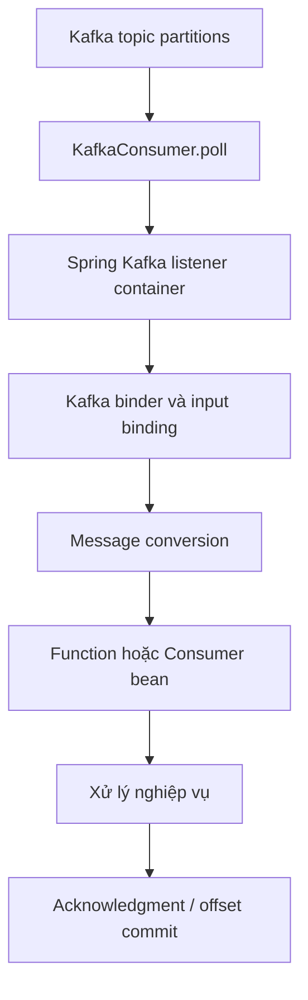
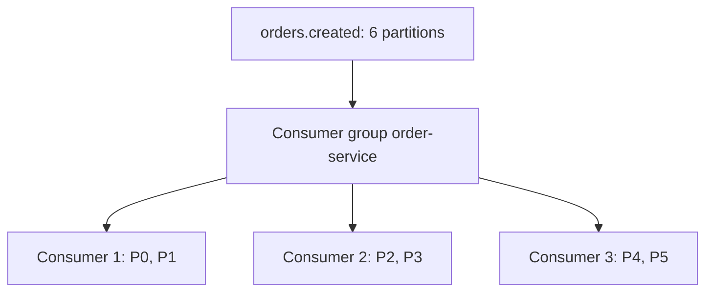

# Luồng poll, listener container và hàm consumer

Khi một ứng dụng Spring Cloud Stream nhận sự kiện từ Kafka, code nghiệp vụ thường chỉ cần khai báo một bean `Consumer<T>` hoặc `Function<T, R>`. Phía dưới, Kafka consumer vẫn phải liên tục gọi `poll()` để lấy record từ broker, quản lý heartbeat, tham gia consumer group, xử lý rebalance và xác nhận offset. Spring Kafka listener container cùng Kafka binder đảm nhiệm vòng đời kỹ thuật đó rồi chuyển record thành message để hàm của ứng dụng xử lý.

Vì vậy, cần phân biệt ba lớp: **Kafka poll loop** là cơ chế giao tiếp cấp thấp với broker; **listener container** quản lý poll loop và gọi listener; **hàm consumer** là điểm vào xử lý nghiệp vụ trong mô hình hàm của Spring Cloud Stream. Trong ứng dụng dùng binder, thông thường không tự viết vòng `KafkaConsumer.poll()` và cũng không cần tự quản lý listener thread.

## 1. Ba lớp trong quá trình nhận message

| Lớp | Trách nhiệm | Thành phần thường gặp |
| --- | --- | --- |
| Kafka consumer | Gửi lệnh poll, nhận record, gửi heartbeat, tham gia group và làm việc với offset | `KafkaConsumer` của Kafka client |
| Listener container | Tạo và quản lý consumer, chạy poll loop, dispatch record, xử lý lỗi và commit/acknowledgment | Spring Kafka `KafkaMessageListenerContainer` hoặc `ConcurrentMessageListenerContainer` |
| Hàm consumer | Xử lý payload và metadata theo nghiệp vụ | Bean `Consumer<OrderCreated>` hoặc `Function<OrderCreated, ...>` |

Kafka binder của Spring Cloud Stream tích hợp với Spring Kafka và tạo listener container cho input binding. Container nhận record rồi chuyển chúng vào hạ tầng message của Spring Cloud Stream. Framework chọn hàm theo `spring.cloud.function.definition`, chuyển đổi payload và gọi hàm tương ứng.



Sơ đồ thể hiện luồng khái niệm. Thời điểm commit offset và cơ chế xác nhận cụ thể phụ thuộc cấu hình container, binder và transaction; không phải mọi ứng dụng đều commit ngay sau khi hàm trả về.

## 2. Kafka poll loop hoạt động như thế nào?

Kafka consumer không nhận message bằng cách broker tự gọi một phương thức Java của ứng dụng. Consumer chủ động gửi yêu cầu `poll()` tới broker. Lệnh poll lấy các record sẵn có từ những partition đang được gán cho consumer, đồng thời tham gia vào giao thức quản lý thành viên group.

Một vòng đời đơn giản:

1. Consumer khởi tạo với cấu hình broker, group ID, deserializer và các thuộc tính liên quan.
2. Consumer đăng ký topic hoặc pattern cần đọc.
3. Consumer tham gia group và nhận assignment các partition.
4. Vòng poll lấy record từ các partition được gán.
5. Listener container chuyển record cho listener và theo dõi kết quả xử lý.
6. Offset được xác nhận theo chế độ commit/acknowledgment.
7. Consumer tiếp tục poll, xử lý rebalance hoặc dừng khi container shutdown.

`poll(Duration)` có thể chờ tối đa khoảng thời gian được truyền vào khi không có dữ liệu, nhưng consumer còn chịu ảnh hưởng của cấu hình như `max.poll.records`, `max.poll.interval.ms`, `session.timeout.ms` và `heartbeat.interval.ms`.

### Vì sao ứng dụng không nên tự gọi poll khi đã dùng binder?

Nếu tự tạo `KafkaConsumer` và gọi `poll()` song song với listener container của binder, ứng dụng sẽ có hai cơ chế đọc độc lập. Chúng có thể dùng group ID, offset, assignment và acknowledgment khác nhau. Điều này làm khó kiểm soát số consumer, dễ tạo cạnh tranh hoặc đọc trùng, đồng thời bỏ qua nhiều cơ chế tích hợp của Spring Cloud Stream.

Hãy dùng `Consumer<T>` cho xử lý message-driven thông thường. Chỉ dùng Kafka client trực tiếp khi có yêu cầu đặc biệt mà abstraction của binder không đáp ứng, và khi đó cần tự chịu trách nhiệm đầy đủ về consumer lifecycle, poll loop, rebalance, commit, error handling và shutdown.

## 3. Listener container quản lý poll loop

Spring Kafka listener container tạo và quản lý Kafka consumer. Container điều phối vòng poll, chuyển record tới listener, áp dụng acknowledgment mode, xử lý exception và dừng consumer đúng cách khi ứng dụng shutdown.

Hai loại container thường được nhắc đến:

- `KafkaMessageListenerContainer`: quản lý một consumer và chạy listener trên một thread consumer.
- `ConcurrentMessageListenerContainer`: quản lý nhiều child listener container để tăng concurrency. Mỗi child container có consumer riêng.

Kafka binder của Spring Cloud Stream dùng hạ tầng listener container này. Khi cấu hình concurrency cho binding, binder/container có thể tạo nhiều consumer member trong cùng group để đọc song song.

### Container và thread xử lý

Trong mô hình listener thông thường, listener được gọi trên luồng consumer do container quản lý. Nếu hàm consumer thực hiện xử lý đồng bộ lâu, thời gian trước lần poll tiếp theo có thể tăng. Điều này liên quan trực tiếp tới `max.poll.interval.ms` và khả năng consumer tiếp tục giữ assignment.

Không nên mặc định rằng Spring Cloud Stream tự chuyển mọi hàm consumer sang một thread pool riêng. Nếu cần xử lý bất đồng bộ, hãy thiết kế rõ ràng ranh giới giữa nhận message, xác nhận offset và hoàn tất side effect; chuyển xử lý sang executor mà không quản lý acknowledgment có thể làm message được commit trước khi công việc thực sự hoàn tất.

## 4. Hàm Consumer trong Spring Cloud Stream

Với mô hình hàm, khai báo một bean `Consumer<T>`. Spring Cloud Stream chọn hàm bằng `spring.cloud.function.definition` và tạo input binding theo quy ước `<function>-in-0`.

```java
import java.util.function.Consumer;

import org.springframework.context.annotation.Bean;
import org.springframework.context.annotation.Configuration;

public record OrderCreated(
        String orderId,
        String customerId,
        long totalCents
) {}

@Configuration
public class OrderConsumers {

    @Bean
    public Consumer<OrderCreated> processOrder() {
        return event -> {
            System.out.printf("Processing order %s for customer %s%n",
                    event.orderId(), event.customerId());
            // Thực hiện nghiệp vụ của ứng dụng.
        };
    }
}
```

Cấu hình:

```yaml
spring:
  cloud:
    function:
      definition: processOrder
    stream:
      bindings:
        processOrder-in-0:
          destination: orders.created
          group: order-service
          content-type: application/json
      kafka:
        bindings:
          processOrder-in-0:
            consumer:
              configuration:
                max.poll.records: 100
                max.poll.interval.ms: 300000
```

Trong ví dụ, Kafka binder tạo input binding tới topic `orders.created`. `group` xác định consumer group. `content-type` hướng dẫn chuyển đổi payload JSON thành `OrderCreated`. Cấu hình `configuration` truyền các thuộc tính Kafka consumer vào client cho binding này.

Hàm `processOrder` chỉ tập trung vào payload nghiệp vụ. Nó không cần biết record đến từ partition nào, container đang chạy thread nào hoặc lệnh poll tiếp theo diễn ra lúc nào, trừ khi nghiệp vụ thực sự cần metadata đó.

## 5. Consumer nhận Message<T> khi cần metadata

Nếu cần đọc header hoặc thông tin gắn với message, khai báo tham số là `Message<T>`:

```java
import java.util.function.Consumer;

import org.springframework.context.annotation.Bean;
import org.springframework.messaging.Message;

@Bean
public Consumer<Message<OrderCreated>> auditOrder() {
    return message -> {
        OrderCreated event = message.getPayload();
        Object correlationId = message.getHeaders().get("correlationId");

        System.out.printf("Order %s, correlation %s%n",
                event.orderId(), correlationId);
    };
}
```

`Message<T>` cho phép truy cập payload và headers. Với Kafka binder, các header broker như topic, partition, offset, key hoặc timestamp có thể được ánh xạ vào message headers theo quy ước của binder. Tên header cụ thể và kiểu dữ liệu cần được kiểm tra theo phiên bản Spring Cloud Stream Kafka binder đang dùng.

Chỉ nhận `Message<T>` khi cần metadata. Nếu hàm chỉ xử lý payload, `Consumer<OrderCreated>` ngắn gọn hơn và làm rõ hợp đồng nghiệp vụ.

## 6. Consumer group và partition assignment

Kafka phân phối partition cho consumer trong cùng group. Một partition tại một thời điểm chỉ được gán cho tối đa một consumer member trong group. Một consumer có thể nhận nhiều partition; nếu số consumer lớn hơn số partition, một số consumer sẽ không có partition để đọc.

Ví dụ topic có 6 partition:



Nếu binding có concurrency 3 và topic có ít nhất 3 partition, container có thể tạo ba consumer để xử lý song song. Nếu topic chỉ có hai partition, concurrency 3 không tạo ra ba consumer cùng đọc partition của topic trong group; consumer dư không được assignment.

Group ID phải ổn định giữa các replica cần chia sẻ công việc. Nếu mỗi replica dùng group ID khác nhau, mỗi group có thể đọc độc lập toàn bộ topic thay vì chia sẻ partition assignment.

## 7. Cấu hình concurrency cho listener container

Có thể cấu hình concurrency ở cấp consumer binding:

```yaml
spring:
  cloud:
    stream:
      bindings:
        processOrder-in-0:
          destination: orders.created
          group: order-service
          consumer:
            concurrency: 3
```

Với Kafka binder, concurrency được dùng để tạo số consumer/listener worker theo cấu hình binding. Tổng số consumer trong group còn phụ thuộc số replica ứng dụng. Ví dụ concurrency 3 trên mỗi 2 replica có thể tạo tổng cộng 6 consumer member trong cùng group.

Chọn concurrency dựa trên số partition, thời gian xử lý, năng lực database/API và tài nguyên CPU. Tăng concurrency quá cao có thể làm downstream quá tải hoặc tạo rebalance thường xuyên mà không tăng throughput.

## 8. Poll-related Kafka consumer properties

Một số thuộc tính Kafka consumer ảnh hưởng trực tiếp đến vòng poll:

| Thuộc tính | Ý nghĩa | Khi điều chỉnh |
| --- | --- | --- |
| `max.poll.records` | Số record tối đa trả về trong một lần poll | Giảm batch nếu mỗi record xử lý lâu; tăng khi xử lý nhanh và muốn giảm số lần poll |
| `max.poll.interval.ms` | Khoảng thời gian tối đa giữa các lần gọi poll trước khi consumer bị xem là không tiến triển | Tăng khi xử lý batch lâu, nhưng ưu tiên giảm thời gian xử lý và kiểm soát batch |
| `session.timeout.ms` | Thời gian broker chờ heartbeat trước khi xem consumer mất kết nối | Điều chỉnh theo độ ổn định mạng và yêu cầu phát hiện lỗi |
| `heartbeat.interval.ms` | Chu kỳ gửi heartbeat khi consumer group dùng cơ chế heartbeat tương ứng | Thường cần nhỏ hơn `session.timeout.ms` theo giới hạn Kafka |
| `fetch.min.bytes` | Lượng dữ liệu tối thiểu broker cố gắng gom trước khi trả fetch | Tăng có thể cải thiện throughput nhưng làm tăng latency |
| `fetch.max.wait.ms` | Thời gian tối đa broker chờ gom đủ dữ liệu theo `fetch.min.bytes` | Cân bằng throughput và độ trễ |

Ví dụ cấu hình binding-specific:

```yaml
spring:
  cloud:
    stream:
      kafka:
        bindings:
          processOrder-in-0:
            consumer:
              configuration:
                max.poll.records: 50
                max.poll.interval.ms: 240000
                session.timeout.ms: 15000
                heartbeat.interval.ms: 5000
```

Các giá trị trên chỉ minh họa. Kafka client kiểm tra ràng buộc giữa timeout, heartbeat và các thuộc tính khác; broker cũng có giới hạn riêng. Không tăng `max.poll.interval.ms` để che giấu một consumer bị treo vô thời hạn. Hãy đo thời gian xử lý thực tế và xử lý các lời gọi I/O bị chậm.

## 9. Vì sao max.poll.interval.ms quan trọng?

Kafka yêu cầu consumer tiếp tục gọi `poll()` trong giới hạn `max.poll.interval.ms`. Nếu một lần xử lý quá lâu khiến container không thể poll tiếp trước thời hạn, consumer có thể rời group và partition được phân công lại cho consumer khác.

Ví dụ:

- `max.poll.records = 100`.
- Mỗi record xử lý trung bình 4 giây.
- Một batch có thể cần khoảng 400 giây nếu xử lý tuần tự.
- Nếu `max.poll.interval.ms` chỉ là 300 giây, batch có thể vượt thời hạn và kích hoạt rebalance.

Đây là phép ước lượng đơn giản; thời gian thực tế còn phụ thuộc fetch, serialization, thời gian chờ I/O, concurrency và cách container xử lý batch. Có thể giảm `max.poll.records`, tối ưu handler, chia nhỏ batch hoặc điều chỉnh timeout sau khi đo kiểm.

Không nên chuyển công việc sang thread khác rồi trả về listener ngay nếu offset được xác nhận trước khi công việc hoàn tất. Khi consumer rebalance hoặc ứng dụng dừng, side effect có thể chưa hoàn thành nhưng Kafka đã coi record là đã xử lý.

## 10. Offset commit và acknowledgment

Kafka lưu vị trí đọc của từng consumer group bằng offset. Khi record đã được xử lý theo chính sách của container, offset được commit để group có thể tiếp tục từ vị trí phù hợp sau restart.

Spring Kafka cung cấp nhiều acknowledgment mode như `RECORD`, `BATCH`, `TIME`, `COUNT`, `COUNT_TIME`, `MANUAL` và `MANUAL_IMMEDIATE`. Kafka binder cho phép cấu hình acknowledgment mode theo binding trong các phiên bản hỗ trợ. Ý nghĩa tổng quát:

- `RECORD`: xác nhận sau khi từng record listener xử lý xong.
- `BATCH`: xác nhận offset của các record đã xử lý trong một poll batch.
- `TIME` hoặc `COUNT`: xác nhận theo ngưỡng thời gian hoặc số record.
- `MANUAL`: ứng dụng chủ động gọi acknowledgment; commit có thể được container thực hiện theo cơ chế batch.
- `MANUAL_IMMEDIATE`: yêu cầu commit ngay khi acknowledgment được gọi trên consumer thread, theo semantics của container.

Ví dụ cấu hình minh họa:

```yaml
spring:
  cloud:
    stream:
      kafka:
        bindings:
          processOrder-in-0:
            consumer:
              ackMode: RECORD
```

Hãy xác minh thuộc tính và giá trị được hỗ trợ bởi phiên bản binder đang dùng. Tránh đồng thời bật Kafka auto-commit theo cách xung đột với cơ chế commit do listener container quản lý. Với xử lý nghiệp vụ thông thường, để binder/container quản lý acknowledgment theo mặc định thường đơn giản hơn; chỉ chuyển sang manual khi có lý do rõ và đã kiểm thử redelivery.

Offset commit không có nghĩa side effect ở hệ thống ngoài đã được thực hiện nguyên tử với Kafka. Nếu consumer ghi database rồi commit offset, crash giữa hai thao tác vẫn có thể gây xử lý lặp. Consumer cần idempotency hoặc transaction strategy phù hợp.

## 11. Xử lý lỗi trong hàm consumer

Nếu hàm consumer ném exception, Spring Cloud Stream và Kafka binder có thể áp dụng retry và error handling theo cấu hình. Một số thuộc tính chung nằm ở consumer binding:

```yaml
spring:
  cloud:
    stream:
      bindings:
        processOrder-in-0:
          consumer:
            max-attempts: 3
            back-off-initial-interval: 1000
            back-off-max-interval: 10000
            back-off-multiplier: 2.0
```

Các giá trị minh họa cấu hình retry của Spring Cloud Stream. Sau khi hết retry, message có thể được chuyển tới error channel hoặc dead-letter destination nếu bật và cấu hình phù hợp. Với Kafka binder, DLQ thường cần bật riêng theo binding và phải có topic DLQ cùng quyền ghi.

Không phải mọi exception đều nên retry giống nhau. Lỗi mạng tạm thời có thể retry; lỗi schema hoặc dữ liệu không hợp lệ có thể cần DLQ để điều tra. Retry vô hạn có thể chặn tiến độ partition và làm consumer lag tăng.

## 12. Batch listener và xử lý từng record

Mặc định, nhiều ứng dụng Spring Cloud Stream xử lý từng message qua `Consumer<T>`. Kafka binder cũng hỗ trợ batch consumption trong các cấu hình tương ứng, khi đó listener nhận một batch thay vì từng record riêng lẻ.

Batch processing có thể giảm overhead khi xử lý nhiều record, nhưng thay đổi hợp đồng hàm và cách xử lý lỗi. Nếu một phần tử trong batch lỗi, cần xác định phần nào được xác nhận, phần nào được retry hoặc chuyển DLQ. Không nên bật batch mode chỉ vì muốn tăng throughput mà chưa kiểm tra semantics acknowledgment.

Với xử lý từng record, handler thường dễ cô lập lỗi và áp dụng idempotency theo event ID. Với batch, cần thiết kế kết quả xử lý theo từng record hoặc chính sách rollback/retry cho toàn batch phù hợp với container.

## 13. Rebalance và vòng đời listener container

Consumer group có thể rebalance khi:

- Một instance mới tham gia group.
- Một instance dừng hoặc mất kết nối.
- Partition topic được thêm hoặc metadata thay đổi.
- Consumer không poll kịp thời hạn.
- Subscription pattern thay đổi hoặc group membership thay đổi.

Trong rebalance, partition assignment có thể chuyển từ consumer này sang consumer khác. Listener container phối hợp việc dừng nhận dữ liệu từ partition bị thu hồi và xử lý callback/lifecycle theo cơ chế Spring Kafka.

Ứng dụng cần:

1. Hoàn tất hoặc xử lý an toàn message đang chạy trước khi partition bị thu hồi.
2. Không lưu state chỉ trong bộ nhớ consumer nếu state cần tồn tại qua rebalance.
3. Làm handler idempotent vì record có thể được giao lại.
4. Theo dõi rebalance count, thời gian rebalance, consumer lag và số lần poll timeout.
5. Dùng graceful shutdown để container có cơ hội dừng consumer và commit theo cấu hình.

## 14. Phân biệt Spring Cloud Stream Consumer với @KafkaListener

Spring Cloud Stream và Spring Kafka đều có thể nhận message từ Kafka nhưng có abstraction khác nhau:

| Cách tiếp cận | Điểm vào | Quản lý binding |
| --- | --- | --- |
| Spring Cloud Stream functional | Bean `Consumer<T>` hoặc `Function<T, R>` | Spring Cloud Stream binder tạo binding từ function definition và binding properties |
| Spring Kafka annotation | Phương thức `@KafkaListener` | Spring Kafka listener container được cấu hình qua annotation và `KafkaListenerContainerFactory` |
| Kafka client trực tiếp | Vòng lặp `KafkaConsumer.poll()` | Ứng dụng tự quản lý consumer và toàn bộ lifecycle |

Trong module này, mô hình chính là Spring Cloud Stream functional consumer. Không cần thêm `@KafkaListener` cho cùng một luồng nếu đã dùng input binding của binder, trừ khi có kiến trúc rõ ràng cho hai listener độc lập. Nếu cùng đọc một topic bằng hai consumer group khác nhau, cả hai có thể nhận bản sao độc lập; cần chủ động thiết kế để tránh side effect trùng.

## 15. Kiểm thử hàm consumer và listener behavior

Unit test nên kiểm tra logic nghiệp vụ độc lập với Kafka:

```java
import static org.mockito.Mockito.verify;

import java.util.function.Consumer;

import org.junit.jupiter.api.Test;
import org.mockito.Mockito;

interface OrderService {
    void process(OrderCreated event);
}

class OrderConsumersTest {

    @Test
    void processesOrderEvent() {
        OrderService orderService = Mockito.mock(OrderService.class);
        Consumer<OrderCreated> consumer = event -> orderService.process(event);

        OrderCreated event = new OrderCreated("ORD-1", "CUS-1", 12500);
        consumer.accept(event);

        verify(orderService).process(event);
    }
}
```

Trong ứng dụng thật, bean consumer nên inject service nghiệp vụ thay vì tự tạo dependency bên trong lambda. Unit test tập trung xác minh payload được chuyển tới service đúng.

Spring Cloud Stream Test Binder có thể kiểm tra binding và hàm consumer mà không cần Kafka thật. Tuy nhiên, test binder không mô phỏng đầy đủ partition assignment, group rebalance, Kafka offset commit, broker retention hoặc network failure.

Integration test với Kafka (ví dụ Testcontainers) nên kiểm tra:

- Binding đọc đúng topic và group.
- Nhiều instance cùng group chia sẻ partition.
- Hai group khác nhau nhận luồng độc lập.
- Offset và redelivery khi handler lỗi hoặc ứng dụng restart.
- Rebalance khi thêm hoặc dừng consumer.
- DLQ và retry khi bật cấu hình tương ứng.
- Hành vi khi handler chậm hơn `max.poll.interval.ms`.

## 16. Quan sát consumer trong production

Các chỉ số cần theo dõi:

- Consumer lag theo group và partition.
- Số record poll được và số record xử lý thành công.
- Thời gian xử lý mỗi record hoặc mỗi batch.
- Số lần rebalance và thời gian hoàn tất rebalance.
- Số lần retry, exception, DLQ và redelivery.
- Tỷ lệ commit offset và lỗi commit.
- Số consumer member so với số partition.
- Thời gian poll và dấu hiệu vượt `max.poll.interval.ms`.

Khi lag tăng, không nên chỉ tăng concurrency. Hãy xác định producer rate, consumer processing rate, partition assignment và bottleneck downstream. Nếu số partition nhỏ hơn số consumer, tăng replica có thể không tăng khả năng đọc song song. Nếu handler chậm, tối ưu I/O hoặc giảm batch size có thể hiệu quả hơn tăng timeout.

## 17. Quy trình chọn cấu hình

Khi triển khai một Kafka consumer bằng Spring Cloud Stream:

1. Chọn bean `Consumer<T>` hoặc `Function<T, R>` và đặt tên rõ ràng.
2. Khai báo `spring.cloud.function.definition` để chọn hàm.
3. Khai báo input binding `<function>-in-0`, topic và group ổn định.
4. Chọn content type và kiểu payload phù hợp schema.
5. Đặt concurrency dựa trên partition count và năng lực xử lý.
6. Đo thời gian xử lý để chọn `max.poll.records` và `max.poll.interval.ms`.
7. Chọn acknowledgment/commit semantics phù hợp với yêu cầu giao nhận.
8. Thiết kế retry, error handling, DLQ và idempotency.
9. Kiểm thử rebalance, restart, handler chậm và lỗi broker.
10. Theo dõi lag, poll, commit, rebalance và processing latency trong production.

## Tài liệu tham khảo

- [Spring Cloud Stream — Kafka Binder](https://docs.spring.io/spring-cloud-stream/reference/kafka/kafka-binder/index.html)
- [Spring Cloud Stream — Functional Binding Names](https://docs.spring.io/spring-cloud-stream/reference/spring-cloud-stream/functional-binding-names.html)
- [Spring Kafka — Message Listener Containers](https://docs.spring.io/spring-kafka/reference/kafka/receiving-messages/message-listener-container.html)
- [Apache Kafka — Consumer Configs](https://kafka.apache.org/documentation/#consumerconfigs)

Hãy đối chiếu tài liệu của release train và phiên bản Kafka client mà dự án đang sử dụng, vì tên thuộc tính binder, mặc định acknowledgment và hành vi container có thể thay đổi theo phiên bản.

## Kết luận

Kafka consumer poll loop là cơ chế cấp thấp để lấy record và duy trì group membership. Spring Kafka listener container quản lý consumer, poll, dispatch, rebalance và offset; Kafka binder kết nối container với input binding của Spring Cloud Stream. Hàm `Consumer<T>` là điểm vào nghiệp vụ, chỉ cần xử lý payload và metadata cần thiết. Khi vận hành, cần hiểu mối liên hệ giữa concurrency, partition, `max.poll.records`, `max.poll.interval.ms`, acknowledgment, retry và idempotency để tránh rebalance không mong muốn, xử lý lặp hoặc consumer lag kéo dài.
