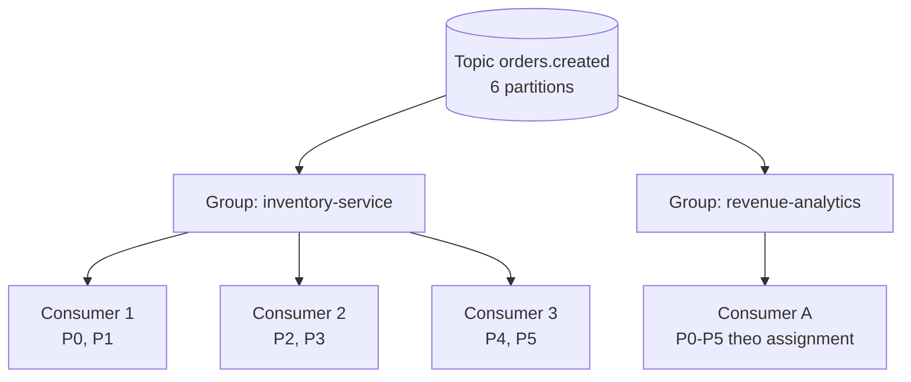
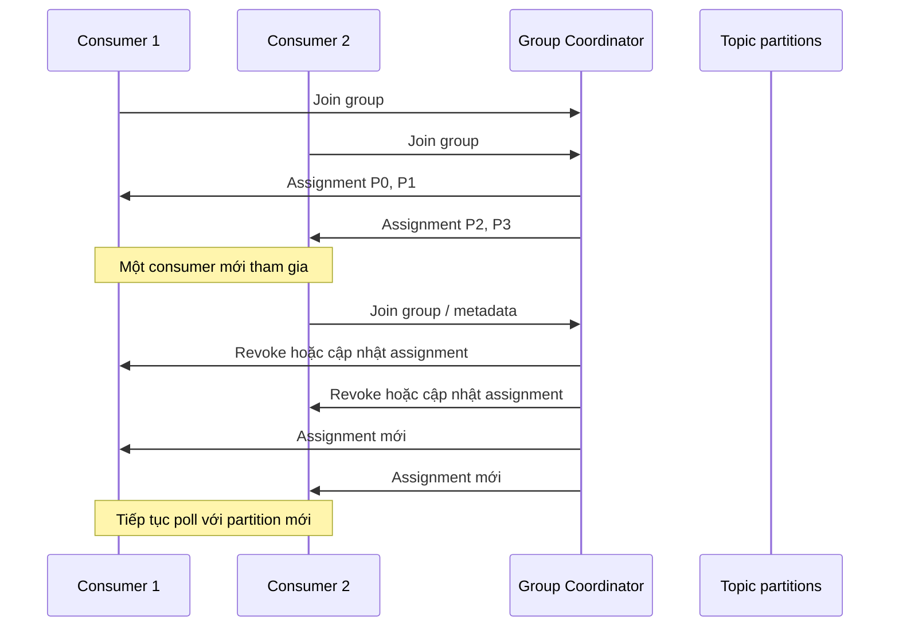

# Consumer group, phân công partition và tái cân bằng

## Mục tiêu

Kafka cho phép một topic được chia thành nhiều partition để lưu trữ và xử lý song song. Khi một ứng dụng có nhiều instance cùng đọc topic, Kafka cần quyết định consumer nào nhận partition nào. **Consumer group** là cơ chế phối hợp các consumer để chia sẻ việc đọc một tập partition, còn **partition assignment** là quá trình phân công partition cho từng consumer trong group. Khi thành viên hoặc topology thay đổi, Kafka thực hiện **rebalance** để tạo assignment mới.

Trong Spring Cloud Stream, ứng dụng thường khai báo `group` ở input binding. Kafka binder chuyển cấu hình này thành danh tính consumer group của Kafka và quản lý consumer/container theo binding. Hiểu mối quan hệ giữa group, partition, concurrency và rebalance giúp thiết kế khả năng mở rộng, tránh consumer không được gán việc, giảm gián đoạn khi deploy và xử lý đúng các tình huống message có thể được đọc lại.

Sau bài học, bạn có thể:

- Giải thích vai trò của consumer group và group ID.
- Phân biệt nhiều instance cùng group với nhiều logical subscriber khác group.
- Tính giới hạn concurrency theo số partition.
- Hiểu các chiến lược phân công partition phổ biến.
- Nhận diện nguyên nhân và vòng đời của một lần rebalance.
- Điều chỉnh polling, timeout và xử lý message để giảm rebalance ngoài ý muốn.
- Kiểm thử assignment, offset, lag và khả năng phục hồi khi consumer thay đổi.

## 1. Consumer group là gì?

Consumer group là tập hợp các consumer cùng phối hợp đọc một topic hoặc tập topic. Các consumer trong cùng group chia sẻ partition; một partition tại một thời điểm được gán cho tối đa một consumer trong group. Mỗi group có tiến độ đọc riêng được lưu bằng offset theo từng partition.

Giả sử topic `orders.created` có sáu partition. Dịch vụ tồn kho chạy ba instance cùng dùng group `inventory-service`. Kafka phân chia sáu partition giữa các consumer của nhóm. Nếu dịch vụ phân tích doanh thu cũng cần đọc toàn bộ sự kiện, nó dùng group riêng `revenue-analytics`; group này có assignment và offset độc lập, nên cũng đọc được toàn bộ topic.



Hai quy tắc nền tảng:

- **Cùng group:** các consumer cạnh tranh/chia sẻ việc đọc partition. Một partition không được giao đồng thời cho hai consumer trong cùng group.
- **Khác group:** mỗi group đọc topic độc lập và có offset riêng. Mỗi logical subscriber có thể nhận toàn bộ luồng.

Consumer group không phải tên của một pod, máy chủ hoặc function bean. Nó đại diện cho một logical subscriber. Các replica của cùng một dịch vụ thường phải dùng chung group name; các dịch vụ cần nhận độc lập phải dùng group name khác.

## 2. Khai báo group trong Spring Cloud Stream

Trong mô hình hàm, input binding được suy ra từ tên function và vị trí đầu vào. Ví dụ function `processOrders` có binding `processOrders-in-0`:

```java
@Bean
Consumer<OrderCreated> processOrders(OrderService service) {
    return event -> service.handle(event);
}
```

Cấu hình binding:

```yaml
spring:
  cloud:
    function:
      definition: processOrders
    stream:
      bindings:
        processOrders-in-0:
          destination: orders.created
          group: inventory-service
          content-type: application/json
```

Kafka binder dùng giá trị `group` để xác định consumer group của binding. Ở cấp Kafka client, danh tính đó tương ứng với `group.id`. Binder quản lý group ID theo cấu hình binding; thông thường không nên tự đặt một `group.id` khác trong client properties vì có thể xung đột với cơ chế quản lý group của binder.

Khi triển khai ba replica của `inventory-service`, cả ba phải dùng cùng destination và cùng group:

```text
inventory-service instance 1 -> group inventory-service
inventory-service instance 2 -> group inventory-service
inventory-service instance 3 -> group inventory-service
```

Nếu mỗi instance dùng group name riêng, Kafka xem chúng là ba logical subscriber độc lập. Mỗi group có thể đọc toàn bộ partition, dẫn đến mỗi đơn hàng được xử lý ba lần ở cấp dịch vụ.

### Named group và anonymous group

Với consumer nghiệp vụ production, nên khai báo group name ổn định. Nếu bỏ thuộc tính `group`, Spring Cloud Stream/Kafka binder tạo danh tính anonymous theo cơ chế của framework. Danh tính này thường không thích hợp cho một consumer cần giữ tiến độ lâu dài qua các lần restart, vì group mới có thể không có committed offset của group trước.

Ví dụ consumer không khai báo group:

```yaml
spring:
  cloud:
    stream:
      bindings:
        observeOrders-in-0:
          destination: orders.created
```

Cấu hình anonymous có thể hữu ích cho quan sát hoặc thử nghiệm độc lập. Với dịch vụ tồn kho, thanh toán hoặc các luồng cần tiếp tục từ tiến độ đã commit, hãy đặt group name rõ ràng và giữ ổn định giữa các lần triển khai.

## 3. Partition được gán cho consumer như thế nào?

Kafka lưu mỗi record trong một partition. Consumer group coordinator phối hợp các thành viên và sử dụng partition assignor để quyết định partition nào thuộc consumer nào. Kết quả được gọi là assignment.

Ví dụ topic có sáu partition `P0...P5` và group có ba consumer. Một assignment cân bằng có thể là:

| Consumer trong group | Partition được gán |
|---|---|
| Consumer 1 | P0, P1 |
| Consumer 2 | P2, P3 |
| Consumer 3 | P4, P5 |

Đây chỉ là một ví dụ; assignment thực tế phụ thuộc partition assignor, số topic/partition, thành viên, subscription và metadata group.

Một partition trong cùng group chỉ có một consumer owner tại một thời điểm. Vì vậy, consumer có thể đọc nhiều partition, nhưng hai consumer trong cùng group không cùng đọc một partition theo assignment bình thường. Các group khác nhau vẫn có thể đọc cùng partition độc lập.

### Số consumer hoạt động bị giới hạn bởi số partition

Nếu topic có sáu partition:

- Một consumer có thể nhận cả sáu partition.
- Ba consumer có thể nhận khoảng hai partition mỗi consumer.
- Sáu consumer có thể nhận mỗi consumer một partition.
- Mười consumer trong cùng group sẽ có ít nhất bốn consumer không được gán partition khi topology chỉ có sáu partition.

Do đó, tăng số replica vượt số partition không tự động tăng mức song song đọc của group. Nếu cần nhiều consumer hoạt động hơn, phải xem xét tăng partition hoặc thay đổi kiến trúc xử lý; việc tăng partition có tác động đến key mapping và ordering nên cần kế hoạch riêng.

## 4. Phân biệt replica, concurrency và partition count

Trong Spring Cloud Stream Kafka binder, một ứng dụng có thể chạy nhiều replica; mỗi replica có thể tạo nhiều consumer theo cấu hình concurrency. Tổng số consumer member trong group có thể được ước lượng:

`Tổng consumer ≈ số replica × concurrency mỗi replica`

Ví dụ:

- 3 replica của dịch vụ.
- `concurrency: 2` trên input binding.
- Tổng cộng khoảng 6 consumer member tham gia group.

Cấu hình:

```yaml
spring:
  cloud:
    stream:
      bindings:
        processOrders-in-0:
          destination: orders.created
          group: inventory-service
          consumer:
            concurrency: 2
```

Nếu topic có sáu partition, sáu consumer có thể nhận mỗi consumer một partition trong assignment cân bằng. Nếu topic chỉ có ba partition, tối đa ba consumer được gán partition; các consumer còn lại ở trạng thái rảnh đối với binding đó.

| Số replica | Concurrency mỗi replica | Tổng consumer dự kiến | Partition | Khả năng sử dụng |
|---:|---:|---:|---:|---|
| 1 | 1 | 1 | 6 | Một consumer đọc cả sáu partition |
| 3 | 1 | 3 | 6 | Ba consumer chia partition |
| 3 | 2 | 6 | 6 | Có thể dùng cả sáu consumer |
| 4 | 2 | 8 | 6 | Ít nhất hai consumer không có partition |
| 2 | 2 | 4 | 12 | Bốn consumer hoạt động, còn khả năng scale |

Bảng giả định tất cả consumer subscribe cùng tập topic và không có ràng buộc assignment khác. Concurrency thực tế còn phụ thuộc cấu hình container, binder version và giới hạn tài nguyên.

Không nhầm `concurrency` với số partition. Concurrency tạo thêm consumer/thread trong ứng dụng; nó không tự tạo partition trên broker. Topic phải được provision với số partition phù hợp nếu muốn tận dụng concurrency.

## 5. Các chiến lược partition assignment phổ biến

Kafka hỗ trợ nhiều partition assignor. Chúng khác nhau về cách cân bằng partition và mức độ di chuyển assignment khi group thay đổi.

### RangeAssignor

Range assignor phân chia partition theo từng topic và gán các dải partition liên tiếp cho consumer. Khi có nhiều topic, việc chia theo từng topic có thể tạo phân bố hơi lệch giữa các consumer.

Ví dụ với một topic sáu partition và ba consumer, kết quả có thể là mỗi consumer hai partition. Với nhiều topic có số partition không chia hết cho số consumer, một số consumer có thể nhận nhiều partition hơn.

### RoundRobinAssignor

Round-robin assignor phân phối các partition của các topic được subscribe lần lượt qua các consumer đủ điều kiện. Nó có thể cân bằng tốt hơn khi group subscribe nhiều topic với topology khác nhau, nhưng assignment còn phụ thuộc subscription của từng consumer.

### StickyAssignor

Sticky assignor cố gắng tạo assignment cân bằng đồng thời giữ lại nhiều partition đã gán trước đó. Khi group thay đổi, nó cố giảm số partition phải chuyển giữa các consumer, nhờ đó giảm chi phí khởi tạo lại công việc.

### CooperativeStickyAssignor

Cooperative sticky sử dụng cơ chế rebalance hợp tác, cho phép thu hồi partition theo từng phần thay vì buộc tất cả consumer thu hồi toàn bộ assignment cùng lúc. Điều này có thể giảm thời gian dừng xử lý khi rebalance. Tất cả consumer trong group cần dùng assignor/protocol tương thích; quá trình chuyển đổi từ eager assignor cần tuân theo hướng dẫn migration của Kafka client.

Có thể cấu hình assignor qua Kafka binder consumer configuration:

```yaml
spring:
  cloud:
    stream:
      bindings:
        processOrders-in-0:
          destination: orders.created
          group: inventory-service
      kafka:
        bindings:
          processOrders-in-0:
            consumer:
              configuration:
                partition.assignment.strategy: org.apache.kafka.clients.consumer.CooperativeStickyAssignor
```

Tên class và khả năng sử dụng phụ thuộc phiên bản Kafka client. Trước khi đổi assignor, kiểm tra tương thích giữa tất cả thành viên trong group và kế hoạch rolling deployment. Không trộn tùy tiện các cấu hình assignor không tương thích.

### Chọn assignor theo nhu cầu

| Chiến lược | Đặc điểm | Khi cân nhắc |
|---|---|---|
| Range | Chia dải partition theo từng topic | Topology đơn giản, dễ dự đoán |
| RoundRobin | Phân phối luân phiên qua consumer | Group subscribe nhiều topic và cần phân bố đều |
| Sticky | Cân bằng và hạn chế di chuyển partition | Muốn giảm công việc chuyển assignment |
| CooperativeSticky | Sticky với thu hồi partition từng phần | Muốn giảm gián đoạn rebalance và client hỗ trợ |

Không có assignor nào tự giải quyết hot partition. Nếu một partition nhận phần lớn traffic vì key phân bố lệch, cần xem lại partition key, dữ liệu và số partition.

## 6. Rebalance là gì?

Rebalance là quá trình Kafka phân công lại partition cho các consumer trong một group. Nó xảy ra khi membership hoặc topology của group thay đổi, hoặc khi consumer không còn đáp ứng điều kiện tham gia group.

Các tình huống thường kích hoạt rebalance:

- Một consumer mới tham gia group.
- Một consumer dừng bình thường và rời group.
- Consumer bị crash hoặc mất kết nối.
- Consumer không gửi heartbeat đúng hạn hoặc bị xem là đã mất.
- Consumer mất quá nhiều thời gian giữa các lần `poll()` và vượt `max.poll.interval.ms`.
- Topic được thêm hoặc xóa partition.
- Subscription của group thay đổi.
- Cấu hình group/assignor hoặc metadata liên quan thay đổi.

Vòng đời khái quát:



Sơ đồ là luồng khái quát. Eager và cooperative rebalance có cách revoke/assign khác nhau; cooperative có thể chuyển partition theo nhiều vòng thay vì thu hồi tất cả ngay lập tức.

### Revoke và assign

Khi rebalance, consumer có thể nhận callback thu hồi partition (revocation) và sau đó nhận partition mới (assignment). Ứng dụng/binder cần xử lý công việc đang dở, lưu trạng thái cần thiết và tránh để side effect chưa commit bị xem là đã hoàn tất.

Với Spring Cloud Stream Kafka binder, container và binder quản lý vòng đời consumer. Nếu cần callback native để lưu/khôi phục trạng thái hoặc quan sát assignment, hãy dùng extension point được phiên bản binder/Spring Kafka hỗ trợ và giữ logic đó ở adapter. Không đưa Kafka consumer API vào domain service.

## 7. Eager và cooperative rebalance

Với eager rebalance, khi group thay đổi, các consumer thường thu hồi toàn bộ partition assignment trước khi nhận assignment mới. Trong khoảng thời gian đó, việc đọc có thể bị gián đoạn. Với workload lớn hoặc stateful processing, việc dừng và khởi động lại nhiều partition có thể tốn kém.

Cooperative rebalance cho phép chuyển assignment theo từng bước. Chỉ partition cần chuyển mới bị thu hồi ở vòng tương ứng; partition không đổi có thể tiếp tục được giữ. Cơ chế này giảm phạm vi gián đoạn, nhưng không loại bỏ mọi pause hoặc mọi rebalance.

Khi sử dụng cooperative assignor:

- Kafka client và các thành viên group cần hỗ trợ cooperative protocol.
- Rolling deployment phải giữ tương thích assignor giữa phiên bản cũ và mới theo migration path của Kafka.
- Consumer vẫn phải xử lý duplicate và commit offset đúng.
- Không giả định mọi partition luôn tiếp tục xử lý xuyên suốt rebalance.

Nếu ứng dụng dùng Kafka Streams, quá trình phân công task và chuyển state store có thêm semantics riêng của Kafka Streams. Không áp dụng nguyên xi mọi chi tiết của plain Kafka consumer group cho Kafka Streams topology.

## 8. Offset, xử lý message và rebalance

Kafka lưu offset đã commit theo group và partition. Offset thể hiện vị trí tiếp theo mà group sẽ đọc trong partition. Consumer thường poll record, xử lý rồi commit tiến độ theo chế độ binder/container.

Một failure window quan trọng:

1. Consumer đọc record offset 100.
2. Ứng dụng cập nhật database thành công.
3. Consumer chưa commit offset 101 thì process bị dừng hoặc bị rebalance.
4. Consumer khác nhận partition và đọc lại offset 100.
5. Side effect database có thể xảy ra lần nữa.

Vì vậy, group và offset không tự tạo exactly-once cho side effect bên ngoài Kafka. Nếu database và Kafka không cùng transaction được quản lý phù hợp, cần thiết kế idempotency bằng event ID, inbox/unique constraint hoặc transaction/outbox tùy chiều dữ liệu.

Ngược lại, nếu commit offset trước khi side effect hoàn tất rồi process lỗi, message có thể bị bỏ qua khi consumer khởi động lại. Thời điểm commit phải phù hợp với bảo đảm giao nhận của ứng dụng và cấu hình acknowledgment của binder.

Spring Cloud Stream Kafka binder quản lý commit/ack theo cấu hình consumer và container. Tránh tự cấu hình `enable.auto.commit` hoặc gọi commit native ngoài cơ chế binder nếu chưa hiểu tương tác; có thể tạo xung đột hoặc làm mất bảo đảm xử lý.

### Rebalance khi có xử lý đang chạy

Nếu consumer bị revoke partition trong khi message đang xử lý:

- Xác định công việc nào đã hoàn tất và có thể commit an toàn.
- Không đánh dấu offset vượt qua message chưa hoàn tất.
- Dừng nhận thêm công việc từ partition bị revoke theo lifecycle container.
- Đảm bảo xử lý dở có thể được retry khi partition được giao cho consumer khác.
- Dùng idempotency để chịu được việc message được đọc lại.

Với xử lý bất đồng bộ, không nên để một consumer poll tiếp quá nhanh trong khi hàng đợi tác vụ nội bộ không giới hạn. Nếu xử lý vượt `max.poll.interval.ms`, Kafka có thể xem member là không còn tiến triển và kích hoạt rebalance.

## 9. Các timeout ảnh hưởng membership

Một số Kafka consumer settings quan trọng:

| Thuộc tính | Vai trò | Tác động khi cấu hình sai |
|---|---|---|
| `session.timeout.ms` | Thời gian coordinator chờ heartbeat trước khi xem consumer mất | Quá thấp có thể gây loại consumer khi mạng chập chờn |
| `heartbeat.interval.ms` | Khoảng thời gian gửi heartbeat theo cơ chế consumer group | Không phù hợp với session timeout có thể làm membership không ổn định |
| `max.poll.interval.ms` | Thời gian tối đa giữa các lần poll trước khi consumer bị xem là không tiến triển | Xử lý lâu có thể khiến consumer rời group và rebalance |
| `max.poll.records` | Giới hạn số record trả về trong một lần poll | Batch quá lớn có thể làm thời gian xử lý vượt poll interval |
| `request.timeout.ms` | Timeout cho request tới broker | Quá thấp có thể gây lỗi request không cần thiết |

Có thể đặt một số Kafka client properties qua Kafka binder:

```yaml
spring:
  cloud:
    stream:
      bindings:
        processOrders-in-0:
          destination: orders.created
          group: inventory-service
          consumer:
            concurrency: 2
      kafka:
        bindings:
          processOrders-in-0:
            consumer:
              configuration:
                max.poll.interval.ms: 300000
                max.poll.records: 100
                session.timeout.ms: 45000
                heartbeat.interval.ms: 15000
```

Các giá trị trên chỉ minh họa. Hãy tính thời gian xử lý worst-case của batch, timeout dependency, thời gian pause và độ trễ mạng để chọn giá trị phù hợp. Không tăng `max.poll.interval.ms` để che giấu một handler bị treo vô hạn; cần timeout và quan sát cho dependency.

Với xử lý lâu, có thể giảm `max.poll.records`, chia nhỏ batch, tăng concurrency theo partition hoặc đưa công việc dài sang pipeline có trạng thái bền vững. Mọi thay đổi cần được kiểm tra cùng ack/commit behavior của binder.

## 10. Giảm rebalance không cần thiết

Một số cách giảm rebalance ngoài ý muốn:

- Giữ group name ổn định giữa các lần triển khai.
- Không tăng/giảm replica liên tục do autoscaling threshold quá nhạy.
- Xử lý message trong giới hạn thời gian phù hợp với poll interval.
- Đặt timeout rõ ràng cho database/API call.
- Tránh blocking hoặc queue nội bộ không giới hạn.
- Chọn cooperative assignor nếu client/binder và migration path hỗ trợ.
- Dùng static membership khi có nhu cầu rõ ràng và quản lý identity đúng cách.
- Giữ partition topology ổn định hoặc có kế hoạch khi tăng partition.

### Static membership

Kafka hỗ trợ static membership thông qua `group.instance.id`. Khi consumer restart trong một khoảng thời gian phù hợp với cấu hình, nó có thể tái tham gia bằng identity ổn định và giảm một số rebalance không cần thiết.

Nếu dùng static membership, mỗi consumer member cần một instance ID duy nhất trong group. Không dùng cùng một ID cho nhiều replica đang chạy đồng thời; điều đó có thể gây fencing hoặc xung đột membership. Việc cấu hình qua binder cần tuân theo Kafka client properties và cách container tạo consumer instance của phiên bản đang dùng.

Static membership không thay thế health check, timeout hay graceful shutdown. Nếu một member thật sự mất lâu, group vẫn cần phục hồi và phân công partition cho member còn hoạt động.

## 11. Theo dõi consumer group trong production

Các chỉ số cần theo dõi:

| Chỉ số | Ý nghĩa | Cách dùng |
|---|---|---|
| Consumer group lag | Khoảng cách giữa offset hiện tại của consumer group và log end offset | Phát hiện xử lý chậm hoặc backlog |
| Assigned partitions | Số partition đang gán cho mỗi consumer | Phát hiện phân bố lệch hoặc consumer rảnh |
| Rebalance count/rate | Số lần rebalance theo thời gian | Nhận diện membership không ổn định |
| Rebalance duration | Thời gian group chuyển assignment | Đánh giá gián đoạn xử lý |
| Records consumed rate | Tốc độ record được đọc | So sánh với producer throughput |
| Processing latency | Thời gian xử lý record/batch | Phát hiện handler chậm |
| Commit latency/failures | Độ trễ hoặc lỗi commit offset | Đánh giá nguy cơ replay hoặc backlog |
| Consumer errors | Exception, deserialization và dependency failure | Tách lỗi dữ liệu khỏi lỗi hạ tầng |

Consumer lag tăng không nhất thiết là rebalance; có thể producer tăng tải hoặc consumer xử lý chậm. Rebalance tăng không nhất thiết do broker lỗi; có thể do `max.poll.interval.ms`, autoscaling hoặc deploy.

Log nên có group ID, client/member ID, topic, partition, offset và event ID nếu có. Tránh log payload nhạy cảm. Khi điều tra, so sánh thời điểm rebalance với deployment, autoscaling, timeout và lỗi downstream.

## 12. Ví dụ triển khai ba replica

Giả sử topic `orders.created` có sáu partition. Dịch vụ tồn kho chạy ba replica và mỗi replica có concurrency bằng hai:

```yaml
spring:
  cloud:
    function:
      definition: processOrders
    stream:
      bindings:
        processOrders-in-0:
          destination: orders.created
          group: inventory-service
          consumer:
            concurrency: 2
          content-type: application/json
```

Ba replica dùng chung cấu hình group. Tổng cộng có thể có sáu consumer member. Với sáu partition, Kafka có thể gán mỗi partition cho một member. Nếu tăng lên bốn replica với concurrency hai, sẽ có tám member; ít nhất hai member không có partition khi group ổn định.

Nếu cần tăng throughput hơn nữa, có thể xem xét tăng partition count, nhưng cần kiểm tra:

- Khả năng broker và storage.
- Partition key có phân bố đều không.
- Mapping key-to-partition thay đổi như thế nào.
- Số consumer và downstream capacity.
- Retention, replication factor và chi phí vận hành.
- Ảnh hưởng đến ordering và stateful processing.

Không tăng partition chỉ để làm số consumer và partition bằng nhau nếu bottleneck thực sự nằm ở database hoặc API phụ thuộc.

## 13. Phân biệt Kafka consumer group với Kafka Streams application.id

Với Kafka binder thông thường, Spring Cloud Stream dùng thuộc tính `group` của input binding để xác định consumer group.

Nếu dùng Kafka Streams binder, ứng dụng có khái niệm `application.id`. Kafka Streams sử dụng application ID làm định danh cho processing application, đồng thời liên quan đến consumer group, internal topics và state management. Nó không chỉ là một tên group có thể thay thế tùy ý trong YAML của Kafka binder thường.

Ví dụ cấu hình Kafka Streams thường có dạng:

```yaml
spring:
  cloud:
    stream:
      function:
        definition: aggregateOrders
      kafka:
        streams:
          binder:
            applicationId: order-aggregation
```

Cấu trúc property cụ thể phụ thuộc phiên bản Spring Cloud Stream Kafka Streams binder. Với Kafka Streams, partition assignment còn gắn với task topology, state store và restoration. Khi rebalance, task có thể được chuyển giữa instance và state cần được khôi phục. Hãy theo tài liệu Kafka Streams binder nếu ứng dụng dùng binder này; các ví dụ consumer group thông thường trong bài tập trung vào Kafka message binder.

## 14. Kiểm thử consumer group và rebalance

Unit test của service không thể chứng minh Kafka phân công partition đúng. Nên kiểm thử ở nhiều tầng.

### Test cấu hình và wiring

- Xác minh input binding có đúng destination và group name.
- Xác minh các replica dùng chung group.
- Xác minh các logical subscriber độc lập dùng group khác nhau.
- Xác minh concurrency được bind theo cấu hình mong muốn.
- Xác minh không vô tình ghi đè group ID do binder quản lý.

### Integration test với Kafka

Dùng Kafka chạy trong Testcontainers hoặc môi trường kiểm thử phù hợp:

1. Tạo topic có số partition xác định.
2. Khởi động một consumer group với nhiều instance.
3. Gửi record có key và xác minh partition assignment.
4. Thêm một consumer member rồi quan sát rebalance và assignment mới.
5. Dừng một member đột ngột, xác minh partition được giao lại.
6. Kiểm tra committed offset và việc đọc lại record khi xử lý/commit bị gián đoạn.
7. Kiểm tra consumer lag và thời gian phục hồi.
8. Kiểm tra assignor đang cấu hình có hoạt động tương thích với tất cả member.

Test cần dùng broker/client version gần production nếu kiểm tra cooperative rebalance hoặc static membership. Test Binder hữu ích cho wiring Spring Cloud Stream nhưng không mô phỏng group coordinator, partition assignment hay rebalance thật.

### Kiểm thử failure window

Tạo tình huống side effect thành công nhưng offset chưa commit, sau đó dừng consumer. Khi consumer khác nhận partition, record có thể được đọc lại. Xác minh inbox/unique constraint hoặc idempotency key ngăn side effect trùng.

Cũng cần kiểm tra trường hợp consumer bị revoke khi đang xử lý batch. Kết quả mong đợi là offset chỉ tiến qua phần đã xử lý an toàn theo acknowledgment mode; phần chưa hoàn tất có thể được đọc lại.

## 15. Lỗi thường gặp

| Triệu chứng | Nguyên nhân có thể | Cách xử lý |
|---|---|---|
| Mỗi replica xử lý toàn bộ message | Mỗi replica dùng group name khác nhau | Dùng cùng named group cho các replica |
| Hai dịch vụ chia nhau message | Hai logical subscriber vô tình dùng chung group | Cấp group riêng cho từng dịch vụ |
| Tăng replica nhưng throughput không tăng | Số consumer vượt số partition hoặc downstream nghẽn | Kiểm tra assignment, lag và bottleneck |
| Rebalance liên tục | Consumer chậm poll, timeout thấp, autoscaling dao động hoặc restart | Đo processing time, điều chỉnh timeout và ổn định membership |
| Message bị xử lý lặp sau rebalance | Side effect hoàn tất nhưng offset chưa commit | Thiết kế idempotency/inbox |
| Một consumer nhận nhiều partition hơn | Assignor, số partition hoặc subscription không đồng đều | Kiểm tra assignment và partition topology |
| Một partition có lag cao | Hot key hoặc dữ liệu lệch | Phân tích key distribution và partition strategy |
| Consumer mới không đọc dữ liệu cũ | Group mới chưa có offset; offset reset policy không như dự kiến | Kiểm tra group name và start/offset reset policy |
| Cooperative assignor không hoạt động | Client/member không tương thích hoặc migration sai | Kiểm tra version và assignor compatibility |

## Kết luận

Consumer group cho phép nhiều consumer chia sẻ việc đọc partition; group khác nhau đọc luồng độc lập với offset riêng. Spring Cloud Stream khai báo group qua thuộc tính `group` của input binding, còn Kafka binder ánh xạ danh tính đó sang consumer group của Kafka. Số consumer hoạt động trong một group bị giới hạn bởi số partition được gán.

Partition assignor quyết định cách phân phối partition; rebalance xảy ra khi membership, subscription hoặc topology thay đổi. Để vận hành ổn định, hãy giữ group name nhất quán, chọn concurrency theo partition count, kiểm soát thời gian giữa các lần poll, theo dõi lag/rebalance và thiết kế idempotency cho trường hợp record được đọc lại. Kiểm thử assignment và failure window trên Kafka thật trước khi cam kết throughput hoặc availability.

