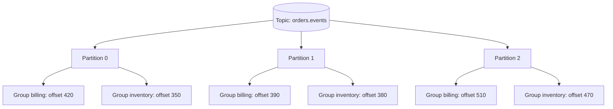

# Reset offset và phát lại dữ liệu có kiểm soát

## 1. Khi nào cần reset offset?

Kafka lưu tiến độ đọc của mỗi consumer group bằng offset theo từng partition. Khi consumer xử lý record, ứng dụng hoặc container commit offset để ghi nhận vị trí đã hoàn tất. Lần khởi động sau, các thành viên trong cùng group tiếp tục từ offset đã commit.

Trong vận hành, có lúc cần đưa tiến độ của một group về vị trí khác để đọc lại dữ liệu:

- Một phiên bản consumer cũ xử lý sai logic và cần chạy lại dữ liệu sau khi sửa lỗi.
- Một projection hoặc bảng đọc cần được dựng lại từ event đã lưu.
- Cần phát lại một khoảng thời gian để phục hồi dữ liệu sau sự cố.
- Một consumer mới cần đọc lại lịch sử để xây dựng trạng thái ban đầu.
- Nhóm vận hành cần kiểm tra một tập record cụ thể mà không làm thay đổi tiến độ production.

Reset offset thay đổi vị trí tiếp tục đọc của một consumer group. Nó không xóa record khỏi topic và cũng không tạo bản sao record. Khi consumer đọc lại, ứng dụng sẽ nhận lại các record đã tồn tại ở các offset được chọn.

Điểm cần quyết định trước tiên là **phát lại bằng group hiện tại hay tạo một group replay riêng**. Reset group production có thể làm thay đổi tiến độ của workload đang phục vụ người dùng. Group replay riêng thường an toàn hơn khi mục tiêu là phân tích, dựng lại projection hoặc chạy thử logic đã sửa.

## 2. Offset được lưu theo group và partition

Mỗi record trong một Kafka partition có offset tăng dần. Consumer group có tiến độ riêng cho từng partition của topic. Hai group đọc cùng topic có thể ở hai vị trí khác nhau:



Offset không phải số thứ tự toàn cục của topic. Offset `420` ở partition 0 và offset `420` ở partition 1 là hai vị trí khác nhau. Khi reset, cần xác định đúng topic, group và các partition bị ảnh hưởng.

Offset đã commit cũng không đồng nghĩa record ở offset đó đã được xử lý thành công theo nghiệp vụ trong mọi thiết kế. Nếu ứng dụng commit sớm rồi mới thực hiện tác dụng phụ, record có thể bị bỏ qua sau sự cố. Nếu tác dụng phụ hoàn tất nhưng commit chưa thành công, record có thể được giao lại. Reset offset là thao tác điều chỉnh tiến độ, không sửa được lỗi về thứ tự xử lý hoặc ranh giới acknowledgement.

## 3. Phân biệt reset offset với auto.offset.reset

`auto.offset.reset` là chính sách Kafka consumer dùng khi group chưa có offset hợp lệ cho partition, hoặc offset đã commit nằm ngoài phạm vi dữ liệu broker còn giữ. Các giá trị phổ biến:

| Giá trị | Hành vi khi cần chọn vị trí bắt đầu |
|---|---|
| `earliest` | Bắt đầu từ offset sớm nhất hiện còn có thể đọc |
| `latest` | Bắt đầu từ cuối log, nhận dữ liệu mới được ghi sau đó |
| `none` | Ném lỗi nếu không tìm thấy offset hợp lệ |

Đổi `auto.offset.reset` từ `latest` sang `earliest` **không tự reset một group đang có committed offset hợp lệ**. Khi group đã có offset, consumer tiếp tục từ offset đó. Đây là nhầm lẫn thường gặp khi muốn phát lại dữ liệu cũ.

Ví dụ, group `billing-service` đã commit đến offset 900. Nếu cấu hình `auto.offset.reset=earliest`, group vẫn tiếp tục từ offset đã commit, thay vì tự quay về đầu topic. Muốn đọc lại cần reset committed offset bằng công cụ quản trị hoặc dùng một group mới chưa có offset.

## 4. Xem trạng thái consumer group trước khi thay đổi

Trước khi reset, cần xác định group có tồn tại, đang ở trạng thái nào, có thành viên hoạt động hay không và lag hiện tại ra sao.

```bash
kafka-consumer-groups.sh \
  --bootstrap-server localhost:9092 \
  --describe \
  --group billing-service
```

Kết quả thường có các cột như topic, partition, current offset, log end offset, lag và consumer ID/host nếu thành viên đang hoạt động. Đọc kết quả theo từng partition, không chỉ nhìn tổng lag.

Một số phiên bản Kafka CLI có thêm lệnh xem trạng thái group và thành viên:

```bash
kafka-consumer-groups.sh --bootstrap-server localhost:9092 --describe --group billing-service --state
kafka-consumer-groups.sh --bootstrap-server localhost:9092 --describe --group billing-service --members
```

Các tùy chọn phụ thuộc phiên bản Kafka. Nếu broker yêu cầu xác thực, thêm `--command-config client.properties` để truyền cấu hình bảo mật; không đặt mật khẩu trực tiếp trên dòng lệnh hoặc trong tài liệu.

## 5. Quy tắc an toàn trước khi reset

Reset offset là thao tác vận hành có ảnh hưởng đến dữ liệu mà consumer sẽ đọc. Với group đang phục vụ production, cần thực hiện theo một quy trình rõ ràng:

1. Xác nhận đúng cluster, topic và group ID.
2. Ghi lại current offset, log end offset và lag của từng partition.
3. Xác định khoảng dữ liệu cần phát lại và lý do nghiệp vụ.
4. Đảm bảo consumer thuộc group đã dừng hoàn toàn và group không còn thành viên hoạt động.
5. Kiểm tra retention, compaction và các offset còn tồn tại.
6. Chạy `--dry-run` để xem offset đích trước khi thực thi.
7. Lưu lại kết quả trước/sau, thời điểm và người thực hiện.
8. Khởi động consumer và theo dõi tốc độ đọc, lag, lỗi, duplicate và tác dụng phụ.

Kafka yêu cầu group không hoạt động để thực hiện reset offset bằng công cụ `kafka-consumer-groups`. Nếu consumer còn hoạt động, hãy dừng các instance hoặc workload tương ứng, chờ chúng rời group rồi mới reset. Nếu reset khi consumer đang chạy hoặc khởi động lại đồng thời, kết quả có thể không như kế hoạch.

## 6. Dùng kafka-consumer-groups để reset offset

Kafka cung cấp công cụ `kafka-consumer-groups` để xem và điều chỉnh offset đã commit. Các ví dụ dưới đây dùng `kafka-consumer-groups.sh` trên Linux/macOS; trên Windows dùng script `.bat` tương ứng trong thư mục `bin\windows` của Kafka distribution.

### Reset về offset sớm nhất còn giữ

Trước tiên chạy dry-run:

```bash
kafka-consumer-groups.sh \
  --bootstrap-server localhost:9092 \
  --group billing-service \
  --topic orders.events \
  --reset-offsets \
  --to-earliest \
  --dry-run
```

Đọc kết quả và xác nhận các partition/offset đúng với kế hoạch. Nếu chính xác, mới thực thi:

```bash
kafka-consumer-groups.sh \
  --bootstrap-server localhost:9092 \
  --group billing-service \
  --topic orders.events \
  --reset-offsets \
  --to-earliest \
  --execute
```

`--to-earliest` có nghĩa là offset sớm nhất broker còn lưu cho partition tại thời điểm reset. Nó không khôi phục dữ liệu đã hết retention và không bảo đảm đọc lại mọi event từng được gửi vào topic.

### Reset về cuối log

Để bỏ qua backlog hiện có và bắt đầu từ dữ liệu mới:

```bash
kafka-consumer-groups.sh \
  --bootstrap-server localhost:9092 \
  --group billing-service \
  --topic orders.events \
  --reset-offsets \
  --to-latest \
  --dry-run
```

Sau khi xác minh, thay `--dry-run` bằng `--execute`. Thao tác này có thể làm group bỏ qua toàn bộ record đang chờ trước vị trí latest. Chỉ dùng khi nghiệp vụ cho phép bỏ qua backlog.

### Reset theo offset cụ thể

Khi cần bắt đầu từ một vị trí đã xác định:

```bash
kafka-consumer-groups.sh \
  --bootstrap-server localhost:9092 \
  --group billing-service \
  --topic orders.events \
  --reset-offsets \
  --to-offset 2500 \
  --dry-run
```

Offset được đặt là vị trí consumer sẽ bắt đầu đọc theo semantics của Kafka. Kiểm tra offset đó còn nằm trong log range của từng partition. Với nhiều partition, cùng một số offset có thể mang ý nghĩa thời gian khác nhau.

## 7. Phát lại theo thời gian hoặc dịch chuyển offset

Không phải lúc nào cũng cần phát lại từ đầu topic. Có thể chọn một thời điểm hoặc dịch offset tương đối khi công cụ Kafka phiên bản đang dùng hỗ trợ.

### Phát lại từ thời điểm

```bash
kafka-consumer-groups.sh \
  --bootstrap-server localhost:9092 \
  --group billing-service \
  --topic orders.events \
  --reset-offsets \
  --to-datetime 2026-11-24T00:00:00.000 \
  --dry-run
```

Kafka tìm offset tương ứng với thời điểm theo timestamp của record trên từng partition. Thời gian không phải lúc nào cũng ánh xạ thành một record chính xác; cần kiểm tra kết quả dry-run và xác định timezone của mốc thời gian.

### Phát lại một khoảng gần đây

Một số phiên bản Kafka hỗ trợ `--by-duration`, ví dụ:

```bash
kafka-consumer-groups.sh \
  --bootstrap-server localhost:9092 \
  --group billing-service \
  --topic orders.events \
  --reset-offsets \
  --by-duration PT6H \
  --dry-run
```

Lệnh này minh họa việc đặt offset về vị trí xấp xỉ sáu giờ trước theo timestamp. Kiểm tra phiên bản CLI và kết quả thực tế trước khi thực thi.

### Dịch offset tương đối

`--shift-by` dịch offset hiện tại theo một số lượng record:

```bash
kafka-consumer-groups.sh \
  --bootstrap-server localhost:9092 \
  --group billing-service \
  --topic orders.events \
  --reset-offsets \
  --shift-by -100 \
  --dry-run
```

Ví dụ trên lùi mỗi partition 100 offset so với vị trí hiện tại. Lùi offset có thể tạo xử lý trùng; tiến offset có thể bỏ qua dữ liệu. Luôn kiểm tra kết quả theo từng partition.

## 8. Chỉ reset một số topic hoặc partition

Một group có thể đọc nhiều topic. Nếu chỉ một luồng cần phát lại, chỉ định topic cần reset thay vì dùng tùy chọn áp dụng cho tất cả topic. Một số phiên bản Kafka CLI cho phép chỉ định các partition cụ thể trong tham số topic, chẳng hạn `orders.events:0,1`; hãy xác nhận cú pháp theo phiên bản distribution đang chạy.

Không dùng `--all-topics` nếu mục tiêu chỉ là khôi phục một destination. Reset nhầm topic có thể làm nhiều luồng nghiệp vụ đọc lại dữ liệu và gây tác dụng phụ ngoài dự kiến.

Khi chỉ một partition bị lỗi, có thể reset partition đó nếu đã xác định được offset phù hợp. Tuy nhiên, nếu các event của cùng aggregate được phân vùng theo key, việc chỉ phát lại một partition có thể làm các sự kiện liên quan ở partition khác không được chạy lại cùng thời điểm. Đánh giá tính nhất quán nghiệp vụ trước khi chọn phạm vi.

## 9. Phát lại bằng consumer group riêng

Nếu mục tiêu là dựng lại projection, chạy kiểm tra logic mới hoặc phân tích dữ liệu, tạo một group riêng thường ít rủi ro hơn reset group production.

Ví dụ cấu hình một function Spring Cloud Stream:

```yaml
spring:
  cloud:
    function:
      definition: rebuildOrderProjection
    stream:
      bindings:
        rebuildOrderProjection-in-0:
          destination: orders.events
          group: order-projection-replay-20261124
          content-type: application/json
      kafka:
        bindings:
          rebuildOrderProjection-in-0:
            consumer:
              startOffset: earliest
```

Group mới chưa có committed offset nên `startOffset: earliest` yêu cầu binder bắt đầu từ phần dữ liệu sớm nhất còn giữ. Tên group riêng tạo tiến độ độc lập với `order-projection-production`. Khi replay xong, có thể dừng workload replay và giữ hoặc xóa group theo chính sách vận hành.

Ưu điểm của group replay:

- Không thay đổi committed offset của group production.
- Có thể so sánh kết quả projection cũ và mới.
- Có thể chạy chậm hoặc tạm dừng mà không làm thay đổi tiến độ consumer chính.
- Dễ giới hạn quyền và destination đầu ra của job replay.

Nhược điểm là broker phải phục vụ thêm lượt đọc và ứng dụng có thể tạo tác dụng phụ trùng nếu replay ghi vào cùng database hoặc gọi dịch vụ bên ngoài. Dùng projection database riêng hoặc idempotency để bảo vệ các thao tác có thể lặp.

## 10. Cấu hình startOffset và resetOffsets trong Kafka binder

Spring Cloud Stream Kafka binder có thuộc tính consumer để xác định vị trí bắt đầu khi binding khởi tạo. Ví dụ:

```yaml
spring:
  cloud:
    stream:
      bindings:
        processOrders-in-0:
          destination: orders.events
          group: billing-service
      kafka:
        bindings:
          processOrders-in-0:
            consumer:
              startOffset: earliest
              resetOffsets: false
```

`startOffset` quy định vị trí bắt đầu khi cần chọn offset ban đầu. `resetOffsets` là tùy chọn binder-specific có thể yêu cầu reset offset về `startOffset` khi binding khởi tạo, theo phiên bản binder. Khi `resetOffsets` bật, mỗi lần khởi động binding có thể tác động đến tiến độ group; không bật trong cấu hình production thường trực nếu chỉ muốn replay một lần.

Trước khi dùng `resetOffsets`, hãy kiểm tra tài liệu và metadata cấu hình của đúng phiên bản Spring Cloud Stream Kafka binder. Hành vi có thể khác giữa các thế hệ binder. Với thao tác quản trị một lần, `kafka-consumer-groups --reset-offsets --dry-run/--execute` giúp nhìn rõ phạm vi và kết quả trước khi thay đổi.

Không nhầm `startOffset` với `auto.offset.reset`: binder có thể ánh xạ thuộc tính riêng vào consumer configuration. Cả hai đều không phải công cụ để tùy ý ghi đè committed offset đang tồn tại trừ khi cơ chế reset cụ thể được bật.

## 11. Replay có thể thực hiện tác dụng phụ lần nữa

Reset offset khiến consumer nhận lại record. Broker không biết function đã gửi email, trừ tiền, tạo đơn hàng hoặc gọi API nào trước đó. Nếu ứng dụng thực hiện side effect, replay có thể lặp lại các thao tác đó.

Ví dụ, consumer nhận `PaymentRequested` và gọi cổng thanh toán. Nếu event được phát lại, gọi lại API có thể tạo giao dịch thứ hai. Các biện pháp bảo vệ:

- Dùng `eventId` ổn định làm idempotency key cho side effect.
- Lưu event đã xử lý vào inbox trong cùng database transaction với cập nhật nghiệp vụ.
- Dùng unique constraint cho mã giao dịch hoặc khóa nghiệp vụ.
- Tách consumer replay khỏi luồng gửi thông báo, thanh toán hoặc command không an toàn khi lặp.
- Dùng chế độ dry-run hoặc output destination riêng để so sánh kết quả.
- Nếu cần gọi API ngoài, kiểm tra API có hỗ trợ idempotency key hay không.

Không tạo event ID mới khi phát lại cùng record. Giữ ID gốc giúp downstream nhận diện đây là cùng một ý định nghiệp vụ.

## 12. Retention và log compaction giới hạn dữ liệu có thể replay

`--to-earliest` không có nghĩa là quay về record đầu tiên từng được tạo. Nó chỉ chọn offset sớm nhất broker còn lưu trong partition.

Với topic dùng retention theo thời gian hoặc dung lượng, record cũ có thể đã bị xóa. Với topic compacted, Kafka giữ giá trị mới nhất cho mỗi key theo chính sách compaction và có thể loại bỏ các phiên bản cũ; không nên xem topic compacted như một lịch sử event đầy đủ để replay mọi thay đổi.

Trước khi lập kế hoạch replay, kiểm tra:

- `retention.ms` và `retention.bytes` của topic.
- `cleanup.policy` là `delete`, `compact` hay kết hợp.
- Log start offset và log end offset của từng partition.
- Có tombstone hoặc record đã bị compact hay không.
- Thời điểm dữ liệu cần thiết có còn trong broker không.

Nếu cần lưu lịch sử lâu hơn retention của topic, hãy thiết kế archive hoặc data lake riêng. Reset offset không khôi phục record đã bị xóa.

## 13. Xử lý offset out of range

Offset đã commit có thể thấp hơn log start offset sau khi retention xóa dữ liệu, hoặc nằm ngoài log end offset do thay đổi topic, restore hoặc thao tác quản trị. Khi đó, consumer gặp tình huống offset out of range và Kafka phải áp dụng chính sách reset.

Nếu `auto.offset.reset=earliest`, consumer chuyển về offset sớm nhất còn giữ; nếu `latest`, consumer chuyển đến cuối log; nếu `none`, consumer báo lỗi. Lựa chọn này có thể khiến dữ liệu bị bỏ qua hoặc đọc lại. Hãy cảnh báo và kiểm tra log khi xảy ra out-of-range thay vì coi đây là một lần khởi động bình thường.

## 14. Xác minh sau khi reset

Sau khi lệnh `--execute` hoàn tất, kiểm tra lại group:

```bash
kafka-consumer-groups.sh \
  --bootstrap-server localhost:9092 \
  --describe \
  --group billing-service
```

Đối chiếu current offset theo partition với kết quả dry-run và kế hoạch. Khi consumer hoạt động trở lại, theo dõi:

- Offset tăng theo tốc độ dự kiến.
- Consumer lag giảm hoặc tăng đúng theo mục tiêu replay.
- Không có partition bị bỏ quên hoặc reset nhầm.
- Tỷ lệ exception, retry và DLQ không tăng bất thường.
- Không có duplicate side effect ngoài dự kiến.
- Consumer group không liên tục rebalance hoặc mất thành viên.

Lưu lại kết quả trước và sau reset cùng lý do, topic, group, partition, offset đích, thời điểm và người thực hiện. Đây là bằng chứng cần thiết để điều tra nếu replay tạo ra dữ liệu khác dự kiến.

## 15. Quy trình replay có kiểm soát trong production

Một quy trình thực tế có thể đi theo các bước sau:

1. Xác định mục tiêu replay: khôi phục group production hay dựng lại một projection độc lập.
2. Nếu có thể, tạo group replay riêng với tên có phiên bản hoặc ngày chạy.
3. Xác minh dữ liệu cần thiết còn trong retention và xác định offset theo từng partition.
4. Kiểm tra consumer có idempotent và các side effect có an toàn khi lặp không.
5. Với group hiện tại, dừng toàn bộ consumer và xác nhận group không còn active member.
6. Chạy reset bằng `--dry-run`, review kết quả rồi mới dùng `--execute`.
7. Khởi động consumer theo cấu hình đã chuẩn bị.
8. Theo dõi lag, throughput, lỗi, DLQ, database và các hệ thống phụ thuộc.
9. Xác nhận trạng thái nghiệp vụ sau replay; giữ lại log thao tác và quyết định kết thúc job.

## 16. Ví dụ lựa chọn phương án

| Mục tiêu | Phương án | Lý do |
|---|---|---|
| Dựng lại bảng projection mà không ảnh hưởng consumer hiện tại | Group replay riêng | Tiến độ độc lập, dễ so sánh và rollback kết quả |
| Consumer production xử lý sai dữ liệu từ một thời điểm | Dừng group, dry-run rồi reset group hiện tại | Cần đưa đúng workload về offset đã chọn |
| Chỉ phân tích dữ liệu lịch sử | Group replay riêng, output vào kho phân tích | Không gọi lại side effect nghiệp vụ |
| Bỏ backlog cũ theo quyết định nghiệp vụ | Reset về latest sau khi xác nhận | Consumer chỉ xử lý dữ liệu mới kể từ mốc đó |
| Đọc lại một số partition | Reset partition được chọn sau khi đánh giá key/order | Giảm phạm vi ảnh hưởng nhưng cần xem quan hệ dữ liệu |

Reset offset là thao tác thay đổi tiến độ tiêu thụ của Kafka consumer group. `auto.offset.reset` chỉ chọn vị trí khi không có offset hợp lệ; nó không tự quay một group đang hoạt động về đầu topic. Để replay an toàn, cần xác định đúng group/topic/partition, dừng consumer khi reset, dùng dry-run, kiểm tra retention và bảo vệ side effect bằng idempotency. Khi mục tiêu cho phép, group replay riêng là cách giữ nguyên tiến độ production trong khi vẫn đọc lại dữ liệu có kiểm soát.

