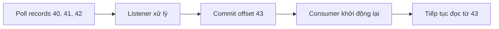
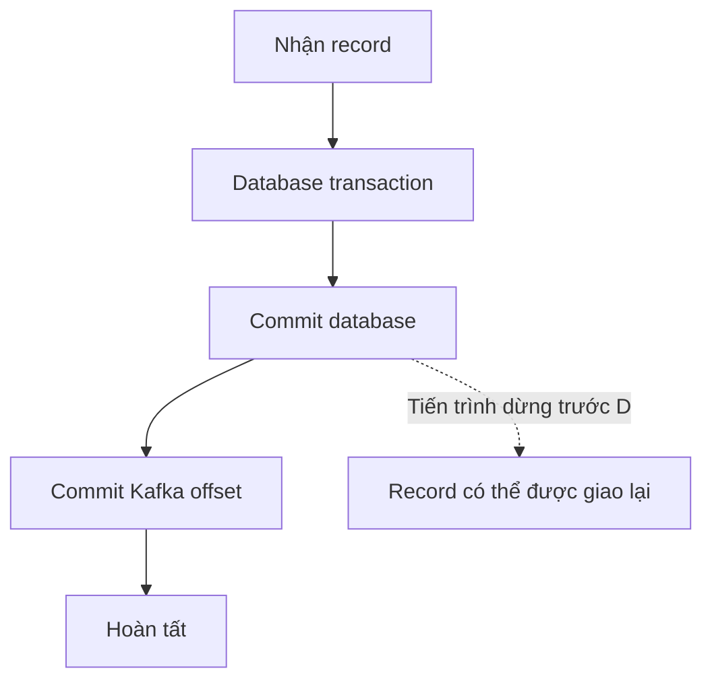

# Chế độ ackMode và thời điểm commit offset

Khi Spring Cloud Stream nhận message từ Kafka, consumer cần ghi nhận vị trí đã xử lý để lần khởi động hoặc lần poll tiếp theo biết phải đọc từ đâu. Kafka lưu vị trí này dưới dạng **committed offset** theo từng partition và consumer group. Spring Cloud Stream Kafka binder dùng listener container của Spring for Apache Kafka để quản lý việc commit.

Thuộc tính `ackMode` quyết định **khi nào offset được commit** sau khi listener xử lý message. Chọn sai thời điểm có thể tạo ra hai loại sự cố: commit quá sớm khiến message chưa được xử lý nhưng consumer đã bỏ qua; commit quá muộn có thể khiến message đã xử lý bị giao lại sau khi ứng dụng dừng. Vì vậy, cần hiểu ack mode cùng với transaction, retry, DLQ và tính idempotent của consumer.

## 1. Offset là vị trí đọc, không phải trạng thái nghiệp vụ

Mỗi record trong một Kafka partition có offset tăng dần. Consumer group giữ committed offset riêng cho mỗi partition mà group đang đọc. Offset được commit biểu thị vị trí tiếp theo mà consumer group sẽ tiếp tục đọc khi khởi động hoặc tái cân bằng.

Ví dụ, partition `orders-0` có các record offset 40, 41, 42 và 43. Nếu consumer đã xử lý thành công record 42 rồi commit vị trí tiếp theo là 43, lần đọc tiếp theo bắt đầu ở offset 43. Kafka không xóa record 40–42 khi offset được commit; retention của topic vẫn quyết định dữ liệu được giữ trong bao lâu.



Offset chỉ mô tả tiến độ đọc của group. Nó không chứng minh rằng database đã commit, API bên ngoài đã hoàn tất hay tác dụng nghiệp vụ đã được lưu bền vững. Ứng dụng phải phối hợp thời điểm commit với thời điểm tác dụng nghiệp vụ hoàn tất.

## 2. ackMode trong Kafka binder nằm ở đâu?

Với Spring Cloud Stream Kafka binder thông thường (message-channel binder), `ackMode` là thuộc tính riêng của consumer binding. Cấu hình có dạng:

```yaml
spring:
  cloud:
    function:
      definition: processOrder
    stream:
      bindings:
        processOrder-in-0:
          destination: orders.events
          group: order-projection
      kafka:
        bindings:
          processOrder-in-0:
            consumer:
              ackMode: RECORD
```

Tên binding `processOrder-in-0` phải khớp với input binding được tạo từ function `processOrder`. `ackMode` được đặt dưới `spring.cloud.stream.kafka.bindings.<binding-name>.consumer`, không đặt dưới `spring.cloud.stream.bindings.<binding-name>.consumer` vì đây là thuộc tính riêng của Kafka binder.

Phạm vi của thuộc tính này là Kafka binder kiểu message-channel. Reactive Kafka binder dùng `ReceiverOffset` trong header `KafkaHeaders.ACKNOWLEDGMENT` và không commit offset mặc định; ứng dụng có thể gọi `acknowledge()` hoặc `commit()` trên `ReceiverOffset`. Kafka Streams binder lại để runtime Kafka Streams quản lý tiến độ theo topology và transaction. Không áp dụng `ackMode` của message-channel binder cho hai binder này.

Giá trị `ackMode` dựa trên enum `AckMode` của Spring Kafka. Các lựa chọn chính là `RECORD`, `BATCH`, `TIME`, `COUNT`, `COUNT_TIME`, `MANUAL` và `MANUAL_IMMEDIATE`.

### Giá trị mặc định cần phân biệt

Spring Kafka listener container có mặc định `BATCH`. Tuy nhiên, Kafka binder có logic cấu hình riêng: trong tài liệu binder hiện hành, nếu không đặt `ackMode` và không bật `batch-mode`, binder dùng `RECORD` cho record listener. Khi dùng batch listener, cần xem đúng phiên bản binder và listener configuration. Vì vậy, không nên suy ra mặc định của ứng dụng Spring Cloud Stream chỉ từ mặc định của một `KafkaMessageListenerContainer` được tạo trực tiếp.

Để cấu hình dễ review và không phụ thuộc mặc định giữa các phiên bản, nên khai báo tường minh `ackMode` cho những binding có yêu cầu giao nhận quan trọng.

## 3. Các chế độ commit offset

| ackMode | Thời điểm commit | Đặc điểm |
|---|---|---|
| `RECORD` | Sau khi listener xử lý xong từng record. | Giảm lượng record có thể bị giao lại khi lỗi xảy ra giữa một poll; có thể tăng số lần commit. |
| `BATCH` | Sau khi tất cả record được trả về trong một lần `poll()` đã được xử lý. | Giảm số lần commit; nếu tiến trình lỗi giữa batch, các record chưa được commit có thể được đọc lại. |
| `TIME` | Sau khi các record của poll đã xử lý và thời gian `ackTime` kể từ lần commit trước đã vượt ngưỡng. | Điều tiết commit theo thời gian, nhưng không commit giữa lúc listener còn đang xử lý batch. |
| `COUNT` | Sau khi các record của poll đã xử lý và đủ `ackCount` record kể từ lần commit trước. | Điều tiết commit theo số lượng record. |
| `COUNT_TIME` | Khi điều kiện thời gian hoặc số lượng đạt ngưỡng, sau khi batch hiện tại được xử lý. | Kết hợp hai ngưỡng; điều kiện nào đến trước sẽ kích hoạt commit. |
| `MANUAL` | Listener gọi `Acknowledgment.acknowledge()`; sau đó áp dụng semantics tương tự `BATCH`. | Ứng dụng quyết định thời điểm xác nhận, container vẫn quản lý commit theo batch. |
| `MANUAL_IMMEDIATE` | Commit ngay khi listener gọi `acknowledge()` trên consumer thread. | Kiểm soát chi tiết hơn; cần gọi đúng thread và quản lý thứ tự xác nhận cẩn thận. |

`RECORD` và `BATCH` thường là hai lựa chọn dễ hiểu nhất khi bắt đầu. `TIME`, `COUNT` và `COUNT_TIME` hữu ích khi cần cân bằng chi phí commit với độ trễ và số record có thể được đọc lại. `MANUAL` và `MANUAL_IMMEDIATE` dành cho ứng dụng cần tự quyết định khi nào một record được xem là đã xử lý.

## 4. RECORD: commit sau từng record

Với `RECORD`, listener container commit offset sau khi listener trả về thành công cho mỗi record. Nếu một lần poll trả về nhiều record, commit được thực hiện theo tiến độ từng record thay vì đợi toàn bộ poll hoàn tất.

Ví dụ:

```yaml
spring:
  cloud:
    stream:
      kafka:
        bindings:
          processOrder-in-0:
            consumer:
              ackMode: RECORD
```

Giả sử một poll trả về offset 40, 41 và 42:

1. Listener xử lý offset 40 xong, container commit vị trí tiếp theo tương ứng.
2. Listener xử lý offset 41 xong, container tiếp tục commit.
3. Listener xử lý offset 42 xong, container commit tiến độ mới.

Nếu tiến trình dừng sau khi xử lý 41 nhưng trước khi xử lý 42, group có thể tiếp tục từ record chưa được commit. Số record phải xử lý lại thường nhỏ hơn so với commit cả batch, nhưng số lần commit có thể tăng và ảnh hưởng throughput.

`RECORD` không có nghĩa là record được commit trước khi listener chạy. Listener phải trả về thành công thì container mới commit theo chế độ này. Nếu listener ném exception, error handler quyết định retry, recover, DLQ hoặc dừng container; không nên giả định offset luôn được commit ngay cả khi có lỗi.

## 5. BATCH: commit sau toàn bộ record của poll

Với `BATCH`, container đợi tất cả record được trả về trong lần `poll()` hoàn tất xử lý rồi mới commit offset. Đây là chế độ mặc định của Spring Kafka listener container nếu cấu hình container trực tiếp và không có override.

Ví dụ:

```yaml
spring:
  cloud:
    stream:
      kafka:
        bindings:
          processOrder-in-0:
            consumer:
              ackMode: BATCH
```

Giả sử poll trả về offset 40, 41, 42 và cả ba đều được xử lý thành công. Container commit tiến độ sau offset 42. Nếu ứng dụng dừng sau khi xử lý 42 nhưng trước khi commit, các record thuộc batch chưa được commit có thể được giao lại khi consumer khởi động.

Ưu điểm của `BATCH` là giảm số lần commit so với `RECORD`, nhất là khi `max.poll.records` lớn. Đổi lại, cửa sổ có thể bị giao lại rộng hơn. Consumer cần idempotent vì một record đã cập nhật database thành công vẫn có thể xuất hiện lại nếu offset của batch chưa được commit.

## 6. TIME, COUNT và COUNT_TIME

Ba chế độ này cho phép gom nhiều tiến độ xử lý trước khi commit. Chúng không có nghĩa listener được phép bỏ qua xử lý; container vẫn cần hoàn tất các record được trả về trong poll trước khi commit theo điều kiện tương ứng.

### TIME

`TIME` commit khi các record của poll đã được xử lý và thời gian kể từ lần commit trước đạt `ackTime`.

```yaml
spring:
  cloud:
    stream:
      kafka:
        bindings:
          processOrder-in-0:
            consumer:
              ackMode: TIME
              ackTime: 5000
```

`ackTime` được tính bằng mili giây. Với giá trị 5000, container xem xét commit sau khi ngưỡng 5 giây đã đạt và batch hiện tại được xử lý xong. Đây không phải bộ hẹn giờ bảo đảm commit đúng từng 5 giây bất kể listener có đang bận hay không.

### COUNT

`COUNT` commit khi số record đã xử lý kể từ lần commit trước đạt `ackCount`, sau khi poll hiện tại được xử lý hoàn tất.

```yaml
spring:
  cloud:
    stream:
      kafka:
        bindings:
          processOrder-in-0:
            consumer:
              ackMode: COUNT
              ackCount: 100
```

Với `ackCount: 100`, container chờ đủ số lượng record theo ngưỡng rồi commit. Giá trị binding-level `ackCount` có ưu tiên hơn cấu hình toàn cục `spring.kafka.listener.ackCount`.

### COUNT_TIME

`COUNT_TIME` kết hợp `ackCount` và `ackTime`. Commit được thực hiện khi một trong hai điều kiện đạt, sau khi các record của poll hiện tại hoàn tất.

```yaml
spring:
  cloud:
    stream:
      kafka:
        bindings:
          processOrder-in-0:
            consumer:
              ackMode: COUNT_TIME
              ackCount: 100
              ackTime: 5000
```

Cấu hình trên có thể giảm số lần commit khi tải cao nhưng vẫn giới hạn khoảng thời gian giữa các lần commit khi tải thấp. Cần đo lag, throughput và số record bị giao lại để chọn ngưỡng thực tế.

## 7. MANUAL và MANUAL_IMMEDIATE

Với hai chế độ manual, Kafka binder đưa một đối tượng `Acknowledgment` vào header `KafkaHeaders.ACKNOWLEDGMENT` của message. Ứng dụng lấy đối tượng này và gọi `acknowledge()` khi đã hoàn tất công việc cần thiết.

Ví dụ cấu hình `MANUAL`:

```yaml
spring:
  cloud:
    stream:
      bindings:
        processOrder-in-0:
          destination: orders.events
          group: order-projection
      kafka:
        bindings:
          processOrder-in-0:
            consumer:
              ackMode: MANUAL
```

Consumer nhận cả payload và headers:

```java
import java.util.function.Consumer;

import org.springframework.context.annotation.Bean;
import org.springframework.kafka.support.Acknowledgment;
import org.springframework.kafka.support.KafkaHeaders;
import org.springframework.messaging.Message;

@Bean
Consumer<Message<OrderCreated>> processOrder(OrderService orderService) {
    return message -> {
        Acknowledgment acknowledgment = message.getHeaders().get(
            KafkaHeaders.ACKNOWLEDGMENT,
            Acknowledgment.class
        );

        if (acknowledgment == null) {
            throw new IllegalStateException("Kafka acknowledgment header is missing");
        }

        // Phương thức này trả về sau khi transaction database đã commit.
        orderService.applyTransactionally(message.getPayload());

        acknowledgment.acknowledge();
    };
}
```

Trong ví dụ, `orderService.applyTransactionally(...)` nên là phương thức được quản lý bởi Spring transaction proxy và chỉ trả về sau khi database transaction commit. Sau đó consumer mới xác nhận offset. Với `MANUAL`, lời gọi `acknowledge()` đánh dấu record đã được xác nhận; container áp dụng semantics tương tự `BATCH` để commit.

Nếu cấu hình `MANUAL_IMMEDIATE`, container commit ngay khi `acknowledge()` được gọi trên consumer thread. Nếu gọi từ thread khác, hành vi không còn là commit tức thời theo nghĩa đó; cần tuân thủ ràng buộc thread của Spring Kafka. Không nên chuyển đối tượng `Acknowledgment` sang executor bất đồng bộ rồi mặc định rằng offset sẽ được commit đúng thứ tự.

### Khi nào cần manual ack?

Manual ack hữu ích khi ứng dụng có một điều kiện hoàn tất rõ ràng trước khi commit, chẳng hạn:

- Database transaction đã commit.
- Một batch nghiệp vụ đã được ghi bền vững.
- Một quy trình kiểm tra hoặc ghi nhận trạng thái đã hoàn tất.
- Ứng dụng cần trì hoãn ACK cho tới khi một bước xử lý cụ thể thành công.

Nếu listener luôn xử lý đồng bộ và chỉ cần commit sau khi method trả về, `RECORD` hoặc `BATCH` thường đơn giản hơn. Manual ack làm tăng trách nhiệm của ứng dụng: mọi nhánh thành công, lỗi, timeout và cancellation phải có chính sách ACK/NACK rõ ràng.

## 8. Commit sau database transaction và cửa sổ duplicate

Một consumer thường thực hiện hai thao tác độc lập: cập nhật database và commit offset Kafka. Không có transaction chung thì luôn có một cửa sổ lỗi giữa hai thao tác.



Nếu database commit thành công rồi tiến trình dừng trước khi offset commit, Kafka có thể giao lại record. Đây là duplicate, không phải mất dữ liệu. Cách xử lý thông dụng là consumer idempotent: lưu `eventId` trong inbox hoặc dùng khóa duy nhất để cùng một event không áp dụng tác dụng nghiệp vụ lần thứ hai.

Ngược lại, nếu offset được commit trước khi database commit và tiến trình dừng, Kafka có thể không giao lại record trong khi thay đổi database đã rollback. Đây là nguy cơ mất tác dụng nghiệp vụ. Vì vậy, với xử lý cần độ tin cậy, không xác nhận offset trước khi tác dụng cần bảo vệ đã bền vững.

Ví dụ bảng inbox:

```sql
CREATE TABLE processed_event (
    consumer_name VARCHAR(100) NOT NULL,
    event_id VARCHAR(100) NOT NULL,
    processed_at TIMESTAMP NOT NULL,
    PRIMARY KEY (consumer_name, event_id)
);
```

Insert inbox row và cập nhật nghiệp vụ nên nằm trong cùng transaction database. Nếu event ID đã tồn tại, consumer có thể bỏ qua tác dụng lặp rồi hoàn tất xử lý message theo chính sách ACK.

## 9. Tương tác giữa ackMode, retry và DLQ

`ackMode` quy định thời điểm commit offset trong đường xử lý bình thường. Khi listener ném exception, error handler của Spring Kafka/Kafka binder quyết định retry, seek, recover hoặc gửi record tới DLQ. Vì vậy, không nên xem `ackMode` là cấu hình retry hay DLQ.

Một số nguyên tắc:

- Nếu lỗi được retry và xử lý thành công, offset chỉ được tiến lên theo semantics của ack mode sau khi listener hoàn tất.
- Nếu lỗi chưa được recover, offset thường không được tiến qua record lỗi theo cách làm mất record; error handler có thể seek để đọc lại.
- Nếu record được recover thành công, chẳng hạn publish tới DLT, error handler/binder có thể commit offset của record đã recover theo cấu hình.
- Với transactional binder, `txCommitRecovered` điều khiển việc commit offset của record đã recover trong một transaction mới; mặc định hiện hành là `true`.
- Nếu custom error handler thay thế binder error handler, cần kiểm tra riêng việc chuyển DLQ và commit offset; không giả định DLQ tự hoạt động.

Ví dụ bật DLQ cho Kafka binder:

```yaml
spring:
  cloud:
    stream:
      bindings:
        processOrder-in-0:
          destination: orders.events
          group: order-projection
          consumer:
            max-attempts: 3
      kafka:
        bindings:
          processOrder-in-0:
            consumer:
              ackMode: RECORD
              enableDlq: true
              dlqName: orders.events.order-projection.dlq
```

Sau khi retry hết và record được binder recover vào DLQ, offset của record đã recover có thể được commit theo cơ chế error handler/binder. Cần kiểm thử với phiên bản đang dùng để xác minh message đã vào DLQ và group offset đã tiến đúng vị trí. Đừng tự gọi `acknowledge()` trong nhánh lỗi rồi đồng thời mong error handler thực hiện retry hoặc DLQ cho cùng record.

## 10. Batch mode thay đổi đơn vị xử lý

Khi `spring.cloud.stream.bindings.<binding>.consumer.batch-mode` được bật, Kafka binder đưa các record thu được từ một lần `poll()` vào listener dưới dạng `List<?>` hoặc `Message<List<?>>`. Nếu không bật batch mode, listener nhận từng record.

```yaml
spring:
  cloud:
    stream:
      bindings:
        processOrder-in-0:
          destination: orders.events
          group: order-projection
          consumer:
            batch-mode: true
      kafka:
        bindings:
          processOrder-in-0:
            consumer:
              ackMode: BATCH
```

Kích thước batch chịu ảnh hưởng của Kafka consumer properties như `max.poll.records`, `fetch.min.bytes` và `fetch.max.wait.ms`. `ackMode` vẫn quyết định thời điểm commit; batch mode quyết định listener nhận dữ liệu theo lô.

Khi dùng batch mode:

- `BATCH` phù hợp với xử lý toàn bộ danh sách như một đơn vị.
- Nếu một record trong batch lỗi, cần biết error handler xử lý phần đã thành công và phần chưa xử lý ra sao.
- Kafka binder không hỗ trợ binder retry theo cách thông thường trong batch mode; `maxAttempts` bị override thành 1. Có thể cấu hình `DefaultErrorHandler` qua `ListenerContainerCustomizer` nếu cần retry tương tự.
- Với manual ack, Spring Kafka hỗ trợ `nack(index, sleep)` cho batch listener nhận `List` để commit phần record trước index và yêu cầu giao lại record lỗi cùng phần còn lại. API này phải được gọi trên listener thread và có ràng buộc phiên bản.
- DLQ batch có thể chuyển toàn bộ record nhận từ poll trước đó sang DLQ, không nhất thiết chỉ một record gây lỗi.

Không bật batch mode chỉ để tăng throughput mà không thiết kế lại logic idempotency và xử lý lỗi theo từng phần tử.

## 11. ackMode khác với autoCommitOffset và enable.auto.commit

Ba tên này dễ bị nhầm:

| Thuộc tính | Lớp cấu hình | Vai trò |
|---|---|---|
| `ackMode` | Spring Cloud Stream Kafka binder consumer binding | Chọn semantics commit của listener container. |
| `autoCommitOffset` | Thuộc tính Kafka binder cũ | Cấu hình kiểu tự commit/manual trong các phiên bản trước; đã deprecated từ binder 3.1 để chuyển sang `ackMode`. |
| `enable.auto.commit` | Kafka consumer client property | Bật auto commit theo timer của Kafka client; listener container thường quản lý commit thay cho cơ chế này. |

Spring Kafka từ phiên bản 2.3 đặt `enable.auto.commit=false` cho listener container nếu ứng dụng không chủ động override, để container kiểm soát offset theo `AckMode`. Không nên bật `enable.auto.commit=true` tùy tiện trong khi cũng dùng listener container commit; hai cơ chế có thể xung đột về thời điểm và độ an toàn.

Nếu đang nâng cấp cấu hình cũ có `autoCommitOffset: false`, hãy chuyển sang `ackMode: MANUAL` hoặc `MANUAL_IMMEDIATE` và thêm logic gọi `Acknowledgment.acknowledge()` trong consumer. Thuộc tính `ackEachRecord` cũng đã deprecated từ binder 3.1; dùng `ackMode: RECORD` thay cho ý định commit sau từng record.

## 12. ackMode không quyết định vị trí bắt đầu đọc

Commit offset và chọn vị trí bắt đầu là hai việc khác nhau:

- `ackMode` điều khiển thời điểm lưu tiến độ đã xử lý.
- `startOffset` điều khiển vị trí ban đầu khi group chưa có committed offset.
- `resetOffsets` liên quan việc reset vị trí đọc theo `startOffset` khi binding khởi động.
- `auto.offset.reset` của Kafka client quy định hành vi khi không có offset hợp lệ và binder không override bằng cấu hình tương ứng.

Với binding có group tường minh, Kafka binder thường mặc định `startOffset` là `earliest`; anonymous group thường mặc định `latest`. Cần xem cấu hình và phiên bản binder thực tế. Thay đổi `ackMode` không tự đưa group về đầu topic và cũng không xóa committed offset hiện có.

Muốn replay dữ liệu, cần một chiến lược reset/replay có chủ đích, không chỉ đổi `ackMode`. Việc reset offset có thể làm consumer đọc lại lượng lớn dữ liệu và gây tác dụng phụ nếu consumer không idempotent.

## 13. Kafka transaction và offset commit

Khi bật transactional Kafka binder, offset của consumer có thể được gửi vào Kafka transaction cùng với các record output. Nếu transaction commit, output record và offset được commit cùng nhau trong phạm vi Kafka; nếu transaction rollback, cả hai có thể được rollback theo transaction.

Để phối hợp consumer và producer theo transaction manager của binder, các binding liên quan cần dùng cùng `KafkaAwareTransactionManager`. Tài liệu binder cho biết semantics offset trong transaction tương đương `RECORD` hoặc `BATCH` tùy listener loại record hay batch.

Kafka transaction có thể cung cấp exactly-once processing trong phạm vi đọc/ghi Kafka được cấu hình đúng. Nó không tự đưa transaction PostgreSQL, MySQL hoặc API thanh toán bên ngoài vào cùng transaction. Nếu consumer cập nhật database, vẫn cần outbox/inbox, idempotency hoặc một cơ chế phối hợp transaction phù hợp.

Không nhầm producer `acks=all` với consumer `ackMode`. `acks` điều khiển mức xác nhận khi producer gửi record tới broker; `ackMode` điều khiển thời điểm consumer commit offset đã đọc.

## 14. Chọn ackMode theo yêu cầu

| Yêu cầu | Lựa chọn gợi ý | Lý do |
|---|---|---|
| Xử lý từng record, muốn giảm cửa sổ duplicate | `RECORD` | Commit sau mỗi record listener thành công. |
| Xử lý batch và tối ưu số lần commit | `BATCH` | Commit sau khi toàn bộ poll batch hoàn tất. |
| Tải thấp/cao thay đổi, muốn commit theo thời gian | `TIME` | Ngưỡng `ackTime` giới hạn nhịp commit khi đủ điều kiện. |
| Tải cao, muốn gom commit theo số lượng | `COUNT` | Ngưỡng `ackCount` giảm commit quá thường xuyên. |
| Muốn ngưỡng theo thời gian hoặc số lượng | `COUNT_TIME` | Commit khi điều kiện nào đến trước. |
| Chỉ xác nhận sau khi bước nghiệp vụ riêng hoàn tất | `MANUAL` | Ứng dụng gọi acknowledge; container dùng semantics BATCH. |
| Cần commit ngay tại lời gọi acknowledge trên consumer thread | `MANUAL_IMMEDIATE` | Offset được commit tức thời theo lời gọi. |

Không có ack mode tốt nhất cho mọi ứng dụng. Nếu database là tác dụng chính, ưu tiên xử lý transaction database trước rồi commit offset, kết hợp idempotency. Nếu batch có kích thước lớn, đo lượng record có thể được giao lại khi một lần poll thất bại. Nếu dùng manual ack, kiểm tra mọi nhánh lỗi để tránh record bị treo hoặc bị commit trước khi công việc hoàn tất.

## 15. Kiểm thử thời điểm commit offset

Test Binder hữu ích để kiểm thử function và binding logic, nhưng không mô phỏng đầy đủ committed offset của Kafka consumer group. Muốn xác minh `ackMode`, cần integration test với Kafka thật hoặc broker test tương đương và đọc committed offset của group.

Một số kịch bản quan trọng:

| Kịch bản | Điều cần xác minh |
|---|---|
| `RECORD`, xử lý record thành công | Offset tiến sau khi listener trả về cho từng record. |
| `BATCH`, xử lý toàn bộ poll thành công | Offset tiến sau khi các record trong poll hoàn tất. |
| Listener ném exception | Offset không vượt qua record lỗi trước khi retry/recovery quyết định. |
| Dừng tiến trình sau DB commit, trước offset commit | Record có thể được giao lại; inbox/idempotency ngăn tác dụng lặp. |
| Manual ack chưa được gọi | Offset chưa được xác nhận theo chế độ manual. |
| Manual ack sau DB commit | Offset tiến sau lời gọi acknowledge theo semantics đã chọn. |
| Manual immediate từ consumer thread | Kiểm tra commit ngay sau lời gọi acknowledge. |
| Batch lỗi ở phần tử giữa | Xác minh record nào được commit, retry hoặc redeliver. |
| Record được recover vào DLQ | Xác minh DLT nhận record và offset được tiến theo cấu hình recover. |
| Consumer restart/rebalance | Consumer tiếp tục từ committed offset của group. |

Không nên chỉ assert rằng function đã được gọi. Cần kiểm tra committed offset, record được giao lại, trạng thái database và DLQ để xác nhận toàn bộ semantics.

## 16. Quan sát commit và điều tra sự cố

Trong production, nên theo dõi:

- Consumer lag theo topic, partition và group.
- Thời gian xử lý mỗi record và thời gian giữa các lần commit.
- Số lần commit thành công/thất bại và lỗi commit timeout.
- Số lần rebalance, số consumer active và partition assignment.
- Số record retry, redelivery, duplicate và record vào DLQ.
- Số message xử lý thành công ở database nhưng được giao lại.
- Số lần manual acknowledgment bị thiếu hoặc handler kết thúc mà chưa xác nhận.

Kafka binder cung cấp metric offset lag thông qua Micrometer khi dependency và cấu hình phù hợp. Khi điều tra lag tăng, phân biệt consumer xử lý chậm với consumer xử lý xong nhưng commit không tiến. Hai tình huống có cách khắc phục khác nhau.

Log nên có `topic`, `partition`, `offset`, `group`, `eventId` và `correlationId` nếu có. Không dùng event ID có cardinality cao làm metric tag; dùng log/trace để tra cứu một record cụ thể.

## 17. Những lỗi thường gặp

1. **Nhầm producer `acks` với consumer `ackMode`.** Một cái xác nhận publish, một cái commit tiến độ consume.
2. **Nghĩ commit offset xóa record khỏi Kafka.** Record vẫn tồn tại theo retention policy của topic.
3. **Commit trước khi database transaction hoàn tất.** Crash có thể làm mất tác dụng nghiệp vụ vì group đã tiến qua record.
4. **Không thiết kế idempotency với RECORD/BATCH.** Crash sau DB commit nhưng trước offset commit có thể gây xử lý lặp.
5. **Bật manual ack nhưng quên gọi acknowledge.** Consumer không tiến offset như mong đợi và có thể đọc lại record sau restart.
6. **Gọi acknowledge trước khi công việc bền vững.** Có thể tạo mất dữ liệu khi bước nghiệp vụ thất bại sau commit.
7. **Gọi MANUAL_IMMEDIATE từ thread tùy ý.** Không còn bảo đảm commit tức thời như khi gọi trên consumer thread.
8. **Nhầm batch-mode với BATCH ackMode.** Một thuộc tính chọn kiểu listener nhận dữ liệu; thuộc tính kia chọn thời điểm commit.
9. **Dùng `autoCommitOffset` hoặc `ackEachRecord` trong cấu hình mới.** Hai thuộc tính binder này đã deprecated từ 3.1; ưu tiên `ackMode`.
10. **Chỉ kiểm thử bằng Test Binder.** Test Binder không chứng minh committed offset và rebalance của Kafka thật.
11. **Đổi ackMode để mong replay từ đầu topic.** Cần xem `startOffset`, `resetOffsets` và committed offset hiện tại.

## 18. Quy trình chọn và cấu hình ackMode

Trước khi triển khai consumer Kafka, hãy thực hiện:

1. Xác định function dùng record listener hay batch listener.
2. Chọn mục tiêu commit: sau từng record, sau poll, theo thời gian/số lượng hay do ứng dụng xác nhận.
3. Khai báo `spring.cloud.stream.kafka.bindings.<binding>.consumer.ackMode` tường minh.
4. Nếu dùng `TIME`, `COUNT` hoặc `COUNT_TIME`, đặt `ackTime`/`ackCount` có căn cứ từ throughput và độ trễ mong muốn.
5. Nếu dùng manual ack, lấy `KafkaHeaders.ACKNOWLEDGMENT` và chỉ acknowledge sau khi tác dụng nghiệp vụ đã bền vững.
6. Thiết kế inbox/idempotency để chịu được record được giao lại.
7. Cấu hình retry, error handler và DLQ riêng; xác minh offset sau khi recover.
8. Nếu dùng transaction Kafka, kiểm tra consumer/producer binding có cùng transaction manager.
9. Integration test committed offset, restart, rebalance, lỗi giữa database commit và offset commit.
10. Theo dõi consumer lag, commit latency, retry, redelivery và DLQ sau khi phát hành.

`ackMode` là quyết định về thời điểm Kafka ghi nhận tiến độ tiêu thụ. Chọn đúng mode, commit sau khi tác dụng cần bảo vệ đã hoàn tất và làm consumer idempotent sẽ giúp hệ thống cân bằng throughput với khả năng phục hồi khi lỗi hoặc restart.

## Tài liệu tham khảo

- [Spring Cloud Stream Kafka Binder – Configuration Options](https://docs.spring.io/spring-cloud-stream/reference/kafka/kafka-binder/config-options.html)
- [Spring Cloud Stream Kafka Binder – Manual Acknowledgement](https://docs.spring.io/spring-cloud-stream/reference/kafka/kafka-binder/manual-ack.html)
- [Spring Cloud Stream Kafka Binder – Consuming Batches](https://docs.spring.io/spring-cloud-stream/reference/kafka/kafka-binder/consume-batches.html)
- [Spring for Apache Kafka – Message Listener Containers and Committing Offsets](https://docs.spring.io/spring-kafka/reference/kafka/receiving-messages/message-listener-container.html)
