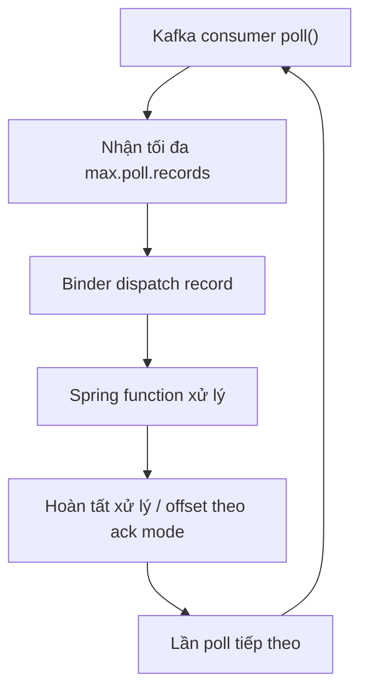
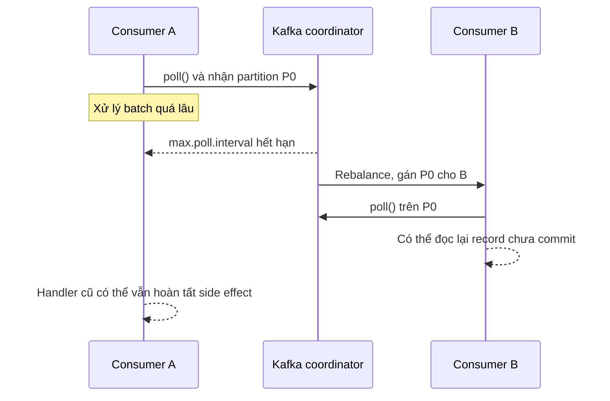

# max.poll.records, max.poll.interval.ms và thời gian xử lý

Kafka consumer không chỉ cần đọc được record; nó còn phải quay lại gọi `poll()` đủ thường xuyên để duy trì tiến độ trong consumer group. Khi ứng dụng xử lý từng record lâu, một poll có thể trả về nhiều record và tổng thời gian xử lý chúng vượt quá khoảng chờ cho phép. Kafka khi đó có thể xem consumer là không còn tiến triển, kích hoạt rebalance và giao lại partition cho member khác.

Hai cấu hình quan trọng để kiểm soát tình huống này là `max.poll.records` và `max.poll.interval.ms`. Cấu hình đầu giới hạn số record trả về trong một lần poll; cấu hình sau giới hạn thời gian tối đa giữa hai lần poll. Trong Spring Cloud Stream Kafka binder, bạn truyền các Kafka consumer properties này qua cấu hình consumer của binding. Muốn chọn giá trị đúng, cần đo thời gian xử lý thực tế, tính tổng thời gian của một poll cycle và hiểu rõ offset/acknowledgement.

## 1. Vòng đời poll và xử lý record

Kafka consumer lấy dữ liệu bằng phương thức `poll()`. Mỗi lần poll, client trả về một tập record có thể đến từ nhiều partition mà consumer đang sở hữu. Ứng dụng xử lý các record đó, sau đó tiếp tục poll để lấy dữ liệu mới và duy trì hoạt động trong group.

Với Spring Cloud Stream Kafka binder, ứng dụng thường khai báo một function bean. Binder tạo listener container và container quản lý Kafka consumer, bao gồm vòng gọi poll, dispatch message đến function, xử lý offset và phối hợp với consumer group. Trong handler thông thường, bạn không tự gọi `KafkaConsumer.poll()`; bạn cấu hình client qua binder và viết logic xử lý message.

Ví dụ function consumer:

```java
@Bean
Consumer<OrderCreated> processOrder(OrderService orderService) {
    return event -> orderService.handle(event);
}
```

Cấu hình binding:

```yaml
spring:
  cloud:
    function:
      definition: processOrder
    stream:
      bindings:
        processOrder-in-0:
          destination: orders.events
          group: order-worker
```

Khi record được đọc từ topic `orders.events`, binder chuyển payload thành `OrderCreated` và gọi function. Nếu handler xử lý đồng bộ, thời gian xử lý handler ảnh hưởng tới thời điểm listener container có thể hoàn tất batch hiện tại và tiếp tục vòng poll.

Sơ đồ đơn giản:



Điều cần kiểm soát là khoảng thời gian từ lần gọi `poll()` này tới lần gọi `poll()` kế tiếp. Nếu khoảng đó vượt `max.poll.interval.ms`, consumer có nguy cơ bị loại khỏi group và partition được phân công lại.

## 2. max.poll.records giới hạn điều gì?

`max.poll.records` là số record tối đa mà một lần gọi `KafkaConsumer.poll()` trả về. Kafka consumer mặc định đặt giá trị này là **500**. Bạn có thể giảm giá trị để mỗi poll trả về ít record hơn, từ đó giảm lượng công việc cần hoàn tất trước vòng poll kế tiếp.

Ví dụ:

- `max.poll.records = 500`: một poll có thể trả về tối đa 500 record.
- `max.poll.records = 100`: một poll có thể trả về tối đa 100 record.
- `max.poll.records = 20`: một poll có thể trả về tối đa 20 record.

Đây là giới hạn tổng số record trả về trong một lần poll của một consumer, tính trên các partition được gán cho consumer đó. Nó không phải số record tối đa cho mỗi partition, cũng không phải số record tối đa của cả consumer group.

### Không đồng nghĩa với giới hạn fetch

`max.poll.records` không trực tiếp giới hạn số byte Kafka fetch từ broker. Consumer có thể fetch và cache record ở nền, sau đó trả dần số record theo giới hạn mỗi lần poll. Các thuộc tính như `fetch.max.bytes` và `max.partition.fetch.bytes` mới liên quan đến giới hạn kích thước dữ liệu fetch.

Do đó:

- Giảm `max.poll.records` giúp giảm số record ứng dụng phải xử lý trong một poll cycle.
- Nó không nhất thiết làm broker gửi ít byte hơn ngay lập tức.
- Nếu record rất lớn, cần xem thêm kích thước fetch, giới hạn message và memory.
- Nếu handler tốn thời gian không đồng đều, số record nhỏ hơn vẫn không bảo đảm thời gian xử lý luôn ngắn.

### Khi nào giảm max.poll.records?

Giảm giá trị khi:

- Một record có thời gian xử lý dài hoặc biến động lớn.
- Một poll trả về nhiều record khiến tổng thời gian handler vượt ngân sách.
- Có nhiều thao tác I/O đồng bộ cho mỗi record.
- Batch lớn làm tăng memory, GC pause hoặc thời gian shutdown.
- Muốn giảm số record có thể phải phát lại khi xảy ra lỗi giữa batch, tùy ack mode và commit strategy.

Không nên giảm quá thấp mà không đo. Poll quá thường xuyên có thể tăng overhead, giảm throughput và làm chi phí network/dispatch lớn hơn so với xử lý batch vừa phải.

## 3. max.poll.interval.ms giới hạn điều gì?

`max.poll.interval.ms` là thời gian tối đa cho phép giữa hai lần gọi `poll()` khi consumer tham gia group management. Giá trị mặc định của Kafka là **300000 ms**, tương đương **5 phút**.

Nếu consumer không gọi `poll()` trước khi khoảng thời gian này hết hạn, Kafka xem consumer không còn tiến triển và bắt đầu quy trình rời group/rebalance để partition có thể được giao cho member khác.

Ví dụ:

- Lần poll gần nhất lúc 10:00:00.
- `max.poll.interval.ms = 300000`.
- Consumer phải gọi poll tiếp theo trước khi hết khoảng 5 phút.
- Nếu handler hoặc một batch xử lý kéo dài hơn khoảng đó, consumer có thể vượt poll interval.

Giá trị này không phải timeout cho một request database hay HTTP. Nó không tự hủy handler đang chạy và không giới hạn thời gian tối đa của một record theo cách trực tiếp. Nó kiểm soát tiến độ poll của consumer trong group.

### Khi poll interval bị vượt

Một kịch bản thường gặp:

1. Consumer A nhận một batch record.
2. Handler xử lý chậm, bị treo hoặc chờ downstream quá lâu.
3. Consumer A không gọi poll tiếp trong thời gian vượt `max.poll.interval.ms`.
4. Kafka xem A không còn đáp ứng tiến độ group và thực hiện rebalance.
5. Partition được giao cho consumer B.
6. B có thể đọc lại những record mà offset chưa được commit.

Nếu A vẫn tiếp tục hoàn tất side effect sau khi partition đã được giao cho B, cùng một nghiệp vụ có thể bị thực hiện hai lần. Offset commit của A cũng có thể thất bại vì group generation/assignment đã thay đổi. Vì vậy, cần idempotency và xử lý offset đúng thời điểm.

Với static membership dùng `group.instance.id`, hành vi khi vượt poll interval có khác biệt: consumer ngừng gửi heartbeat và partition có thể chỉ được giao lại sau khi session timeout hết hạn, thay vì được chuyển ngay. Đây là chi tiết nâng cao; không nên dùng static membership như cách thay thế việc kiểm soát thời gian xử lý.

## 4. Phân biệt max.poll.interval.ms với session.timeout.ms

Hai thuộc tính đều liên quan đến việc consumer còn được xem là thành viên hoạt động của group, nhưng theo dõi hai vấn đề khác nhau.

| Thuộc tính | Theo dõi điều gì? | Nguyên nhân thường gặp |
|---|---|---|
| `max.poll.interval.ms` | Consumer có tiếp tục gọi poll để tiến triển không | Handler xử lý quá lâu, batch quá lớn, thread poll bị block |
| `session.timeout.ms` | Broker có còn nhận heartbeat hợp lệ không | Process chết, network partition, heartbeat không gửi được |
| `heartbeat.interval.ms` | Nhịp gửi heartbeat trong classic group protocol | Cấu hình nhịp duy trì session |

Kafka consumer có thể gửi heartbeat ở nền trong khi ứng dụng xử lý record, nhưng điều đó không loại bỏ yêu cầu gọi poll trong thời gian cho phép. Heartbeat cho biết thành viên còn sống; poll interval kiểm soát việc consumer có tiếp tục tiến triển trong vòng xử lý hay không.

Tăng `session.timeout.ms` không phải cách trực tiếp sửa lỗi `max.poll.interval.ms`. Tăng `max.poll.interval.ms` có thể cho phép công việc dài hơn, nhưng cũng làm thời gian phát hiện consumer bị kẹt lâu hơn. Hãy chọn giá trị theo thời gian xử lý và mục tiêu phục hồi của hệ thống.

## 5. Tính ngân sách thời gian cho một poll cycle

Khi xử lý đồng bộ tuần tự, có thể ước lượng thời gian một poll cycle:

`T_cycle ≈ Σ(i = 1..N) T_process(i) + T_conversion + T_commit + T_overhead`

Trong đó:

- (N) là số record trả về trong poll, không vượt `max.poll.records`.
- (T_{process,i}) là thời gian xử lý record thứ (i).
- (T_{conversion}) là thời gian deserialize và chuyển đổi payload.
- (T_{commit}) là thời gian commit offset nếu commit nằm trong chu kỳ xử lý.
- (T_{overhead}) gồm scheduling, GC, logging và thời gian chờ lock.

Để an toàn, hãy bảo đảm thời gian chu kỳ ở tải cao vẫn thấp hơn đáng kể so với `max.poll.interval.ms`. Không lấy thời gian trung bình làm căn cứ duy nhất; dùng p95/p99 hoặc tình huống xấu hợp lý và dành headroom cho biến động.

### Ví dụ tính toán

Giả sử một consumer xử lý tuần tự:

- `max.poll.records = 40`.
- Thời gian xử lý p95 mỗi record khoảng 1,2 giây.
- Chuyển đổi, commit và overhead dự phòng khoảng 12 giây.

Ước lượng:

`T_cycle ≈ 40 × 1,2 + 12 = 60 giây`

Nếu đặt `max.poll.interval.ms = 180000` (3 phút), chu kỳ ước lượng 60 giây có khoảng đệm 120 giây. Tuy nhiên, nếu downstream có thể treo 90 giây hoặc GC pause dài, cần đo lại p99 và kiểm thử tình huống đó.

### Ví dụ batch lớn

Giả sử `max.poll.records = 500`, mỗi record xử lý tuần tự trung bình 0,8 giây:

`500 × 0,8 = 400 giây`

400 giây vượt mặc định 300 giây, chưa tính conversion, commit hoặc GC. Consumer có nguy cơ vượt poll interval dù mỗi record riêng lẻ chỉ mất chưa tới một giây.

Nếu giảm `max.poll.records` xuống 100:

`100 × 0,8 = 80 giây`

Batch nhỏ hơn có thể đưa poll cycle về vùng an toàn mà không cần tăng poll interval quá cao. Đây chỉ là ước lượng; thời gian thực tế cần đo trên workload đại diện.

## 6. Cấu hình trong Spring Cloud Stream Kafka binder

Kafka binder cho phép truyền Kafka consumer properties ở cấp binding qua nhánh:

```text
spring.cloud.stream.kafka.bindings.<bindingName>.consumer.configuration
```

Ví dụ đặt `max.poll.records` và `max.poll.interval.ms` cho binding `processOrder-in-0`:

```yaml
spring:
  cloud:
    function:
      definition: processOrder
    stream:
      bindings:
        processOrder-in-0:
          destination: orders.events
          group: order-worker
          consumer:
            concurrency: 3
      kafka:
        bindings:
          processOrder-in-0:
            consumer:
              configuration:
                "max.poll.records": 40
                "max.poll.interval.ms": 180000
                "session.timeout.ms": 45000
                "heartbeat.interval.ms": 15000
```

Giải thích:

- `processOrder-in-0` là binding name của input function.
- `destination` là Kafka topic.
- `group` là consumer group ID.
- `consumer.concurrency` là số consumer thread/container cho binding trong mỗi application instance.
- `configuration` chứa các Kafka consumer properties được chuyển tới Kafka client.
- `max.poll.records` giới hạn số record mỗi poll.
- `max.poll.interval.ms` đặt giới hạn thời gian giữa hai lần poll.
- `session.timeout.ms` và `heartbeat.interval.ms` điều khiển session/heartbeat theo group protocol.

Đặt các property ở đúng binding giúp tránh vô tình áp dụng giới hạn xử lý của một consumer chậm cho các consumer khác. Kafka binder cũng hỗ trợ consumer defaults ở cấp binder cho những cấu hình cần dùng chung; hãy dùng đúng prefix được tài liệu phiên bản binder công bố.

### Cấu hình theo profile

Có thể đặt giá trị khác nhau theo môi trường:

```yaml
# application-dev.yml
spring:
  cloud:
    stream:
      kafka:
        bindings:
          processOrder-in-0:
            consumer:
              configuration:
                "max.poll.records": 20
                "max.poll.interval.ms": 180000
```

```yaml
# application-prod.yml
spring:
  cloud:
    stream:
      kafka:
        bindings:
          processOrder-in-0:
            consumer:
              configuration:
                "max.poll.records": 40
                "max.poll.interval.ms": 240000
```

Không nên tăng giá trị production chỉ để che giấu handler bị nghẽn. Hãy đo thời gian xử lý thực tế ở tải production-like và giữ cấu hình nhất quán với SLA.

## 7. max.poll.records, batch mode và concurrency

Ba khái niệm này có liên quan nhưng không thay thế nhau:

- `max.poll.records`: số record tối đa được trả về trong một lần poll của mỗi Kafka consumer.
- Batch mode: cách binder chuyển các record đã poll đến function, có thể đưa cả batch vào một lần gọi handler.
- `concurrency`: số consumer thread/container cho một binding trong mỗi instance ứng dụng.

### Record mode

Ở chế độ thông thường, function nhận từng payload. Kafka consumer vẫn poll một tập record; listener container dispatch các record theo cách cấu hình. Nếu xử lý đồng bộ, tổng thời gian xử lý những record trong chu kỳ vẫn ảnh hưởng thời điểm poll tiếp theo.

### Batch mode

Khi bật batch mode, function có thể nhận một danh sách record trong một lần gọi:

```java
@Bean
Consumer<List<OrderCreated>> processOrderBatch(OrderService service) {
    return events -> service.handleBatch(events);
}
```

Cấu hình batch mode thuộc core consumer binding:

```yaml
spring:
  cloud:
    stream:
      bindings:
        processOrder-in-0:
          consumer:
            batch-mode: true
```

Khi batch mode được bật, cần kiểm tra chữ ký function và cách binder chuyển đổi payload. Một batch có thể chứa record từ nhiều partition được gán cho consumer đó. Thời gian xử lý batch, không chỉ thời gian từng record, cần nằm trong ngân sách poll interval.

### Concurrency và số partition

Mỗi consumer member có vòng poll riêng. Tăng concurrency có thể chia partition cho nhiều consumer member hơn và giảm số partition/record mỗi member phải xử lý, nhưng tổng số consumer hữu ích trong một group vẫn bị giới hạn bởi số partition.

Ví dụ topic có 12 partition:

- Một instance, concurrency 1: một consumer member có thể nhận 12 partition.
- Ba instance, concurrency 2: tối đa 6 member trong group, mỗi member có thể nhận khoảng 2 partition.
- Sáu instance, concurrency 2: tối đa 12 member, có thể sử dụng hết 12 partition.
- Tám instance, concurrency 2: 16 member nhưng ít nhất 4 member không được gán partition.

Tăng concurrency có thể giúp giảm tải mỗi consumer, nhưng cũng tăng số thread, kết nối và tài nguyên. Hãy kiểm tra CPU, database connection pool và giới hạn downstream trước khi tăng.

## 8. Offset commit và thời gian xử lý

`max.poll.records` không quyết định thời điểm offset được commit. Offset commit do Kafka consumer và cơ chế acknowledgement của Spring Kafka/Kafka binder quản lý.

Spring Cloud Stream Kafka binder có thuộc tính `ackMode` để chọn chế độ commit. Các chế độ như record hoặc batch quyết định offset được xác nhận sau từng record hay sau một nhóm xử lý. Khi dùng manual acknowledgement, ứng dụng phải chỉ xác nhận sau khi xử lý đạt điều kiện thành công đã định.

Một nguyên tắc quan trọng:

**Không commit offset trước khi side effect cần bảo toàn đã hoàn tất.**

Nếu ứng dụng commit offset rồi mới ghi database, process crash có thể khiến Kafka không phát lại record dù database chưa được cập nhật. Nếu database ghi thành công nhưng process crash trước commit, record có thể được giao lại; vì vậy handler cần idempotency.

### Khi batch có record lỗi

Giả sử poll trả về 40 record và record thứ 27 thất bại. Tùy ack mode, error handler và commit strategy, các record trước đó có thể đã được commit hoặc toàn batch có thể được phát lại. Cần hiểu rõ cấu hình thực tế thay vì suy luận từ `max.poll.records`.

Nếu dùng batch mode, cần xác định:

- Một record lỗi có làm cả batch thất bại không?
- Offset được commit đến vị trí nào?
- Record đã xử lý thành công trước đó có thể được giao lại không?
- Có dùng DLQ/retry và cơ chế recoverer không?
- Handler có thể xử lý duplicate an toàn không?

## 9. Điều gì xảy ra khi xử lý lâu hơn poll interval?

Một consumer vượt `max.poll.interval.ms` có thể gây rebalance. Rebalance không chỉ tạo log cảnh báo; nó thay đổi quyền sở hữu partition và có thể ảnh hưởng throughput toàn group.

Các triệu chứng thường gặp:

- Log cho biết consumer không poll trong thời gian cho phép.
- Group rebalance thường xuyên.
- Partition bị revoke rồi gán lại.
- Offset commit thất bại hoặc phát sinh lỗi liên quan tới group generation.
- Consumer lag tăng dù CPU không nhất thiết đạt 100%.
- Một số record bị giao lại và side effect có nguy cơ lặp.

### Ví dụ timeline



Nếu A vẫn chạy handler sau khi mất partition ownership, A và B có thể cùng thực hiện một nghiệp vụ. Dùng event ID, unique constraint, inbox table hoặc idempotency key để bảo vệ side effect.

## 10. Chiến lược xử lý khi record mất nhiều thời gian

Không có một cách sửa duy nhất. Chọn giải pháp theo nguyên nhân và yêu cầu thứ tự.

### Giảm max.poll.records

Đây thường là bước thử đầu tiên khi một poll trả quá nhiều record. Giảm batch size làm giảm tổng công việc đồng bộ giữa hai lần poll. Đo throughput sau khi giảm để tránh tạo overhead quá lớn.

### Tăng max.poll.interval.ms

Tăng poll interval nếu công việc thực sự cần thời gian dài và có giới hạn dự đoán được. Ví dụ batch có thể cần 6 phút, có thể đặt interval 10 phút kèm headroom. Cần cân nhắc thời gian phát hiện consumer bị treo và thời gian rebalance.

Đừng đặt một giá trị cực lớn để che giấu lỗi deadlock hoặc dependency không có timeout. Nếu handler treo vô thời hạn, poll interval lớn chỉ trì hoãn việc phát hiện.

### Tối ưu handler

- Giảm truy vấn database lặp lại.
- Dùng batch insert/update nếu phù hợp.
- Tránh gọi HTTP tuần tự khi có thể gộp hoặc cache.
- Đặt timeout cho downstream.
- Giảm serialization/deserialization không cần thiết.
- Tránh lock contention và GC pressure.
- Đo p95/p99 theo event type thay vì chỉ đo thời gian trung bình.

### Tăng concurrency hoặc scale instance

Nếu topic có đủ partition, tăng concurrency hoặc số instance có thể chia tải cho nhiều consumer member. Mỗi consumer xử lý ít partition hơn, nhưng phải kiểm tra giới hạn partition count và tài nguyên downstream.

Nếu partition count đã thấp hơn số consumer mong muốn, tăng instance không tạo thêm mức song song hữu ích. Nếu hot partition bị chi phối bởi một key, tăng consumer cũng không chia một partition cho nhiều member trong cùng group.

### Offload công việc dài có kiểm soát

Có thể nhận record, ghi một công việc bền vững vào work queue/database rồi để worker khác xử lý. Tuy nhiên, không được commit offset ngay sau khi đẩy vào một hàng đợi trong memory không bền vững. Việc chuyển giao phải có durability và idempotency rõ ràng.

Nếu xử lý bất đồng bộ:

- Dùng bounded executor, không dùng queue không giới hạn.
- Chỉ acknowledge/commit sau khi công việc đạt điều kiện hoàn tất đã cam kết.
- Giữ thứ tự theo key nếu nghiệp vụ yêu cầu.
- Theo dõi worker backlog và thời gian chờ.
- Xử lý shutdown để không bỏ lại công việc chưa xác nhận.

## 11. Đặt poll interval và batch size theo workload

Một quy trình thực tế:

1. Đo thời gian xử lý từng record theo event type.
2. Đo phân phối số record trả về trong mỗi poll.
3. Đo thời gian xử lý cả poll cycle ở tải cao.
4. Xác định p95/p99 và tình huống downstream chậm.
5. Chọn `max.poll.records` sao cho tổng thời gian batch nằm trong ngân sách.
6. Đặt `max.poll.interval.ms` cao hơn đáng kể so với thời gian chu kỳ xấu hợp lý.
7. Thử tải và gây lỗi có kiểm soát để quan sát rebalance.
8. Theo dõi consumer lag, rebalance và duplicate sau deploy.

Ví dụ giả định:

| Thông số | Giá trị |
|---|---:|
| Thời gian xử lý p99 mỗi record | 1,5 giây |
| max.poll.records | 50 |
| Ước lượng xử lý tuần tự | 75 giây |
| Conversion/commit/GC headroom | 30 giây |
| Tổng ngân sách dự kiến | 105 giây |
| max.poll.interval.ms | 240000 (4 phút) |

Trong ví dụ, 105 giây thấp hơn 240 giây và còn headroom. Cần xác minh bằng test tải vì p99 từng record không luôn bằng p99 của tổng batch; tail latency có thể cộng dồn hoặc tương quan khi downstream chậm.

## 12. Theo dõi và chẩn đoán

Để hiểu vì sao consumer gần hoặc vượt poll interval, theo dõi:

- Thời gian giữa các lần poll nếu có thể quan sát qua listener/container instrumentation.
- Số record trả về trong mỗi poll.
- Processing time theo record và theo batch.
- p50, p95, p99 và max latency.
- Consumer lag theo topic, partition và group.
- Số lần rebalance và thời gian rebalance.
- Commit latency và commit failure.
- Số lần retry, DLQ và redelivery.
- CPU, heap, GC pause, thread pool saturation.
- Database/HTTP latency và connection pool usage.

Một số dấu hiệu giúp phân biệt nguyên nhân:

| Triệu chứng | Khả năng cần kiểm tra |
|---|---|
| Poll interval bị vượt, CPU cao | Xử lý CPU-bound, batch lớn hoặc serialization nặng |
| Poll interval bị vượt, CPU thấp | Handler chờ database/HTTP, lock hoặc timeout dài |
| Lag tăng ở một vài partition | Hot partition hoặc một loại record xử lý chậm |
| Rebalance liên tục khi tải tăng | Poll cycle vượt giới hạn hoặc consumer restart |
| Commit lỗi sau thời gian xử lý dài | Partition ownership/group generation đã thay đổi |
| Duplicate tăng sau rebalance | Side effect chưa idempotent hoặc commit timing không phù hợp |

Không chỉ tăng `max.poll.interval.ms` khi thấy rebalance. Trước tiên hãy xác định thời gian bị tiêu tốn ở handler, commit, GC hay chờ dependency.

## 13. Kiểm thử max.poll.records và max.poll.interval.ms

Unit test có thể đo thời gian handler và xác minh logic, nhưng không chứng minh được hành vi group rebalance. Cần integration test với Kafka thật hoặc containerized broker tương đương môi trường chạy.

### Kiểm thử batch size

- Gửi nhiều record hơn `max.poll.records`.
- Quan sát số record được trả về trong mỗi poll/batch.
- Xác minh record còn lại được lấy ở poll kế tiếp.
- Thử payload có kích thước khác nhau.
- Đo throughput khi thay đổi 10, 50, 100 và 500.

### Kiểm thử poll interval

- Cấu hình poll interval nhỏ trong môi trường test.
- Tạo handler có độ trễ có kiểm soát lớn hơn interval.
- Chạy ít nhất hai consumer trong cùng group.
- Quan sát partition revoke/assign và rebalance.
- Xác minh record chưa commit được đọc lại theo semantics của binder.
- Kiểm tra side effect không bị nhân đôi nhờ idempotency.

Không nên dùng thời gian sleep tùy tiện làm test duy nhất. Dùng latch hoặc controllable dependency để tạo độ trễ xác định, sau đó quan sát group state và kết quả xử lý.

### Kiểm thử offset và ack

- Kiểm tra record được commit sau khi handler hoàn tất theo ack mode.
- Làm handler thất bại trước commit và xác minh redelivery.
- Làm process dừng sau side effect nhưng trước commit và xác minh idempotency.
- Kiểm tra batch có record lỗi ở giữa.
- Kiểm tra retry/DLQ và offset recovery.

## 14. Những lỗi cấu hình thường gặp

**Chỉ tăng max.poll.interval.ms.** Cách này có thể che giấu handler chậm hoặc bị treo. Hãy đo và giảm batch hoặc tối ưu handler trước.

**Đặt max.poll.records quá lớn.** Batch có thể mất nhiều thời gian xử lý hơn poll interval, đặc biệt khi mỗi record gọi downstream đồng bộ.

**Nhầm max.poll.records với fetch size.** Giới hạn record trả về không đồng nghĩa giới hạn byte fetch hoặc memory ở broker.

**Tăng concurrency vượt partition count.** Consumer member dư sẽ không nhận partition, không giúp tăng throughput.

**Dùng thread pool không giới hạn.** Poll loop có vẻ tiếp tục nhưng memory queue tăng vô hạn và offset có thể được commit trước khi worker hoàn tất.

**Commit offset quá sớm.** Nếu side effect chưa bền vững, crash có thể làm mất công việc.

**Không có idempotency.** Rebalance hoặc retry có thể giao lại record và lặp side effect.

**Không đặt timeout downstream.** Một request bị treo có thể giữ listener thread lâu hơn poll interval.

**Không kiểm tra batch mode.** Chữ ký function, số record mỗi poll và cách commit offset thay đổi theo batch/record mode.

## 15. Checklist trước khi deploy

- Đã hiểu `max.poll.records` giới hạn record trả về mỗi lần poll, không phải byte fetch.
- Đã hiểu `max.poll.interval.ms` giới hạn thời gian giữa hai lần poll.
- Đã phân biệt poll interval với session timeout và heartbeat interval.
- Đã đo p95/p99 processing time và thời gian poll cycle.
- Đã chọn batch size phù hợp với thời gian xử lý xấu hợp lý.
- Poll interval có headroom cho conversion, commit, GC và downstream jitter.
- Kafka consumer properties được đặt đúng binding qua Kafka binder.
- Concurrency phù hợp với partition count và tài nguyên.
- Batch mode và chữ ký function đã được kiểm tra.
- Ack mode/offset commit chỉ xác nhận sau khi xử lý theo cam kết.
- Handler có idempotency để chịu redelivery.
- Downstream có timeout và retry có giới hạn.
- Worker pool có giới hạn và backpressure nếu xử lý bất đồng bộ.
- Integration test đã quan sát rebalance và offset khi handler chậm.
- Dashboard có poll-cycle latency, consumer lag, rebalance, commit failure và processing latency.

`max.poll.records` và `max.poll.interval.ms` cần được cấu hình cùng nhau. Batch size quyết định lượng record có thể được giao trong một lần poll; poll interval quyết định khoảng thời gian consumer được phép hoàn tất công việc trước khi cần poll tiếp. Hãy dùng số liệu p95/p99, giới hạn công việc trong mỗi chu kỳ, quản lý offset sau khi xử lý thành công và kiểm thử rebalance. Với Spring Cloud Stream, Kafka binder giúp cấu hình các Kafka client properties theo binding, còn tính đúng đắn cuối cùng phụ thuộc cách function xử lý message, acknowledgement và idempotency.

## Tài liệu tham khảo

- [Apache Kafka — Consumer Configs](https://kafka.apache.org/41/configuration/consumer-configs/)
- [Spring Cloud Stream Kafka Binder — Configuration Options](https://docs.spring.io/spring-cloud-stream/reference/kafka/kafka-binder/config-options.html)
- [Spring Cloud Stream — Binding Properties](https://docs.spring.io/spring-cloud-stream/reference/spring-cloud-stream/binding-properties.html)
- [Spring for Apache Kafka — Message Listener Containers](https://docs.spring.io/spring-kafka/reference/kafka/receiving-messages/message-listener-container.html)

