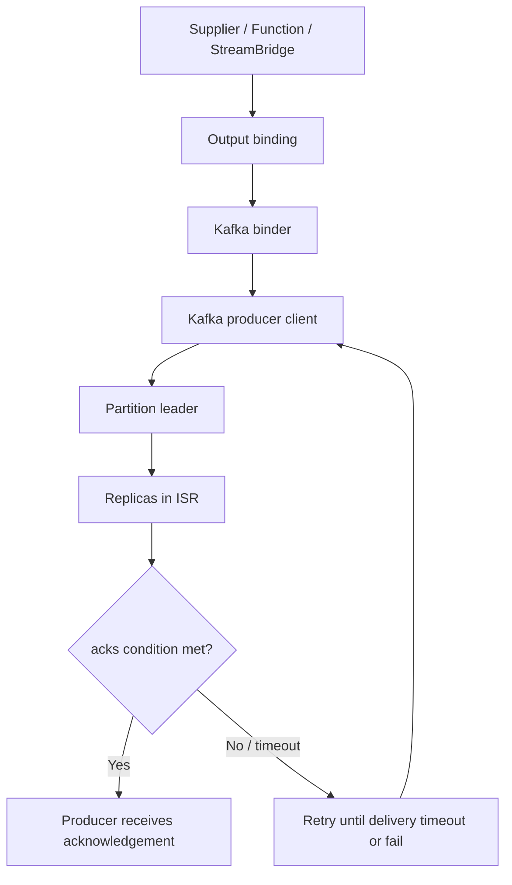
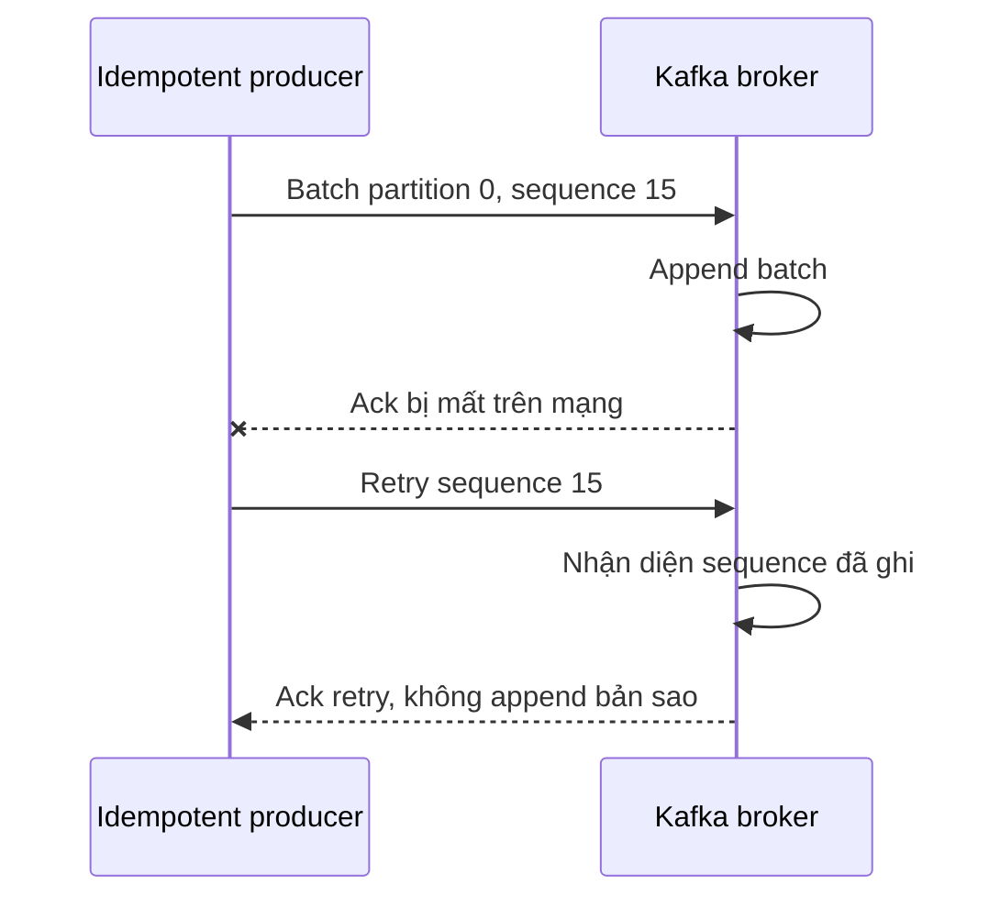

# acks, retries, idempotence và giới hạn bảo đảm của producer

## 1. Producer cần bảo đảm điều gì?

Khi ứng dụng gửi message tới Kafka, producer không chỉ chuyển byte đến broker. Nó còn phải xử lý trường hợp request bị timeout, broker leader thay đổi, replica chậm hoặc phản hồi xác nhận bị mất. Một lần gửi có thể thành công ở broker nhưng producer không nhận được phản hồi; nếu ứng dụng gửi lại, record có thể bị ghi trùng nếu cơ chế producer không nhận diện lần thử lại đó.

Kafka producer có ba nhóm cấu hình quan trọng:

- **`acks`:** mức xác nhận mà producer yêu cầu từ broker trước khi coi một lần gửi đã được xác nhận.
- **`retries` và timeout:** cách producer thử lại khi gửi thất bại tạm thời và giới hạn thời gian cho một lần gửi.
- **Idempotence:** khả năng broker nhận diện và loại bỏ bản ghi trùng do retry của cùng một producer session.

Các thuộc tính này phối hợp với replication factor, `min.insync.replicas`, cấu hình leader election và cách ứng dụng xử lý lỗi. Chúng nâng độ tin cậy của việc publish, nhưng không tự bảo đảm toàn bộ nghiệp vụ được thực hiện đúng một lần.

## 2. Luồng gửi của Kafka producer

Với Spring Cloud Stream, mã ứng dụng gửi message qua output binding. Kafka binder chuyển message thành record Kafka, gọi producer client và xử lý kết quả theo cấu hình binder.



Producer chọn partition theo record key hoặc partitioning strategy, gửi record đến leader của partition rồi chờ mức xác nhận đã cấu hình. Với `acks=all`, leader chờ các replica hiện nằm trong ISR (in-sync replicas) xác nhận theo giao thức replication trước khi trả thành công.

Binder quản lý kết nối và cấu hình producer; các thuộc tính `acks`, `retries` và `enable.idempotence` thuộc Kafka producer client. Khi cần kiểm soát chúng, hãy dùng cấu hình Kafka binder đúng cho output binding thay vì nhầm với các thuộc tính chung của Spring Cloud Stream.

## 3. Hiểu ba mức acks

`acks` quy định producer cần bao nhiêu xác nhận từ broker:

| Giá trị | Hành vi | Đánh đổi |
|---|---|---|
| `0` | Producer không chờ broker xác nhận | Độ trễ thấp, nhưng không biết broker đã nhận record hay chưa; có thể mất dữ liệu |
| `1` | Leader xác nhận sau khi ghi record vào log cục bộ | Nhanh hơn `all`, nhưng leader có thể lỗi trước khi replica khác nhận record |
| `all` hoặc `-1` | Leader chờ các replica hiện thuộc ISR xác nhận theo replication protocol | Độ bền cao hơn, nhưng có thể tăng độ trễ và từ chối ghi nếu ISR không đủ |

`acks=all` không có nghĩa mọi replica được cấu hình cho partition, kể cả replica đang offline hoặc ngoài ISR, đều đã xác nhận. Nó có nghĩa các replica đang thuộc ISR tham gia xác nhận. Vì vậy, cần kết hợp `acks=all` với replication factor và `min.insync.replicas` phù hợp.

### Ví dụ replication factor 3

Giả sử một topic có replication factor 3 và `min.insync.replicas=2`:

- Khi leader và ít nhất một follower còn đồng bộ, ISR có ít nhất hai replica; producer dùng `acks=all` có thể tiếp tục ghi.
- Nếu ISR giảm còn một replica, broker từ chối ghi với lỗi liên quan đến số replica không đủ.
- Khi replica phục hồi và bắt kịp leader, ISR có thể tăng lại và producer tiếp tục ghi.

Việc từ chối ghi khi ISR quá nhỏ là một phần của chính sách bảo vệ độ bền: hệ thống chọn báo lỗi thay vì xác nhận một bản ghi chỉ có một bản sao khi yêu cầu tối thiểu là hai.

## 4. Kết hợp acks với min.insync.replicas

`min.insync.replicas` là cấu hình phía broker/topic, không phải thuộc tính producer. Khi producer đặt `acks=all`, broker yêu cầu số replica trong ISR ít nhất bằng giá trị này trước khi chấp nhận ghi.

Ví dụ cấu hình topic:

```bash
kafka-topics.sh \
  --bootstrap-server localhost:9092 \
  --create \
  --topic orders.events \
  --partitions 12 \
  --replication-factor 3 \
  --config min.insync.replicas=2
```

Với topic đã tồn tại, có thể thay đổi cấu hình topic bằng lệnh cấu hình phù hợp với phiên bản Kafka, chẳng hạn `kafka-configs.sh --alter`. Cần kiểm tra quyền quản trị và lưu lại cấu hình hiện tại trước khi thay đổi.

### Ma trận lựa chọn

| Producer acks | min.insync.replicas | Hành vi và nhận xét |
|---|---:|---|
| `1` | `2` | `min.insync.replicas` không tạo cùng mức bảo đảm như `acks=all`; leader ack có thể trả trước khi follower đủ điều kiện xác nhận |
| `all` | `1` | Chờ toàn bộ ISR hiện có, nhưng có thể vẫn ghi khi chỉ còn một replica trong ISR |
| `all` | `2` | Yêu cầu ít nhất hai replica trong ISR; phù hợp khi muốn từ chối ghi nếu replication suy giảm dưới ngưỡng |
| `all` | `3` | Yêu cầu cả ba replica trong ISR; độ bền cao hơn theo cấu hình nhưng tính sẵn sàng ghi giảm khi một replica không đồng bộ |

Không có một cặp giá trị phù hợp cho mọi hệ thống. Chọn ngưỡng theo khả năng chịu mất dữ liệu, số broker, topology rack/zone và yêu cầu sẵn sàng của ứng dụng.

## 5. Retries: thử lại khi lỗi tạm thời

Producer có thể gặp lỗi tạm thời như:

- Broker leader vừa chuyển đổi.
- Request timeout hoặc phản hồi xác nhận bị mất.
- Network chập chờn.
- Replica tạm thời chưa bắt kịp leader.
- Broker từ chối tạm thời do quá tải hoặc giới hạn tài nguyên.

`retries` quy định số lần producer thử gửi lại khi gặp lỗi có thể retry. Nếu không retry, một lỗi mạng ngắn cũng có thể làm publish thất bại ngay. Nếu retry quá lâu, ứng dụng có thể giữ message trong bộ đệm và tăng độ trễ.

Kafka producer hiện đại thường kết hợp retry với `delivery.timeout.ms`. Thuộc tính này giới hạn tổng thời gian producer cho phép một record được gửi thành công, bao gồm thời gian chờ batch, request và các lần retry. Vì vậy, chỉ tăng `retries` không có nghĩa producer sẽ thử vô hạn trong thực tế; khi delivery timeout hết, lần gửi thất bại.

### Các timeout liên quan

| Thuộc tính | Vai trò |
|---|---|
| `request.timeout.ms` | Thời gian chờ phản hồi cho một request tới broker |
| `delivery.timeout.ms` | Tổng thời gian tối đa để một record được gửi thành công hoặc thất bại |
| `linger.ms` | Thời gian producer chờ gom thêm record vào batch trước khi gửi |
| `retry.backoff.ms` | Khoảng nghỉ giữa các lần retry trong các phiên bản hỗ trợ thuộc tính này |

`delivery.timeout.ms` phải tương thích với `request.timeout.ms` và `linger.ms` theo quy tắc của Kafka client. Hãy kiểm tra cấu hình của phiên bản Kafka client được binder kéo vào; tránh tăng timeout quá lớn mà không tính đến thời gian chờ của request HTTP hoặc tác vụ upstream.

## 6. Idempotent producer ngăn duplicate do retry

Khi producer gửi một record, broker có thể ghi record thành công nhưng phản hồi xác nhận bị mất trên đường về. Producer thấy timeout và không biết broker đã ghi hay chưa. Nếu gửi lại, broker có thể ghi thêm một bản sao.

Idempotent producer dùng producer ID và sequence number theo partition để broker nhận diện retry của cùng một batch từ cùng producer session. Nếu batch đã được ghi nhưng phản hồi bị mất, lần retry có cùng sequence được nhận diện là bản gửi lại, tránh append duplicate do retry đó.



Idempotence bảo vệ trường hợp retry giao thức trong cùng producer session. Nó không tự khử trùng lặp khi ứng dụng gọi `send` hai lần cho cùng một event nghiệp vụ với hai lần gửi độc lập, khi ứng dụng khởi động lại rồi tái tạo event, hoặc khi consumer xử lý lại một record.

### Cấu hình idempotence

Thuộc tính Kafka producer là:

```properties
enable.idempotence=true
acks=all
retries=2147483647
max.in.flight.requests.per.connection=5
```

Với Kafka client hiện đại, idempotence được bật mặc định trong nhiều phiên bản nếu các thuộc tính liên quan không xung đột. Tuy nhiên, khai báo tường minh trong cấu hình production giúp ý định rõ ràng và tránh vô tình vô hiệu hóa do thay đổi thuộc tính khác. Luôn xác minh mặc định theo phiên bản Kafka client.

Khi idempotence được bật, Kafka yêu cầu cấu hình tương thích: `acks=all`, `retries` lớn hơn 0 và `max.in.flight.requests.per.connection` không vượt quá giới hạn hỗ trợ (5 ở các phiên bản Kafka hiện đại). Nếu cấu hình mâu thuẫn, client có thể từ chối khởi tạo hoặc tự điều chỉnh theo phiên bản; không dựa vào hành vi ngầm.

## 7. Cấu hình Kafka producer qua Spring Cloud Stream

Spring Cloud Stream Kafka binder cho phép đặt thuộc tính Kafka producer theo binding. Ví dụ một function phát event đơn hàng:

```java
import java.util.function.Function;
import org.springframework.context.annotation.Bean;
import org.springframework.context.annotation.Configuration;

record OrderCreated(String eventId, String orderId, long totalCents) {}
record OrderAccepted(String eventId, String orderId, String status) {}

@Configuration
class OrderProducerFunctions {

    @Bean
    Function<OrderCreated, OrderAccepted> publishOrder() {
        return event -> new OrderAccepted(
            event.eventId(), event.orderId(), "ACCEPTED"
        );
    }
}
```

Cấu hình binding và producer:

```yaml
spring:
  cloud:
    function:
      definition: publishOrder
    stream:
      bindings:
        publishOrder-out-0:
          destination: orders.accepted
          content-type: application/json
      kafka:
        binder:
          brokers: localhost:9092
        bindings:
          publishOrder-out-0:
            producer:
              configuration:
                acks: all
                enable.idempotence: true
                retries: 2147483647
                max.in.flight.requests.per.connection: 5
                request.timeout.ms: 30000
                delivery.timeout.ms: 120000
```

Các thuộc tính trong `spring.cloud.stream.kafka.bindings.<bindingName>.producer.configuration` được chuyển tới Kafka producer client theo hỗ trợ của phiên bản binder. Tên thuộc tính client dùng đúng dạng Kafka, kể cả các key có dấu chấm. Nếu ứng dụng cấu hình nhiều output binding, có thể đặt chính sách riêng cho từng binding.

Không nhầm `spring.cloud.stream.bindings.<name>.producer` với `spring.cloud.stream.kafka.bindings.<name>.producer`: nhóm đầu là thuộc tính producer chung của Spring Cloud Stream, nhóm sau là thuộc tính đặc thù Kafka binder.

## 8. Cấu hình đồng bộ và bất đồng bộ khi gửi

Kafka producer client gửi bất đồng bộ theo mặc định: lời gọi gửi đưa record vào bộ đệm và callback/future nhận kết quả khi broker phản hồi. Điều này giúp tăng throughput và gom batch.

Kafka binder có thuộc tính producer `sync` để yêu cầu gửi đồng bộ theo khả năng của binder:

```yaml
spring:
  cloud:
    stream:
      kafka:
        bindings:
          publishOrder-out-0:
            producer:
              sync: true
              configuration:
                acks: all
                enable.idempotence: true
```

Với `sync: true`, luồng gửi chờ kết quả producer theo cách binder triển khai; lỗi gửi có thể được ném lại trong luồng gọi thay vì chỉ xuất hiện qua callback bất đồng bộ. Điều này làm tăng độ trễ và có thể giảm throughput. Kiểm tra tên thuộc tính, timeout và semantics trong phiên bản Kafka binder đang sử dụng.

Nếu dùng gửi bất đồng bộ, cần có cách quan sát lỗi callback/producer error channel phù hợp. Không được coi việc function trả về hoặc `StreamBridge.send` trả về `true` là bằng chứng rằng broker đã xác nhận record, trừ khi cấu hình gửi đồng bộ và API đang dùng định nghĩa rõ điều đó.

## 9. acks, retries và idempotence phối hợp ra sao?

Ba thuộc tính giải quyết các vấn đề khác nhau:

| Thuộc tính | Câu hỏi được trả lời |
|---|---|
| `acks` | Broker cần xác nhận ở mức nào trước khi producer nhận thành công? |
| `retries` | Producer thử lại lỗi tạm thời bao nhiêu lần trong giới hạn delivery timeout? |
| `enable.idempotence` | Broker có thể nhận diện retry của cùng batch để tránh ghi trùng hay không? |

Một cấu hình thường dùng cho event quan trọng:

- `acks=all` để chờ ISR xác nhận.
- Topic replication factor 3 và `min.insync.replicas=2` để yêu cầu ít nhất hai replica đồng bộ.
- `enable.idempotence=true` để chống duplicate do retry trong producer session.
- `retries` đủ lớn và `delivery.timeout.ms` được chọn theo SLO.
- `max.in.flight.requests.per.connection` không vượt quá giới hạn idempotent producer.

Đây là một điểm khởi đầu, không phải bộ giá trị bắt buộc cho mọi workload. Producer có thể báo lỗi khi ISR không đủ; ứng dụng phải quyết định trả lỗi cho caller, lưu outbox hoặc retry ở tầng cao hơn.

## 10. Giới hạn của idempotent producer

Idempotence của Kafka producer không có nghĩa mỗi event nghiệp vụ chỉ tồn tại một lần trong mọi tình huống. Các trường hợp sau vẫn có thể tạo duplicate:

1. Controller nhận cùng request hai lần và tạo hai lần gọi publish độc lập.
2. Ứng dụng khởi động lại, đọc lại dữ liệu nguồn và gửi lại cùng event với producer session mới.
3. Outbox relay publish thành công nhưng dừng trước khi đánh dấu bản ghi đã gửi.
4. Consumer đã cập nhật database nhưng dừng trước khi offset được commit; broker giao lại record.
5. Hai service khác nhau cùng phát một event logic vì không có idempotency key chung.

Để chống trùng ở tầng nghiệp vụ, dùng event ID ổn định và cơ chế idempotency tại consumer hoặc API đích. Producer idempotence và consumer idempotency bảo vệ hai ranh giới khác nhau.

## 11. Giới hạn của acks=all và replication

`acks=all` nâng mức xác nhận nhưng không phải cam kết dữ liệu bất khả mất. Một số giới hạn cần hiểu:

- ISR có thể thay đổi khi replica bị chậm hoặc mất kết nối.
- Nếu `min.insync.replicas` đặt quá thấp, `acks=all` vẫn có thể chấp nhận ghi với ít bản sao hơn mong muốn.
- Nếu cấu hình unclean leader election cho phép replica ngoài ISR trở thành leader, có thể mất các record chưa được replica đó nhận.
- Lỗi đồng thời của nhiều broker, lỗi ổ đĩa, lỗi vùng mạng hoặc thao tác quản trị có thể vượt ngoài giả định replication thông thường.
- Retention hoặc compaction có thể xóa dữ liệu theo chính sách sau khi record đã được ghi thành công.

Với topic quan trọng, xem xét replication factor, `min.insync.replicas`, rack awareness, `unclean.leader.election.enable`, storage durability, backup/replication liên vùng và quy trình khôi phục. Cấu hình producer chỉ là một phần của thiết kế độ bền.

## 12. Producer acknowledgement không phải consumer acknowledgement

Khi producer nhận ack từ Kafka với `acks=all`, điều đó nói về việc broker đã chấp nhận record theo replication policy. Nó không nói consumer đã đọc, xử lý hoặc commit offset.

Các mốc khác nhau:

| Mốc | Ý nghĩa |
|---|---|
| `send()` được gọi | Ứng dụng bắt đầu gửi record |
| Record được đưa vào producer buffer | Client đã nhận record để xử lý gửi |
| Producer nhận broker ack | Broker xác nhận theo `acks` và replication state |
| Consumer đọc record | Consumer group đã fetch record |
| Consumer xử lý thành công | Logic ứng dụng đã hoàn tất tác dụng phụ |
| Consumer commit offset | Tiến độ group được ghi nhận để tiếp tục sau restart |

Không suy ra mốc sau từ mốc trước. Nếu nghiệp vụ cần biết consumer đã hoàn tất, cần một event phản hồi/ack nghiệp vụ riêng hoặc cơ chế trạng thái xử lý ở tầng ứng dụng.

## 13. Producer transaction và giới hạn end-to-end

Kafka transaction có thể gộp nhiều record đầu ra và offset đầu vào trong một transaction Kafka khi ứng dụng/binder được cấu hình theo mô hình consume-transform-produce được hỗ trợ. Transaction này mở rộng bảo đảm trong phạm vi Kafka.

Nó không tự bao gồm:

- Commit database PostgreSQL/MySQL.
- Gọi REST API hoặc thanh toán bên ngoài.
- Gửi email, SMS hoặc push notification.
- Publish sang RabbitMQ hoặc Pulsar.
- Tác dụng phụ ở một dịch vụ khác.

Nếu cần gắn cập nhật database với event phát ra, cân nhắc transactional outbox. Outbox ghi dữ liệu nghiệp vụ và bản ghi cần publish trong cùng database transaction; relay gửi lại cho đến khi hoàn tất. Vì relay có thể publish lặp sau sự cố, consumer vẫn cần idempotency theo event ID.

## 14. Xử lý lỗi producer trong ứng dụng

Khi producer không thể gửi trong thời gian cho phép, lỗi có thể xuất hiện ở callback, future, binder error channel hoặc ngay trong luồng gọi nếu gửi đồng bộ. Ứng dụng cần phân biệt lỗi tạm thời và lỗi cấu hình/dữ liệu:

| Lỗi | Hướng xử lý |
|---|---|
| Timeout, leader change, network tạm thời | Cho producer retry trong delivery timeout; sau đó xử lý lỗi ở tầng ứng dụng |
| NotEnoughReplicas | Kiểm tra ISR, broker health và `min.insync.replicas`; không hạ ngưỡng tùy tiện |
| Record quá lớn | Kiểm tra giới hạn message ở producer, broker và consumer; không retry nguyên trạng vô hạn |
| Serialization failure | Sửa schema/serializer hoặc đưa dữ liệu lỗi vào luồng xử lý riêng |
| Authorization failure | Kiểm tra ACL/credential; retry không sửa được quyền bị thiếu |

Nếu dùng `StreamBridge`, kết quả boolean phản ánh việc gửi được chấp nhận ở mức API. Để xử lý lỗi broker cụ thể, cấu hình và quan sát producer error handling của Kafka binder. Với luồng HTTP, không trả thành công cho caller nếu ứng dụng chưa đạt mức xác nhận mà API cam kết.

Không retry ở nhiều tầng mà không tính tổng số lần thử. Producer có retry nội bộ; service có thể retry `send`; HTTP client có thể retry request; caller cũng có thể gửi lại. Các tầng cộng dồn có thể tạo tải đột biến và duplicate. Chọn một nơi chịu trách nhiệm retry chính, đặt backoff/jitter và idempotency key.

## 15. Kiểm thử producer reliability

Kiểm thử cần bao gồm cả thành công và sự cố:

1. Xác nhận binding dùng đúng Kafka cluster và destination.
2. Kiểm tra record key, payload, header và serializer.
3. Dừng một broker để quan sát leader election và retry.
4. Giảm ISR dưới `min.insync.replicas` để xác nhận producer nhận lỗi thay vì ghi với mức replica thấp hơn yêu cầu.
5. Làm mất phản hồi ack sau khi broker đã ghi để kiểm tra idempotent retry.
6. Gửi lại cùng event từ ứng dụng bằng hai lệnh độc lập để xác nhận producer idempotence không thay thế business deduplication.
7. Kiểm tra delivery timeout, callback/error channel và cách ứng dụng phản hồi khi gửi thất bại.
8. Kiểm tra restart producer, transaction fencing và quyền ACL.

Test binder có thể xác nhận logic function và binding ở mức Spring Cloud Stream. Các kiểm thử về ISR, leader election, idempotent sequence và broker acknowledgement cần Kafka thật hoặc môi trường integration phù hợp.

## 16. Quan sát producer trong production

Theo dõi metric producer và broker để phát hiện lỗi trước khi chúng thành backlog:

- Record send rate và byte rate.
- Request latency, record retry rate và error rate.
- Record queue time và batch size.
- Request timeout, delivery timeout và producer buffer availability.
- Số lần lỗi NotEnoughReplicas hoặc lỗi authorization.
- ISR shrink/expand, under-replicated partition và offline partition.
- Tỷ lệ lỗi ở producer error channel và số message outbox chờ publish.

Log nên có binding name, topic, partition, event ID và correlation ID. Không log payload nhạy cảm hoặc credential. Cảnh báo khi retry tăng kéo dài, buffer cạn, delivery timeout tăng hoặc ISR suy giảm.

## 17. Quy trình chọn cấu hình cho producer

1. Xác định mức mất dữ liệu có thể chấp nhận và latency SLO.
2. Chọn replication factor và `min.insync.replicas` cho topic.
3. Chọn `acks` tương ứng; với event quan trọng thường cân nhắc `all`.
4. Bật idempotent producer và giữ các thuộc tính tương thích.
5. Đặt retry, request timeout và delivery timeout theo thời gian phục hồi dự kiến.
6. Cấu hình đúng Kafka producer properties dưới binding của Kafka binder.
7. Quyết định gửi đồng bộ hay bất đồng bộ và thiết kế đường quan sát lỗi.
8. Dùng event ID và consumer idempotency để bảo vệ nghiệp vụ khỏi gửi/nhận lặp.
9. Kiểm thử broker failure, ISR shrink, timeout, restart và duplicate ở môi trường tích hợp.
10. Theo dõi metric producer, ISR và backlog sau triển khai.

`acks`, `retries` và idempotence tạo thành nền tảng cho producer Kafka đáng tin cậy: `acks` quyết định mức xác nhận, retry giúp vượt qua lỗi tạm thời, còn idempotence ngăn duplicate do retry của cùng producer session. Bảo đảm này vẫn nằm trong phạm vi producer và broker. Để bảo vệ toàn bộ nghiệp vụ, cần replication phù hợp, kiểm soát lỗi gửi, event ID ổn định, idempotent consumer và outbox/inbox tại ranh giới database.

