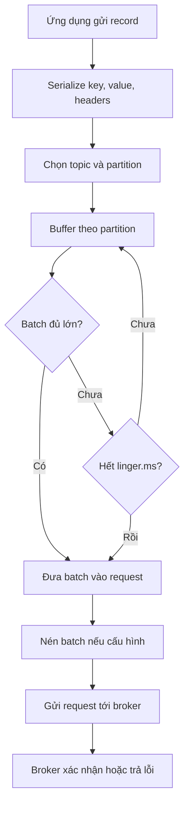

# Batching, linger, compression và kích thước bản ghi

Kafka producer không nhất thiết gửi từng record thành một request riêng. Client gom các record thuộc cùng partition vào một batch, đợi batch đủ lớn hoặc hết thời gian chờ rồi gửi tới broker. Cấu hình `batch.size`, `linger.ms` và `compression.type` quyết định cách gom, thời điểm gửi và cách nén dữ liệu. Các giới hạn kích thước như `max.request.size` ở producer và `message.max.bytes`/`max.message.bytes` ở broker quyết định request hoặc record batch nào được chấp nhận.

Trong Spring Cloud Stream, Kafka Binder tạo và cấu hình Kafka producer phía dưới. Có thể truyền các thuộc tính producer native qua cấu hình của từng output binding. Việc điều chỉnh cần dựa trên lưu lượng thực tế, số partition, kích thước payload và yêu cầu độ trễ. Tăng batch hoặc linger có thể cải thiện throughput và compression ratio, nhưng cũng có thể làm message phải chờ lâu hơn trước khi được gửi.

## 1. Kafka producer gom record thành batch như thế nào?

Producer serialize key, value và headers thành record, sau đó đưa record vào bộ đệm theo partition đích. Mỗi partition có batch riêng. Khi batch đạt kích thước mục tiêu, hoặc khi thời gian chờ đã hết, producer gửi các batch sẵn sàng trong một request tới broker.



Batching là hành vi nội bộ của Kafka producer. Ứng dụng vẫn có thể gọi `StreamBridge.send(...)` hoặc phát từng phần tử từ `Supplier`; producer tự gom record theo partition. Đây không phải thao tác gom nhiều payload thành một object nghiệp vụ, cũng không phải `batch-mode` ở phía consumer.

Vì batch được tổ chức theo partition, các record có cùng key thường được đưa về cùng partition theo partitioner đang dùng. Nếu traffic phân tán đều trên nhiều partition nhưng mỗi partition chỉ nhận ít record, nhiều batch có thể không đầy và được gửi khi hết `linger.ms`. Nếu một partition nhận phần lớn traffic, batch của partition đó có thể đầy nhanh trong khi các partition khác còn thưa.

## 2. `batch.size`: kích thước mục tiêu của batch

`batch.size` là số byte mục tiêu mà producer dành cho một batch record của mỗi partition. Khi batch gần đạt giới hạn này, producer có thể gửi batch mà không cần đợi hết `linger.ms`.

Ví dụ cấu hình tăng batch mục tiêu lên 64 KiB:

```yaml
spring:
  cloud:
    stream:
      bindings:
        orders-out-0:
          destination: orders.created
          content-type: application/json
      kafka:
        bindings:
          orders-out-0:
            producer:
              configuration:
                batch.size: 65536
```

`65536` là số byte, tương đương 64 KiB. Đây là cấu hình native Kafka producer áp dụng cho output binding `orders-out-0`. Tên binding phải khớp với binding thực tế của ứng dụng.

Một số điểm cần hiểu:

- `batch.size` là mục tiêu dung lượng batch, không phải yêu cầu producer phải chờ cho đủ số byte mới gửi.
- Batch chưa đầy vẫn có thể được gửi khi hết `linger.ms`, khi ứng dụng gọi `flush()` hoặc khi producer đóng theo lifecycle.
- Một record đơn lẻ lớn hơn `batch.size` vẫn có thể được đưa vào một batch riêng đủ chỗ cho record đó; `batch.size` không phải giới hạn cứng cho kích thước một record.
- Producer có thể cần bộ nhớ cho nhiều batch cùng lúc, đặc biệt khi có nhiều partition đang hoạt động.

Tăng `batch.size` có thể giảm số request và cải thiện hiệu quả nén khi có đủ traffic trên từng partition. Đổi lại, bộ nhớ buffer có thể tăng và một số record phải chờ lâu hơn để batch hình thành. Không tăng giá trị này chỉ vì muốn “batch càng lớn càng tốt”; hãy đo batch-size thực tế và tỷ lệ sử dụng batch.

## 3. `linger.ms`: thời gian chờ để gom thêm record

`linger.ms` đặt khoảng thời gian producer có thể chờ để gom thêm record vào batch trước khi gửi batch chưa đầy. Giá trị được tính bằng mili giây.

Ví dụ đặt linger 10 ms:

```yaml
spring:
  cloud:
    stream:
      kafka:
        bindings:
          orders-out-0:
            producer:
              configuration:
                linger.ms: 10
```

Giá trị này tạo một khoảng chờ tối đa có chủ đích cho batch chưa đầy, nhưng không có nghĩa mọi record đều bị giữ đúng 10 ms. Batch có thể đầy và được gửi sớm hơn. Tải cao thường làm batch đầy nhanh; tải thấp có thể khiến producer chờ gần hết linger trước khi gửi batch nhỏ.

### 3.1. Đánh đổi độ trễ và throughput

| Thiết lập | Lợi ích thường thấy | Chi phí hoặc rủi ro |
|---|---|---|
| `linger.ms` thấp | Record được gửi sớm hơn khi traffic thưa | Batch có thể nhỏ, nhiều request hơn và hiệu quả nén thấp hơn |
| `linger.ms` cao hơn | Có thêm cơ hội gom record, giảm request rate và tăng compression ratio | Tăng thời gian chờ trước khi gửi, nhất là ở partition ít traffic |
| `batch.size` nhỏ | Giới hạn dung lượng mỗi batch, phù hợp một số luồng nhỏ/độ trễ thấp | Batch đầy nhanh và có thể tăng số request |
| `batch.size` lớn | Cho phép batch lớn hơn khi traffic đủ | Tăng nhu cầu bộ nhớ; nếu traffic thưa, batch vẫn có thể được gửi khi linger hết mà không đầy |

Không nên cộng `linger.ms` vào mọi request latency như một hằng số chính xác. Độ trễ thực tế còn phụ thuộc batch đã đầy hay chưa, buffer producer, scheduling, mạng, broker load và xác nhận gửi. Cần đo p50, p95, p99 end-to-end trong tải đại diện.

## 4. `compression.type`: nén batch trước khi gửi

Kafka producer nén record batch trước khi gửi tới broker. Nén có thể giảm lượng dữ liệu qua mạng và dung lượng lưu trữ, đồng thời tăng hiệu quả khi batch chứa các record có cấu trúc hoặc nội dung lặp lại.

Các codec thường gặp:

| Codec | Đặc điểm tổng quát | Khi cân nhắc |
|---|---|---|
| `none` | Không nén | Payload đã nén, record nhỏ hoặc CPU cần dành cho tác vụ khác |
| `gzip` | Thường cho tỷ lệ nén tốt nhưng tốn CPU hơn | Mạng hoặc dung lượng lưu trữ là nút thắt và chấp nhận chi phí CPU |
| `snappy` | Nén/giải nén nhanh, tỷ lệ nén vừa phải | Cần giảm băng thông với chi phí CPU tương đối thấp |
| `lz4` | Thường ưu tiên tốc độ nén/giải nén | Luồng throughput cao, cần cân bằng CPU và băng thông |
| `zstd` | Có thể đạt tỷ lệ nén tốt với nhiều mức cân bằng tốc độ | Client/broker hỗ trợ và đã benchmark với dữ liệu thực tế |

Cấu hình ví dụ:

```yaml
spring:
  cloud:
    stream:
      kafka:
        bindings:
          orders-out-0:
            producer:
              configuration:
                compression.type: zstd
```

Tên codec và khả năng sử dụng phụ thuộc phiên bản Kafka client/broker và thư viện native có sẵn. Hãy kiểm tra phiên bản triển khai và thử codec trên đúng loại dữ liệu. Payload JSON có nhiều tên trường, cấu trúc lặp có thể nén tốt; payload ảnh hoặc file đã nén có thể không giảm nhiều.

### 4.1. Nén hiệu quả hơn khi batch đủ lớn

Compression được áp dụng trên record batch, không phải nhất thiết từng message độc lập. Batch có nhiều record thường cho codec nhiều dữ liệu lặp lại hơn để khai thác. Vì vậy, `batch.size` và `linger.ms` có ảnh hưởng gián tiếp đến compression ratio.

Nén không miễn phí. Producer cần CPU để nén và broker/consumer cần CPU để xử lý dữ liệu nén. Nếu mạng không phải nút thắt, codec nén mạnh có thể làm tăng CPU và độ trễ mà không mang lại lợi ích tương xứng. Hãy so sánh throughput, request size, compression rate và CPU giữa các codec.

## 5. Kích thước record, batch và request khác nhau

Các giới hạn kích thước thường bị nhầm lẫn:

| Thuộc tính | Phạm vi | Ý nghĩa |
|---|---|---|
| `batch.size` | Kafka producer, theo partition | Kích thước mục tiêu của một batch trong buffer |
| `max.request.size` | Kafka producer | Giới hạn kích thước request gửi; ảnh hưởng lượng batch có thể đưa vào một request |
| `message.max.bytes` | Kafka broker | Giới hạn kích thước record batch mà broker chấp nhận |
| `max.message.bytes` | Topic-level Kafka configuration | Override giới hạn batch tối đa cho topic |
| `max.partition.fetch.bytes` | Kafka consumer | Giới hạn dữ liệu fetch cho một partition trong một lần fetch |
| `fetch.max.bytes` | Kafka consumer | Giới hạn tổng dữ liệu fetch trong một request |

Kích thước record được tính sau serialization và gồm key, value, headers cùng overhead định dạng. Kích thước batch còn gồm nhiều record và overhead batch. Request có thể chứa nhiều batch của nhiều partition. Vì vậy, một payload có vẻ nhỏ trong Java có thể lớn hơn sau serialization hoặc khi có nhiều header.

### 5.1. `max.request.size` ở producer

`max.request.size` giới hạn kích thước request producer có thể gửi. Nếu request vượt giới hạn, producer có thể báo lỗi trước khi broker chấp nhận. Thuộc tính này không thay thế giới hạn batch ở broker.

Ví dụ tăng giới hạn request lên 2 MiB:

```yaml
spring:
  cloud:
    stream:
      kafka:
        bindings:
          orders-out-0:
            producer:
              configuration:
                max.request.size: 2097152
```

Tăng giới hạn producer một mình không bảo đảm broker chấp nhận record batch lớn. Cần đối chiếu `message.max.bytes` ở broker và `max.message.bytes` ở topic, cũng như fetch limits ở consumer. Chỉ tăng giới hạn tới mức ứng dụng thực sự cần; request lớn làm tăng bộ nhớ, thời gian truyền và tác động khi retry.

### 5.2. Giới hạn ở broker và topic

Broker dùng `message.max.bytes` để giới hạn kích thước record batch. Có thể đặt override ở topic bằng `max.message.bytes`. Ví dụ cấu hình topic qua công cụ Kafka:

```bash
kafka-configs.sh \
  --bootstrap-server kafka-1:9092 \
  --entity-type topics \
  --entity-name orders.created \
  --alter \
  --add-config max.message.bytes=2097152
```

Lệnh trên thay đổi cấu hình topic. Chỉ thực hiện trong môi trường được quản trị, sau khi xác định tác động lên broker, replication, consumer và dung lượng. Giá trị cần tương thích với `max.request.size` của producer và khả năng fetch của consumer. Các giới hạn có thể thay đổi theo phiên bản Kafka và cấu hình cluster; kiểm tra cấu hình thực tế thay vì giả định giá trị mặc định.

### 5.3. Consumer cũng cần đọc được batch lớn

Nếu producer gửi record batch lớn hơn giới hạn fetch mà consumer đang cấu hình, consumer có thể gặp lỗi hoặc tiến độ đọc bị ảnh hưởng. Kiểm tra `max.partition.fetch.bytes` và `fetch.max.bytes` ở consumer khi cho phép record lớn. Kafka consumer có cơ chế đặc biệt để có thể trả về batch đầu tiên vượt một số fetch limit nhằm bảo đảm tiến triển, nhưng không nên dựa vào điều đó thay cho cấu hình đồng bộ và kiểm thử.

## 6. Cấu hình kết hợp cho output binding

Có thể đặt các thuộc tính producer trong cùng một cấu hình binding:

```yaml
spring:
  cloud:
    stream:
      bindings:
        orders-out-0:
          destination: orders.created
          content-type: application/json
      kafka:
        bindings:
          orders-out-0:
            producer:
              configuration:
                batch.size: 65536
                linger.ms: 10
                compression.type: lz4
                max.request.size: 2097152
                buffer.memory: 67108864
```

Trong ví dụ:

- `batch.size: 65536` đặt batch mục tiêu 64 KiB cho mỗi partition.
- `linger.ms: 10` cho producer thêm thời gian gom record khi batch chưa đầy.
- `compression.type: lz4` bật nén batch bằng LZ4 nếu client/broker hỗ trợ.
- `max.request.size: 2097152` đặt giới hạn request producer 2 MiB.
- `buffer.memory: 67108864` đặt tổng bộ nhớ buffer producer 64 MiB để chứa record đang chờ gửi.

`configuration` chuyển các thuộc tính native Kafka producer tới client được tạo cho binding. Nếu cần cấu hình chung cho nhiều binding, có thể dùng cấu hình ở cấp Kafka Binder; cấu hình riêng theo binding giúp tránh áp dụng một mức batch hoặc giới hạn record cho mọi luồng ngoài ý muốn. Kiểm tra thứ tự ưu tiên và tên thuộc tính theo phiên bản Spring Cloud Stream đang sử dụng.

Không dùng các giá trị trên như một bộ thông số mặc định cho mọi production. Chúng chỉ là điểm bắt đầu minh họa. Tải, số partition, kích thước payload, broker capacity và latency objective của từng hệ thống sẽ quyết định cấu hình phù hợp.

## 7. Buffer producer và áp lực bộ nhớ

`buffer.memory` là tổng bộ nhớ producer dành cho record đang chờ được gửi. Khi tốc độ ứng dụng tạo record vượt tốc độ broker nhận trong một khoảng thời gian, buffer có thể đầy. Lúc đó `send()` có thể block chờ buffer hoặc metadata đến giới hạn `max.block.ms`, rồi phát sinh lỗi nếu không giải phóng được.

Tăng `buffer.memory` có thể hấp thụ burst ngắn, nhưng không giải quyết được tình trạng broker liên tục chậm hơn producer. Nếu chỉ tăng buffer, ứng dụng có thể giữ nhiều dữ liệu trong RAM hơn và trì hoãn việc phát hiện quá tải. Cần theo dõi `buffer-available-bytes`, số thread chờ buffer, request latency, retry và record error rate.

Một số nguyên tắc:

- Giới hạn tốc độ đầu vào hoặc dùng backpressure ở tầng ứng dụng nếu producer không theo kịp.
- Không tăng `buffer.memory` vô hạn để che broker bottleneck.
- Đặt `max.block.ms` phù hợp với SLA của request gọi producer.
- Theo dõi heap và số partition vì batch buffer có thể được phân bổ theo partition hoạt động.
- Với tác vụ phát sự kiện quan trọng, cân nhắc outbox bền vững thay vì giữ backlog chỉ trong RAM.

## 8. Chọn cấu hình theo đặc điểm workload

Không có một cấu hình tối ưu cho mọi luồng. Hãy bắt đầu từ yêu cầu nghiệp vụ:

| Workload | Hướng điều chỉnh để thử | Điều cần theo dõi |
|---|---|---|
| Event nhỏ, cần latency thấp | `linger.ms` thấp; batch vừa phải; chọn codec nhanh hoặc không nén nếu CPU là giới hạn | p95/p99 latency, request rate |
| Event nhỏ, throughput cao | Tăng batch và linger vừa phải; thử LZ4/Snappy/Zstd | Batch size, compression ratio, CPU, throughput |
| Payload lớn | Đặt giới hạn producer/broker/consumer đồng bộ; cân nhắc lưu object ngoài broker và gửi reference | Record size, request size, fetch errors, memory |
| Traffic không đều, có burst | Buffer đủ cho burst ngắn và giới hạn thời gian chờ; kiểm tra khả năng phục hồi sau burst | Buffer available, producer blocking, consumer lag |
| Nhiều partition nhưng traffic mỗi partition thấp | Không đặt linger quá cao nếu cần latency; đánh giá số partition có thực sự cần thiết | Batch utilization theo partition và latency |
| Dữ liệu đã nén ở tầng ứng dụng | So sánh `compression.type=none` với codec nhẹ | CPU và compression ratio thực tế |

Nếu payload thường là file lớn hoặc blob nhị phân, cân nhắc lưu nội dung ở object storage rồi gửi URI/reference cùng checksum và metadata qua Kafka. Cách này giảm áp lực kích thước record và cho phép quản lý vòng đời file riêng, nhưng cần bảo đảm quyền truy cập, tính sẵn sàng và thời gian lưu của object.

## 9. Đo lường và benchmark

Trước khi thay đổi cấu hình production, hãy benchmark bằng dữ liệu đại diện. Tạo các nhóm payload nhỏ, trung bình và lớn; mô phỏng traffic đều, burst, phân bố key lệch và số partition thực tế. So sánh từng cấu hình một để biết thay đổi nào tạo ra kết quả.

Các metric Kafka producer hữu ích gồm:

- `record-send-rate` và `record-send-total`: tốc độ/số lượng record gửi.
- `record-size-avg` và `record-size-max`: kích thước record trung bình/lớn nhất.
- `batch-size-avg` và `batch-size-max`: kích thước batch thực tế.
- `compression-rate-avg`: tỷ lệ nén quan sát được theo metric của client.
- `request-size-avg` và `request-size-max`: kích thước request gửi broker.
- `request-latency-avg` và `request-latency-max`: độ trễ request.
- `buffer-available-bytes` và `waiting-threads`: áp lực buffer producer.
- `record-error-rate` và `record-retry-rate`: lỗi và retry gửi record.

Tên metric và cách export phụ thuộc Kafka client, Micrometer binder và hệ thống quan sát. Không phải ứng dụng nào cũng tự động xuất toàn bộ metric này; cần bật và scrape đúng client metrics.

Đo thêm phía broker và consumer: network throughput, request queue, disk throughput, under-replicated partitions, consumer lag và thời gian fetch. Một cấu hình producer tốt không có ích nếu consumer không theo kịp hoặc broker bị giới hạn bởi disk/network.

## 10. Lỗi thường gặp và cách xử lý

| Triệu chứng | Nguyên nhân có thể | Hướng xử lý |
|---|---|---|
| Producer báo record/request quá lớn | `max.request.size` thấp hoặc batch vượt `message.max.bytes`/`max.message.bytes` | Kiểm tra kích thước sau serialization; đồng bộ giới hạn producer, broker, topic và consumer |
| Tăng `batch.size` nhưng batch thực tế vẫn nhỏ | Traffic thấp hoặc phân tán trên nhiều partition; linger hết trước khi batch đầy | Xem `batch-size-avg`, partition distribution và `linger.ms` |
| Tăng `linger.ms` làm API chậm | Record phải chờ thêm để gom batch, nhất là partition ít traffic | Giảm linger hoặc chỉ tăng ở binding throughput cao; đo p95/p99 |
| Compression làm CPU tăng mạnh | Codec tốn CPU hoặc payload vốn đã nén | Benchmark codec khác hoặc tắt nén cho binding đó |
| Compression ratio thấp | Batch nhỏ, dữ liệu ngẫu nhiên hoặc đã nén | Kiểm tra batch utilization và bản chất payload |
| Producer block khi gửi | Buffer đầy, broker chậm hoặc metadata chưa sẵn sàng | Kiểm tra buffer metrics, broker latency, `buffer.memory` và `max.block.ms` |
| Producer gửi được nhưng consumer lỗi fetch | Consumer fetch limit thấp hoặc record batch lớn | Kiểm tra `max.partition.fetch.bytes` và `fetch.max.bytes` |
| Chỉ một số partition tạo batch đầy | Key phân bố lệch hoặc traffic không đều | Kiểm tra partition key, skew và consumer/producer distribution |

Đọc nguyên nhân gốc từ Kafka client exception. `RecordTooLargeException`, lỗi broker từ chối request hoặc timeout có thể xuất hiện ở những lớp khác nhau. Không chỉ tăng mọi giới hạn cùng lúc; xác định giới hạn nào thực sự bị chạm và điều chỉnh có kiểm soát.

## 11. Quy trình thay đổi cấu hình an toàn

1. Ghi nhận phiên bản Spring Cloud Stream, Kafka Binder, Kafka client và broker.
2. Đo baseline: throughput, p95/p99 latency, batch size, compression ratio, request size, CPU, network và consumer lag.
3. Xác định binding cần tối ưu; tránh thay đổi cấu hình chung nếu chỉ một topic có workload khác biệt.
4. Thay đổi từng nhóm nhỏ: trước tiên batch/linger, sau đó compression, cuối cùng các giới hạn kích thước nếu cần.
5. Chạy benchmark với payload và partition distribution đại diện.
6. Xác nhận consumer fetch được record batch mới và broker chấp nhận kích thước đó.
7. Triển khai canary hoặc một nhóm producer nhỏ, theo dõi lỗi, latency, lag và tài nguyên.
8. Giữ cấu hình rollback và ghi rõ thay đổi để có thể phục hồi khi SLA xấu đi.

Đừng nâng giới hạn record lớn mà không xem xét tác động tới memory, replication và fetch. Một record batch lớn có thể tăng thời gian truyền, làm consumer cần nhiều bộ nhớ hơn và làm phục hồi sau lỗi chậm hơn.

## 12. Danh sách kiểm tra trước khi triển khai

- [ ] Hiểu Kafka producer gom batch riêng theo partition.
- [ ] `batch.size` được chọn theo throughput, số partition và ngân sách bộ nhớ.
- [ ] `linger.ms` được chọn theo tradeoff giữa batching và latency.
- [ ] `compression.type` được benchmark với payload thật và phiên bản client/broker.
- [ ] Phân biệt `batch.size`, `max.request.size`, `message.max.bytes` và topic `max.message.bytes`.
- [ ] Kiểm tra consumer `max.partition.fetch.bytes` và `fetch.max.bytes` khi gửi batch lớn.
- [ ] Cấu hình producer native trong đúng output binding của Kafka Binder.
- [ ] `buffer.memory` và `max.block.ms` phù hợp với burst và SLA.
- [ ] Có metric batch size, compression ratio, request size, buffer pressure và error rate.
- [ ] Benchmark p95/p99, throughput, CPU, network, broker load và consumer lag.
- [ ] Có kế hoạch canary/rollback khi thay đổi cấu hình production.

`batch.size` quyết định kích thước mục tiêu của batch theo partition; `linger.ms` cho producer thêm thời gian gom record; `compression.type` nén batch trước khi gửi. Các giới hạn record, request, broker và consumer phải được xem xét đồng bộ. Tối ưu đúng là tìm được điểm cân bằng giữa throughput, độ trễ, CPU, mạng và bộ nhớ bằng benchmark trên workload thực tế, thay vì chỉ tăng các giá trị cấu hình.

## Tài liệu tham khảo

- [Apache Kafka Producer Configuration](https://kafka.apache.org/documentation/#producerconfigs)
- [Apache Kafka Broker and Topic Configuration](https://kafka.apache.org/documentation/#brokerconfigs)
- [Spring Cloud Stream Kafka Binder — Producer Properties](https://docs.spring.io/spring-cloud-stream/reference/kafka/kafka-binder/config-options.html)
