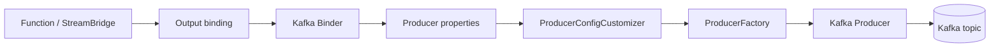

# Tùy biến ProducerFactory và Kafka client theo nhu cầu

Kafka Binder tạo và quản lý producer client để gửi record từ output binding tới Kafka. Trong phần lớn ứng dụng, các thuộc tính cấu hình là đủ để điều chỉnh serializer, compression, batching, acknowledgement và bảo mật. Khi cần thay đổi cấu hình theo điều kiện runtime, theo từng binding hoặc dựa trên bean của ứng dụng, có thể dùng `ProducerConfigCustomizer` để can thiệp vào map cấu hình trước khi binder tạo `ProducerFactory`.

Cần phân biệt hai việc: tùy biến **cấu hình dùng để tạo ProducerFactory** và tự thay thế **ProducerFactory object** do binder quản lý. Extension point được Kafka Binder tài liệu hóa là `ProducerConfigCustomizer`; nó nhận map producer properties cùng tên binding và destination, rồi cho phép thay đổi map đó. Nó không phải một hook tổng quát để thay thế mọi hành vi của factory. Hiểu đúng ranh giới này giúp chọn giải pháp đơn giản nhất và tránh tạo thêm producer client ngoài ý muốn.

## 1. ProducerFactory nằm ở đâu trong đường gửi?

Khi function trả về message hoặc ứng dụng gửi qua output binding, Spring Cloud Stream chuyển message tới Kafka Binder. Binder dùng cấu hình binding và cấu hình Kafka client để tạo producer factory. Factory quản lý việc tạo và sử dụng các Kafka producer cho đường gửi.



Các lớp có trách nhiệm khác nhau:

- **Output binding** xác định destination và hành vi producer ở mức Spring Cloud Stream.
- **Kafka Binder properties** cấu hình broker, bảo mật chung và các mặc định của binder.
- **Kafka producer properties** điều chỉnh Kafka client, ví dụ `acks`, `compression.type`, `linger.ms`.
- **ProducerConfigCustomizer** chỉnh map cấu hình trước khi binder tạo factory.
- **ProducerFactory** quản lý vòng đời và việc tạo Kafka producer.
- **Kafka Producer** thực hiện serialize, partition, buffer và gửi record tới broker.

Ứng dụng không cần tự tạo `KafkaProducer` cho mỗi message khi đã dùng binder. Binder quản lý producer client và kết nối nó với output binding.

## 2. Phân biệt cấu hình thường với customizer

Nên ưu tiên cấu hình property khi giá trị là cố định theo môi trường hoặc binding. Chỉ dùng customizer khi cần logic Java, chẳng hạn chọn cấu hình theo binding name, destination hoặc bean do ứng dụng quản lý.

| Cách cấu hình | Phạm vi | Khi phù hợp |
|---|---|---|
| `spring.cloud.stream.kafka.binder.configuration` | Thuộc tính chung cho producer và consumer của binder | Bảo mật hoặc cấu hình client dùng chung |
| `spring.cloud.stream.kafka.binder.producer-properties` | Thuộc tính Kafka producer ở phạm vi binder | Mặc định producer dùng chung |
| `spring.cloud.stream.kafka.bindings.<binding>.producer.configuration` | Thuộc tính producer riêng của một binding | Một output cần compression, serializer hoặc timeout khác |
| `spring.cloud.stream.kafka.default.producer.<property>` | Thuộc tính producer áp dụng cho các output binding | Mặc định chung cho nhiều output |
| `ProducerConfigCustomizer` | Chỉnh map producer properties bằng Java trước khi tạo factory | Cần điều kiện runtime hoặc phụ thuộc bean ứng dụng |

`configuration` ở binder-level được dùng chung cho producer và consumer, vì vậy chỉ nên đặt các thuộc tính chung như security. `producer-properties` dành riêng cho producer và hỗ trợ các thuộc tính Kafka producer tùy ý. Cấu hình theo binding giúp giới hạn ảnh hưởng vào đúng output cần điều chỉnh.

## 3. Cấu hình producer trực tiếp bằng YAML

Ví dụ ứng dụng có function phát sự kiện đơn hàng:

```java
@Bean
Supplier<OrderPlaced> publishOrder(OrderService service) {
    return service::nextEvent;
}
```

Binding đầu ra:

```yaml
spring:
  cloud:
    function:
      definition: publishOrder
    stream:
      bindings:
        publishOrder-out-0:
          destination: orders.placed
          content-type: application/json
      kafka:
        binder:
          brokers:
            - kafka-1.internal:9092
            - kafka-2.internal:9092
        bindings:
          publishOrder-out-0:
            producer:
              configuration:
                acks: all
                compression.type: zstd
                linger.ms: 10
                batch.size: 32768
```

Các thuộc tính dưới `spring.cloud.stream.kafka.bindings.publishOrder-out-0.producer.configuration` là Kafka client producer properties cho riêng binding đó. Ví dụ này yêu cầu Kafka producer dùng acknowledgement `all`, nén Zstandard, chờ ngắn để gom batch và dùng batch size 32 KiB.

Nếu mọi output binding cần cùng một cấu hình producer, có thể dùng `spring.cloud.stream.kafka.binder.producer-properties` hoặc `spring.cloud.stream.kafka.default.producer.<property>` tùy thuộc nhóm thuộc tính. Không đặt `acks`, `linger.ms` hoặc `compression.type` trong binder `configuration` nếu chúng chỉ dành cho producer.

## 4. ProducerConfigCustomizer là extension point cho ProducerFactory

Khi cấu hình cần điều kiện Java, khai báo bean `ProducerConfigCustomizer`. Kafka Binder phát hiện bean này và gọi phương thức `configure` ngay trước khi tạo `ProducerFactory`. Customizer nhận map cấu hình producer, tên binding và tên destination.

```java
import java.util.Map;

import org.apache.kafka.clients.producer.ProducerConfig;
import org.springframework.cloud.stream.binder.kafka.ProducerConfigCustomizer;
import org.springframework.context.annotation.Bean;
import org.springframework.context.annotation.Configuration;

@Configuration
public class KafkaProducerConfiguration {

    @Bean
    ProducerConfigCustomizer producerConfigCustomizer() {
        return (producerProperties, bindingName, destination) -> {
            if ("publishOrder-out-0".equals(bindingName)
                    && "orders.placed".equals(destination)) {

                producerProperties.put(
                    ProducerConfig.COMPRESSION_TYPE_CONFIG,
                    "zstd"
                );
                producerProperties.put(
                    ProducerConfig.LINGER_MS_CONFIG,
                    10
                );
                producerProperties.put(
                    ProducerConfig.BATCH_SIZE_CONFIG,
                    32 * 1024
                );
            }
        };
    }
}
```

Customizer chỉ thay đổi map cấu hình cho binding phù hợp. Các binding khác không bị ảnh hưởng bởi nhánh điều kiện. Điều này hữu ích khi cùng một ứng dụng có nhiều output tới các topic với yêu cầu latency hoặc throughput khác nhau.

Các tên binding được tạo từ function definition. Với function `publishOrder`, output mặc định là `publishOrder-out-0`. Nếu ứng dụng đổi tên binding bằng `spring.cloud.stream.function.bindings`, hãy dùng tên binding sau khi đổi trong điều kiện customizer.

### Dùng bean ứng dụng để quyết định cấu hình

Customizer có thể nhận dependency Spring qua tham số của phương thức `@Bean`. Ví dụ một bean cung cấp cấu hình producer theo môi trường:

```java
import org.springframework.boot.context.properties.ConfigurationProperties;

@ConfigurationProperties(prefix = "app.kafka.producer")
public record ProducerTuning(
    String clientIdPrefix,
    int orderBatchSize,
    int orderLingerMs
) {}
```

```java
@Bean
ProducerConfigCustomizer producerConfigCustomizer(
        ProducerTuning tuning) {

    return (properties, bindingName, destination) -> {
        if ("publishOrder-out-0".equals(bindingName)) {
            properties.put(
                ProducerConfig.CLIENT_ID_CONFIG,
                tuning.clientIdPrefix() + "-" + bindingName
            );
            properties.put(
                ProducerConfig.BATCH_SIZE_CONFIG,
                tuning.orderBatchSize()
            );
            properties.put(
                ProducerConfig.LINGER_MS_CONFIG,
                tuning.orderLingerMs()
            );
        }
    };
}
```

Đăng ký record cấu hình bằng `@ConfigurationPropertiesScan` trên application class hoặc `@EnableConfigurationProperties(ProducerTuning.class)`. Các giá trị có thể được cấp theo profile hoặc external configuration. Không đọc secret từ file tùy ý trong customizer; hãy dùng cơ chế quản lý secret của nền tảng.

### Giữ nguyên giá trị đã cấu hình

Nếu customizer chỉ muốn đặt mặc định khi property chưa có, dùng `putIfAbsent`:

```java
@Bean
ProducerConfigCustomizer producerDefaults() {
    return (properties, bindingName, destination) -> {
        properties.putIfAbsent(
            ProducerConfig.COMPRESSION_TYPE_CONFIG,
            "lz4"
        );
    };
}
```

Nếu dùng `put()`, giá trị mới sẽ thay thế giá trị đang có trong map. Chỉ ghi đè khi đó là chính sách bắt buộc của ứng dụng. Không tạo xung đột giữa YAML, profile và customizer mà không có quy ước ưu tiên rõ ràng.

## 5. Customizer không thay thế trực tiếp ProducerFactory

Tên extension point của Kafka Binder là `ProducerConfigCustomizer`. Nó cho phép chỉnh map thuộc tính được dùng để tạo factory; nó không cung cấp trực tiếp đối tượng `ProducerFactory` để gọi các phương thức riêng của factory.

Điều này có nghĩa:

- Không khai báo một bean tên `ProducerFactoryCustomizer` rồi kỳ vọng Kafka Binder tự động nhận diện nếu phiên bản binder không cung cấp extension point đó.
- Không tự tạo một `DefaultKafkaProducerFactory` rồi giả định binder sẽ sử dụng nó cho output binding.
- Không tạo một `KafkaProducer` mới trong mỗi lần gọi function.
- Nếu cần can thiệp vào thuộc tính Kafka client, ưu tiên cấu hình hoặc `ProducerConfigCustomizer`.
- Nếu cần dùng API Spring Kafka trực tiếp cho một luồng gửi riêng, có thể cấu hình `ProducerFactory` và `KafkaTemplate` riêng; đường gửi đó do ứng dụng quản lý, độc lập với output binding của binder.

Ví dụ tạo producer trực tiếp chỉ phù hợp khi ứng dụng chủ động sở hữu đường gửi riêng:

```java
import java.util.HashMap;
import java.util.Map;

import org.apache.kafka.clients.producer.ProducerConfig;
import org.apache.kafka.common.serialization.StringSerializer;
import org.springframework.beans.factory.annotation.Value;
import org.springframework.context.annotation.Bean;
import org.springframework.context.annotation.Configuration;
import org.springframework.kafka.core.DefaultKafkaProducerFactory;
import org.springframework.kafka.core.KafkaTemplate;
import org.springframework.kafka.core.ProducerFactory;

@Configuration
public class DirectKafkaConfiguration {

    @Bean
    ProducerFactory<String, String> directProducerFactory(
            @Value("${app.kafka.bootstrap-servers}") String bootstrapServers) {

        Map<String, Object> properties = new HashMap<>();
        properties.put(
            ProducerConfig.BOOTSTRAP_SERVERS_CONFIG,
            bootstrapServers
        );

        properties.put(
            ProducerConfig.KEY_SERIALIZER_CLASS_CONFIG,
            StringSerializer.class
        );
        properties.put(
            ProducerConfig.VALUE_SERIALIZER_CLASS_CONFIG,
            StringSerializer.class
        );

        return new DefaultKafkaProducerFactory<>(properties);
    }

    @Bean
    KafkaTemplate<String, String> directKafkaTemplate(
            ProducerFactory<String, String> directProducerFactory) {
        return new KafkaTemplate<>(directProducerFactory);
    }
}
```

Ví dụ minh họa một đường gửi Spring Kafka riêng. Nó không thay thế producer factory bên trong Kafka Binder. Trong dự án, cần bảo đảm cấu hình bootstrap server, serializer, transaction manager và vòng đời factory riêng được quản lý nhất quán. Nếu không cần API gửi trực tiếp, không nên duy trì hai đường producer chỉ để thay đổi một vài thuộc tính.

## 6. Chọn thuộc tính producer theo yêu cầu

Các thuộc tính Kafka producer thường được tùy chỉnh theo mục tiêu hiệu năng, độ bền hoặc giới hạn dữ liệu:

| Thuộc tính | Tác động | Đánh đổi cần cân nhắc |
|---|---|---|
| `acks` | Mức xác nhận broker producer chờ | Mức xác nhận cao hơn có thể tăng latency |
| `enable.idempotence` | Giảm duplicate do retry ở producer session | Có ràng buộc với một số thuộc tính gửi |
| `compression.type` | Nén record batch | Giảm mạng/disk nhưng dùng CPU |
| `batch.size` | Kích thước batch mục tiêu theo partition | Batch lớn có thể tăng memory và chờ gom |
| `linger.ms` | Thời gian chờ gom thêm record trước khi gửi | Tăng throughput nhưng thêm latency |
| `buffer.memory` | Bộ nhớ buffer cho record chờ gửi | Tăng buffer tiêu thụ heap/native memory |
| `max.request.size` | Giới hạn kích thước request producer | Phải tương thích giới hạn broker/topic |
| `delivery.timeout.ms` | Tổng thời gian tối đa để giao record trước khi báo lỗi | Phải phối hợp với retry và request timeout |
| `max.in.flight.requests.per.connection` | Số request chưa được xác nhận trên một connection | Ảnh hưởng throughput và thứ tự khi retry |

Không có một bộ giá trị tối ưu cho mọi workload. Đo kích thước message, số partition, throughput, latency, tỷ lệ retry và năng lực broker trước khi điều chỉnh.

### Acknowledgement và idempotence

Ví dụ cấu hình producer ưu tiên độ tin cậy:

```yaml
spring:
  cloud:
    stream:
      kafka:
        bindings:
          publishOrder-out-0:
            producer:
              configuration:
                acks: all
                enable.idempotence: true
                delivery.timeout.ms: 120000
```

`acks=all` yêu cầu leader chờ các replica trong tập in-sync replicas xác nhận theo giao thức Kafka. Mức bền vững thực tế còn phụ thuộc replication factor và `min.insync.replicas`. `enable.idempotence` giúp producer tránh ghi trùng do retry trong phạm vi producer session và cấu hình hỗ trợ.

Idempotent producer không bảo đảm exactly-once cho toàn bộ nghiệp vụ. Nó không thay thế event ID, idempotency ở consumer hoặc transactional outbox khi cần nhất quán với database. Nếu binder transaction được bật, cần dùng cấu hình producer transaction tương ứng.

Kafka kiểm tra tính tương thích giữa idempotence, `acks`, `retries` và `max.in.flight.requests.per.connection`. Đừng đặt các giá trị xung đột; dùng cấu hình được Kafka client hỗ trợ trong phiên bản đang chạy.

### Throughput và batching

Ví dụ producer ưu tiên throughput hơn latency:

```yaml
spring:
  cloud:
    stream:
      kafka:
        bindings:
          publishTelemetry-out-0:
            producer:
              configuration:
                compression.type: lz4
                batch.size: 65536
                linger.ms: 20
                buffer.memory: 67108864
```

`linger.ms` cho producer một khoảng ngắn để gom thêm record vào batch; `batch.size` là mục tiêu kích thước batch cho mỗi partition. Nếu lưu lượng thấp, producer có thể gửi batch nhỏ hơn. Tăng các giá trị này không tự động tăng throughput nếu broker, mạng hoặc serialization là nút thắt.

Dùng compression phù hợp với dữ liệu. JSON có nhiều ký tự lặp thường nén tốt; payload đã nén có thể không được lợi thêm. Benchmark CPU, network và end-to-end latency trước khi chọn codec.

## 7. Serializer và native encoding

Mặc định, Spring Cloud Stream có thể chuyển payload qua message converter rồi binder gửi dạng byte. Khi cần Kafka client tự serialize object, bật native encoding và khai báo serializer phù hợp.

```yaml
spring:
  cloud:
    stream:
      kafka:
        bindings:
          publishOrder-out-0:
            producer:
              use-native-encoding: true
              configuration:
                key.serializer: org.apache.kafka.common.serialization.StringSerializer
                value.serializer: com.example.kafka.OrderPlacedSerializer
```

Serializer value phải tương thích với kiểu payload thực tế. Nếu dùng `StringSerializer`, payload cần là `String`; nếu payload là `OrderPlaced`, serializer phải biết cách chuyển đổi kiểu đó thành byte array.

Nếu tiếp tục dùng message conversion của Spring Cloud Stream, không bật native encoding chỉ vì muốn thay đổi một thuộc tính producer. Hãy để framework chuyển payload thành byte theo content type và chỉ tùy chỉnh các thuộc tính producer cần thiết.

Không cấu hình cùng một serializer ở nhiều cấp khác nhau mà không hiểu cách merge. Serializer sai kiểu thường gây lỗi lúc gửi record, không nhất thiết xuất hiện khi ứng dụng khởi động.

## 8. Cấu hình Kafka producer interceptor

Kafka hỗ trợ `interceptor.classes` để đăng ký producer interceptor. Interceptor có thể quan sát hoặc bổ sung metadata cho `ProducerRecord` trước khi gửi, và nhận kết quả acknowledgement theo API Kafka.

Có thể khai báo qua customizer:

```java
@Bean
ProducerConfigCustomizer producerInterceptorCustomizer() {
    return (properties, bindingName, destination) -> {
        if ("publishOrder-out-0".equals(bindingName)) {
            properties.put(
                ProducerConfig.INTERCEPTOR_CLASSES_CONFIG,
                OrderProducerInterceptor.class.getName()
            );
        }
    };
}
```

Interceptor do Kafka client khởi tạo theo cơ chế của client. Không giả định Spring sẽ tự inject các service vào interceptor như một bean thông thường. Nếu interceptor cần cấu hình, hãy dùng constructor/khởi tạo hoặc map cấu hình mà Kafka hỗ trợ theo đúng API; tránh nhét đối tượng Spring tùy ý vào config map.

Interceptor nên nhẹ, thread-safe và không chặn thao tác gửi. Không gọi database hoặc HTTP đồng bộ trong `onSend()`; việc đó có thể làm chậm mọi record trên producer. Nếu cần nghiệp vụ phức tạp, xử lý ở service trước khi phát message thay vì dùng interceptor.

## 9. Khi binder transaction được bật

Kafka Binder hỗ trợ transaction thông qua `spring.cloud.stream.kafka.binder.transaction.transaction-id-prefix`. Khi thuộc tính này được cấu hình, binder tạo transactional producer. Trong chế độ đó, các producer properties riêng lẻ có thể bị bỏ qua; cấu hình producer được lấy từ nhóm:

```yaml
spring:
  cloud:
    stream:
      kafka:
        binder:
          transaction:
            transaction-id-prefix: orders-tx-
            producer:
              configuration:
                acks: all
                compression.type: lz4
```

Đặt các thuộc tính producer cho transactional binder dưới `spring.cloud.stream.kafka.binder.transaction.producer.*` theo cấu trúc cấu hình của phiên bản đang dùng. Không chỉ đặt chúng ở `spring.cloud.stream.kafka.bindings.<binding>.producer.configuration` rồi giả định chúng có hiệu lực khi transaction đã bật.

Transaction Kafka có thể kết hợp việc consume và produce trong một transaction Kafka nếu consumer/producer binding dùng cùng transaction manager và cấu hình phù hợp. Nó không tự bao gồm transaction của một database ngoài Kafka. Với dữ liệu database và event cần nhất quán, hãy đánh giá transactional outbox hoặc chiến lược tích hợp phù hợp.

## 10. Giới hạn và phạm vi của cấu hình

Một số thuộc tính có phạm vi đặc biệt:

- `spring.cloud.stream.kafka.binder.configuration`: dùng chung cho client producer và consumer; thích hợp với security properties.
- `spring.cloud.stream.kafka.binder.producer-properties`: chỉ dành cho producer client ở phạm vi binder.
- `spring.cloud.stream.kafka.bindings.<binding>.producer.configuration`: dành cho một producer binding.
- `spring.cloud.stream.kafka.default.producer.<property>`: đặt mặc định cho các producer binding.
- `spring.cloud.stream.kafka.binder.transaction.producer.*`: dùng khi transactional binder được bật.

Không đặt `bootstrap.servers` trong producer binding `configuration`; địa chỉ broker thuộc cấu hình binder. Nếu cần gửi tới nhiều Kafka cluster, dùng nhiều binder instance và gán binding tới binder tương ứng.

Nếu có cả `KafkaTemplate` trực tiếp và Kafka Binder, mỗi đường gửi có thể dùng factory và cấu hình khác nhau. Kiểm tra riêng cả hai. Không giả định property của Spring Boot tự động cấu hình mọi producer do binder quản lý.

## 11. Kiểm thử customizer và producer

Nên kiểm thử hai phần: logic chọn cấu hình và hành vi gửi tới Kafka.

### Unit test cho customizer

Có thể gọi customizer trực tiếp với map giả lập để xác minh chỉ binding mong muốn được thay đổi:

```java
@Test
void customizesOnlyOrderProducer() {
    ProducerConfigCustomizer customizer =
        (properties, bindingName, destination) -> {
            if ("publishOrder-out-0".equals(bindingName)
                    && "orders.placed".equals(destination)) {
                properties.put(
                    ProducerConfig.COMPRESSION_TYPE_CONFIG,
                    "zstd"
                );
            }
        };

    Map<String, Object> properties = new HashMap<>();

    customizer.configure(
        properties,
        "publishOrder-out-0",
        "orders.placed"
    );

    assertThat(properties)
        .containsEntry(ProducerConfig.COMPRESSION_TYPE_CONFIG, "zstd");
}
```

Đoạn test minh họa logic của customizer. Chữ ký interface và cách import cần khớp phiên bản Kafka Binder trong dependency của dự án.

### Integration test với Kafka

Dùng Kafka thật hoặc Testcontainers để xác minh:

1. Binder kết nối đúng broker và binding trỏ đúng topic.
2. Producer được tạo với serializer và compression mong muốn.
3. Record key, partition và payload đúng.
4. Producer acknowledgement và lỗi được quan sát theo cấu hình.
5. Producer interceptor (nếu có) không làm thay đổi payload ngoài dự kiến.
6. Transaction commit/rollback hoạt động nếu transactional binder được bật.
7. Cấu hình customizer chỉ áp dụng cho binding/destination mong muốn.

Test Binder kiểm tra function và binding ở bộ nhớ nhưng không chứng minh Kafka client thực tế đã dùng cấu hình producer mong muốn. Những thuộc tính như compression, idempotence, serializer, record key và broker acknowledgement cần integration test với Kafka.

## 12. Chẩn đoán lỗi thường gặp

| Triệu chứng | Nguyên nhân có thể | Cách kiểm tra |
|---|---|---|
| Customizer không chạy | Bean không được binder phát hiện hoặc dùng nhầm interface/package | Kiểm tra dependency, import và log khởi tạo |
| Cấu hình ảnh hưởng mọi output | Đặt ở binder-level thay vì binding-level hoặc thiếu điều kiện binding | Kiểm tra prefix và bindingName |
| Giá trị YAML không có hiệu lực | Customizer ghi đè bằng `put()` sau khi map đã được tổng hợp | Kiểm tra thứ tự áp dụng và dùng `putIfAbsent` nếu cần mặc định |
| Serializer báo ClassCastException | Serializer không phù hợp kiểu payload | Kiểm tra payload type và native encoding |
| Không thể kết nối broker | Đặt bootstrap server sai cấp hoặc sai listener | Kiểm tra `binder.brokers`, DNS và network |
| Transaction producer không dùng config riêng binding | Transaction binder dùng nhóm transaction producer properties | Đặt cấu hình dưới `binder.transaction.producer` |
| Throughput không tăng | Bottleneck nằm ở broker, partition, network hoặc serialization | Đo batch size, linger, CPU và latency |
| Interceptor làm producer chậm | Thực hiện I/O blocking trong callback | Giữ interceptor nhẹ và không blocking |

Khi debug, có thể log binding name, destination và các thuộc tính không nhạy cảm trong customizer. Không log password, JAAS config, token, truststore password hoặc private key. Tránh in toàn bộ config map vì map có thể chứa credential.

## 13. Checklist trước khi đưa tùy biến vào production

- Xác định rõ cần thay đổi Kafka client property hay cần một đường gửi Kafka độc lập.
- Dùng property theo binding nếu giá trị cố định.
- Dùng `ProducerConfigCustomizer` khi cần logic Java theo binding/destination hoặc dependency ứng dụng.
- Không nhầm `ProducerConfigCustomizer` với hook thay thế trực tiếp `ProducerFactory`.
- Giữ `bootstrap.servers` ở binder configuration.
- Dùng binder-level common configuration cho security dùng chung; dùng producer properties cho cấu hình riêng producer.
- Kiểm tra transaction binder vì producer properties riêng binding có thể bị bỏ qua.
- Chọn serializer tương thích payload và chỉ bật native encoding khi muốn Kafka client serialize.
- Đánh giá `acks`, idempotence, retry và timeout cùng replication policy.
- Đo `batch.size`, `linger.ms`, compression và buffer bằng workload thực tế.
- Giữ interceptor thread-safe, không blocking.
- Kiểm thử unit logic customizer và integration test với Kafka thật.
- Bảo vệ credential và không log toàn bộ producer configuration.

## 14. Tài liệu tham khảo

- [Spring Cloud Stream — Customizing Consumer and Producer Configuration](https://docs.spring.io/spring-cloud-stream/reference/kafka/kafka-binder/cons-prod-config-cust.html), phần `ProducerConfigCustomizer`.
- [Spring Cloud Stream — Kafka Binder Configuration Options](https://docs.spring.io/spring-cloud-stream/reference/kafka/kafka-binder/config-options.html), binder, producer và transaction producer properties.
- [Spring Cloud Stream Kafka Binder — Producer Properties](https://docs.spring.io/spring-cloud-stream/reference/kafka/kafka-binder/index.html), cấu hình theo binding, serializer và record metadata.
- [Spring for Apache Kafka — Sending Messages](https://docs.spring.io/spring-kafka/reference/kafka/sending-messages.html), `ProducerFactory`, `KafkaTemplate` và gửi record.
- [Apache Kafka Producer Configuration](https://kafka.apache.org/documentation/#producerconfigs), thuộc tính producer client và các ràng buộc cấu hình.

Kafka Binder tạo `ProducerFactory` từ map thuộc tính của Kafka client. Dùng YAML cho các giá trị cố định và `ProducerConfigCustomizer` khi cần logic Java trước thời điểm tạo factory. Khi chọn đúng phạm vi cấu hình, kiểm soát serializer, transaction và tuning producer, ứng dụng có thể đáp ứng yêu cầu của từng output binding mà vẫn để binder quản lý vòng đời producer nhất quán.

