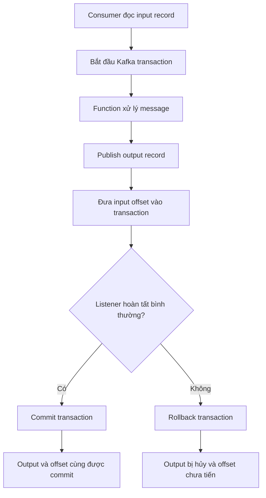

# Bật transactional binder bằng transactionIdPrefix

Kafka hỗ trợ transaction để nhóm nhiều thao tác publish thành một đơn vị commit hoặc rollback. Spring Cloud Stream Kafka binder tích hợp cơ chế này với binding và listener container của Spring for Apache Kafka. Chỉ cần cấu hình một `transactionIdPrefix` khác rỗng, binder sẽ tạo transactional producer factory và kích hoạt transactional behavior cho các producer binding thuộc binder đó.

Trong ứng dụng xử lý theo mô hình **consume-process-produce**, transaction có thể bao gồm cả record đầu ra và offset của record đầu vào. Nếu xử lý hoàn tất bình thường, listener container gửi offset vào transaction rồi commit. Nếu xử lý ném exception, transaction rollback và các record đầu ra đã gửi trong transaction cũng không được commit. Đây là nền tảng để đạt exactly-once processing trong phạm vi Kafka khi producer, consumer và transaction được cấu hình phù hợp.

## 1. Transactional binder giải quyết vấn đề gì?

Một processor thường đọc event từ topic đầu vào, thực hiện biến đổi rồi publish kết quả sang topic khác. Nếu publish output thành công nhưng commit offset đầu vào thất bại, message đầu vào có thể được đọc lại và output bị phát trùng. Ngược lại, nếu offset được commit trước khi output được ghi bền vững, hệ thống có thể mất output.

Khi dùng Kafka transaction, consumer offset và các record output có thể được ghi trong cùng một Kafka transaction:



Trong processor application, listener container bắt đầu transaction khi nhận message. Những record được gửi trên consumer thread tham gia cùng transaction. Khi listener trả về bình thường, container đưa offset đã xử lý vào transaction và commit. Nếu listener thất bại, transaction rollback; message đầu vào có thể được giao lại theo cơ chế retry của container.

Transactional binder phù hợp khi các thao tác cần phối hợp đều nằm trong Kafka, ví dụ đọc topic A, biến đổi và ghi topic B/C. Nó không tự tạo một transaction phân tán bao gồm database SQL, Redis hoặc HTTP API.

## 2. Bật transaction bằng transactionIdPrefix

Thuộc tính bật transaction là:

```text
spring.cloud.stream.kafka.binder.transaction.transactionIdPrefix
```

Khi giá trị khác rỗng, Kafka binder bật transactional producer. Nếu không cấu hình, mặc định là `null`, nghĩa là binder không dùng transactional mode.

Ví dụ `application.yml`:

```yaml
spring:
  cloud:
    stream:
      kafka:
        binder:
          transaction:
            transaction-id-prefix: ${KAFKA_TX_ID_PREFIX}
```

`transaction-id-prefix` là cách viết kebab-case trong YAML của property `transactionIdPrefix`. Biến môi trường `KAFKA_TX_ID_PREFIX` phải được cung cấp khi chạy ứng dụng và có giá trị không rỗng. Không nên đưa một prefix dùng chung cố định vào file cấu hình nếu ứng dụng chạy nhiều instance.

Có thể cấu hình trực tiếp trong profile riêng, nhưng prefix vẫn cần được cấp duy nhất cho từng instance. Ví dụ, môi trường triển khai có thể cung cấp `KAFKA_TX_ID_PREFIX=order-processor-pod-7f8c-`; instance khác phải có giá trị khác.

## 3. transactionIdPrefix phải duy nhất trên mỗi instance

Kafka dùng transactional ID để nhận diện producer đang sở hữu transaction. Spring Kafka tạo transactional ID cho từng producer bằng cách kết hợp prefix với suffix do producer factory quản lý. Nếu nhiều instance chạy đồng thời dùng cùng một prefix, chúng có thể tạo transactional ID trùng và Kafka sẽ fence (vô hiệu hóa) producer cũ khi producer mới đăng ký cùng ID.

Quy tắc triển khai:

- Mỗi instance đang chạy cần một `transactionIdPrefix` riêng.
- Dùng định danh instance ổn định trong vòng đời instance, chẳng hạn pod name hoặc instance ID do nền tảng cấp.
- Không dùng một giá trị prefix duy nhất cho tất cả replica trong Deployment.
- Khi instance được thay thế, prefix của instance mới cần tránh xung đột với instance khác đang hoạt động.
- Không nhầm prefix với consumer group. Consumer group xác định nhóm đọc; transaction ID prefix xác định không gian định danh producer transaction.

Ví dụ triển khai:

```yaml
spring:
  cloud:
    stream:
      kafka:
        binder:
          transaction:
            transaction-id-prefix: order-processor-${HOSTNAME}-
```

Ví dụ này giả định `HOSTNAME` khác nhau giữa các instance đang chạy. Trong Kubernetes, có thể truyền Pod name hoặc một instance ID duy nhất qua environment variable. Cần kiểm tra quy tắc đặt tên của nền tảng để bảo đảm không tái sử dụng một prefix trong khi producer cũ vẫn còn hoạt động.

## 4. Transactional binder trong ứng dụng consume-process-produce

Đây là trường hợp binder tích hợp trực tiếp nhất. Ứng dụng có một input binding và một hoặc nhiều output binding. Consumer transaction được bắt đầu bởi listener container; mọi output được gửi đồng bộ trên consumer thread sẽ tham gia transaction đó.

Ví dụ khai báo function:

```java
import java.util.function.Function;

import org.springframework.context.annotation.Bean;
import org.springframework.context.annotation.Configuration;

@Configuration
class OrderProcessor {

    @Bean
    Function<OrderCreated, OrderEnriched> enrichOrder(
            OrderService orderService) {
        return event -> orderService.enrich(event);
    }
}

record OrderCreated(String eventId, String orderId, long totalAmount) {}
record OrderEnriched(String eventId, String orderId, String status) {}
```

Cấu hình binding:

```yaml
spring:
  cloud:
    function:
      definition: enrichOrder
    stream:
      bindings:
        enrichOrder-in-0:
          destination: orders.created
          group: order-enrichment
          content-type: application/json
        enrichOrder-out-0:
          destination: orders.enriched
          content-type: application/json
      kafka:
        binder:
          transaction:
            transaction-id-prefix: ${KAFKA_TX_ID_PREFIX}
```

Khi consumer nhận một record từ `orders.created`, listener container bắt đầu Kafka transaction. Function xử lý và trả `OrderEnriched`; binder publish kết quả tới `orders.enriched` trong transaction. Khi listener hoàn tất, offset của record đầu vào được gửi vào cùng transaction. Commit thành công làm output record và offset đầu vào cùng có hiệu lực.

Nếu `orderService.enrich(...)` ném exception hoặc một thao tác gửi output thất bại theo cách làm listener thất bại, transaction rollback. Output record trong transaction không được commit và offset đầu vào không được tiến qua record đó. Cơ chế retry sau rollback sẽ quyết định khi nào record được xử lý lại.

## 5. Nhiều output binding cùng tham gia transaction

Một processor có thể phát nhiều output từ cùng một lần xử lý. Ví dụ, khi tạo đơn hàng, ứng dụng phát event nghiệp vụ và một event audit. Nếu cả hai output được gửi trong cùng consumer transaction, chúng cùng commit hoặc rollback với offset đầu vào.

```java
import java.util.function.Function;

import org.springframework.cloud.stream.function.StreamBridge;
import org.springframework.context.annotation.Bean;

@Bean
Function<OrderCreated, OrderEnriched> enrichAndAudit(
        OrderService orderService,
        StreamBridge streamBridge) {
    return event -> {
        OrderEnriched result = orderService.enrich(event);

        boolean sent = streamBridge.send(
            "orderAudit-out-0",
            new OrderAudit(event.eventId(), "ENRICHED")
        );
        if (!sent) {
            throw new IllegalStateException("Could not send order audit event");
        }

        return result;
    };
}

record OrderAudit(String eventId, String action) {}
```

Khai báo output binding bổ sung:

```yaml
spring:
  cloud:
    function:
      definition: enrichAndAudit
    stream:
      output-bindings: orderAudit-out-0
      bindings:
        enrichAndAudit-in-0:
          destination: orders.created
          group: order-enrichment
        enrichAndAudit-out-0:
          destination: orders.enriched
        orderAudit-out-0:
          destination: orders.audit
```

`StreamBridge.send(...)` được gọi đồng bộ trên thread đang xử lý consumer, do đó producer transactional của binder có thể tham gia transaction đang mở. Không chuyển lệnh gửi sang một executor hoặc thread khác rồi giả định transaction được truyền tự động sang thread đó.

Kết quả `send(...)` cần được kiểm tra. Nếu ứng dụng bỏ qua trường hợp gửi thất bại và vẫn trả về bình thường, listener có thể hoàn tất transaction trong khi output phụ không được gửi như dự kiến. Khi output là một phần bắt buộc của nghiệp vụ, hãy làm cho lỗi gửi khiến listener thất bại để transaction rollback.

## 6. Các producer binding dùng chung transactional producer factory

Khi transactional binder được bật, Kafka binder sử dụng một producer factory chung cho các producer binding được cấu hình bằng:

```text
spring.cloud.stream.kafka.binder.transaction.producer.*
```

Các thuộc tính producer Kafka đặt riêng trên từng binding sẽ bị bỏ qua trong transactional mode. Vì vậy, nếu cần điều chỉnh cấu hình producer như serializer, compression hoặc các thuộc tính Kafka client khác, hãy cấu hình ở namespace `transaction.producer` theo property được hỗ trợ.

Ví dụ cấu hình producer dùng chung:

```yaml
spring:
  cloud:
    stream:
      kafka:
        binder:
          transaction:
            transaction-id-prefix: ${KAFKA_TX_ID_PREFIX}
            producer:
              configuration:
                compression.type: lz4
```

Đây là cấu hình minh họa một Kafka producer property. Tên property và cách bind cần khớp với phiên bản Kafka binder/Kafka client đang dùng. Không đặt cùng một thuộc tính ở cả binding-level và transaction-level rồi kỳ vọng binding-level sẽ ghi đè; trong transactional mode, producer factory chung được cấu hình từ `transaction.producer.*`.

Các thuộc tính consumer vẫn nằm ở cấu hình consumer tương ứng. Việc bật transactional binder không có nghĩa mọi consumer property đều chuyển sang namespace producer.

## 7. Producer-only transaction trong source application

Một source application chỉ phát dữ liệu, chẳng hạn `Supplier`, REST controller hoặc `@Scheduled` job, không có consumer listener để tự mở transaction. Trong trường hợp này, cần lấy transactional producer factory từ Kafka binder và tạo một `KafkaTransactionManager` sử dụng đúng factory đó.

Ví dụ cấu hình prefix vẫn được khai báo như phần trước. Sau đó tạo transaction manager:

```java
import org.springframework.beans.factory.annotation.Value;
import org.springframework.cloud.stream.binder.BinderFactory;
import org.springframework.cloud.stream.binder.kafka.KafkaMessageChannelBinder;
import org.springframework.context.annotation.Bean;
import org.springframework.context.annotation.Configuration;
import org.springframework.kafka.core.ProducerFactory;
import org.springframework.kafka.transaction.KafkaTransactionManager;
import org.springframework.messaging.MessageChannel;

@Configuration
class KafkaProducerTransactionConfiguration {

    @Bean
    KafkaTransactionManager<byte[], byte[]> kafkaTransactionManager(
            BinderFactory binders,
            @Value("${app.kafka.transaction-id}") String transactionId) {

        KafkaMessageChannelBinder binder = (KafkaMessageChannelBinder)
            binders.getBinder(null, MessageChannel.class);

        ProducerFactory<byte[], byte[]> producerFactory =
            binder.getTransactionalProducerFactory();

        KafkaTransactionManager<byte[], byte[]> manager =
            new KafkaTransactionManager<>(producerFactory);
        manager.setTransactionId(transactionId);
        return manager;
    }
}
```

Trong ví dụ, `null` ở `getBinder(...)` phù hợp khi ứng dụng chỉ có một Kafka binder. Nếu có nhiều binder, truyền tên binder tương ứng. `transactionId` phải duy nhất cho instance theo quy tắc transaction ID của Kafka. Cần bảo đảm transaction manager dùng đúng transactional producer factory mà binder đang sử dụng.

Sau đó có thể dùng Spring transaction support cho producer-only flow:

```java
import java.util.List;

import org.springframework.cloud.stream.function.StreamBridge;
import org.springframework.stereotype.Service;
import org.springframework.transaction.annotation.Transactional;

@Service
class OrderEventSource {

    private final StreamBridge streamBridge;

    OrderEventSource(StreamBridge streamBridge) {
        this.streamBridge = streamBridge;
    }

    @Transactional("kafkaTransactionManager")
    public void publishBatch(List<OrderCreated> events) {
        for (OrderCreated event : events) {
            if (!streamBridge.send("orders-out-0", event)) {
                throw new IllegalStateException("Kafka publish failed");
            }
        }
    }
}
```

Nếu method kết thúc bình thường, transaction manager commit các record được gửi trong transaction. Nếu exception thoát khỏi method và thuộc nhóm rollback, transaction rollback. `@Transactional` hoạt động qua Spring proxy; gọi method transactional từ method khác trong cùng instance (self-invocation) có thể không kích hoạt proxy như mong muốn.

## 8. Không nhầm transactionIdPrefix của binder với cấu hình Spring Boot

Spring Boot có property riêng:

```text
spring.kafka.producer.transaction-id-prefix
```

Property này có thể khiến Spring Boot tự cấu hình một `KafkaTransactionManager` dựa trên producer factory do Spring Boot tạo. Trong Spring Cloud Stream, binder dùng producer factory riêng của nó. Nếu muốn transaction của `StreamBridge` hoặc output binding tham gia transaction manager, hai thành phần phải dùng cùng producer factory.

Vì vậy, để bật transactional binder, dùng:

```text
spring.cloud.stream.kafka.binder.transaction.transactionIdPrefix
```

Nếu tạo transaction manager cho producer-only flow, lấy `getTransactionalProducerFactory()` từ Kafka binder rồi tạo `KafkaTransactionManager` từ factory đó. Không giả định transaction manager auto-configured bởi `spring.kafka.producer.transaction-id-prefix` sẽ tự động điều khiển producer của binder.

## 9. Retry sau rollback trong transactional binder

Retry thông thường của binder và retry trong transactional binder có cách hoạt động khác nhau. Khi transaction đang mở, nếu binder thực hiện retry bên trong chính transaction ban đầu, các output record có thể bị rollback cùng transaction. Vì vậy, normal binder retry và dead-lettering không được dùng theo cách cũ trong transactional mode.

Khi retry được bật thông qua thuộc tính chung `maxAttempts` lớn hơn 0, retry properties được dùng để cấu hình `DefaultAfterRollbackProcessor` ở listener container. Quy trình là:

1. Listener bắt đầu transaction và xử lý record.
2. Nếu listener ném exception, transaction hiện tại rollback.
3. `DefaultAfterRollbackProcessor` quyết định có retry record sau rollback hay không.
4. Khi retry hết, processor có thể recover record, ví dụ publish tới dead-letter topic, sau khi transaction chính đã rollback.

Không nên hiểu rằng retry sẽ chạy lại function trong cùng transaction đã rollback. Mỗi lần xử lý lại cần transaction mới theo cơ chế container.

### Phân loại exception

Trong transactional binder, có thể điều chỉnh exception nào được retry bằng `defaultRetryable` và `retryableExceptions`:

```yaml
spring:
  cloud:
    stream:
      kafka:
        bindings:
          processOrder-in-0:
            consumer:
              defaultRetryable: false
              retryableExceptions:
                java.net.SocketTimeoutException: true
                java.lang.IllegalArgumentException: false
```

Với `defaultRetryable: false`, exception không được khai báo tường minh sẽ không retry. Ví dụ trên cho phép retry timeout mạng và không retry lỗi đối số không hợp lệ. Chỉ các kiểu exception kế thừa `Exception` mới được cấu hình trong `retryableExceptions` theo cơ chế này.

### Dead-letter sau rollback

Với transactional binder, việc publish dead-letter record được chuyển sang `DefaultAfterRollbackProcessor` chạy sau khi transaction chính rollback. Không gửi dead-letter record trong transaction đã thất bại rồi kỳ vọng nó vẫn tồn tại sau rollback.

Nếu record đã được recover, `txCommitRecovered` điều khiển việc commit offset của record đã recover trong một transaction mới; mặc định hiện hành là `true`. Khi thay đổi property này, cần kiểm thử cả trạng thái DLT và committed offset để tránh record bị mất hoặc lặp vô hạn.

## 10. Batch listener và giới hạn của retry transaction

Tài liệu Kafka binder hiện hành cho biết `DefaultAfterRollbackProcessor` chỉ được cấu hình theo cơ chế transactional retry này khi transaction bật và batch mode không bật. Vì vậy, không nên giả định cùng một retry configuration sẽ hoạt động giống nhau giữa record listener và batch listener.

Nếu dùng `batch-mode: true`, cần xem xét rõ:

- Listener nhận cả batch hay từng record.
- Một exception ảnh hưởng tới toàn batch hay một phần batch.
- Cách offset của batch được commit hoặc rollback.
- Cách recover record lỗi và có thể phát lại các record đã xử lý trước đó.
- Khả năng tương thích của binder version với batch listener và transactional processing.

Nếu yêu cầu nghiệp vụ cần retry transaction theo từng record và kiểm soát chính xác record gây lỗi, record listener thường dễ reasoning hơn. Nếu cần batch throughput, phải thiết kế riêng chính sách rollback, idempotency và replay.

## 11. Transaction chỉ bao phủ các thao tác trong Kafka transaction

Kafka transaction có thể phối hợp các record output và offset input trong Kafka. Nó không tự động bao gồm thao tác database:

```java
@Bean
Function<OrderCreated, OrderEnriched> processOrder(
        OrderRepository repository,
        StreamBridge streamBridge) {
    return event -> {
        repository.save(...); // Database transaction riêng
        streamBridge.send("orders-audit-out-0", ...); // Kafka transaction
        return ...;
    };
}
```

Nếu database commit thành công nhưng Kafka transaction rollback, dữ liệu database vẫn có thể đã thay đổi. Nếu Kafka commit nhưng database transaction rollback, hai hệ thống có thể lệch nhau. Không có XA transaction tự động chỉ vì method chạy trong một function.

Với database và Kafka cần đồng bộ bền vững, cân nhắc transactional outbox: ghi dữ liệu nghiệp vụ và event vào cùng database transaction, sau đó relay publish event tới Kafka. Consumer dùng inbox/idempotency để chống xử lý lặp. Nếu nghiệp vụ gồm nhiều dịch vụ hoặc API ngoài, dùng saga và hành động bù trừ phù hợp.

## 12. Transaction gắn với thread xử lý

Trong processor application, Kafka transaction được gắn với consumer thread. Những lần gửi output đồng bộ trên thread đó có thể tham gia transaction đang mở. Nếu chuyển xử lý sang `CompletableFuture`, executor, `@Async` hoặc Reactor scheduler khác, transaction context không tự truyền sang thread mới.

Ví dụ không nên giả định transaction còn hoạt động:

```java
return event -> CompletableFuture.runAsync(() ->
    streamBridge.send("orders-out-0", transform(event))
);
```

Lệnh gửi chạy trên thread khác, không tự động thuộc transaction consumer đang mở. Listener có thể kết thúc và commit offset trước khi tác vụ async gửi xong. Khi cần transactional consume-process-produce, hãy thực hiện các lệnh gửi cần bảo vệ trên consumer thread trước khi listener hoàn tất, hoặc mở một transaction producer riêng rõ ràng trong thread thực thi.

Với reactive processing, không mặc định transaction của listener container được truyền qua mọi subscription/scheduler. Cần kiểm tra hỗ trợ cụ thể của binder/version và sử dụng cơ chế transaction reactive tương ứng nếu được hỗ trợ. Không trộn imperative Kafka transaction với reactive pipeline chỉ bằng cách gọi `subscribe()`.

## 13. Consumer chỉ đọc dữ liệu đã commit

Kafka consumer có `isolation.level` để quyết định có đọc record thuộc transaction chưa commit hoặc đã rollback hay không:

- `read_uncommitted`: có thể nhìn thấy record transactional trước khi transaction hoàn tất và cả record từ transaction bị abort.
- `read_committed`: chỉ trả về record thuộc transaction đã commit; record từ transaction bị abort không được cung cấp cho ứng dụng.

Khi hệ thống dựa vào transactional output để bảo đảm consumer chỉ thấy dữ liệu đã commit, hãy cấu hình consumer downstream dùng `read_committed` theo property của binding hoặc binder tương ứng. Ví dụ:

```yaml
spring:
  cloud:
    stream:
      kafka:
        bindings:
          auditConsumer-in-0:
            consumer:
              configuration:
                isolation.level: read_committed
```

Tên property Kafka client là `isolation.level`. Cấu hình này chỉ có tác dụng khi consumer thực sự dùng Kafka binder và property được chuyển tới Kafka client. Các ứng dụng không cần semantics đọc committed transaction có thể có lựa chọn khác, nhưng cần hiểu rõ tác động trước khi thay đổi.

## 14. Kiểm thử transactional binder

Test Binder của Spring Cloud Stream hữu ích cho function và binding logic, nhưng không mô phỏng đầy đủ Kafka transaction coordinator, producer fencing, offset transaction hoặc isolation level. Với transaction, cần integration test bằng Kafka broker phù hợp.

Các kịch bản cần xác minh:

| Kịch bản | Kết quả mong đợi |
|---|---|
| Processor xử lý thành công và phát output | Output xuất hiện với consumer `read_committed`; input offset được commit. |
| Function ném exception sau khi gửi output | Transaction rollback; output không xuất hiện với consumer `read_committed`; input offset chưa tiến qua record. |
| Gửi nhiều output trong một lần xử lý | Tất cả output cùng commit hoặc cùng rollback với offset input. |
| Restart consumer khi transaction đang mở | Transaction chưa commit bị abort hoặc được phục hồi theo Kafka transaction protocol; record input được xử lý lại nếu offset chưa commit. |
| Hai instance dùng prefix khác nhau | Cả hai có thể tạo transactional producer độc lập. |
| Hai instance dùng prefix trùng | Phát hiện producer fencing hoặc lỗi transactional ID; cấu hình phải được sửa thành duy nhất. |
| Retry sau rollback | Mỗi lần thử dùng transaction phù hợp; chỉ lần thành công mới commit output và offset. |
| Hết retry và recover vào DLT | DLT nhận record theo cơ chế after-rollback; offset recovered được commit theo cấu hình. |
| Producer-only `@Transactional` | Các output gửi trong method cùng commit/rollback qua transaction manager dùng đúng binder producer factory. |
| Gửi output từ thread khác | Không được giả định output tham gia transaction consumer; test cần làm rõ ranh giới này. |

Khi kiểm thử, nên đọc output bằng consumer `read_committed`, kiểm tra committed offset của group và xác minh trạng thái record input. Chỉ kiểm tra log hoặc giá trị trả về từ `StreamBridge.send(...)` không đủ chứng minh transaction đã commit.

## 15. Theo dõi và xử lý sự cố

Các tín hiệu nên quan sát:

- Transaction commit/abort count và tỷ lệ lỗi transaction.
- Producer fencing exception hoặc lỗi transactional ID.
- Transaction timeout và thời gian transaction mở.
- Consumer lag, rebalance và thời gian xử lý listener.
- Số lần retry sau rollback, số record được recover và số record vào DLT.
- Tỷ lệ output được commit so với input đã nhận.
- Lỗi gửi output và lỗi khi đóng producer/transaction manager.

Transaction quá dài có thể giữ tài nguyên và tăng khả năng timeout. Không đặt các thao tác HTTP chậm hoặc chờ người dùng trong transaction Kafka. Giữ transaction ngắn, chỉ bao gồm những thao tác Kafka cần commit cùng nhau.

Khi gặp `ProducerFencedException`, kiểm tra prefix có bị dùng trùng giữa các instance, producer cũ có còn sống sau deploy hoặc transaction ID có bị tái sử dụng không. Khi gặp transaction timeout, xem xét thời gian xử lý listener, cấu hình transaction timeout và giới hạn của broker.

## 16. Quy trình bật transactional binder

1. Xác định luồng có cần phối hợp consume-process-produce trong Kafka hay chỉ cần gửi producer thông thường.
2. Cấu hình `spring.cloud.stream.kafka.binder.transaction.transactionIdPrefix` bằng một giá trị không rỗng.
3. Cấp prefix duy nhất cho từng instance; không hard-code một prefix chung cho mọi replica.
4. Xác định producer properties cần dùng chung dưới `spring.cloud.stream.kafka.binder.transaction.producer.*`.
5. Với processor application, để listener container mở transaction và bảo đảm các output cần bảo vệ được gửi trên consumer thread.
6. Với producer-only source application, lấy transactional producer factory từ binder và tạo `KafkaTransactionManager` sử dụng đúng factory đó.
7. Cấu hình retry sau rollback và dead-letter recovery theo transactional binder, không dùng máy móc retry/DLQ thông thường.
8. Nếu downstream chỉ được đọc record đã commit, cấu hình consumer `isolation.level=read_committed`.
9. Không giả định Kafka transaction bao gồm database hoặc API ngoài; dùng outbox/inbox hoặc saga khi cần phối hợp tài nguyên khác.
10. Integration test commit, rollback, retry, fencing, offset và output bằng Kafka broker thật.

`transactionIdPrefix` là công tắc bật transactional producer cho Kafka binder và là phần định danh quan trọng của producer transaction. Khi prefix duy nhất trên mỗi instance, output và offset được gửi trong cùng transaction, retry được xử lý sau rollback và phạm vi transaction được giữ trong Kafka, ứng dụng có thể xây dựng luồng consume-process-produce có tính nhất quán cao mà vẫn hiểu rõ giới hạn với database và hệ thống bên ngoài.

## Tài liệu tham khảo

- [Spring Cloud Stream – Transactional Binder](https://docs.spring.io/spring-cloud-stream/reference/kafka/kafka-binder/transactional.html)
- [Spring Cloud Stream – Kafka Binder Configuration Options](https://docs.spring.io/spring-cloud-stream/reference/kafka/kafka-binder/config-options.html)
- [Spring for Apache Kafka – Transactions](https://docs.spring.io/spring-kafka/reference/kafka/transactions.html)
- [Spring Blog – Producer Initiated Transactions in Spring Cloud Stream Kafka Applications](https://spring.io/blog/2023/09/28/producer-initiated-transactions-in-spring-cloud-stream-kafka-applications/)
