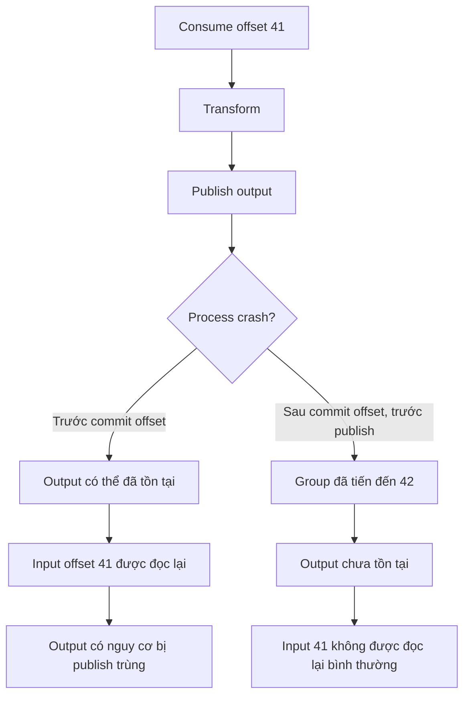
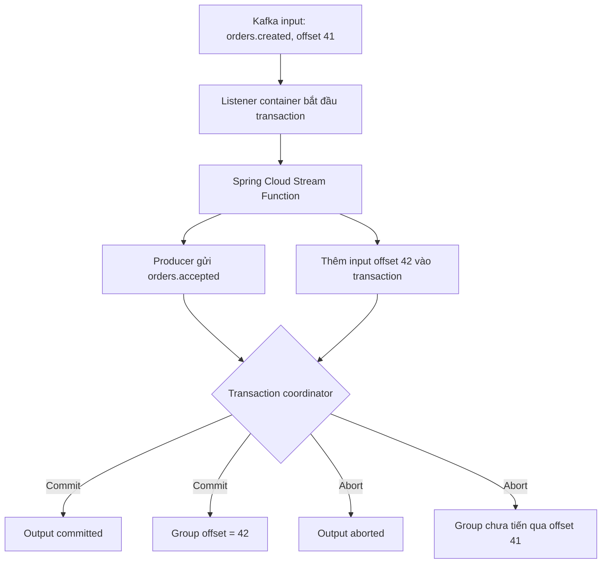

# Commit offset cùng kết quả phát trong một giao dịch Kafka

## 1. Bài toán consume-transform-produce

Một ứng dụng xử lý sự kiện thường nhận message từ một topic, thực hiện nghiệp vụ rồi phát kết quả sang topic khác. Ví dụ, dịch vụ đơn hàng đọc `orders.created`, kiểm tra đơn hàng và phát `orders.accepted`.

Có hai thao tác phải nhất quán:

1. Ghi kết quả đầu ra để downstream có thể nhìn thấy.
2. Commit offset đầu vào để consumer group ghi nhận message đã được xử lý.

Nếu hai thao tác độc lập, một sự cố có thể tạo ra trạng thái không mong muốn:

- Output đã được publish nhưng offset chưa commit. Khi consumer đọc lại input, output có thể được publish lần nữa.
- Offset đã commit nhưng output chưa được publish. Consumer tiếp tục từ record sau và kết quả nghiệp vụ có thể bị mất.

Kafka transaction giải quyết khoảng lỗi này trong phạm vi Kafka bằng cách đưa các record đầu ra và offset đầu vào vào cùng một transaction. Khi transaction commit, cả output lẫn tiến độ tiêu thụ cùng có hiệu lực. Khi transaction abort, output không được consumer `read_committed` nhìn thấy và offset đầu vào không được tiến lên bởi transaction đó.

Đây là mô hình **consume-transform-produce**: nhận record, biến đổi, phát record mới và xác nhận record đầu vào như một đơn vị nguyên tử của Kafka.

## 2. Vì sao commit output và offset riêng lẻ có rủi ro?

Giả sử consumer nhận record `OrderCreated` ở partition 0, offset 41. Function tạo `OrderAccepted` và gửi sang topic đầu ra.

Nếu publish và commit offset là hai thao tác độc lập, có hai cửa sổ lỗi:



Giao dịch Kafka ghép các thao tác này lại. Ứng dụng không phải tự chọn thứ tự “publish trước” hay “commit offset trước” để giảm rủi ro; coordinator quyết định transaction commit hoặc abort cho toàn bộ thao tác đã tham gia.

## 3. Kafka transaction bao gồm những gì?

Một Kafka transaction có thể bao gồm:

- Nhiều record được gửi tới một hoặc nhiều topic/partition trong cùng Kafka cluster.
- Offset của record đầu vào được consumer group xác nhận thông qua transaction.
- Trạng thái commit hoặc abort được Kafka transaction coordinator quản lý.

Khi xử lý một record đầu vào ở offset 41, consumer cần commit vị trí tiếp theo là 42. Offset 42 được đưa vào transaction cùng với record đầu ra. Khi transaction commit, output được đánh dấu committed và group tiến đến offset 42. Khi transaction abort, output thuộc transaction đó bị đánh dấu aborted và offset không được commit bởi transaction đó.



Offset đầu vào không phải một record nghiệp vụ được gửi sang topic. Nó là metadata tiến độ tiêu thụ được Kafka ghi nhận trong cùng transaction với output.

## 4. Vai trò của producer, consumer và transaction coordinator

Trong luồng consume-transform-produce:

- Consumer đọc record từ partition và giữ metadata của group, topic, partition và offset.
- Listener container mở transaction trước khi gọi logic xử lý khi binder được cấu hình transaction theo mô hình consumer-initiated.
- Producer transactional gửi record đầu ra trong transaction hiện tại.
- Khi listener xử lý thành công, offset đầu vào được đưa vào transaction.
- Transaction coordinator quyết định commit hoặc abort và lưu trạng thái giao dịch.

Kafka dùng `transactional.id` để nhận diện producer logic, Producer ID và epoch để quản lý quyền sở hữu producer. Các producer có transaction phải có định danh phù hợp giữa các instance; nếu dùng chung định danh sai cách, producer có thể fence lẫn nhau.

Transaction có thể gửi output tới nhiều topic/partition trong cùng cluster Kafka. Nó không tạo transaction phân tán giữa hai Kafka cluster độc lập.

## 5. Cấu hình Kafka transaction trong Spring Cloud Stream

Kafka binder của Spring Cloud Stream hỗ trợ transaction thông qua `transactionIdPrefix`. Khi bật transaction, binder sử dụng transactional producer và tích hợp transaction với listener container theo khả năng của phiên bản binder.

Ví dụ cấu hình:

```yaml
spring:
  cloud:
    function:
      definition: processOrder
    stream:
      bindings:
        processOrder-in-0:
          destination: orders.created
          group: order-processor
          content-type: application/json
        processOrder-out-0:
          destination: orders.accepted
          content-type: application/json
      kafka:
        binder:
          transaction:
            transactionIdPrefix: ${KAFKA_TX_ID_PREFIX}
```

`KAFKA_TX_ID_PREFIX` cần được cấp phù hợp cho từng instance ứng dụng đang hoạt động. Prefix phải tránh xung đột giữa các producer transactional đồng thời. Binder/Spring Kafka quản lý suffix và vòng đời producer theo cơ chế của phiên bản tương ứng.

Khi `transactionIdPrefix` được cấu hình, các producer binding do binder quản lý sử dụng producer transactional. Với consumer-initiated transaction, listener container bắt đầu transaction trước khi gọi listener; output được gửi trong quá trình xử lý có thể tham gia transaction đó và offset đầu vào được commit cùng transaction khi xử lý thành công.

Tên và vị trí thuộc tính cần được xác nhận với phiên bản Spring Cloud Stream Kafka binder của dự án. Không sao chép cấu hình transaction của Kafka binder sang RabbitMQ hoặc Pulsar binder.

## 6. Function xử lý và phát output

Với mô hình hàm, Spring Cloud Stream có thể ánh xạ input binding vào tham số của `Function` và gửi giá trị trả về qua output binding.

```java
import java.util.function.Function;
import org.springframework.context.annotation.Bean;
import org.springframework.context.annotation.Configuration;

record OrderCreated(String eventId, String orderId, long totalCents) {}
record OrderAccepted(String eventId, String orderId, String status) {}

interface OrderService {
    OrderAccepted accept(OrderCreated event);
}

@Configuration
class OrderFunctions {

    @Bean
    Function<OrderCreated, OrderAccepted> processOrder(OrderService service) {
        return event -> service.accept(event);
    }
}
```

Function nhận `OrderCreated`, gọi nghiệp vụ và trả về `OrderAccepted`. Binder ánh xạ function với:

- `processOrder-in-0`: input binding đọc từ `orders.created`.
- `processOrder-out-0`: output binding ghi vào `orders.accepted`.

Khi Kafka transaction được bật và function được gọi trong listener container transactional, việc gửi output qua output binding nằm trong transaction đang xử lý record đầu vào. Khi listener hoàn tất thành công, container đưa offset đầu vào vào transaction để commit cùng output.

Nếu function ném exception trước khi listener hoàn tất, transaction bị rollback/abort theo error handling của binder. Cần kiểm tra chính sách retry và recover để xác định record được thử lại bao nhiêu lần hoặc chuyển sang DLQ.

## 7. Consumer group và offset tham gia transaction

Offset được commit theo consumer group và partition. Với record offset 41, transaction gửi offset tiếp theo 42 cho đúng group đang xử lý.

Ví dụ:

| Thành phần | Giá trị |
|---|---|
| Input topic | `orders.created` |
| Input partition | `0` |
| Record đang xử lý | `offset 41` |
| Consumer group | `order-processor` |
| Offset đưa vào transaction | `42` |
| Output topic | `orders.accepted` |

Nếu transaction commit, group `order-processor` tiến đến offset 42 và output record được commit. Một consumer group khác đọc cùng input topic có offset độc lập; transaction của group này không tự cập nhật tiến độ group khác.

Nếu một function xử lý nhiều input binding hoặc batch, phạm vi offset tham gia transaction phụ thuộc cách binder/container tạo listener và batch. Không giả định một transaction luôn tương ứng đúng một record nếu ứng dụng dùng batch listener hoặc cơ chế xử lý đặc biệt.

## 8. Điều gì xảy ra khi transaction commit thành công?

Khi listener xử lý xong và transaction commit thành công:

1. Các output record thuộc transaction được đánh dấu committed.
2. Offset đầu vào được commit cùng transaction.
3. Consumer `read_committed` có thể đọc output sau khi transaction hoàn tất.
4. Consumer group tiếp tục từ offset tiếp theo.

Đây là trạng thái thành công mong muốn: không có tình huống output đã committed nhưng offset đầu vào vẫn ở vị trí cũ do cùng transaction, hoặc offset đã tiến nhưng output chưa committed.

Lưu ý rằng commit thành công trong Kafka không có nghĩa downstream đã xử lý output. Nó chỉ có nghĩa broker đã commit record. Consumer phía sau vẫn cần xử lý, commit offset và bảo vệ side effect của riêng nó.

## 9. Điều gì xảy ra khi transaction abort?

Transaction có thể abort khi:

- Function ném exception và listener container rollback transaction.
- Ứng dụng chủ động đánh dấu transaction rollback-only.
- Producer gặp lỗi nghiêm trọng trong quá trình gửi.
- Transaction timeout hoặc producer bị fence.
- Tiến trình dừng khi transaction chưa commit và coordinator xử lý transaction chưa hoàn tất.

Khi transaction abort:

- Output record trong transaction không được consumer `read_committed` coi là dữ liệu đã commit.
- Offset đầu vào không được tiến lên bởi transaction đó.
- Record đầu vào có thể được giao lại theo retry/recovery policy.
- Logic function có thể chạy lại; side effect ngoài Kafka có thể lặp nếu không có idempotency.

Record thuộc transaction bị abort có thể vẫn tồn tại vật lý trong log Kafka. `read_committed` lọc các record chưa commit hoặc đã abort khỏi kết quả đọc, trong khi `read_uncommitted` có thể nhìn thấy chúng. Vì vậy, khi kiểm thử tính nguyên tử, phải dùng consumer có isolation level phù hợp.

## 10. read_committed và read_uncommitted

Kafka consumer có thuộc tính `isolation.level`:

| Giá trị | Hành vi |
|---|---|
| `read_uncommitted` | Có thể đọc record thuộc transaction chưa commit hoặc đã abort |
| `read_committed` | Chỉ đọc record thuộc transaction đã commit và record không transactional |

Nếu downstream cần chỉ nhìn thấy kết quả của transaction đã commit, cấu hình consumer `read_committed`:

```yaml
spring:
  cloud:
    stream:
      kafka:
        bindings:
          consumeAccepted-in-0:
            consumer:
              configuration:
                isolation.level: read_committed
```

Đây là cấu hình consumer của Kafka binder. Tên binding phải khớp với input binding thực tế. Consumer `read_uncommitted` vẫn có thể quan sát output của transaction bị abort, nên không phù hợp nếu ứng dụng downstream giả định mọi record nhìn thấy đều đã commit.

### Last Stable Offset

Consumer `read_committed` chỉ đọc đến Last Stable Offset (LSO), là ranh giới trước transaction đang mở sớm nhất trong partition. Nếu một transaction kéo dài, consumer có thể tạm thời chưa đọc được các record mới hơn dù chúng đã được append vào log. Đây là hệ quả của việc bảo đảm chỉ đọc dữ liệu đã commit.

Theo dõi thời gian transaction, transaction timeout và consumer lag để phân biệt backlog do consumer xử lý chậm với backlog do transaction chưa kết thúc.

## 11. Phân biệt transaction với auto commit và manual ack

`enable.auto.commit` và acknowledgement mode điều khiển cách consumer ghi nhận tiến độ trong mô hình tiêu thụ thông thường. Khi dùng transaction consume-transform-produce, offset đầu vào cần tham gia transaction Kafka thay vì được commit độc lập trước khi output hoàn tất.

Không bật auto commit tùy tiện trong luồng transactional. Cần để Kafka binder/Spring Kafka container quản lý offset theo transaction manager và phiên bản hỗ trợ. Cấu hình ack mode thủ công không tự tạo transaction; gọi `acknowledge()` cũng không thay thế việc đưa offset vào Kafka transaction nếu luồng không được cấu hình transactional.

Hãy kiểm tra cấu hình listener container và tài liệu binder theo phiên bản. Không trộn lẫn cơ chế commit offset thủ công của consumer client với transaction do binder quản lý.

## 12. Xử lý exception, retry và DLQ

Khi function ném exception, listener container có thể abort transaction. Sau đó error handler quyết định retry, backoff hoặc recover message. Cách xử lý cụ thể phụ thuộc Spring Cloud Stream Kafka binder, Spring Kafka và cấu hình error handler.

Một chính sách tổng quát:

- Lỗi tạm thời như timeout dịch vụ phụ thuộc: retry có giới hạn và backoff.
- Lỗi dữ liệu cố định như JSON sai schema: tránh retry vô hạn; chuyển sang DLQ hoặc luồng quarantine.
- Hết retry: xác định rõ message được recover, chuyển DLQ hay tiếp tục gây lỗi để vận hành xử lý.

Ví dụ cấu hình consumer retry và DLQ minh họa:

```yaml
spring:
  cloud:
    stream:
      bindings:
        processOrder-in-0:
          destination: orders.created
          group: order-processor
          consumer:
            max-attempts: 3
      kafka:
        bindings:
          processOrder-in-0:
            consumer:
              enable-dlq: true
```

Các thuộc tính DLQ, khả năng kết hợp với transaction và hành vi sau retry phải được xác nhận theo phiên bản Kafka binder. Không giả định mọi cách recover/DLQ đều tự động nằm trong cùng transaction với output chính. Hãy kiểm tra topic DLQ, quyền ghi, offset đầu vào và cách error handler kết thúc transaction.

## 13. Transaction chỉ bao gồm thao tác Kafka

Kafka transaction có thể gộp output record và input offset trong cùng cluster. Nó không tự bao gồm:

- Commit PostgreSQL, MySQL hoặc database khác.
- Gọi HTTP API, thanh toán, gửi email hoặc SMS.
- Publish sang RabbitMQ hoặc Pulsar.
- Tác dụng phụ trong hệ thống bên ngoài.

Ví dụ function cập nhật database rồi trả output:

```java
@Bean
Function<OrderCreated, OrderAccepted> processOrder(OrderService service) {
    return event -> {
        service.updateDatabase(event); // Database transaction riêng
        return service.createAcceptedEvent(event);
    };
}
```

Nếu database commit thành công nhưng Kafka transaction abort, input có thể được đọc lại và database side effect có thể chạy lần nữa. Nếu database rollback nhưng Kafka transaction vẫn commit do lỗi bị nuốt hoặc tác vụ được tách khỏi luồng xử lý, downstream có thể nhận output không phù hợp với trạng thái database.

Với dữ liệu ngoài Kafka, dùng transactional outbox/inbox hoặc idempotency key. Không gọi transaction Kafka là transaction nguyên tử của toàn bộ nghiệp vụ.

## 14. Không tách output send khỏi transaction context

Output chỉ tham gia transaction đang mở khi producer/binder gửi trong đúng transaction context được quản lý. Nếu ứng dụng đẩy việc gửi sang thread khác, executor, scheduler hoặc tác vụ bất đồng bộ chạy sau khi listener hoàn tất, thao tác gửi có thể nằm ngoài transaction ban đầu.

Ví dụ cần tránh:

```java
@Bean
Consumer<OrderCreated> processOrder(Executor executor, StreamBridge bridge) {
    return event -> executor.execute(() ->
        bridge.send("orders-out-0", transform(event))
    );
}
```

Listener trả về ngay sau khi đưa tác vụ vào executor. Transaction của listener có thể commit offset trước khi tác vụ gửi output chạy. Nếu cần atomic consume-transform-produce, hãy thực hiện gửi trong luồng listener transaction được binder quản lý hoặc dùng một thiết kế outbox riêng.

Với `StreamBridge`, kết quả `send()` cho biết thao tác được chấp nhận ở mức API; nó không phải bằng chứng transaction đã commit. Nếu dùng `StreamBridge` trong listener transactional, gọi đồng bộ trên luồng xử lý và xác minh binding/producer tham gia transaction theo binder version.

## 15. Transaction ID và nhiều instance ứng dụng

Transactional producer cần `transactionIdPrefix` phù hợp. Mỗi instance ứng dụng đồng thời phải có prefix riêng để tránh producer fencing. Binder/Spring Kafka có thể thêm suffix để tạo transactional ID cụ thể cho producer.

Ví dụ:

```text
order-processor-tx-pod-a-
order-processor-tx-pod-b-
order-processor-tx-pod-c-
```

Consumer group vẫn có thể giống nhau giữa các instance để chia partition. Transactional ID prefix phải phân biệt producer instance. Khi rolling deployment, không để phiên bản cũ và mới cùng dùng một prefix chung nếu chúng có producer transactional đồng thời.

## 16. Transaction timeout và transaction đang mở

Kafka transaction cần hoàn tất trong giới hạn timeout. Nếu function gọi hệ thống phụ thuộc quá lâu, transaction có thể hết hạn hoặc bị abort. Một transaction mở lâu cũng có thể giữ LSO và làm consumer `read_committed` chờ.

Các yếu tố cần xem xét:

- `transaction.timeout.ms` của producer.
- Giới hạn `transaction.max.timeout.ms` phía broker.
- Thời gian xử lý function và gọi dịch vụ phụ thuộc.
- Thời gian listener poll và cấu hình consumer.
- Shutdown timeout và cách abort transaction khi ứng dụng dừng.
- Kích thước batch và số output record trong mỗi transaction.

Không đặt timeout quá ngắn khiến xử lý hợp lệ thường xuyên abort; cũng không đặt quá dài khiến transaction lỗi giữ tài nguyên và làm chậm phát hiện sự cố. Đo thời gian xử lý p95/p99 và đặt timeout có headroom phù hợp.

## 17. Kiểm tra trạng thái group và output

Sau khi chạy thử, có thể xem offset của group:

```bash
kafka-consumer-groups.sh \
  --bootstrap-server localhost:9092 \
  --describe \
  --group order-processor
```

Đọc output bằng consumer ở isolation level `read_committed`:

```bash
kafka-console-consumer.sh \
  --bootstrap-server localhost:9092 \
  --topic orders.accepted \
  --from-beginning \
  --isolation-level read_committed
```

Khi kiểm tra, đối chiếu:

- Input topic, partition và offset đã xử lý.
- Committed offset của đúng consumer group.
- Output record có event ID tương ứng.
- Output có xuất hiện với `read_committed` sau commit hay không.
- Retry, abort, DLQ và consumer lag.

Không dùng một consumer `read_uncommitted` để kết luận output của transaction đã commit thành công; consumer đó có thể nhìn thấy record bị abort.

## 18. Thực nghiệm lỗi trước và sau commit transaction

Để xác nhận atomicity, dùng topic/group thử nghiệm và tạo failpoint trong môi trường integration:

### Thí nghiệm A: lỗi trước khi gửi output

1. Consumer nhận input record.
2. Function ném exception trước khi tạo output.
3. Xác nhận transaction abort hoặc retry theo error handler.
4. Kiểm tra input offset chưa tiến qua record đó.
5. Xác nhận không có output committed tương ứng.

### Thí nghiệm B: output đã gửi nhưng transaction chưa commit

1. Function gửi output record trong transaction.
2. Tạo lỗi trước khi listener hoàn tất/transaction commit.
3. Xác nhận transaction abort.
4. Đọc output bằng `read_committed` và xác nhận record không xuất hiện.
5. Xác nhận input có thể được giao lại.

### Thí nghiệm C: transaction commit thành công rồi process crash

1. Xử lý input và gửi output.
2. Chờ transaction commit thành công.
3. Dừng process ngay sau commit.
4. Khởi động lại consumer cùng group.
5. Xác nhận group tiếp tục từ offset kế tiếp và output đã commit vẫn tồn tại.

### Thí nghiệm D: consumer đọc output với isolation khác nhau

1. Tạo một transaction gửi output rồi abort.
2. Đọc topic bằng `read_uncommitted` và `read_committed`.
3. So sánh kết quả để xác nhận record aborted có thể bị nhìn thấy ở chế độ chưa cam kết nhưng bị lọc ở `read_committed`.

Các thí nghiệm này cần Kafka broker thật hoặc môi trường integration có transaction coordinator. Test binder chỉ xác nhận logic function và binding ở mức abstraction, không thay thế kiểm thử transaction protocol.

## 19. Những lỗi cấu hình thường gặp

| Lỗi | Hậu quả | Cách xử lý |
|---|---|---|
| Không cấu hình `transactionIdPrefix` | Producer không chạy theo transaction mode của binder | Bật transaction theo cấu hình Kafka binder |
| Dùng prefix giống nhau giữa replica | Producer fencing, transaction bị abort | Cấp prefix duy nhất cho từng instance đồng thời |
| Downstream dùng `read_uncommitted` | Có thể nhìn thấy record thuộc transaction abort | Dùng `read_committed` nếu chỉ muốn dữ liệu đã commit |
| Gửi output trên thread khác | Output có thể ngoài transaction của listener | Gửi trong transaction context hoặc dùng outbox |
| Nuốt exception trong function | Listener có thể kết thúc bình thường và transaction commit | Ném lỗi lên nếu cần abort/retry |
| Gọi database rồi giả định nó cùng Kafka transaction | Database có thể commit riêng | Dùng outbox/inbox và idempotency |
| Transaction mở quá lâu | Timeout, abort, LSO bị giữ | Giảm thời gian xử lý và đặt timeout phù hợp |
| Kiểm thử chỉ bằng Test Binder | Không kiểm tra transaction coordinator/offset thực tế | Integration test với Kafka thật |

## 20. Giám sát giao dịch trong production

Theo dõi các chỉ số và log sau:

- Số transaction bắt đầu, commit, abort và timeout.
- `ProducerFencedException`, `InvalidProducerEpochException` và lỗi coordinator.
- Producer send latency, retry và delivery timeout.
- Consumer lag và thời gian transaction đang mở.
- Output topic throughput và tỷ lệ record bị abort.
- DLQ count, retry count và lỗi function.
- Số lần rebalance và thời gian phục hồi consumer.

Log nên chứa binding name, topic, partition, offset, event ID, consumer group và application instance. Không ghi payload nhạy cảm. Khi thấy consumer `read_committed` lag tăng nhưng broker vẫn nhận record mới, kiểm tra transaction mở lâu và LSO trước khi kết luận consumer thiếu năng lực.

## 21. Quy trình triển khai consume-transform-produce transactional

1. Xác định input topic, output topic và consumer group.
2. Bật transaction bằng `transactionIdPrefix` trong Kafka binder.
3. Cấp prefix duy nhất cho mỗi application instance đang chạy.
4. Dùng function xử lý đồng bộ trong listener transaction; không tách output send sang thread khác.
5. Để binder/container đưa offset đầu vào vào transaction cùng output.
6. Cấu hình downstream consumer `read_committed` nếu cần chỉ đọc kết quả đã commit.
7. Xác định retry, backoff, DLQ và hành vi khi function ném exception.
8. Giữ transaction ngắn, tránh gọi dịch vụ bên ngoài lâu trong transaction.
9. Dùng outbox/inbox và idempotency cho database hoặc side effect ngoài Kafka.
10. Kiểm thử abort, crash, restart, fencing và offset commit với Kafka thật.
11. Theo dõi transaction, LSO, consumer lag và producer errors sau triển khai.

Commit offset cùng kết quả phát trong một giao dịch Kafka giúp tránh hai trạng thái lệch nhau giữa output và tiến độ tiêu thụ. Spring Cloud Stream Kafka binder có thể điều phối transaction cho luồng consume-transform-produce khi được cấu hình đúng: listener xử lý input, producer phát output và offset được commit trong cùng transaction. Bảo đảm này chỉ nằm trong phạm vi Kafka; các database và dịch vụ bên ngoài vẫn cần outbox, inbox hoặc idempotency để phục hồi nhất quán.

