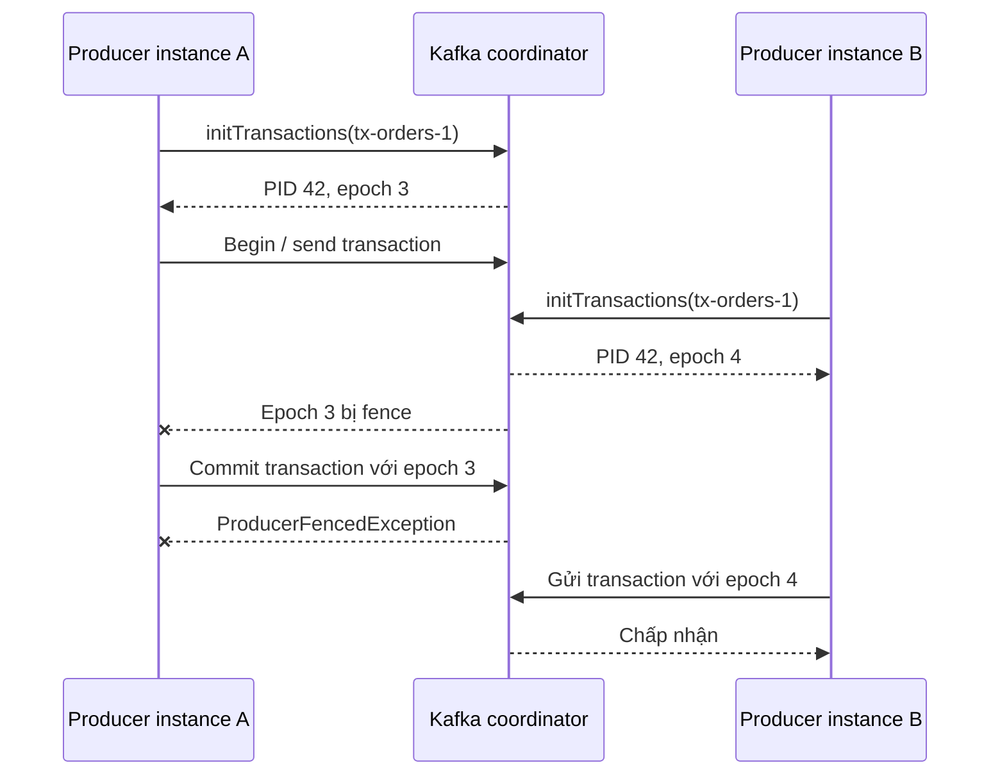

# Mã giao dịch duy nhất giữa các instance và lỗi producer fencing

## 1. Vì sao Kafka cần transactional ID?

Kafka hỗ trợ producer transaction để ghi nhiều record và, trong luồng consume-transform-produce phù hợp, commit offset đầu vào cùng các record đầu ra. Để broker quản lý một producer có transaction qua các lần khởi tạo, producer dùng một định danh gọi là **`transactional.id`**.

`transactional.id` đại diện cho một producer logic. Khi producer khởi tạo transaction bằng định danh này, Kafka cấp hoặc khôi phục producer ID cùng epoch tương ứng. Epoch giúp broker phân biệt producer hiện tại với một producer cũ vẫn còn hoạt động nhưng không còn quyền ghi.

Nếu hai producer đang chạy đồng thời dùng cùng `transactional.id`, producer khởi tạo sau có thể làm tăng epoch và **fence** producer trước. Producer cũ bị từ chối các thao tác transactional tiếp theo. Đây là cơ chế bảo vệ tính nhất quán: tại một thời điểm, chỉ producer đang giữ epoch hợp lệ của transactional ID mới được tiếp tục.

Vì vậy, mỗi instance ứng dụng chạy transactional producer đồng thời cần có định danh phù hợp. Dùng chung một chuỗi `transactional.id` cố định cho mọi replica là lỗi cấu hình phổ biến dẫn đến `ProducerFencedException`.

## 2. Producer ID, epoch và cơ chế fencing

Kafka phân biệt producer bằng hai thành phần nội bộ:

- **Producer ID (PID):** định danh producer do broker quản lý.
- **Producer epoch:** số thế hệ của producer gắn với transactional ID. Khi một producer mới khởi tạo cùng transactional ID, epoch có thể tăng để vô hiệu hóa producer cũ.

Mỗi batch được gửi bởi transactional producer còn có sequence number theo partition để broker phát hiện retry và duy trì tính nhất quán của producer session.



Trong sơ đồ, hai instance dùng cùng transactional ID. Kafka chuyển quyền sang epoch mới; instance cũ không thể tiếp tục commit transaction. Đây là hành vi có chủ đích của fencing, không đơn thuần là một lỗi mạng có thể retry trên cùng producer.

## 3. Vì sao transactional ID phải duy nhất giữa các instance?

Một ứng dụng Spring Cloud Stream có thể chạy nhiều replica để chia tải. Các replica thường cùng dùng một consumer group để đọc topic, nhưng chúng phải có transactional producer identity riêng nếu mỗi replica tạo producer transaction độc lập.

Ví dụ triển khai ba replica:

| Instance | Consumer group | Transactional ID prefix |
|---|---|---|
| `orders-0` | `order-processor` | `orders-tx-orders-0-` |
| `orders-1` | `order-processor` | `orders-tx-orders-1-` |
| `orders-2` | `order-processor` | `orders-tx-orders-2-` |

Consumer group giống nhau là bình thường: các instance phối hợp chia partition. Transactional ID prefix phải phân biệt giữa các instance đang hoạt động để producer của instance này không fence producer của instance khác.

Không nhầm hai loại định danh:

- `group` hoặc `group.id` xác định nhóm consumer và tiến độ đọc.
- `transactional.id` xác định producer logic và quyền sở hữu epoch của transactional producer.

Một consumer group có thể chứa nhiều instance, mỗi instance có transactional producer riêng. Dùng chung group không có nghĩa phải dùng chung transactional ID.

## 4. Transactional ID phải ổn định đến mức nào?

Transactional ID cần đáp ứng hai yêu cầu tưởng như trái ngược:

1. **Khác nhau giữa các producer đồng thời:** hai instance cùng hoạt động không được vô tình dùng chung một ID.
2. **Có thể được tái sử dụng bởi cùng logical instance khi phục hồi:** nếu một tiến trình cũ bị treo hoặc chưa tắt sạch, producer mới của cùng logical instance có thể dùng lại ID để Kafka fence producer cũ.

Do đó, nên tạo định danh từ một logical instance identity ổn định trong vòng đời của instance, thay vì dùng một hằng số chung cho cả deployment hoặc tạo chuỗi ngẫu nhiên mới cho mọi lần gửi.

Ví dụ trong môi trường container, có thể đưa Pod UID hoặc một ordinal ổn định của StatefulSet vào prefix. Cần hiểu vòng đời identity:

- Replica `orders-0` và `orders-1` phải có prefix khác nhau.
- Khi tiến trình của `orders-0` khởi động lại và thay thế chính instance đó, dùng lại identity của `orders-0` có thể giúp fence producer cũ còn sót.
- Khi scale lên một replica mới, replica mới phải nhận identity chưa được replica đang chạy sử dụng.

Nếu mỗi lần restart đều sinh identity mới, producer mới sẽ không fence được producer cũ đang giữ transactional ID trước đó. Nếu mọi replica dùng cùng identity, chúng sẽ fence lẫn nhau. Việc cấp identity phải đi cùng cơ chế điều phối instance và shutdown có kiểm soát.

## 5. Cấu hình transactionIdPrefix trong Spring Cloud Stream Kafka binder

Spring Cloud Stream Kafka binder cho phép bật transaction bằng cách cấu hình `transactionIdPrefix`. Prefix này được dùng để tạo transactional ID cho producer do binder/Spring Kafka quản lý.

Ví dụ cấu hình:

```yaml
spring:
  cloud:
    function:
      definition: processOrder
    stream:
      kafka:
        binder:
          transaction:
            transactionIdPrefix: ${KAFKA_TX_ID_PREFIX}
      bindings:
        processOrder-in-0:
          destination: orders.events
          group: order-processor
        processOrder-out-0:
          destination: orders.processed
```

Mỗi replica cần nhận một giá trị `KAFKA_TX_ID_PREFIX` khác nhau trong khi các producer của cùng logical instance dùng prefix được quản lý cho instance đó. Ví dụ:

```text
orders-tx-orders-0-
orders-tx-orders-1-
orders-tx-orders-2-
```

Spring Kafka producer factory có thể tạo các transactional ID cụ thể bằng cách kết hợp prefix với suffix để quản lý nhiều producer trong cùng ứng dụng. Không tự nối một suffix ngẫu nhiên cho mỗi lần gọi `send`; hãy để binder/producer factory quản lý vòng đời producer theo cơ chế của phiên bản đang dùng.

Tên thuộc tính và cấu trúc cấu hình cần được xác nhận với phiên bản Spring Cloud Stream Kafka binder của dự án. Trong các phiên bản hỗ trợ cấu trúc này, `spring.cloud.stream.kafka.binder.transaction.transactionIdPrefix` là thuộc tính bật transaction và cung cấp prefix.

## 6. Ví dụ cấp prefix từ môi trường triển khai

Trong Kubernetes, có thể dùng tên Pod làm identity khi tên đó phân biệt các replica đang hoạt động. Biến được tham chiếu phải khai báo trước trong danh sách `env`:

```yaml
env:
  - name: POD_NAME
    valueFrom:
      fieldRef:
        fieldPath: metadata.name
  - name: KAFKA_TX_ID_PREFIX
    value: "orders-tx-$(POD_NAME)-"
```

Nếu cần dùng Pod UID thay cho tên, khai báo UID trước rồi tham chiếu:

```yaml
env:
  - name: POD_UID
    valueFrom:
      fieldRef:
        fieldPath: metadata.uid
  - name: KAFKA_TX_ID_PREFIX
    value: "orders-tx-$(POD_UID)-"
```

Tên Pod thường phân biệt replica đồng thời và có thể được tái sử dụng khi StatefulSet thay thế một Pod cùng ordinal; Pod UID phân biệt từng Pod incarnation. Dùng tên Pod nếu muốn cùng logical slot có thể tái sử dụng identity khi thay thế có kiểm soát; dùng UID nếu mỗi incarnation cần identity riêng và hệ thống đảm bảo tiến trình cũ đã chấm dứt trước khi tạo incarnation mới. Chọn identity theo mục tiêu fencing và cách nền tảng quản lý vòng đời instance.

Không dùng hostname chung của service, tên deployment hoặc một literal như `orders-tx-` cho tất cả replica. Những giá trị này thường giống nhau giữa nhiều instance.

## 7. Spring Kafka producer factory và suffix

Trong Spring Kafka, `transactionIdPrefix` là tiền tố để `DefaultKafkaProducerFactory` tạo transactional ID cho producer. Producer factory có thể quản lý cache và suffix nhằm cấp producer riêng cho các transaction đang hoạt động trong cùng ứng dụng.

Vì vậy cần phân biệt:

- **Prefix cấp ứng dụng/instance:** do cấu hình binder hoặc producer factory nhận; phải duy nhất giữa các instance đồng thời.
- **Transactional ID hoàn chỉnh:** prefix kết hợp suffix do producer factory tạo.
- **Producer ID và epoch:** giá trị broker quản lý sau khi producer khởi tạo transaction.

Không nên tự quản lý cả ba lớp trong code nghiệp vụ. Thông thường, ứng dụng chỉ cấu hình prefix đúng và để binder/Spring Kafka quản lý producer lifecycle. Nếu tạo `KafkaProducer` thủ công bên ngoài binder, ứng dụng phải tự chịu trách nhiệm cấu hình transactional ID, gọi `initTransactions`, begin/commit/abort và đóng producer đúng cách.

## 8. ProducerFencedException là gì?

`ProducerFencedException` cho biết producer hiện tại đã bị Kafka fence vì một producer khác đã khởi tạo với cùng transactional ID và epoch mới hơn, hoặc quyền sở hữu producer đã thay đổi theo transaction protocol.

Một số tình huống thường gặp:

- Hai replica dùng chung `transactionIdPrefix` và tạo cùng transactional ID.
- Một logical instance mới khởi động với cùng ID trong khi producer cũ vẫn hoạt động.
- Rolling deployment vô tình dùng prefix giống nhau cho phiên bản cũ và mới.
- Hai tiến trình độc lập cùng được cấu hình cùng một transactional ID.
- Một tiến trình cũ bị treo nhưng vẫn tiếp tục gửi hoặc commit sau khi instance thay thế đã khởi tạo cùng ID.

Khi producer cũ bị fence, các thao tác transactional tiếp theo của nó không còn hợp lệ. Không xử lý lỗi này như một timeout thông thường bằng cách retry vô hạn trên cùng producer instance. Cần giải quyết xung đột identity và để producer lifecycle được khởi tạo lại đúng cách.

## 9. Phân biệt fencing với các lỗi producer khác

Không phải mọi lỗi producer đều là fencing. Phân loại đúng giúp chọn cách phục hồi:

| Lỗi | Ý nghĩa thường gặp | Hướng xử lý |
|---|---|---|
| `ProducerFencedException` | Producer bị producer mới hơn dùng cùng transactional ID fence | Dừng producer cũ, tìm instance trùng ID, sửa identity/ownership |
| `InvalidProducerEpochException` | Epoch của producer không còn hợp lệ cho thao tác | Kiểm tra transaction lifecycle và producer fencing; producer hiện tại không thể tiếp tục transaction đó |
| `OutOfOrderSequenceException` | Sequence number không đúng trạng thái broker mong đợi | Kiểm tra producer session, retry và cấu hình; xử lý theo semantics client/binder |
| `TimeoutException` | Request hoặc transaction không hoàn tất trong thời gian cho phép | Kiểm tra network, broker, timeout và trạng thái transaction; có thể retry theo chính sách |
| `NotEnoughReplicasException` | ISR không đạt ngưỡng yêu cầu ghi | Kiểm tra ISR, replication và `min.insync.replicas` |
| `TransactionalIdAuthorizationException` | Principal không có quyền dùng transactional ID | Sửa ACL/quyền broker; retry không khắc phục được |

Các exception có thể được bọc trong exception của Spring Messaging hoặc binder. Khi điều tra, đọc cause chain và kiểm tra transaction ID, client ID, application instance và thời điểm khởi động.

## 10. Fencing bảo vệ điều gì?

Giả sử instance A bắt đầu transaction nhưng bị mất kết nối với ứng dụng điều phối. Instance B được khởi động để thay thế A và dùng lại transactional ID của A. Broker cấp epoch mới cho B. Nếu A tỉnh lại và cố commit transaction bằng epoch cũ, broker từ chối.

Nếu không có fencing, A và B có thể cùng tiếp tục ghi bằng một logical producer identity, khiến ứng dụng khó xác định transaction nào là hợp lệ. Fencing giúp loại bỏ producer cũ khỏi quyền commit.

Fencing không tự đảm bảo toàn bộ tác vụ nghiệp vụ chỉ chạy một lần. Nếu A đã thực hiện một side effect ngoài Kafka trước khi bị fence, side effect đó không tự rollback. Database, HTTP API hoặc hệ thống thanh toán vẫn cần idempotency và transaction riêng.

## 11. Xử lý ProducerFencedException trong Spring Cloud Stream

Với producer do Kafka binder/Spring Kafka quản lý, không nên bắt `ProducerFencedException` trong function rồi bỏ qua để tiếp tục xử lý như thành công. Việc fence có nghĩa producer hiện tại đã mất quyền transactional. Nếu exception được bọc, hãy giữ cause để log và điều tra.

Quy trình xử lý phù hợp:

1. Xác định transactional ID/prefix của producer gặp lỗi.
2. Tìm các instance khác đang dùng cùng prefix hoặc cùng ID.
3. Kiểm tra rolling deployment, autoscaling và tiến trình cũ chưa dừng.
4. Đảm bảo mỗi instance đang hoạt động có prefix duy nhất.
5. Dừng producer/instance đã mất quyền sở hữu; không tiếp tục dùng transaction hiện tại.
6. Để binder/producer factory đóng và tạo producer mới theo vòng đời được hỗ trợ.
7. Xác minh message đầu vào chưa bị xác nhận sai và xử lý lại theo idempotency nếu cần.

Tùy cách binder/container quản lý producer, lỗi fatal có thể làm transaction hoặc listener dừng và cần khởi động lại context/instance. Không giả định Spring Cloud Stream sẽ tự đổi prefix sau lỗi; prefix là cấu hình identity, không phải bộ đếm retry.

## 12. Rolling deployment và autoscaling

Khi triển khai phiên bản mới, instance cũ và mới có thể cùng tồn tại trong một khoảng thời gian. Nếu tất cả dùng chung `transactionIdPrefix`, producer mới có thể fence producer cũ ngay khi khởi tạo transaction. Điều này gây lỗi trong lúc rolling update và có thể làm các transaction đang mở bị abort.

Thiết kế identity cho deployment:

- Mỗi replica đang chạy có prefix riêng.
- Không dùng một biến cấu hình chung giống nhau cho mọi replica nếu binder yêu cầu prefix riêng.
- Với StatefulSet, có thể dùng ordinal làm phần identity khi đảm bảo không có hai tiến trình cùng ordinal hoạt động đồng thời.
- Với Deployment có tên Pod thay đổi, dùng một instance identity được cấp riêng cho mỗi Pod incarnation hoặc cơ chế lease/ownership rõ ràng.
- Đảm bảo shutdown có graceful timeout để transaction đang mở được hoàn tất hoặc abort trước khi tiến trình rời đi.
- Không tái sử dụng identity của instance cũ khi instance đó vẫn có thể hoạt động.

Nếu cần instance mới fence một tiến trình cũ bị treo, phải tái sử dụng cùng logical identity một cách có chủ đích sau khi hệ thống xác định instance cũ đã mất quyền sở hữu. Không tự ý cấp ID giống nhau cho hai replica khỏe mạnh.

## 13. Transaction timeout và producer fencing

Kafka transaction có timeout. Nếu transaction không được commit hoặc abort trong thời gian cho phép, coordinator có thể kết thúc transaction theo chính sách broker. Transaction timeout không đồng nghĩa với producer fencing do trùng ID, nhưng chúng có thể cùng xuất hiện khi ứng dụng bị treo hoặc quản lý producer lifecycle không đúng.

Các điểm cần kiểm tra:

- `transaction.timeout.ms` của producer/binder.
- `transaction.max.timeout.ms` phía broker.
- Thời gian xử lý function và thời gian gọi dịch vụ phụ thuộc.
- Consumer poll interval và thời gian listener xử lý.
- Shutdown timeout và cách abort transaction khi dừng.
- Số lượng producer transactional đang được cache và concurrency của binding.

Nếu transaction timeout quá ngắn so với thời gian xử lý, transaction có thể bị abort trước khi function hoàn tất. Nếu timeout quá dài, transaction lỗi có thể giữ tài nguyên và làm chậm phục hồi. Chọn timeout theo SLO và đo thời gian xử lý thực tế.

## 14. Kiểm tra transactional ID và lỗi fencing

Khi gặp lỗi, cần thu thập bằng chứng đủ để xác định hai producer nào đang tranh chấp:

1. Ghi nhận application name, instance ID, Pod/host và phiên bản triển khai.
2. Ghi nhận `transactionIdPrefix` đã resolve (không ghi secret).
3. Đọc log Kafka client có `client.id`, transactional ID và exception cause.
4. So sánh thời điểm producer được khởi tạo giữa các instance.
5. Kiểm tra cấu hình environment/secret/config map có bị dùng chung ngoài ý muốn.
6. Kiểm tra số replica thực tế trong rolling update và autoscaling.
7. Xác định transaction đang mở có bị abort hoặc input offset chưa commit hay không.

Log không nên chỉ ghi “Kafka transaction failed”. Hãy đưa vào instance identity, binding, topic và exception gốc để phân biệt lỗi fencing với lỗi network hoặc ISR.

## 15. Kiểm thử uniqueness giữa các instance

Kiểm thử cần chạy nhiều instance thật sự, không chỉ tạo hai producer trong một unit test:

1. Khởi chạy hai replica với hai prefix khác nhau và xác nhận cả hai có thể thực hiện transaction.
2. Gửi nhiều message qua consumer group chung và xác nhận các partition được chia tải bình thường.
3. Khởi chạy hai producer có chủ đích dùng cùng transactional ID trong môi trường test và quan sát producer cũ bị fence.
4. Khởi động lại cùng logical instance với identity được thiết kế để tái sử dụng; xác nhận producer cũ không thể tiếp tục commit.
5. Thực hiện rolling deployment với replica cũ/mới và xác nhận prefix không xung đột.
6. Dừng instance giữa transaction và xác nhận transaction được abort hoặc phục hồi theo cấu hình.
7. Kiểm tra input offset và output record sau fencing để phát hiện mất hoặc xử lý lặp.
8. Kiểm thử retry/idempotency ở consumer vì fencing không rollback side effect ngoài Kafka.

Test binder không mô phỏng đầy đủ Kafka transaction coordinator, producer epoch và fencing. Những kiểm thử này cần Kafka broker thật hoặc môi trường integration tương thích với phiên bản Kafka client/binder đang dùng.

## 16. Quan sát và vận hành

Theo dõi các chỉ số và log liên quan:

- Số lần `ProducerFencedException` và `InvalidProducerEpochException`.
- Số transaction bắt đầu, commit, abort và timeout.
- Transactional ID prefix theo instance (chỉ metadata không nhạy cảm).
- Producer creation/close, producer cache và số producer đang hoạt động.
- Rolling deployment, restart và autoscaling event.
- Consumer lag, rebalance và số message được xử lý lại sau abort.
- Lỗi output binding và transaction coordinator.

Đặt cảnh báo khi có fencing lặp lại giữa các instance. Một lỗi fencing đơn lẻ có thể xuất hiện trong quá trình phục hồi có chủ đích, nhưng fencing liên tục thường chỉ ra identity bị trùng hoặc vòng đời producer không được điều phối đúng.

## 17. Quy trình thiết kế transactional ID

1. Xác định số producer transactional có thể hoạt động đồng thời.
2. Chọn logical instance identity ổn định cho từng replica.
3. Tạo `transactionIdPrefix` duy nhất giữa các instance đang chạy.
4. Cấu hình prefix qua `spring.cloud.stream.kafka.binder.transaction.transactionIdPrefix` theo phiên bản binder.
5. Để binder/Spring Kafka quản lý suffix và producer lifecycle.
6. Thiết kế restart/rolling deployment để cùng logical instance có thể được phục hồi có kiểm soát mà không trùng với replica khác.
7. Phân loại `ProducerFencedException` là lỗi mất quyền sở hữu producer, không retry mù quáng như timeout.
8. Kiểm thử nhiều replica, restart, autoscaling và fencing với Kafka thật.
9. Theo dõi transaction abort, fencing và consumer replay trong production.

Transactional ID là danh tính của producer logic trong giao thức transaction Kafka. Prefix phải duy nhất giữa các producer instance đồng thời, còn việc tái sử dụng identity khi restart phải gắn với quyền sở hữu của cùng logical instance. Kafka dùng producer epoch để fence producer cũ khi một producer mới tiếp quản cùng ID. Cấu hình đúng `transactionIdPrefix`, quản lý vòng đời instance và xử lý fencing như một lỗi fatal của producer giúp Spring Cloud Stream vận hành transaction ổn định trong môi trường nhiều replica.

