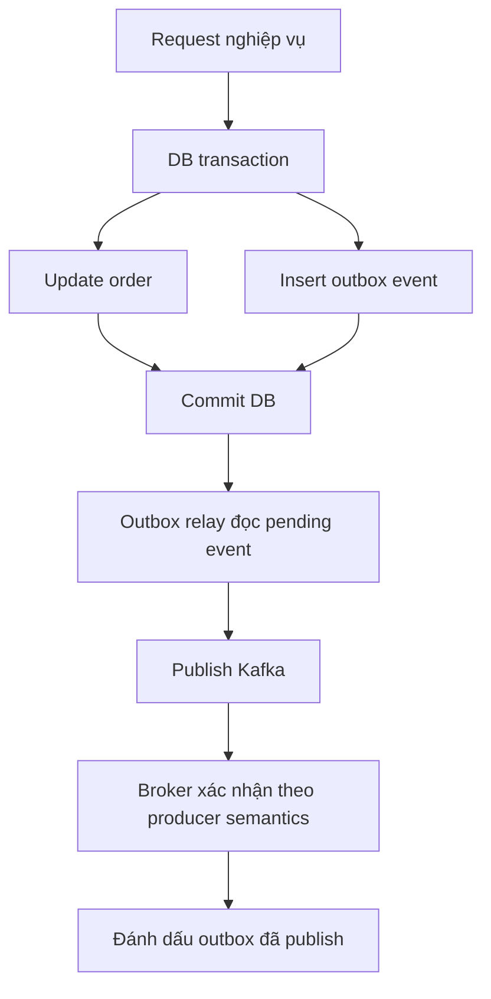

# Phân biệt giao dịch Kafka với giao dịch cơ sở dữ liệu

## Mục tiêu

Một ứng dụng Spring Cloud Stream có thể đọc sự kiện từ Kafka, cập nhật cơ sở dữ liệu và phát một sự kiện mới. Nhìn từ code, toàn bộ thao tác có thể nằm trong một phương thức service, nhưng thực tế chúng thuộc hai hệ thống lưu trữ độc lập: Kafka quản lý record và offset; cơ sở dữ liệu quản lý row và transaction riêng.

**Giao dịch Kafka** bảo đảm tính nguyên tử cho các thao tác Kafka nằm trong cùng transaction, chẳng hạn ghi nhiều record và commit offset của consumer. **Giao dịch cơ sở dữ liệu** bảo đảm tính nguyên tử cho các thay đổi trong database. Hai loại transaction không tự động trở thành một transaction phân tán chỉ vì chúng được gọi trong cùng một phương thức Java hoặc cùng một annotation `@Transactional`.

Bài học này làm rõ phạm vi bảo đảm của từng loại transaction, các failure window khi phối hợp Kafka với database, cách Spring Cloud Stream Kafka binder hỗ trợ transaction và cách dùng transactional outbox/inbox để xây dựng luồng dữ liệu đáng tin cậy.

Sau bài học, bạn có thể:

- Phân biệt Kafka transaction với JDBC/database transaction.
- Hiểu Kafka transaction có thể nguyên tử hóa output record và input offset như thế nào.
- Cấu hình transaction cho Spring Cloud Stream Kafka binder.
- Giải thích vì sao một `@Transactional` thông thường không tự commit Kafka và database cùng lúc.
- Nhận diện lỗi khi database commit nhưng Kafka publish thất bại, hoặc ngược lại.
- Thiết kế transactional outbox và inbox/idempotency.
- Chọn chiến lược phù hợp cho consume-transform-produce và cho nghiệp vụ có side effect trong database.
- Kiểm thử commit, abort, duplicate và các failure window.

## 1. Transaction là ranh giới nguyên tử của một tài nguyên

Transaction gom một tập thao tác thành một đơn vị thành công hoặc thất bại. Nếu transaction commit, các thay đổi thuộc phạm vi transaction được xác nhận; nếu rollback/abort, các thay đổi đó không được xem là đã commit.

Điểm quan trọng là **transaction manager chỉ quản lý những tài nguyên được enlist và hỗ trợ trong transaction của nó**. Một transaction JDBC thường quản lý connection database. Kafka transaction quản lý transactional producer, các record được gửi và offset được đưa vào transaction. Chúng có thể được sử dụng trong cùng luồng nghiệp vụ, nhưng không mặc nhiên chia sẻ một commit nguyên tử.

| Loại transaction | Tài nguyên chính | Có thể bảo vệ |
|---|---|---|
| Database/JDBC transaction | Connection và transaction của database | INSERT, UPDATE, DELETE và các thay đổi database trong cùng transaction |
| Kafka producer transaction | Kafka transactional producer | Ghi nhiều record vào một hoặc nhiều topic/partition trong cùng Kafka cluster |
| Kafka consume-transform-produce transaction | Kafka input offsets và output records | Commit offset và output record cùng nhau trong một Kafka transaction |
| Transaction nghiệp vụ kết hợp DB + Kafka | Hai hệ thống độc lập | Cần pattern phối hợp; không tự có atomic commit chỉ bằng một annotation |

Ví dụ database transaction:

    @Transactional
    public void createOrder(Order order) {
        orderRepository.save(order);
        inventoryReservationRepository.create(order.id());
    }

Nếu hai repository dùng cùng transaction manager và cùng database transaction, cả hai thay đổi có thể commit hoặc rollback cùng nhau. Kafka không nằm trong transaction này chỉ vì service cũng có thể gọi `StreamBridge.send()`.

## 2. Kafka transaction bảo đảm điều gì?

Kafka transaction cho phép producer ghi một nhóm record theo cách nguyên tử. Consumer dùng isolation level `read_committed` chỉ đọc record thuộc transaction đã commit; record từ transaction bị abort sẽ không được xem là dữ liệu đã commit.

Kafka transaction còn hỗ trợ mô hình consume-transform-produce: ứng dụng đọc record, tạo output record và đưa offset input tương ứng vào cùng transaction. Khi transaction commit, output records và tiến độ input được xác nhận cùng nhau. Nếu transaction abort, output không hiển thị với consumer `read_committed` và offset input chưa được commit trong transaction đó, nên record đầu vào có thể được xử lý lại.

Luồng khái quát:

    Consumer đọc input record
        -> Xử lý và tạo output record
        -> Gửi output record trong Kafka transaction
        -> Đưa input offset vào cùng transaction
        -> Commit Kafka transaction
             -> Output hiển thị cho read_committed consumer
             -> Input offset được xác nhận
        -> Nếu abort:
             -> Output transaction không hiển thị
             -> Input offset không tiến theo transaction

Kafka transaction có thể bao gồm nhiều topic và partition trong cùng cluster. Nó không bao gồm một transaction JDBC thông thường, file system, HTTP API hay một broker khác.

### Producer idempotence và transaction khác nhau

Producer idempotence giúp Kafka producer xử lý retry ở tầng protocol để tránh tạo duplicate record do một số lần gửi lại trong cùng producer session/sequence. Kafka transaction bổ sung khả năng commit hoặc abort một nhóm record và phối hợp offset.

Hai tính năng liên quan nhưng không đồng nghĩa:

- Idempotent producer không tự gộp nhiều thao tác nghiệp vụ thành một transaction.
- Kafka transaction không tự làm cho thao tác ghi database trở thành nguyên tử.
- Cả hai không loại bỏ nhu cầu idempotency khi ứng dụng replay event hoặc thực hiện lại side effect ngoài Kafka.

## 3. Kafka transaction trong Spring Cloud Stream

Kafka binder của Spring Cloud Stream có thể dùng transactional producer. Khi cấu hình transaction ID prefix, binder tạo producer có transaction ID và quản lý Kafka transaction theo cơ chế tích hợp của binder.

Ví dụ cấu hình khái quát:

    spring:
      cloud:
        stream:
          bindings:
            orders-out-0:
              destination: orders.processed
          kafka:
            binder:
              transaction:
                transaction-id-prefix: ${INSTANCE_ID:local}-orders-tx-

`transaction-id-prefix` bật transaction support của Kafka binder khi được cấu hình theo phiên bản binder tương ứng. Prefix cần được thiết kế để các instance chạy đồng thời không tranh chấp transactional ID. Trong môi trường nhiều replica, cung cấp identity riêng/ổn định theo instance theo hướng dẫn của binder và Spring Kafka; không dùng một transactional identity xung đột cho nhiều producer độc lập.

Các producer properties dành cho transactional producer được cấu hình trong phần transaction producer configuration của binder, thay vì giả định mọi thuộc tính producer binding thông thường đều được áp dụng giống nhau:

    spring:
      cloud:
        stream:
          kafka:
            binder:
              transaction:
                transaction-id-prefix: ${INSTANCE_ID:local}-orders-tx-
                producer:
                  configuration:
                    acks: all

Tên property, cách binder tạo suffix và vị trí các producer properties cần được đối chiếu với phiên bản Spring Cloud Stream Kafka binder đang dùng. Đặc biệt, transaction ID phải duy nhất trong phạm vi các producer đang hoạt động đồng thời.

Khi bật transaction ở binder, các output binding thuộc binder đó có thể dùng transactional producer theo cấu hình transaction. Trong luồng consume-transform-produce, binder có thể đưa output record và offset input vào cùng transaction theo transaction integration của container. Điều này chỉ áp dụng cho các thao tác Kafka được tham gia vào transaction đó.

### Consumer đọc dữ liệu đã commit

Consumer cần isolation level phù hợp nếu không muốn nhìn thấy dữ liệu của transaction chưa commit hoặc đã abort:

    spring:
      cloud:
        stream:
          kafka:
            binder:
              configuration:
                isolation.level: read_committed

Cấu hình isolation ở đúng namespace có thể khác theo phiên bản binder hoặc theo binding consumer. Hãy xác minh effective Kafka consumer properties trong ứng dụng. Nếu consumer dùng `read_uncommitted`, nó có thể nhìn thấy record thuộc transaction chưa hoàn tất hoặc transaction bị abort; điều đó không phù hợp khi yêu cầu chỉ đọc dữ liệu đã commit.

### Transaction timeout và vận hành

Kafka transaction có timeout. Nếu xử lý kéo dài quá thời gian cho phép, broker có thể abort transaction. Cần tính đến:

- Thời gian xử lý batch.
- Thời gian gọi dependency.
- Thời gian gửi output.
- Thời gian commit.
- Cấu hình `transaction.timeout.ms` và giới hạn broker.
- Thời gian consumer được phép giữa các lần poll.

Không tăng timeout vô hạn để che giấu handler bị treo. Hãy đặt timeout cho dependency, giới hạn batch/concurrency và theo dõi transaction abort.

## 4. Database transaction không tự bao gồm Kafka

Ví dụ sau trông có vẻ như một thao tác nguyên tử:

    @Service
    public class OrderService {

        private final OrderRepository repository;
        private final StreamBridge streamBridge;

        @Transactional
        public void createOrder(Order order) {
            repository.save(order);
            streamBridge.send("orders-out-0", OrderCreated.from(order));
        }
    }

Nếu transaction manager đang được chọn là database transaction manager, `repository.save()` tham gia transaction database. Lời gọi `StreamBridge.send()` gửi message qua output binding, nhưng nó không tự động trở thành một phần của transaction JDBC đó.

Một số tích hợp có thể phối hợp transaction manager hoặc đồng bộ thứ tự commit giữa các tài nguyên. Tuy nhiên, việc commit tuần tự hai resource không tạo ra atomic commit phân tán. Nếu process chết giữa hai lần commit, một resource có thể đã commit trong khi resource kia chưa commit.

Cần xác định rõ transaction manager nào đang điều khiển phương thức. `@Transactional` không phải một yêu cầu chung rằng mọi hệ thống được gọi trong phương thức đều cùng rollback.

## 5. Hai failure window khi ghi database và publish Kafka

Giả sử nghiệp vụ cần lưu đơn hàng và phát `OrderCreated`.

### Database commit trước, Kafka publish thất bại

1. Database lưu đơn hàng và commit.
2. Ứng dụng gửi `OrderCreated` nhưng broker không nhận hoặc producer gặp lỗi.
3. Đơn hàng tồn tại nhưng consumer không biết có đơn hàng mới.

Đây là sự kiện bị thiếu so với trạng thái database. Retry request ở tầng HTTP có thể tạo thêm đơn hàng nếu endpoint không idempotent.

### Kafka commit trước, database rollback

1. Ứng dụng publish `OrderCreated` thành công.
2. Database transaction rollback do lỗi.
3. Consumer nhận sự kiện cho một đơn hàng không tồn tại hoặc chưa được commit.

Đây là sự kiện ma (phantom event) so với database.

### Cả hai thành công nhưng response bị mất

1. Database commit.
2. Kafka publish thành công.
3. Process hoặc kết nối client gặp lỗi trước khi caller nhận được response.
4. Caller thử lại và có thể tạo thao tác/publish lần nữa.

Đây là một nguồn duplicate phổ biến. Cần idempotency key ở API và event ID ổn định ở message.

| Failure window | Database | Kafka | Hậu quả |
|---|---|---|---|
| DB commit, publish thất bại | Đã commit | Chưa có event | Thiếu event |
| Publish commit, DB rollback | Rollback | Event đã commit | Event không phản ánh trạng thái DB |
| Cả hai commit, response mất | Đã commit | Đã commit | Caller retry có thể tạo duplicate |
| Process chết giữa hai commit | Một bên đã commit | Bên còn lại chưa commit | Trạng thái lệch |
| Publish thành công, đánh dấu outbox thất bại | Outbox còn pending | Event đã có | Relay có thể gửi duplicate |

Đây là lý do không nên gọi hai thao tác độc lập là "một transaction" chỉ vì chúng nằm trong cùng một phương thức service.

## 6. Transactional outbox: ghi trạng thái và sự kiện trong cùng DB transaction

Transactional outbox giải quyết failure window ở phía producer bằng cách ghi thay đổi nghiệp vụ và một bản ghi outbox trong **cùng transaction database**. Một relay riêng đọc outbox và gửi message sang Kafka.

Luồng:

Nếu transaction database rollback, cả order update và outbox row đều rollback. Nếu commit, event vẫn được lưu bền vững trong database để relay có thể thử lại sau sự cố Kafka.

Ví dụ schema:

    CREATE TABLE outbox_event (
        event_id VARCHAR(120) PRIMARY KEY,
        aggregate_id VARCHAR(120) NOT NULL,
        event_type VARCHAR(160) NOT NULL,
        payload JSON NOT NULL,
        created_at TIMESTAMP NOT NULL,
        published_at TIMESTAMP NULL
    );

Service nghiệp vụ:

    @Transactional
    public void createOrder(Order order) {
        orderRepository.save(order);

        OrderCreated event = OrderCreated.from(order);
        outboxRepository.insert(
                event.eventId(),
                order.id(),
                "order.created",
                serialize(event),
                clock.instant()
        );
    }

Hai thao tác repository tham gia cùng database transaction. Phương thức không trực tiếp gửi Kafka; relay đảm nhiệm việc publish sau khi transaction commit.

### Outbox relay cần xác nhận publish trước khi đánh dấu

Relay có thể dùng polling, batch hoặc CDC. Với polling, nó tìm các row chưa publish, gửi message và chỉ đánh dấu published sau khi có bằng chứng gửi thành công theo semantics của producer/binder.

Pseudo-flow:

    for each pending outbox row:
        publish event with original event_id
        wait for successful broker send result
        mark row published

Không coi `StreamBridge.send()` trả về `true` là bằng chứng broker đã lưu record bền vững; giá trị này biểu thị message được chấp nhận bởi đường gửi của framework. Cần dùng cơ chế xác nhận phù hợp với binder/producer, ví dụ send result/callback hoặc Kafka producer future theo cấu hình ứng dụng, rồi mới đánh dấu outbox.

### Vì sao outbox vẫn có thể gửi trùng?

Giả sử Kafka đã nhận event, nhưng relay chết trước khi cập nhật `published_at`. Khi khởi động lại, relay thấy row vẫn pending và gửi lại. Vì vậy, transactional outbox thường cung cấp khả năng phát ít nhất một lần (at-least-once), không tự bảo đảm exactly-once end-to-end.

Để xử lý duplicate:

- Giữ nguyên `event_id` qua mọi lần retry.
- Consumer lưu event ID đã xử lý với unique constraint.
- Việc ghi inbox/dedup và cập nhật trạng thái nghiệp vụ diễn ra trong cùng DB transaction.
- Có metric cho outbox age, số pending row, retry và publish failure.
- Có quy trình xử lý row bị kẹt hoặc payload không còn tương thích.

### Polling hay CDC?

| Cách relay | Đặc điểm | Cần cân nhắc |
|---|---|---|
| Polling relay | Ứng dụng truy vấn row pending theo batch | Lock/claim row, batch size, polling interval và cleanup |
| CDC/outbox connector | Đọc thay đổi database log và chuyển outbox record sang Kafka | Connector, schema routing, quyền log/replication và vận hành CDC |

CDC có thể giảm polling và tận dụng log database, nhưng cần hạ tầng connector và chính sách schema. Dù dùng cách nào, event ID và consumer idempotency vẫn quan trọng.

## 7. Consumer ghi database: inbox và thứ tự commit

Ở phía consumer, ứng dụng có thể nhận Kafka event rồi cập nhật database. Kafka offset và database transaction cũng là hai resource riêng.

Một failure window:

1. Consumer đọc event.
2. Database cập nhật thành công và commit.
3. Process chết trước khi Kafka offset được commit.
4. Kafka giao lại event sau khi consumer restart/rebalance.
5. Database có thể nhận cùng side effect lần nữa.

Một cách xử lý là dùng inbox table:

    CREATE TABLE inbox_event (
        event_id VARCHAR(120) PRIMARY KEY,
        received_at TIMESTAMP NOT NULL
    );

Consumer thực hiện trong cùng DB transaction:

    @Transactional
    public void handle(OrderCreated event) {
        boolean firstDelivery = inboxRepository.insertIfAbsent(
                event.eventId(),
                clock.instant()
        );

        if (!firstDelivery) {
            return;
        }

        inventoryService.reserve(event.orderId());
    }

Nếu event ID đã tồn tại, side effect đã được xử lý trong transaction trước đó; lần giao lại có thể kết thúc mà không lặp nghiệp vụ. Nếu transaction rollback, cả inbox insert và side effect database rollback, nên lần giao lại có thể thử lại.

Cần bảo đảm `insertIfAbsent` dựa trên unique constraint hoặc thao tác atomic của database. Một mẫu "SELECT trước rồi INSERT" không được bảo vệ có thể race khi hai consumer xử lý cùng event đồng thời.

### Khi nào offset được commit?

Với consumer Kafka, cần cấu hình acknowledgment/commit sao cho offset không được tiến vượt qua công việc database chưa hoàn tất. Cách cụ thể phụ thuộc Kafka binder, container transaction mode, ack mode và function model.

Nếu offset commit trước DB commit rồi database rollback, message có thể bị bỏ qua khi consumer khởi động lại. Nếu DB commit trước offset commit, message có thể được giao lại, nhưng inbox/idempotency xử lý duplicate. Đối với side effect database, cách thứ hai thường dễ xây dựng tính đúng đắn hơn vì chấp nhận duplicate có kiểm soát thay vì nguy cơ mất message.

Không tự bật Kafka auto-commit hoặc tự commit offset bên ngoài cơ chế binder nếu chưa hiểu tương tác. Kiểm thử failure window bằng cách dừng consumer ở giữa DB commit và offset commit.

## 8. Kafka consume-transform-produce: atomicity trong Kafka

Một use case phù hợp với Kafka transaction là:

- Đọc `orders.created`.
- Tính toán và tạo `orders.accepted`.
- Commit offset của input record.
- Gộp output và offset trong cùng Kafka transaction.

Khi binder hỗ trợ transactional listener/container và các binding dùng cùng Kafka binder transaction, framework có thể phối hợp gửi output record và commit input offset trong một transaction Kafka. Nếu xử lý thất bại và transaction abort, output record không được consumer `read_committed` nhìn thấy và input offset không tiến theo transaction đó.

Đây là bảo đảm mạnh cho luồng Kafka-to-Kafka. Nếu function còn gọi database hoặc HTTP API, các side effect đó không tự rollback khi Kafka transaction abort. Khi message được xử lý lại, side effect ngoài Kafka có thể xảy ra lần nữa.

### Ví dụ function

    @Bean
    Function<OrderCreated, OrderAccepted> acceptOrder(OrderPolicy policy) {
        return event -> policy.accept(event);
    }

Cấu hình function và binding:

    spring:
      cloud:
        function:
          definition: acceptOrder
        stream:
          bindings:
            acceptOrder-in-0:
              destination: orders.created
              group: order-acceptor
            acceptOrder-out-0:
              destination: orders.accepted
        kafka:
          binder:
            transaction:
              transaction-id-prefix: ${INSTANCE_ID:local}-accept-order-

Ví dụ minh họa cấu hình transaction ở binder. Cần xác minh transaction mode, producer settings, consumer isolation và error handling theo phiên bản Spring Cloud Stream Kafka binder. Không phải cứ khai báo prefix là mọi lời gọi database trong function được enlist vào Kafka transaction.

## 9. Vì sao @Transactional không giải quyết cross-resource atomicity?

Spring `@Transactional` thường chọn một transaction manager theo qualifier hoặc transaction manager mặc định. Ví dụ:

- `DataSourceTransactionManager`/transaction manager tương ứng quản lý database connection.
- `KafkaTransactionManager` quản lý Kafka producer transaction.
- Kafka binder có transaction integration riêng cho listener/output flow.

Nếu phương thức dùng database transaction manager, Kafka send không tự tham gia database transaction. Nếu phương thức dùng Kafka transaction manager, JDBC operation không tự tham gia Kafka transaction.

Có thể cấu hình transaction synchronization để một transaction manager commit trước/sau resource khác, nhưng đây là điều phối thứ tự và vẫn có failure window giữa các lần commit. Không được diễn giải synchronization thành distributed atomic commit.

Một hệ thống distributed transaction/2PC cần coordinator và resource manager thực sự hỗ trợ giao thức đó. Kafka transaction không phải một cơ chế XA chung để tự enlist bất kỳ JDBC database nào. Trong phần lớn kiến trúc event-driven, outbox/inbox và idempotency là lựa chọn thực tế, dễ vận hành hơn việc cố tạo một transaction phân tán giữa database và Kafka.

## 10. Chọn chiến lược theo use case

| Use case | Cơ chế nên xem xét | Phạm vi bảo đảm |
|---|---|---|
| Ghi nhiều record Kafka như một đơn vị | Kafka producer transaction | Output records cùng commit/abort |
| Consume Kafka, transform, produce Kafka | Kafka transaction tích hợp offset | Input offset và output records cùng transaction |
| Cập nhật DB rồi phát event | Transactional outbox | DB state và outbox row atomic; relay phát ít nhất một lần |
| Consume Kafka rồi cập nhật DB | Inbox/idempotency + DB transaction | Side effect DB không lặp khi event được giao lại |
| Gọi HTTP API ngoài rồi commit Kafka offset | Idempotency key ở API hoặc workflow/outbox | Xử lý retry ngoài Kafka |
| Ghi DB và Kafka trong cùng method | Không giả định một transaction chung | Phải thiết kế failure recovery rõ ràng |

Câu hỏi thiết kế quan trọng không phải "có dùng `@Transactional` không", mà là:

1. Resource nào phải commit cùng nhau?
2. Có thể chấp nhận duplicate không?
3. Có thể khôi phục event sau process crash không?
4. Nguồn sự thật nằm ở database, Kafka hay event store?
5. Consumer có idempotent không?
6. Cần consistency tức thời hay eventual consistency là đủ?

## 11. Kiểm thử Kafka transaction

Một test Kafka transaction cần xác minh hành vi commit và abort với consumer isolation phù hợp.

### Commit thành công

- Bắt đầu transaction.
- Gửi một hoặc nhiều record.
- Commit transaction.
- Consumer `read_committed` nhìn thấy toàn bộ record đã commit.
- Không có record nào trong nhóm transaction bị thiếu ngoài dự kiến.

### Abort

- Bắt đầu transaction.
- Gửi output record.
- Abort do exception hoặc lỗi.
- Consumer `read_committed` không nhìn thấy record thuộc transaction bị abort.
- Với consume-transform-produce, input offset chưa được commit cùng transaction và record có thể được xử lý lại.

### Consume-transform-produce

- Gửi input record.
- Consumer xử lý và gửi output trong transaction.
- Xác minh output record và input offset commit cùng nhau.
- Buộc transaction abort và xác minh output không hiển thị, input có thể được đọc lại.
- Dùng consumer `read_committed` để kiểm tra kết quả.

Test Binder hữu ích cho wiring Spring Cloud Stream, nhưng không thay thế Kafka broker integration test để xác minh transaction coordinator, isolation level, offset transaction và fencing.

## 12. Kiểm thử phối hợp database và Kafka

Cần kiểm thử failure window thay vì chỉ test happy path.

### Outbox tests

- Rollback DB transaction: domain row và outbox row đều không tồn tại.
- Commit DB transaction: domain row và outbox row cùng tồn tại.
- Kafka unavailable: outbox row vẫn pending và relay retry sau.
- Kafka nhận event nhưng relay chết trước khi đánh dấu published: event có thể được gửi lại; consumer dedupe theo event ID.
- Payload/schema lỗi: row được giữ để điều tra hoặc chuyển trạng thái lỗi theo policy, không bị xóa âm thầm.

### Inbox tests

- Event mới: inbox row và domain update commit cùng nhau.
- Duplicate event ID: không lặp side effect.
- DB rollback: inbox row cũng rollback để event có thể được xử lý lại.
- DB commit nhưng offset chưa commit: redelivery không lặp side effect.
- Consumer crash trước DB commit: event được giao lại và xử lý bình thường.

### Failure injection

Có thể mô phỏng:

- Dừng process sau DB commit nhưng trước Kafka publish.
- Dừng relay sau Kafka send success nhưng trước cập nhật outbox.
- Dừng consumer sau DB commit nhưng trước offset commit.
- Làm Kafka transaction abort sau khi đã gửi output.
- Tạo timeout hoặc mất kết nối trong lúc commit.

Test phải quan sát trạng thái cuối cùng của database, Kafka topic, outbox/inbox và offset. Chỉ kiểm tra exception được ném ra là chưa đủ.

## 13. Vận hành và quan sát

Với Kafka transaction, theo dõi:

- Transaction commit/abort rate.
- Transaction timeout và fencing errors.
- Producer send failures.
- Consumer lag và offset commit failures.
- Thời gian xử lý một transaction/batch.
- Số record được gửi trong mỗi transaction.

Với outbox/inbox, theo dõi:

- Số row pending.
- Tuổi của outbox row lâu nhất.
- Retry và publish failure rate.
- Số duplicate bị inbox loại bỏ.
- Số event ở trạng thái lỗi cần can thiệp.
- Độ trễ từ DB commit đến Kafka publish.
- Dung lượng và chính sách cleanup của bảng outbox/inbox.

Outbox không được để tăng vô hạn. Cần retention/archival cho row đã publish, index theo trạng thái và thời gian, batch size, lock strategy và quy trình cleanup. Không xóa pending row chỉ vì nó cũ; cần có điều tra và quyết định rõ ràng.

## 14. Những lỗi thường gặp

| Triệu chứng | Nguyên nhân có thể | Cách xử lý |
|---|---|---|
| DB rollback nhưng Kafka event vẫn tồn tại | Kafka send không tham gia DB transaction | Dùng outbox hoặc thiết kế transaction boundary đúng |
| DB commit nhưng không có event | Publish thất bại sau DB commit | Ghi outbox cùng DB transaction |
| Consumer xử lý side effect hai lần | DB commit nhưng offset chưa commit | Inbox/unique event ID và idempotent handler |
| Consumer thấy record của transaction bị abort | Consumer dùng isolation level không phù hợp | Dùng read_committed khi cần chỉ đọc record đã commit |
| Kafka transaction bị fencing | Transactional ID prefix bị trùng giữa producer instance | Cấp prefix/identity riêng theo yêu cầu binder |
| Transaction timeout | Xử lý quá lâu hoặc dependency bị treo | Giới hạn batch, timeout dependency và transaction duration |
| Outbox gửi trùng | Relay chết sau publish trước khi đánh dấu | Giữ event ID và consumer dedupe |
| Nghĩ rằng @Transactional bao gồm mọi lời gọi | Chưa xác định transaction manager và resource được enlist | Xác định transaction manager, dùng outbox/inbox |
| Test pass nhưng production mất event | Chỉ test happy path, không test crash window | Thêm broker integration và failure injection tests |

## 15. Quy trình thiết kế transaction cho một luồng sự kiện

Trước khi triển khai, hãy làm rõ các bước sau:

1. Vẽ ranh giới database transaction và Kafka transaction.
2. Liệt kê mọi side effect: database write, Kafka publish, HTTP call, file hoặc broker khác.
3. Xác định những thao tác nào có thể commit nguyên tử trong cùng resource.
4. Nếu chỉ consume-transform-produce trong Kafka, xem xét Kafka binder transaction và read_committed consumer.
5. Nếu database state phải đi cùng event, ghi outbox trong cùng DB transaction.
6. Nếu consumer cập nhật database, ghi inbox/dedup và business state trong cùng DB transaction.
7. Giữ event ID ổn định qua retry/replay.
8. Xác định thời điểm offset/ack được commit và kiểm thử crash window.
9. Kiểm thử transaction commit/abort, outbox retry, duplicate và consumer restart.
10. Theo dõi transaction abort, outbox age, consumer lag và duplicate rate.

## Kết luận

Kafka transaction bảo vệ các thao tác Kafka trong cùng transaction, đặc biệt hữu ích khi ghi nhiều output record và commit input offset trong một luồng consume-transform-produce. Database transaction bảo vệ thay đổi trong database. Một `@Transactional` thông thường không tự biến hai loại transaction này thành một atomic commit chung.

Khi nghiệp vụ cần cập nhật database và phát event, transactional outbox giúp lưu trạng thái nghiệp vụ cùng event record trong một DB transaction; relay phát event với khả năng at-least-once và consumer dùng inbox/idempotency để chịu duplicate. Khi consumer đọc Kafka rồi ghi database, hãy commit side effect DB trước khi offset tiến theo policy của binder và dùng inbox để xử lý redelivery. Luôn kiểm thử failure window thực tế thay vì chỉ dựa vào happy path hoặc tên annotation.

