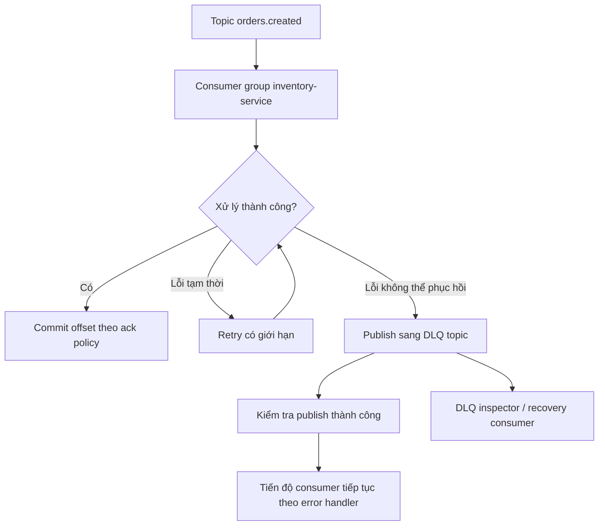

# Chọn destination và partition cho bản ghi lỗi

Khi consumer Kafka không xử lý được một record sau các lần thử phù hợp, hệ thống có thể chuyển record sang Dead Letter Topic (DLT/DLQ) để điều tra và phục hồi. Việc chọn topic đích và partition cho record lỗi ảnh hưởng tới khả năng cô lập lỗi giữa các dịch vụ, thông lượng, thứ tự theo key, quyền truy cập và quy trình phát lại.

Trong Spring Cloud Stream Kafka Binder, có thể bật dead-letter publishing cho input binding, đặt tên topic đích bằng `dlqName` và kiểm soát số partition của DLQ. Khi cần nhiều partition, `DlqPartitionFunction` cho phép chọn partition cho từng record lỗi. Một thiết kế tốt phải giữ đủ metadata nguồn để truy vết, giới hạn phạm vi destination, bảo đảm topic có cấu hình phù hợp và tránh tạo ra một DLQ không thể vận hành hoặc phát lại an toàn.

## 1. DLQ là nơi cách ly record không xử lý được

Kafka lưu record trong topic theo partition. Khi consumer không thể xử lý một record, error handler có thể retry, phục hồi hoặc publish record đó sang một topic khác. Topic đích này thường được gọi là Dead Letter Topic (DLT) hoặc Dead Letter Queue (DLQ). Với Kafka, tên “topic” chính xác hơn vì record được lưu trong log và được đọc lại theo consumer group/offset.



DLQ giúp tách record lỗi khỏi luồng chính để consumer tiếp tục xử lý các record khác theo chính sách đã cấu hình. Nó không tự sửa payload, không tự xác định cách khôi phục nghiệp vụ và không bảo đảm record được xử lý lại đúng một lần. Đội vận hành vẫn cần phân loại nguyên nhân, sửa dữ liệu hoặc code, rồi phát lại có kiểm soát.

## 2. Chọn destination theo phạm vi sở hữu

Destination của DLQ nên thể hiện rõ record đến từ luồng nào và ai chịu trách nhiệm xử lý. Với Kafka Binder, nếu bật DLQ mà không khai báo tên riêng, tên mặc định thường theo dạng `error.<destination>.<group>`. Ví dụ, input destination `orders.created` với group `inventory-service` có thể dùng topic `error.orders.created.inventory-service` theo quy tắc đặt tên của binder/phiên bản.

Có thể đặt tên rõ ràng bằng `dlqName`:

```yaml
spring:
  cloud:
    stream:
      bindings:
        processOrder-in-0:
          destination: orders.created
          group: inventory-service
      kafka:
        bindings:
          processOrder-in-0:
            consumer:
              enable-dlq: true
              dlq-name: orders.created.inventory-service.dlq
```

Trong ví dụ, `enable-dlq` bật việc publish record không thể xử lý tới DLQ của Kafka Binder. `dlq-name` chỉ định topic đích. Binding cần có consumer group ổn định để trạng thái tiêu thụ và DLQ có chủ sở hữu rõ ràng. Kiểm tra tên thuộc tính và điều kiện hỗ trợ theo phiên bản Kafka Binder đang sử dụng.

### 2.1. DLQ riêng cho từng destination và group

Đây thường là lựa chọn dễ vận hành nhất khi mỗi nhóm có quy trình xử lý lỗi riêng:

- `orders.created` + `inventory-service` → `orders.created.inventory-service.dlq`.
- `orders.created` + `payment-service` → `orders.created.payment-service.dlq`.
- `payments.requested` + `payment-worker` → `payments.requested.payment-worker.dlq`.

Hai consumer group đọc cùng topic có thể có lỗi khác nhau và cần đội phụ trách, thời hạn lưu, quyền truy cập và quy trình phát lại khác nhau. DLQ riêng giúp cô lập backlog và tránh một consumer phục hồi ảnh hưởng tới nhóm khác.

### 2.2. Khi nào dùng DLQ dùng chung?

Một DLQ tập trung có thể phù hợp với nền tảng có dịch vụ điều phối lỗi chung, nhưng cần giữ metadata nguồn đầy đủ và có bộ định tuyến rõ ràng. Ít nhất phải phân biệt được:

- Topic nguồn và consumer group nguồn.
- Partition và offset gốc.
- Event ID, key và thời điểm phát sinh.
- Loại exception và số lần retry.
- Phiên bản ứng dụng/schema đã xử lý record.
- Nhóm sở hữu và quy trình phục hồi.

Nếu nhiều luồng ghi vào cùng DLQ mà không có metadata nguồn, người vận hành khó biết phải phát lại vào đâu. DLQ dùng chung cũng có thể tạo một điểm nóng về thông lượng và quyền truy cập. Không chọn destination chung chỉ để giảm số topic mà bỏ qua ranh giới sở hữu.

### 2.3. Định tuyến động theo loại lỗi

Trong một số phiên bản Kafka Binder, có thể dùng `DlqDestinationResolver` để xác định topic DLQ tại runtime, ví dụ phân loại lỗi schema, lỗi nghiệp vụ hoặc lỗi hệ thống. Chỉ dùng định tuyến động khi có tập destination được kiểm soát và quy trình vận hành cho từng loại. Tránh tạo tên topic trực tiếp từ exception message, tenant ID hoặc dữ liệu không tin cậy; cách làm đó có thể sinh số lượng topic không giới hạn.

Nếu chỉ cần phân loại nguyên nhân, một DLQ ổn định kèm header `failureCategory` hoặc một trường metadata tương đương thường dễ quản lý hơn nhiều topic động. API resolver và cách cấu hình phụ thuộc phiên bản binder; kiểm tra đúng Javadoc trước khi triển khai.

## 3. Chọn số partition của DLQ

DLQ có thể có một hoặc nhiều partition. Lựa chọn phụ thuộc vào thông lượng lỗi, yêu cầu song song, khả năng giữ liên hệ với partition nguồn và cách phát lại.

| Thiết kế DLQ | Lợi ích | Giới hạn |
|---|---|---|
| Một partition | Đơn giản, dễ quan sát và dễ đọc tuần tự | Throughput và khả năng song song thấp; mọi record lỗi tập trung vào partition 0 |
| Cùng số partition với topic nguồn | Có thể ánh xạ record lỗi theo partition nguồn và xử lý song song tương ứng | Tốn tài nguyên; cần mapping nhất quán và bảo đảm topic DLQ được cấp phát đúng |
| Ít partition hơn topic nguồn | Giảm tài nguyên, gom nhiều partition nguồn vào một partition DLQ | Có thể tạo điểm nóng và mất quan hệ một-một giữa partition nguồn và DLQ |
| Nhiều partition hơn topic nguồn | Có thêm dung lượng xử lý khi lỗi tăng đột biến | Không tự tăng throughput nếu không có consumer; cần quy tắc phân vùng và quản lý offset riêng |

Với `dlqPartitions`, Kafka Binder cho phép chỉ định số partition mong muốn cho DLQ trong các cấu hình hỗ trợ. Khi cần nhiều partition, có thể khai báo bean `DlqPartitionFunction` để quyết định partition đích cho từng record lỗi. Nếu chỉ có một partition, mọi record được gửi vào partition duy nhất theo hành vi của binder; không trả về index dựa trên partition nguồn nếu index đó có thể vượt phạm vi DLQ.

Ví dụ ánh xạ giữ nguyên số partition nguồn khi DLQ được cấp phát với cùng số partition:

```java
import org.apache.kafka.clients.consumer.ConsumerRecord;
import org.springframework.cloud.stream.binder.kafka.DlqPartitionFunction;
import org.springframework.context.annotation.Bean;
import org.springframework.context.annotation.Configuration;

@Configuration
public class KafkaDlqConfiguration {

    @Bean
    DlqPartitionFunction dlqPartitionFunction() {
        return (group, record, exception) -> record.partition();
    }
}
```

Hàm trên dùng partition nguồn làm partition DLQ. Chỉ áp dụng khi topic DLQ có ít nhất số partition cần thiết và index nguồn hợp lệ trong DLQ. Nếu topic nguồn có 12 partition nhưng DLQ chỉ có 4, hàm trên có thể trả về index 4–11 không hợp lệ. Khi số partition khác nhau, cần ánh xạ tường minh, ví dụ dùng phép modulo với số partition DLQ đã biết hoặc chọn partition theo một quy tắc khác có kiểm tra phạm vi.

Ví dụ dưới đây minh họa phép ánh xạ về 4 partition DLQ:

```java
@Bean
DlqPartitionFunction dlqPartitionFunction() {
    int dlqPartitionCount = 4;
    return (group, record, exception) ->
            Math.floorMod(record.partition(), dlqPartitionCount);
}
```

Không cố định `4` trong code nếu số partition được quản trị thay đổi theo môi trường. Có thể đưa số partition vào cấu hình ứng dụng hoặc lấy từ metadata/provisioning đã được xác thực. Hàm phải trả về partition tồn tại; việc gửi tới index không hợp lệ sẽ làm publish DLQ thất bại.

### 3.1. Partition theo key nghiệp vụ

Nếu cần các record của cùng một entity đi vào cùng partition DLQ, có thể chọn partition dựa trên key nghiệp vụ thay vì partition nguồn. Ví dụ mọi lỗi của cùng `orderId` được gom về một partition để recovery worker xử lý theo khóa.

Tuy nhiên, partition theo key cần đảm bảo:

- Key có mặt và ổn định trên record lỗi.
- Producer DLQ và recovery consumer dùng cùng quy tắc partitioning.
- Số partition DLQ không thay đổi tùy tiện vì thay đổi partition count có thể làm key được ánh xạ sang partition khác.
- Một key có lưu lượng lỗi quá lớn không tạo partition nóng.

Giữ nguyên partition nguồn phù hợp khi cần truy vết và xử lý theo luồng nguồn. Chọn theo key phù hợp khi mục tiêu chính là gom lỗi theo entity. Không có một quy tắc duy nhất phù hợp cho mọi DLQ.

## 4. Bảo toàn metadata nguồn

Record trong DLQ cần đủ thông tin để điều tra và phát lại. Khi binder publish record lỗi, nó có thể bổ sung các header về exception và nguồn gốc. Tên header cụ thể phụ thuộc phiên bản và cấu hình binder; hãy kiểm tra message thực tế thay vì giả định tên header giống nhau giữa mọi release.

Các trường nên được bảo toàn hoặc ghi nhận gồm:

| Metadata | Mục đích |
|---|---|
| Original topic | Xác định destination nguồn để phát lại đúng nơi |
| Original partition | Truy vết phân vùng và thứ tự nguồn |
| Original offset | Định vị record gốc trong Kafka log |
| Record key | Giữ liên hệ theo entity và partitioning |
| Event ID | Chống xử lý nghiệp vụ trùng lặp |
| Correlation ID | Liên kết log/trace qua nhiều dịch vụ |
| Exception class/message | Phân loại nguyên nhân lỗi |
| Retry count hoặc delivery attempt | Biết record đã được thử bao nhiêu lần |
| Consumer group và ứng dụng | Xác định chủ sở hữu luồng xử lý |
| Schema/content type/version | Chọn đúng converter và phiên bản consumer khi phục hồi |

Không đưa stack trace hoặc payload nhạy cảm vào log mở. Nếu binder đính kèm exception headers, giới hạn kích thước và quyền truy cập; cân nhắc lưu stack trace đầy đủ trong hệ thống log có kiểm soát và chỉ giữ mã lỗi/thông tin ngắn trong Kafka header.

Nếu lỗi xảy ra trong quá trình deserialize trước khi payload Java được tạo, đường đi DLQ có thể khác với lỗi ném ra bên trong function. Cấu hình deserializer, `ErrorHandlingDeserializer` và binder version ảnh hưởng tới việc raw bytes cùng exception được chuyển tiếp như thế nào. Hãy kiểm thử riêng lỗi deserialize và lỗi business handler; không giả định mọi lỗi đều tới cùng một recoverer.

## 5. Cấp phát và cấu hình topic DLQ

DLQ là topic Kafka thật nên cần được quản trị như topic nghiệp vụ:

- Partition count phù hợp với `DlqPartitionFunction` và số consumer recovery.
- Replication factor theo yêu cầu độ bền dữ liệu.
- Retention đủ dài để điều tra và xử lý lại; có giới hạn để tránh tăng dung lượng vô hạn.
- ACL cho publisher DLQ, recovery consumer và người vận hành.
- Quota và monitoring để DLQ không ảnh hưởng topic chính.
- Cleanup policy phù hợp với nhu cầu lưu giữ record lỗi; không bật compaction một cách máy móc nếu cần giữ từng lần phát sinh lỗi.

Ví dụ cấp phát topic DLQ riêng với 12 partition và replication factor 3:

```bash
kafka-topics.sh \
  --bootstrap-server kafka-1:9092 \
  --create \
  --topic orders.created.inventory-service.dlq \
  --partitions 12 \
  --replication-factor 3
```

Giá trị chỉ minh họa cho cluster có đủ broker. Kiểm tra topic sau khi tạo:

```bash
kafka-topics.sh \
  --bootstrap-server kafka-1:9092 \
  --describe \
  --topic orders.created.inventory-service.dlq
```

Nếu Kafka Binder được phép tự tạo topic, có thể để binder provision theo cấu hình `autoCreateTopics` và `autoAddPartitions`. Trong production được quản trị tập trung, nên cấp phát DLQ bằng pipeline/hạ tầng dưới dạng mã và tắt khả năng tạo/mở rộng tự động ở ứng dụng. Không để `DlqPartitionFunction` trả về partition chưa được tạo.

## 6. Cấu hình consumer hoàn chỉnh

Ví dụ dưới đây bật DLQ và khai báo tên topic riêng:

```yaml
spring:
  cloud:
    function:
      definition: processOrder
    stream:
      bindings:
        processOrder-in-0:
          destination: orders.created
          group: inventory-service
          content-type: application/json
      kafka:
        bindings:
          processOrder-in-0:
            consumer:
              enable-dlq: true
              dlq-name: orders.created.inventory-service.dlq
              dlq-partitions: 12
              configuration:
                max.poll.interval.ms: 300000
```

`dlq-partitions` cần tương thích với topic đã provision và logic partitioning. `max.poll.interval.ms` là thuộc tính Kafka consumer điều khiển khoảng thời gian tối đa giữa các lần poll trước khi consumer được xem là không còn hoạt động; nó không phải thời gian retry DLQ. Chỉ thêm cấu hình này khi thời gian xử lý thực tế cần và đã được đo.

Các thuộc tính DLQ, khả năng tự provision và cách ánh xạ partition phụ thuộc phiên bản Kafka Binder. Đọc tài liệu của đúng release train trước khi dùng trong production; cấu hình trong ví dụ không thay thế kiểm thử integration.

## 7. Chọn destination và partition theo tình huống

| Tình huống | Destination gợi ý | Partition strategy |
|---|---|---|
| Một consumer group xử lý đơn hàng | DLQ riêng cho `orders.created` + group | Cùng partition nguồn nếu DLQ có cùng số partition |
| Nhiều group đọc cùng topic, mỗi group có owner khác | Một DLQ cho từng group | Ánh xạ theo partition nguồn trong từng DLQ |
| Nhiều loại lỗi cần quy trình riêng | Một số DLQ theo category đã định nghĩa | Giữ partition nguồn hoặc key theo entity tùy recovery flow |
| Lưu lượng lỗi nhỏ, cần vận hành đơn giản | Một DLQ partition | Partition 0 |
| Lưu lượng lỗi lớn và recovery song song | DLQ nhiều partition | `DlqPartitionFunction` xác định, kiểm tra index và capacity |
| Cần xử lý theo cùng `orderId` | DLQ theo destination/group, giữ record key | Partition theo key ổn định |
| Nhiều dịch vụ dùng chung hệ thống cách ly | DLQ tập trung có metadata nguồn rõ | Phân vùng theo nguồn hoặc khóa nghiệp vụ, có quota/owner |

Ưu tiên cô lập DLQ theo destination và group trước khi tối ưu số lượng topic. Chỉ gom nhiều nguồn vào một DLQ khi đã xác định được schema metadata chung, quyền truy cập, quota và quy trình phát lại.

## 8. Recovery consumer và phát lại record lỗi

DLQ cần một quy trình tiêu thụ riêng. Recovery worker thường đọc record lỗi, hiển thị thông tin nguồn, cho phép phân loại nguyên nhân và quyết định sửa dữ liệu, sửa code hoặc phát lại.

Một quy trình an toàn có thể gồm:

1. Đọc record DLQ và xác định original topic, group, partition, offset và event ID.
2. Phân loại lỗi: dữ liệu sai, schema không tương thích, lỗi phụ thuộc tạm thời hay lỗi code.
3. Sửa nguyên nhân trước khi phát lại; nếu payload sai, cần có quy tắc hiệu chỉnh và audit.
4. Chọn destination đích và partition theo key hoặc quy tắc nguồn đã định nghĩa.
5. Publish record đã phục hồi và xác nhận kết quả gửi.
6. Ghi lại trạng thái recovery, người/thành phần thực hiện và thời điểm.
7. Chỉ đánh dấu record DLQ đã hoàn tất sau khi publish/ xử lý phục hồi có bằng chứng bền vững.
8. Theo dõi consumer chính và đối soát tác động nghiệp vụ.

Không đọc DLQ rồi publish lại liên tục mà không lưu trạng thái. Nếu recovery worker dừng sau khi publish thành công nhưng trước khi đánh dấu record đã xử lý, record có thể được phát lại lần nữa. Dùng event ID ổn định, recovery attempt ID và bảng trạng thái để chống trùng.

### 8.1. Giữ key và chọn partition khi replay

Khi phát lại, giữ nguyên key nếu key biểu diễn entity và cần partitioning nhất quán với luồng chính. Tuy nhiên, partition của topic đích không nhất thiết trùng partition DLQ. Hãy chọn partition theo partitioner của topic đích hoặc quy tắc nghiệp vụ đã thống nhất; không sao chép số partition DLQ sang topic nguồn nếu hai topic có partition count khác nhau.

Nếu cần giữ thứ tự của một entity, phát lại theo thứ tự phù hợp và tránh chạy nhiều recovery worker cùng xử lý một key. Kafka chỉ bảo đảm thứ tự trong một partition; nó không tạo thứ tự toàn cục giữa topic chính và DLQ.

## 9. Những lỗi cấu hình thường gặp

| Triệu chứng | Nguyên nhân có thể | Cách xử lý |
|---|---|---|
| Record lỗi không xuất hiện trong DLQ | `enable-dlq` chưa bật, lỗi xảy ra ngoài error path được hỗ trợ hoặc publish DLQ thất bại | Kiểm tra binder logs, error handler, deserializer path và producer permissions |
| Binding không khởi tạo được | DLQ topic chưa tồn tại, auto-create bị tắt hoặc thiếu quyền | Provision topic trước và kiểm tra ACL |
| Publish DLQ báo partition không hợp lệ | `DlqPartitionFunction` trả index lớn hơn partition count | Đồng bộ partition count và mapping function |
| Tất cả record tập trung vào partition 0 | DLQ chỉ có một partition hoặc mapping không phân tán | Tăng partition khi cần và khai báo function phù hợp |
| Một partition DLQ quá nóng | Mapping theo key/partition bị lệch hoặc một key phát sinh nhiều lỗi | Đo phân bố và điều chỉnh chiến lược partition |
| Recovery tạo side effect trùng | Record được publish lại sau crash hoặc consumer không idempotent | Dùng event ID, unique constraint và recovery state |
| Không tìm được topic nguồn để replay | Thiếu original topic/group/partition/offset metadata | Bảo toàn metadata khi publish DLQ và kiểm thử header thực tế |
| DLQ tăng liên tục | Nguyên nhân gốc chưa được sửa hoặc consumer chính tiếp tục lỗi | Phân loại exception, cảnh báo và xử lý theo owner |

Đừng xóa DLQ hoặc tăng retention mà không kiểm tra dung lượng và yêu cầu audit. Record lỗi có thể chứa bằng chứng duy nhất về một giao dịch chưa hoàn tất.

## 10. Kiểm thử destination và partition

Kiểm thử cần xác nhận cả cấu hình provision và record thực tế:

- Khi `enable-dlq=true`, tạo một lỗi xác định trong consumer và xác nhận record xuất hiện ở đúng `dlqName`.
- Gửi record lỗi từ nhiều partition nguồn và kiểm tra `DlqPartitionFunction` trả partition hợp lệ.
- Kiểm tra trường hợp DLQ chỉ có một partition và trường hợp DLQ có cùng số partition với nguồn.
- Kiểm tra `record.partition()` không vượt số partition DLQ khi số lượng hai topic khác nhau.
- Xác nhận key, payload, event ID, original topic/partition/offset và exception metadata còn đủ.
- Mô phỏng lỗi publish DLQ do ACL, topic thiếu hoặc broker timeout; xác nhận record gốc không bị coi là đã cách ly thành công.
- Kiểm tra retry hết số lần rồi mới vào DLQ theo chính sách.
- Phát lại record từ DLQ và xác nhận consumer chính không tạo side effect trùng.
- Kiểm tra retention, ACL và recovery consumer trong môi trường Kafka tích hợp.

Test Binder có thể kiểm tra một phần logic message nhưng không mô phỏng đầy đủ Kafka topic provisioning, partition assignment, offset và ACL. Dùng Kafka thật hoặc môi trường test tương đương để xác minh các hành vi đó.

## 11. Quan sát và bảo mật DLQ

Theo dõi các chỉ số:

- Số record mới vào từng DLQ và tốc độ tăng theo thời gian.
- DLQ partition distribution để phát hiện partition nóng.
- Tuổi của record cũ nhất và tổng backlog.
- Tỷ lệ lỗi theo exception category, source topic và consumer group.
- Số lần recovery, tỷ lệ recovery thành công và record bị phát lại nhiều lần.
- Producer error khi publish DLQ và lỗi authorization.

DLQ có thể chứa payload lỗi, thông tin cá nhân hoặc dữ liệu giao dịch. Chỉ cấp quyền đọc cho đội có trách nhiệm, mã hóa dữ liệu theo tiêu chuẩn nền tảng và đặt retention phù hợp. Không ghi toàn bộ payload/stack trace vào log công khai. Cần audit ai đã xem, sửa hoặc phát lại record.

## 12. Danh sách kiểm tra trước khi triển khai

- [ ] `enable-dlq` bật trên đúng input binding và consumer group.
- [ ] `dlqName` thể hiện destination nguồn và owner/group rõ ràng.
- [ ] DLQ riêng hay dùng chung đã được chọn theo ranh giới vận hành.
- [ ] Số partition DLQ phù hợp thông lượng và chiến lược recovery.
- [ ] `DlqPartitionFunction` trả partition hợp lệ trong phạm vi topic đích.
- [ ] Topic DLQ được provision với replication, retention, ACL và quota phù hợp.
- [ ] Key, event ID và metadata nguồn được giữ để truy vết/phát lại.
- [ ] Đã kiểm thử riêng lỗi deserialize, lỗi conversion và lỗi trong business handler.
- [ ] Recovery worker có idempotency và lưu trạng thái phát lại.
- [ ] Có cảnh báo backlog, partition skew, publish error và tuổi record.
- [ ] Có quy trình audit, sửa dữ liệu, replay và dọn DLQ.

Chọn DLQ destination theo destination nguồn và consumer group giúp cô lập trách nhiệm xử lý lỗi. Chọn partition theo partition nguồn phù hợp khi cần giữ quan hệ phân vùng và DLQ có số partition tương ứng; chọn theo key phù hợp khi recovery cần gom sự kiện của cùng entity. Dù dùng chiến lược nào, phải bảo toàn metadata, cấp phát topic trước, kiểm tra partition index và phát lại bằng quy trình idempotent để record lỗi có thể được phục hồi an toàn.

## Tài liệu tham khảo

- [Spring Cloud Stream Kafka Binder — Dead-Letter Topic Processing](https://docs.spring.io/spring-cloud-stream/reference/kafka/kafka-binder/dlq.html)
- [Spring Cloud Stream Kafka Binder — Consumer Properties](https://docs.spring.io/spring-cloud-stream/reference/kafka/kafka-binder/config-options.html)
- [Apache Kafka — Topics, Partitions and Consumer Groups](https://kafka.apache.org/documentation/)
