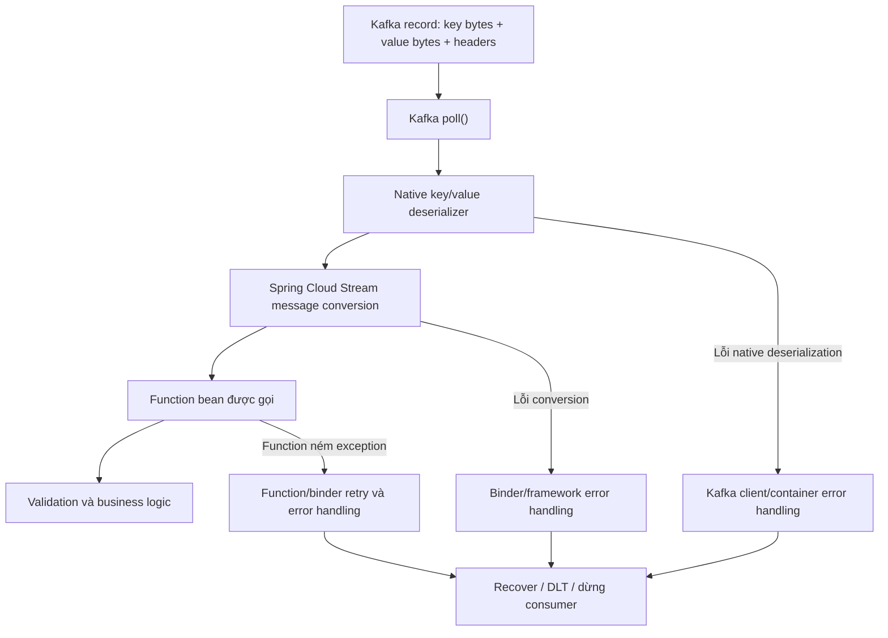
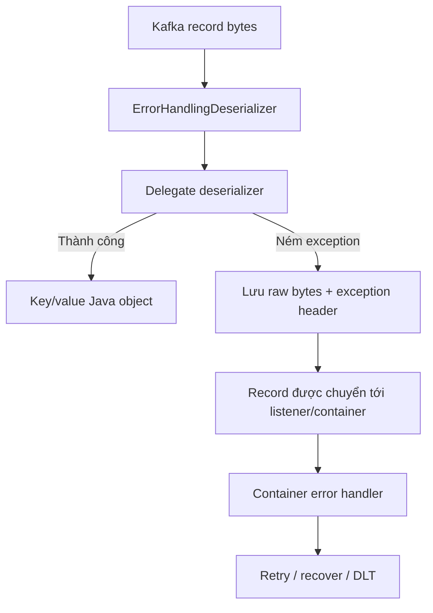

# Phân biệt lỗi deserialization với lỗi trong hàm nghiệp vụ

Khi một record Kafka không được xử lý thành công, bước đầu tiên là xác định lỗi xảy ra ở đâu. **Lỗi deserialization** xảy ra khi Kafka client không thể biến key hoặc value bytes thành kiểu dữ liệu Java mong muốn. **Lỗi trong hàm nghiệp vụ** xảy ra sau khi message đã được đọc, chuyển đổi và function của ứng dụng bắt đầu chạy. Hai lỗi này nằm ở những giai đoạn khác nhau, nên cơ chế retry, error handler và dead-letter topic (DLT/DLQ) cũng có thể khác nhau.

Điểm khác biệt quan trọng nhất: với native Kafka deserializer, lỗi có thể xảy ra ngay bên trong `poll()`, trước khi listener hoặc function nhận được message. Khi đó, retry/DLQ thông thường của Spring Cloud Stream không tự xử lý được. Spring Kafka cung cấp `ErrorHandlingDeserializer` để giữ raw bytes và thông tin exception, sau đó chuyển record lỗi tới container error handler. Ngược lại, nếu function đã được gọi rồi ném exception, Kafka binder có thể áp dụng retry và DLQ theo cấu hình consumer binding.

Bài học này phân tích từng chặng từ record bytes tới function, cách nhận biết đúng loại lỗi, cấu hình xử lý cho Kafka binder, bảo toàn dữ liệu lỗi và kiểm thử hai đường đi độc lập.

## 1. Hai loại lỗi nằm ở hai giai đoạn khác nhau

Một record Kafka được lưu dưới dạng key bytes, value bytes và headers. Consumer phải đọc record, giải mã key/value, tạo message Spring rồi mới gọi function. Có thể chia pipeline thành các giai đoạn:

1. Kafka client lấy record từ broker.
2. Kafka deserializer giải mã key và value nếu dùng native decoding.
3. Binder/message converter chuyển record thành Spring Message và payload Java.
4. Spring Cloud Function gọi function bean.
5. Function thực hiện validation và logic nghiệp vụ.
6. Binder/container xử lý acknowledgement, commit offset hoặc error recovery.

Lỗi deserialization native thường nằm ở bước 2. Lỗi message conversion nằm ở bước 3. Lỗi nghiệp vụ thường nằm ở bước 4 hoặc 5.

`Lưu ý:` Trong giao tiếp hằng ngày, mọi lỗi chuyển bytes thành object đôi khi đều được gọi là “deserialization”. Trong bài này, cần phân biệt chính xác **Kafka native deserializer**, **Spring message conversion** và **logic trong function**, vì chúng có cơ chế phục hồi khác nhau.



Nếu function chưa được gọi, đừng vội tìm lỗi trong service hoặc repository của function. Trước tiên hãy xác định record đã vượt qua deserializer và message converter hay chưa.

## 2. Lỗi deserialization là gì?

Kafka lưu record dưới dạng byte array. Consumer cấu hình một key deserializer và một value deserializer để chuyển bytes thành kiểu Java.

Ví dụ:

| Kafka record | Deserializer | Kết quả mong muốn |
|---|---|---|
| Key bytes | StringDeserializer | String |
| Value bytes | JsonDeserializer | OrderCreated |
| Value bytes | Avro deserializer | Avro-generated object |
| Value bytes | IntegerDeserializer | Integer |

Lỗi xảy ra khi bytes không phù hợp với định dạng mà deserializer mong đợi. Một số nguyên nhân phổ biến:

- Producer ghi JSON nhưng consumer lại dùng Avro deserializer.
- Producer đổi schema hoặc serializer nhưng consumer chưa được nâng cấp.
- Record bị ghi sai định dạng, bị cắt cụt hoặc có bytes không hợp lệ.
- Key/value deserializer được cấu hình sai class.
- Schema Registry không truy cập được hoặc không tìm thấy schema ID.
- Producer phát một kiểu dữ liệu khác với kiểu consumer mong đợi.
- Record cũ trong topic được tạo bằng schema/encoding không còn tương thích.

Ví dụ consumer mong đợi một JSON object có trường `orderId`, nhưng producer ghi dữ liệu binary theo một format khác. Deserializer không thể giải mã và ném exception trước khi function có cơ hội kiểm tra payload.

### Key deserialization và value deserialization

Key và value được giải mã riêng. Một record có thể gặp lỗi ở key, value hoặc cả hai. Lỗi key có thể khiến partition key không thể khôi phục dưới dạng Java object; lỗi value khiến payload không thể chuyển thành kiểu dữ liệu của function.

Khi điều tra, cần ghi nhận loại deserializer thất bại. Spring Kafka `ErrorHandlingDeserializer` cung cấp header exception riêng cho key và value:

- `ErrorHandlingDeserializer.KEY_DESERIALIZER_EXCEPTION_HEADER`
- `ErrorHandlingDeserializer.VALUE_DESERIALIZER_EXCEPTION_HEADER`

Không giả định mọi lỗi đều là lỗi value. Một số pipeline phụ thuộc key để định tuyến, deduplicate hoặc xác định aggregate; lỗi key cũng có thể ảnh hưởng tính đúng đắn.

## 3. Lỗi native deserialization xảy ra trước khi poll trả về

Khi Kafka consumer dùng deserializer trực tiếp và deserializer ném exception, lỗi có thể xảy ra bên trong lời gọi `poll()`. Listener container không nhận được một record đã giải mã hoàn chỉnh để chuyển tới Spring Cloud Stream function.

Điều này giải thích vì sao retry thông thường của function không giải quyết được lỗi này:

- Function chưa được gọi.
- Không có payload Java hợp lệ để truyền cho function.
- Binder retry dành cho lỗi message handler không thể tự retry một lần gọi function chưa diễn ra.
- Nếu exception thoát khỏi poll/container mà không có cơ chế xử lý, consumer có thể dừng hoặc liên tục gặp lại record lỗi tùy cách container được cấu hình.

Một poison record ở đầu tiến độ partition có thể làm consumer không thể tiến qua record đó. Nếu consumer restart và đọc lại cùng offset, lỗi có thể lặp lại. Cần có cơ chế bắt lỗi ở tầng Kafka consumer/container.

### Ví dụ đường đi bị chặn

Giả sử function:

```java
@Bean
Consumer<OrderCreated> processOrder(OrderService service) {
    return event -> service.handle(event);
}
```

Nếu Kafka native deserializer không tạo được `OrderCreated`, function `processOrder` không nhận được object. Một breakpoint trong `OrderService.handle` sẽ không được chạm tới. Hãy kiểm tra log của Kafka client, exception type và deserializer trước khi sửa code nghiệp vụ.

## 4. Lỗi message conversion của Spring Cloud Stream

Spring Cloud Stream có thể dùng cơ chế message conversion của framework thay vì native deserializer để tạo payload Java. Trong chế độ này, Kafka client có thể đọc bytes thành `byte[]`, sau đó binder/framework dựa trên content type và converter để chuyển payload thành kiểu function mong đợi.

Ví dụ binding:

```yaml
spring:
  cloud:
    function:
      definition: processOrder
    stream:
      bindings:
        processOrder-in-0:
          destination: orders.events
          group: order-service
          content-type: application/json
```

Function nhận object:

```java
@Bean
Consumer<OrderCreated> processOrder(OrderService service) {
    return event -> service.handle(event);
}
```

Nếu bytes không phải JSON hợp lệ hoặc JSON không thể chuyển đổi sang kiểu đích, lỗi xảy ra trong giai đoạn message conversion. Đây vẫn là lỗi trước khi function chạy, nhưng không nhất thiết là lỗi native Kafka deserializer bên trong `poll()`.

Hệ quả:

- Kafka client có thể đã trả record về listener container.
- Spring message converter không tạo được payload đích.
- Function có thể chưa được gọi.
- Error có thể đi qua cơ chế error handling của binder/framework, tùy phiên bản và cấu hình.

Vì vậy, cần ghi rõ ứng dụng đang dùng `useNativeDecoding` hay framework message conversion. Không cấu hình `ErrorHandlingDeserializer` như một giải pháp chung cho mọi lỗi conversion mà không kiểm tra đường đi thực tế.

## 5. Lỗi trong hàm nghiệp vụ là gì?

Lỗi nghiệp vụ chỉ xuất hiện sau khi record đã được đọc, chuyển đổi thành message và function được gọi. Một số ví dụ:

- Đơn hàng ở trạng thái không cho phép thanh toán.
- Tài khoản không tồn tại hoặc đã bị khóa.
- Dịch vụ thanh toán tạm thời timeout.
- Database tạm mất kết nối.
- Quy tắc nghiệp vụ phát hiện số tiền âm hoặc currency không hợp lệ.
- Gọi API bên ngoài thất bại.
- Một invariant trong domain model không được thỏa mãn.

Ví dụ:

```java
@Bean
Consumer<OrderCreated> processOrder(OrderService service) {
    return event -> {
        if (event.total() <= 0) {
            throw new InvalidOrderException(
                    "Order total must be positive");
        }

        service.createOrder(event);
    };
}
```

Trong trường hợp này, Kafka đã cung cấp được record và function đã nhận object. Exception được ném trong quá trình xử lý. Binder có thể thực hiện retry theo chính sách consumer; nếu hết retry, error handler hoặc DLQ xử lý message thất bại.

### Lỗi nghiệp vụ không đồng nghĩa lỗi tạm thời

Không phải mọi exception trong function đều nên retry:

| Loại lỗi | Ví dụ | Retry có ích? |
|---|---|---|
| Tạm thời | HTTP 503, database connection timeout | Thường có |
| Dữ liệu không hợp lệ | Tổng tiền âm, thiếu order ID | Thường không |
| Trạng thái nghiệp vụ | Đơn hàng đã hủy, thao tác không được phép | Tùy quy tắc; thường cần xử lý riêng |
| Lỗi cấu hình | Sai credentials, thiếu endpoint | Retry từng message thường không giải quyết |
| Lỗi lập trình | Null pointer, mapping sai | Cần sửa code; retry thường không giúp |

Retry một lỗi dữ liệu cố định chỉ làm tăng độ trễ và tải. Với lỗi tạm thời, retry có backoff có thể giúp message được xử lý sau khi dependency hồi phục.

## 6. So sánh dấu hiệu và nơi xử lý

| Tiêu chí | Native deserialization | Message conversion | Function/business |
|---|---|---|---|
| Giai đoạn | Kafka client deserialize key/value | Binder/framework chuyển payload | Function đã được gọi |
| Function có chạy? | Không | Thường chưa | Có |
| Có payload Java hợp lệ? | Không | Không tạo được payload đích | Có |
| Exception thường thấy | SerializationException hoặc lỗi delegate | MessageConversionException, ConversionException | Domain exception, IllegalStateException, dependency exception |
| Cơ chế chính | ErrorHandlingDeserializer và container error handler | Binder/framework error handling, converter phù hợp | Retry/error channel/DLQ của binding |
| Có thể sửa bằng retry? | Thường không nếu bytes/schema sai; có thể nếu lỗi phụ thuộc dịch vụ schema tạm thời | Thường không nếu payload sai format | Có thể với lỗi transient |
| Bằng chứng quan trọng | Raw bytes, key/value exception header, topic/partition/offset | Content type, converter, payload bytes | Stack trace bên trong function và event ID |

Exception class chỉ là một dấu hiệu. Một exception có thể được bọc trong exception khác. Hãy tìm **điểm đầu tiên phát sinh lỗi** và xác định function có thực sự được gọi hay không.

## 7. ErrorHandlingDeserializer giải quyết native deserialization như thế nào?

Spring Kafka cung cấp `ErrorHandlingDeserializer` để bọc một deserializer thực tế (delegate). Nó gọi delegate để giải mã. Nếu delegate thành công, kết quả được trả về như bình thường. Nếu delegate ném exception, wrapper giữ thông tin exception và raw bytes trong metadata của record, thay vì để lỗi thoát trực tiếp khỏi poll.

Về khái niệm:



Khi delegate thất bại, key hoặc value tương ứng được đặt thành null trong record được chuyển tiếp; raw bytes ban đầu và exception được lưu trong header. Container error handler có thể đọc metadata đó và quyết định recover hoặc publish record lỗi tới DLT.

Điều này không làm bytes sai trở thành object hợp lệ. Nó chỉ giúp consumer giữ được record lỗi và chuyển quyền quyết định cho cơ chế error handling.

### Cấu hình delegate

Ví dụ dùng native decoding và JSON deserializer:

```yaml
spring:
  cloud:
    function:
      definition: processOrder
    stream:
      bindings:
        processOrder-in-0:
          destination: orders.events
          group: order-service
          consumer:
            use-native-decoding: true
      kafka:
        bindings:
          processOrder-in-0:
            consumer:
              configuration:
                value.deserializer: org.springframework.kafka.support.serializer.ErrorHandlingDeserializer
                spring.deserializer.value.delegate.class: org.springframework.kafka.support.serializer.JsonDeserializer
                spring.json.value.default.type: com.example.events.OrderCreated
                spring.json.trusted.packages: com.example.events
```

Ở đây:

- `use-native-decoding: true` yêu cầu binder sử dụng Kafka deserializer thay cho message conversion thông thường.
- `value.deserializer` là wrapper `ErrorHandlingDeserializer`.
- `spring.deserializer.value.delegate.class` chỉ định deserializer thực tế.
- `spring.json.value.default.type` chỉ định kiểu Java mặc định cho JSON value.
- `spring.json.trusted.packages` giới hạn package được phép deserialize theo cấu hình Spring Kafka.

Nếu key cũng cần native deserialization có khả năng bắt lỗi, cấu hình `key.deserializer` thành `ErrorHandlingDeserializer` và đặt `spring.deserializer.key.delegate.class` tương ứng. Chỉ thêm wrapper cho key khi key deserializer thực sự có thể lỗi và ứng dụng có chính sách xử lý.

Tên property, kiểu đích và trusted package phải phù hợp với phiên bản Spring Kafka/Spring Cloud Stream đang dùng. Với Avro hoặc Protobuf, thay delegate bằng deserializer tương ứng và cấu hình schema registry theo thư viện đó.

## 8. Xử lý deserialization failure bằng container error handler

Vì native deserialization có thể thất bại trước khi function được gọi, cần xử lý ở Kafka listener container. Spring Cloud Stream Kafka binder cho phép tùy chỉnh container qua `ListenerContainerCustomizer`. Spring Kafka cung cấp `DefaultErrorHandler` và `DeadLetterPublishingRecoverer` để thực hiện retry/recovery và publish record lỗi sang DLT.

Mô hình cấu hình:

```java
@Bean
ListenerContainerCustomizer<AbstractMessageListenerContainer<byte[], byte[]>> containerCustomizer(
        DefaultErrorHandler errorHandler) {

    return (container, destination, group) ->
            container.setCommonErrorHandler(errorHandler);
}

@Bean
DefaultErrorHandler kafkaErrorHandler(
        DeadLetterPublishingRecoverer recoverer) {

    return new DefaultErrorHandler(recoverer);
}

@Bean
DeadLetterPublishingRecoverer deadLetterRecoverer(
        KafkaTemplate<Object, Object> template) {

    return new DeadLetterPublishingRecoverer(template);
}
```

Đây là khung cấu hình minh họa. Kiểu generic của listener container và KafkaTemplate phải khớp với kiểu key/value, raw bytes và serializer thực tế của ứng dụng. Nếu cần backoff, phân loại exception hoặc routing DLT tùy chỉnh, cấu hình `DefaultErrorHandler` và `DeadLetterPublishingRecoverer` tương ứng.

Với Spring Kafka `DefaultErrorHandler`, `DeserializationException` thuộc nhóm exception không retry mặc định vì thử lại cùng bytes thường không thay đổi kết quả. Recoverer được gọi để đưa record vào DLT hoặc thực hiện hành động phục hồi đã cấu hình. Nếu ứng dụng thay đổi classification, hãy bảo đảm retry thực sự có khả năng giải quyết nguyên nhân.

### Tại sao phải giữ raw bytes?

Khi deserializer thất bại, không có object Java đúng kiểu để serialize lại. DLT publisher cần có khả năng gửi lại byte array gốc. Nếu publisher chỉ có serializer cho `OrderCreated`, nó có thể không publish được record mà value đã thất bại và đang là raw bytes.

Khi dùng native decoding và DLT publisher, kiểm tra key/value serializer của DLT. Có thể cần cấu hình serializer hỗ trợ cả byte[] lẫn object đã giải mã thành công, hoặc dùng một template phù hợp với kiểu dữ liệu record. Đừng giả định serializer của producer chính luôn xử lý đúng raw bytes.

## 9. DLQ thông thường của Kafka binder và DLQ cho deserialization

Đây là điểm dễ nhầm nhất.

### Function/business error

Kafka binder có cơ chế DLQ cho lỗi xảy ra trong quá trình xử lý message handler. Ví dụ function được gọi, sau đó ném exception. Có thể bật DLQ trên consumer binding:

```yaml
spring:
  cloud:
    function:
      definition: processOrder
    stream:
      bindings:
        processOrder-in-0:
          destination: orders.events
          group: order-service
      kafka:
        bindings:
          processOrder-in-0:
            consumer:
              enableDlq: true
              dlqName: orders.events-dlq
```

Một group tường minh là bắt buộc để dùng DLQ của Kafka binder. Nếu không đặt `dlqName`, tên mặc định thường theo mẫu `error.<destination>.<group>`. Khi function ném exception, binder retry theo cấu hình; sau khi hết retry, record lỗi có thể được chuyển tới DLQ.

Ví dụ retry mặc định được Kafka binder tài liệu hóa cho message handler:

- Tối đa 3 lần thử.
- Backoff ban đầu 1 giây.
- Hệ số nhân 2.
- Backoff tối đa 10 giây.

Có thể cấu hình `maxAttempts`, `backOffInitialInterval`, `backOffMultiplier`, `backOffMaxInterval`, `retryableExceptions` và `defaultRetryable` theo binding. Kiểm tra đúng phiên bản binder vì các thuộc tính và behavior có thể thay đổi theo phiên bản.

### Native deserialization error

DLQ thông thường của Spring Cloud Stream không tự bắt được native deserialization exception nếu lỗi xảy ra bên trong Kafka `poll()` trước khi record tới listener. Cần `ErrorHandlingDeserializer` và container error handler như phần trước.

Hai cơ chế có thể cùng tồn tại trong ứng dụng, nhưng chúng giải quyết hai đường lỗi khác nhau:

| Đường lỗi | Cơ chế chính |
|---|---|
| Kafka native deserializer thất bại trước listener | ErrorHandlingDeserializer + Spring Kafka container error handler/recoverer |
| Function/business handler ném exception | Kafka binder retry + `enableDlq` hoặc error handler được chọn |

Khi native decoding được bật và có DLQ, cần kiểm tra serializer của DLQ producer. Với native decoding, tài liệu Kafka binder yêu cầu cấu hình key/value serializer phù hợp trong `dlqProducerProperties.configuration` khi dùng DLQ của binder cho các record được xử lý theo đường đó.

### Ảnh hưởng của custom error handler

Spring Cloud Stream cho phép khai báo một function nhận `ErrorMessage` bằng `error-handler-definition`. Khi dùng custom error handler này, nó thay thế các error handler mặc định của framework/binder cho binding đó; tài liệu cảnh báo rằng DLQ do binder cung cấp sẽ không hoạt động như trước, kể cả khi `enableDlq` vẫn được bật. Nếu cần vừa có xử lý tùy chỉnh vừa có DLT, hãy thiết kế một recovery path duy nhất và tự publish/ack một cách có kiểm soát, hoặc để binder quản lý DLQ và quan sát qua cơ chế phù hợp. Tránh đăng ký hai handler cùng xử lý một exception mà không có quy tắc ownership rõ ràng.

### Không cấu hình hai cơ chế như thể chúng là một

Không chỉ bật `enableDlq: true` rồi cho rằng mọi lỗi deserialization đều sẽ được chuyển vào DLQ. Ngược lại, không chỉ cấu hình `ErrorHandlingDeserializer` rồi cho rằng lỗi trong function cũng tự được recover. Hãy xác minh mỗi loại exception đi qua handler nào.

## 10. Retry và phân loại exception trong function

Lỗi function có thể được retry bởi binder vì function đã được gọi và binder biết message nào gây lỗi. Tuy nhiên, retry cần phân loại exception:

```yaml
spring:
  cloud:
    stream:
      bindings:
        processOrder-in-0:
          consumer:
            maxAttempts: 3
            backOffInitialInterval: 1000
            backOffMultiplier: 2.0
            backOffMaxInterval: 10000
            defaultRetryable: false
            retryableExceptions:
              com.example.PaymentUnavailableException: true
              com.example.InvalidOrderException: false
      kafka:
        bindings:
          processOrder-in-0:
            consumer:
              enableDlq: true
              dlqName: orders.events-dlq
```

Với cấu hình này, chỉ lỗi được đánh dấu retryable mới được thử lại theo chính sách. Lỗi dữ liệu không hợp lệ có thể được chuyển nhanh sang recovery/DLQ thay vì lặp lại nhiều lần.

Hãy lưu ý rằng cấu hình retry của Spring Cloud Stream message handler áp dụng cho imperative function xử lý từng message. Reactive function nhận Flux có cơ chế xử lý lỗi riêng từ Reactor; không nên mặc định RetryTemplate của binder sẽ áp dụng giống hệt.

### Không retry deserialization sai định dạng vô hạn

Nếu record có bytes sai format hoặc schema không tương thích vĩnh viễn, thử lại cùng bytes thường không giúp. Hãy lưu raw bytes, exception và schema metadata vào DLT/quarantine, sau đó điều tra producer hoặc hợp đồng schema. Chỉ retry nếu lỗi thực sự có thể tạm thời, ví dụ schema registry bị gián đoạn trong thời gian ngắn và deserializer có thể thử lại an toàn.

## 11. Message conversion và business validation

Cần phân biệt ba tình huống thường bị gộp:

1. **Không parse được bytes:** JSON malformed hoặc encoding sai. Đây là lỗi chuyển đổi dữ liệu.
2. **Parse được nhưng không khớp kiểu/contract:** field không tương thích, enum không nhận diện hoặc thiếu dữ liệu bắt buộc. Có thể là conversion/schema validation.
3. **Payload hợp lệ nhưng vi phạm nghiệp vụ:** order tồn tại nhưng không được phép thanh toán, tài khoản bị khóa. Đây là business validation.

Ví dụ payload JSON hợp lệ:

```json
{
  "orderId": "order-42",
  "total": -100
}
```

JSON converter có thể tạo object thành công vì `total` vẫn là một số. Nhưng function hoặc domain validator sẽ từ chối giá trị âm. Đây là lỗi validation/nghiệp vụ, không phải native deserialization.

Một cách tổ chức code rõ ràng:

```java
@Bean
Consumer<OrderCreated> processOrder(
        OrderValidator validator,
        OrderService service) {

    return event -> {
        validator.validate(event);
        service.create(event);
    };
}
```

Tách validation khỏi mapping giúp log và metrics nhận diện rõ lỗi schema/contract với lỗi quy tắc domain. Không nên dùng exception chung cho tất cả trường hợp nếu chính sách retry khác nhau.

## 12. Bảo toàn thông tin record lỗi

Một record được đưa vào DLT cần đủ thông tin để điều tra và replay. Tối thiểu nên giữ:

- Topic gốc.
- Partition và offset gốc.
- Record key bytes và value bytes ban đầu nếu có thể.
- Headers gốc và content type.
- Exception class, message và stack trace.
- Loại lỗi: key deserialization, value deserialization, conversion hay function.
- Event ID/correlation ID nếu đọc được.
- Thời điểm nhận và số lần thử.
- Consumer group và binding gây lỗi.

Kafka binder DLQ thông thường bổ sung các header như `x-original-topic`, `x-exception-message` và `x-exception-stacktrace` (dạng byte[] theo tài liệu binder). Các header này hữu ích cho điều tra, nhưng vẫn cần kiểm tra cách binder/version cụ thể giữ key, value và metadata.

Với native deserialization failure, không có object hợp lệ để dựng lại payload. Raw bytes là bằng chứng quan trọng nhất. Tránh parse rồi serialize lại bằng một schema khác nếu mục tiêu là bảo toàn record gốc.

## 13. Quy trình xử lý và replay DLT

DLT là nơi cách ly record thất bại để xử lý sau. Nó không tự sửa dữ liệu hoặc tự đảm bảo replay thành công.

Quy trình vận hành nên gồm:

1. Xác định loại lỗi và stage gây lỗi.
2. Lấy topic, partition, offset và raw bytes của record.
3. Xác định producer/schema/version tạo record.
4. Sửa nguyên nhân: serializer, schema, converter, code hoặc dependency.
5. Kiểm thử record lỗi với consumer đã sửa.
6. Chọn cách replay: phát lại raw bytes, chuyển đổi sang schema mới hoặc tạo event bù.
7. Replay với tốc độ giới hạn và giữ event ID gốc khi phù hợp.
8. Theo dõi duplicate, thứ tự và side effect.
9. Chỉ đóng sự cố sau khi đối soát số record trong DLT.

Nếu dữ liệu không thể sửa, có thể chuyển sang quarantine để xử lý thủ công hoặc phát một event correction theo nghiệp vụ. Không xóa DLT chỉ vì consumer chính đã chạy lại thành công.

### Raw replay và transformed replay

- **Raw replay:** phát lại đúng key/value bytes gốc sau khi sửa consumer/deserializer. Cách này giữ nguyên bằng chứng và phù hợp khi lỗi nằm ở code consumer.
- **Transformed replay:** đọc raw bytes, chuyển đổi sang schema/contract mới rồi phát record mới. Cần ghi lại nguồn gốc event và bảo đảm semantics không bị thay đổi âm thầm.
- **Business correction:** tạo event mới bù trừ hoặc sửa trạng thái. Dùng khi event gốc không thể được áp dụng an toàn.

Không thay đổi payload gốc trong DLT để làm cho nó “trông hợp lệ” mà không ghi nhận phép chuyển đổi. Việc đó làm mất khả năng kiểm toán.

## 14. Idempotency và offset khi xử lý lỗi

Retry, redelivery và replay có thể khiến cùng một event được xử lý nhiều lần. Với function/business exception, một side effect có thể đã hoàn tất trước khi exception xảy ra. Với deserialization failure, function thường chưa chạy, nhưng sau khi sửa consumer và replay, record sẽ bắt đầu tạo side effect lần đầu.

Hãy dùng event ID làm idempotency key:

```java
@Transactional
public void handle(OrderCreated event) {
    if (processedEventRepository.existsById(event.eventId())) {
        return;
    }

    orderRepository.create(event);
    processedEventRepository.save(event.eventId());
}
```

Việc ghi trạng thái nghiệp vụ và đánh dấu event đã xử lý nên nằm trong cùng transaction nếu cùng database. Nếu side effect nằm ở dịch vụ ngoài, dùng idempotency key hoặc inbox/outbox pattern và đối soát.

Offset commit không đồng nghĩa business transaction đã hoàn tất. Hãy hiểu ack mode, retry/recoverer và transaction boundary của binder. Đừng commit offset quá sớm để rồi mất record khi side effect thất bại; cũng đừng giả định record chỉ được xử lý đúng một lần.

## 15. Quan sát và phân loại lỗi trong production

Để xác định lỗi ở stage nào, log/metric nên ghi:

| Trường | Mục đích |
|---|---|
| Topic, partition, offset | Định danh record gốc |
| Consumer group, binding | Xác định consumer pipeline |
| Event ID/correlation ID | Truy vết nghiệp vụ nếu đọc được |
| Deserializer class | Xác định codec được sử dụng |
| Content type/schema ID | Phát hiện mismatch contract |
| Exception class và root cause | Phân loại lỗi |
| Processing stage | deserialize, convert, function, downstream |
| Delivery attempt | Theo dõi retry/redelivery |
| DLT destination | Theo dõi nơi cách ly |
| Function invocation count | Xác minh function có được gọi không |

Một số dấu hiệu:

- Consumer log lỗi trong `poll()`, function không có log bắt đầu: nghi ngờ native deserialization.
- ErrorHandlingDeserializer header có exception và raw bytes: xác nhận delegate deserializer thất bại.
- Có record tới listener nhưng message conversion ném exception: kiểm tra content type và converter.
- Log đầu function xuất hiện rồi stack trace trỏ tới service/domain: lỗi function/business.
- Retry tăng rồi DLT nhận record: kiểm tra exception classification và recovery.
- Consumer restart liên tục ở cùng partition/offset: tìm poison record hoặc lỗi không được recover.

Không log toàn bộ payload nhạy cảm. Có thể ghi byte length, checksum, schema ID và event ID; raw bytes chỉ lưu trong DLT/quarantine có quyền truy cập phù hợp.

## 16. Kiểm thử hai đường lỗi riêng biệt

Một test chỉ gửi message hợp lệ và xác minh function chạy không đủ để chứng minh error handling đúng. Cần tạo test riêng cho từng stage.

### Test native deserialization failure

1. Tạo Kafka topic và consumer binding với `useNativeDecoding: true`.
2. Cấu hình `ErrorHandlingDeserializer` bọc delegate.
3. Gửi một record có value bytes không hợp lệ với delegate.
4. Xác minh function không được gọi.
5. Xác minh error handler nhận deserialization exception metadata.
6. Xác minh raw bytes được publish vào DLT.
7. Xác minh consumer tiếp tục đọc record hợp lệ kế tiếp.
8. Kiểm tra topic, partition, offset và exception headers của record DLT.

### Test business function failure

1. Gửi record có bytes và schema hợp lệ.
2. Xác minh deserializer/converter tạo object.
3. Function được gọi và ném một exception có chủ đích.
4. Xác minh binder retry đúng số lần theo cấu hình.
5. Khi hết retry, xác minh record được chuyển vào DLQ nếu đã bật.
6. Xác minh header lỗi và original topic metadata.
7. Xác minh side effect không bị lặp ngoài ý muốn.

### Test message conversion failure

1. Dùng framework message conversion (không bật native decoding).
2. Gửi bytes không phải JSON hợp lệ hoặc payload không khớp kiểu đích.
3. Xác minh function chưa được gọi.
4. Quan sát error channel/binder handling của phiên bản đang dùng.
5. Xác minh record được recover hoặc chuyển DLQ theo cấu hình thực tế.

### Test replay

- Sửa deserializer hoặc schema rồi replay record DLT.
- Xác minh payload được đọc đúng.
- Giữ event ID để idempotency có tác dụng.
- Giới hạn tốc độ replay.
- Đối soát số record đã replay, thành công và tiếp tục lỗi.

Dùng Kafka thật hoặc Testcontainers khi cần xác minh `poll()`, listener container, DLT và offset. Unit test cho function không thể mô phỏng đầy đủ lỗi xảy ra trước khi function được gọi.

## 17. Không nhầm Kafka binder với Kafka Streams binder

Spring Cloud Stream có Kafka message binder thông thường và Kafka Streams binder. Cả hai đều dùng Kafka nhưng có mô hình xử lý và error handling khác nhau.

Với **Kafka Streams binder**, binder cung cấp deserialization exception handler riêng, ví dụ:

- `logAndContinue`: ghi log và bỏ qua record lỗi để tiếp tục.
- `logAndFail`: ghi log và dừng xử lý; đây là mặc định được tài liệu Kafka Streams binder mô tả.
- `sendToDlq`: gửi record lỗi tới DLQ theo cấu hình.

Thuộc tính được dùng ở Kafka Streams binder là:

```yaml
spring:
  cloud:
    stream:
      kafka:
        streams:
          binder:
            deserializationExceptionHandler: sendToDlq
```

Đây là cấu hình riêng cho Kafka Streams binder. Không sao chép thuộc tính này sang Kafka message binder thông thường và kỳ vọng nó điều khiển `ErrorHandlingDeserializer` hoặc `DefaultErrorHandler` của listener container. Hãy xác định binder đang dùng trước khi chọn cơ chế.

## 18. Quy trình chẩn đoán nhanh

Khi một record không được xử lý, hãy đi theo thứ tự:

1. Xác định topic, partition, offset và consumer group.
2. Xác định function có được gọi hay không.
3. Nếu function chưa chạy, kiểm tra native deserializer và framework message converter.
4. Nếu dùng native decoding, kiểm tra key/value deserializer và ErrorHandlingDeserializer headers.
5. Nếu function đã chạy, đọc root cause trong handler/service.
6. Phân loại lỗi transient hay permanent.
7. Chọn retry, error channel, recoverer hoặc DLQ phù hợp.
8. Kiểm tra offset và side effect đã thực hiện chưa.
9. Lưu raw record và metadata nếu cần điều tra/replay.
10. Sau khi sửa, replay có kiểm soát và đối soát.

Câu hỏi đầu tiên không phải “có nên retry không?” mà là “record đã đi tới giai đoạn nào?”. Khi biết chính xác stage, bạn sẽ tránh retry vô ích cho bytes sai định dạng hoặc bỏ sót lỗi nghiệp vụ sau khi function đã tạo side effect.

## 19. Checklist triển khai

- Đã xác định binding dùng native decoding hay framework message conversion.
- Key/value deserializer đúng với format producer ghi.
- Đã phân biệt native deserialization, message conversion và business validation.
- Có ErrorHandlingDeserializer khi cần bảo vệ native deserialization failure.
- Delegate deserializer và schema registry được cấu hình đúng.
- Container error handler có chiến lược retry/recover rõ ràng.
- DLT publisher giữ được raw key/value bytes khi deserialize thất bại.
- Serializer cho DLT tương thích cả raw bytes và object nếu cần.
- Kafka binder `enableDlq` được bật cho function/business errors cần cách ly.
- Consumer có explicit group khi sử dụng Kafka binder DLQ.
- Retry chỉ áp dụng cho exception có khả năng hồi phục.
- Custom error handler không vô tình vô hiệu hóa binder DLQ ngoài dự kiến.
- Raw record, topic, partition, offset và exception metadata được bảo toàn.
- Handler có idempotency để chịu retry và replay.
- Test riêng deserialization, conversion, function exception và replay.
- Dashboard phân biệt processing stage, retry, DLT và consumer lag.
- Đã xác định rõ đang dùng Kafka binder hay Kafka Streams binder.

Lỗi deserialization và lỗi trong hàm nghiệp vụ không thể được xử lý như một loại exception duy nhất. Native deserialization có thể thất bại trước khi `poll()` trả record; message conversion có thể thất bại trước khi function chạy; business exception chỉ xuất hiện sau khi function nhận payload. Hãy dùng ErrorHandlingDeserializer và container recovery cho đường native decoding, dùng binder retry/DLQ cho lỗi message handler, bảo toàn raw bytes để điều tra, và kiểm thử từng đường lỗi độc lập.

## Tài liệu tham khảo

- [Spring Cloud Stream Kafka Binder — Tips, Tricks and Recipes: Handling Deserialization Errors with DLQ](https://docs.spring.io/spring-cloud-stream/reference/kafka/kafka_tips.html)
- [Spring Cloud Stream Kafka Binder Reference Guide — Retry and Dead Letter Processing](https://docs.spring.io/spring-cloud-stream/docs/current/reference/html/spring-cloud-stream-binder-kafka.html)
- [Spring Cloud Stream — Error Handling](https://docs.spring.io/spring-cloud-stream/reference/spring-cloud-stream/overview-error-handling.html)
- [Spring for Apache Kafka — Handling Exceptions](https://docs.spring.io/spring-kafka/reference/kafka/annotation-error-handling.html)
- [Spring Kafka — Serialization, Deserialization, and Message Conversion](https://docs.spring.io/spring-kafka/reference/kafka/serdes.html)

