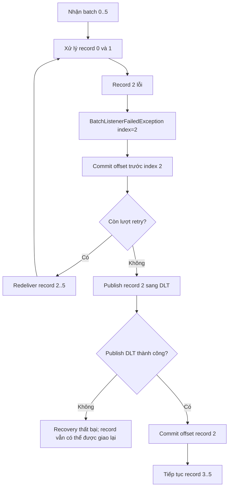

# Giới hạn thử lại và đưa DLT khi nhận theo lô

Kafka batch consumer nhận nhiều record trong một lần `poll()` và chuyển chúng thành một danh sách để function xử lý. Cách này giảm số lần gọi handler và phù hợp với các thao tác bulk, nhưng một lỗi ở giữa batch làm nảy sinh câu hỏi: những record nào đã hoàn tất, record nào cần thử lại và record nào phải được đưa sang Dead Letter Topic (DLT)?

Với Kafka Binder, cần phân biệt retry do binder quản lý với retry do listener container của Spring Kafka quản lý. Khi bật batch mode, retry nội bộ của binder không được hỗ trợ và `maxAttempts` bị ghi đè thành `1`. Binder hỗ trợ DLT cho batch từ phiên bản 4.0.2, nhưng khi dùng DLT tích hợp, toàn bộ record nhận được từ lần poll trước được chuyển sang DLT. Nếu cần cô lập đúng record lỗi, có thể dùng `DefaultErrorHandler` của Spring Kafka kết hợp `BatchListenerFailedException` để chỉ ra chỉ số phần tử thất bại.

## 1. Batch consumer và ranh giới xử lý lỗi

Bật batch mode bằng thuộc tính `consumer.batch-mode` của input binding. Function nhận danh sách payload:

```java
@Bean
Consumer<List<OrderCreated>> processOrderBatch(OrderBatchService service) {
    return service::process;
}
```

Cấu hình binding:

```yaml
spring:
  cloud:
    function:
      definition: processOrderBatch
    stream:
      bindings:
        processOrderBatch-in-0:
          destination: orders.created
          group: order-batch-service
          consumer:
            batch-mode: true
```

Một lần Kafka poll có thể trả về nhiều record từ một hoặc nhiều partition được gán cho consumer. Binder chuyển các record đó thành một `List<OrderCreated>` và gọi function một lần. Kích thước batch chịu ảnh hưởng của `max.poll.records`, `fetch.min.bytes`, `fetch.max.wait.ms` và lượng dữ liệu sẵn có.

Ví dụ một batch có năm phần tử:

```text
Index 0: order-101
Index 1: order-102
Index 2: order-103  <- xử lý thất bại
Index 3: order-104
Index 4: order-105
```

Nếu function ném một exception chung mà không chỉ rõ phần tử lỗi, error handler có thể phải xử lý lại toàn batch. Nếu function báo đúng index bằng `BatchListenerFailedException`, Spring Kafka có thể commit các record trước index, thử lại từ record lỗi và sau đó tiếp tục với các record còn lại.

Đây là khác biệt quan trọng giữa retry cả batch và retry từ một record xác định. Việc chọn cơ chế cần phù hợp với transaction boundary của nghiệp vụ và cách consumer ghi nhận offset.

## 2. Hai cơ chế retry/DLT cần phân biệt

| Cơ chế | Ai quản lý? | Hành vi trong batch mode |
|---|---|---|
| Retry nội bộ của Kafka Binder | Spring Cloud Stream Kafka Binder | Không hỗ trợ; `maxAttempts` bị ghi đè thành `1` |
| DLT tích hợp của binder | Kafka Binder | Từ binder 4.0.2; toàn bộ record của lần poll trước được chuyển tới DLT khi batch lỗi |
| `DefaultErrorHandler` | Spring for Apache Kafka | Có thể retry cả batch hoặc xác định record lỗi nếu listener ném `BatchListenerFailedException` |
| `DeadLetterPublishingRecoverer` | Spring for Apache Kafka | Publish record được recover sang DLT theo chiến lược của error handler |

Không nên cấu hình `max-attempts: 5` rồi kỳ vọng binder tự gọi function năm lần khi batch mode đang bật. Muốn kiểm soát số lần thử, backoff và record được đưa vào DLT, cần chuyển logic sang error handler của listener container hoặc dùng chính sách DLT tích hợp với hành vi toàn batch đã được hiểu rõ.

## 3. Dùng DLT tích hợp của Kafka Binder

Từ Spring Cloud Stream Kafka Binder 4.0.2, consumer batch mode hỗ trợ DLT tích hợp. Cấu hình ví dụ:

```yaml
spring:
  cloud:
    function:
      definition: processOrderBatch
    stream:
      bindings:
        processOrderBatch-in-0:
          destination: orders.created
          group: order-batch-service
          consumer:
            batch-mode: true
      kafka:
        bindings:
          processOrderBatch-in-0:
            consumer:
              enable-dlq: true
              dlq-name: orders.created.batch.dlt
```

Các điểm cần lưu ý:

- Consumer phải có group được khai báo rõ ràng; đăng ký ẩn danh không đáp ứng yêu cầu DLT của Kafka Binder.
- `enable-dlq: true` bật cơ chế dead-letter.
- `dlq-name` đặt tên DLT riêng; nếu bỏ qua, binder dùng tên mặc định theo destination và group.
- Cần cấp quyền ghi topic DLT cho producer được binder sử dụng.
- DLT phải có số partition và cách định tuyến phù hợp với chính sách chuyển record của binder.
- Khi batch listener lỗi, tất cả record nhận từ lần poll trước được chuyển sang DLT, kể cả record không phải nguyên nhân gây lỗi.

Ví dụ, nếu batch có năm record và một record bị lỗi, DLT tích hợp có thể nhận cả năm record. Điều này giúp cô lập batch để luồng chính tiếp tục, nhưng làm tăng lượng record phải điều tra và có thể khiến record hợp lệ xuất hiện trong DLT.

Đây là hành vi cần được tính đến khi thiết kế replay. Không phát lại nguyên batch một cách tự động nếu một số record đã có side effect nghiệp vụ. Consumer nên idempotent và công cụ replay nên hỗ trợ lọc theo event ID.

## 4. Cô lập đúng record lỗi bằng BatchListenerFailedException

Nếu muốn retry từ đúng record thất bại và chỉ đưa record đó vào DLT sau khi hết lượt, hãy dùng `DefaultErrorHandler` cùng `DeadLetterPublishingRecoverer`.

Function cần xác định index của phần tử gây lỗi:

```java
import java.util.List;
import java.util.function.Consumer;

import org.springframework.context.annotation.Bean;
import org.springframework.kafka.listener.BatchListenerFailedException;

@Bean
Consumer<List<OrderCreated>> processOrderBatch(OrderService orderService) {
    return events -> {
        for (int index = 0; index < events.size(); index++) {
            OrderCreated event = events.get(index);

            try {
                orderService.processOne(event);
            }
            catch (Exception ex) {
                throw new BatchListenerFailedException(
                    "Could not process batch element at index " + index,
                    ex,
                    index
                );
            }
        }
    };
}
```

Constructor nhận message, nguyên nhân và index giúp Spring Kafka xác định record lỗi trong batch. Với chữ ký `List<T>`, index là vị trí của payload trong danh sách mà binder chuyển cho function.

Không thay exception này bằng một `RuntimeException` chung nếu muốn xử lý theo record. Khi listener ném exception khác `BatchListenerFailedException`, `DefaultErrorHandler` dùng cơ chế fallback retry toàn batch.

Hãy giữ nguyên nguyên nhân trong tham số `cause`. Error handler có thể dùng loại exception gốc để quyết định retry hay chuyển thẳng sang DLT.

## 5. Cấu hình DefaultErrorHandler và DLT recoverer

Để sử dụng error handler do ứng dụng quản lý, khai báo một `ListenerContainerCustomizer`. Ví dụ sau áp dụng riêng cho destination và group đã chọn:

```java
import org.apache.kafka.common.TopicPartition;
import org.springframework.cloud.stream.config.ListenerContainerCustomizer;
import org.springframework.context.annotation.Bean;
import org.springframework.kafka.core.KafkaTemplate;
import org.springframework.kafka.listener.AbstractMessageListenerContainer;
import org.springframework.kafka.listener.DeadLetterPublishingRecoverer;
import org.springframework.kafka.listener.DefaultErrorHandler;
import org.springframework.util.backoff.FixedBackOff;

@Bean
DefaultErrorHandler orderBatchErrorHandler(
        KafkaTemplate<Object, Object> dltKafkaTemplate) {

    DeadLetterPublishingRecoverer recoverer =
        new DeadLetterPublishingRecoverer(
            dltKafkaTemplate,
            (record, exception) -> new TopicPartition(
                record.topic() + ".DLT",
                record.partition()
            )
        );

    // 1 giây giữa các lần thử; 2 lần retry sau lần giao đầu tiên.
    DefaultErrorHandler handler =
        new DefaultErrorHandler(recoverer, new FixedBackOff(1000L, 2L));

    handler.addNotRetryableExceptions(InvalidOrderEventException.class);

    return handler;
}

@Bean
ListenerContainerCustomizer<AbstractMessageListenerContainer<?, ?>>
        orderBatchContainerCustomizer(
                DefaultErrorHandler orderBatchErrorHandler) {

    return (container, destinationName, group) -> {
        if ("orders.created".equals(destinationName)
                && "order-batch-service".equals(group)) {
            container.setCommonErrorHandler(orderBatchErrorHandler);
        }
    };
}
```

Trong ví dụ này:

- `ListenerContainerCustomizer` được gọi khi binder tạo listener container.
- Điều kiện destination và group giới hạn customizer vào đúng consumer.
- `DefaultErrorHandler` quản lý retry và recovery.
- `DeadLetterPublishingRecoverer` gửi record được recover sang topic có hậu tố `.DLT`.
- `FixedBackOff(1000L, 2L)` có nghĩa là một lần giao ban đầu và tối đa hai lần retry, tổng cộng ba lần xử lý.
- `InvalidOrderEventException` được đánh dấu không retry; lỗi này đi thẳng tới recoverer theo phân loại của handler.

`dltKafkaTemplate` phải kết nối tới cluster đích và có key/value serializer tương thích với record được gửi. Nếu record có thể chứa nhiều kiểu payload hoặc dữ liệu byte thô từ lỗi deserialize, hãy cấu hình serializer phù hợp, có thể dùng template chuyên biệt cho DLT. Topic DLT trong ví dụ giữ nguyên partition gốc; vì vậy cần bảo đảm partition tương ứng tồn tại ở topic đích.

Khi dùng error handler riêng như ví dụ này, không bật DLT tích hợp `enable-dlq` cho cùng binding. Hai cơ chế có thể cạnh tranh quyền xử lý lỗi. DLT tích hợp của binder có thể có ưu tiên so với customizer; hãy chọn một đường recovery rõ ràng.

## 6. Retry hoạt động thế nào khi có index lỗi?

Giả sử batch có sáu record và record ở index 2 bị lỗi. Function đã xử lý thành công index 0 và 1, sau đó ném `BatchListenerFailedException` với index 2.

Với `DefaultErrorHandler`, trình tự điển hình là:

1. Commit offset của các record đứng trước record lỗi.
2. Nếu còn lượt retry, seek để record lỗi và các record sau nó được giao lại.
3. Nếu retry hết, gọi recoverer cho record lỗi.
4. Khi publish DLT thành công, offset record lỗi được commit.
5. Các record sau record lỗi được giao lại để tiếp tục xử lý.



Retry từ index lỗi không có nghĩa chỉ record đó được gọi lại. Các record đứng sau index cũng được giao lại vì container cần tiếp tục từ vị trí lỗi trong từng partition. Vì vậy, record phía sau có thể được xử lý nhiều lần nếu lần trước đã tạo side effect trước khi batch thất bại.

Nếu recoverer không thể publish DLT, recovery được xem là thất bại. Record lỗi không nên bị bỏ qua; nó có thể được giao lại và đi qua backoff/recovery lần nữa. Hãy giám sát lỗi publish DLT và bảo đảm topic, ACL, serializer và broker đích sẵn sàng.

## 7. Vì sao phải chỉ rõ index lỗi?

Nếu function ném một exception thông thường, không có `BatchListenerFailedException`, `DefaultErrorHandler` không biết record nào gây lỗi. Khi đó cơ chế fallback của batch listener sẽ retry toàn bộ batch đang giữ trong bộ nhớ.

Sau khi hết retry, recoverer được gọi cho từng record trong batch. Hành vi này có thể đưa nhiều record hợp lệ vào DLT.

| Cách function báo lỗi | Hành vi error handler |
|---|---|
| `BatchListenerFailedException` có index hợp lệ | Commit phần trước index; retry từ record lỗi và các record sau; recover record lỗi khi hết retry |
| Exception khác | Retry toàn bộ batch theo fallback; khi hết retry, recover từng record trong batch |
| Exception phát sinh trước khi xác định được phần tử lỗi | Thường phải xử lý theo chiến lược whole-batch hoặc tách bước validation để xác định index |

Vì vậy, nên xử lý từng phần tử theo vòng lặp có index và bọc exception tại đúng vị trí. Nếu có một bước validation toàn batch trước khi xử lý, hãy xác định rõ phần tử sai để ném `BatchListenerFailedException` phù hợp; nếu lỗi thực sự liên quan toàn batch, hãy chủ động chọn chiến lược retry toàn batch.

## 8. Phân loại lỗi và ngân sách retry

Retry chỉ hữu ích khi lỗi có khả năng thay đổi theo thời gian. Ví dụ timeout database hoặc lỗi kết nối tạm thời có thể phục hồi; schema không hỗ trợ hoặc thiếu trường bắt buộc thường không tự hết khi thử lại.

| Loại lỗi | Chính sách gợi ý |
|---|---|
| Timeout hoặc lỗi kết nối tạm thời | Retry có backoff và giới hạn |
| Giới hạn tốc độ từ dịch vụ phụ thuộc | Retry sau khoảng chờ phù hợp, có jitter nếu nhiều consumer |
| Payload sai schema hoặc thiếu trường bắt buộc | Không retry; đưa DLT để điều tra |
| Lỗi nghiệp vụ vĩnh viễn | Phân loại theo hợp đồng nghiệp vụ; thường chuyển DLT |
| Lỗi xác thực/quyền truy cập | Dừng retry nhanh, cảnh báo cấu hình/hạ tầng |
| Bug không dự kiến | Giới hạn retry, DLT và cảnh báo để sửa ứng dụng |

`DefaultErrorHandler` cho phép phân loại exception. Ví dụ:

```java
handler.addNotRetryableExceptions(
    InvalidOrderEventException.class,
    UnsupportedOrderVersionException.class
);
```

Với exception không retryable, recoverer được gọi mà không chờ hết các lần retry thông thường. Với lỗi tạm thời, backoff giúp giảm áp lực lên dịch vụ đang lỗi. Có thể thay `FixedBackOff` bằng backoff tăng dần có giới hạn nếu workload cần thời gian chờ dài hơn.

Non-blocking retry dựa trên `@RetryableTopic` không được hỗ trợ với batch listener. Nếu cần retry theo topic trung gian, hãy cân nhắc chuyển sang record mode hoặc thiết kế một pipeline retry riêng có kiểm soát; không áp dụng cấu hình `@RetryableTopic` của record listener cho batch consumer.

Tính số lần thử phải rõ ràng. Trong ví dụ `FixedBackOff(1000L, 2L)`, có một lần xử lý ban đầu và hai lần retry. Đừng hiểu số retry là tổng số lần giao. Hãy ghi rõ tổng số lần handler có thể chạy trong tài liệu vận hành.

## 9. Giới hạn thời gian retry và max.poll.interval.ms

Kafka consumer cần tiếp tục poll trong giới hạn `max.poll.interval.ms`. Nếu tổng thời gian xử lý batch và backoff vượt giới hạn, consumer có thể bị xem là không còn tiến triển và rời group, gây rebalance.

Khi chọn retry policy, tính cả:

- Thời gian xử lý bình thường của batch.
- Thời gian của từng lần retry.
- Tổng thời gian backoff.
- Thời gian publish DLT.
- Thời gian poll/fetch và các khoảng chờ của container.

Nếu backoff dài, có thể dùng `ContainerPausingBackOffHandler` để pause listener container trong lúc chờ thay vì giữ consumer thread ngủ quá lâu. Cơ chế pause vẫn cần tiếp tục poll theo cách container quản lý để giữ group membership. Hãy kiểm tra `max.poll.interval.ms`, `pollTimeout` và shutdown timeout cùng nhau.

Batch lớn không chỉ làm tăng throughput; nó còn làm tăng thời gian xử lý trước khi offset được commit. Nếu batch thường xuyên mất nhiều thời gian, hãy giảm `max.poll.records`, tối ưu bulk operation hoặc tăng giới hạn phù hợp sau khi đánh giá tác động rebalance.

## 10. Dùng nack(index, sleep) như một lựa chọn khác

Spring Kafka cung cấp `Acknowledgment.nack(index, sleep)` cho batch listener khi ứng dụng muốn xác nhận phần trước index và yêu cầu record tại index cùng các record sau được giao lại. Đây là cơ chế điều khiển offset/seek ở listener thread.

Với Spring Cloud Stream, có thể lấy acknowledgement từ header khi dùng kiểu `Message<List<T>>` và cấu hình manual acknowledgement phù hợp:

```java
import java.time.Duration;
import java.util.List;
import java.util.function.Consumer;

import org.springframework.kafka.support.Acknowledgment;
import org.springframework.kafka.support.KafkaHeaders;
import org.springframework.messaging.Message;

@Bean
Consumer<Message<List<OrderCreated>>> processOrderBatch(
        OrderService service) {

    return batch -> {
        List<OrderCreated> events = batch.getPayload();
        Acknowledgment acknowledgment =
            batch.getHeaders().get(
                KafkaHeaders.ACKNOWLEDGMENT,
                Acknowledgment.class
            );

        for (int index = 0; index < events.size(); index++) {
            try {
                service.processOne(events.get(index));
            }
            catch (TransientOrderException ex) {
                if (acknowledgment == null) {
                    throw ex;
                }

                acknowledgment.nack(index, Duration.ofSeconds(2));
                return;
            }
        }

        if (acknowledgment != null) {
            acknowledgment.acknowledge();
        }
    };
}
```

Đây là ví dụ về việc yêu cầu redelivery khi gặp lỗi tạm thời. Cần cấu hình `ack-mode: MANUAL` cho Kafka consumer binding và xác minh header acknowledgement có mặt trong phiên bản binder đang dùng. `nack` phải được gọi trên consumer thread. Thời gian chờ thực tế không nhỏ hơn giới hạn theo `pollTimeout`; khoảng chờ và thời gian xử lý trước index phải phù hợp với `max.poll.interval.ms`.

`nack(index, sleep)` tự nó không tạo giới hạn số lần thử và không gửi message sang DLT. Nếu dùng cách này, ứng dụng phải có bộ đếm retry bền vững hoặc một chính sách khác để sau số lần thử tối đa chuyển message sang DLT. Nếu không, poison message có thể được giao lại vô hạn.

Không kết hợp thủ công `nack` với `DefaultErrorHandler` cho cùng một đường lỗi nếu chưa thiết kế rõ quyền quản lý offset. Chọn một cơ chế chính để tránh commit, seek hoặc redelivery chồng lấn.

## 11. Transaction và batch recovery

Khi listener container sử dụng Kafka transaction, lỗi xử lý thường dẫn tới rollback transaction. Trong trường hợp đó, Spring Kafka dùng `DefaultAfterRollbackProcessor` cho xử lý sau rollback thay vì áp dụng nguyên xi cấu hình `DefaultErrorHandler` ở ví dụ non-transactional.

Cần xác định rõ:

- Producer và consumer có tham gia cùng Kafka transaction hay không.
- Offset được gửi vào transaction ở thời điểm nào.
- DLT publish có nằm trong transaction recovery hay không.
- Cấu hình retry sau rollback và số lần thử.
- Transaction timeout có đủ cho thời gian xử lý và backoff không.

Kafka transaction không bao gồm transaction của database ngoài Kafka. Nếu một batch cập nhật database rồi publish Kafka, cần thiết kế outbox hoặc cơ chế phối hợp phù hợp. Không giả định rollback Kafka sẽ hoàn tác side effect đã commit ở database.

Khi dùng transaction, tham khảo `DefaultAfterRollbackProcessor` và cấu hình transactional recovery của phiên bản Spring Kafka tương ứng. Không dùng đoạn `DefaultErrorHandler` non-transactional ở trên như một cấu hình đầy đủ cho transactional listener.

## 12. Lỗi deserialize trong batch

Lỗi deserialize có thể xảy ra trước khi function nhận được payload. Với batch listener, cần dùng `ErrorHandlingDeserializer` hoặc cơ chế conversion error phù hợp để lỗi của một record không làm toàn bộ quá trình chuyển đổi dừng theo cách không thể xác định vị trí.

Khi dùng `ErrorHandlingDeserializer`, lỗi deserialize có thể được đưa vào header và payload tương ứng trở thành null. Batch function cần kiểm tra phần tử null cùng metadata lỗi, xác định index rồi ném `BatchListenerFailedException` để error handler xử lý record đó.

Ví dụ kiểm tra khái quát:

```java
for (int index = 0; index < events.size(); index++) {
    OrderCreated event = events.get(index);

    if (event == null) {
        throw new BatchListenerFailedException(
            "Payload is null or could not be converted",
            index
        );
    }

    process(event);
}
```

Không phải mọi payload null đều là lỗi deserialize. Kafka tombstone cũng có thể được chuyển thành phần tử null trong batch, đặc biệt với compacted topic. Phải phân biệt tombstone hợp lệ với lỗi deserialize bằng exception/header metadata trước khi đưa record vào DLT.

DLT producer cần serializer phù hợp với dữ liệu thực tế. Nếu muốn giữ byte gốc của record deserialize thất bại, cấu hình template/recoverer để hỗ trợ byte array và metadata lỗi; không giả định serializer JSON của payload nghiệp vụ có thể serialize mọi record lỗi.

## 13. Idempotency khi retry và redelivery

Khi batch thất bại, record lỗi và các record sau có thể được giao lại. Nếu handler đã tạo side effect trước khi lỗi xảy ra, lần giao lại có thể lặp tác dụng đó.

Nên dùng event ID ổn định và lưu dấu xử lý trong cùng transaction với thay đổi nghiệp vụ:

```java
@Service
public class OrderService {

    private final ProcessedEventRepository processedEvents;
    private final OrderRepository orders;

    public OrderService(
            ProcessedEventRepository processedEvents,
            OrderRepository orders) {
        this.processedEvents = processedEvents;
        this.orders = orders;
    }

    @Transactional
    public void processOne(OrderCreated event) {
        if (processedEvents.existsById(event.eventId())) {
            return;
        }

        orders.apply(event);
        processedEvents.save(new ProcessedEvent(event.eventId()));
    }
}
```

Ví dụ giả định event ID có unique constraint và thay đổi đơn hàng cùng dấu xử lý nằm trong một transaction database. Nếu nhiều instance có thể xử lý cùng event đồng thời, cần xử lý xung đột unique constraint rõ ràng; thao tác kiểm tra trước khi ghi không tự ngăn race condition.

Nếu function dùng chiến lược commit offset từng phần theo index, hãy căn chỉnh transaction database theo từng record hoặc theo một chiến lược tương thích. Không để transaction database rollback toàn batch trong khi error handler đã commit offset của các record trước index, vì điều đó có thể làm side effect bị rollback nhưng offset không còn được đọc lại.

## 14. Vận hành và replay DLT

DLT là nơi cô lập message để điều tra và phục hồi. Nó không tự sửa payload và không nên được nối ngược vô hạn về topic chính.

Một quy trình replay an toàn:

1. Đọc event ID, topic gốc, partition, offset, exception và thời điểm lỗi.
2. Phân loại nguyên nhân là dữ liệu, schema, nghiệp vụ hay hạ tầng.
3. Sửa dữ liệu hoặc triển khai consumer có thể xử lý message.
4. Xác minh message chưa hoàn tất nghiệp vụ hoặc consumer có idempotency.
5. Replay theo event ID hoặc phạm vi đã duyệt, không nhất thiết phát lại cả batch.
6. Giới hạn tốc độ replay để tránh tạo tải đột biến.
7. Ghi audit và theo dõi kết quả sau replay.

Theo dõi các chỉ số:

| Chỉ số | Mục đích |
|---|---|
| Batch size và số lần function được gọi | Biết tải thực tế của batch consumer |
| Số lần retry theo record | Phát hiện poison message hoặc downstream chập chờn |
| Số record vào DLT | Phát hiện lỗi dữ liệu và lỗi xử lý kéo dài |
| DLT publish failure | Phát hiện lỗi quyền, serializer hoặc broker đích |
| Consumer lag theo partition | Đánh giá khả năng bắt kịp dữ liệu |
| Thời gian xử lý batch | Phát hiện nguy cơ vượt `max.poll.interval.ms` |
| Số lần redelivery | Phát hiện lỗi commit/ack hoặc handler không idempotent |

Khi ghi log, dùng event ID, topic, partition và offset để đối chiếu. Tránh ghi toàn bộ payload nhạy cảm vào log hoặc DLT mà không có chính sách truy cập và retention.

## 15. Kiểm thử retry và DLT cho batch consumer

Test Binder giúp kiểm tra function và binding ở mức ứng dụng, nhưng không mô phỏng đầy đủ Kafka poll, partition, offset commit, seek và DLT. Cần integration test với Kafka thật hoặc Testcontainers cho các hành vi này.

Các tình huống nên kiểm thử:

1. Batch không lỗi: mọi record được xử lý và offset tiến lên.
2. Lỗi tại index đầu tiên: không có record trước đó cần commit.
3. Lỗi ở giữa batch: record trước index được commit; failed record và suffix được giao lại.
4. Lỗi tạm thời: số lần thử và backoff đúng cấu hình.
5. Lỗi không retryable: chuyển DLT ngay theo phân loại.
6. Retry hết: chỉ record lỗi vào DLT khi dùng `BatchListenerFailedException` và custom recoverer.
7. Exception không có index: xác minh fallback xử lý toàn batch.
8. DLT broker không sẵn sàng: recovery không bị xem là thành công và record không bị mất.
9. Binder DLT tích hợp: xác minh toàn bộ record của lần poll trước được chuyển DLT từ phiên bản 4.0.2.
10. Consumer restart hoặc rebalance trong quá trình retry.
11. Deserialization failure và tombstone/null payload.
12. Replay DLT: xác minh idempotency và không tạo side effect trùng.

Trong test, kiểm tra cả record trong DLT lẫn offset đã commit. Chỉ kiểm tra log hoặc số lần function gọi là chưa đủ để chứng minh delivery semantics.

## 16. Lỗi thường gặp

| Hiện tượng | Nguyên nhân có thể | Cách xử lý |
|---|---|---|
| `max-attempts` không tạo retry cho batch | Binder retry bị vô hiệu trong batch mode | Cấu hình `DefaultErrorHandler` hoặc cơ chế container phù hợp |
| Nhiều record hợp lệ xuất hiện trong DLT | DLT batch tích hợp chuyển toàn bộ record của lần poll trước | Dùng custom error handler có index nếu cần cô lập record lỗi |
| Toàn batch bị xử lý lại | Function ném exception chung thay vì `BatchListenerFailedException` | Ném exception có index lỗi |
| Record lỗi lặp vô hạn | Backoff/recovery không có giới hạn hoặc DLT publish thất bại | Đặt retry hữu hạn, giám sát recoverer và kiểm tra DLT |
| Consumer bị rebalance | Tổng thời gian xử lý/backoff vượt `max.poll.interval.ms` | Điều chỉnh batch size, timeout hoặc backoff handler |
| Record phía sau bị xử lý trùng | Record suffix được giao lại sau lỗi ở index trước | Thiết kế idempotency |
| DLT không nhận được record | Topic/ACL/serializer/partition không phù hợp | Kiểm tra producer DLT và topology |
| Payload null bị đưa nhầm vào DLT | Tombstone bị coi là lỗi deserialize | Kiểm tra metadata lỗi trước khi phân loại |

## 17. Checklist triển khai

- Xác định rõ cần DLT toàn batch hay chỉ record lỗi.
- Dùng group có tên nếu bật DLT tích hợp của Kafka Binder.
- Ghi nhớ DLT batch tích hợp chỉ có từ binder 4.0.2 và chuyển toàn bộ record của poll trước.
- Không dựa vào `maxAttempts` của binder để retry batch.
- Dùng `BatchListenerFailedException` với index chính xác khi cần xử lý từng record.
- Cấu hình `DefaultErrorHandler`, backoff hữu hạn và `DeadLetterPublishingRecoverer` khi cần selective recovery.
- Không bật DLT tích hợp và custom recoverer cạnh tranh trên cùng binding.
- Bảo đảm DLT tồn tại, đủ partition, có ACL và serializer phù hợp.
- Phân loại exception retryable/non-retryable.
- Tính tổng thời gian xử lý và backoff so với `max.poll.interval.ms`.
- Dùng idempotency và transaction boundary tương thích với partial offset commit.
- Kiểm thử batch failure, recovery failure, rebalance, deserialization và replay với Kafka thật.

## 18. Tài liệu tham khảo

- [Spring Cloud Stream — Consuming Batches](https://docs.spring.io/spring-cloud-stream/reference/kafka/kafka-binder/consume-batches.html), batch mode, giới hạn retry và DLT tích hợp.
- [Spring Cloud Stream — Dead-Letter Topic Processing](https://docs.spring.io/spring-cloud-stream/reference/kafka/kafka-binder/dlq.html), cấu hình group, enable DLQ và quy trình replay.
- [Spring for Apache Kafka — Handling Exceptions](https://docs.spring.io/spring-kafka/reference/kafka/annotation-error-handling.html), `DefaultErrorHandler`, `BatchListenerFailedException`, recovery và batch listener.
- [Spring for Apache Kafka — Message Listener Containers](https://docs.spring.io/spring-kafka/reference/kafka/receiving-messages/message-listener-container.html), acknowledgement, `nack(index, sleep)` và offset commit.

Batch retry cần xác định đúng record lỗi và thống nhất với cách Kafka commit offset. DLT tích hợp của binder là lựa chọn đơn giản khi chấp nhận cô lập toàn bộ batch của lần poll; `DefaultErrorHandler` kết hợp `BatchListenerFailedException` phù hợp khi cần retry từ một index và chỉ đưa record lỗi vào DLT. Với cả hai cách, retry hữu hạn, idempotency, DLT có thể ghi được và integration test với Kafka là điều kiện quan trọng để phục hồi an toàn.

