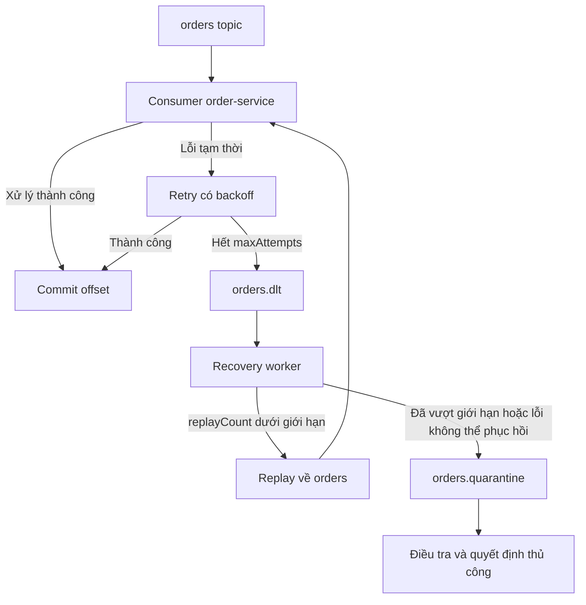

# Phát lại DLT có giới hạn số lần và nơi cách ly cuối cùng

Dead Letter Topic (DLT) là nơi lưu những message không thể xử lý thành công sau các lần retry đã cấu hình. DLT giúp consumer chính tiếp tục xử lý các message khác thay vì bị kẹt mãi ở một record lỗi. Tuy nhiên, lưu message vào DLT mới chỉ là bước cách ly ban đầu. Khi nguyên nhân lỗi đã được sửa, đội vận hành có thể cần phát lại một số message về luồng xử lý chính.

Phát lại DLT phải có giới hạn. Nếu một message lỗi được gửi lại vô hạn, nó có thể tạo vòng lặp giữa topic chính và DLT, làm tăng tải, tạo duplicate và che khuất nguyên nhân gốc. Một quy trình phục hồi an toàn cần theo dõi số lần replay, giới hạn tốc độ và phạm vi replay, đồng thời chuyển message đã vượt ngưỡng tới một nơi cách ly cuối cùng (quarantine topic) để con người điều tra.

## 1. Phân biệt retry, DLT, replay và quarantine

Bốn khái niệm này có vai trò khác nhau:

| Khái niệm | Mục đích | Vị trí trong vòng đời |
| --- | --- | --- |
| Retry | Thử xử lý lại message khi lỗi có thể tạm thời | Ngay trong consumer, trước khi kết luận xử lý thất bại |
| DLT/DLQ | Lưu message đã hết retry của consumer chính | Điểm cách ly để điều tra hoặc phục hồi |
| Replay | Đưa một message đã nằm trong DLT trở lại luồng xử lý | Sau khi nguyên nhân lỗi đã được xử lý hoặc có quyết định vận hành |
| Quarantine | Lưu message không còn được tự động replay hoặc cần can thiệp thủ công | Điểm cách ly cuối cùng, không tự động đưa về topic chính |

Ví dụ dịch vụ xử lý đơn hàng đọc topic `orders`. Nếu xử lý một record thất bại, consumer có thể retry ba lần. Khi vẫn lỗi, Kafka binder gửi record tới `orders.dlt`. Sau khi nhóm phát triển sửa lỗi schema hoặc dữ liệu, một recovery worker có thể replay record về `orders`. Nếu record tiếp tục thất bại và đã dùng hết số lần replay cho phép, worker chuyển nó sang `orders.quarantine`.



Retry của consumer và số lần replay từ DLT là hai bộ đếm khác nhau. Ví dụ, `maxAttempts: 3` cho phép tối đa ba lần xử lý trong một lượt giao message; `maxReplayAttempts: 2` cho phép tối đa hai chu kỳ đưa message từ DLT trở lại topic chính. Tổng số lần xử lý thực tế có thể lớn hơn ba, vì mỗi chu kỳ replay lại có retry riêng.

## 2. Bật DLT cho Kafka consumer bằng Spring Cloud Stream

Kafka binder hỗ trợ gửi message thất bại tới DLT sau khi retry của consumer đã hết. Consumer cần có group ổn định để binder xác định phạm vi tiêu thụ và cấu hình DLT.

Ví dụ cấu hình:

```yaml
spring:
  cloud:
    function:
      definition: processOrder
    stream:
      bindings:
        processOrder-in-0:
          destination: orders
          group: order-service
          content-type: application/json
          consumer:
            maxAttempts: 3
            backOffInitialInterval: 1000
            backOffMaxInterval: 10000
            backOffMultiplier: 2.0
      kafka:
        bindings:
          processOrder-in-0:
            consumer:
              enableDlq: true
              dlqName: orders.dlt
```

Trong ví dụ:

- `maxAttempts` là số lần thử xử lý trong một lượt giao message, bao gồm lần đầu.
- `backOffInitialInterval`, `backOffMaxInterval` và `backOffMultiplier` điều khiển khoảng chờ giữa các lần retry.
- `enableDlq: true` bật DLT cho input binding Kafka.
- `dlqName` đặt tên topic đích để lưu message đã hết retry.
- `group` tạo danh tính consumer group ổn định; không nên bỏ group khi cần DLT theo group.

Tên thuộc tính và vị trí cấu hình cần đối chiếu với phiên bản Spring Cloud Stream Kafka binder của dự án. Các thuộc tính retry chung nằm dưới `spring.cloud.stream.bindings.<binding>.consumer`; thuộc tính DLT riêng của Kafka nằm dưới `spring.cloud.stream.kafka.bindings.<binding>.consumer`.

### Retry có backoff

Với cấu hình ví dụ, consumer thử tối đa ba lần. Khoảng chờ tăng dần theo multiplier nhưng không vượt quá `backOffMaxInterval`. Backoff giúp tránh gửi lại liên tục khi database, broker hoặc dịch vụ phụ thuộc đang quá tải.

Retry không phải giải pháp cho mọi exception. Lỗi mạng tạm thời có thể phù hợp với retry; dữ liệu không hợp lệ, schema không tương thích hoặc vi phạm invariant nghiệp vụ thường cần chuyển DLT sớm để điều tra. Có thể cấu hình phân loại exception theo khả năng retry thay vì áp dụng cùng một chính sách cho mọi lỗi.

## 3. Metadata cần giữ trong DLT

Khi Kafka binder chuyển message sang DLT, Spring Kafka bổ sung metadata về record gốc và lỗi. Các header thường dùng gồm:

- `KafkaHeaders.DLT_ORIGINAL_TOPIC`: topic ban đầu.
- `KafkaHeaders.DLT_ORIGINAL_PARTITION`: partition ban đầu.
- `KafkaHeaders.DLT_ORIGINAL_OFFSET`: offset ban đầu.
- `KafkaHeaders.DLT_ORIGINAL_TIMESTAMP`: timestamp của record gốc.
- `KafkaHeaders.DLT_ORIGINAL_CONSUMER_GROUP`: consumer group xử lý record.
- `KafkaHeaders.DLT_EXCEPTION_FQCN`: tên đầy đủ của exception.
- `KafkaHeaders.DLT_EXCEPTION_MESSAGE`: thông điệp lỗi.
- `KafkaHeaders.DLT_EXCEPTION_STACKTRACE`: stack trace, nếu được cấu hình giữ lại.

Tên hằng số và header cụ thể phụ thuộc phiên bản Spring Kafka. Khi dùng code, ưu tiên các hằng số `KafkaHeaders` tương ứng thay vì hard-code tên header. Không giả định tất cả header lỗi đều luôn có mặt: header mapper, cấu hình binder và loại lỗi có thể làm thay đổi metadata được giữ.

Ngoài metadata DLT, ứng dụng nên có event ID ổn định và business key. Event ID giúp phát hiện duplicate; business key giúp xác định aggregate cần xử lý và hỗ trợ giữ thứ tự theo nghiệp vụ.

## 4. Thiết kế bộ đếm replay có giới hạn

DLT mặc định không tự biết message đã được replay bao nhiêu lần. Ứng dụng cần lưu bộ đếm replay theo một cách bền vững và truyền được qua mỗi vòng phục hồi.

Có thể dùng Kafka header riêng, ví dụ:

| Header | Ý nghĩa |
| --- | --- |
| `x-event-id` | Định danh ổn định của sự kiện |
| `x-replay-count` | Số chu kỳ replay đã thực hiện |
| `x-replay-request-id` | Mã yêu cầu replay do vận hành tạo |
| `x-replay-requested-by` | Danh tính người hoặc hệ thống yêu cầu replay |
| `x-replay-reason` | Lý do replay sau khi đã xử lý nguyên nhân gốc |

Ví dụ chính sách:

```text
MAX_REPLAY_ATTEMPTS = 2

DLT record có replayCount = 0
  -> replay về orders, đặt replayCount = 1

Nếu lại thất bại và quay về DLT với replayCount = 1
  -> replay về orders, đặt replayCount = 2

Nếu lại thất bại và quay về DLT với replayCount = 2
  -> chuyển orders.quarantine
```

Ở ví dụ này, `MAX_REPLAY_ATTEMPTS = 2` cho phép hai lần replay sau lần xử lý ban đầu. Khi `replayCount >= MAX_REPLAY_ATTEMPTS`, recovery worker không gửi lại topic chính nữa.

### Header hay recovery ledger?

Header phù hợp khi binder và header mapper bảo toàn custom header qua luồng topic chính → DLT → replay. Phải kiểm thử điều này với đúng phiên bản binder; nếu header bị loại hoặc đổi kiểu, bộ đếm có thể bị reset và giới hạn không còn tác dụng.

Với yêu cầu audit hoặc phục hồi quan trọng, có thể lưu bộ đếm trong recovery ledger bền vững, khóa theo `(consumerName, eventId)` hoặc `(eventId, replayRequestId)`. Ledger cần được cập nhật cùng quy trình phát lại để không mất dấu khi worker restart. Khi chọn ledger ngoài Kafka, phải giải quyết khoảng hở giữa cập nhật ledger và gửi message, ví dụ dùng transactional outbox cho chính recovery command.

Không dùng số lần retry nội bộ của binder làm bộ đếm replay DLT. Retry nội bộ kết thúc trước khi message được gửi tới DLT; replay là một chu kỳ phục hồi mới sau đó.

## 5. Quy trình replay có kiểm soát

Recovery worker đọc DLT và quyết định một trong hai hướng:

1. Nếu message đủ điều kiện và còn lượt replay, gửi lại topic gốc hoặc một topic replay được consumer chính subscribe.
2. Nếu message đã vượt giới hạn, không còn đủ metadata, hoặc được xác định là lỗi không thể phục hồi, gửi tới quarantine.

Trước khi replay, nên xác nhận:

- Nguyên nhân gốc đã được sửa hoặc có lý do rõ ràng để thử lại.
- Message được chọn đúng theo event ID, khoảng thời gian hoặc điều kiện đã duyệt.
- Destination đích nằm trong allowlist cấu hình.
- Bộ đếm replay hiện tại nhỏ hơn giới hạn.
- Payload và schema vẫn tương thích với consumer hiện tại.
- Event ID, key và metadata cần thiết được giữ nguyên.
- Tốc độ replay không làm quá tải consumer hoặc hệ thống phụ thuộc.

Không nên tự động replay toàn bộ DLT ngay khi ứng dụng khởi động. Nếu lỗi gốc vẫn còn, worker có thể liên tục tạo vòng lặp DLT → topic chính → DLT. Tốt hơn là replay theo batch nhỏ, có rate limit và có thể yêu cầu thao tác vận hành sau khi xác minh nguyên nhân.

## 6. Ví dụ recovery worker với KafkaTemplate

Một recovery worker chuyên biệt có thể dùng Spring Kafka `@KafkaListener` để đọc DLT và `KafkaTemplate` để gửi lại. Cách này cho phép đọc trực tiếp `ConsumerRecord`, giữ key và kiểm tra header Kafka gốc.

Ví dụ cấu hình listener manual acknowledgment:

```yaml
spring:
  kafka:
    consumer:
      enable-auto-commit: false
    listener:
      ack-mode: manual
```

Đoạn code sau minh họa quyết định replay hoặc quarantine. Các helper đọc header và sao chép business headers được tách riêng để làm rõ luồng chính:

```java
import java.nio.ByteBuffer;
import java.nio.charset.StandardCharsets;
import java.util.concurrent.TimeUnit;

import org.apache.kafka.clients.consumer.ConsumerRecord;
import org.apache.kafka.clients.producer.ProducerRecord;
import org.apache.kafka.common.header.Header;
import org.springframework.kafka.annotation.KafkaListener;
import org.springframework.kafka.core.KafkaTemplate;
import org.springframework.kafka.support.KafkaHeaders;
import org.springframework.kafka.support.Acknowledgment;
import org.springframework.stereotype.Component;

@Component
public class OrderDltRecovery {

    private static final String REPLAY_COUNT = "x-replay-count";
    private static final int MAX_REPLAY_ATTEMPTS = 2;
    private static final String QUARANTINE_TOPIC = "orders.quarantine";

    private final KafkaTemplate<String, OrderEvent> kafkaTemplate;

    public OrderDltRecovery(KafkaTemplate<String, OrderEvent> kafkaTemplate) {
        this.kafkaTemplate = kafkaTemplate;
    }

    @KafkaListener(
            topics = "orders.dlt",
            groupId = "orders-dlt-recovery")
    public void recover(
            ConsumerRecord<String, OrderEvent> failed,
            Acknowledgment acknowledgment) throws Exception {

        int replayCount;
        try {
            replayCount = readIntHeader(failed, REPLAY_COUNT, 0);
            if (replayCount < 0) {
                throw new IllegalArgumentException("Negative replay count");
            }
        }
        catch (RuntimeException invalidCounter) {
            publish(QUARANTINE_TOPIC, failed, -1,
                    "INVALID_REPLAY_COUNT");
            acknowledgment.acknowledge();
            return;
        }

        String originalTopic = readStringHeader(
                failed, KafkaHeaders.DLT_ORIGINAL_TOPIC);

        if (replayCount >= MAX_REPLAY_ATTEMPTS) {
            publish(QUARANTINE_TOPIC, failed, replayCount,
                    "MAX_REPLAY_ATTEMPTS_EXCEEDED");
        }
        else {
            if (originalTopic == null || originalTopic.isBlank()) {
                publish(QUARANTINE_TOPIC, failed, replayCount,
                        "MISSING_ORIGINAL_TOPIC");
            }
            else {
                publish(originalTopic, failed, replayCount + 1, "REPLAY");
            }
        }

        // Chỉ xác nhận offset DLT sau khi send đã được broker xác nhận.
        acknowledgment.acknowledge();
    }

    private void publish(
            String destination,
            ConsumerRecord<String, OrderEvent> failed,
            int nextReplayCount,
            String action) throws Exception {

        ProducerRecord<String, OrderEvent> outgoing = new ProducerRecord<>(
                destination,
                failed.key(),
                failed.value());

        copyBusinessHeaders(failed, outgoing);
        outgoing.headers().add(REPLAY_COUNT,
                ByteBuffer.allocate(Integer.BYTES)
                        .putInt(nextReplayCount).array());
        outgoing.headers().add("x-recovery-action",
                action.getBytes(StandardCharsets.UTF_8));

        kafkaTemplate.send(outgoing).get(10, TimeUnit.SECONDS);
    }

    private static int readIntHeader(
            ConsumerRecord<?, ?> record, String name, int defaultValue) {
        Header header = record.headers().lastHeader(name);
        if (header == null) {
            return defaultValue;
        }
        return ByteBuffer.wrap(header.value()).getInt();
    }

    private static String readStringHeader(
            ConsumerRecord<?, ?> record, String name) {
        Header header = record.headers().lastHeader(name);
        return header == null ? null
                : new String(header.value(), StandardCharsets.UTF_8);
    }

    private static void copyBusinessHeaders(
            ConsumerRecord<?, ?> source,
            ProducerRecord<?, ?> target) {
        // Chỉ sao chép allowlist header nghiệp vụ/tracing cần giữ.
        // Không sao chép header DLT nội bộ hoặc header replay cũ.
    }
}
```

Đây là skeleton cần hoàn thiện cho model và cấu hình dự án. `OrderEvent` là kiểu payload ứng dụng; consumer deserializer phải đọc được payload từ DLT. `copyBusinessHeaders` cần sao chép có chọn lọc event ID, correlation ID và header nghiệp vụ cần thiết, đồng thời loại bỏ header DLT cũ và `x-replay-count` cũ trước khi thêm giá trị mới. Nếu DLT có nhiều loại payload, dùng serializer/deserializer phù hợp hoặc lưu payload dạng byte/JSON envelope để tránh ép kiểu sai.

`KafkaTemplate.send(...).get(...)` chờ kết quả gửi của producer trước khi xác nhận offset DLT. Producer nên được cấu hình `acks=all` và replication phù hợp với yêu cầu durability. Tuy nhiên, vẫn có cửa sổ crash sau khi broker nhận message nhưng trước khi offset DLT được commit; khi đó message DLT có thể được giao lại và replay lần nữa. Đây là ngữ nghĩa at-least-once, vì vậy event ID và consumer idempotency vẫn cần thiết.

Nếu cần atomic consume-DLT-and-produce-replay/quarantine, có thể cấu hình listener container dùng Kafka transaction manager và `KafkaTemplate` cùng transactional producer factory để output record và offset input được commit trong cùng Kafka transaction. Cấu hình này phải được kiểm thử theo phiên bản Spring Kafka và cách ứng dụng tạo listener container; không chỉ bật `transactional.id` là tự động có atomicity.

## 7. Vì sao phải sao chép header có chọn lọc?

Record DLT chứa cả metadata nghiệp vụ lẫn metadata lỗi do binder/Spring Kafka thêm. Khi phát lại về topic chính, không nên sao chép toàn bộ header DLT một cách mù quáng:

- Giữ event ID, correlation ID, tenant ID hoặc schema version nếu consumer cần chúng.
- Giữ hoặc tạo lại replay count để giới hạn vòng lặp.
- Ghi lại replay request ID và người yêu cầu để audit.
- Loại bỏ header exception/DLT cũ nếu chúng không còn mô tả lần xử lý mới.
- Không ghi đè Kafka header do broker tạo như offset, partition hoặc timestamp của record mới.

Kafka tự tạo offset, partition và timestamp mới cho record replay. Metadata gốc nên được giữ trong header audit riêng hoặc recovery ledger nếu cần điều tra. Không giả định offset cũ còn là vị trí của record sau khi phát lại.

## 8. Nơi cách ly cuối cùng (quarantine topic)

Quarantine topic dành cho message đã vượt giới hạn replay hoặc không thể tự phục hồi an toàn. Ví dụ tên topic là `orders.quarantine`. Topic này khác DLT ở mục đích vận hành:

| DLT | Quarantine |
| --- | --- |
| Chứa message hết retry của consumer chính | Chứa message đã hết replay hoặc bị đánh dấu cần xử lý thủ công |
| Có thể được chọn để replay sau khi sửa nguyên nhân | Không tự động replay về topic chính |
| Phục vụ điều tra lỗi xử lý và phục hồi có kiểm soát | Phục vụ lưu giữ cuối cùng, audit và quy trình xử lý ngoại lệ |
| Thường được recovery worker đọc | Chỉ được đọc bởi công cụ/nhóm vận hành có quyền phù hợp |

Một quarantine record nên giữ:

- Payload gốc hoặc byte payload để không mất dữ liệu.
- Event ID, business key, original topic/partition/offset.
- Replay count cuối cùng và lý do chuyển quarantine.
- Exception cuối cùng và thời điểm lỗi gần nhất.
- Replay request ID, danh tính người phê duyệt và thời điểm thao tác.
- Schema version, correlation ID và trace context cần thiết.

Quarantine topic cần ACL riêng, retention phù hợp và dashboard theo dõi. Không để consumer nghiệp vụ thông thường tự subscribe quarantine rồi phát lại tự động, nếu không nó sẽ trở thành một DLT thứ hai không có giới hạn.

## 9. Giữ thứ tự khi replay

Replay về topic gốc có thể làm thay đổi thứ tự xử lý. Giả sử `OrderCreated` của `ORD-1` bị lỗi và nằm trong DLT, trong khi `PaymentReceived` và `OrderShipped` của cùng đơn hàng đã được xử lý. Khi replay `OrderCreated`, message cũ có thể đến sau các sự kiện mới.

Nếu nghiệp vụ yêu cầu thứ tự nghiêm ngặt theo key:

1. Dùng event ID và aggregate sequence để nhận diện sự kiện cũ.
2. Consumer kiểm tra sequence và không áp dụng sự kiện đến muộn sai thứ tự.
3. Có thể tạm dừng partition hoặc aggregate liên quan trong lúc phục hồi, nếu kiến trúc cho phép.
4. Replay theo key/partition và batch nhỏ, sau khi xác minh trạng thái hiện tại.
5. Nếu cần, đưa sự kiện vào một luồng reconciliation riêng thay vì ghi thẳng về topic chính.

Kafka không tự chèn record replay vào vị trí offset cũ. Record replay là record mới, có offset mới. Dù giữ nguyên key để partitioner chọn partition hiện tại, thứ tự lịch sử của key không tự được khôi phục.

## 10. Giới hạn tốc độ và phạm vi replay

Một DLT có thể tích lũy hàng triệu record. Replay toàn bộ cùng lúc có thể làm consumer chính, database hoặc API phụ thuộc quá tải. Recovery worker nên hỗ trợ:

- Batch size có giới hạn.
- Rate limit theo số record/giây.
- Chạy theo event ID, thời gian, loại lỗi hoặc tenant đã được phê duyệt.
- Dry-run để thống kê số record sẽ replay hoặc quarantine.
- Pause/resume mà không làm mất vị trí đọc.
- Backoff giữa các batch và circuit breaker khi downstream lỗi lại.
- Audit log cho từng lần replay.

Không dùng tên destination tùy ý từ request vận hành. Recovery service chỉ nên cho phép danh sách topic đích đã cấu hình và kiểm tra original topic nằm trong allowlist. Điều này tránh việc một thao tác replay gửi dữ liệu nhạy cảm sang topic ngoài phạm vi.

## 11. Replay thủ công sau khi sửa nguyên nhân gốc

Quy trình vận hành nên theo các bước:

1. Xác định nguyên nhân khiến message vào DLT: lỗi dữ liệu, schema, dependency, ACL hay bug ứng dụng.
2. Khắc phục và triển khai phiên bản consumer đã sửa.
3. Chạy dry-run trên một tập event ID nhỏ.
4. Kiểm tra payload, schema, replay count và destination gốc.
5. Phê duyệt replay theo quyền vận hành.
6. Replay theo batch nhỏ, có rate limit.
7. Theo dõi consumer lag, lỗi mới và số record quay lại DLT.
8. Chuyển record vượt giới hạn hoặc không an toàn sang quarantine.
9. Đối soát số lượng DLT đầu vào, replay thành công và quarantine.

Không replay message chỉ vì nó đã nằm trong DLT một khoảng thời gian. Nếu lỗi gốc chưa được sửa, replay chỉ tạo thêm vòng lỗi. Với lỗi dữ liệu vĩnh viễn, cần sửa payload bằng quy trình có audit hoặc giữ ở quarantine để xử lý nghiệp vụ riêng; không âm thầm thay đổi dữ liệu gốc.

## 12. Idempotency và chống duplicate trong quá trình replay

DLT replay thường có ngữ nghĩa at-least-once. Duplicate có thể xuất hiện khi:

- Recovery worker gửi thành công nhưng crash trước khi commit offset DLT.
- Producer timeout khiến worker không biết broker đã nhận record hay chưa.
- Replay request được gửi hai lần do thao tác vận hành lặp.
- Một message đã được xử lý thành công nhưng DLT offset chưa được xác nhận.

Consumer chính nên dùng event ID ổn định và lưu dấu đã xử lý bằng unique constraint hoặc inbox table. Khi nhận event ID đã tồn tại, consumer bỏ qua side effect trùng nhưng vẫn hoàn tất acknowledgment theo chính sách.

Recovery worker cũng nên có idempotency key cho replay request, ví dụ `(eventId, replayAttempt)`. Nếu người vận hành gửi cùng request hai lần, hệ thống có thể phát hiện và tránh tạo nhiều bản replay không cần thiết.

## 13. Retry topic, DLT và quarantine có thay thế nhau không?

Không. Retry topic, DLT và quarantine giải quyết các giai đoạn khác nhau:

- Retry topic có thể trì hoãn việc thử lại theo thời gian và tách luồng retry khỏi partition chính.
- DLT giữ message đã hết chính sách retry của consumer.
- Quarantine giữ message đã vượt chính sách replay hoặc cần điều tra thủ công.

Nếu cần delay dài, không nên giữ consumer thread chờ nhiều phút hoặc nhiều giờ. Có thể dùng retry topic theo cấp độ thời gian (ví dụ `orders.retry.1m`, `orders.retry.10m`) hoặc một scheduler đọc recovery store có `nextAttemptAt`. Khi dùng retry topic, phải kiểm soát số lần retry và tránh vòng lặp giữa các retry topic.

## 14. Quan sát và cảnh báo

Các chỉ số nên theo dõi:

- Số message hiện có trong DLT và quarantine.
- Tuổi của message cũ nhất trong DLT/quarantine.
- Số replay thành công, thất bại và bị từ chối do vượt giới hạn.
- Số lần replay trung bình và phân bố replay count.
- Tốc độ replay theo giây và consumer lag của topic chính.
- Số duplicate được consumer phát hiện.
- Lỗi publish tới topic gốc hoặc quarantine.
- Số replay request đang chạy, bị pause hoặc cần phê duyệt.

Đặt cảnh báo khi DLT tăng đột biến, quarantine có record mới, replay liên tục thất bại hoặc tuổi message vượt SLA. Không chỉ theo dõi số lượng record; một message có thể bị kẹt lâu dù tổng DLT nhỏ.

## 15. Kiểm thử bounded replay và quarantine

Unit test nên kiểm tra quyết định dựa trên replay count:

| Replay count hiện tại | Hành động mong đợi |
| ---: | --- |
| 0 | Replay về topic gốc, count mới là 1 |
| 1 | Replay về topic gốc, count mới là 2 |
| 2 | Chuyển sang quarantine, không replay về topic gốc |
| Header không hợp lệ | Cách ly hoặc chuyển trạng thái lỗi theo chính sách; không tự reset về 0 |

Integration test với Kafka nên kiểm tra:

1. Consumer chính hết retry và message xuất hiện trong DLT.
2. Recovery worker đọc đúng original topic và event ID.
3. Replay giữ business key và custom headers cần thiết.
4. Replay count tăng qua mỗi vòng DLT.
5. Khi đạt giới hạn, message được gửi tới quarantine.
6. Broker send lỗi thì offset DLT chưa được xác nhận.
7. Crash sau send nhưng trước offset commit tạo duplicate có thể được xử lý idempotent.
8. Replay rate không làm consumer chính hoặc downstream quá tải.
9. Header mapper bảo toàn replay count qua topic chính và DLT.
10. Record có lỗi vĩnh viễn không bị replay tự động vô hạn.

Test binder hữu ích để kiểm tra hàm xử lý và mapping message, nhưng không thay thế Kafka integration test cho offset commit, DLT header, producer acknowledgment, partition, transaction và crash window.

## 16. Các lỗi thường gặp

| Hiện tượng | Nguyên nhân có thể | Cách xử lý |
| --- | --- | --- |
| Message quay vòng DLT → topic chính → DLT vô hạn | Không lưu replay count hoặc không kiểm tra ngưỡng | Dùng bộ đếm bền vững và chuyển quarantine khi đạt giới hạn. |
| Replay count luôn bằng 0 | Custom header bị header mapper loại bỏ hoặc không được copy khi replay | Kiểm tra mapper và integration test toàn vòng; dùng recovery ledger nếu cần. |
| DLT worker xác nhận offset dù publish thất bại | Ack trước khi broker xác nhận output | Chỉ ack sau send acknowledgment; cân nhắc Kafka transaction để commit output và offset cùng nhau. |
| Cùng event được replay nhiều lần | Crash sau publish trước khi commit offset DLT | Idempotent consumer và replay request ID; cân nhắc transaction consume-produce. |
| Replay làm đảo thứ tự nghiệp vụ | Record cũ được ghi thành record mới sau các event mới | Dùng aggregate sequence, kiểm tra thứ tự và quy trình reconciliation. |
| Quarantine bị xử lý lại tự động | Consumer nghiệp vụ subscribe quarantine hoặc có auto-replay | Tách ACL, group và quy trình phê duyệt cho quarantine. |
| Replay làm consumer chính quá tải | Replay toàn bộ DLT không giới hạn tốc độ | Batch nhỏ, rate limit, pause/resume và theo dõi lag. |
| Message thiếu original topic | Header DLT bị thiếu hoặc record được đưa vào DLT ngoài binder | Cách ly và yêu cầu xác minh destination; không đoán topic. |

## 17. Checklist triển khai

Trước khi bật DLT replay trong production:

- Cấu hình consumer group và `enableDlq` cho đúng input binding.
- Đặt `dlqName` rõ ràng và tạo quyền truy cập phù hợp.
- Chọn retry count/backoff cho lỗi tạm thời.
- Định nghĩa replay count tối đa độc lập với retry count.
- Chọn nơi lưu replay count: custom Kafka header đã kiểm thử hoặc recovery ledger bền vững.
- Xác định event ID và idempotency strategy.
- Allowlist topic gốc và quarantine destination.
- Chỉ ack DLT sau khi publish được xác nhận hoặc trong Kafka transaction phù hợp.
- Giữ key, schema và business headers cần thiết; loại bỏ DLT headers cũ.
- Đánh giá thứ tự theo key và aggregate sequence.
- Đặt rate limit, batch size, dry-run và audit log.
- Cấu hình quarantine retention, ACL, dashboard và quy trình xử lý thủ công.
- Kiểm thử crash window, duplicate, lỗi publish và vượt replay limit.

## Tài liệu tham khảo

- [Spring Cloud Stream Kafka Binder — Dead-Letter Topic Processing](https://docs.spring.io/spring-cloud-stream/reference/kafka/kafka-binder/dlq.html)
- [Spring Cloud Stream — Consumer Properties](https://docs.spring.io/spring-cloud-stream/reference/spring-cloud-stream/binding-properties.html)
- [Spring for Apache Kafka — Handling Exceptions](https://docs.spring.io/spring-kafka/reference/kafka/annotation-error-handling.html)
- [Spring for Apache Kafka — Dead-Letter Publishing Recoverer](https://docs.spring.io/spring-kafka/reference/kafka/annotation-error-handling.html#dead-letters)
- [Apache Kafka — Consumer Configs](https://kafka.apache.org/documentation/#consumerconfigs)

Hãy đối chiếu tài liệu của phiên bản Spring Cloud Stream Kafka binder và Spring Kafka đang dùng, nhất là tên property DLT, header metadata, acknowledgment mode và hỗ trợ transaction của listener container.

## Kết luận

Retry xử lý lỗi ngắn hạn trong consumer; DLT lưu message đã hết retry; replay đưa message trở lại luồng sau khi nguyên nhân gốc được xử lý; quarantine giữ message đã vượt giới hạn hoặc cần can thiệp thủ công. Một quy trình an toàn cần bộ đếm replay độc lập với retry count, event ID ổn định, publish được xác nhận trước khi commit offset DLT, idempotency, rate limit và kiểm soát thứ tự. Khi đạt `MAX_REPLAY_ATTEMPTS`, recovery worker phải dừng replay và chuyển record tới quarantine để tránh vòng lặp vô hạn.
