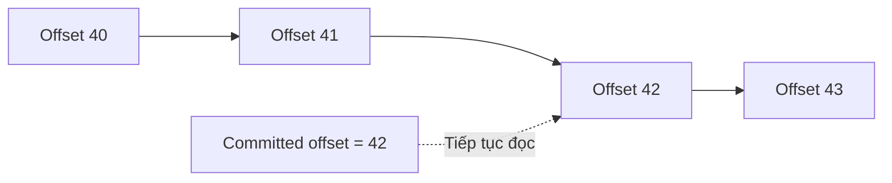
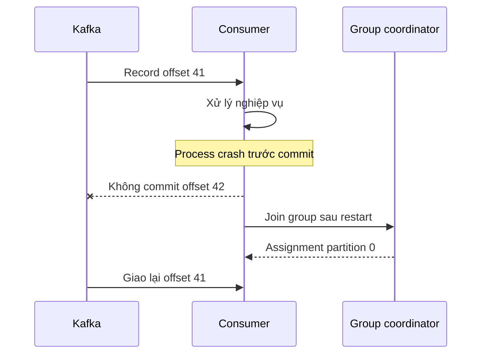
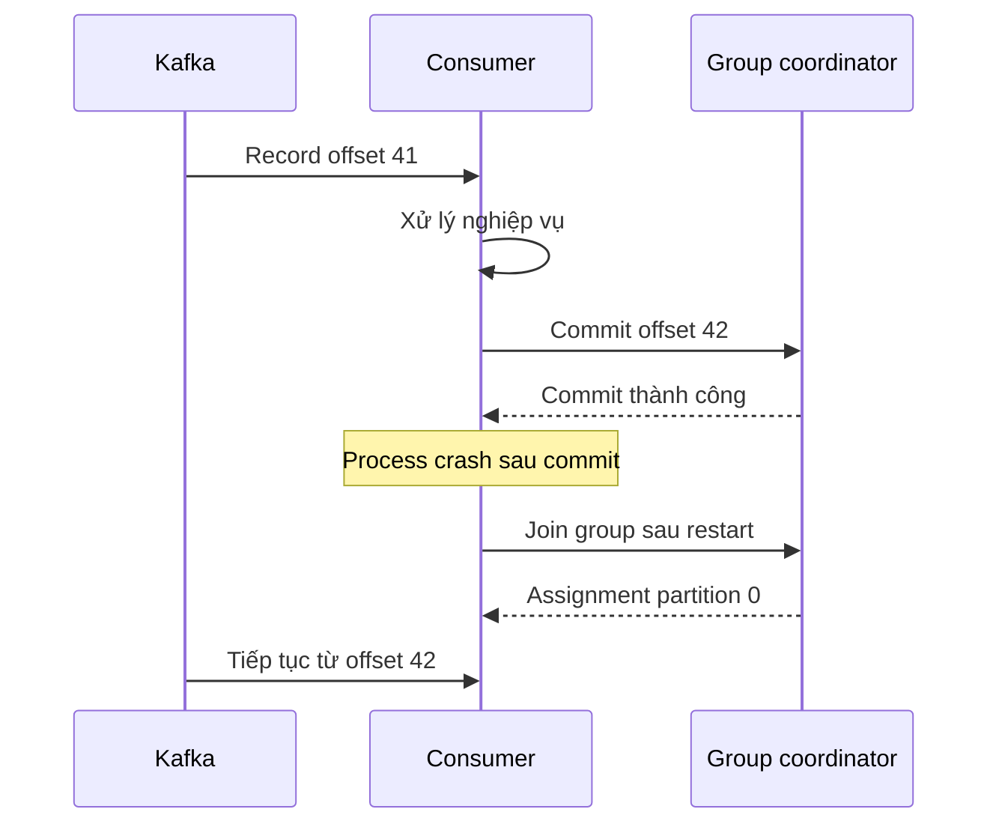
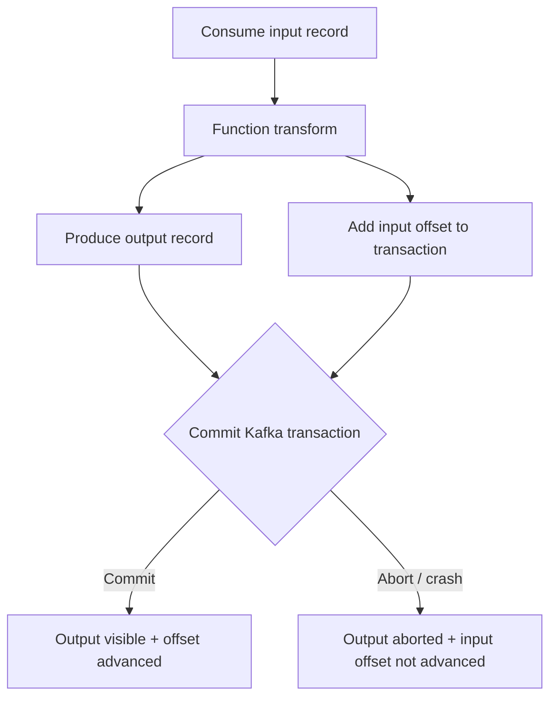

# Thực nghiệm lỗi tiến trình trước và sau commit offset

## 1. Vì sao cần thử nghiệm thời điểm crash?

Một Kafka consumer có thể đọc message, thực hiện logic nghiệp vụ rồi commit offset để ghi nhận tiến độ của consumer group. Nếu tiến trình dừng đột ngột, kết quả phụ thuộc vào việc offset đã được broker ghi nhận hay chưa và tác dụng phụ nghiệp vụ đã hoàn tất hay chưa.

Hai tình huống quan trọng:

- **Crash trước khi offset được commit:** Kafka vẫn xem record là chưa được xác nhận hoàn tất. Khi consumer khởi động lại hoặc partition được giao cho thành viên khác, record có thể được đọc lại.
- **Crash sau khi offset đã được commit:** consumer group tiếp tục từ offset đã commit. Record trước đó không được giao lại trong lần đọc bình thường, dù tiến trình đã dừng ngay sau commit.

Thử nghiệm hai thời điểm này giúp hiểu vì sao Kafka thường được vận hành theo at-least-once khi commit sau xử lý, vì sao duplicate vẫn có thể xảy ra và vì sao commit quá sớm có thể làm mất tác dụng phụ nghiệp vụ.

## 2. Offset đã commit có nghĩa là gì?

Mỗi record trong Kafka partition có một offset. Consumer group lưu tiến độ riêng cho từng partition. Giá trị offset được commit là vị trí tiếp theo mà group sẽ đọc, tức là thường bằng offset của record cuối cùng đã hoàn tất cộng một.

Ví dụ, consumer xử lý record có offset `41` và commit `42`. Sau khi khởi động lại, consumer tiếp tục từ `42`, không đọc lại record `41` trong điều kiện group còn offset hợp lệ và không có thao tác reset.



Offset commit không phải là một bản ghi xác nhận rằng database đã commit, email đã gửi hoặc API bên ngoài đã xử lý xong. Nó chỉ ghi nhận tiến độ tiêu thụ của group theo cơ chế Kafka. Ứng dụng phải sắp xếp thứ tự side effect và commit phù hợp.

## 3. Hai mốc độc lập: side effect và offset commit

Khi consumer cập nhật database, có hai thao tác riêng:

1. Database commit thay đổi nghiệp vụ.
2. Kafka commit offset của consumer group.

Hai thao tác này không tự động trở thành một transaction nguyên tử. Có thể xảy ra bốn trường hợp:

| Database side effect | Offset commit | Kết quả sau crash |
|---|---|---|
| Chưa hoàn tất | Chưa commit | Record được đọc lại; xử lý có thể bắt đầu lại |
| Đã commit | Chưa commit | Record được đọc lại; side effect có nguy cơ lặp |
| Chưa hoàn tất | Đã commit | Record không được đọc lại; side effect có thể bị mất |
| Đã commit | Đã commit | Consumer tiếp tục sau record đó; đây là trạng thái mong muốn |

Mục tiêu của consumer thường là hoàn tất side effect bền vững trước, rồi mới xác nhận offset. Cách này ưu tiên at-least-once: có thể xử lý lặp, nhưng tránh đánh dấu một record hoàn tất khi tác dụng phụ chưa được lưu. Để chống lặp, cần idempotency hoặc inbox.

## 4. Crash trước commit offset

Giả sử group `order-processor` đang đọc topic `orders.events`, partition 0. Consumer nhận record offset `41`:

1. Consumer đọc record `41`.
2. Ứng dụng bắt đầu xử lý.
3. Tiến trình bị kill trước khi offset `42` được commit.
4. Consumer khởi động lại với cùng group ID.
5. Kafka cung cấp lại record `41` vì committed offset vẫn ở `41` hoặc vị trí trước đó.



Nếu crash xảy ra trước khi side effect hoàn tất, lần xử lý sau có thể hoàn thành bình thường. Nếu database đã commit trước khi tiến trình crash, lần xử lý sau có thể thực hiện side effect lần thứ hai. Vì vậy, “crash trước commit offset” không tự nói lên nghiệp vụ đã được thực hiện hay chưa; phải xem điểm crash tương đối với database/API call.

## 5. Crash sau commit offset

Nếu broker đã ghi nhận offset `42`, group sẽ tiếp tục từ offset đó. Giả sử consumer commit xong rồi tiến trình dừng:

1. Consumer đọc record `41`.
2. Ứng dụng xử lý record.
3. Consumer commit offset `42` và nhận xác nhận commit thành công.
4. Tiến trình crash.
5. Consumer khởi động lại cùng group.
6. Kafka bắt đầu từ offset `42`; record `41` không được giao lại trong lần đọc bình thường.



Nếu ứng dụng commit offset trước khi database commit hoặc trước khi gọi API nghiệp vụ, crash sau commit có thể khiến record bị bỏ qua trong khi side effect chưa hoàn tất. Đây là cửa sổ mất dữ liệu do thứ tự commit sai.

## 6. Thử nghiệm cần phân biệt “gửi commit” và “commit đã được broker xác nhận”

Trong code, lời gọi commit có thể gửi request đến group coordinator. Tiến trình có thể dừng trong lúc request đang bay hoặc trước khi nhận phản hồi. Khi đó, client không chắc commit đã được broker ghi nhận hay chưa.

Vì vậy, khi thử nghiệm “crash sau commit”, hãy xác nhận commit đã hoàn tất theo chế độ commit đang dùng, hoặc kiểm tra committed offset từ một client quản trị độc lập trước khi dừng tiến trình. Nếu chỉ dừng ngay sau khi gọi API commit mà không chờ kết quả, thử nghiệm có thể rơi vào trạng thái không xác định.

Tương tự, nếu crash trong lúc commit request đang xử lý, kết quả sau restart có thể là đọc lại record hoặc tiếp tục từ offset mới tùy coordinator đã ghi nhận request hay chưa. Consumer phải an toàn trong cả hai khả năng.

## 7. Auto commit và commit do container quản lý

Kafka consumer có thuộc tính `enable.auto.commit`. Khi bật, client tự commit offset theo chu kỳ mà không nhất thiết chờ logic nghiệp vụ hoàn tất. Nếu ứng dụng xử lý chậm hơn chu kỳ commit, offset có thể được commit trong khi side effect chưa xong; crash khi đó có thể làm record không được đọc lại.

Spring Kafka container thường quản lý commit và mặc định tắt auto commit nếu ứng dụng không chủ động bật. Spring Cloud Stream Kafka binder cung cấp `ackMode` để điều khiển thời điểm container xác nhận offset. Với consumer xử lý nghiệp vụ, cần hiểu rõ cấu hình binder và không bật auto commit tùy tiện.

Các chế độ acknowledgement phổ biến của Spring Kafka:

| Ack mode | Thời điểm commit khái quát | Phạm vi replay khi crash |
|---|---|---|
| `RECORD` | Sau khi listener xử lý xong từng record | Các record chưa commit có thể được đọc lại |
| `BATCH` | Sau khi xử lý xong các record trong poll batch | Có thể đọc lại phần chưa commit của batch |
| `TIME` | Theo khoảng thời gian cấu hình, khi điều kiện batch được đáp ứng | Có thể đọc lại nhiều record kể từ lần commit trước |
| `COUNT` | Khi đạt số record cấu hình | Có thể đọc lại các record sau lần commit trước |
| `MANUAL` | Ứng dụng gọi acknowledge; commit theo chu kỳ/container sau khi xử lý batch | Phụ thuộc thời điểm acknowledge và commit thực tế |
| `MANUAL_IMMEDIATE` | Commit ngay khi acknowledge được gọi trên consumer thread | Phạm vi replay nhỏ hơn khi commit đã hoàn tất |

Chi tiết hành vi còn phụ thuộc phiên bản Spring Kafka, loại listener, batch/record mode và cấu hình đồng bộ commit. Hãy đối chiếu với phiên bản binder trong dự án.

## 8. Cấu hình ackMode trong Spring Cloud Stream Kafka binder

Ví dụ cấu hình input binding dùng `RECORD`:

```yaml
spring:
  cloud:
    function:
      definition: processOrder
    stream:
      bindings:
        processOrder-in-0:
          destination: orders.events
          group: order-processor
      kafka:
        bindings:
          processOrder-in-0:
            consumer:
              ackMode: RECORD
```

Với `RECORD`, container commit offset sau khi listener hoàn tất xử lý record theo semantics của Spring Kafka. Nếu function ném exception và lỗi chưa được phục hồi, commit thường không được xem là thành công cho record đó; error handler/retry/DLQ sẽ quyết định bước tiếp theo.

Nếu dùng `BATCH`, container có thể commit sau khi xử lý xong các record được trả về trong một poll. Khi process crash giữa batch, các record chưa được commit có thể được giao lại, kể cả record mà logic đã chạy xong nhưng chưa nằm trước offset đã commit.

`ackMode` là thuộc tính Kafka binder, không phải thuộc tính chung cho mọi binder. RabbitMQ và Pulsar có acknowledgement semantics riêng.

## 9. Manual acknowledgement trong function

Khi cần xác định rõ thời điểm xác nhận, có thể dùng manual ack theo hỗ trợ của Kafka binder. Ví dụ dưới đây lấy `Acknowledgment` từ message header và chỉ acknowledge sau khi service hoàn tất thao tác nghiệp vụ:

```java
import java.util.function.Consumer;
import org.springframework.context.annotation.Bean;
import org.springframework.context.annotation.Configuration;
import org.springframework.kafka.support.Acknowledgment;
import org.springframework.kafka.support.KafkaHeaders;
import org.springframework.messaging.Message;

record OrderEvent(String eventId, String orderId) {}

interface OrderService {
    void apply(OrderEvent event);
}

@Configuration
class OrderFunctions {

    @Bean
    Consumer<Message<OrderEvent>> processOrder(OrderService service) {
        return message -> {
            service.apply(message.getPayload());

            Acknowledgment acknowledgment = message.getHeaders().get(
                KafkaHeaders.ACKNOWLEDGMENT,
                Acknowledgment.class
            );
            if (acknowledgment == null) {
                throw new IllegalStateException("Kafka acknowledgment header is missing");
            }
            acknowledgment.acknowledge();
        };
    }
}
```

Cấu hình binding:

```yaml
spring:
  cloud:
    function:
      definition: processOrder
    stream:
      bindings:
        processOrder-in-0:
          destination: orders.events
          group: order-processor
      kafka:
        bindings:
          processOrder-in-0:
            consumer:
              ackMode: MANUAL
```

`service.apply` cần hoàn tất side effect bền vững trước khi hàm gọi `acknowledge`. Nếu service dùng `@Transactional`, lời gọi qua Spring proxy thường chỉ trả về sau khi transaction method kết thúc và commit; cần đảm bảo không đẩy phần ghi database sang một tác vụ bất đồng bộ chưa hoàn tất.

Với `MANUAL`, acknowledge đánh dấu record đã xử lý và container thực hiện commit theo quy tắc của chế độ này. `MANUAL_IMMEDIATE` có thể commit ngay khi acknowledge được gọi trên consumer thread. Đừng gọi ack từ thread khác nếu chưa hiểu semantics của container và phiên bản đang dùng.

Manual ack không tạo transaction chung với database. Nếu database commit xong rồi process crash trước khi ack có hiệu lực, record vẫn có thể được giao lại. Consumer cần idempotent.

## 10. Thí nghiệm A: crash trước offset commit

Mục tiêu là quan sát record được giao lại khi tiến trình dừng sau khi nhận message nhưng trước khi commit offset.

### Chuẩn bị

1. Tạo topic thử nghiệm `recovery-lab` với một partition.
2. Dùng group riêng `recovery-lab-group` để không ảnh hưởng workload khác.
3. Đặt `auto.offset.reset=earliest` cho group thử nghiệm mới.
4. Gửi một record có event ID duy nhất, ví dụ `evt-001`.
5. Chạy consumer có log `eventId`, partition và offset.
6. Đặt một failpoint sau khi nhận record nhưng trước khi acknowledge/commit.

### Thực hiện

- Khởi chạy consumer và chờ log cho biết đã nhận `evt-001`.
- Dừng cưỡng bức tiến trình trước khi offset commit được broker xác nhận.
- Khởi động lại consumer với cùng group ID.
- Quan sát record `evt-001` được nhận lại với cùng partition và offset.
- Kiểm tra committed offset của group trước và sau lần khởi động.

Kết quả mong đợi: offset chưa được commit nên Kafka giao lại record. Nếu side effect chưa chạy trước failpoint, lần xử lý sau chỉ thực hiện một lần. Nếu side effect đã commit trước failpoint, lần xử lý sau có thể tạo duplicate.

## 11. Thí nghiệm B: crash sau offset commit

Mục tiêu là quan sát group tiếp tục từ offset tiếp theo sau khi commit đã được broker xác nhận.

### Thực hiện

1. Dùng lại topic và group thử nghiệm hoặc tạo một group mới.
2. Gửi record `evt-002` ở offset đã biết.
3. Consumer xử lý record và acknowledge/commit.
4. Chờ commit hoàn tất; xác minh committed offset đã chuyển sang vị trí tiếp theo.
5. Dừng cưỡng bức tiến trình ngay sau mốc xác nhận commit.
6. Khởi động lại consumer với cùng group ID.
7. Quan sát consumer tiếp tục từ offset tiếp theo, không nhận lại `evt-002` trong lần đọc bình thường.

Kết quả mong đợi: nếu offset commit đã được broker ghi nhận, consumer không đọc lại record trước đó. Nếu side effect nghiệp vụ chưa hoàn tất trước commit, thí nghiệm cho thấy cách commit sớm có thể làm mất tác dụng phụ.

## 12. Thí nghiệm C: database commit xong nhưng crash trước Kafka commit

Đây là cửa sổ thường gây duplicate trong hệ thống at-least-once:

1. Consumer nhận event `evt-003`.
2. Database transaction ghi thay đổi nghiệp vụ và commit thành công.
3. Tiến trình crash trước khi Kafka offset được commit.
4. Kafka giao lại `evt-003` sau restart.
5. Consumer thực hiện lại logic và có nguy cơ ghi cùng thay đổi lần nữa.

Để quan sát, ghi `eventId` vào bảng xử lý và thử nghiệm cả hai trường hợp: không có unique constraint và có inbox unique constraint. Với inbox, lần giao lại phải được nhận diện là duplicate và không áp dụng lại tác dụng phụ.

Không dùng số thứ tự offset làm idempotency key toàn cục. Offset chỉ duy nhất trong phạm vi topic/partition; event ID nghiệp vụ ổn định phù hợp hơn khi dữ liệu được sao chép hoặc replay sang luồng khác.

## 13. Thí nghiệm D: commit offset trước database commit

Thí nghiệm này minh họa tình huống có thể mất tác dụng phụ:

1. Consumer nhận `evt-004`.
2. Ứng dụng acknowledge/commit offset.
3. Chờ xác nhận committed offset.
4. Dừng tiến trình trước khi database commit.
5. Khởi động lại consumer với cùng group.
6. Xác nhận consumer bắt đầu từ offset tiếp theo và không tự đọc lại `evt-004`.

Kết quả: Kafka đã ghi nhận group hoàn tất record, nên record không được giao lại theo tiến độ group. Nếu database chưa commit, tác dụng phụ có thể bị mất. Không dùng thứ tự commit này cho consumer cần bảo đảm side effect database.

## 14. Kiểm tra committed offset bằng Kafka CLI

Trước và sau mỗi thí nghiệm, xem trạng thái group:

```bash
kafka-consumer-groups.sh \
  --bootstrap-server localhost:9092 \
  --describe \
  --group recovery-lab-group
```

Đối chiếu các cột:

- `CURRENT-OFFSET`: vị trí tiếp theo group sẽ đọc theo trạng thái đã commit.
- `LOG-END-OFFSET`: vị trí cuối log theo cách CLI hiển thị cho partition.
- `LAG`: chênh lệch giữa log end và current offset.
- `CONSUMER-ID` và `HOST`: thành viên đang giữ assignment nếu có.

Khi consumer đang hoạt động, `CURRENT-OFFSET` có thể chưa phản ánh record vừa xử lý nếu commit mode đang chờ đến cuối batch hoặc chu kỳ. Hãy hiểu `ackMode` trước khi so sánh log ứng dụng với offset CLI.

## 15. Batch processing và phạm vi replay

Với `AckMode.BATCH`, consumer có thể nhận một poll batch gồm nhiều record. Container thường commit offset sau khi batch được xử lý hoàn tất. Nếu process crash giữa batch, những record chưa được commit có thể được đọc lại sau restart.

Ví dụ batch chứa offset `10`, `11`, `12`, `13`:

- Ứng dụng đã xử lý xong `10` và `11`.
- Ứng dụng bắt đầu xử lý `12` thì crash.
- Offset commit trước đó vẫn là `10`.
- Khi restart, group có thể đọc lại từ `10`, dẫn đến `10` và `11` được xử lý lại.

Đây là trade-off giữa hiệu năng commit theo batch và phạm vi có thể replay. `RECORD` có thể giảm số record phải đọc lại nhưng tăng số lần commit. Chọn theo throughput, latency và khả năng idempotent.

## 16. Rebalance cũng có thể làm record được giao lại

Consumer crash hoặc mất kết nối có thể khiến group rebalance. Partition được chuyển sang thành viên khác. Nếu record đã được xử lý nhưng offset chưa commit, consumer mới có thể đọc lại từ offset đã commit gần nhất.

Ngoài crash, rebalance có thể xảy ra khi:

- Instance được scale up hoặc scale down.
- Consumer bị dừng trong rolling deployment.
- `max.poll.interval.ms` bị vượt do xử lý quá lâu.
- Network chập chờn khiến member rời group.
- Subscription hoặc partition assignment thay đổi.

Hãy xử lý shutdown có kiểm soát, tránh giữ poll thread quá lâu và thiết kế consumer idempotent. Không coi redelivery sau rebalance là lỗi bất thường của Kafka.

## 17. Tác động của auto.offset.reset

`auto.offset.reset` chỉ được dùng khi group không có committed offset hợp lệ hoặc offset đã commit nằm ngoài phạm vi log còn lưu. Các giá trị phổ biến:

- `earliest`: bắt đầu từ offset sớm nhất còn giữ.
- `latest`: bắt đầu từ cuối log.
- `none`: báo lỗi nếu không tìm thấy offset hợp lệ.

Nếu group đã có committed offset hợp lệ, đổi `auto.offset.reset` không làm group quay lại đầu topic. Để replay, cần reset offset bằng công cụ quản trị hoặc dùng group mới. Trong thí nghiệm, luôn dùng group riêng để tránh vô tình thay đổi tiến độ production.

## 18. Kafka transaction cho consume-transform-produce

Nếu consumer đọc record Kafka rồi phát record đầu ra Kafka, Kafka transaction có thể gộp output record và offset đầu vào trong cùng một transaction khi binder/container được cấu hình đúng.



Nếu process crash trước transaction commit, transaction có thể bị abort hoặc được coordinator xử lý theo timeout; consumer đọc ở `read_committed` không nhìn thấy output chưa commit và input offset chưa được tiến lên trong transaction đó. Khi xử lý lại, function có thể chạy lại.

Nếu transaction commit thành công rồi process crash, output record đã commit và offset đầu vào cũng được tiến lên trong cùng phạm vi Kafka transaction. Đây là bảo đảm mạnh hơn cho consume-transform-produce bên trong Kafka.

Kafka transaction không bao gồm database hoặc HTTP service bên ngoài. Nếu function cập nhật database trước khi transaction Kafka commit, crash có thể khiến database side effect đã hoàn tất nhưng input được đọc lại. Dùng outbox/inbox hoặc idempotency cho ranh giới ngoài Kafka.

## 19. Thiết kế consumer idempotent

Vì crash trước offset commit có thể gây redelivery, consumer nên nhận diện event đã xử lý:

```java
import org.springframework.stereotype.Service;
import org.springframework.transaction.annotation.Transactional;

record OrderEvent(String eventId, String orderId, long totalCents) {}

interface InboxRepository {
    boolean insertIfAbsent(String eventId);
}

interface OrderRepository {
    void apply(OrderEvent event);
}

@Service
class IdempotentOrderHandler {

    private final InboxRepository inbox;
    private final OrderRepository orders;

    IdempotentOrderHandler(InboxRepository inbox, OrderRepository orders) {
        this.inbox = inbox;
        this.orders = orders;
    }

    @Transactional
    void handle(OrderEvent event) {
        if (!inbox.insertIfAbsent(event.eventId())) {
            return;
        }
        orders.apply(event);
    }
}
```

`insertIfAbsent` phải được triển khai bằng thao tác database nguyên tử và unique constraint trên `event_id`; không chỉ kiểm tra tồn tại rồi insert bằng hai câu lệnh tách rời. Việc insert inbox và cập nhật đơn hàng phải nằm trong cùng transaction database. Nếu transaction rollback, cả hai thao tác rollback. Nếu commit thành công, lần redelivery sau được nhận diện và bỏ qua tác dụng phụ đã hoàn tất.

## 20. Quy trình thực nghiệm trong môi trường an toàn

1. Dùng Kafka cluster thử nghiệm, topic một partition và consumer group riêng.
2. Tắt hoặc kiểm soát auto commit để thời điểm commit rõ ràng.
3. Gửi event có ID duy nhất và ghi lại topic, partition, offset.
4. Tạo failpoint trước acknowledgement và một failpoint sau khi commit đã được xác nhận.
5. Chạy từng thí nghiệm riêng, dừng process cưỡng bức tại failpoint.
6. Khởi động lại cùng group và quan sát record được giao lại hay bỏ qua.
7. Đọc committed offset bằng Kafka CLI sau mỗi lần dừng.
8. Lặp lại với database side effect trước/sau commit để quan sát duplicate và loss window.
9. Bật inbox/idempotency rồi chạy lại để xác nhận tác dụng phụ không lặp.
10. Thử `RECORD` và `BATCH` để so sánh phạm vi replay.

Không thực hiện reset offset hoặc kill consumer production để thử nghiệm. Nếu cần kiểm tra trong môi trường staging, dùng topic/group riêng và thống nhất thời điểm thử với nhóm vận hành.

## 21. Cách đọc kết quả và chẩn đoán

| Quan sát | Diễn giải có thể xảy ra | Việc cần kiểm tra |
|---|---|---|
| Record xuất hiện lại sau restart | Offset chưa commit hoặc commit chưa được broker xác nhận | Committed offset, ack mode, commit request result |
| Record không xuất hiện lại | Offset đã commit hoặc group bắt đầu ở vị trí khác | Group ID, committed offset, reset policy và log range |
| Database có dữ liệu nhưng record được đọc lại | Database commit trước Kafka offset commit | Inbox/idempotency và thứ tự side effect/ack |
| Record không đọc lại nhưng database thiếu dữ liệu | Offset có thể đã commit trước side effect | Auto commit, manual ack placement, batch behavior |
| Nhiều record trong batch bị đọc lại | Batch chưa được commit khi process crash | `ackMode`, poll batch và committed offset trước crash |
| Record được giao lại sau rebalance | Partition chuyển member trong khi offset chưa commit | Consumer membership, poll interval và graceful shutdown |

Không kết luận từ log ứng dụng duy nhất. Đối chiếu event ID, partition, offset, trạng thái database và committed offset của đúng group.

## 22. Quy trình chọn thời điểm commit

1. Xác định side effect nào phải hoàn tất trước khi message được xác nhận.
2. Với database, chờ transaction commit thành công rồi mới acknowledge input.
3. Chọn `RECORD`, `BATCH` hoặc manual ack theo yêu cầu latency và phạm vi replay.
4. Giữ auto commit tắt nếu container chịu trách nhiệm commit sau xử lý.
5. Làm cho side effect idempotent để chịu được crash sau database commit nhưng trước offset commit.
6. Dùng Kafka transaction khi cần atomic consume-transform-produce trong phạm vi Kafka.
7. Dùng outbox/inbox khi cần phối hợp database và broker.
8. Thực nghiệm crash trước/sau commit trong môi trường test và kiểm tra offset thực tế.

Crash trước commit offset thường khiến Kafka giao lại record; crash sau khi commit đã được broker xác nhận khiến group tiếp tục từ offset tiếp theo. Hai kết quả này tạo ra lựa chọn at-least-once và nguy cơ duplicate hoặc nguy cơ mất side effect nếu commit sai thứ tự. Trong Spring Cloud Stream, hãy hiểu `ackMode`, đặt acknowledgement sau khi tác dụng phụ bền vững hoàn tất và dùng idempotency để bảo vệ cửa sổ crash giữa database commit với Kafka offset commit.

