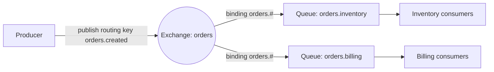
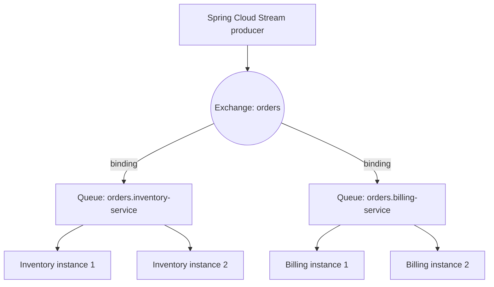

# Ánh xạ destination sang exchange và group sang queue

## Mục tiêu

RabbitMQ tổ chức định tuyến message qua exchange, binding và queue. Spring Cloud Stream RabbitMQ binder ánh xạ mô hình binding của framework sang các thành phần này: **destination** xác định exchange mà producer gửi tới và consumer đăng ký nhận từ đó; **consumer group** xác định queue riêng của một logical subscriber được bind vào exchange.

Hiểu đúng ánh xạ này giúp thiết kế fan-out giữa nhiều dịch vụ, chia tải giữa các replica, chọn routing key và quản lý queue bền vững. Nếu nhầm destination với queue hoặc group với exchange, ứng dụng có thể gửi message đến sai topology, tạo queue trùng hoặc khiến nhiều dịch vụ vô tình cạnh tranh nhận cùng một message.

Sau bài học, bạn có thể:

- Giải thích vai trò exchange, queue, binding và routing key trong RabbitMQ.
- Hiểu Spring Cloud Stream ánh xạ destination sang exchange.
- Hiểu consumer group được ánh xạ sang queue như thế nào.
- Phân biệt các replica cùng group với các logical subscriber khác group.
- Cấu hình exchange type, routing key và binding routing key.
- Chọn queue name, durability và vòng đời subscription phù hợp.
- Kiểm thử topology và xác minh message được định tuyến đến đúng queue.

## 1. Các thành phần định tuyến cơ bản của RabbitMQ

RabbitMQ không gửi message trực tiếp đến queue theo cách producer phải biết tên queue. Producer publish message đến một **exchange**. Exchange xem xét loại exchange, routing key và các binding đã khai báo để quyết định queue nào nhận message.

Bốn thành phần cần phân biệt:

| Thành phần | Vai trò | Ví dụ |
|---|---|---|
| Exchange | Điểm nhận message từ producer và thực hiện định tuyến | `orders` |
| Queue | Nơi lưu message chờ consumer nhận | `orders.inventory` |
| Binding | Quy tắc liên kết queue với exchange | Queue `orders.inventory` nhận khóa `orders.#` |
| Routing key | Giá trị producer gắn vào message để exchange so khớp binding | `orders.created` |

Luồng gửi:



Producer chỉ cần biết exchange và routing key. Nó không cần biết queue nào sẽ nhận message. Exchange có thể định tuyến một message đến một queue hoặc nhiều queue tùy loại exchange và binding.

Một queue có thể có nhiều consumer cùng đọc. Những consumer đó cạnh tranh nhận message từ queue. Nếu cần hai dịch vụ đều nhận bản sao độc lập, thường tạo hai queue khác nhau cùng bind vào exchange, thay vì để hai dịch vụ cùng đọc một queue.

## 2. Ánh xạ của Spring Cloud Stream RabbitMQ binder

Trong Spring Cloud Stream, input/output binding có thuộc tính `destination`. Với RabbitMQ binder, destination thường ánh xạ đến tên exchange:

- **Output binding:** binder publish message đến exchange có tên là destination.
- **Input binding:** binder khai báo hoặc sử dụng exchange tương ứng rồi bind queue của consumer vào exchange đó.
- **Consumer group:** binder dùng group để xác định queue của logical subscriber.
- **Binding routing key:** quy định loại message nào từ exchange được chuyển vào queue của consumer.

Ví dụ một input binding:

```yaml
spring:
  cloud:
    function:
      definition: processOrders
    stream:
      bindings:
        processOrders-in-0:
          destination: orders
          group: inventory
          content-type: application/json
```

Ở đây:

- `orders` là destination và là tên exchange theo cấu hình Rabbit binder.
- `inventory` là consumer group.
- Queue được tạo cho logical subscriber inventory và được bind vào exchange `orders`.
- Tên queue mặc định thường kết hợp destination và group, ví dụ `orders.inventory`; cấu hình queue naming của binder có thể thay đổi quy tắc này.

Đây là ánh xạ quan trọng nhất: **destination chọn exchange, group chọn queue của consumer**. Group không phải tên exchange; destination cũng không phải queue name.

Nếu không khai báo group, binder tạo anonymous consumer queue theo cơ chế của nó. Queue ẩn danh thường có tên được sinh tự động và vòng đời tạm thời, phù hợp với subscriber không cần giữ danh tính ổn định qua các lần khởi động. Với consumer nghiệp vụ cần queue bền vững và tiếp tục nhận message sau restart, hãy dùng group có tên ổn định.

## 3. Một destination, nhiều group: fan-out đến nhiều logical subscriber

Giả sử hệ thống phát sự kiện đơn hàng vào exchange `orders`. Hai dịch vụ cần nhận toàn bộ sự kiện:

- `inventory-service` cập nhật tồn kho.
- `billing-service` tạo yêu cầu thanh toán.

Mỗi dịch vụ khai báo cùng destination nhưng group khác nhau:

```yaml
# inventory-service
spring:
  cloud:
    function:
      definition: processOrders
    stream:
      bindings:
        processOrders-in-0:
          destination: orders
          group: inventory-service
```

```yaml
# billing-service
spring:
  cloud:
    function:
      definition: createInvoices
    stream:
      bindings:
        createInvoices-in-0:
          destination: orders
          group: billing-service
```

Rabbit binder tạo queue riêng cho mỗi group và bind cả hai queue vào exchange `orders`. Khi exchange định tuyến một message phù hợp đến cả hai queue, mỗi dịch vụ nhận một bản sao độc lập.



Các replica trong cùng group đọc chung queue và chia sẻ công việc. Các group khác nhau có queue riêng nên mỗi group nhận bản sao. Đây là cách kết hợp fan-out giữa các logical subscriber và competing consumers bên trong từng subscriber.

Nếu inventory và billing dùng cùng group name, chúng có thể cùng đọc một queue và cạnh tranh nhận message. Khi đó một message có thể đến inventory hoặc billing, thay vì cả hai dịch vụ đều nhận. Hãy cấp group name khác nhau cho các dịch vụ cần bản sao độc lập.

## 4. Một group, nhiều instance: chia tải trên cùng queue

Khi một dịch vụ chạy nhiều replica, các replica của nó thường dùng cùng destination và group:

```text
inventory-service instance 1 -> exchange orders, queue orders.inventory-service
inventory-service instance 2 -> exchange orders, queue orders.inventory-service
inventory-service instance 3 -> exchange orders, queue orders.inventory-service
```

Ba consumer cùng consume queue `orders.inventory-service`. RabbitMQ phân phối message cho consumer theo trạng thái sẵn sàng, prefetch và các điều kiện queue/channel. Đây là mô hình competing consumers.

Khác với Kafka, RabbitMQ không chia queue thành các partition được gán cố định cho từng consumer theo consumer group. Queue là nơi lưu message; nhiều consumer có thể nhận message từ cùng queue. Thứ tự hoàn tất xử lý có thể khác thứ tự giao nếu có nhiều consumer, prefetch lớn hoặc xử lý bất đồng bộ.

Cần cân nhắc:

- Số consumer/concurrency và năng lực xử lý mỗi instance.
- Prefetch để giới hạn số message chưa được xác nhận mà mỗi consumer giữ.
- Thời gian xử lý và timeout của dependency.
- Acknowledgment sau khi xử lý thành công.
- Redelivery khi consumer dừng trước khi ack.
- Idempotency nếu cùng message được giao lại.

Tăng số replica không tự động làm một message được xử lý đúng một lần. RabbitMQ có thể redeliver message chưa được xác nhận; consumer nên dùng event ID hoặc khóa idempotency để tránh lặp side effect.

## 5. Queue name và group name

Theo quy tắc mặc định phổ biến của Rabbit binder, queue của named group kết hợp destination và group, ví dụ:

```text
destination = orders
group       = inventory-service
queue       = orders.inventory-service
```

Có thể dùng thuộc tính `queue-name-group-only` để yêu cầu queue name chỉ dựa trên group:

```yaml
spring:
  cloud:
    stream:
      bindings:
        processOrders-in-0:
          destination: orders
          group: inventory-service
      rabbit:
        bindings:
          processOrders-in-0:
            consumer:
              queue-name-group-only: true
```

Khi bật tùy chọn này, queue name không còn chứa destination theo quy tắc mặc định. Hãy bảo đảm group name duy nhất trong phạm vi broker/vhost mà queue được khai báo; nếu hai destination khác nhau cùng dùng một group name và queue name chỉ là group, chúng có thể xung đột hoặc tạo topology không mong muốn.

Quyết định đặt tên nên xét:

- Tính duy nhất trong broker virtual host.
- Môi trường triển khai, ví dụ dev/staging/prod.
- Tên dịch vụ hoặc logical subscriber.
- Khả năng quan sát và vận hành queue.
- Kế hoạch đổi destination/group và migration queue.

Tên group nên ổn định giữa các replica và lần triển khai. Không đưa pod ID, hostname hoặc UUID vào named group nếu mục tiêu là các replica cùng chia sẻ queue.

## 6. Exchange type quyết định cách routing

RabbitMQ có nhiều loại exchange. Loại exchange quyết định cách routing key và binding được sử dụng.

| Exchange type | Cách định tuyến | Ví dụ phù hợp |
|---|---|---|
| Direct | Routing key phải khớp chính xác binding key | `orders.created` chỉ đến queue đăng ký đúng khóa |
| Topic | Routing key được so khớp bằng pattern có wildcard | `orders.*`, `orders.#` |
| Fanout | Gửi đến mọi queue được bind, bỏ qua routing key | Broadcast sự kiện đến mọi subscriber |
| Headers | So khớp dựa trên message headers và binding arguments | Định tuyến theo thuộc tính header |

Rabbit binder hỗ trợ cấu hình exchange type. Ví dụ producer và consumer cùng dùng topic exchange:

```yaml
spring:
  cloud:
    stream:
      bindings:
        orders-out-0:
          destination: orders
      rabbit:
        bindings:
          orders-out-0:
            producer:
              exchange-type: topic
```

Exchange type phải tương thích giữa producer, consumer và topology đã tồn tại. Nếu exchange `orders` đã được khai báo là direct nhưng ứng dụng cố khai báo lại cùng tên là topic, RabbitMQ có thể từ chối vì loại exchange không thể thay đổi tại chỗ. Khi cần đổi topology, phải có migration plan hoặc exchange name mới.

### Topic wildcard

Với topic exchange, routing key và binding key là các chuỗi phân đoạn bởi dấu chấm:

- `*` khớp đúng một segment.
- `#` khớp không hoặc nhiều segment.

Ví dụ:

| Binding key | Routing key khớp | Routing key không khớp |
|---|---|---|
| `orders.created` | `orders.created` | `orders.updated` |
| `orders.*` | `orders.created`, `orders.cancelled` | `orders.eu.created` |
| `orders.#` | `orders.created`, `orders.eu.created` | `payments.created` |
| `#` | Hầu hết routing key | Không giới hạn theo prefix |

Chọn pattern đủ hẹp để queue chỉ nhận message mà consumer cần. Dùng `#` cho mọi queue có thể khiến nhiều subscriber nhận nhiều loại message hơn dự kiến.

## 7. Cấu hình routing key ở producer và binding key ở consumer

Producer routing key và consumer binding key là hai phía của cùng quy tắc định tuyến:

- **Producer routing key:** giá trị được gắn vào message khi publish đến exchange.
- **Consumer binding key:** pattern mà queue đăng ký với exchange để nhận các message phù hợp.

Ví dụ producer gửi event type làm routing key:

```yaml
spring:
  cloud:
    stream:
      bindings:
        orders-out-0:
          destination: orders
          content-type: application/json
      rabbit:
        bindings:
          orders-out-0:
            producer:
              exchange-type: topic
              routing-key-expression: payload.eventType
```

Giả sử payload có `eventType = "orders.created"`, producer publish đến exchange `orders` với routing key `orders.created`.

Consumer inventory nhận mọi sự kiện đơn hàng:

```yaml
spring:
  cloud:
    stream:
      bindings:
        processOrders-in-0:
          destination: orders
          group: inventory-service
      rabbit:
        bindings:
          processOrders-in-0:
            consumer:
              binding-routing-key: orders.#
              durable-subscription: true
```

Consumer billing có thể chỉ nhận sự kiện tạo đơn:

```yaml
spring:
  cloud:
    stream:
      bindings:
        createInvoices-in-0:
          destination: orders
          group: billing-service
      rabbit:
        bindings:
          createInvoices-in-0:
            consumer:
              binding-routing-key: orders.created
              durable-subscription: true
```

Trong ví dụ:

- Cả hai input binding cùng dùng exchange `orders`.
- Mỗi group có queue riêng.
- Queue inventory bind bằng `orders.#`.
- Queue billing bind bằng `orders.created`.
- Message `orders.created` được định tuyến đến cả hai queue.
- Message `orders.cancelled` chỉ phù hợp với queue inventory.

Tên thuộc tính binder dùng dạng kebab-case trong YAML. Cần kiểm tra cấu hình thực tế và phiên bản Rabbit binder khi dùng nhiều binding hoặc custom exchange.

### Routing key expression

`routing-key-expression` là SpEL expression được đánh giá trên message/payload theo hỗ trợ của Rabbit binder. Có thể chọn key từ event type, region hoặc một thuộc tính nghiệp vụ:

```yaml
routing-key-expression: payload.region + '.' + payload.eventType
```

Nếu expression tạo `eu.orders.created`, queue có thể bind bằng `eu.orders.#`. Không lấy routing key tùy ý từ HTTP request hoặc dữ liệu chưa xác thực; hãy ánh xạ giá trị đầu vào vào tập routing key đã được cho phép.

## 8. Named group và anonymous queue

Named group tạo một logical subscriber có danh tính ổn định. Queue của group có thể được cấu hình durable để tồn tại qua restart và giữ message trong lúc consumer tạm dừng, tùy queue/message durability và broker policy.

Ví dụ:

```yaml
spring:
  cloud:
    stream:
      bindings:
        processOrders-in-0:
          destination: orders
          group: inventory-service
      rabbit:
        bindings:
          processOrders-in-0:
            consumer:
              durable-subscription: true
```

Khi không khai báo group, binder tạo anonymous queue. Queue này thường có tên tự sinh và vòng đời tạm thời, thích hợp cho consumer quan sát hoặc thử nghiệm không cần giữ subscription lâu dài. Khi ứng dụng dừng, queue có thể bị xóa theo cơ chế auto-delete/non-durable của binder và broker.

| Đặc điểm | Named group | Anonymous group |
|---|---|---|
| Queue identity | Ổn định theo destination/group và naming config | Tên được sinh tự động |
| Dùng cho | Logical subscriber production | Consumer tạm thời, thử nghiệm hoặc quan sát |
| Nhiều replica | Có thể chia sẻ cùng queue | Phụ thuộc identity/queue được tạo cho instance |
| Sau restart | Có thể tiếp tục queue và message nếu durable | Không nên dựa vào việc giữ queue/đọc lại message |
| Quản lý | Có thể đặt tên, ACL, monitor và retention rõ | Vòng đời thường do binder/broker quản lý |

Durable queue không tự bảo đảm mọi message được lưu bền vững. Cần phân biệt queue durability với message delivery mode/persistence, publisher confirms, consumer acknowledgment và broker replication. Một queue durable chứa message không persistent vẫn không có cùng bảo đảm khi broker restart như queue durable với message persistent.

## 9. Exchange và queue được khai báo khi nào?

Rabbit binder có thể khai báo exchange, queue và binding trong quá trình tạo binding nếu cấu hình provisioning cho phép. Một số thuộc tính thường cần xem xét:

- `declare-exchange`: binder có khai báo exchange hay không.
- `bind-queue`: binder có tạo binding giữa queue và exchange hay không.
- `durable-subscription`: queue subscription có durability hay không.
- `queue-name-group-only`: chọn quy tắc queue name chỉ theo group.
- `binding-routing-key`: routing key/pattern cho queue binding.
- `exchange-type`: loại exchange.
- `auto-bind-dlq`: có khai báo dead-letter topology tự động hay không.

Ví dụ consumer dùng topology đã được quản lý bởi hạ tầng:

```yaml
spring:
  cloud:
    stream:
      bindings:
        processOrders-in-0:
          destination: orders
          group: inventory-service
      rabbit:
        bindings:
          processOrders-in-0:
            consumer:
              declare-exchange: false
              bind-queue: false
              durable-subscription: true
```

Khi tắt khai báo exchange hoặc binding, hạ tầng phải tạo sẵn các thành phần tương ứng. Queue cần tồn tại và được bind đúng exchange/routing key trước khi consumer bắt đầu nhận. Nếu exchange hoặc queue không tồn tại, binding có thể không hoạt động hoặc channel bị đóng tùy thao tác broker.

Không tắt provisioning một cách riêng lẻ mà chưa xác nhận topology đã được tạo bởi IaC hoặc đội vận hành. Ứng dụng cần quyền phù hợp để declare, bind, consume và publish theo mô hình triển khai.

## 10. Queue durability, message persistence và acknowledgment

Ba cơ chế sau độc lập:

1. **Durable queue:** queue được khai báo durable và có thể tồn tại qua broker restart theo semantics của queue type.
2. **Persistent message:** message được publish với delivery mode phù hợp để broker lưu bền vững.
3. **Publisher confirm và consumer ack:** publisher nhận xác nhận từ broker về publish; consumer xác nhận message đã được xử lý theo policy.

Một queue durable không đồng nghĩa message đã được xác nhận publish bền vững. Consumer ack cũng không đồng nghĩa database transaction đã commit trừ khi code sắp xếp thứ tự đúng.

Một luồng consumer an toàn thường:

1. Nhận message.
2. Validate payload và contract.
3. Thực hiện nghiệp vụ trong transaction database.
4. Commit database.
5. Ack message theo cơ chế binder/container.
6. Nếu process chết sau DB commit nhưng trước ack, RabbitMQ có thể giao lại; consumer cần idempotent.

Với lỗi xử lý, nack/reject có thể requeue hoặc dead-letter theo cấu hình. Không dùng requeue vô hạn cho poison message; cần retry budget và DLQ.

## 11. Ví dụ hoàn chỉnh: producer phát, hai group nhận

Giả sử producer phát `OrderEvent` đến exchange `orders`:

```java
public record OrderEvent(
        String eventId,
        String eventType,
        String orderId,
        String region
) {}

@Service
public class OrderPublisher {

    private final StreamBridge streamBridge;

    public OrderPublisher(StreamBridge streamBridge) {
        this.streamBridge = streamBridge;
    }

    public boolean publish(OrderEvent event) {
        return streamBridge.send("orders-out-0", event);
    }
}
```

Output binding:

```yaml
spring:
  cloud:
    stream:
      bindings:
        orders-out-0:
          destination: orders
          content-type: application/json
      rabbit:
        bindings:
          orders-out-0:
            producer:
              exchange-type: topic
              routing-key-expression: payload.eventType
```

Consumer inventory:

```java
@Bean
Consumer<OrderEvent> processOrders(InventoryService service) {
    return event -> service.process(event);
}
```

```yaml
spring:
  cloud:
    stream:
      bindings:
        processOrders-in-0:
          destination: orders
          group: inventory-service
      rabbit:
        bindings:
          processOrders-in-0:
            consumer:
              binding-routing-key: orders.#
              durable-subscription: true
```

Consumer billing:

```java
@Bean
Consumer<OrderEvent> createInvoices(BillingService service) {
    return event -> service.createInvoice(event);
}
```

```yaml
spring:
  cloud:
    stream:
      bindings:
        createInvoices-in-0:
          destination: orders
          group: billing-service
      rabbit:
        bindings:
          createInvoices-in-0:
            consumer:
              binding-routing-key: orders.created
              durable-subscription: true
```

Nếu producer gửi routing key `orders.created`, cả queue inventory và queue billing đều nhận message. Nếu gửi `orders.cancelled`, chỉ queue inventory phù hợp với binding key đã cấu hình.

## 12. Các lỗi cấu hình thường gặp

| Triệu chứng | Nguyên nhân có thể | Cách xử lý |
|---|---|---|
| Consumer không nhận message | Queue chưa bind vào exchange hoặc binding key không khớp | Kiểm tra exchange, queue và routing key trên broker |
| Hai dịch vụ chia nhau message | Hai dịch vụ dùng cùng group nên đọc chung queue | Dùng group khác nhau cho logical subscriber cần bản sao độc lập |
| Mỗi replica nhận bản sao riêng | Mỗi replica tạo queue/identity riêng | Giữ cùng named group cho các replica |
| Message đi vào exchange nhưng không có queue nhận | Không có binding phù hợp hoặc routing key sai | Kiểm tra exchange type và binding pattern |
| Ứng dụng không khởi động khi khai báo exchange | Exchange cùng tên đã tồn tại với type/arguments khác | Đồng bộ topology hoặc migration sang tên mới |
| Queue bị xóa sau restart | Anonymous/auto-delete hoặc durability chưa đúng | Dùng named group và cấu hình durable subscription |
| Queue durable nhưng message vẫn mất khi restart | Message không persistent hoặc publish chưa được confirm | Kiểm tra delivery mode, confirms và broker durability |
| Queue name xung đột | Bật queue-name-group-only nhưng group không duy nhất | Dùng group name duy nhất hoặc giữ destination trong queue name |
| Message xử lý trùng sau consumer restart | Consumer dừng trước ack hoặc broker redelivery | Dùng event ID và idempotent handler |

## 13. Kiểm thử topology RabbitMQ binder

Test Binder có thể kiểm tra wiring và function behavior ở mức Spring Cloud Stream, nhưng không chứng minh exchange, queue và binding native được khai báo đúng trên RabbitMQ. Cần integration test với broker thật hoặc môi trường RabbitMQ test tương đương production.

Các trường hợp nên kiểm tra:

1. Producer publish đến exchange có tên destination.
2. Named group tạo queue đúng theo naming policy.
3. Queue được bind bằng routing key/pattern dự kiến.
4. Hai group khác nhau đều nhận bản sao của message phù hợp.
5. Nhiều replica cùng group cạnh tranh nhận message từ một queue.
6. Message có routing key không khớp không đi vào queue đó.
7. Exchange type direct/topic/fanout tạo routing behavior đúng.
8. Queue durability, message persistence và redelivery hoạt động theo cấu hình.
9. Anonymous queue có vòng đời đúng khi consumer dừng và khởi động lại.
10. Quyền RabbitMQ hạn chế vẫn cho phép binder thực hiện các thao tác cần thiết.

Khi test, có thể dùng RabbitMQ Management UI hoặc API quản trị để quan sát exchange, queue, binding, consumer count, ready/unacked message. Không chỉ kiểm tra hàm consumer có được gọi; cần xác minh topology mà binder đã tạo.

### Test fan-out giữa hai group

Một kịch bản kiểm thử:

- Tạo exchange `orders` kiểu topic.
- Khởi động inventory với group `inventory-service`, binding key `orders.#`.
- Khởi động billing với group `billing-service`, binding key `orders.created`.
- Publish một message routing key `orders.created`.
- Xác minh cả hai queue nhận một bản sao.
- Publish `orders.cancelled`.
- Xác minh chỉ queue inventory nhận message.
- Khởi động thêm replica inventory cùng group và xác minh chúng chia sẻ queue, không tạo queue subscriber mới.

## 14. Vận hành và quan sát

Các chỉ số hữu ích:

| Chỉ số | Ý nghĩa |
|---|---|
| Queue ready count | Số message đang chờ consumer |
| Unacked count | Số message đã giao nhưng chưa được xác nhận |
| Consumer count | Số consumer đang đọc queue |
| Publish rate | Tốc độ producer gửi message |
| Deliver/ack rate | Tốc độ broker giao và consumer xác nhận |
| Redelivery rate | Tần suất message được giao lại |
| Queue depth age | Tuổi của message cũ nhất đang chờ |
| DLQ depth | Số message bị dead-letter |
| Connection/channel count | Tình trạng kết nối và tài nguyên consumer/producer |

Cảnh báo khi queue depth tăng liên tục, unacked tăng bất thường, consumer count bằng 0 hoặc redelivery rate tăng đột biến. Queue backlog có thể do consumer chậm, downstream lỗi, routing sai hoặc group không có consumer; cần đối chiếu publish rate và binding topology để tìm nguyên nhân.

Đặt tên exchange/queue dễ nhận diện và ghi rõ owner, group, môi trường, retention và DLQ liên quan. Hạn chế quyền đọc queue nghiệp vụ và queue lỗi theo nguyên tắc least privilege.

## Kết luận

Với RabbitMQ binder, destination của Spring Cloud Stream ánh xạ đến exchange; consumer group xác định queue của logical subscriber; binding routing key quyết định message nào từ exchange đi vào queue. Nhiều replica cùng group chia sẻ queue, còn các group khác nhau có queue riêng để nhận bản sao độc lập.

Hãy phân biệt exchange type, producer routing key và consumer binding key; quản lý queue name, durability và provisioning theo topology thực tế. Queue durable, message persistence, publisher confirms và consumer acknowledgments là các bảo đảm riêng biệt. Kiểm thử exchange/queue/binding trên RabbitMQ thật để xác minh fan-out, competing consumers, redelivery và vòng đời queue trước khi triển khai production.

