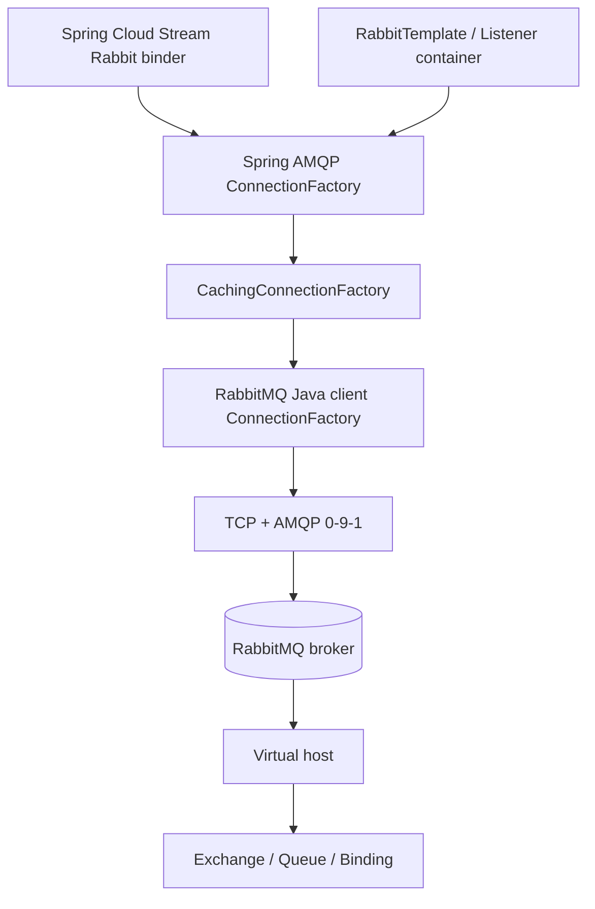

# Kết nối RabbitMQ, virtual host và cấu hình ConnectionFactory

Spring Cloud Stream RabbitMQ binder dùng một `ConnectionFactory` để kết nối ứng dụng với broker. Thông tin host, port, tài khoản, mật khẩu, TLS và virtual host quyết định ứng dụng kết nối tới broker nào, được phép thao tác trên vùng tài nguyên nào và kết nối được bảo vệ ra sao.

Theo mặc định, RabbitMQ binder sử dụng `ConnectionFactory` do Spring Boot tự cấu hình. Vì vậy, với một broker RabbitMQ, phần lớn ứng dụng chỉ cần khai báo `spring.rabbitmq.*` trong `application.yml`; không cần tự tạo socket, channel hoặc một connection factory mới. Khi cần kết nối nhiều broker hoặc tùy biến sâu, có thể cấu hình binder riêng hay cung cấp `ConnectionFactory` tùy chỉnh.

## 1. ConnectionFactory nằm ở đâu trong kiến trúc?

Trong Spring AMQP, `org.springframework.amqp.rabbit.connection.ConnectionFactory` là abstraction mà `RabbitTemplate`, listener container và RabbitMQ binder sử dụng để lấy connection/channel. Implementation mặc định của Spring Boot là `CachingConnectionFactory`.

`CachingConnectionFactory` làm việc với RabbitMQ Java client factory (`com.rabbitmq.client.ConnectionFactory`) ở tầng thấp hơn. Nó quản lý kết nối TCP tới broker và cache các AMQP channel để giảm chi phí tạo/hủy channel liên tục.



Các khái niệm cần phân biệt:

| Thành phần | Vai trò |
|---|---|
| Connection | Kết nối TCP/AMQP từ ứng dụng tới broker. Một connection có thể mang nhiều channel. |
| Channel | Kênh AMQP logic chạy bên trong connection; publish, consume, declare queue/exchange và ACK được thực hiện qua channel. |
| Spring AMQP `ConnectionFactory` | Abstraction cung cấp connection cho các thành phần Spring. |
| `CachingConnectionFactory` | Implementation quản lý connection và cache channel. |
| RabbitMQ virtual host | Không gian logic chứa exchange, queue, binding, policy và quyền truy cập. |
| RabbitMQ binder | Ánh xạ destination/binding Spring Cloud Stream sang exchange, queue và consumer trên broker. |

Không nên tạo một TCP connection mới cho mỗi message. Ứng dụng thường dùng connection dài hạn và tái sử dụng channel thông qua factory.

## 2. Cấu hình kết nối cơ bản bằng Spring Boot

RabbitMQ binder mặc định sử dụng Spring Boot `ConnectionFactory`. Các thuộc tính kết nối có prefix `spring.rabbitmq`.

Ví dụ cấu hình trong `application.yml`:

```yaml
spring:
  rabbitmq:
    host: ${RABBITMQ_HOST:localhost}
    port: ${RABBITMQ_PORT:5672}
    username: ${RABBITMQ_USERNAME}
    password: ${RABBITMQ_PASSWORD}
    virtual-host: ${RABBITMQ_VHOST:/}
    connection-timeout: 5s
    requested-heartbeat: 30s
```

Ý nghĩa các thuộc tính:

| Thuộc tính | Ý nghĩa | Giá trị thường gặp |
|---|---|---|
| `host` | Tên máy hoặc địa chỉ broker. | `localhost`, DNS nội bộ hoặc hostname dịch vụ. |
| `port` | Cổng AMQP. | `5672` cho AMQP không TLS; `5671` thường dùng cho AMQP qua TLS. |
| `username` | Tài khoản xác thực. | Tài khoản ứng dụng được cấp riêng. |
| `password` | Mật khẩu tài khoản. | Lấy từ secret store hoặc biến môi trường. |
| `virtual-host` | Virtual host mà connection sẽ truy cập. | `/` hoặc tên như `/orders`. |
| `connection-timeout` | Thời gian chờ khi thiết lập kết nối. | Ví dụ `5s`. |
| `requested-heartbeat` | Chu kỳ heartbeat được thương lượng để phát hiện connection không còn hoạt động. | Ví dụ `30s`. |

Các giá trị trong ví dụ chỉ minh họa. Không commit mật khẩu thật vào Git, không dùng tài khoản `guest` từ xa trong production và không dùng cùng một tài khoản quyền rộng cho mọi ứng dụng.

### Dùng danh sách địa chỉ broker

Khi broker chạy theo cụm hoặc có nhiều node, có thể cấu hình `addresses`:

```yaml
spring:
  rabbitmq:
    addresses: ${RABBITMQ_ADDRESSES:rmq-1.internal:5672,rmq-2.internal:5672}
    username: ${RABBITMQ_USERNAME}
    password: ${RABBITMQ_PASSWORD}
    virtual-host: /orders
```

Khi `addresses` được đặt, `host` và `port` riêng lẻ bị bỏ qua. Có thể dùng danh sách `host:port` hoặc URI AMQP phù hợp với cấu hình client. Nếu URI dùng giao thức `amqps`, TLS được bật theo cấu hình địa chỉ.

Không nhầm địa chỉ AMQP với địa chỉ RabbitMQ Management HTTP API. Cổng AMQP thường là `5672`/`5671`; giao diện quản trị thường dùng `15672`. Binder cần kết nối AMQP, không dùng cổng management để publish/consume.

## 3. Virtual host là ranh giới tài nguyên và quyền truy cập

RabbitMQ là hệ thống multi-tenant. Virtual host (vhost) là một nhóm tài nguyên logic độc lập. Exchange, queue, binding, policy và quyền người dùng đều thuộc về một vhost cụ thể.

Ví dụ, cùng tên exchange `orders.events` có thể tồn tại trong hai vhost khác nhau:

```text
RabbitMQ cluster
├── vhost: /orders
│   ├── exchange: orders.events
│   └── queue: order-projection
└── vhost: /analytics
    ├── exchange: orders.events
    └── queue: order-analytics
```

Hai exchange cùng tên không phải một exchange dùng chung. Một connection chỉ thao tác trong vhost mà nó chọn lúc mở AMQP connection. Muốn trao đổi message giữa hai vhost, ứng dụng hoặc cơ chế bridge như Shovel phải kết nối tới cả hai phía và chuyển tiếp dữ liệu.

Virtual host cung cấp cô lập logic và phạm vi quyền truy cập; nó không phải một broker vật lý riêng và không thay thế việc phân bổ tài nguyên. Tên vhost phải tồn tại trên RabbitMQ trước khi ứng dụng kết nối, trừ khi nền tảng triển khai có quy trình provision riêng.

### Tạo vhost và cấp quyền

Ví dụ tạo vhost cho dịch vụ đơn hàng và tài khoản ứng dụng:

```bash
rabbitmqctl add_vhost orders-prod
rabbitmqctl add_user orders-app '<password-from-secret-store>'
rabbitmqctl set_permissions -p orders-prod orders-app '.*' '.*' '.*'
```

Lệnh cuối cấp quyền rộng trong vhost để minh họa. Trong production, nên giới hạn regex theo tên exchange/queue mà dịch vụ cần dùng. Ba biểu thức lần lượt là:

- `configure`: quyền khai báo, thay đổi hoặc xóa exchange, queue và binding.
- `write`: quyền publish vào exchange.
- `read`: quyền consume/get message từ queue.

Nếu binder tự khai báo topology, tài khoản thường cần quyền `configure` trên các tài nguyên liên quan. Nếu topology được provision trước và ứng dụng chỉ consume/publish, có thể thu hẹp quyền và tắt những hành vi khai báo không cần thiết.

Tài khoản tồn tại nhưng chưa được cấp quyền trên vhost sẽ không kết nối được vào vhost đó. Có username/password đúng vẫn chưa đủ; RabbitMQ kiểm tra quyền của user trên vhost được yêu cầu.

### Vhost mặc định `/`

RabbitMQ tạo vhost mặc định `/` trên node mới. Nếu không cấu hình `spring.rabbitmq.virtual-host`, client thường kết nối vào vhost mặc định. Để tránh phụ thuộc ngầm vào môi trường, nên khai báo rõ vhost trong cấu hình ứng dụng.

Trong YAML, giá trị `/` nên được viết dưới dạng chuỗi:

```yaml
spring:
  rabbitmq:
    virtual-host: "/"
```

Tên vhost như `/orders` hoặc `orders-prod` là giá trị cấu hình connection. Không đặt tên vhost vào `spring.cloud.stream.bindings.<binding>.destination`; destination là exchange logic của binder, còn vhost thuộc cấu hình kết nối broker.

## 4. Cấu hình TLS cho kết nối AMQP

Khi RabbitMQ được triển khai qua mạng không tin cậy hoặc môi trường production, nên dùng TLS để mã hóa đường truyền và xác thực chứng chỉ máy chủ.

Ví dụ dùng trust store và client certificate:

```yaml
spring:
  rabbitmq:
    host: ${RABBITMQ_HOST}
    port: 5671
    username: ${RABBITMQ_USERNAME}
    password: ${RABBITMQ_PASSWORD}
    virtual-host: /orders
    ssl:
      enabled: true
      trust-store: file:/run/secrets/rabbit-truststore.p12
      trust-store-password: ${RABBITMQ_TRUSTSTORE_PASSWORD}
      trust-store-type: PKCS12
      key-store: file:/run/secrets/rabbit-client.p12
      key-store-password: ${RABBITMQ_KEYSTORE_PASSWORD}
      key-store-type: PKCS12
```

Trong ví dụ, trust store chứa CA/chứng chỉ dùng để xác thực broker. Key store chỉ cần khi broker yêu cầu mutual TLS (mTLS) và client phải trình chứng chỉ. Nếu broker chỉ yêu cầu TLS một chiều, thường không cần client key store.

Các điểm cần kiểm tra:

- Chứng chỉ broker còn hạn và hostname trong chứng chỉ khớp hostname ứng dụng dùng để kết nối.
- Trust store chứa CA đáng tin cậy ký chứng chỉ broker.
- Nếu dùng mTLS, broker đã tin cậy CA cấp client certificate và certificate có đúng danh tính được cấp phép.
- Secret của key store/trust store không nằm trong source code hoặc image công khai.
- Cổng TLS được mở trên broker và network policy cho phép ứng dụng truy cập.

Spring Boot cũng có thể bật TLS bằng `spring.rabbitmq.ssl.enabled` và các SSL bundle/trust store tùy phiên bản. Khi địa chỉ dùng scheme `amqps`, client có thể tự bật SSL theo URI. Không tắt xác thực chứng chỉ hoặc hostname verification chỉ để làm cho kết nối chạy được; hãy sửa trust chain hoặc hostname cấu hình.

## 5. RabbitMQ binder dùng ConnectionFactory như thế nào?

Với một RabbitMQ binder, Spring Cloud Stream sử dụng `ConnectionFactory` do Spring Boot cung cấp. Các binding chỉ định destination và group; binder dùng connection factory để khai báo hoặc truy cập topology trên vhost đã cấu hình.

Ví dụ function gửi event:

```java
import java.util.function.Supplier;

import org.springframework.context.annotation.Bean;
import org.springframework.context.annotation.Configuration;

@Configuration
class OrderEventSource {

    @Bean
    Supplier<OrderCreated> orderCreated() {
        return () -> new OrderCreated("evt-1001", "order-9001");
    }
}

record OrderCreated(String eventId, String orderId) {}
```

Binding đầu ra:

```yaml
spring:
  cloud:
    function:
      definition: orderCreated
    stream:
      bindings:
        orderCreated-out-0:
          destination: orders.events
          content-type: application/json
```

Với RabbitMQ binder, destination mặc định được ánh xạ thành một `TopicExchange`. Với mỗi consumer group, binder tạo một queue và bind queue đó vào exchange. Consumer anonymous không có group dùng queue auto-delete với tên ngẫu nhiên. Tất cả các tài nguyên này được tạo trong vhost của connection factory.

Điều này giải thích vì sao một lỗi quyền `configure` có thể xuất hiện khi ứng dụng khởi động: binder đang cố khai báo exchange/queue/binding nhưng user không có quyền trên vhost. Nếu topology được quản lý bên ngoài, có thể cấu hình binder không tự khai báo exchange hoặc queue theo nhu cầu và cấp quyền tối thiểu cho ứng dụng.

## 6. Dùng Spring Boot ConnectionFactory mặc định hay tự tạo?

Với một broker và một bộ thông tin kết nối, nên bắt đầu bằng cấu hình `spring.rabbitmq.*`. Spring Boot tự tạo `CachingConnectionFactory`, rồi RabbitMQ binder sử dụng factory đó. Cách này giữ cấu hình tập trung và tránh tạo thêm bean trùng lặp.

Chỉ nên tự tạo `ConnectionFactory` khi cần kiểm soát chi tiết mà property không đáp ứng, chẳng hạn custom client properties, routing connection factory hoặc chiến lược cache riêng.

Ví dụ thay thế factory mặc định bằng `CachingConnectionFactory`:

```java
import org.springframework.amqp.rabbit.connection.CachingConnectionFactory;
import org.springframework.context.annotation.Bean;
import org.springframework.context.annotation.Configuration;

@Configuration
class RabbitConnectionConfiguration {

    @Bean
    CachingConnectionFactory connectionFactory() {
        CachingConnectionFactory factory =
            new CachingConnectionFactory("rabbit.internal");

        factory.setPort(5672);
        factory.setUsername(System.getenv("RABBITMQ_USERNAME"));
        factory.setPassword(System.getenv("RABBITMQ_PASSWORD"));
        factory.setVirtualHost("/orders");
        factory.setChannelCacheSize(50);

        return factory;
    }
}
```

Khi bean `ConnectionFactory` do ứng dụng cung cấp, Spring Boot thường lùi lại và không tạo factory mặc định thứ hai. Rabbit binder sẽ sử dụng bean được cung cấp trong application context. Không khai báo nhiều bean cùng kiểu mà không có cấu hình phân biệt rõ ràng, vì binder có thể không biết phải dùng factory nào.

Ví dụ Java trên minh họa cấu hình kết nối cơ bản. Nếu cần TLS, cluster addresses, heartbeat, connection timeout hoặc các client properties khác, ưu tiên property được Spring Boot hỗ trợ hoặc cấu hình đầy đủ underlying Rabbit client factory; không giả định mọi property của `application.yml` tự động áp dụng cho factory tự tạo.

## 7. Connection và channel cache

Spring AMQP `CachingConnectionFactory` mặc định dùng một connection proxy có thể chia sẻ trong ứng dụng. Nhiều channel được tạo trên connection đó và được cache sau khi sử dụng.

Một số đặc điểm quan trọng:

- Channel cache mặc định có kích thước 25.
- Cache size là số channel có thể được giữ lại để tái sử dụng; tự nó không nhất thiết là giới hạn cứng số channel đang được dùng.
- Khi `channelCheckoutTimeout` lớn hơn 0, channel cache size có thể trở thành giới hạn số channel; thread sẽ chờ channel rảnh hoặc timeout.
- Cache tăng theo nhu cầu. Tăng cache size có thể giảm chi phí tạo/hủy channel trong tải đồng thời cao.
- Listener container thường giữ channel trong suốt thời gian chạy consumer.
- Channel tự tạo bên ngoài framework phải được đóng đúng cách để trả lại tài nguyên.

Không tăng channel cache size chỉ vì thấy giá trị mặc định là 25. Hãy quan sát số channel đang mở, số channel được tái sử dụng, concurrency của consumer và thời gian chờ lấy channel. Nếu bật giới hạn checkout, cần đặt timeout phù hợp để ứng dụng không chờ vô hạn khi hết channel.

## 8. Kết nối tới nhiều broker hoặc nhiều virtual host

Một ứng dụng có thể cần kết nối tới hai RabbitMQ broker khác nhau, hoặc hai vhost trên các broker khác nhau. Một `spring.rabbitmq.*` mặc định chỉ mô tả một bộ cấu hình connection factory. Với Spring Cloud Stream, có thể khai báo nhiều binder configuration, mỗi binder có môi trường riêng.

Ví dụ hai RabbitMQ broker:

```yaml
spring:
  cloud:
    stream:
      bindings:
        orderEvents-out-0:
          destination: orders.events
          binder: ordersRabbit
        auditEvents-out-0:
          destination: audit.events
          binder: auditRabbit
      binders:
        ordersRabbit:
          type: rabbit
          environment:
            spring:
              rabbitmq:
                host: ${ORDERS_RABBIT_HOST}
                port: 5672
                username: ${ORDERS_RABBIT_USERNAME}
                password: ${ORDERS_RABBIT_PASSWORD}
                virtual-host: /orders
        auditRabbit:
          type: rabbit
          environment:
            spring:
              rabbitmq:
                host: ${AUDIT_RABBIT_HOST}
                port: 5672
                username: ${AUDIT_RABBIT_USERNAME}
                password: ${AUDIT_RABBIT_PASSWORD}
                virtual-host: /audit
```

Trong ví dụ, `ordersRabbit` và `auditRabbit` là tên cấu hình binder. Mỗi binder có `environment` riêng, vì vậy mỗi binder có thể dùng host, credential và virtual host khác nhau. Binding chọn binder bằng thuộc tính `binder`.

Khi bật cấu hình binder tường minh, Spring Cloud Stream không còn tự tạo toàn bộ cấu hình binder mặc định; cần khai báo đầy đủ các binder mà ứng dụng sử dụng. Nếu chỉ muốn thêm một binder phụ không trở thành ứng viên mặc định, có thể đặt `defaultCandidate: false` cho binder configuration tương ứng.

Tài liệu RabbitMQ binder cũng lưu ý khi dùng nhiều RabbitMQ binder trong cùng ứng dụng, cần loại trừ `RabbitAutoConfiguration` để tránh cùng cấu hình tự động của Spring Boot bị áp dụng vào các binder. Hãy kiểm tra đúng phiên bản Spring Cloud Stream/Spring Boot và cách tách binder environment trước khi triển khai.

Ví dụ loại trừ auto-configuration khi ứng dụng thật sự có nhiều Rabbit binder:

```java
import org.springframework.boot.autoconfigure.SpringBootApplication;
import org.springframework.boot.autoconfigure.amqp.RabbitAutoConfiguration;

@SpringBootApplication(exclude = RabbitAutoConfiguration.class)
public class MessagingApplication {
}
```

Không dùng nhiều binder chỉ để đổi vhost nếu một broker connection factory đơn lẻ đã đủ. Mỗi binder có tài nguyên, kết nối và cấu hình riêng; cần cân nhắc số lượng connection, topology, quyền truy cập và khả năng vận hành.

## 9. Đặt tên connection để quan sát trên RabbitMQ Management

Khi có nhiều service và nhiều replica, connection name giúp người vận hành nhận biết connection đến từ ứng dụng nào. Spring AMQP cung cấp `ConnectionNameStrategy`; Spring Boot có thể tự nhận bean này và áp dụng cho `CachingConnectionFactory` được auto-configure.

Ví dụ:

```java
import org.springframework.amqp.rabbit.connection.ConnectionNameStrategy;
import org.springframework.amqp.rabbit.connection.SimplePropertyValueConnectionNameStrategy;
import org.springframework.context.annotation.Bean;
import org.springframework.context.annotation.Configuration;

@Configuration
class RabbitConnectionNameConfiguration {

    @Bean
    ConnectionNameStrategy rabbitConnectionNameStrategy() {
        return new SimplePropertyValueConnectionNameStrategy(
            "spring.application.name"
        );
    }
}
```

Connection name xuất hiện trong RabbitMQ Management UI nếu broker hỗ trợ client properties. Nó giúp nhận diện kết nối khi điều tra, nhưng không phải định danh bảo mật và không nhất thiết duy nhất.

## 10. ConnectionFactory và topology provisioning

Connection factory chỉ thiết lập kết nối và cung cấp channel. Nó không quyết định toàn bộ topology của ứng dụng. RabbitMQ binder ánh xạ destination Spring Cloud Stream sang exchange và queue theo cấu hình binding.

Với mặc định Rabbit binder:

- Mỗi destination được ánh xạ thành `TopicExchange`.
- Mỗi consumer group có một queue được bind với exchange.
- Mỗi consumer instance tham gia queue của group.
- Consumer anonymous dùng queue auto-delete có tên ngẫu nhiên.
- Binder có thể tự khai báo exchange, queue và binding nếu các tùy chọn tương ứng được bật.

Nếu đội nền tảng quản lý topology bằng definitions hoặc IaC, ứng dụng có thể được cấu hình để không tự khai báo queue/exchange. Khi đó, cần đảm bảo tên exchange, queue, binding key và vhost khớp với cấu hình ứng dụng. User chỉ cần quyền đọc/ghi phù hợp với thao tác thực tế; không nhất thiết phải có quyền `configure` rộng.

Lỗi topology thường xuất hiện dưới dạng `ACCESS_REFUSED` trên channel khi binder khai báo queue/exchange, trong khi lỗi sai vhost thường khiến connection bị từ chối ngay trong quá trình mở connection. Phân biệt hai trường hợp giúp khoanh vùng nhanh hơn.

## 11. Kiểm tra kết nối và xử lý lỗi thường gặp

| Dấu hiệu | Nguyên nhân có thể | Cách kiểm tra |
|---|---|---|
| `Connection refused` | Broker không chạy, sai host/port, firewall hoặc network policy chặn. | Kiểm tra DNS, TCP tới cổng AMQP, broker listener và network route. |
| Timeout khi khởi động | Broker không phản hồi, sai endpoint hoặc timeout quá ngắn. | Kiểm tra địa chỉ, thời gian kết nối và log broker. |
| Authentication failure | Username/password sai hoặc tài khoản bị vô hiệu hóa. | Kiểm tra secret được nạp đúng môi trường và trạng thái user. |
| `ACCESS_REFUSED - access to vhost ... refused` | User không có quyền truy cập vhost được yêu cầu hoặc vhost chưa tồn tại. | Kiểm tra vhost, `rabbitmqctl list_vhosts` và permissions của user. |
| `ACCESS_REFUSED` khi declare queue/exchange | User có thể kết nối nhưng thiếu quyền `configure` trên resource. | Kiểm tra permission regex và topology binder đang khai báo. |
| TLS handshake/certificate error | CA không được tin cậy, certificate hết hạn, hostname mismatch hoặc client certificate không hợp lệ. | Kiểm tra trust store, certificate chain, hostname và cấu hình TLS hai phía. |
| Kết nối chập chờn | Heartbeat, network idle timeout, broker resource alarm hoặc node failover. | Kiểm tra heartbeat, blocked/unblocked events, broker logs và network. |
| Channel limit hoặc channel timeout | Ứng dụng dùng quá nhiều channel hoặc cache/checkout không phù hợp. | Quan sát channel count, concurrency, cache size và checkout timeout. |
| Binder tạo topology ở sai nơi | Vhost trong connection factory khác với vhost đang xem trên Management UI. | Kiểm tra `spring.rabbitmq.virtual-host` và vhost ở connection details. |

Một kết nối thành công trên RabbitMQ Management UI không chứng minh ứng dụng dùng đúng vhost hoặc đúng quyền. Hãy xem connection details để kiểm tra user, vhost, protocol và client name thực tế.

## 12. Kiểm thử cấu hình kết nối

Nên kiểm thử ở nhiều mức:

1. **Kiểm tra cấu hình:** xác nhận host, port, username, virtual host và TLS được nạp từ profile/secret đúng môi trường.
2. **Kiểm tra mạng:** xác nhận ứng dụng truy cập được cổng AMQP, không nhầm cổng Management HTTP.
3. **Kiểm tra xác thực và quyền:** kết nối với đúng user/vhost và xác nhận quyền configure/read/write cần thiết.
4. **Kiểm tra binder startup:** khởi động ứng dụng và xác nhận binder tạo hoặc truy cập đúng exchange/queue trong vhost mong muốn.
5. **Kiểm tra publish/consume:** gửi message qua output binding, nhận qua consumer group và xác nhận payload/header.
6. **Kiểm tra lỗi:** dùng sai password, sai vhost hoặc thiếu permission trong môi trường test để bảo đảm log chỉ rõ nguyên nhân.
7. **Kiểm tra reconnect:** dừng broker trong môi trường thử nghiệm, khởi động lại và quan sát khả năng phục hồi của Spring AMQP/binder.
8. **Kiểm tra nhiều binder:** xác nhận mỗi binding dùng đúng broker/vhost riêng khi ứng dụng có nhiều Rabbit binder.

Test Binder của Spring Cloud Stream hữu ích để kiểm thử logic function và binding trong JVM, nhưng nó không xác minh TCP, TLS, vhost, credential hoặc permission của RabbitMQ thật. Với bài toán kết nối, cần integration test bằng broker thật hoặc Testcontainers RabbitMQ.

## 13. Checklist triển khai production

Trước khi triển khai, hãy xác minh:

- [ ] Ứng dụng dùng đúng AMQP endpoint và port, không nhầm management port.
- [ ] Vhost đã được tạo và không dựa vào giả định rằng Spring Boot sẽ tự tạo vhost.
- [ ] User được cấp đúng quyền trên đúng vhost.
- [ ] Credential lấy từ secret store/environment, không nằm trong source code.
- [ ] TLS bật khi yêu cầu bảo mật mạng và certificate/hostname được xác thực.
- [ ] `addresses` không xung đột với `host`/`port`; hiểu rõ host/port bị bỏ qua khi addresses được đặt.
- [ ] Binder sử dụng đúng Spring Boot `ConnectionFactory` hoặc custom factory được chủ ý cấu hình.
- [ ] Connection/channel cache phù hợp với concurrency và tải thực tế.
- [ ] Connection name đủ rõ để quan sát trên RabbitMQ Management.
- [ ] Topology được binder khai báo hoặc được IaC provision theo một quy trình thống nhất.
- [ ] Nếu có nhiều Rabbit binder, mỗi binder có environment riêng và auto-configuration không bị áp dụng nhầm.
- [ ] Có integration test cho kết nối, vhost, quyền, TLS, publish/consume và reconnect.

Kết nối RabbitMQ ổn định bắt đầu từ việc chọn đúng broker endpoint, tài khoản và virtual host. Khi Spring Cloud Stream binder dùng đúng `ConnectionFactory`, topology được khai báo trong đúng vhost và quyền được cấp vừa đủ, ứng dụng có thể kết nối, publish và consume nhất quán qua nhiều môi trường triển khai.

## Tài liệu tham khảo

- [Spring Cloud Stream – RabbitMQ Binder Reference Guide](https://docs.spring.io/spring-cloud-stream/docs/current/reference/html/spring-cloud-stream-binder-rabbit.html)
- [Spring Cloud Stream – Connecting to Multiple Systems](https://docs.spring.io/spring-cloud-stream/reference/spring-cloud-stream/multiple-systems.html)
- [Spring Boot – AMQP Configuration](https://docs.spring.io/spring-boot/3.5/reference/messaging/amqp.html)
- [Spring AMQP – Connection and Resource Management](https://docs.spring.io/spring-amqp/reference/amqp/connections.html)
- [RabbitMQ – Virtual Hosts](https://www.rabbitmq.com/docs/vhosts)
- [RabbitMQ – Authentication, Authorisation and Access Control](https://www.rabbitmq.com/docs/access-control)
