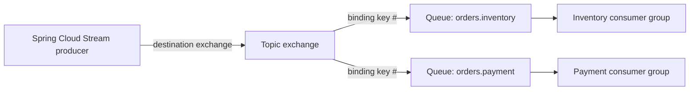

# Sử dụng exchange hoặc queue có sẵn

RabbitMQ Binder mặc định tự cấp phát một phần topology khi tạo binding. Với một destination, binder thường tạo một `TopicExchange`; với mỗi consumer group, binder tạo một queue rồi bind queue đó vào exchange. Cách làm này thuận tiện khi ứng dụng sở hữu toàn bộ topology. Trong nhiều hệ thống doanh nghiệp, exchange, queue và binding đã được nhóm nền tảng hoặc nhóm vận hành tạo trước bằng Terraform, Ansible, RabbitMQ Management hoặc quy trình provisioning riêng.

Khi kết nối tới topology có sẵn, cần cấu hình binder để sử dụng đúng tên exchange và queue mà không khai báo hoặc bind lại chúng. Các thuộc tính quan trọng là `declareExchange`, `bindQueue` và `queueNameGroupOnly`. Với producer, `declareExchange=false` ngăn binder khai báo exchange; với consumer, cần kết hợp các thuộc tính để binder dùng queue đã tồn tại và không tạo binding mới.

## 1. Topology mặc định của RabbitMQ Binder

RabbitMQ có các thành phần chính:

- **Exchange** nhận message từ producer và định tuyến message tới queue theo loại exchange, routing key và binding.
- **Queue** lưu message cho consumer nhận và xử lý.
- **Binding** nối exchange với queue, có thể kèm routing key hoặc arguments.
- **Routing key** là giá trị producer gửi cùng message để exchange dùng khi định tuyến; ý nghĩa cụ thể phụ thuộc exchange type.

Theo mặc định, RabbitMQ Binder ánh xạ `destination` thành một topic exchange. Với consumer có group, binder thường tạo queue theo dạng `<destination>.<group>` rồi bind queue vào exchange bằng routing key `#` cho destination không partition. Consumer không khai báo group sẽ dùng queue anonymous có tên ngẫu nhiên và auto-delete.



Ví dụ, binding có `destination: orders` và `group: inventory` thường dẫn tới exchange `orders` và queue `orders.inventory`. Nếu hạ tầng đã tạo queue tên `inventory-orders` và bind queue đó vào exchange `orders.events`, cấu hình mặc định sẽ không tự tìm ra queue này. Cần chỉ rõ tên tài nguyên và tắt các thao tác provisioning tương ứng.

## 2. Dùng exchange và queue đã tồn tại cho consumer

Giả sử nhóm nền tảng đã tạo:

- Exchange: `orders.events`.
- Queue: `inventory.orders`.
- Binding từ exchange tới queue với routing key `order.created` và `order.cancelled`.

Consumer cần đọc queue đã có. Cấu hình sau dùng `destination` làm tên exchange, `group` làm tên queue và yêu cầu binder không khai báo queue, không bind queue, cũng không khai báo exchange:

```yaml
spring:
  cloud:
    function:
      definition: receiveOrders
    stream:
      bindings:
        receiveOrders-in-0:
          destination: orders.events
          group: inventory.orders
          content-type: application/json
      rabbit:
        bindings:
          receiveOrders-in-0:
            consumer:
              bind-queue: false
              declare-exchange: false
              queue-name-group-only: true
```

Ba thuộc tính Rabbit-specific có vai trò khác nhau:

| Thuộc tính | Tác dụng |
|---|---|
| `bind-queue: false` | Không khai báo queue và không bind queue vào exchange; dùng khi hạ tầng đã tạo queue và binding |
| `declare-exchange: false` | Không khai báo exchange đích |
| `queue-name-group-only: true` | Dùng giá trị `group` làm tên queue; nếu không bật, binder mặc định ghép `destination.group` |

Với cấu hình trên, binder tìm queue `inventory.orders` để consume. Exchange `orders.events` đã được quản trị bên ngoài và binding key đã tồn tại. Binder không tự thêm binding `#`, do đó các routing key do nhóm nền tảng cấu hình vẫn được giữ nguyên.

Đây là cấu hình dùng topology có sẵn theo hướng dẫn RabbitMQ Binder. Tên queue thực tế phải khớp tuyệt đối với `group` khi `queue-name-group-only` bật. Nếu bỏ thuộc tính này, binder sẽ tìm queue theo quy tắc mặc định `<destination>.<group>`, có thể dẫn tới tên không tồn tại.

### 2.1. Vì sao phải tắt cả bindQueue và declareExchange?

Chỉ tắt `declare-exchange` chưa đủ nếu binder vẫn được phép tạo queue và binding. Chỉ tắt `bind-queue` mà không tắt `declare-exchange` vẫn có thể khiến binder khai báo exchange theo tên destination. Khi dùng topology được quản lý bên ngoài, hãy quyết định rõ tài nguyên nào binder được phép tạo:

- Queue và binding đã có: `bind-queue: false`.
- Exchange đã có: `declare-exchange: false`.
- Queue dùng tên đúng bằng group: `queue-name-group-only: true`.

Nếu ứng dụng được phép tạo queue nhưng exchange đã tồn tại, có thể giữ `bind-queue: true`, tắt `declare-exchange` và cấu hình `binding-routing-key` theo topology cần tạo. Nếu queue đã tồn tại nhưng cần binder tạo binding, kiểm tra kỹ queue declaration arguments và quyền `configure` trước khi chọn cách này.

## 3. Producer gửi tới exchange có sẵn

Producer chỉ cần publish tới exchange; queue và binding phía sau exchange do hạ tầng quản lý. Đặt `destination` bằng tên exchange và tắt `declare-exchange` trong producer binding:

```yaml
spring:
  cloud:
    function:
      definition: publishOrder
    stream:
      bindings:
        publishOrder-out-0:
          destination: orders.events
          content-type: application/json
      rabbit:
        bindings:
          publishOrder-out-0:
            producer:
              declare-exchange: false
              routing-key: order.created
```

Trong ví dụ, producer gửi tới exchange `orders.events` với routing key cố định `order.created`. Binder không khai báo exchange. Exchange phải tồn tại trước khi ứng dụng publish. Nếu exchange không tồn tại, broker có thể đóng channel khi producer publish; nếu exchange tồn tại nhưng không có binding phù hợp, message có thể không được định tuyến tới queue.

`routing-key` là một giá trị cố định. Nếu routing key phụ thuộc payload hoặc header, dùng `routing-key-expression` với SpEL:

```yaml
spring:
  cloud:
    stream:
      bindings:
        publishOrder-out-0:
          destination: orders.events
      rabbit:
        bindings:
          publishOrder-out-0:
            producer:
              declare-exchange: false
              routing-key-expression: "payload.eventType"
```

Biểu thức cần phù hợp với kiểu payload thực tế. Nếu dùng `Message<?>`, có thể đọc metadata từ header, ví dụ `headers['route']`. Không lấy routing key trực tiếp từ dữ liệu người dùng nếu chưa xác thực; routing sai có thể làm message đi vào queue không mong muốn hoặc không có queue nào nhận.

### 3.1. Exchange type quyết định cách routing key được hiểu

Không phải mọi exchange đều xử lý routing key như nhau:

| Exchange type | Cách định tuyến | Ví dụ |
|---|---|---|
| `direct` | Routing key phải khớp chính xác binding key | `order.created` khớp `order.created` |
| `topic` | So khớp theo pattern với `*` và `#` | `order.*` khớp `order.created`; `order.#` khớp nhiều cấp |
| `fanout` | Gửi tới mọi queue được bind, bỏ qua routing key | Broadcast thông báo tới các queue đăng ký |
| `headers` | So khớp message headers với binding arguments | Dùng `x-match` và các header đã khai báo |

Khi exchange đã tồn tại, binder không nên được cấu hình để khai báo lại nó với một `exchange-type` khác. `exchange-type` chỉ có ý nghĩa khi binder tạo exchange. Hãy để nhóm sở hữu topology xác nhận exchange type và binding keys; producer chỉ gửi routing key phù hợp với hợp đồng đó.

## 4. Tên destination, group và queue phải được phân biệt

Trong Spring Cloud Stream, `destination` và `group` là thuộc tính ở tầng binding. Rabbit Binder ánh xạ chúng sang tên exchange và queue theo quy tắc mặc định, nhưng khi dùng tài nguyên có sẵn, có thể điều chỉnh cách ánh xạ.

| Thuộc tính | Ví dụ | Vai trò trong cấu hình dùng topology có sẵn |
|---|---|---|
| `destination` | `orders.events` | Tên exchange mà binding tham chiếu |
| `group` | `inventory.orders` | Tên queue khi `queue-name-group-only: true` |
| `binding-routing-key` | `order.created` | Routing key dùng để bind queue nếu binder được phép bind |
| `routing-key` | `order.created` | Routing key producer gửi tới exchange |

`binding-routing-key` và `routing-key` không giống nhau. Thuộc tính thứ nhất điều khiển binding từ exchange tới queue; thuộc tính thứ hai điều khiển routing key của message do producer gửi. Khi `bind-queue=false`, binder không tạo binding nên `binding-routing-key` không được dùng để thay đổi binding đã có. Khi producer publish, `routing-key` vẫn cần khớp binding do hạ tầng thiết lập.

## 5. Nếu chỉ muốn dùng queue có sẵn nhưng vẫn để binder khai báo exchange?

Có thể chọn mức tự động provisioning theo từng tài nguyên. Ví dụ, exchange đã có nhưng muốn binder tạo queue và bind queue mới:

```yaml
spring:
  cloud:
    stream:
      bindings:
        receiveOrders-in-0:
          destination: orders.events
          group: inventory
      rabbit:
        bindings:
          receiveOrders-in-0:
            consumer:
              declare-exchange: false
              bind-queue: true
              binding-routing-key: order.created
```

Trong trường hợp này, binder không khai báo exchange nhưng vẫn tạo queue theo quy tắc tên và bind queue bằng routing key đã cấu hình. Queue sẽ được tạo theo tên mặc định `<destination>.<group>` trừ khi `queue-name-group-only` được bật. Nếu cần dùng queue có sẵn, không dùng cấu hình này vì `bind-queue: true` cho phép binder khai báo queue và binding.

Ngược lại, nếu muốn binder tạo exchange và queue nhưng dùng exchange type hoặc routing key khác mặc định, có thể đặt `exchange-type` và `binding-routing-key`. Cách đó phù hợp khi ứng dụng sở hữu topology; nó không phải cách kết nối read-only tới topology đã provision.

## 6. Producer có `requiredGroups` và queue provisioning

Producer binding có thể khai báo `required-groups` để yêu cầu binder tạo queue/binding cho các consumer group đã biết ngay cả khi consumer chưa được triển khai. Điều này hữu ích khi muốn bảo đảm queue tồn tại trước lúc producer bắt đầu phát message.

Ví dụ:

```yaml
spring:
  cloud:
    stream:
      bindings:
        publishOrder-out-0:
          destination: orders.events
          producer:
            required-groups:
              - inventory
              - payment
```

Nếu hạ tầng đã tạo queue và binding cho các group này, không nên vô tình yêu cầu binder provision lại topology. Rabbit producer có thuộc tính `bind-queue` áp dụng cho các `required-groups`; đặt `false` khi queue và binding đã được tạo sẵn. Kiểm tra quy tắc tên queue và cách binder xử lý required groups của phiên bản đang dùng, đặc biệt khi queue có tên tùy chỉnh.

Với consumer dùng `queue-name-group-only`, queue được lấy trực tiếp từ `group`. Cần bảo đảm producer provisioning và consumer binding cùng tham chiếu đúng queue. Không giả định tên queue tùy chỉnh tự động được suy ra từ một `required-group` nếu chưa kiểm tra cấu hình provisioning.

## 7. Queue arguments và topology do nền tảng quản lý

Queue có thể được tạo với các thuộc tính ảnh hưởng tới hành vi và khả năng phục hồi:

- **Durable:** queue tồn tại qua lần broker restart theo cấu hình lưu trữ.
- **Exclusive:** chỉ connection tạo queue được sử dụng queue; thường không phù hợp queue dùng chung cho nhiều instance.
- **Auto-delete:** queue có thể bị xóa khi consumer cuối cùng ngừng sử dụng.
- **Queue type:** classic hoặc quorum; quyết định cách lưu trữ và replication.
- **TTL và max length:** giới hạn thời gian sống hoặc số lượng/byte message.
- **Dead-letter exchange:** định tuyến message bị dead-letter sang nơi khác.
- **Single active consumer:** chỉ một consumer hoạt động tại một thời điểm theo cơ chế broker.

Khi binder không khai báo queue, nó không có trách nhiệm thay đổi các arguments này. Nhóm nền tảng phải đảm bảo queue có cấu hình phù hợp với workload. Nếu binder vẫn khai báo queue có cùng tên nhưng arguments khác với queue hiện hữu, RabbitMQ có thể trả lỗi `PRECONDITION_FAILED` do khai báo không tương thích. Cách tránh lỗi là xác định rõ quyền sở hữu topology và tắt provisioning ở binder khi queue đã được tạo sẵn.

Không nên để một ứng dụng consumer tự quyết định queue type, durability hoặc DLX của queue do một nhóm nền tảng quản lý. Những thay đổi này cần được thực hiện qua quy trình topology migration để tránh xóa queue và mất backlog.

## 8. Quyền truy cập RabbitMQ

RabbitMQ phân quyền theo virtual host và tên resource. Khi dùng topology có sẵn, cần cấp quyền đúng với thao tác ứng dụng thực hiện:

| Thao tác | Quyền thường cần |
|---|---|
| Consume từ queue có sẵn | `read` trên queue |
| Publish tới exchange có sẵn | `write` trên exchange |
| Declare exchange/queue | `configure` trên resource tương ứng |
| Tạo binding | `write` trên exchange và `read` trên queue |
| Xem/quản lý topology qua Management API | Quyền Management API riêng, không đồng nghĩa quyền AMQP runtime |

Nếu `bind-queue=false` và `declare-exchange=false`, ứng dụng không yêu cầu binder tạo queue, binding hoặc exchange. Tuy nhiên, user vẫn cần quyền consume trên queue hoặc publish trên exchange. Việc không khai báo topology không có nghĩa là không cần xác thực hoặc không cần quyền truy cập.

Kiểm tra đúng virtual host, username, TLS, resource permissions và regex scope. Không dùng tài khoản administrator cho runtime nếu chỉ cần consume/publish. Cấp quyền theo tên exchange/queue và môi trường cụ thể.

## 9. Xử lý startup và lỗi topology

Khi dùng tài nguyên bên ngoài, startup có thể thất bại nếu queue không tồn tại, tên group sai, exchange bị xóa hoặc user thiếu quyền. Rabbit Binder có thuộc tính `missingQueuesFatal` cho consumer để điều khiển việc coi queue bị thiếu là lỗi nghiêm trọng; mặc định thường là `true`. Không nên tắt thuộc tính này chỉ để che lỗi provisioning nếu queue bắt buộc phải tồn tại trước khi ứng dụng chạy.

Các lỗi thường gặp:

| Triệu chứng | Nguyên nhân có thể | Hướng xử lý |
|---|---|---|
| Consumer không tìm thấy queue | `group` sai, thiếu `queue-name-group-only` hoặc queue chưa được provision | So sánh tên queue thực tế với binding config |
| Broker báo `NOT_FOUND` hoặc channel đóng | Exchange đích không tồn tại khi publish/consume | Kiểm tra `destination` và topology trên đúng vhost |
| `PRECONDITION_FAILED` khi declare | Binder khai báo exchange/queue với type hoặc arguments khác tài nguyên có sẵn | Tắt provisioning tương ứng hoặc đồng bộ topology theo quy trình quản trị |
| Message không tới queue | Routing key producer không khớp binding key hoặc exchange type không đúng kỳ vọng | Kiểm tra exchange type, routing key và binding thực tế |
| Consumer nhận message không mong muốn | Queue đã bind với pattern rộng hoặc `#` | Điều chỉnh binding key ở nơi sở hữu topology |
| Access refused | Thiếu `read`, `write` hoặc `configure` trong vhost | Cấp quyền tối thiểu theo thao tác thực tế |
| Queue bị xóa khi app dừng | Queue được tạo anonymous/auto-delete hoặc topology không phải queue bền vững | Dùng group ổn định và để nền tảng tạo queue durable theo yêu cầu |

Đọc nguyên nhân gốc từ log Spring AMQP và RabbitMQ broker. Lỗi topology thường xuất hiện lúc khởi tạo binding hoặc lúc publish; lỗi routing có thể không làm publish thất bại nếu exchange tồn tại nhưng không có queue phù hợp. Vì vậy, cần bật publisher returns/confirms khi ứng dụng phải phát hiện message không được định tuyến.

## 10. Publisher confirms và message không được định tuyến

`declare-exchange: false` chỉ tắt việc khai báo exchange; nó không xác nhận rằng message đã tới một queue. RabbitMQ có thể nhận publish tới exchange nhưng không định tuyến message nếu không có binding phù hợp. Nếu ứng dụng cần phát hiện trường hợp này, cấu hình publisher confirms và publisher returns ở connection factory, đồng thời bật error handling theo yêu cầu.

Ví dụ cấu hình Spring Boot:

```yaml
spring:
  rabbitmq:
    publisher-confirm-type: correlated
    publisher-returns: true
  cloud:
    stream:
      bindings:
        publishOrder-out-0:
          destination: orders.events
          producer:
            error-channel-enabled: true
      rabbit:
        bindings:
          publishOrder-out-0:
            producer:
              declare-exchange: false
              use-confirm-header: true
```

`publisher-confirm-type: correlated` cho phép nhận publisher confirms theo correlation data; `publisher-returns: true` cho phép nhận message bị trả lại khi không route được theo cấu hình mandatory tương ứng của template/binder. `use-confirm-header` là một trong các cơ chế nhận kết quả publish của Rabbit Binder. Không cấu hình đồng thời `use-confirm-header` và `confirm-ack-channel`; chúng là hai cơ chế thay thế nhau trong các phiên bản hỗ trợ.

Publisher confirm cho biết broker đã xử lý publish theo semantics confirm. Returned message cho biết message không được định tuyến tới queue. Confirm không đồng nghĩa consumer đã nhận hoặc xử lý nghiệp vụ. Với luồng quan trọng, hãy kết hợp kết quả gửi với outbox/idempotency ở tầng ứng dụng.

## 11. Kiểm thử topology có sẵn

Không nên chỉ kiểm tra ứng dụng khởi động thành công. Kiểm thử tích hợp với RabbitMQ cần xác nhận binder đang dùng đúng exchange/queue và không tạo tài nguyên ngoài ý muốn:

1. Tạo exchange với đúng tên và type.
2. Tạo queue với đúng tên, durability và arguments.
3. Tạo binding với routing key cần thiết.
4. Khởi động consumer với `bind-queue=false`, `declare-exchange=false` và `queue-name-group-only=true`.
5. Xác nhận consumer nhận message được publish tới exchange với routing key phù hợp.
6. Gửi message với routing key không khớp và xác nhận hành vi return/confirm theo cấu hình.
7. Khởi động ứng dụng bằng user thiếu quyền configure nhưng có quyền read; xác nhận consumer vẫn có thể sử dụng topology đã có.
8. Thử sai queue name hoặc xóa queue trong môi trường test để xác nhận startup/health báo lỗi rõ ràng.
9. Kiểm tra ứng dụng shutdown không xóa queue bền vững do nền tảng quản lý.

Test Binder có thể kiểm tra logic function và mapping message ở mức Spring Cloud Stream, nhưng không mô phỏng đầy đủ exchange, queue, binding, vhost permission, routing và publisher returns. Những yêu cầu này phải được kiểm thử trên RabbitMQ thật hoặc container test tương đương.

## 12. Quy trình phối hợp với nhóm nền tảng

Trước khi cấu hình ứng dụng, cần nhận được một hợp đồng topology rõ ràng:

| Thông tin cần có | Ví dụ |
|---|---|
| Virtual host | `/orders-prod` |
| Exchange name/type | `orders.events` / `topic` |
| Queue name | `inventory.orders` |
| Binding key | `order.created`, `order.cancelled` |
| Durability/queue type | Durable quorum queue |
| DLX/DLQ | `orders.dlx` / `inventory.orders.dlq` |
| Message contract | JSON schema version 2 |
| Runtime principal | `inventory-consumer` có read trên queue |
| Ownership | Nhóm nền tảng quản lý topology; nhóm ứng dụng quản lý consumer code |

Đưa các tên và quy tắc này vào cấu hình theo môi trường, không hard-code vào source. Thay đổi queue/exchange type, binding key hoặc DLX cần có kế hoạch tương thích và rollout. Nếu đổi tên queue, phải xem xét backlog cũ, consumer đang chạy và thời điểm chuyển đổi.

## 13. Danh sách kiểm tra trước khi triển khai

- [ ] `destination` khớp tên exchange đã được provision.
- [ ] `group` khớp tên queue khi dùng `queue-name-group-only: true`.
- [ ] Consumer đặt `bind-queue: false` khi queue và binding đã có sẵn.
- [ ] Consumer đặt `declare-exchange: false` khi exchange do hạ tầng quản lý.
- [ ] Producer đặt `declare-exchange: false` khi publish tới exchange có sẵn.
- [ ] Routing key producer khớp exchange type và binding key hiện hữu.
- [ ] Không vô tình dùng `required-groups` để binder tạo queue/binding ngoài kế hoạch.
- [ ] Queue arguments, durability, queue type, TTL và DLX đã được nhóm sở hữu xác nhận.
- [ ] Runtime user có `read` hoặc `write` đúng resource; không cấp quyền administrator không cần thiết.
- [ ] Publisher confirms/returns được bật nếu cần phát hiện lỗi publish hoặc unroutable message.
- [ ] Có integration test với RabbitMQ thật cho startup, routing, permission và shutdown.
- [ ] Cấu hình khác nhau theo profile môi trường và được quản lý bằng secret/config store phù hợp.

Khi exchange hoặc queue đã được provision bên ngoài, Spring Cloud Stream RabbitMQ Binder có thể sử dụng chúng mà không tạo topology mới. Với consumer, `bind-queue=false`, `declare-exchange=false` và `queue-name-group-only=true` giúp binder consume từ queue có tên bằng group. Với producer, `declare-exchange=false` cho phép publish tới exchange hiện hữu; routing key phải khớp binding do hạ tầng quản lý. Kiểm tra topology, quyền truy cập và publisher confirms/returns giúp tránh lỗi startup hoặc message bị gửi nhưng không tới queue.

## Tài liệu tham khảo

- [Spring Cloud Stream RabbitMQ Binder — Using Existing Queues/Exchanges](https://docs.spring.io/spring-cloud-stream/reference/rabbit/rabbit_overview/rabbitmq-binder.html)
- [Spring Cloud Stream RabbitMQ Binder Reference Guide](https://docs.spring.io/spring-cloud-stream/docs/current/reference/html/spring-cloud-stream-binder-rabbit.html)
- [RabbitMQ — Exchanges and Routing](https://www.rabbitmq.com/tutorials/amqp-concepts)
