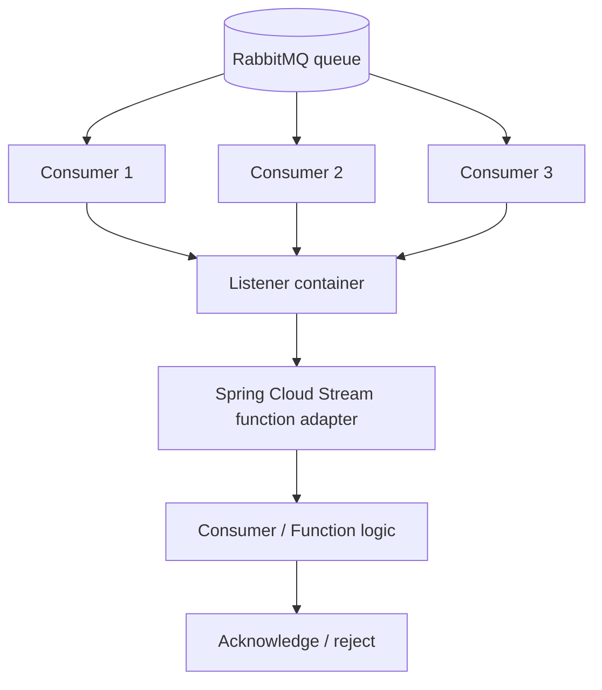
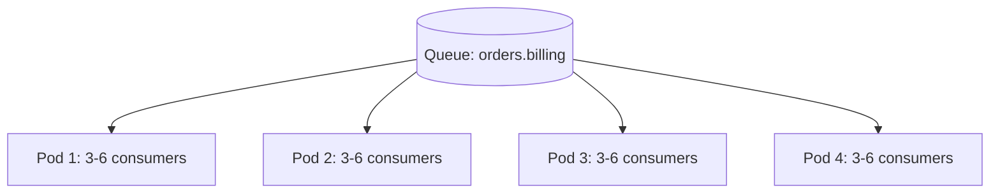
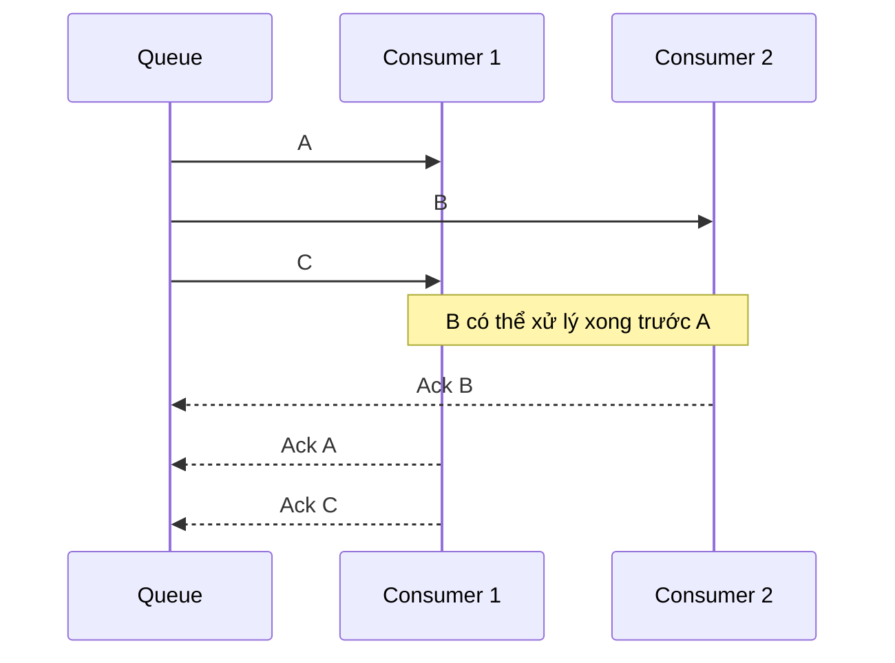

# Listener container, concurrency và prefetch

## 1. Vai trò của listener container

Trong Spring Cloud Stream, RabbitMQ binder kết nối input binding với queue của RabbitMQ. Binder tạo và cấu hình listener container để nhận message, chuyển đổi thành Spring `Message`, gọi `Supplier`/`Function`/`Consumer` adapter phù hợp và phối hợp acknowledgement sau khi xử lý.

Listener container quản lý các consumer chạy trong ứng dụng. Nó chịu trách nhiệm nhận message từ RabbitMQ, gọi listener, xử lý lỗi, xác nhận hoặc từ chối message và quản lý vòng đời consumer khi ứng dụng khởi động, dừng hoặc mất kết nối.

Ba khái niệm thường được điều chỉnh cùng nhau nhưng giải quyết các vấn đề khác nhau:

- **Concurrency:** số consumer đồng thời đọc queue, quyết định mức song song của listener.
- **Maximum concurrency:** giới hạn trên để container có thể tăng số consumer khi tải tăng, nếu cơ chế container hỗ trợ scale động.
- **Prefetch:** số message broker có thể giao trước cho một consumer nhưng chưa được acknowledge, quyết định lượng công việc đang nằm trong tay consumer.

Concurrency điều khiển số người xử lý; prefetch điều khiển lượng message mỗi người có thể giữ chưa xác nhận. Tăng một tham số không thay thế được việc điều chỉnh tham số còn lại.



Sơ đồ thể hiện một binding có nhiều consumer cùng nhận từ queue. Mỗi consumer có thể giữ một số message chưa xác nhận theo prefetch; container điều phối việc gọi logic ứng dụng và hoàn tất delivery.

## 2. Quan hệ giữa application instance, group và concurrency

Với Rabbit binder, một consumer binding có group thường tương ứng với queue bền vững dành cho group đó. Nhiều instance ứng dụng cùng destination và cùng group sẽ cạnh tranh nhận message từ queue chung. Trong mỗi instance, listener container có thể tạo nhiều consumer đồng thời.

Ví dụ:

- Có 4 replica của `billing-service`.
- Mỗi replica cấu hình `concurrency=3`.
- Mỗi replica có tối thiểu 3 consumer đọc queue của group `billing-service`.
- Tổng số consumer hoạt động xấp xỉ 4 × 3 = 12.

Nếu `maxConcurrency=6`, mỗi instance có thể tăng tối đa lên 6 consumer theo điều kiện scale của container. Tổng số consumer tối đa khi cả 4 replica đều tăng hết mức là 4 × 6 = 24.



Các consumer trong cùng group chia sẻ workload. Nếu một dịch vụ khác dùng group name riêng, binder tạo queue riêng được bind với destination/exchange tương ứng; queue đó nhận một luồng message độc lập và có listener container riêng.

Tổng consumer thực tế còn phụ thuộc số replica đang chạy, trạng thái container, giới hạn tài nguyên và cơ chế scale. Không lấy số replica nhân concurrency rồi coi đó là throughput chắc chắn; đây chỉ là số consumer có thể tham gia nhận message.

## 3. Cấu hình concurrency cho Rabbit binder

Ví dụ ứng dụng xử lý sự kiện đơn hàng:

```java
import java.util.function.Consumer;
import org.springframework.context.annotation.Bean;
import org.springframework.context.annotation.Configuration;

record OrderCreated(String orderId, long totalCents) {}

@Configuration
class OrderFunctions {

    @Bean
    Consumer<OrderCreated> processOrder(OrderService orderService) {
        return event -> orderService.reserve(event);
    }
}
```

Cấu hình binding:

```yaml
spring:
  cloud:
    function:
      definition: processOrder
    stream:
      bindings:
        processOrder-in-0:
          destination: orders
          group: billing-service
      rabbit:
        bindings:
          processOrder-in-0:
            consumer:
              concurrency: 3
              maxConcurrency: 6
              prefetch: 20
              acknowledgeMode: AUTO
```

Trong ví dụ:

- `concurrency: 3` đặt số consumer khởi đầu cho listener container.
- `maxConcurrency: 6` đặt giới hạn consumer tối đa khi container tăng concurrency.
- `prefetch: 20` cho phép mỗi consumer có tối đa khoảng 20 delivery chưa xác nhận theo QoS áp dụng.
- `acknowledgeMode: AUTO` yêu cầu container xác nhận khi listener xử lý thành công; lỗi được chuyển qua error handling theo cấu hình.

Đây là các thuộc tính riêng của Rabbit binder, nằm dưới `spring.cloud.stream.rabbit.bindings.<bindingName>.consumer`. Cần kiểm tra metadata cấu hình của phiên bản Spring Cloud Stream Rabbit binder đang dùng vì tên thuộc tính và khả năng container có thể thay đổi theo phiên bản.

## 4. concurrency và maxConcurrency khác nhau thế nào?

`concurrency` là số consumer ban đầu hoặc mức consumer tối thiểu mà container khởi chạy theo cấu hình binder. `maxConcurrency` là giới hạn trên khi container hỗ trợ tăng consumer động.

Ví dụ `concurrency=2` và `maxConcurrency=8`:

- Khi tải thấp, container có thể chạy với 2 consumer.
- Khi message backlog tăng và điều kiện scale được đáp ứng, container có thể thêm consumer.
- Khi tải giảm đủ lâu, container có thể dừng bớt consumer nhưng không thấp hơn mức tối thiểu.
- Container không nhất thiết tăng lên 8 ngay khi có một message; việc scale phụ thuộc thuật toán và các trigger của listener container.

Nếu không cần scale động, đặt `concurrency` ở mức phù hợp và không khai báo `maxConcurrency` cao hơn cần thiết. Nếu có `maxConcurrency`, hãy xác định rõ giới hạn tài nguyên downstream mà số consumer tối đa có thể tạo ra.

### Khi nào tăng concurrency?

Tăng concurrency hữu ích khi message độc lập, thời gian xử lý có thể chạy song song và hệ thống phụ thuộc đủ khả năng nhận tải. Ví dụ, mỗi event cập nhật một đơn hàng khác nhau và database có đủ connection để xử lý đồng thời.

Không nên tăng concurrency nếu:

- Mọi message đều cập nhật cùng một dòng hoặc cùng một aggregate và cần thứ tự nghiêm ngặt.
- Database connection pool nhỏ hơn số tác vụ đồng thời.
- API bên ngoài có giới hạn request thấp.
- Mỗi message chiếm nhiều CPU hoặc bộ nhớ.
- Queue có thứ tự nghiệp vụ phụ thuộc vào một consumer duy nhất.

## 5. Prefetch là gì?

RabbitMQ prefetch giới hạn số message broker giao cho một consumer nhưng consumer chưa acknowledge. Với chế độ QoS theo consumer thường dùng trong listener container, prefetch được áp dụng cho từng consumer.

Ví dụ `prefetch=10`:

1. Consumer nhận tối đa khoảng 10 message chưa ack.
2. Khi xử lý và ack một message, một vị trí nhận mới được mở.
3. Broker có thể giao message tiếp theo cho consumer đó.
4. Nếu consumer chậm, các message đã giao vẫn ở trạng thái unacknowledged và không được phân phối lại cho consumer khác chỉ vì consumer còn lại rảnh.

Prefetch không phải số message xử lý đồng thời trong code. Một consumer có thể nhận trước nhiều message nhưng listener container vẫn gọi xử lý theo cơ chế của nó. Với listener đồng bộ thông thường, một consumer xử lý một callback tại một thời điểm; prefetch tạo vùng đệm delivery chưa ack.

### Giá trị prefetch bằng 0

Trong RabbitMQ, prefetch bằng `0` có nghĩa không đặt giới hạn số message chưa xác nhận theo QoS đó. Đây không phải là “không nhận message”. Giá trị không giới hạn có thể làm một consumer tích lũy quá nhiều delivery, tăng bộ nhớ và giảm khả năng phân phối công bằng.

Với ứng dụng cần kiểm soát tải, nên chọn một prefetch hữu hạn dựa trên thời gian xử lý, kích thước message và khả năng downstream.

## 6. Tính lượng message đang nằm trong consumer

Với prefetch áp dụng cho từng consumer, một ước lượng đơn giản về số delivery chưa xác nhận tối đa là:

\[
N_{unacked} \approx N_{consumers} \times prefetch
\]

Ví dụ triển khai có 4 replica, mỗi replica chạy 3 consumer và `prefetch=20`:

\[
4 \times 3 \times 20 = 240
\]

Hệ thống có thể có khoảng 240 message đang được giao nhưng chưa ack trên queue đó khi tất cả consumer đều đạt prefetch. Nếu container tăng đến 6 consumer trên mỗi replica, con số ước lượng có thể lên đến:

\[
4 \times 6 \times 20 = 480
\]

Đây là ước lượng theo QoS per-consumer và giả định mọi consumer đều đạt giới hạn. Cấu hình global QoS, batching, số queue, số group và cách binder triển khai có thể làm số liệu thực tế khác đi.

Nếu payload trung bình 100 KB, 480 message tương ứng khoảng 48 MB payload chưa tính overhead, object Java, header và bản sao trong bộ nhớ. Vì vậy, tăng concurrency và prefetch đồng thời có thể làm heap tăng nhanh.

## 7. Chọn prefetch theo thời gian xử lý

Prefetch thấp giúp phân phối message linh hoạt hơn và giới hạn số message đang nằm ở mỗi consumer. Prefetch cao giúp giảm thời gian consumer chờ broker cấp message mới và có thể tăng throughput khi xử lý nhanh, ổn định.

| Đặc điểm workload | Hướng chọn prefetch |
|---|---|
| Message lớn, xử lý lâu | Bắt đầu thấp để giới hạn bộ nhớ và số unacked |
| Message nhỏ, xử lý nhanh | Có thể tăng dần để giảm khoảng trống giữa các lần nhận |
| Thời gian xử lý rất không đồng đều | Giữ vừa phải để tránh consumer nhanh/chậm giữ lượng message lệch lớn |
| Cần phân phối công bằng giữa nhiều consumer | Prefetch thấp hoặc trung bình |
| Downstream có giới hạn tải | Prefetch hữu hạn, kết hợp concurrency phù hợp |
| Consumer chỉ có thể xử lý tuần tự | Tránh prefetch quá cao vì nhiều message sẽ chờ trong cùng consumer |

Không có một con số tối ưu chung. Hãy đo throughput, p95/p99 processing time, queue depth, unacked count và bộ nhớ khi thử tải.

## 8. Prefetch ảnh hưởng đến phân phối message

RabbitMQ phân phối message cho các consumer đang đăng ký queue. Khi prefetch lớn, broker có thể giao trước nhiều message cho consumer A. Nếu A xử lý chậm trong khi consumer B rảnh, các message đã giao cho A vẫn đang ở trạng thái unacked và thường không được broker chuyển sang B.

Ví dụ:

- Consumer A có prefetch 50 và nhận 50 message.
- Consumer B có prefetch 50 nhưng chỉ nhận một số message ban đầu.
- A gặp một tác vụ chậm và giữ nhiều message chưa ack.
- B có thể hoàn tất nhanh nhưng không thể lấy lại các message đã được giao cho A.

Giảm prefetch giúp broker có cơ hội phân phối message mới cho consumer đang rảnh. Tuy nhiên, prefetch quá thấp có thể khiến consumer chờ nhận message liên tục và giảm throughput khi network round trip đáng kể.

## 9. Concurrency và thứ tự xử lý

Một queue RabbitMQ có thể có nhiều consumer. Khi có nhiều consumer, broker phân phối message cho các consumer khác nhau; thời điểm bắt đầu và hoàn tất xử lý có thể khác nhau.

Giả sử queue nhận `A`, `B`, `C` theo thứ tự:



Vì vậy, nhiều consumer có thể làm thứ tự hoàn tất khác thứ tự enqueue. Redelivery, requeue và prefetch cũng có thể ảnh hưởng thứ tự quan sát. Nếu nghiệp vụ yêu cầu thứ tự nghiêm ngặt, cân nhắc một consumer cho queue, prefetch phù hợp và xử lý đồng bộ; hoặc thiết kế phân vùng theo key để mỗi nhóm thực thể có thứ tự riêng.

Ngay cả với một consumer, nếu callback đẩy tác vụ sang thread pool bất đồng bộ rồi trả về sớm, các side effect có thể hoàn tất sai thứ tự. Bảo toàn thứ tự cần được giữ xuyên suốt từ broker đến code xử lý.

## 10. Acknowledge mode và prefetch

Prefetch giới hạn số delivery chưa ack, vì vậy cách acknowledge ảnh hưởng trực tiếp đến thời điểm broker có thể giao message mới.

Rabbit binder hỗ trợ các chế độ acknowledgement của Spring AMQP:

| Mode | Hành vi khái quát | Quan hệ với prefetch |
|---|---|---|
| `AUTO` | Container ack khi listener hoàn tất thành công; exception được xử lý theo error handler/requeue policy | Message giữ trạng thái unacked trong lúc listener xử lý |
| `MANUAL` | Ứng dụng phải acknowledge hoặc reject/nack | Message chiếm slot prefetch cho đến khi ứng dụng xác nhận |
| `NONE` | Broker tự xác nhận ngay khi giao message theo no-ack semantics | Không có hàng đợi unacked để prefetch giới hạn theo cách thông thường; có nguy cơ mất message nếu consumer dừng |

Trong Spring AMQP, `AUTO` là container-managed acknowledgement, không phải broker auto-ack. `NONE` mới tương ứng với việc broker không chờ consumer ack. Đây là điểm dễ nhầm khi đọc cấu hình.

Nếu dùng `MANUAL` mà code quên ack/nack, message có thể giữ unacked cho đến khi channel/connection đóng; khi đó broker có thể requeue và giao lại. Prefetch thấp giúp giới hạn số message bị giữ, nhưng không thay thế xử lý acknowledgement đúng.

## 11. Retry và DLQ khi concurrency lớn

Khi listener ném exception, binder/container áp dụng retry và chính sách reject/requeue/DLQ. Trong thời gian retry đồng bộ, consumer đó có thể bị chiếm dụng và không nhận message mới. Nếu nhiều consumer cùng gặp lỗi, toàn bộ năng lực xử lý của queue có thể giảm.

Ví dụ cấu hình Rabbit binder với DLQ:

```yaml
spring:
  cloud:
    stream:
      bindings:
        processOrder-in-0:
          destination: orders
          group: billing-service
          consumer:
            max-attempts: 3
      rabbit:
        bindings:
          processOrder-in-0:
            consumer:
              autoBindDlq: true
              republishToDlq: true
              prefetch: 10
              concurrency: 2
              maxConcurrency: 4
```

`max-attempts` là thuộc tính consumer chung của Spring Cloud Stream; các thuộc tính `autoBindDlq`, `republishToDlq`, `prefetch`, `concurrency` và `maxConcurrency` là thuộc tính Rabbit binder. Cần xác nhận topology và quyền khai báo exchange/queue của môi trường broker.

Không tăng concurrency để che giấu một message lỗi bị retry liên tục. Phân loại lỗi tạm thời và lỗi dữ liệu, giới hạn retry, đưa message không thể xử lý vào DLQ và theo dõi redelivery.

## 12. Kết hợp concurrency với database connection pool

Mỗi consumer có thể thực hiện một tác vụ nghiệp vụ đồng thời. Nếu function gọi database, tổng số consumer có thể tạo ra lượng truy vấn đồng thời lớn.

Ví dụ:

- 5 replica.
- `maxConcurrency=8` mỗi replica.
- Tối đa 40 consumer.
- Database connection pool mỗi replica chỉ có 10 connection.

Mặc dù có 40 consumer, mỗi instance chỉ có thể cấp tối đa 10 connection cho các tác vụ database. Các listener còn lại có thể chờ pool, kéo dài thời gian xử lý, giữ message unacked và chiếm slot prefetch.

Hãy đồng bộ các giới hạn:

- Tổng consumer theo số replica và concurrency.
- Connection pool của database.
- Giới hạn đồng thời của HTTP client hoặc API ngoài.
- CPU và heap của mỗi instance.
- Prefetch và kích thước payload.
- Thời gian xử lý trung bình và p95/p99.

Nếu downstream là nút thắt, tăng concurrency chỉ làm tăng hàng đợi chờ và số message unacked. Cần tối ưu tác vụ hoặc điều tiết consumer theo năng lực downstream.

## 13. Ví dụ tính cấu hình ban đầu

Giả sử một queue xử lý event đơn hàng với đặc điểm:

- 3 replica ứng dụng.
- Mỗi message có payload trung bình 8 KB.
- Thời gian xử lý p95 khoảng 150 ms.
- Database chịu được khoảng 12 thao tác đồng thời từ workload này.
- Mỗi instance có connection pool dành cho chức năng này tối đa 4 connection.

Một cấu hình thử nghiệm ban đầu có thể là:

```yaml
spring:
  cloud:
    stream:
      rabbit:
        bindings:
          processOrder-in-0:
            consumer:
              concurrency: 2
              maxConcurrency: 4
              prefetch: 8
```

Ở mức concurrency tối thiểu, tổng consumer là 3 × 2 = 6. Nếu tất cả replica tăng lên mức tối đa, tổng consumer là 3 × 4 = 12, tương đương giới hạn thao tác đồng thời dự kiến của database. Với prefetch 8, số delivery chưa ack tối đa theo ước lượng per-consumer là 12 × 8 = 96 khi tất cả consumer đạt mức tối đa.

Đây chỉ là cấu hình khởi đầu để thử tải. Cần quan sát connection pool, unacked count, queue depth và latency để điều chỉnh. Nếu message xử lý lâu hoặc payload tăng, giảm prefetch; nếu consumer thường xuyên rảnh vì chờ broker và downstream còn dư năng lực, có thể tăng từng bước.

## 14. Dynamic scaling của listener container

Khi dùng `concurrency` và `maxConcurrency`, listener container có thể tăng/giảm số consumer theo tín hiệu tải. Cơ chế này không giống autoscaling số Pod:

- Container concurrency tăng consumer bên trong một JVM.
- Kubernetes/HPA hoặc nền tảng triển khai tăng số application instance.
- Cả hai có thể cùng tác động đến tổng consumer trên queue.

Nếu container scale lên hết mức trong mọi replica đồng thời HPA tăng số replica, tổng consumer có thể vượt giới hạn database hoặc broker. Hãy tính worst-case:

\[
N_{total,max} = N_{replicas,max} \times concurrency_{max}
\]

Sau đó đối chiếu với connection pool, rate limit và giới hạn queue. Nếu không cần dynamic scaling, đặt concurrency cố định sẽ dễ dự đoán hơn.

## 15. Prefetch và message lớn

Prefetch tính theo số message, không phải tổng byte. Cùng `prefetch=20`, queue có thể chứa 20 message vài KB hoặc 20 message nhiều MB. Trường hợp thứ hai có thể chiếm bộ nhớ lớn hơn nhiều.

Khi message lớn:

- Giảm prefetch để giới hạn lượng payload đang nằm trong consumer.
- Đặt giới hạn kích thước message ở producer/broker theo chính sách hệ thống.
- Tránh giữ thêm nhiều bản sao payload trong cache hoặc queue nội bộ.
- Cân nhắc lưu file/object lớn ở object storage và chỉ gửi metadata/reference qua RabbitMQ.
- Theo dõi heap, garbage collection và container memory.

Prefetch cao kết hợp concurrency cao có thể làm ứng dụng nhận một lượng message lớn trước khi xử lý xong. Nếu process bị kill, các message unacked sẽ được requeue, tạo burst redelivery cho các consumer còn lại.

## 16. Cách kiểm tra concurrency và prefetch đang hoạt động

Có thể kiểm tra trạng thái queue bằng RabbitMQ Management UI hoặc CLI:

```bash
rabbitmqctl list_queues name messages_ready messages_unacknowledged consumers
```

Các trường thường dùng:

- `messages_ready`: message đang chờ được giao.
- `messages_unacknowledged`: message đã giao nhưng chưa ack.
- `consumers`: số consumer đang đăng ký queue.

Để xem connection/channel và consumer tag, có thể dùng các lệnh `rabbitmqctl list_consumers`, `list_channels` hoặc Management API phù hợp phiên bản. Các lệnh yêu cầu quyền quản trị và nên chạy trên môi trường được phép.

Khi quan sát:

- `consumers` thấp hơn dự kiến: kiểm tra số replica, container startup, group và lỗi đăng ký queue.
- `messages_unacknowledged` gần `consumers × prefetch`: consumer đang giữ đầy slot delivery; kiểm tra processing time và downstream.
- `messages_ready` tăng liên tục nhưng unacked thấp: có thể thiếu consumer hoặc consumer không nhận được message.
- Unacked tăng cao và consumer capacity thấp: có thể xử lý chậm, bị block hoặc prefetch quá lớn.

Số liệu queue là ảnh chụp tại thời điểm kiểm tra. Kết hợp metric theo thời gian và log ứng dụng để xác định xu hướng.

## 17. Thử tải và điều chỉnh theo từng bước

Không thay đổi đồng thời concurrency và prefetch nếu muốn biết yếu tố nào cải thiện kết quả. Có thể thực hiện quy trình:

1. Bắt đầu với `concurrency=1`, `maxConcurrency=1` và prefetch nhỏ.
2. Đo throughput, p95/p99 latency, queue depth và unacked count.
3. Tăng concurrency lên 2, rồi 4 nếu downstream còn đủ năng lực.
4. Giữ concurrency ổn định và tăng prefetch từng bước để xem có giảm thời gian chờ broker hay không.
5. Thử message nhỏ và message lớn để đánh giá memory footprint.
6. Mô phỏng lỗi xử lý và redelivery để quan sát số message unacked.
7. Dừng thử tải khi database pool, CPU, heap hoặc broker chạm giới hạn.
8. Chọn cấu hình ổn định ở tải đỉnh dự kiến, có headroom cho sự cố.

Đo throughput thành công, không chỉ số message được giao. Một cấu hình nhận nhiều message nhưng giữ chúng unacked lâu hoặc làm downstream timeout không phải là cải thiện.

## 18. Kiểm thử lỗi và shutdown

Kiểm thử tích hợp với RabbitMQ thật giúp xác nhận hành vi container và QoS:

- Dừng một application instance khi còn message unacked và quan sát redelivery.
- Tăng/giảm số replica để quan sát tổng consumer.
- Tăng tải để xem container có scale từ concurrency lên maxConcurrency hay không.
- Làm chậm service phụ thuộc để xem prefetch ảnh hưởng số unacked như thế nào.
- Ném exception trong listener để kiểm tra retry, requeue và DLQ.
- Dừng broker rồi khởi động lại để kiểm tra reconnect và khôi phục consumer.
- Kiểm tra graceful shutdown khi container đang xử lý message.

Khi shutdown có kiểm soát, container nên dừng nhận message mới và hoàn tất hoặc để broker giao lại những delivery chưa xác nhận theo cấu hình. Nếu listener xử lý quá lâu, cần đặt shutdown timeout phù hợp và đảm bảo side effect idempotent.

## 19. Những cấu hình dễ gây sự cố

| Cấu hình/vấn đề | Hậu quả có thể gặp | Cách xử lý |
|---|---|---|
| Prefetch quá cao | Nhiều unacked, memory tăng, phân phối lệch | Giảm prefetch và đo lại |
| Concurrency quá cao | Database/API quá tải, timeout và retry tăng | Giới hạn theo năng lực downstream |
| `maxConcurrency` cao trên mọi replica | Tổng consumer vượt dự kiến khi autoscaling | Tính worst-case theo số replica tối đa |
| Prefetch bằng 0 | Không giới hạn delivery chưa ack theo QoS | Dùng giá trị hữu hạn cho workload cần kiểm soát |
| `acknowledgeMode: NONE` | Message được broker xác nhận ngay khi giao, có thể mất khi process chết | Dùng AUTO/MANUAL nếu cần xử lý có xác nhận |
| Manual ack bị bỏ quên | Message giữ unacked và có thể redeliver khi channel đóng | Đảm bảo mọi nhánh xử lý ack/reject đúng |
| Nhiều consumer nhưng yêu cầu thứ tự toàn queue | Thứ tự hoàn tất không còn được bảo đảm | Giảm consumer hoặc partition logic theo key |

## 20. Quy trình chọn listener container, concurrency và prefetch

1. Xác định queue và group mà binding sẽ đọc.
2. Tính số application instance tối đa có thể chạy đồng thời.
3. Chọn concurrency khởi đầu theo số tác vụ độc lập và năng lực downstream.
4. Chỉ đặt `maxConcurrency` khi cần container scale động và đã tính tổng consumer tối đa.
5. Chọn prefetch hữu hạn dựa trên kích thước message, thời gian xử lý và memory budget.
6. Chọn acknowledgement mode phù hợp với yêu cầu giao nhận.
7. Kiểm tra retry, requeue và DLQ để message lỗi không chiếm consumer vô hạn.
8. Thử tải và quan sát ready/unacked/consumer count, latency và tài nguyên.
9. Kiểm thử shutdown, reconnect, redelivery và scale up/down với RabbitMQ thật.
10. Ghi lại cấu hình và cảnh báo cho các ngưỡng backlog, unacked và lỗi xử lý.

Listener container là nơi Rabbit binder điều phối consumer và acknowledgement. Concurrency quyết định số message có thể được xử lý song song; `maxConcurrency` giới hạn mức tăng consumer; prefetch giới hạn lượng delivery chưa xác nhận mỗi consumer giữ. Chọn ba yếu tố cùng với số replica, ack mode và năng lực database/API giúp RabbitMQ phân phối tải ổn định, tránh giữ quá nhiều message trong bộ nhớ và duy trì khả năng phục hồi khi consumer gặp lỗi.

