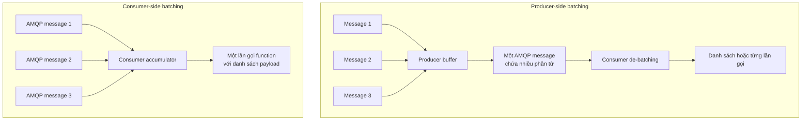

# Nhận theo lô, phát theo lô và giới hạn kích thước thông điệp

RabbitMQ binder hỗ trợ gom nhiều message khi phát hoặc khi nhận. Hai cách này thường được gọi chung là batching, nhưng khác nhau về nơi tạo batch, hình dạng message trên broker, cấu hình và phạm vi redelivery.

- **Producer-side batching:** producer buffer nhiều message rồi gửi chúng trong một AMQP message chứa nhiều phần tử.
- **Consumer-side batching:** broker vẫn giao từng message độc lập; listener container tích lũy nhiều delivery rồi gọi function một lần với danh sách payload.
- **Giới hạn kích thước:** producer batch là một message vật lý nên tổng kích thước batch phải nằm trong giới hạn broker. Consumer batch là một danh sách trong ứng dụng, vì vậy memory của consumer cũng cần được kiểm soát.

Bài học này trình bày hai kiểu batching của Spring Cloud Stream Rabbit binder, cấu hình producer/consumer, kích thước message, latency, acknowledgement, redelivery và cách kiểm thử.

## 1. Vì sao cần batching?

Khi ứng dụng phát hoặc nhận nhiều message nhỏ, overhead của mỗi lần publish/dispatch có thể chiếm tỷ lệ lớn so với thời gian xử lý payload. Batching gom nhiều phần tử để giảm số lần gọi, giảm overhead protocol và cho phép xử lý theo nhóm.

Ví dụ một dịch vụ nhận 500 sự kiện tồn kho mỗi giây. Nếu gom 50 sự kiện mỗi batch, số lần publish có thể giảm từ khoảng 500 xuống khoảng 10 lần mỗi giây khi lưu lượng đủ đều.

Batching hữu ích khi:

- Message nhỏ và xuất hiện với số lượng lớn.
- Có thể giảm truy vấn hoặc thao tác I/O bằng xử lý theo nhóm.
- Ứng dụng chấp nhận thêm thời gian chờ gom message.
- Kích thước batch vẫn nằm trong giới hạn broker, memory và thời gian xử lý.

Batch lớn có thể tăng throughput nhưng cũng làm tăng latency, memory, thời gian xử lý một lần và phạm vi ảnh hưởng khi lỗi. Vì vậy, chọn batch size phải dựa trên cả throughput lẫn SLA.

## 2. Hai kiểu batch của RabbitMQ binder

| Kiểu batch | Ai gom? | Broker nhận/giao gì? | Function nhận gì? |
|---|---|---|---|
| Producer-created batch | Producer | Một AMQP message chứa nhiều message con | Mặc định de-batch thành từng lần gọi; có thể nhận danh sách |
| Consumer-side batch | Listener container | Nhiều AMQP message độc lập | Một lần gọi với danh sách payload đã convert |



Producer batching thay đổi message vật lý trên đường truyền. Consumer batching chỉ gom nhiều delivery riêng vào một danh sách trong ứng dụng. Không nên giả định hai cách có cùng acknowledgement hoặc redelivery semantics.

## 3. Producer-side batching

Spring Cloud Stream Rabbit binder dùng batching strategy của Spring AMQP. Khi bật batching, producer buffer message; batch được phát khi đạt số lượng, chạm giới hạn buffer hoặc hết timeout.

Các producer properties:

| Thuộc tính | Ý nghĩa | Mặc định theo tài liệu binder |
|---|---|---:|
| batching-enabled | Bật batching ở producer | false |
| batch-size | Số message mục tiêu trong một batch | 100 |
| batch-buffer-limit | Giới hạn kích thước batch buffer; có thể làm batch phát sớm | 10000 |
| batch-timeout | Thời gian chờ phát batch chưa đủ số lượng | 5000 ms |

Tài liệu Java thường viết các tên này theo camelCase (batchingEnabled, batchSize, batchBufferLimit, batchTimeout). Trong YAML, có thể dùng kebab-case nhờ Spring Boot relaxed binding.

### Cấu hình producer

Ví dụ function phát sự kiện tồn kho:

```java
@Bean
Supplier<InventoryChanged> publishInventory(InventorySource source) {
    return source::next;
}
```

Cấu hình Rabbit producer:

```yaml
spring:
  cloud:
    function:
      definition: publishInventory
    stream:
      bindings:
        publishInventory-out-0:
          destination: inventory.events
      rabbit:
        bindings:
          publishInventory-out-0:
            producer:
              batching-enabled: true
              batch-size: 50
              batch-buffer-limit: 1048576
              batch-timeout: 1000
```

Trong ví dụ:

- batching-enabled bật producer batching.
- batch-size đặt mục tiêu gom tối đa 50 message.
- batch-buffer-limit đặt giới hạn kích thước buffer/batch theo strategy.
- batch-timeout cho phép phát batch chưa đủ 50 phần tử sau khoảng một giây không có thêm message.

Đây là giá trị minh họa. Hãy xác minh mặc định và behavior theo phiên bản Spring Cloud Stream/Spring AMQP đang dùng.

### Khi nào batch được phát?

Batch có thể được phát khi:

1. Đã gom đủ batch-size message.
2. Kích thước chạm batch-buffer-limit, khiến batch ngắn được phát.
3. batch-timeout hết hạn và không có hoạt động mới bổ sung vào batch.

Timeout tránh việc batch chờ vô hạn khi lưu lượng thấp. Đổi lại, message đầu tiên có thể phải chờ gần hết timeout nếu message tiếp theo đến chậm.

### Producer buffer nằm trong memory

Batch chưa được gửi đang nằm trong bộ nhớ của producer. Nếu process crash trước khi batch được phát, các message đang buffer có thể bị mất. Producer batching không tạo durable queue ở phía ứng dụng.

Nếu cần xác nhận publish, cấu hình publisher confirms/returns phù hợp và chỉ coi publish thành công sau khi nhận kết quả xác nhận. Publisher confirm không thay thế việc kiểm tra routing đúng queue hoặc transaction nghiệp vụ.

## 4. Cấu trúc producer-created batch

Spring AMQP SimpleBatchingStrategy tạo batch bằng cách đặt một trường độ dài nhị phân 4 byte trước mỗi message con. Header springBatchFormat với giá trị lengthHeader4 cho listener container biết cách tách batch.

Mô hình khái quát:

```text
AMQP message body
+----------------------+----------------------+
| length (4 bytes)     | payload message 1    |
+----------------------+----------------------+
| length (4 bytes)     | payload message 2    |
+----------------------+----------------------+
| length (4 bytes)     | payload message 3    |
+----------------------+----------------------+
```

Đây là format batch của Spring AMQP, không phải batch format chung mà mọi AMQP client tự động hiểu. Consumer khác Spring cần hỗ trợ format này để đọc đúng batch.

Batching strategy mặc định hỗ trợ gom message cho cùng một exchange/routing key. Không giả định có thể trộn tùy ý message thuộc các đích hoặc routing key khác nhau trong một batch.

## 5. Consumer nhận producer-created batch

Theo mặc định, listener container tự động de-batch message do producer tạo và chuyển từng message con thành lần gọi listener riêng. Từ Spring Cloud Stream 3.0, có thể yêu cầu binder trình bày producer-created batch dưới dạng danh sách bằng consumer.batch-mode.

Function nhận danh sách:

```java
@Bean
Consumer<List<InventoryChanged>> processInventoryBatch(
        InventoryService service) {

    return events -> service.applyBatch(events);
}
```

Cấu hình:

```yaml
spring:
  cloud:
    function:
      definition: processInventoryBatch
    stream:
      bindings:
        processInventoryBatch-in-0:
          destination: inventory.events
          group: inventory-projection
          consumer:
            batch-mode: true
```

batch-mode=true cho biết function muốn nhận danh sách. Nếu producer gửi các message riêng lẻ và consumer không bật consumer-side batching, không nên kỳ vọng binder tự gom chúng thành danh sách chỉ vì batch-mode được bật.

### Lỗi trong producer-created batch

Một producer-created batch là một message vật lý trên broker. Khi listener de-batch, nhiều message con trở thành phần tử logic. Nếu một phần tử gây lỗi và message vật lý bị reject, toàn bộ batch có thể bị reject/redeliver. Các phần tử đã xử lý thành công trước đó có thể được giao lại cùng batch.

Vì vậy:

- Dùng event ID riêng cho từng phần tử để bảo vệ idempotency.
- Không giả định từng phần tử có acknowledgement broker độc lập.
- Nếu cần xử lý lỗi từng phần tử, hãy lưu trạng thái từng phần tử một cách bền vững.
- Kiểm thử redelivery với broker thật để xác định phạm vi batch được giao lại.

## 6. Consumer-side batching

Consumer-side batching không yêu cầu producer gửi batch. RabbitMQ vẫn nhận và giao từng message riêng. Listener container tích lũy các delivery, rồi gọi function một lần với danh sách payload đã chuyển đổi.

Spring Cloud Stream Rabbit binder hỗ trợ cách này từ phiên bản 3.1. Cần phối hợp các thuộc tính:

- spring.cloud.stream.bindings.<binding>.consumer.batch-mode=true
- spring.cloud.stream.rabbit.bindings.<binding>.consumer.enable-batching=true
- batch-size và receive-timeout ở Rabbit consumer binding.

Ví dụ:

```yaml
spring:
  cloud:
    function:
      definition: processInventoryBatch
    stream:
      bindings:
        processInventoryBatch-in-0:
          destination: inventory.events
          group: inventory-projection
          consumer:
            batch-mode: true
      rabbit:
        bindings:
          processInventoryBatch-in-0:
            consumer:
              enable-batching: true
              batch-size: 20
              receive-timeout: 250
              container-type: simple
```

Function:

```java
@Bean
Consumer<List<InventoryChanged>> processInventoryBatch(
        InventoryService service) {

    return events -> {
        if (events.isEmpty()) {
            return;
        }
        service.applyBatch(events);
    };
}
```

Container cố gắng gom tối đa 20 message. Nếu đủ 20, batch được chuyển tới function. Nếu receive-timeout hết hạn trước khi đủ số lượng, một batch ngắn hơn được gửi đi. Ví dụ có 7 message đến trong khoảng chờ, function có thể nhận danh sách 7 phần tử.

Consumer-side batching chỉ được hỗ trợ với container-type=simple, là container mặc định. Nếu chọn container khác, cần kiểm tra tài liệu binder trước khi bật tính năng này.

### Vai trò từng property

| Thuộc tính | Lớp cấu hình | Tác dụng |
|---|---|---|
| consumer.batch-mode | Core Spring Cloud Stream | Cho phép function nhận danh sách |
| consumer.enable-batching | Rabbit binder | Yêu cầu listener container tích lũy delivery |
| consumer.batch-size | Rabbit binder | Số message mục tiêu trong batch |
| consumer.receive-timeout | Rabbit binder | Thời gian chờ gom; hết hạn có thể phát batch ngắn |

Chỉ bật batch-mode chưa đủ để gom các message độc lập. Chỉ bật enable-batching cũng chưa đủ để function nhận danh sách nếu core binding chưa được cấu hình đúng.

## 7. Đọc headers của từng phần tử

Khi function nhận danh sách payload, metadata của từng message có thể khác nhau. Ví dụ các sự kiện tồn kho có cùng payload type nhưng khác tenantId, correlationId hoặc eventVersion.

Để đọc headers của từng phần tử, function có thể nhận Message<List<?>>. Với consumer-side batching, binder đặt danh sách headers tương ứng trong header AmqpInboundChannelAdapter.CONSOLIDATED_HEADERS.

Ví dụ:

```java
@Bean
Consumer<Message<List<InventoryChanged>>> processInventoryBatch(
        InventoryService service) {

    return message -> {
        List<InventoryChanged> events = message.getPayload();

        @SuppressWarnings("unchecked")
        List<Map<String, Object>> headers =
                (List<Map<String, Object>>) message.getHeaders()
                        .get(AmqpInboundChannelAdapter.CONSOLIDATED_HEADERS);

        for (int i = 0; i < events.size(); i++) {
            InventoryChanged event = events.get(i);
            Map<String, Object> eventHeaders = headers.get(i);

            service.apply(
                    event,
                    (String) eventHeaders.get("correlationId")
            );
        }
    };
}
```

Danh sách headers có cùng thứ tự với danh sách payload. Header ở index i thuộc payload ở index i. Hãy xử lý trường hợp header không tồn tại và tránh ép kiểu khi chưa kiểm tra kiểu dữ liệu.

## 8. Phân biệt các thuộc tính batch

Tên property tương tự nhau nhưng thuộc hai hướng batching:

| Thuộc tính | Phạm vi | Ý nghĩa |
|---|---|---|
| Producer batch-size | Rabbit producer | Số message mục tiêu trong một batch publish |
| Producer batch-buffer-limit | Rabbit producer | Giới hạn kích thước batch buffer |
| Producer batch-timeout | Rabbit producer | Thời gian chờ trước khi phát batch |
| Consumer batch-size | Rabbit consumer | Số delivery mục tiêu trong danh sách |
| Consumer receive-timeout | Rabbit consumer | Thời gian chờ thu thập batch |

Producer và consumer có thể dùng batch size khác nhau. Không giả định batch producer 50 phần tử sẽ luôn được function nhận thành đúng một danh sách 50 phần tử; kết quả phụ thuộc de-batching, consumer mode và cách container tích lũy delivery.

## 9. Giới hạn kích thước message của RabbitMQ

Một AMQP message gồm body và properties/headers. Khi producer batching, nhiều message con được đóng gói vào body của một message vật lý. Vì vậy, tổng kích thước batch phải nằm trong giới hạn của broker.

RabbitMQ có cấu hình max_message_size để giới hạn kích thước message. Tài liệu RabbitMQ 4.4 nêu mặc định **16 MiB** và giá trị tối đa được hỗ trợ **512 MiB**. Quản trị viên có thể cấu hình giới hạn này; hãy kiểm tra phiên bản và cấu hình thực tế của cluster trước khi thiết kế batch.

Ví dụ cấu hình phía broker trong rabbitmq.conf:

```ini
max_message_size = 16777216
```

Giá trị trên tương ứng 16 MiB. Đây là cấu hình server-side, không phải property của Spring Cloud Stream binder. Khi đổi giới hạn, cần đánh giá memory, disk, network và năng lực xử lý của toàn cluster.

### frame_max không phải max_message_size

RabbitMQ cũng có frame_max. Trong tài liệu RabbitMQ 4.4, mặc định là **131072 byte (128 KiB)**. Đây là giới hạn kích thước của một protocol frame, không phải giới hạn tổng kích thước của toàn bộ AMQP message. Message lớn có thể được truyền qua nhiều frame.

Không dùng frame_max như giới hạn payload. Muốn kiểm soát kích thước message, cần xem max_message_size, kích thước batch và giới hạn memory của producer/consumer.

### Ví dụ kích thước

Giả sử mỗi message đã serialize có payload trung bình 256 KiB:

| Số phần tử | Tổng payload ước lượng |
|---:|---:|
| 20 | 5 MiB |
| 40 | 10 MiB |
| 80 | 20 MiB |

Kích thước thực tế còn có trường length 4 byte cho mỗi phần tử, headers, properties và overhead serialization. Nếu cluster giới hạn 16 MiB, batch 80 phần tử trong ví dụ có thể vượt giới hạn dù từng message riêng lẻ nhỏ hơn nhiều.

Hãy đo kích thước sau serialize, dùng phân vị p95/p99 và dành headroom cho metadata. Không chọn batch size chỉ dựa trên số lượng phần tử.

Với consumer-side batching, các message vẫn được broker giao riêng. Vì vậy mỗi message vật lý phải nằm dưới max_message_size; tổng kích thước danh sách sau khi container gom lại là bài toán memory và processing time ở consumer, không phải một AMQP message mới trên broker.

## 10. Message đơn lẻ quá lớn

batch-buffer-limit kiểm soát kích thước batch được gom; nó không thay thế giới hạn message của RabbitMQ. Spring AMQP batching strategy cũng lưu ý giới hạn buffer không áp dụng để cắt nhỏ một message đơn lẻ.

Ví dụ event chứa file 20 MiB có thể vượt max_message_size 16 MiB ngay cả khi producer batching tắt. Giảm batch-size về 1 không làm payload đơn lẻ nhỏ hơn.

Các hướng xử lý payload lớn:

- Lưu file/blob ở object storage và chỉ gửi URI, object key, checksum và metadata qua RabbitMQ.
- Chia payload thành chunk có ID, sequence và tổng số chunk; consumer ghép lại và kiểm tra checksum.
- Nén dữ liệu nếu payload có thể nén và consumer tương thích.
- Bỏ field dư thừa hoặc dữ liệu có thể truy xuất từ nguồn khác.
- Điều chỉnh max_message_size khi thật sự cần và cluster có đủ memory, disk, network cùng năng lực xử lý.

Không tăng giới hạn broker chỉ để che giấu thiết kế event chứa dữ liệu nhị phân quá lớn. Message lớn làm tăng chi phí lưu trữ, replication, network, memory và redelivery.

## 11. Nén và batching

Rabbit producer có thuộc tính compress để nén dữ liệu khi gửi. Nén có thể giảm kích thước truyền và lưu trữ nếu payload có cấu trúc lặp lại, nhưng tiêu tốn CPU và không phải định dạng nào cũng nén tốt.

Cần đo kích thước trước/sau nén, CPU dùng cho nén/giải nén, latency publish và tỷ lệ nén trên payload thực tế. Không dựa vào nén để vượt giới hạn một cách mù quáng. Dữ liệu đã nén như JPEG hoặc ZIP thường không giảm đáng kể.

Batching giảm số lần publish; compression giảm số byte nếu dữ liệu có thể nén. Hai cơ chế giải quyết hai loại overhead khác nhau.

## 12. Latency, throughput và batch size

Batch lớn thường giảm overhead trên mỗi phần tử nhưng làm tăng thời gian chờ gom đủ message. Batch nhỏ phát nhanh hơn nhưng tạo nhiều lần publish hơn.

| Workload | Batch size minh họa | Timeout minh họa | Mục tiêu |
|---|---:|---:|---|
| Cao, ổn định | 100 | 200 ms | Giảm số lần publish |
| Trung bình | 50 | 500 ms | Cân bằng throughput và latency |
| Thấp, không đều | 20 | 1000 ms | Phát batch ngắn khi timeout |
| Gần thời gian thực | 5 | 50 ms | Giữ thời gian chờ thấp |

Đây là ví dụ để thử nghiệm, không phải khuyến nghị cố định.

Các chỉ số nên đo: số message con trong mỗi batch, kích thước batch sau serialize, thời gian chờ gom, publish rate, publisher confirm latency, consumer batch size thực tế, thời gian xử lý function, queue depth, unacked count, redelivery rate, CPU, heap, GC và network throughput.

Nếu throughput tăng nhưng p99 latency vượt SLA, giảm batch-size hoặc timeout. Nếu overhead vẫn cao, cân nhắc tăng batch size trong giới hạn kích thước.

## 13. Acknowledgement, lỗi và redelivery

Batching làm thay đổi phạm vi giao nhận cần quan sát.

### Producer-created batch

Producer-created batch là một message vật lý. Khi listener de-batch, nhiều message con trở thành phần tử logic. Nếu một phần tử gây lỗi và message vật lý bị reject, toàn batch có thể bị reject/redeliver. Những phần tử đã xử lý thành công trước đó có thể được giao lại.

Dùng event ID riêng cho từng phần tử và bảo vệ side effect bằng idempotency. Không giả định mỗi phần tử trong producer-created batch có acknowledgement broker độc lập.

### Consumer-side batch

Consumer-side batch gồm nhiều message vật lý độc lập. Tuy nhiên, listener container có thể quản lý acknowledgement theo batch hoặc transaction configuration. Nếu function ném exception, cần hiểu binder/container sẽ reject hoặc requeue những delivery nào và liệu message đã xử lý trước đó có thể được giao lại không.

Hãy kiểm tra acknowledge mode, transaction, prefetch, retry và DLQ của Rabbit binder. Batching không tự tạo transaction nghiệp vụ nguyên tử cho toàn bộ phần tử trong danh sách.

### All-or-nothing và partial success

Với batch 20 event, giả sử 18 event hợp lệ và 2 event sai dữ liệu:

- **All-or-nothing:** một phần tử lỗi làm cả batch thất bại. Đơn giản hơn nhưng yêu cầu idempotency cho các phần tử đã thành công.
- **Partial success:** xử lý từng phần tử, lưu kết quả thành công và chuyển riêng phần tử lỗi vào quarantine/DLQ. Cách này phức tạp hơn; chỉ acknowledge message sau khi kết quả từng phần tử được lưu bền vững.

Không bắt exception rồi bỏ qua lỗi mà không ghi nhận event thất bại. Điều đó có thể khiến message được acknowledge trong khi một phần nghiệp vụ chưa hoàn tất.

## 14. Prefetch, concurrency và memory

Batch size không phải giới hạn duy nhất số message đang nằm trong ứng dụng:

- **Prefetch:** số delivery chưa được acknowledge mà broker có thể gửi cho consumer.
- **Concurrency:** số consumer/listener hoạt động song song.
- **Batch size:** số delivery mục tiêu trong danh sách function xử lý hoặc số message gom ở producer.
- **Receive timeout:** thời gian chờ thu thập batch consumer-side.

Nếu prefetch quá lớn, nhiều message có thể nằm ở trạng thái unacked và chiếm memory. Nếu quá nhỏ, consumer có thể chờ broker nhiều lần và không lấp đầy batch. Hãy kiểm tra behavior thực tế của container/binder thay vì giả định prefetch luôn tự tăng theo batch size.

Ước lượng memory thô cho consumer-side batching:

Memory ≈ concurrency × batchSize × averagePayloadSize × objectOverhead

Ví dụ 4 consumer, batch-size 100, payload trung bình 64 KiB:

4 × 100 × 64 KiB ≈ 25 MiB

Đây mới là payload thô. Object Java, headers, converter, buffer và batch đang xử lý có thể làm memory thực tế cao hơn. Dùng heap profiling và tải thực tế để chọn giới hạn.

## 15. Bảo vệ kích thước khi publish

Một producer an toàn nên:

1. Serialize payload bằng converter thực tế.
2. Đo byte length sau serialize.
3. Từ chối hoặc chuyển payload đơn lẻ vượt ngưỡng ứng dụng.
4. Gom message tới khi đạt batch-size hoặc batch-buffer-limit.
5. Phát batch có headroom dưới max_message_size.
6. Theo dõi publisher confirms và returned messages.
7. Ghi metric batch-size, batch-bytes và publish failures.

Có thể đặt ngưỡng ứng dụng thấp hơn giới hạn broker. Ví dụ cluster giới hạn 16 MiB, ứng dụng có thể giới hạn batch ở 12 MiB để dành chỗ cho metadata và biến động payload. Mức headroom phải dựa trên kích thước đo được.

Nếu producer gửi batch vượt giới hạn, broker có thể từ chối publish hoặc đóng channel/connection tùy protocol và phiên bản. Cần xử lý lỗi publish, không chỉ ghi log rồi giả định message đã được giao.

## 16. Kiểm thử producer batching

Kiểm thử producer cần xác minh số phần tử và kích thước batch:

- Bật batching và gửi đúng batch-size; xác minh batch được phát.
- Gửi ít hơn batch-size; chờ batch-timeout và xác minh batch ngắn được phát.
- Gửi payload đủ lớn để chạm batch-buffer-limit; xác minh batch được phát sớm.
- Gửi một message đơn lẻ lớn hơn buffer limit; xác minh behavior và giới hạn broker.
- Gửi message tới routing key/exchange khác nhau; xác minh phạm vi batching.
- Dừng process khi batch còn trong buffer; xác minh ứng dụng không dựa vào buffer memory như durable storage.
- Bật publisher confirms; xác minh publish được broker xác nhận và returned message được xử lý.

Dùng RabbitMQ thật hoặc Testcontainers để kiểm tra message limits, publisher confirms và topology. Test Binder không mô phỏng đầy đủ giới hạn broker.

## 17. Kiểm thử consumer batching

Consumer-side batching cần kiểm tra:

- batch-mode=true và enable-batching=true cùng được bật.
- Function nhận danh sách payload đúng kiểu.
- Đủ batch-size thì function được gọi với số phần tử mong đợi.
- Hết receive-timeout thì function nhận batch ngắn.
- Lưu lượng thấp không làm message bị giữ vô thời hạn.
- container-type=simple được sử dụng.
- Headers khớp index khi function nhận Message<List<?>>.
- Exception tạo redelivery/reject theo đúng chính sách.
- Acknowledgement, retry và DLQ không làm mất message.
- Concurrency và prefetch không làm heap tăng vượt ngân sách.

Dùng payload có kích thước p50, p95 và p99, không chỉ message nhỏ cùng kích thước.

## 18. Chẩn đoán lỗi batching

| Triệu chứng | Điều cần kiểm tra |
|---|---|
| Producer vẫn gửi từng message | batching-enabled, prefix Rabbit producer và timeout |
| Producer giữ message lâu | batch-size cao, timeout lớn hoặc traffic thấp |
| Batch phát trước khi đủ số lượng | batch-buffer-limit bị chạm |
| Function nhận từng payload thay vì danh sách | consumer.batch-mode và loại batch được gửi |
| Consumer không gom message độc lập | enable-batching, batch-mode, batch-size, receive-timeout |
| Consumer-side batch không hoạt động | container-type phải là simple |
| Function nhận batch nhỏ | receive-timeout hết hạn hoặc lưu lượng thấp |
| Message lớn bị broker từ chối | max_message_size, batch size và payload đơn lẻ |
| Consumer heap tăng mạnh | batch-size, concurrency, prefetch và object overhead |
| Một lỗi làm batch bị giao lại | producer-created batch, reject/ack mode và idempotency |
| Header không khớp payload | Message<List<?>> và CONSOLIDATED_HEADERS |

Khi điều tra, ghi nhận kích thước byte sau serialize, không chỉ kích thước object Java trước serialize. JSON, Avro, Protobuf, headers và encoding có thể tạo ra kích thước truyền khác với kích thước object trong heap.

## 19. Quy trình chọn batch size

1. Đo throughput và kích thước payload p50/p95/p99.
2. Xác định mục tiêu latency của producer và consumer.
3. Chọn producer batch-size ban đầu nhỏ, ví dụ 20 hoặc 50.
4. Đặt batch-timeout phù hợp SLA.
5. Đặt batch-buffer-limit dưới giới hạn message của broker.
6. Bật consumer-side batching riêng nếu function hưởng lợi từ xử lý danh sách.
7. Tính memory theo batch-size × concurrency × payload.
8. Kiểm tra prefetch, acknowledgement và transaction.
9. Load test với payload lớn và traffic burst.
10. Theo dõi publisher confirms, queue depth, unacked, latency và heap.
11. Điều chỉnh batch size từng bước.
12. Kiểm tra redelivery và idempotency trước khi rollout rộng.

Không bật cả producer batching và consumer-side batching chỉ vì cả hai đều có thể tăng throughput. Hai tầng gom batch có thể làm batch lồng nhau, tăng memory và khiến phạm vi redelivery khó hiểu. Chỉ kết hợp khi có nhu cầu cụ thể và đã kiểm thử.

## 20. Checklist triển khai

- Đã xác định dùng producer-created batch hay consumer-side batch.
- Producer batching chỉ bật khi ứng dụng chấp nhận buffer memory và độ trễ chờ gom.
- Producer properties được đặt đúng Rabbit binding.
- consumer.batch-mode=true được bật khi function cần nhận danh sách.
- Consumer-side batching bật cả core batch-mode và Rabbit enable-batching.
- Consumer-side batching dùng container-type=simple.
- Batch-size và receive-timeout phù hợp với lưu lượng và SLA.
- Đã hiểu producer batch là một AMQP message vật lý.
- Đã kiểm tra springBatchFormat và khả năng de-batch.
- Đã kiểm tra max_message_size trên RabbitMQ cluster.
- Không nhầm frame_max với giới hạn tổng kích thước message.
- Kích thước batch được tính sau serialize và có headroom.
- Payload đơn lẻ lớn được xử lý riêng; buffer limit không chia nhỏ payload.
- Prefetch, concurrency và memory được đo cùng nhau.
- Function có idempotency khi batch có thể redeliver.
- Chính sách partial success/all-or-nothing đã được xác định.
- Publisher confirms/returns được kiểm tra nếu cần bảo đảm publish.
- Integration test xác minh timeout, message limits, lỗi và redelivery.
- Dashboard có batch count, batch bytes, latency, queue depth, unacked và publish failures.

Producer batching và consumer-side batching giúp Rabbit binder xử lý nhiều message hiệu quả hơn, nhưng mỗi cơ chế có semantics riêng. Producer batching gom nhiều message thành một AMQP message; consumer-side batching gom nhiều delivery độc lập thành một danh sách trong ứng dụng. Hãy chọn đúng kiểu batch, kiểm soát kích thước sau serialize, phân biệt max_message_size với frame_max, và kiểm thử acknowledgement/redelivery để tối ưu throughput mà vẫn giữ tính đúng đắn.

## Tài liệu tham khảo

- [Spring Cloud Stream Rabbit Binder — Receiving Batched Messages](https://docs.spring.io/spring-cloud-stream/reference/rabbit/rabbit_overview/receiving-batch.html)
- [Spring Cloud Stream Rabbit Binder — Producer Properties](https://docs.spring.io/spring-cloud-stream/reference/rabbit/rabbit_overview/prod-props.html)
- [Spring AMQP — Sending Messages and Batching](https://docs.spring.io/spring-amqp/reference/amqp/sending-messages.html)
- [Spring AMQP — SimpleBatchingStrategy API](https://docs.spring.io/spring-amqp/docs/3.2.x/api/org/springframework/amqp/rabbit/batch/SimpleBatchingStrategy.html)
- [RabbitMQ 4.4 — Configurable Limits](https://www.rabbitmq.com/docs/limits)

