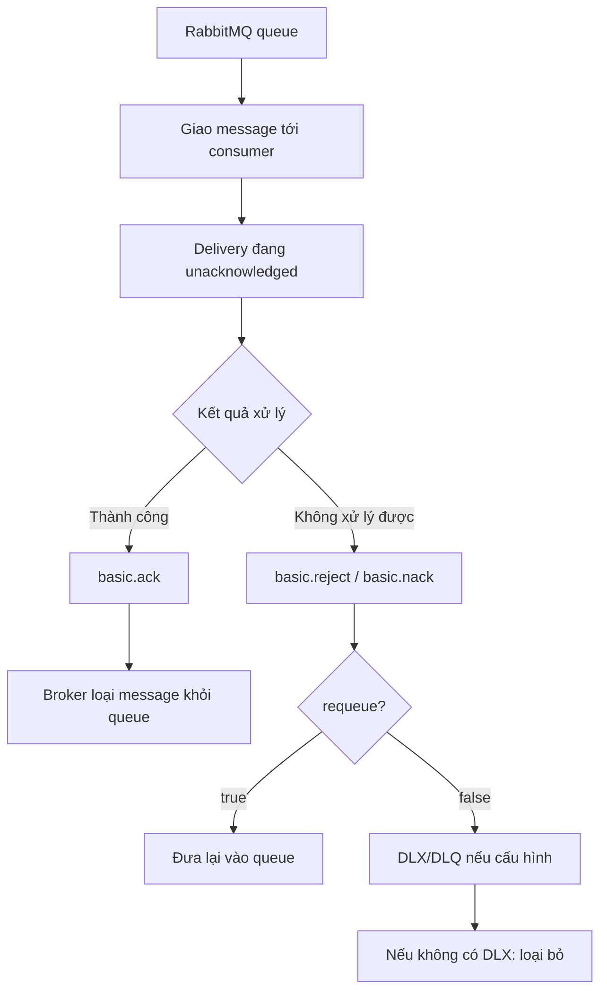

# Phân biệt ack, nack, reject và requeue

RabbitMQ giao message cho consumer theo cơ chế delivery. Sau khi nhận message, consumer phải cho broker biết kết quả xử lý: đã hoàn tất, không thể xử lý, hay cần đưa message trở lại queue để thử lại. Trong AMQP 0-9-1, các thao tác chính là `basic.ack`, `basic.reject` và phần mở rộng của RabbitMQ `basic.nack`. Tham số `requeue` quyết định message bị từ chối sẽ được giao lại hay đi qua dead-letter exchange (DLX).

Bốn thuật ngữ thường được nhắc cùng nhau nhưng không cùng cấp độ:

- **ack** là xác nhận tích cực: consumer đã xử lý xong delivery.
- **reject** là từ chối một delivery.
- **nack** là xác nhận tiêu cực; RabbitMQ mở rộng thao tác này để có thể từ chối nhiều delivery cùng lúc.
- **requeue** là lựa chọn đưa delivery bị từ chối trở lại queue. Nó là một tham số của reject/nack, không phải một loại acknowledgement độc lập.

Trong Spring Cloud Stream Rabbit binder, cấu hình `acknowledgeMode`, retry, `requeueRejected` và DLQ quyết định cách exception từ function được chuyển thành hành vi broker. Hiểu đúng các ranh giới này giúp tránh mất message, vòng lặp redelivery và xử lý side effect nhiều lần.

## 1. Vòng đời của một delivery

RabbitMQ giữ message trong queue cho đến khi có kết quả giao nhận phù hợp. Với manual acknowledgement, broker đánh dấu delivery là unacknowledged sau khi gửi tới consumer. Consumer xử lý rồi gửi ack, reject hoặc nack.



Ở chế độ auto-ack của protocol, broker coi message đã được xác nhận ngay khi gửi tới consumer; ứng dụng không chờ xử lý xong. Ở chế độ manual ack, message chỉ được loại khỏi queue sau khi broker nhận được acknowledgement tương ứng.

Một consumer production thường cần manual acknowledgement hoặc chế độ container quản lý acknowledgement sau khi handler hoàn tất, thay vì auto-ack ngay lúc giao.

## 2. ack — xác nhận xử lý thành công

`basic.ack` là positive acknowledgement. Consumer gửi ack để thông báo rằng delivery đã được xử lý và broker có thể loại message khỏi queue.

Ví dụ với RabbitMQ Java client:

```java
channel.basicAck(deliveryTag, false);
```

Hai tham số:

- `deliveryTag`: mã định danh delivery do channel cấp.
- `multiple`: nếu `false`, chỉ xác nhận delivery có tag được chỉ định; nếu `true`, xác nhận tất cả delivery chưa ack trên cùng channel có tag nhỏ hơn hoặc bằng tag đó.

Ack nên được gửi sau khi side effect cần bảo toàn đã hoàn tất. Ví dụ, nếu consumer cập nhật database, hãy hoàn tất transaction database trước khi ack. Nếu ack trước rồi process crash trước khi commit database, message đã bị loại khỏi queue nhưng nghiệp vụ chưa được ghi nhận.

### Ack không có nghĩa là xử lý đúng một lần

Acknowledgement xác nhận trạng thái giao nhận với broker. Nó không tạo transaction nguyên tử giữa RabbitMQ và database hoặc API bên ngoài. Nếu database commit thành công nhưng connection bị đứt trước khi broker nhận ack, message có thể được giao lại.

Vì vậy, handler vẫn cần idempotency theo event ID, unique constraint hoặc inbox pattern. Ack giúp kiểm soát delivery; nó không loại bỏ duplicate delivery trong mọi tình huống.

### Consumer ack khác publisher confirm

RabbitMQ cũng gửi `basic.ack` cho publisher khi bật confirm mode. Hai trường hợp cùng tên method nhưng khác chiều và mục đích:

- **Consumer acknowledgement:** consumer gửi ack tới broker để xác nhận một delivery đã xử lý.
- **Publisher confirm:** broker gửi ack tới publisher để xác nhận broker đã nhận publish theo semantics của queue đích.

Publisher confirm không chứng minh consumer đã xử lý message. Consumer ack cũng không chứng minh publisher đã nhận confirm. Nếu cần bảo đảm cả hai đầu, producer và consumer phải triển khai hai cơ chế tương ứng.

## 3. reject — từ chối một delivery

`basic.reject` là negative acknowledgement cho **một delivery**. Consumer cho broker biết rằng message này không được xử lý thành công.

Ví dụ:

```java
channel.basicReject(deliveryTag, false);
```

Tham số thứ hai là `requeue`:

- `true`: đưa message trở lại queue để có thể giao lại.
- `false`: không requeue; RabbitMQ route message tới DLX nếu queue có dead-letter exchange, nếu không thì loại bỏ message.

`basic.reject` không có tham số `multiple`; nó chỉ tác động lên một delivery tag. Đây là lựa chọn phù hợp khi muốn từ chối một message cụ thể, chẳng hạn payload sai hợp đồng hoặc dữ liệu không thể xử lý.

### Reject không tự tạo DLQ

`requeue=false` không đồng nghĩa message chắc chắn được lưu vào DLQ. Broker chỉ dead-letter message khi queue có DLX và routing phù hợp. Nếu không có dead-letter configuration, message bị loại bỏ.

Vì vậy, trước khi dùng reject để cách ly dữ liệu, hãy xác minh queue có DLX, routing key và DLQ thực sự hoạt động.

## 4. nack — từ chối một hoặc nhiều delivery

`basic.nack` là phần mở rộng của RabbitMQ cho AMQP 0-9-1. Nó có các tham số:

```java
channel.basicNack(deliveryTag, multiple, requeue);
```

- `deliveryTag`: delivery tag làm mốc.
- `multiple`: chọn một delivery hay nhiều delivery chưa xác nhận.
- `requeue`: đưa delivery bị nack trở lại queue hay dead-letter/drop.

Ví dụ nack một delivery và yêu cầu requeue:

```java
channel.basicNack(deliveryTag, false, true);
```

Ví dụ nack tất cả delivery chưa ack trên channel đến tag hiện tại:

```java
channel.basicNack(deliveryTag, true, false);
```

Khi `multiple=true`, RabbitMQ áp dụng thao tác cho mọi delivery chưa được xác nhận có tag nhỏ hơn hoặc bằng tag được truyền trên **cùng channel**. Đây là thao tác hàng loạt, cần thận trọng khi xử lý song song.

### Khác biệt chính giữa reject và nack

| Đặc điểm | basic.reject | basic.nack |
|---|---|---|
| Ý nghĩa | Từ chối một delivery | Từ chối một hoặc nhiều delivery |
| Có tham số multiple? | Không | Có |
| Có requeue? | Có | Có |
| requeue=false | DLX nếu có, nếu không loại bỏ | DLX nếu có, nếu không loại bỏ |
| Phù hợp | Quyết định lỗi cho một message | Xử lý lỗi một message hoặc một nhóm delivery |

Với quorum queue, RabbitMQ hiện phân biệt thêm ý nghĩa poison-message: `basic.reject` biểu thị delivery xử lý thất bại và tăng delivery-count; `basic.nack` biểu thị consumer không xử lý delivery nhưng không tăng delivery-count. Vì vậy, chỉ `basic.reject` được tính vào delivery limit của quorum queue. Hãy xác minh semantics theo phiên bản RabbitMQ và loại queue đang chạy.

## 5. requeue — đưa message trở lại queue

Requeue là lựa chọn `requeue=true` khi gửi reject/nack. RabbitMQ đưa delivery chưa được xử lý trở lại queue để cùng consumer hoặc consumer khác có thể nhận lại.

Ví dụ:

```java
channel.basicReject(deliveryTag, true);
```

Requeue có ích khi lỗi chỉ tạm thời và một lần thử khác có khả năng thành công, chẳng hạn consumer gặp dependency tạm mất kết nối hoặc cần nhường message cho consumer khác.

Tuy nhiên, requeue không đồng nghĩa với retry có backoff. Message có thể sẵn sàng được giao lại gần như ngay lập tức. Nếu mọi consumer đều gặp cùng một lỗi và liên tục requeue, hệ thống tạo vòng lặp nóng.

### Vị trí message sau requeue

RabbitMQ cố gắng đưa message về vị trí ban đầu trong queue nếu có thể. Khi nhiều consumer đang nhận và xác nhận các delivery khác, message requeue có thể được đặt ở vị trí gần đầu queue. Do đó, không nên giả định requeue luôn giữ thứ tự quan sát tuyệt đối của từng consumer.

Sau requeue, message có thể được giao lại cho chính consumer cũ hoặc một consumer khác. Property `redelivered` cho biết broker đã từng giao message trước đó; nó không cho biết chính xác số lần thử.

## 6. requeue=false: dead-letter hoặc loại bỏ

Khi consumer gửi reject/nack với `requeue=false`, RabbitMQ không đưa message trở lại queue gốc:

- Nếu queue có DLX, broker publish message sang dead-letter exchange theo cấu hình dead-letter routing.
- Nếu không có DLX, message bị loại bỏ.
- Queue đích và routing key phụ thuộc DLX, dead-letter routing key và topology hiện có.

Đây là lựa chọn thường dùng cho message không thể xử lý bằng cách thử lại ngay, chẳng hạn payload sai schema hoặc vi phạm hợp đồng dữ liệu.

Không dùng `requeue=false` với suy nghĩ “RabbitMQ sẽ tự giữ message ở đâu đó”. Muốn bảo toàn message thất bại, hãy cấu hình DLX/DLQ và kiểm tra routing, quyền publish, durability cùng retention của queue đích.

## 7. Delivery tag và cờ multiple

Mỗi delivery trên một channel có một delivery tag tăng dần. Tag chỉ có ý nghĩa trên channel đã nhận delivery đó.

Quy tắc quan trọng:

- Ack/reject/nack phải dùng đúng channel nhận message.
- Không dùng delivery tag từ channel này trên channel khác.
- Không xác nhận cùng một delivery tag hai lần.
- Khi channel đóng, các delivery chưa ack trên channel đó được broker requeue.
- `multiple=true` tác động lên mọi delivery chưa ack trước đó trên cùng channel, không chỉ các message đã xử lý xong theo ý định nghiệp vụ.

Ví dụ channel có các delivery tag 10, 11, 12, 13 đang unacknowledged. Lệnh:

```java
channel.basicAck(12, true);
```

sẽ ack tag 10, 11 và 12. Tag 13 vẫn chưa được ack.

Nếu các message được xử lý bất đồng bộ và tag 10 chưa xong nhưng tag 12 đã xong, dùng `multiple=true` cho tag 12 có thể ack nhầm tag 10. Chỉ dùng ack/nack hàng loạt khi thứ tự hoàn tất và tập delivery chưa xác nhận đã được quản lý chắc chắn.

## 8. Ba acknowledgement mode trong Spring AMQP

Spring AMQP có ba chế độ acknowledgement:

| Mode | Ai xác nhận? | Hành vi |
|---|---|---|
| `NONE` | Không gửi ack | RabbitMQ coi message đã được xác nhận ngay khi gửi tới consumer; thường gọi là auto-ack |
| `AUTO` | Listener container | Container ack khi listener kết thúc bình thường; exception được chuyển qua error handling |
| `MANUAL` | Ứng dụng | Listener phải gọi basicAck/basicNack/basicReject |

`AUTO` của Spring không giống `NONE` của protocol. Trong `AUTO`, container chờ kết quả listener rồi mới quyết định ack hoặc reject. Trong `NONE`, broker không chờ consumer xác nhận hoàn tất xử lý.

Với Spring Cloud Stream Rabbit binder, thuộc tính `acknowledgeMode` có giá trị mặc định `AUTO`.

## 9. Cấu hình acknowledge mode trong Spring Cloud Stream Rabbit binder

Thuộc tính được cấu hình ở Rabbit consumer binding:

```yaml
spring:
  cloud:
    function:
      definition: processOrder
    stream:
      bindings:
        processOrder-in-0:
          destination: orders.events
          group: order-worker
      rabbit:
        bindings:
          processOrder-in-0:
            consumer:
              acknowledge-mode: AUTO
              requeue-rejected: false
```

Trong ví dụ:

- `processOrder-in-0` là input binding.
- `destination` xác định destination mà binder dùng.
- `group` xác định queue consumer group.
- `acknowledge-mode: AUTO` để listener container xác nhận khi function xử lý bình thường.
- `requeue-rejected: false` yêu cầu delivery lỗi không tự requeue trong trường hợp property này được áp dụng.

Có thể đặt `acknowledge-mode: MANUAL` khi ứng dụng thực sự cần kiểm soát ack/nack. Chỉ chọn `NONE` khi chấp nhận rủi ro message được coi là đã nhận ngay cả khi consumer chưa xử lý xong.

### Cấu hình dùng chung

Rabbit binder cho phép đặt consumer defaults cho nhiều binding bằng prefix:

```yaml
spring:
  cloud:
    stream:
      rabbit:
        default:
          acknowledge-mode: AUTO
          requeue-rejected: false
```

Cấu hình riêng của binding ghi đè giá trị mặc định chung. Khi điều tra một binding, hãy kiểm tra cả property riêng và default để hiểu giá trị cuối cùng.

## 10. AUTO mode: container quyết định theo kết quả function

Với `acknowledge-mode: AUTO`, function không cần gọi Channel ack trực tiếp. Listener container quan sát kết quả xử lý:

- Function kết thúc bình thường: container ack delivery.
- Function ném exception: exception đi vào error handling/retry của binder và container.
- Sau khi retry thất bại, binder/container quyết định reject, requeue hoặc chuyển DLQ theo cấu hình.

Ví dụ function:

```java
@Bean
Consumer<OrderCreated> processOrder(OrderService service) {
    return event -> service.handle(event);
}
```

Đây là cách đơn giản nhất cho phần lớn ứng dụng. Logic nghiệp vụ chỉ cần trả về bình thường khi đã xử lý xong; nếu thất bại, ném exception phù hợp để error handler quyết định bước tiếp theo.

Không bắt exception rồi chỉ ghi log và kết thúc bình thường nếu message chưa được xử lý. Trong AUTO mode, kết thúc bình thường khiến container hiểu listener đã hoàn tất và ack message.

## 11. MANUAL mode: ứng dụng tự ack/nack/reject

Trong manual mode, ứng dụng cần delivery tag và channel nhận message. Spring AMQP cung cấp các header `AmqpHeaders.CHANNEL` và `AmqpHeaders.DELIVERY_TAG` để truy cập chúng trong message.

Ví dụ minh họa với function nhận Spring Message:

```java
@Bean
Consumer<Message<OrderCreated>> processOrderManual(OrderService service) {
    return message -> {
        Channel channel = message.getHeaders()
                .get(AmqpHeaders.CHANNEL, Channel.class);
        Long deliveryTag = message.getHeaders()
                .get(AmqpHeaders.DELIVERY_TAG, Long.class);

        if (channel == null || deliveryTag == null) {
            throw new IllegalStateException(
                    "Missing RabbitMQ channel or delivery tag");
        }

        try {
            service.handle(message.getPayload());
            ack(channel, deliveryTag);
        }
        catch (InvalidOrderException ex) {
            reject(channel, deliveryTag);
        }
        catch (TemporaryDependencyException ex) {
            nackAndRequeue(channel, deliveryTag);
        }
    };
}

private static void ack(Channel channel, long tag) {
    try {
        channel.basicAck(tag, false);
    }
    catch (IOException ex) {
        throw new UncheckedIOException(ex);
    }
}

private static void reject(Channel channel, long tag) {
    try {
        channel.basicReject(tag, false);
    }
    catch (IOException ex) {
        throw new UncheckedIOException(ex);
    }
}

private static void nackAndRequeue(Channel channel, long tag) {
    try {
        channel.basicNack(tag, false, true);
    }
    catch (IOException ex) {
        throw new UncheckedIOException(ex);
    }
}
```

Binding cần cấu hình `acknowledge-mode: MANUAL`. Ví dụ phân loại:

- Xử lý thành công: `basicAck`.
- Dữ liệu vĩnh viễn không hợp lệ: `basicReject(..., false)` để dead-letter/drop theo topology.
- Lỗi tạm thời: `basicNack(..., false, true)` để requeue.

Đây là ví dụ minh họa cách truy cập channel và delivery tag; trong ứng dụng thật cần bảo đảm mọi nhánh đều có quyết định giao nhận. Nếu code ném exception trước khi ack/nack, delivery vẫn unacknowledged và có thể được requeue khi channel đóng. Không gọi ack hai lần cho cùng tag.

### Manual ack và xử lý bất đồng bộ

Không giữ channel rồi tùy tiện dùng từ nhiều thread. Channel có delivery tag theo channel và thao tác ack cần được phối hợp với vòng đời listener. Nếu chuyển công việc sang executor, hãy thiết kế rõ quyền sở hữu delivery, trạng thái hoàn tất, shutdown và ack; dùng bounded queue và không ack trước khi công việc đã được lưu bền vững.

## 12. Exception ảnh hưởng đến requeue trong Spring AMQP

Với AUTO mode, exception từ listener được chuyển tới error handler. Một số exception cho phép điều khiển hành vi requeue:

| Exception | Ý nghĩa |
|---|---|
| `AmqpRejectAndDontRequeueException` | Reject và không requeue; DLX có thể nhận message nếu queue được cấu hình |
| `ImmediateRequeueAmqpException` | Yêu cầu requeue ngay |
| `ImmediateAcknowledgeAmqpException` | Xác nhận message và bỏ qua DLQ theo behavior của binder/framework |

Ví dụ từ chối message không requeue:

```java
throw new AmqpRejectAndDontRequeueException(
        "Order payload cannot be processed");
```

Ví dụ yêu cầu requeue:

```java
throw new ImmediateRequeueAmqpException(
        "Inventory service is temporarily unavailable");
```

Chỉ dùng các exception điều khiển này khi đã hiểu retry và DLQ của binding. Ví dụ `ImmediateAcknowledgeAmqpException` có thể làm message bị loại khỏi luồng xử lý và không đi qua DLQ; không dùng nó như cách “bỏ qua lỗi” chung chung.

## 13. Retry, requeueRejected và DLQ của Rabbit binder

Rabbit binder có thể retry message trong ứng dụng trước khi quyết định kết quả cuối cùng. Thuộc tính core `maxAttempts` điều khiển số lần thử. Với retry bật, listener container thread có thể bị giữ trong khoảng backoff; điều này có thể ảnh hưởng throughput và ordering của một consumer.

Ví dụ cấu hình retry và DLQ:

```yaml
spring:
  cloud:
    function:
      definition: processOrder
    stream:
      bindings:
        processOrder-in-0:
          destination: orders.events
          group: order-worker
          consumer:
            max-attempts: 3
            back-off-initial-interval: 1000
            back-off-multiplier: 2.0
            back-off-max-interval: 10000
      rabbit:
        bindings:
          processOrder-in-0:
            consumer:
              auto-bind-dlq: true
              republish-to-dlq: true
              requeue-rejected: false
```

Ý nghĩa:

- Binder thử lại tối đa 3 lần theo retry policy.
- Backoff bắt đầu 1 giây, tăng theo hệ số 2 và không vượt 10 giây.
- `auto-bind-dlq: true` yêu cầu binder khai báo DLX/DLQ và binding liên quan.
- `republish-to-dlq: true` yêu cầu binder publish message lỗi sang DLQ, bổ sung metadata lỗi như exception message/stack trace.
- `requeue-rejected: false` tránh đưa message lỗi quay lại queue vô hạn trong đường reject thông thường.

DLQ của binder cần consumer group tường minh. Tên DLQ và routing được binder tạo theo cấu hình; hãy kiểm tra topology thực tế thay vì tự đoán tên queue.

### requeueRejected=true có thể tạo vòng lặp

Nếu retry đã tắt hoặc đã hết và `requeueRejected=true` trong khi không republish-to-DLQ, message có thể được requeue liên tục. Điều này chỉ phù hợp khi lỗi thực sự tạm thời và có cơ chế kiểm soát số lần thử hoặc thời gian chờ.

Đối với lỗi kéo dài, nên dùng retry có backoff, DLQ có TTL để lên lịch thử lại hoặc parking-lot queue. Requeue ngay không tạo backoff.

## 14. Dead-lettering không giống requeue

Hai hành vi khác nhau:

| Tiêu chí | Requeue | Dead-letter |
|---|---|---|
| Queue đích | Queue ban đầu | Queue được route qua DLX |
| Ý nghĩa | Thử giao lại message | Đưa message ra khỏi luồng chính |
| Khi dùng | Lỗi tạm thời, có khả năng xử lý ở lần sau | Lỗi vĩnh viễn hoặc đã hết retry |
| Nguy cơ | Redelivery loop, hot queue | DLQ đầy hoặc không có consumer xử lý |
| Replay | Message tự quay lại queue | Cần quy trình replay hoặc TTL/DLX route lại |

DLQ không tự sửa message. Nó chỉ cách ly message thất bại để điều tra, sửa dữ liệu hoặc phát lại có kiểm soát. Cần có alert cho số message và tuổi message trong DLQ.

RabbitMQ thêm header `x-death` khi message bị dead-letter. Header này chứa thông tin queue/reason/count và có thể giúp xác định số chu kỳ dead-letter. Không nên dùng requeue liên tục thay cho một quy trình retry có giới hạn.

## 15. Quorum queue delivery limit và poison message

Quorum queue hỗ trợ delivery limit để ngăn poison message bị giao lại vô hạn. Khi message vượt delivery limit, RabbitMQ dead-letter hoặc loại bỏ theo cấu hình queue.

Trong RabbitMQ hiện đại, cần phân biệt:

- `basic.reject` biểu thị xử lý message thất bại và tăng delivery-count.
- `basic.nack` biểu thị consumer không xử lý delivery nhưng không tăng delivery-count theo semantics poison-message của quorum queue.
- Chỉ reject được tính vào delivery limit của quorum queue.

Do đó, nếu dựa vào delivery limit để ngăn poison message, lựa chọn reject/nack có ý nghĩa. Kiểm tra phiên bản RabbitMQ, queue type và delivery-limit được cấu hình; không giả định mọi queue/classic queue có cùng semantics.

## 16. Redelivery, thứ tự và idempotency

Một message có thể được giao lại khi:

- Consumer gửi reject/nack với `requeue=true`.
- Consumer channel hoặc connection đóng khi delivery chưa ack.
- Consumer process bị crash trước khi ack tới broker.
- Retry/recovery của binder yêu cầu giao lại.
- Broker failover làm consumer mất channel và phải kết nối lại.

RabbitMQ cung cấp cờ `redelivered` để báo delivery đã từng được gửi trước đó. Cờ này không phải bộ đếm số lần thử và không thay thế event ID.

Ví dụ dùng event ID để chống xử lý lặp:

```java
@Transactional
public void handle(OrderCreated event) {
    if (processedEventRepository.existsById(event.eventId())) {
        return;
    }

    orderRepository.create(event);
    processedEventRepository.save(event.eventId());
}
```

Nếu hai thao tác cùng dùng database, lưu trạng thái nghiệp vụ và processed event trong cùng transaction. Nếu side effect nằm ở dịch vụ bên ngoài, dùng idempotency key hoặc inbox/outbox và đối soát.

Không dựa vào cờ redelivered để quyết định bỏ message; lần giao đầu có thể đã tạo side effect nhưng ack thất bại, và lần giao lại cần được xử lý an toàn.

## 17. Prefetch và số message chưa ack

Prefetch giới hạn số delivery chưa được acknowledge mà RabbitMQ có thể gửi tới consumer/channel. Khi prefetch cao, consumer có thể giữ nhiều message in-flight. Nếu consumer chậm hoặc bị treo, số message unacked tăng và khi channel đóng, nhiều message có thể cùng được requeue.

Các điểm cần cân nhắc:

- Prefetch thấp giúp giới hạn số message in-flight và memory, nhưng có thể giảm throughput.
- Prefetch cao có thể tăng throughput nhưng làm tăng lượng message chưa ack và phạm vi redelivery khi consumer lỗi.
- Với manual ack, mỗi delivery cần được ack/nack đúng một lần.
- Nếu dùng `multiple=true`, phải bảo đảm mọi delivery tag thấp hơn đã xử lý xong.
- Với công việc nặng, kết hợp prefetch vừa phải, concurrency phù hợp và timeout downstream.

Không chọn prefetch chỉ theo số consumer. Hãy đo processing time, memory, queue depth và redelivery trong tải thực tế.

## 18. Phân loại lỗi để chọn ack/nack/reject

| Loại lỗi | Ví dụ | Hành động thường phù hợp |
|---|---|---|
| Xử lý thành công | Database transaction đã commit | ack |
| Lỗi tạm thời | HTTP timeout, database tạm unavailable | Retry có backoff; sau đó requeue hoặc DLQ theo chính sách |
| Dữ liệu không hợp lệ | JSON sai schema, field bắt buộc thiếu | reject/nack với requeue=false để DLQ hoặc quarantine |
| Lỗi cấu hình | Sai credentials, queue/exchange không tồn tại | Dừng/cảnh báo và sửa cấu hình; tránh requeue từng message vô hạn |
| Poison message | Cùng message thất bại lặp lại | Giới hạn retry, DLQ/parking lot |
| Không thể lưu trạng thái lỗi | DLQ publish thất bại hoặc database quarantine lỗi | Không ack như thể đã lưu; chọn recovery bảo toàn message |

Điều quan trọng là phân biệt “không thể xử lý message này” với “chưa thể xử lý ngay lúc này”. Trường hợp đầu thường cần cách ly; trường hợp sau có thể retry nhưng phải có giới hạn.

## 19. Kiểm thử acknowledgement và redelivery

Unit test cho function không đủ để xác minh broker đã ack, requeue hay dead-letter đúng. Cần integration test với RabbitMQ thật hoặc Testcontainers.

Các kịch bản:

1. **AUTO success:** function kết thúc bình thường; xác minh message được ack và queue giảm.
2. **AUTO exception:** function ném exception; xác minh binder retry đúng số lần và hành vi cuối.
3. **MANUAL ack:** function gọi basicAck; xác minh message biến mất khỏi queue.
4. **MANUAL reject:** gọi basicReject với requeue=false; xác minh message đi DLQ nếu DLX đã cấu hình.
5. **MANUAL nack requeue:** gọi basicNack với requeue=true; xác minh message được giao lại.
6. **Nack multiple:** có nhiều delivery chưa ack; xác minh đúng tập tag bị tác động.
7. **Channel close:** đóng channel khi có delivery unacked; xác minh broker requeue.
8. **Double ack:** xác minh channel báo lỗi protocol với delivery tag không còn hợp lệ.
9. **Redelivery:** xác minh cờ redelivered và idempotency của side effect.
10. **DLQ unavailable:** làm publish/route tới DLQ thất bại; xác minh message không bị ack như thể đã cách ly thành công.
11. **Requeue loop:** gây lỗi kéo dài; xác minh alert, giới hạn retry và không tạo vòng lặp không kiểm soát.
12. **Quorum delivery limit:** thử reject/nack trên quorum queue và quan sát delivery-count/delivery-limit theo phiên bản broker.

Dùng timeout hữu hạn, queue riêng cho từng test và dọn topology sau test. Quan sát cả ready, unacked, redelivered và DLQ depth; chỉ kiểm tra function đã được gọi là chưa đủ.

## 20. Checklist trước khi triển khai

- Đã phân biệt ack, reject, nack và tham số requeue.
- Đã chọn acknowledge mode phù hợp: AUTO, MANUAL hoặc NONE.
- Hiểu AUTO của container khác NONE/auto-ack của protocol.
- Nếu MANUAL, mọi nhánh xử lý đều có ack/nack/reject rõ ràng.
- Delivery tag được xác nhận trên đúng channel nhận message.
- Không ack hai lần hoặc dùng delivery tag trên channel khác.
- Chỉ dùng multiple=true khi mọi delivery tag trước đó đã hoàn tất.
- `requeue-rejected` được cấu hình theo chính sách retry/DLQ.
- Requeue ngay chỉ dùng cho lỗi có khả năng hồi phục.
- Có giới hạn retry và backoff; không tạo vòng lặp nóng.
- DLX/DLQ đã được khai báo và kiểm thử routing.
- Đã hiểu behavior khi không có DLX: reject không requeue có thể loại bỏ message.
- Đã kiểm tra `x-death` và delivery limit nếu dùng dead-letter/quorum queue.
- Handler idempotent để chịu redelivery.
- Side effect bền vững hoàn tất trước khi ack.
- Prefetch/concurrency phù hợp với thời gian xử lý và memory.
- Integration test xác minh ack, nack, reject, requeue, channel close và DLQ.
- Dashboard theo dõi ready, unacked, redelivered, retry và DLQ depth.

Ack, reject và nack biểu thị kết quả xử lý delivery; requeue quyết định message bị từ chối có quay lại queue hay không. Trong Spring Cloud Stream Rabbit binder, hãy chọn acknowledge mode và retry/DLQ theo loại lỗi. Với AUTO, để container xác nhận sau khi function hoàn tất; với MANUAL, quản lý delivery tag chính xác trên đúng channel. Luôn có idempotency, giới hạn retry và integration test để message không bị mất hoặc lặp side effect ngoài ý muốn.

## Tài liệu tham khảo

- [RabbitMQ — Consumer Acknowledgements and Publisher Confirms](https://www.rabbitmq.com/docs/confirms)
- [RabbitMQ — Negative Acknowledgements](https://www.rabbitmq.com/docs/nack)
- [RabbitMQ — Broker Semantics](https://www.rabbitmq.com/docs/semantics)
- [Spring Cloud Stream — RabbitMQ Binder Reference Guide](https://docs.spring.io/spring-cloud-stream/docs/current/reference/html/spring-cloud-stream-binder-rabbit.html)
- [Spring AMQP — Message Listener Container Configuration](https://docs.spring.io/spring-amqp/reference/amqp/containerAttributes.html)
- [Spring AMQP — Handling Exceptions](https://docs.spring.io/spring-amqp/reference/amqp/receiving-messages/async-consumer.html)

