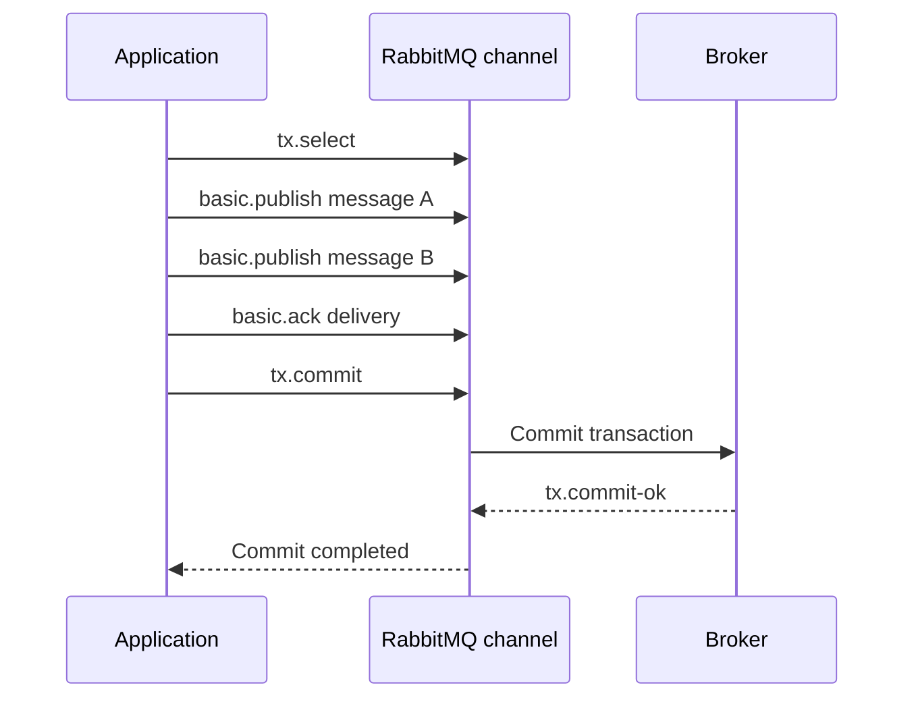
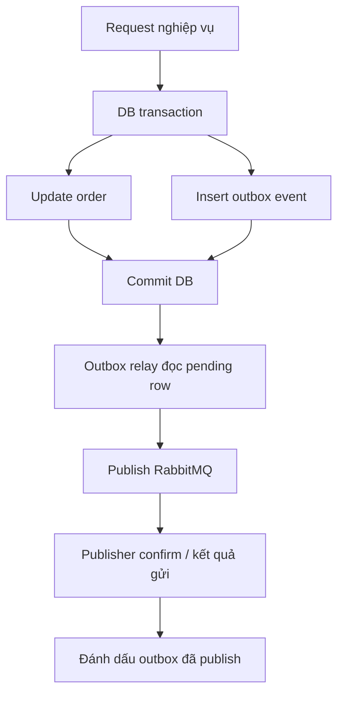

# Giao dịch AMQP và giới hạn khi phối hợp cơ sở dữ liệu

## Mục tiêu

Một ứng dụng Spring Cloud Stream có thể nhận message từ RabbitMQ, cập nhật cơ sở dữ liệu rồi phát một message khác. Các thao tác này có thể xuất hiện trong cùng một phương thức Java, nhưng chúng thuộc hai hệ thống quản lý trạng thái khác nhau. RabbitMQ quản lý message, queue và acknowledgment; database quản lý row và transaction riêng.

**Giao dịch AMQP** của RabbitMQ có thể nhóm các thao tác trên một channel, chẳng hạn publish message và acknowledge delivery, thành một đơn vị commit hoặc rollback. **Giao dịch cơ sở dữ liệu** bảo vệ các thay đổi trong transaction của database. Hai transaction không tự trở thành một atomic transaction chung chỉ vì ứng dụng gọi chúng liên tiếp hoặc đặt chúng trong cùng một annotation `@Transactional`.

Bài học này giải thích transaction AMQP 0-9-1, cách Spring AMQP và RabbitMQ binder bật chế độ giao dịch, khác biệt giữa transaction và publisher confirms, các failure window khi phối hợp với database, cùng các pattern outbox/inbox để xử lý an toàn.

Sau bài học, bạn có thể:

- Giải thích `tx.select`, `tx.commit` và `tx.rollback` trong AMQP 0-9-1.
- Xác định phạm vi transaction trên RabbitMQ channel.
- Phân biệt transaction AMQP, publisher confirms và consumer acknowledgments.
- Cấu hình channel giao dịch trong Spring AMQP hoặc RabbitMQ binder.
- Hiểu vì sao transaction database không tự bao gồm publish/ack RabbitMQ.
- Nhận diện tình huống database commit nhưng message không được publish, hoặc message được ack khi database chưa commit.
- Dùng transactional outbox và inbox/idempotency để khôi phục sau lỗi.
- Thiết kế và kiểm thử failure window giữa database và RabbitMQ.

## 1. Transaction AMQP là gì?

AMQP 0-9-1 định nghĩa một chế độ giao dịch cho channel. Client chọn chế độ này bằng `tx.select`; sau đó các thao tác publish và acknowledgment thuộc channel được giữ trong transaction cho đến khi client gửi `tx.commit` hoặc `tx.rollback`.

Ba thao tác cơ bản:

| Thao tác | Ý nghĩa |
|---|---|
| `tx.select` | Chuyển channel sang chế độ giao dịch |
| `tx.commit` | Commit các thao tác giao dịch đang chờ trên channel |
| `tx.rollback` | Rollback các thao tác giao dịch đang chờ trên channel |

Trong RabbitMQ, transaction gắn với **một channel**. Nó không phải transaction toàn connection, không bao phủ tất cả channel của một connection và cũng không bao phủ một database hoặc broker khác.

Một transaction AMQP có thể được dùng để:

- Publish một hoặc nhiều message rồi commit cùng nhau.
- Acknowledge một hoặc nhiều delivery trong transaction.
- Kết hợp thao tác publish và acknowledgment trên cùng channel trong một transaction, ví dụ consume-transform-publish.
- Rollback các publish chưa commit và làm cho các delivery chưa được xác nhận có thể được giao lại theo semantics của broker.

Luồng khái quát:



Nếu client gọi `tx.rollback` thay cho commit, các publish chưa commit không được giữ như message đã publish thành công; các delivery chưa được xác nhận có thể được giao lại. Ứng dụng cần kiểm thử behavior cụ thể khi kết hợp transaction với requeue, dead-letter và consumer lifecycle.

### Transaction không phải một block code Java

Một phương thức Java có thể gọi nhiều API RabbitMQ, nhưng chỉ những thao tác thực sự dùng channel đang ở transaction mode mới thuộc transaction AMQP đó. Nếu một thao tác dùng channel khác hoặc một connection khác, nó không tự tham gia.

Tương tự, gọi một service database trong khi Rabbit channel đang giao dịch không làm database transaction tự tham gia. Transaction manager phải quản lý tài nguyên tương ứng; AMQP channel không thể rollback một câu SQL đã commit.

## 2. Phạm vi và giới hạn của transaction RabbitMQ

Transaction AMQP có phạm vi hẹp và rõ ràng:

- Gắn với channel đã chọn chế độ transaction.
- Chỉ bao phủ các thao tác AMQP tham gia trên channel đó.
- Commit/rollback được broker xử lý theo giao thức AMQP.
- Không cung cấp atomic commit với JDBC, JPA, file system, HTTP API hoặc Kafka.
- Không tạo thứ tự nghiệp vụ toàn cục giữa nhiều queue hoặc nhiều consumer.
- Không loại bỏ redelivery hoặc duplicate trong mọi failure window.

Nếu ứng dụng mở hai channel A và B, transaction trên A không tự commit hoặc rollback thao tác của B. Nếu ứng dụng gửi message đến hai exchange trên cùng broker qua cùng channel giao dịch, các publish có thể thuộc cùng transaction; nhưng routing vẫn phụ thuộc exchange, binding, routing key và topology. Transaction commit không sửa một routing key sai hoặc bảo đảm có queue phù hợp nếu message không được route.

Một transaction RabbitMQ cũng không phải một transaction phân tán XA. Không thể đưa database connection vào cùng AMQP transaction chỉ bằng cách thêm một annotation hoặc dùng cùng một thread.

## 3. Publish và acknowledgment trong một transaction

Một use case hữu ích là consumer nhận message đầu vào, thực hiện biến đổi và phát message đầu ra. Nếu consumer acknowledgment và output publish được thực hiện trên cùng channel giao dịch, ứng dụng có thể commit hai thao tác AMQP cùng nhau:

- Khi transaction commit, output publish và acknowledgment đầu vào được commit theo transaction của channel.
- Khi transaction rollback, output publish chưa commit bị hủy và delivery đầu vào chưa được xác nhận có thể được giao lại.

Điều này hữu ích cho một bước consume-transform-publish chỉ nằm trong RabbitMQ. Tuy nhiên, cần xác minh Spring container/binder có thực sự dùng cùng channel giao dịch cho input acknowledgment và output publish hay không. Nếu output được gửi qua một channel khác, nó không thuộc cùng transaction chỉ vì code gọi cả hai trong một handler.

Ví dụ khái niệm:

```text
Nhận delivery trên channel C
    -> tx.select đã được bật cho C
    -> xử lý message
    -> publish output trên channel C
    -> acknowledge input delivery trên channel C
    -> tx.commit trên C
```

Không suy ra từ ví dụ khái niệm rằng mọi lời gọi `StreamBridge.send()` bên trong listener đều dùng cùng channel với delivery. Cấu hình binder, transaction manager, connection factory và cách gửi message quyết định channel thực tế.

### Điều gì xảy ra khi process dừng?

Nếu process dừng trước khi transaction commit, broker có thể rollback/đóng channel và các delivery chưa được xác nhận được xem xét để giao lại. Publish chưa commit không nên được xem là đã hoàn tất. Nếu commit đã được broker xử lý nhưng response bị mất trên mạng, client có thể không biết chắc transaction đã commit hay chưa; retry mù quáng có thể tạo duplicate ở tầng ứng dụng. Dùng event ID ổn định và idempotency cho những thao tác có thể được thực hiện lại.

## 4. Transaction trong Spring AMQP

Spring AMQP cung cấp các abstraction để làm việc với channel giao dịch. Hai khái niệm quan trọng:

- `channelTransacted`: yêu cầu thao tác RabbitMQ dùng channel ở transaction mode.
- `RabbitTransactionManager`: transaction manager cục bộ quản lý tài nguyên RabbitMQ qua một `ConnectionFactory`.

Với `RabbitTemplate`, có thể bật channel transaction:

```java
@Bean
RabbitTemplate transactionalRabbitTemplate(
        ConnectionFactory connectionFactory) {

    RabbitTemplate template = new RabbitTemplate(connectionFactory);
    template.setChannelTransacted(true);
    return template;
}
```

Nếu dùng một `RabbitTransactionManager`, các thao tác RabbitTemplate được cấu hình channel-transacted có thể tham gia transaction RabbitMQ gắn với thread hiện tại:

```java
@Bean
RabbitTransactionManager rabbitTransactionManager(
        ConnectionFactory connectionFactory) {
    return new RabbitTransactionManager(connectionFactory);
}
```

Ví dụ service chỉ thực hiện thao tác RabbitMQ:

```java
@Service
public class OrderEventPublisher {

    private final RabbitTemplate rabbitTemplate;

    public OrderEventPublisher(RabbitTemplate rabbitTemplate) {
        this.rabbitTemplate = rabbitTemplate;
    }

    @Transactional(transactionManager = "rabbitTransactionManager")
    public void publish(OrderCreated event) {
        rabbitTemplate.convertAndSend(
                "orders",
                "orders.created",
                event
        );
    }
}
```

Khi transaction manager RabbitMQ quản lý phương thức, commit hoặc rollback điều khiển transaction RabbitMQ tương ứng. Đây vẫn là transaction cục bộ của RabbitMQ; nếu phương thức còn cập nhật database qua một transaction manager khác, database không tự trở thành một phần của transaction này.

Tên bean transaction manager trong ví dụ cần khớp cấu hình ứng dụng. Nếu có nhiều transaction manager, chỉ định rõ manager hoặc qualifier để tránh annotation vô tình chọn nhầm tài nguyên.

### Listener container

Với Spring AMQP listener container, `channelTransacted` cho phép acknowledgment tham gia transaction channel. Nếu listener ném exception, container có thể rollback transaction và delivery được đưa lại theo cấu hình rollback/requeue/error handling.

```java
@Bean
SimpleRabbitListenerContainerFactory transactionalListenerFactory(
        ConnectionFactory connectionFactory) {

    SimpleRabbitListenerContainerFactory factory =
            new SimpleRabbitListenerContainerFactory();

    factory.setConnectionFactory(connectionFactory);
    factory.setChannelTransacted(true);
    factory.setDefaultRequeueRejected(false);

    return factory;
}
```

Ví dụ trên minh họa factory cho listener Spring AMQP. `defaultRequeueRejected` là chính sách xử lý message bị reject khi listener thất bại; cần kết hợp retry/DLQ phù hợp. Không bật requeue vô hạn cho poison message.

## 5. Cấu hình transaction trong Spring Cloud Stream RabbitMQ binder

RabbitMQ binder có thuộc tính `transacted` cho consumer và producer binding. Cấu hình nằm trong namespace Rabbit binder của đúng binding:

Consumer:

```yaml
spring:
  cloud:
    function:
      definition: processOrders
    stream:
      bindings:
        processOrders-in-0:
          destination: orders
          group: inventory-service
      rabbit:
        bindings:
          processOrders-in-0:
            consumer:
              transacted: true
```

Producer:

```yaml
spring:
  cloud:
    stream:
      bindings:
        orders-out-0:
          destination: orders.processed
      rabbit:
        bindings:
          orders-out-0:
            producer:
              transacted: true
```

Các thuộc tính này yêu cầu binder dùng chế độ giao dịch cho binding tương ứng. Chúng không tuyên bố rằng mọi binding input/output trong ứng dụng dùng chung một channel hoặc một transaction. Đặc biệt, bật `transacted: true` trên consumer và producer binding riêng biệt không tự bảo đảm publish output và ack input cùng một transaction AMQP. Phải xác minh cách binder tích hợp channel, container và transaction manager của phiên bản đang chạy.

Khi cần một transaction bao phủ consume và publish, kiểm tra tài liệu Rabbit binder, effective configuration và integration test. Không dựa vào việc hai binding cùng dùng một destination hoặc cùng một `ConnectionFactory` để suy ra chúng chia sẻ channel transaction.

### Kết hợp với database transaction manager

Spring AMQP có thể đồng bộ thao tác channel-transacted với một transaction manager bên ngoài theo cơ chế transaction synchronization. Cách này có thể sắp xếp thời điểm commit Rabbit channel tương ứng với transaction chính. Tuy nhiên, đây vẫn không phải distributed atomic commit.

Ví dụ failure window vẫn tồn tại: database đã commit, nhưng process hoặc broker gặp lỗi trước khi Rabbit transaction commit thành công. Ứng dụng cần khả năng phát lại message từ một bản ghi bền vững như outbox, thay vì giả định cả hai resource đã commit cùng lúc.

## 6. Transaction AMQP khác publisher confirms

Publisher confirms là cơ chế broker xác nhận kết quả publish cho producer. Producer có thể biết broker đã xác nhận message, thay vì chỉ biết lệnh gửi đã được ghi vào client buffer hoặc socket.

Transaction AMQP và publisher confirms là hai cơ chế khác nhau:

| Tiêu chí | AMQP transaction | Publisher confirms |
|---|---|---|
| Mục đích | Commit/rollback nhóm thao tác trên channel | Xác nhận broker đã xử lý publish |
| Phạm vi | Transaction trên một channel | Kết quả publish của message/sequence trên channel |
| Rollback nhóm publish | Có qua tx.rollback trước commit | Không có thao tác rollback publish đã được broker confirm |
| Kết hợp với consumer ack | Có thể đưa ack và publish cùng transaction trên channel | Confirm chỉ xác nhận publish; consumer ack là cơ chế riêng |
| Hiệu năng | Transaction commit có chi phí đồng bộ đáng kể | Thường phù hợp hơn cho throughput publish cao |
| Database atomicity | Không | Không |

RabbitMQ không cho phép dùng publisher confirm mode và transaction mode đồng thời trên cùng channel. Chọn cơ chế phù hợp với nhu cầu của publisher; không cấu hình cả hai trên một channel rồi kỳ vọng chúng bổ sung nhau.

Với phần lớn producer cần độ tin cậy publish, publisher confirms thường là lựa chọn phù hợp hơn transaction AMQP vì có thể xử lý nhiều publish bất đồng bộ và theo dõi confirm. Nhưng confirm không có nghĩa message đã được consumer xử lý, cũng không chứng minh database đã commit.

Nếu exchange không có binding phù hợp, broker vẫn có thể confirm việc xử lý publish nhưng message không được route đến queue nào, tùy publish flags và cấu hình. Dùng mandatory publish/return handling nếu ứng dụng cần phát hiện message không được route; publisher confirm và returned message là hai tín hiệu cần xem xét cùng nhau.

## 7. Queue durability và message persistence vẫn là điều kiện riêng

Transaction không thay thế durability. Muốn message tồn tại qua broker restart, cần xem xét riêng:

- Queue/exchange topology có được khai báo durable hay không.
- Message có được publish với delivery mode persistent hay không.
- Queue type và replication policy (ví dụ quorum queue) có đáp ứng yêu cầu không.
- Publisher confirm hoặc transaction commit có được nhận thành công không.
- Broker storage và cluster có được vận hành đúng không.

Một queue durable không làm mọi message tự động persistent. Message persistent cũng không bảo đảm được route đến queue nếu binding sai. Transaction commit không sửa topology hoặc cấu hình retention.

Với RabbitMQ binder, kiểm tra `durableSubscription`, delivery mode và queue arguments theo phiên bản binder. Nếu topology được quản lý bởi hạ tầng, đảm bảo exchange, queue, binding và DLQ được tạo trước khi ứng dụng publish/consume.

## 8. Vì sao database transaction không tự bao gồm RabbitMQ?

Giả sử service lưu đơn hàng vào database rồi publish `OrderCreated`:

```java
@Service
public class OrderService {

    private final OrderRepository orderRepository;
    private final RabbitTemplate rabbitTemplate;

    @Transactional
    public void createOrder(Order order) {
        orderRepository.save(order);

        rabbitTemplate.convertAndSend(
                "orders",
                "orders.created",
                OrderCreated.from(order)
        );
    }
}
```

Nếu transaction manager đang điều khiển phương thức là database transaction manager, `orderRepository.save()` tham gia transaction database. Lời gọi RabbitTemplate không tự trở thành một thao tác JDBC. Nếu RabbitTemplate không dùng channel transaction, publish có thể được gửi độc lập; nếu channel transaction được đồng bộ với database transaction, vẫn có thể tồn tại khoảng trống giữa hai lần commit.

Tương tự, nếu phương thức được điều khiển bởi `RabbitTransactionManager`, Rabbit channel có thể commit/rollback nhưng database operation không tự tham gia transaction RabbitMQ.

### Hai failure window cơ bản

**Database commit nhưng Rabbit publish thất bại:**

1. Database lưu đơn hàng và commit.
2. Ứng dụng publish message nhưng broker không nhận hoặc transaction RabbitMQ rollback.
3. Đơn hàng tồn tại nhưng consumer không nhận được `OrderCreated`.

Kết quả: trạng thái database đã thay đổi nhưng event bị thiếu.

**Rabbit publish commit nhưng database rollback:**

1. RabbitMQ nhận và commit `OrderCreated`.
2. Database transaction rollback do lỗi.
3. Consumer nhận event cho một đơn hàng chưa tồn tại hoặc chưa được commit.

Kết quả: event không phản ánh trạng thái database.

| Failure window | Database | RabbitMQ | Hậu quả |
|---|---|---|---|
| DB commit, publish thất bại | Đã commit | Không có message | Thiếu event |
| Publish commit, DB rollback | Rollback | Message đã được route/commit | Event ma |
| Cả hai commit, response mất | Đã commit | Đã commit | Caller retry có thể tạo duplicate |
| Process chết giữa hai commit | Một resource đã commit | Resource còn lại chưa commit | Trạng thái lệch |
| Broker nhận message, app chết trước khi ghi nhận kết quả | Tùy transaction DB | Message có thể đã commit | Retry có thể publish trùng |

Một annotation không loại bỏ các trạng thái trung gian này. Cần thiết kế một nguồn dữ liệu bền vững để có thể phục hồi.

## 9. Transactional outbox cho producer

Transactional outbox giải quyết failure window ở phía producer bằng cách ghi thay đổi nghiệp vụ và bản ghi sự kiện vào cùng database transaction. Một relay riêng đọc outbox và publish message đến RabbitMQ.

Luồng:



Schema minh họa:

```sql
CREATE TABLE outbox_event (
    event_id VARCHAR(120) PRIMARY KEY,
    aggregate_id VARCHAR(120) NOT NULL,
    event_type VARCHAR(160) NOT NULL,
    payload JSON NOT NULL,
    created_at TIMESTAMP NOT NULL,
    published_at TIMESTAMP NULL
);
```

Service nghiệp vụ chỉ ghi database:

```java
@Transactional
public void createOrder(Order order) {
    orderRepository.save(order);

    OrderCreated event = OrderCreated.from(order);
    outboxRepository.insert(
            event.eventId(),
            order.id(),
            "order.created",
            serialize(event),
            clock.instant()
    );
}
```

Vì order và outbox row nằm trong cùng DB transaction, cả hai cùng commit hoặc rollback. Nếu RabbitMQ tạm thời không khả dụng, outbox row vẫn tồn tại và relay có thể thử lại sau.

### Relay cần đánh dấu sau khi có kết quả publish

Relay có thể dùng RabbitTemplate, Spring Integration hoặc một thành phần publish riêng. Trình tự logic:

```text
Claim một batch outbox row chưa publish
    -> Publish message với event_id gốc
    -> Chờ publisher confirm/return outcome theo policy
    -> Nếu publish thành công và được route như mong đợi: đánh dấu published
    -> Nếu publish thất bại: giữ pending và retry theo backoff
```

Không đánh dấu outbox row đã publish chỉ vì một lời gọi API gửi trả về mà chưa có kết quả broker cần thiết. Nếu dùng publisher confirms, xử lý cả positive confirm, negative confirm và returned message khi bật mandatory routing.

### Outbox vẫn có thể publish duplicate

Giả sử RabbitMQ đã nhận message và confirm, nhưng relay dừng trước khi cập nhật `published_at`. Khi khởi động lại, relay thấy row vẫn pending và gửi lại. Vì vậy, outbox thường cung cấp at-least-once delivery, không tự bảo đảm exactly-once end-to-end.

Để chịu được duplicate:

- Giữ nguyên event ID trong mọi lần retry.
- Consumer ghi event ID đã xử lý trong inbox có unique constraint.
- Inbox record và thay đổi nghiệp vụ consumer commit trong cùng DB transaction.
- Theo dõi tuổi outbox row, số lần retry và publish failure.
- Có quy trình xử lý row bị kẹt hoặc payload không còn tương thích.

### Polling relay và CDC

| Cách relay | Đặc điểm | Cần cân nhắc |
|---|---|---|
| Polling | Truy vấn các row pending theo batch | Claim/lock row, polling interval, batch size, cleanup |
| CDC | Đọc database change log rồi chuyển outbox record sang broker | Connector, log retention, schema routing và vận hành |

Dù dùng polling hay CDC, event ID ổn định và consumer idempotency vẫn cần thiết.

## 10. Inbox/idempotency cho consumer ghi database

Ở phía consumer, RabbitMQ delivery và database transaction cũng là hai resource. Một tình huống thường gặp:

1. Consumer nhận message.
2. Database cập nhật thành công và commit.
3. Process chết trước khi gửi acknowledgment.
4. RabbitMQ giao lại message vì delivery chưa được xác nhận.
5. Side effect có thể xảy ra lần nữa.

Inbox pattern giúp loại bỏ tác động lặp. Tạo bảng:

```sql
CREATE TABLE inbox_event (
    event_id VARCHAR(120) PRIMARY KEY,
    received_at TIMESTAMP NOT NULL
);
```

Consumer xử lý trong cùng transaction database:

```java
@Transactional
public void handle(OrderCreated event) {
    boolean firstDelivery = inboxRepository.insertIfAbsent(
            event.eventId(),
            clock.instant()
    );

    if (!firstDelivery) {
        return;
    }

    inventoryService.reserve(event.orderId());
}
```

Nếu event ID đã tồn tại, side effect đã được commit trong transaction trước đó; delivery lặp có thể kết thúc mà không xử lý lại. Nếu transaction rollback, cả inbox insert và business update rollback, nên message được giao lại có thể được xử lý lần nữa.

`insertIfAbsent` cần dựa trên unique constraint hoặc thao tác atomic của database. Mẫu `SELECT` rồi `INSERT` không được bảo vệ có thể race khi hai consumer cùng xử lý một event.

### Thời điểm ack

Đối với consumer ghi database, một thứ tự thường dễ phục hồi là:

1. Nhận message.
2. Ghi inbox và cập nhật nghiệp vụ trong DB transaction.
3. Commit DB.
4. Ack message theo cơ chế container/binder.

Nếu process chết sau bước 3 nhưng trước bước 4, message có thể được giao lại; inbox nhận diện duplicate. Nếu ack trước DB commit rồi database rollback, message đã bị loại khỏi queue và nghiệp vụ có thể bị mất. Cấu hình acknowledgment của Rabbit binder/listener container cần khớp với transaction boundary thực tế.

Không bật auto-ack nếu ứng dụng cần chờ database commit trước khi xác nhận. Kiểm tra `acknowledgeMode`, `transacted`, error handling và retry của binder theo phiên bản đang dùng.

## 11. Kết hợp database transaction và Rabbit channel transaction

Spring AMQP hỗ trợ phối hợp channel-transacted với một transaction manager bên ngoài thông qua transaction synchronization. Trong một số cấu hình, thao tác Rabbit được commit sau khi transaction chính hoàn tất; nếu transaction chính rollback, channel transaction có thể rollback theo synchronization.

Cách này hữu ích để tránh publish khi database transaction rollback trong các failure path thông thường. Nhưng nó không cung cấp distributed atomic commit. Vẫn có một khoảng thời gian sau khi database commit và trước khi Rabbit channel commit. Nếu broker hoặc process gặp sự cố trong khoảng đó, database có thể đã commit trong khi publish chưa hoàn tất.

Vì vậy:

- Không gọi transaction synchronization là XA hoặc two-phase commit.
- Không giả định rollback của database luôn có thể rollback một publish RabbitMQ đã commit độc lập.
- Không giả định Rabbit transaction commit luôn thành công sau khi database commit.
- Nếu không thể chấp nhận mất event, dùng outbox để có bản ghi cần publish bền vững.
- Nếu consumer có side effect database, dùng inbox/idempotency để chịu redelivery.

`ChainedTransactionManager` hoặc việc sắp xếp nhiều local transaction manager cũng không biến hai resource thành một distributed transaction thực sự. Nếu dùng cơ chế phối hợp nhiều manager, cần hiểu thứ tự commit và failure behavior, đồng thời có reconciliation/recovery.

## 12. Khi nào dùng AMQP transaction, khi nào dùng publisher confirms?

Chọn cơ chế theo yêu cầu:

| Nhu cầu | Cơ chế nên cân nhắc | Giới hạn |
|---|---|---|
| Nhóm nhiều publish trên một channel thành commit/rollback | AMQP transaction | Phạm vi một channel, chi phí commit cao |
| Consume-transform-publish trên cùng channel và cùng broker | Channel transaction | Phải xác minh input ack và output publish dùng cùng channel |
| Xác nhận broker đã xử lý publish | Publisher confirms | Không xác nhận consumer đã xử lý |
| Phát event sau DB commit mà không muốn mất event | Transactional outbox + publisher confirms | Có thể gửi duplicate; consumer cần idempotent |
| Consumer cập nhật DB rồi ack | DB transaction + inbox/idempotency | DB và ack không atomic chung; redelivery cần được xử lý |
| Cần transaction phân tán nhiều hệ thống | Distributed transaction coordinator nếu tất cả resource hỗ trợ | Phức tạp; RabbitMQ transaction đơn lẻ không phải XA |

Trong nhiều ứng dụng, publisher confirms cùng outbox mang lại cách vận hành rõ ràng hơn so với dùng AMQP transaction cho mọi publish. AMQP transaction phù hợp khi cần atomicity cho nhóm thao tác AMQP trên cùng channel, nhưng không phải công cụ tổng quát để phối hợp database.

## 13. Kiểm thử transaction AMQP

Unit test service chỉ xác minh logic nghiệp vụ; nó không chứng minh RabbitMQ đã commit hoặc rollback các thao tác trên channel. Cần kiểm thử với broker thật hoặc môi trường RabbitMQ test tương đương production.

### Kiểm thử commit

- Mở channel transaction.
- Publish một hoặc nhiều message.
- Commit.
- Xác minh message được route đến queue phù hợp.
- Xác minh consumer nhận được message sau commit.
- Nếu transaction bao gồm acknowledgment, xác minh delivery đầu vào không bị giao lại sau commit.

### Kiểm thử rollback

- Mở channel transaction.
- Publish message.
- Rollback hoặc gây exception trước commit.
- Xác minh message chưa commit không xuất hiện như publish thành công.
- Với delivery đầu vào chưa ack, xác minh message có thể được giao lại theo cấu hình.
- Kiểm tra retry/DLQ không tạo vòng lặp ngoài ý muốn.

### Kiểm thử DB và RabbitMQ

Tạo failure injection ở các điểm:

1. DB rollback trước khi Rabbit publish.
2. DB commit xong nhưng process dừng trước Rabbit commit.
3. Rabbit publish commit nhưng response bị mất.
4. Consumer DB commit xong nhưng process dừng trước ack.
5. Outbox relay publish thành công rồi dừng trước khi đánh dấu row.
6. Duplicate message được consumer nhận lại.

Quan sát đồng thời trạng thái database, outbox/inbox, queue depth, message redelivery và kết quả publish. Chỉ kiểm tra exception hoặc log không đủ để chứng minh tính đúng đắn.

### Kiểm thử publisher confirms

Nếu dùng confirms thay transaction:

- Xác minh positive confirm khi broker nhận publish.
- Xử lý negative confirm hoặc timeout.
- Dùng mandatory publish/return handling để phát hiện message không được route.
- Xác minh relay không đánh dấu outbox published trước khi có kết quả phù hợp.
- Mô phỏng confirm bị mất để kiểm tra duplicate khi retry.

Test Binder kiểm tra wiring Spring Cloud Stream nhưng không mô phỏng RabbitMQ channel transaction, publisher confirm, queue durability hoặc redelivery. Cần broker integration test cho những bảo đảm này.

## 14. Vận hành và quan sát

Theo dõi các chỉ số liên quan:

| Chỉ số | Ý nghĩa |
|---|---|
| Transaction commit/rollback rate | Số transaction AMQP commit hoặc rollback |
| Publish confirm latency | Thời gian nhận confirm từ broker |
| Negative confirm/return count | Publish thất bại hoặc message không được route |
| Queue ready/unacked count | Backlog và message đang được consumer giữ |
| Redelivery rate | Tần suất message được giao lại |
| Consumer processing latency | Thời gian xử lý trước ack |
| Outbox pending count/age | Số event chờ publish và tuổi row lâu nhất |
| Inbox duplicate count | Số delivery lặp bị deduplicate |
| Connection/channel errors | Lỗi kết nối, channel đóng hoặc transaction abort |

Outbox table cần index theo trạng thái và thời gian, batch size, chiến lược claim row và cleanup/archival. Không xóa row pending chỉ vì nó cũ. Queue backlog và redelivery tăng có thể do consumer lỗi, dependency chậm, ack không hoàn tất hoặc requeue policy; cần đối chiếu log và metric.

Log nên có event ID, exchange, routing key, queue/group, transaction outcome và correlation ID. Không log credential hoặc toàn bộ payload nhạy cảm.

## 15. Những lỗi thường gặp

| Triệu chứng | Nguyên nhân có thể | Cách xử lý |
|---|---|---|
| DB rollback nhưng message vẫn tồn tại | Publish không tham gia transaction DB hoặc đã commit độc lập | Dùng outbox và xác định transaction manager |
| DB commit nhưng không có message | Publish/AMQP transaction thất bại sau DB commit | Ghi outbox cùng DB transaction |
| Consumer xử lý trùng | DB commit xong nhưng ack chưa được broker nhận | Inbox/unique event ID và idempotent handler |
| Nghĩ hai binding cùng transacted sẽ dùng chung channel | Mỗi binding/container có channel riêng | Xác minh channel thực tế và transaction integration |
| Transaction commit chậm | AMQP transaction có chi phí đồng bộ | Cân nhắc publisher confirms hoặc batch phù hợp |
| Message không vào queue dù publish được confirm | Không có binding/routing key phù hợp | Dùng mandatory returns và kiểm tra topology |
| Queue durable nhưng message không tồn tại sau restart | Message không persistent hoặc publish chưa được xác nhận | Kiểm tra delivery mode, queue type và confirms |
| Poison message requeue vô hạn | Requeue policy không có giới hạn | Retry có backoff, DLQ và phân loại lỗi |
| Consumer ack trước khi DB commit | Auto-ack hoặc transaction boundary sai | Điều chỉnh ack mode và kiểm thử crash window |

## 16. Quy trình thiết kế một luồng RabbitMQ có database

Trước khi triển khai, hãy trả lời:

1. Transaction AMQP cần bao phủ những publish/ack nào trên cùng channel?
2. Producer cần atomic group publish hay chỉ cần xác nhận broker đã nhận message?
3. Exchange, queue và message có durability/persistence phù hợp không?
4. Database transaction manager nào đang điều khiển nghiệp vụ?
5. Có khoảng trống giữa DB commit và Rabbit commit không?
6. Có thể ghi outbox trong cùng transaction database không?
7. Consumer có inbox/event ID để chống duplicate không?
8. Ack chỉ diễn ra sau khi DB commit hay chưa?
9. Retry, requeue và DLQ có giới hạn không?
10. Integration test đã mô phỏng process crash và confirm/ack response bị mất chưa?

Với luồng nghiệp vụ quan trọng, lưu đồ transaction và failure window nên được ghi trong tài liệu vận hành. Nêu rõ nguồn sự thật, event ID, cách replay, owner của outbox/DLQ và metric cảnh báo.

## Kết luận

Transaction AMQP của RabbitMQ nhóm publish và acknowledgment trên cùng channel thông qua `tx.select`, `tx.commit` và `tx.rollback`. Spring AMQP và RabbitMQ binder có thể bật channel/binding transaction, nhưng phạm vi vẫn là resource RabbitMQ tham gia transaction đó. Publisher confirms là cơ chế xác nhận publish riêng và thường phù hợp hơn cho producer cần throughput cao; hai chế độ không dùng đồng thời trên cùng channel.

Database transaction không tự enlist RabbitMQ channel và Rabbit transaction không thể rollback một database đã commit. Khi cần giữ nhất quán giữa trạng thái database và event, dùng transactional outbox ở producer; ở consumer, dùng inbox/idempotency và chỉ ack sau khi thay đổi database đã commit. Kiểm thử các failure window thực tế để chứng minh message không bị mất âm thầm và duplicate không tạo side effect lặp.

