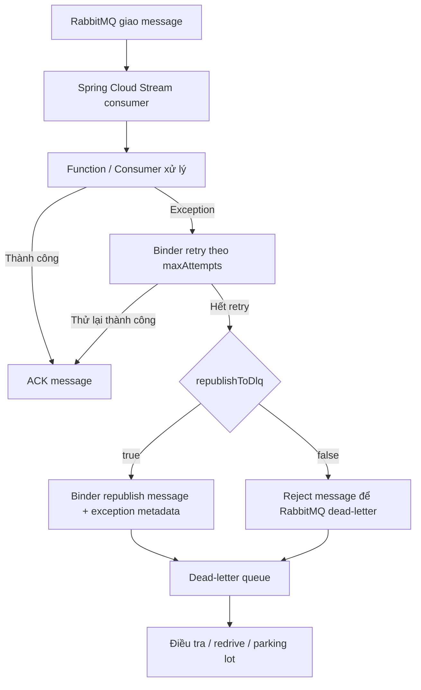

# republishToDlq và metadata exception

Khi consumer Spring Cloud Stream RabbitMQ xử lý message thất bại, binder có thể retry, reject message hoặc chuyển message sang dead-letter queue (DLQ). Nếu chỉ dùng cơ chế dead-lettering của RabbitMQ, message gốc được giữ lại và broker bổ sung header `x-death`, nhưng thông tin về exception trong ứng dụng thường không có đầy đủ.

Thuộc tính `republishToDlq` cho phép RabbitMQ binder **phát lại message lỗi tới DLQ** thay vì chỉ reject message để broker tự chuyển. Trong lúc republish, binder bổ sung metadata về lỗi, chẳng hạn exception message, stack trace và thông tin exchange/routing key ban đầu. Nhờ vậy, người vận hành có thể biết message lỗi ở đâu, vì sao lỗi và có thể định tuyến lại message có kiểm soát.

`autoBindDlq` và `republishToDlq` giải quyết hai việc khác nhau: `autoBindDlq` yêu cầu binder khai báo DLX/DLQ và routing; `republishToDlq` quyết định cách binder đưa message lỗi vào DLQ và metadata được bổ sung. Bật republish mà không có DLQ/routing phù hợp không tự tạo ra một nơi lưu trữ lỗi.

## 1. Luồng xử lý khi consumer thất bại

Giả sử function `processOrder` nhận message từ queue `orders.commands.order-handler`. Khi xử lý ném exception, binder thực hiện retry theo cấu hình. Nếu các lần retry đều thất bại và DLQ đã được cấu hình, message sẽ được đưa vào luồng dead-letter.

Ví dụ consumer imperative:

```java
import java.util.function.Consumer;

import org.springframework.context.annotation.Bean;
import org.springframework.context.annotation.Configuration;

@Configuration
class OrderConsumer {

    @Bean
    Consumer<OrderCreated> processOrder(OrderService orderService) {
        return event -> orderService.process(event);
    }
}
```

Nếu `orderService.process(...)` ném exception ra khỏi consumer, binder nhận được lỗi để áp dụng retry và recovery. Không bắt exception rồi chỉ ghi log nếu mục tiêu là để binder chuyển message thất bại sang DLQ.



Khi `republishToDlq=true`, binder dùng recoverer để gửi lại message tới dead-letter exchange/queue. Khi `false`, binder reject message và RabbitMQ thực hiện dead-letter routing theo cấu hình queue. Cả hai hướng đều cần topology DLQ hợp lệ nếu muốn giữ message trong DLQ.

## 2. Cấu hình autoBindDlq và republishToDlq

Ví dụ cấu hình cho binding `processOrder-in-0`:

```yaml
spring:
  cloud:
    function:
      definition: processOrder
    stream:
      bindings:
        processOrder-in-0:
          destination: orders.commands
          group: order-handler
          consumer:
            max-attempts: 3
            back-off-initial-interval: 1000
            back-off-multiplier: 2.0
            back-off-max-interval: 10000
      rabbit:
        bindings:
          processOrder-in-0:
            consumer:
              auto-bind-dlq: true
              republish-to-dlq: true
              requeue-rejected: false
              republish-delivery-mode: PERSISTENT
              frame-max-headroom: 20000
```

Các thuộc tính Rabbit-specific nằm dưới `spring.cloud.stream.rabbit.bindings.<binding-name>.consumer`:

| Thuộc tính | Ý nghĩa |
|---|---|
| `auto-bind-dlq` | Tự khai báo DLQ, dead-letter exchange và binding cần thiết. Mặc định `false`. |
| `republish-to-dlq` | Binder republish message lỗi và thêm metadata exception. |
| `requeue-rejected` | Khi retry bị tắt hoặc republish không dùng, quyết định message reject có được đưa lại queue hay không. Mặc định `false`. |
| `republish-delivery-mode` | Delivery mode của message được republish. Mặc định `PERSISTENT`. |
| `frame-max-headroom` | Số byte dành trước cho các header khác khi tính kích thước stack trace. Mặc định `20000`. |

`max-attempts` và các thuộc tính backoff là thuộc tính consumer chung của Spring Cloud Stream, không nằm trong namespace Rabbit-specific. Ví dụ trên cho phép tối đa ba lần thử theo retry của binder; khi vẫn thất bại, message được chuyển vào DLQ với metadata lỗi.

### Mặc định theo phiên bản

Tài liệu RabbitMQ binder 4.0.5 ghi `republishToDlq` mặc định là `true`; tài liệu của các phiên bản cũ hơn từng ghi mặc định `false`. Mặc định của `autoBindDlq` vẫn là `false`, vì vậy DLQ không tự được khai báo chỉ nhờ `republishToDlq`. Nên đặt rõ cả hai thuộc tính trong cấu hình production thay vì dựa vào mặc định có thể thay đổi theo phiên bản.

## 3. autoBindDlq tạo những thành phần nào?

Với destination `orders.commands` và group `order-handler`, Rabbit binder mặc định tạo exchange cho destination và queue consumer theo tên destination/group. Khi bật `auto-bind-dlq`, binder tạo thêm dead-letter exchange (DLX), DLQ và routing giữa chúng.

Với consumer group có tên, queue chính thường theo dạng `<prefix><destination>.<group>` và DLQ thường được đặt theo queue đó với hậu tố `.dlq`, trừ khi cấu hình `deadLetterQueueName` thay đổi tên. Ví dụ minh họa:

```text
orders.commands                 (destination exchange)
    |
    +---- orders.commands.order-handler  (consumer queue)
                  |
                  | message bị reject/dead-letter
                  v
               DLX
                  |
                  v
orders.commands.order-handler.dlq
```

Tên exchange, queue và routing key thực tế phụ thuộc cấu hình binder như `prefix`, `deadLetterExchange`, `deadLetterQueueName` và `deadLetterRoutingKey`. Nếu topology được quản lý bên ngoài bằng RabbitMQ definitions hoặc IaC, cần khai báo đúng DLX, DLQ và binding thay vì để binder tạo lại.

Một consumer group ổn định là điều kiện quan trọng để có queue bền vững và DLQ gắn với group. Consumer anonymous không có group thường dùng queue auto-delete ngẫu nhiên, không phù hợp cho quy trình DLQ cần giữ message lâu dài.

## 4. Khác biệt giữa republishToDlq=true và false

Hai chế độ cùng có thể đưa message lỗi vào DLQ nhưng cách thực hiện và metadata khác nhau.

| Đặc điểm | `republishToDlq=false` | `republishToDlq=true` |
|---|---|---|
| Cách chuyển | Binder reject message; RabbitMQ dead-letter theo queue/DLX. | Binder publish lại message tới DLQ. |
| Payload | Giữ message gốc. | Giữ payload message gốc khi republish. |
| Metadata lỗi ứng dụng | Không tự thêm exception message/stack trace từ binder. | Thêm metadata exception, gồm message và stack trace. |
| Metadata broker | RabbitMQ thêm `x-death` mô tả dead-letter event. | Binder thêm thông tin exchange/routing key gốc; có thể không có cùng `x-death` như đường broker reject. |
| Delivery mode | Theo message gốc và cấu hình broker. | Theo `republish-delivery-mode`, mặc định `PERSISTENT`. |
| Nhu cầu retry | Có thể kết hợp retry binder trước khi reject. | Có thể republish ngay sau một lần thử nếu `max-attempts=1`. |

`x-death` là header do RabbitMQ quản lý khi broker dead-letter message. Các header exception như `x-exception-message` và `x-exception-stacktrace` do binder/recoverer bổ sung khi republish. Không nên coi hai nhóm header này là một loại metadata hoặc giả định chúng luôn cùng xuất hiện.

## 5. Metadata exception thường gặp

Khi `republishToDlq=true`, message trong DLQ có thể có các header sau:

| Header | Nội dung | Dùng để |
|---|---|---|
| `x-exception-message` | Thông điệp của exception gây lỗi cuối cùng. | Nhận biết nhanh nguyên nhân như validation failure hoặc timeout. |
| `x-exception-stacktrace` | Stack trace của exception/cause cuối cùng, có thể bị cắt ngắn. | Xác định class, method và vị trí phát sinh lỗi. |
| `x-original-exchange` | Exchange ban đầu nhận message. | Xác định nơi message được publish trước khi vào DLQ. |
| `x-original-routingKey` | Routing key ban đầu. | Hỗ trợ redrive về đúng routing key. |
| `x-death` | Thông tin dead-letter do RabbitMQ ghi nhận, khi message đi qua broker dead-lettering. | Đếm số lần dead-letter, queue/reason/exchange liên quan. |

Tên header là metadata kỹ thuật, không phải một schema nghiệp vụ ổn định. Khi đọc header, cần xử lý trường hợp header không tồn tại, kiểu dữ liệu khác dự kiến hoặc stack trace đã bị truncate. Không để code phụ thuộc vào thứ tự header hoặc nội dung stack trace như một API cố định.

### Exception message là lỗi cuối cùng sau retry

Khi binder retry nhiều lần, metadata exception phản ánh lỗi được recover ở cuối quá trình retry, không phải bản ghi đầy đủ của mọi exception trong tất cả lần thử. Nếu cần lịch sử từng lần thử, hãy ghi log/metric riêng với `eventId`, attempt number và correlation ID.

Không nên dùng riêng `x-exception-message` làm khóa phân loại lỗi. Exception message có thể thay đổi giữa phiên bản thư viện, chứa dữ liệu đầu vào hoặc thông tin môi trường. Nên phân loại bằng exception type/error code do ứng dụng kiểm soát và dùng stack trace để điều tra chi tiết.

## 6. Ví dụ đọc metadata từ DLQ

Một thành phần vận hành có thể đọc message từ DLQ bằng `@RabbitListener` và lấy exception headers để ghi nhận hoặc đưa vào màn hình xử lý lỗi.

```java
import java.util.Map;

import org.springframework.amqp.core.Message;
import org.springframework.amqp.core.MessageProperties;
import org.springframework.amqp.rabbit.annotation.RabbitListener;
import org.springframework.stereotype.Component;

@Component
class OrderDlqInspector {

    @RabbitListener(queues = "orders.commands.order-handler.dlq")
    void inspect(Message failedMessage) {
        MessageProperties properties = failedMessage.getMessageProperties();
        Map<String, Object> headers = properties.getHeaders();

        Object exceptionMessage = headers.get("x-exception-message");
        Object stackTrace = headers.get("x-exception-stacktrace");
        Object originalExchange = headers.get("x-original-exchange");
        Object originalRoutingKey = headers.get("x-original-routingKey");

        // Ghi metadata đã được lọc vào hệ thống điều tra lỗi.
        // Không ghi payload nhạy cảm hoặc toàn bộ stack trace vào log công khai.
        // Phải lưu bền vững trước khi listener trả về nếu muốn giữ bản ghi điều tra.
        recordFailure(
            exceptionMessage,
            stackTrace,
            originalExchange,
            originalRoutingKey
        );
    }

    private void recordFailure(
            Object exceptionMessage,
            Object stackTrace,
            Object originalExchange,
            Object originalRoutingKey) {
        // Thay bằng persistence/observability service của ứng dụng.
    }
}
```

Đây là ví dụ đọc message thô ở tầng Spring AMQP. Phương thức `recordFailure(...)` là điểm tích hợp cần được triển khai bằng persistence/observability service thật. Với ACK tự động, listener thường xác nhận message khi method trả về bình thường; vì vậy, nếu việc lưu bản ghi điều tra thất bại, hãy để exception thoát ra để message không bị xác nhận như thể đã lưu thành công. Cần cấu hình listener chỉ đọc đúng DLQ và xác định rõ chính sách ACK.

## 7. Stack trace có thể bị truncate bởi frame_max

RabbitMQ giới hạn kích thước frame AMQP qua `frame_max`. Khi binder thêm stack trace vào header, tổng kích thước của stack trace cộng với các header khác phải nằm trong giới hạn frame. Stack trace có thể rất dài, đặc biệt khi exception lồng nhiều cause hoặc chứa nhiều frame.

`frameMaxHeadroom` quy định số byte binder dành trước cho các header khác khi tính kích thước stack trace. Mặc định của Rabbit binder hiện hành là `20000` byte. Nếu stack trace cộng headroom vượt quá giới hạn frame, binder cắt ngắn stack trace và ghi log mức WARN.

Ví dụ giảm headroom nếu môi trường cần dành ít byte hơn cho header khác:

```yaml
spring:
  cloud:
    stream:
      rabbit:
        bindings:
          processOrder-in-0:
            consumer:
              frame-max-headroom: 12000
```

Không nên tùy tiện đặt headroom quá thấp. Hãy kiểm tra `frame_max` phía broker, kích thước payload/header, stack trace thực tế và log WARN. Cách khác là giảm stack trace bằng cách bắt exception ở tầng phù hợp và ném exception có thông tin cần thiết, tránh giữ một chuỗi cause quá dài.

Stack trace bị cắt không đồng nghĩa payload message bị cắt. Đây là giới hạn metadata header; payload gốc được xử lý riêng.

## 8. republishDeliveryMode và độ bền của message DLQ

`republishDeliveryMode` xác định delivery mode của message binder republish. Giá trị mặc định hiện hành là `PERSISTENT`.

```yaml
spring:
  cloud:
    stream:
      rabbit:
        bindings:
          processOrder-in-0:
            consumer:
              republish-delivery-mode: PERSISTENT
```

Persistent delivery mode giúp message phù hợp với queue durable và chính sách lưu trữ qua broker restart. Tuy nhiên, chỉ đặt delivery mode persistent không tự bảo đảm toàn bộ đường DLQ bền vững. Cần xem cả queue durability, broker storage, replication/quorum policy, publisher confirms/returns và cách binder xử lý lỗi khi publish DLQ.

## 9. Retry, requeueRejected và vòng lặp message lỗi

Retry binder và requeue của RabbitMQ là hai cơ chế khác nhau:

- `max-attempts` điều khiển số lần binder thử gọi handler trước khi recover.
- `back-off-*` điều khiển khoảng chờ giữa các lần retry trong binder.
- `requeue-rejected` điều khiển broker có đưa message reject trở lại queue hay không trong những trường hợp retry bị tắt hoặc republish không được sử dụng.
- `republish-to-dlq` yêu cầu binder republish message lỗi tới DLQ kèm metadata.

Nếu `max-attempts=1`, retry binder bị tắt. Với `auto-bind-dlq=true`, `requeue-rejected=false` (mặc định) cho phép message reject được broker dead-letter sang DLQ. Nếu đặt `requeue-rejected=true` khi không dùng republish, message có thể được đưa lại queue liên tục và lặp lỗi không dừng.

Ví dụ cấu hình chỉ thử một lần rồi chuyển lỗi:

```yaml
spring:
  cloud:
    stream:
      bindings:
        processOrder-in-0:
          consumer:
            max-attempts: 1
      rabbit:
        bindings:
          processOrder-in-0:
            consumer:
              auto-bind-dlq: true
              republish-to-dlq: true
              requeue-rejected: false
```

Với `republish-to-dlq=true`, binder có thể republish sau một lần thử; không bắt buộc phải bật retry nhiều lần. Với lỗi tạm thời, có thể cấu hình retry và backoff trước khi đưa message vào DLQ. Với lỗi dữ liệu cố định như payload sai schema, retry lặp lại thường không giúp sửa nguyên nhân.

### ImmediateAcknowledgeAmqpException là trường hợp đặc biệt

Nếu listener ném `ImmediateAcknowledgeAmqpException`, Rabbit binder bỏ qua DLQ và message bị loại bỏ. Theo tài liệu binder hiện hành, hành vi này đúng bất kể `republishToDlq` đang bật hay tắt. Chỉ sử dụng exception này khi nghiệp vụ thực sự quyết định bỏ message và đã có dấu vết/audit cần thiết.

## 10. Transacted consumer và publisher confirms khi republish

Từ Rabbit binder 3.1.2, nếu consumer được đánh dấu `transacted`, việc publish message tới DLQ có thể tham gia transaction của consumer. Khi publish DLQ thất bại, ví dụ user không có quyền publish vào dead-letter exchange, transaction có thể rollback.

Nếu `ConnectionFactory` được cấu hình publisher confirms hoặc returns, thao tác publish DLQ có thể chờ confirm và kiểm tra message bị return. Khi nhận negative acknowledgment hoặc message returned, binder ném `AmqpRejectAndDontRequeueException` để RabbitMQ thực hiện dead-lettering như trường hợp `republishToDlq=false`.

Điều này giúp giảm nguy cơ ACK message gốc khi việc chuyển DLQ không thành công. Tuy nhiên, cần cấu hình và kiểm thử đúng phiên bản Spring Cloud Stream Rabbit binder, Spring AMQP và RabbitMQ client. Không nên suy ra publisher confirm đã bật chỉ vì `republishToDlq=true`.

## 11. DLQ của destination phân vùng

Với destination partitioned, Rabbit binder sử dụng một DLQ chung cho các partition. Khi `republishToDlq=false`, RabbitMQ thêm `x-death` chứa thông tin queue/exchange/routing key đã dead-letter. Consumer DLQ cần đọc metadata đó để xác định queue gốc.

Khi `republishToDlq=true`, binder thêm header chứa original exchange và original routing key. Điều này giúp redrive message về đúng exchange/routing key thay vì đoán partition từ tên DLQ.

Ví dụ tên header trong Spring AMQP recoverer:

```java
import org.springframework.amqp.rabbit.retry.RepublishMessageRecoverer;

String originalExchangeHeader = RepublishMessageRecoverer.X_ORIGINAL_EXCHANGE;
String originalRoutingKeyHeader = RepublishMessageRecoverer.X_ORIGINAL_ROUTING_KEY;
```

Không giả định một DLQ riêng cho mỗi partition. Khi xử lý partitioned destination, hãy dùng original exchange/routing key hoặc metadata `x-death` tương ứng để xác định nơi message xuất phát.

## 12. Redrive từ DLQ có giới hạn và parking lot

Spring Cloud Stream Rabbit binder không cung cấp một cơ chế chuẩn duy nhất để tiêu thụ DLQ và tự động đưa message trở lại queue gốc. Ứng dụng có thể dùng `@RabbitListener`, `RabbitTemplate` hoặc một Spring Integration flow để xử lý DLQ.

Một quy trình redrive nên:

1. Đọc event ID, original exchange/routing key, exception message và số lần thử.
2. Phân loại lỗi còn có thể phục hồi hay là lỗi dữ liệu/nghiệp vụ vĩnh viễn.
3. Sửa nguyên nhân trước khi redrive, ví dụ khôi phục dịch vụ phụ thuộc hoặc sửa dữ liệu theo quy trình được duyệt.
4. Tăng một retry counter do ứng dụng quản lý, chẳng hạn `x-retries`.
5. Nếu dưới ngưỡng, publish lại về original exchange/routing key hoặc một retry exchange có TTL/delay.
6. Nếu vượt ngưỡng, chuyển sang parking-lot queue để người vận hành xem xét.
7. Dùng event ID ổn định và consumer idempotent để chịu được message được giao lại.

Ví dụ pseudocode:

```java
if (retryCount < MAX_REDRIVES && isTransientFailure(failure)) {
    publishToOriginalRoute(originalExchange, originalRoutingKey, message,
        retryCount + 1);
} else {
    publishToParkingLot(message, failureCategory);
}
```

Không redrive vô hạn. Nếu lỗi là schema không hợp lệ, thiếu dữ liệu bắt buộc hoặc vi phạm quy tắc nghiệp vụ, việc gửi lại cùng payload thường chỉ tạo thêm tải và lặp lỗi. Cần có parking lot, cảnh báo và quy trình sửa/replay có kiểm soát.

## 13. Bảo mật exception metadata

Exception message và stack trace rất hữu ích cho vận hành, nhưng cũng có thể chứa dữ liệu nhạy cảm:

- SQL statement, tên bảng hoặc giá trị truy vấn.
- URL nội bộ, hostname, đường dẫn file hoặc tên service.
- Token, credential hoặc thông tin request bị đưa nhầm vào exception.
- Dữ liệu người dùng được nhúng trong message lỗi.

DLQ thường được nhiều nhóm vận hành, hỗ trợ và công cụ phân tích truy cập. Vì vậy:

- Giới hạn quyền đọc DLQ theo nguyên tắc least privilege.
- Không ghi toàn bộ payload/stack trace vào log công khai.
- Làm sạch exception message trước khi tạo lỗi nếu có nguy cơ chứa secret.
- Đặt retention và chính sách xóa DLQ phù hợp với dữ liệu nhạy cảm.
- Mã hóa kết nối và storage theo tiêu chuẩn môi trường.
- Ghi event ID, correlation ID và error category để tra cứu thay vì dùng payload nhạy cảm làm nhãn metric.

Không nên tắt metadata exception chỉ vì lo lộ dữ liệu mà không có phương án điều tra thay thế. Có thể giữ exception type, error code và message đã làm sạch, đồng thời hạn chế quyền truy cập stack trace.

## 14. Kiểm thử republishToDlq

Test Binder của Spring Cloud Stream không mô phỏng đầy đủ DLX/DLQ, AMQP reject, publisher confirm hoặc header do Rabbit binder tạo. Cần integration test với RabbitMQ thật hoặc Testcontainers RabbitMQ để xác minh hành vi.

Các trường hợp nên kiểm thử:

| Trường hợp | Kết quả cần xác minh |
|---|---|
| Handler thành công | Message được ACK; không có message trong DLQ. |
| Handler lỗi, retry thành công | Message không vào DLQ; tác dụng nghiệp vụ chỉ xảy ra đúng theo thiết kế. |
| Hết retry với `republishToDlq=true` | DLQ nhận payload và exception metadata. |
| `republishToDlq=false` | Broker dead-letter message và bổ sung `x-death`; không giả định có stack trace. |
| `max-attempts=1` | Message được chuyển theo cấu hình requeue/DLX ngay sau lần thử. |
| `requeue-rejected=true` | Xác minh có nguy cơ redelivery liên tục và cảnh báo phù hợp. |
| Stack trace vượt giới hạn frame | Có WARN và stack trace bị truncate; payload vẫn được giữ. |
| Original exchange/routing key | Header chỉ đúng route gốc, đặc biệt với partitioned destination. |
| DLQ publish thất bại | Xác minh transaction/confirm/return và trạng thái message gốc. |
| ImmediateAcknowledgeAmqpException | Message bị discard và DLQ bị bypass theo semantics binder. |
| Redrive vượt ngưỡng | Message được chuyển parking lot, không lặp vô hạn. |

Khi đọc message DLQ, hãy xác minh cả payload, delivery mode, exception headers, original route, `x-death` nếu có và số lần retry. Đừng chỉ assert queue có một message mà bỏ qua metadata và khả năng redrive.

## 15. Quan sát và vận hành DLQ

Nên theo dõi các chỉ số:

- Số message trong DLQ và tuổi của message cũ nhất.
- Tốc độ message đi vào DLQ theo destination/group.
- Số lần retry trung bình và tỷ lệ lỗi cuối cùng.
- Phân loại exception theo error category, không dùng exception message tự do làm metric tag.
- Số message bị redrive, số lần redrive và số message chuyển parking lot.
- Lỗi publish DLQ, negative confirm, returned message và lỗi permission.
- Cảnh báo stack trace bị truncate hoặc header vượt kích thước frame.

Log cần có destination, group, event ID, correlation ID và exception type. Không đưa event ID có cardinality cao vào metric tag; dùng log hoặc trace để truy vấn từng message. Cần có dashboard cho DLQ và runbook quy định ai được redrive, ai được xóa và điều kiện đóng một recovery task.

## 16. Lỗi thường gặp

1. **Chỉ bật `republish-to-dlq` mà quên `auto-bind-dlq`.** Không có DLX/DLQ/routing phù hợp thì message không tự có nơi lưu lỗi.
2. **Giả định `republishToDlq` luôn mặc định false hoặc true.** Giá trị mặc định thay đổi theo phiên bản; khai báo tường minh.
3. **Nhầm `x-death` với `x-exception-stacktrace`.** `x-death` do RabbitMQ dead-letter; stack trace do binder bổ sung khi republish.
4. **Bật `requeue-rejected=true` không giới hạn.** Message có thể quay lại queue và lỗi lặp liên tục.
5. **Cho rằng `republishToDlq` cần retry nhiều lần.** Binder có thể republish sau một lần thử nếu `max-attempts=1`.
6. **Không xử lý stack trace bị truncate.** Kiểm tra `frame-max-headroom`, broker `frame_max` và log WARN.
7. **Dùng exception message làm error code ổn định.** Message có thể thay đổi hoặc chứa dữ liệu nhạy cảm.
8. **Redrive không có giới hạn.** Lỗi vĩnh viễn có thể tạo vòng lặp DLQ → main queue → DLQ.
9. **Không kiểm tra original routing key.** Message partitioned có thể bị gửi lại sai route.
10. **Chỉ kiểm thử bằng Test Binder.** Cần RabbitMQ integration test cho dead-letter và republish behavior.
11. **Cho rằng DLQ tự được tiêu thụ.** Ứng dụng phải xây dựng quy trình đọc, điều tra và redrive riêng.

## 17. Quy trình triển khai

1. Xác định input binding, destination và consumer group cần DLQ.
2. Bật `auto-bind-dlq` hoặc provision DLX/DLQ bằng hạ tầng quản lý topology.
3. Đặt rõ `republish-to-dlq` theo phiên bản và yêu cầu metadata.
4. Chọn `max-attempts` và backoff phù hợp với lỗi tạm thời.
5. Đặt `requeue-rejected` có chủ đích; tránh requeue vô hạn.
6. Kiểm tra `republish-delivery-mode` và durability của DLQ.
7. Đặt `frame-max-headroom` phù hợp với giới hạn frame và header thực tế.
8. Bảo vệ exception metadata và quyền truy cập DLQ.
9. Kiểm thử header exception, original route, DLQ publish failure và redrive.
10. Thiết lập dashboard, cảnh báo, parking lot và runbook xử lý message lỗi.

`republishToDlq` giúp biến một message thất bại thành một bản ghi có thể điều tra được: payload gốc đi cùng metadata exception và thông tin route. Khi kết hợp với DLQ được khai báo đúng, retry có giới hạn, quản lý kích thước header, bảo mật và quy trình redrive, ứng dụng Spring Cloud Stream có thể xử lý lỗi RabbitMQ minh bạch mà không tạo vòng lặp message hoặc làm mất dấu nguyên nhân.

## Tài liệu tham khảo

- [Spring Cloud Stream RabbitMQ Binder – Dead-Letter Queue và republishToDlq](https://docs.spring.io/spring-cloud-stream/docs/current/reference/html/spring-cloud-stream-binder-rabbit.html)
- [Spring Cloud Stream RabbitMQ Binder – Consumer Properties](https://docs.spring.io/spring-cloud-stream/docs/current/reference/html/spring-cloud-stream-binder-rabbit.html#rabbit-consumer-properties)
- [Spring AMQP – Exception Handling and RepublishMessageRecoverer](https://docs.spring.io/spring-amqp/reference/amqp/resilience-recovering-from-errors-and-broker-failures.html)
- [RabbitMQ – Dead Letter Exchanges](https://www.rabbitmq.com/docs/dlx)
