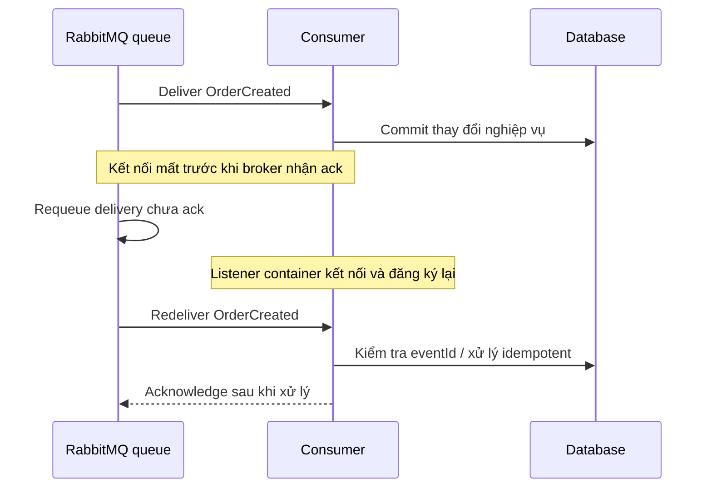

# Xử lý mất kết nối, khôi phục consumer và giới hạn redelivery

Một consumer RabbitMQ có thể mất kết nối vì broker khởi động lại, node đang giữ queue gặp sự cố, mạng bị gián đoạn, firewall đóng kết nối nhàn rỗi hoặc ứng dụng bị dừng đột ngột. Khi kết nối AMQP bị đóng, các channel trên kết nối đó cũng đóng theo. Những message đã giao cho consumer nhưng chưa được acknowledge sẽ được RabbitMQ đưa trở lại queue để có thể giao cho consumer khác hoặc consumer được khôi phục.

Spring Cloud Stream RabbitMQ Binder phối hợp với Spring AMQP để tạo connection, khai báo exchange/queue/binding và đăng ký consumer. Khi kết nối phục hồi, listener container có thể kết nối lại và tiếp tục nhận message. Tuy nhiên, message chưa được xác nhận có thể xuất hiện lần nữa. Vì vậy, khôi phục kết nối và xử lý redelivery phải được thiết kế cùng idempotency, retry có giới hạn và dead-letter queue (DLQ).

## 1. Những gì xảy ra khi consumer mất kết nối?

Giả sử một consumer nhận sự kiện `OrderCreated`, cập nhật database rồi chuẩn bị acknowledge. Nếu kết nối bị mất trước khi broker nhận được acknowledgement, RabbitMQ không thể biết chắc nghiệp vụ đã hoàn tất. Message chưa được ack sẽ được đưa lại trạng thái có thể giao.

Trình tự điển hình:



Một số điều cần nhớ:

- TCP connection bị đóng thì các AMQP channel trên connection đó cũng đóng.
- Delivery chưa được acknowledge được tự động requeue khi channel hoặc connection đóng.
- Broker cần thời gian để phát hiện client không còn hoạt động; heartbeat giúp phát hiện kết nối chết sớm hơn.
- Consumer có thể nhận lại message đã xử lý nghiệp vụ nhưng chưa kịp ack.
- Redelivery là hành vi bình thường của mô hình at-least-once, không nhất thiết là lỗi broker.

Do đó, không được giả định mỗi event chỉ được gọi handler đúng một lần. Consumer cần có khả năng xử lý cùng một event nhiều lần mà không tạo side effect trùng.

## 2. Phân biệt khôi phục kết nối với retry nghiệp vụ

Hai cơ chế này giải quyết hai loại lỗi khác nhau:

| Cơ chế | Mục đích | Ví dụ |
|---|---|---|
| Connection recovery | Khôi phục connection, channel và consumer registration sau lỗi hạ tầng | Broker restart, TCP reset, node mất kết nối |
| Listener retry | Gọi lại handler khi xử lý một message thất bại | Database timeout, service kho tạm thời lỗi |
| Broker redelivery | Giao lại delivery chưa ack hoặc bị reject/requeue | Process chết giữa lúc xử lý, channel đóng |
| DLQ | Cô lập message sau khi hết retry hoặc bị từ chối không requeue | Payload sai schema, lỗi nghiệp vụ không thể tự phục hồi |

`recoveryInterval` điều khiển khoảng thời gian giữa các lần listener container thử khởi động lại consumer sau một lỗi không fatal. Nó không phải thời gian chờ giữa các lần retry một message và cũng không thay thế cơ chế khôi phục connection của Spring AMQP.

Ngược lại, `max-attempts` và các thuộc tính backoff của consumer binding điều khiển retry handler trong Spring Cloud Stream. Nếu retry hết và message bị reject không requeue, broker có thể dead-letter message khi queue có DLX phù hợp.

Không nên dùng connection recovery để xử lý lỗi nghiệp vụ hoặc dùng requeue liên tục để chờ broker phục hồi. Khi broker mất kết nối, listener container sẽ phục hồi kết nối; khi handler gặp lỗi, hãy áp dụng chính sách retry/DLQ.

## 3. RabbitMQ Binder ánh xạ destination thành exchange và queue

Theo cấu hình mặc định, RabbitMQ Binder ánh xạ mỗi destination thành một `TopicExchange`. Với consumer group có tên, binder tạo một queue và bind queue đó vào exchange. Các instance thuộc cùng group cùng tiêu thụ queue của group.

Ví dụ function:

```java
@Bean
Consumer<OrderCreated> reserveInventory(InventoryService inventory) {
    return event -> inventory.reserve(event);
}
```

Cấu hình binding:

```yaml
spring:
  cloud:
    function:
      definition: reserveInventory
    stream:
      bindings:
        reserveInventory-in-0:
          destination: orders.created
          group: inventory-service
          content-type: application/json
```

Với destination `orders.created` và group `inventory-service`, queue thường được đặt theo dạng `orders.created.inventory-service` (có thể có prefix hoặc cấu hình đổi tên). Các instance của dịch vụ cùng group cạnh tranh nhận message từ queue này.

Một consumer không khai báo `group` là anonymous consumer. Binder dùng queue có tên ngẫu nhiên và auto-delete. Queue đó có thể bị xóa khi consumer rời đi, vì vậy không phù hợp nếu cần giữ backlog trong thời gian ứng dụng tạm dừng. Với consumer production cần tiếp tục sau restart, hãy khai báo group ổn định và dùng queue bền vững.

## 4. Cấu hình kết nối và heartbeat

RabbitMQ Binder mặc định sử dụng Spring Boot `ConnectionFactory`, do đó có thể dùng các thuộc tính `spring.rabbitmq.*` để cấu hình địa chỉ, xác thực và kết nối.

Ví dụ cấu hình theo môi trường:

```yaml
spring:
  rabbitmq:
    addresses: ${RABBITMQ_ADDRESSES:localhost:5672}
    username: ${RABBITMQ_USERNAME:app}
    password: ${RABBITMQ_PASSWORD}
    virtual-host: ${RABBITMQ_VHOST:/}
    requested-heartbeat: 30s
    connection-timeout: 5s
```

Trong production, cung cấp địa chỉ, username và password từ biến môi trường hoặc secret manager. Không commit credential thật vào repository. Với RabbitMQ cluster, `addresses` có thể chứa danh sách node mà client có thể truy cập. Cần bảo đảm các địa chỉ được broker quảng bá (advertised endpoints) cũng truy cập được từ mạng của ứng dụng.

Heartbeat giúp hai phía phát hiện kết nối không còn hoạt động, bao gồm trường hợp TCP connection bị treo hoặc thiết bị mạng đóng kết nối nhàn rỗi. Giá trị quá thấp có thể khiến kết nối bị xem là chết trong lúc hệ thống tạm thời chậm; giá trị quá cao làm thời gian phát hiện lỗi kéo dài. Chọn heartbeat theo độ ổn định mạng và yêu cầu phục hồi.

`connection-timeout` giới hạn thời gian thiết lập kết nối ban đầu. Nó không thay thế heartbeat và cũng không quyết định thời gian retry handler.

Spring AMQP dùng `CachingConnectionFactory` để quản lý kết nối và channel. Khi broker hoặc mạng phục hồi, framework có thể tạo lại connection/channel và `RabbitAdmin` khai báo lại exchange, queue, binding được quản lý. Listener container sau đó khởi động lại consumer. Spring AMQP có cơ chế recovery riêng; không tự bật thêm một cơ chế recovery ở tầng ứng dụng nếu chưa xác định rõ vai trò của từng lớp.

## 5. Cấu hình recovery và queue declaration

RabbitMQ consumer properties được đặt dưới `spring.cloud.stream.rabbit.bindings.<bindingName>.consumer`. Một số thuộc tính liên quan tới phục hồi:

| Thuộc tính | Ý nghĩa |
|---|---|
| `recovery-interval` | Khoảng thời gian giữa các lần thử khởi động lại consumer sau lỗi không fatal; mặc định 5.000 ms |
| `missing-queues-fatal` | Quyết định việc queue không tồn tại có làm listener container dừng ở trạng thái fatal hay không; mặc định `false` |
| `queue-declaration-retries` | Số lần thử khai báo/tiêu thụ queue khi queue thiếu; có ý nghĩa khi `missing-queues-fatal=true` |
| `failed-declaration-retry-interval` | Khoảng cách giữa các lần thử khi queue bị thiếu |
| `prefetch` | Số delivery chưa ack mà broker có thể gửi trước cho consumer |
| `max-concurrency` | Số consumer tối đa mà container có thể tạo trong các loại container hỗ trợ |

Ví dụ:

```yaml
spring:
  cloud:
    stream:
      bindings:
        reserveInventory-in-0:
          destination: orders.created
          group: inventory-service
      rabbit:
        bindings:
          reserveInventory-in-0:
            consumer:
              recovery-interval: 5000
              missing-queues-fatal: false
              prefetch: 20
              max-concurrency: 4
```

Khi `missing-queues-fatal=false`, listener container tiếp tục thử lấy message từ queue thay vì dừng ứng dụng chỉ vì queue tạm thời không tồn tại. Điều này hữu ích trong cluster hoặc khi queue được provision bởi quy trình triển khai khác. Tuy nhiên, ứng dụng có thể ở trạng thái chưa tiêu thụ được message trong một thời gian; cần log và metric để phát hiện.

Nếu đặt `missing-queues-fatal=true`, có thể dùng `queue-declaration-retries` để giới hạn số lần thử trước khi xem lỗi là fatal. Chọn chính sách phù hợp với việc queue được tạo bởi binder hay bởi đội vận hành/hạ tầng.

Các thuộc tính trên phụ thuộc container type và phiên bản Rabbit binder. Ví dụ, một số thuộc tính concurrency không áp dụng với container `direct` hoặc `stream`. Luôn đối chiếu tài liệu của đúng phiên bản dependency.

## 6. Consumer acknowledgement quyết định redelivery

RabbitMQ cần biết khi nào một delivery được xử lý xong. Spring Cloud Stream Rabbit binder có thuộc tính `acknowledge-mode`; mặc định là `AUTO`.

Trong ngữ cảnh Spring AMQP, `AUTO` có nghĩa listener container tự acknowledge sau khi listener hoàn tất bình thường. Nếu listener ném exception, container áp dụng chính sách lỗi, retry và reject/requeue tương ứng. Đây không phải chế độ AMQP auto-ack kiểu fire-and-forget.

Các chế độ thường gặp:

| Chế độ | Hành vi | Lưu ý |
|---|---|---|
| `AUTO` | Container ack sau khi listener hoàn tất thành công | Lựa chọn thông thường cho Spring Cloud Stream |
| `MANUAL` | Ứng dụng chủ động ack/nack delivery | Cần quản lý delivery tag và channel đúng cách |
| `NONE` | Broker xem message đã được giao ngay khi gửi tới consumer | Thông lượng có thể cao hơn nhưng có nguy cơ mất message nếu consumer lỗi |

Ví dụ giữ chế độ container-managed AUTO:

```yaml
spring:
  cloud:
    stream:
      rabbit:
        bindings:
          reserveInventory-in-0:
            consumer:
              acknowledge-mode: AUTO
```

Với chế độ AUTO, chỉ trả về bình thường sau khi xử lý xong. Nếu service nghiệp vụ thất bại, hãy để exception truyền ra listener để binder áp dụng retry/error policy. Không bắt exception rồi bỏ qua nếu message chưa thực sự được xử lý.

Khi dùng MANUAL, delivery tag chỉ có ý nghĩa trên channel đã nhận message. Acknowledge delivery trên channel khác hoặc ack cùng delivery tag nhiều lần có thể gây lỗi protocol và đóng channel. Chỉ dùng manual ack khi có yêu cầu rõ ràng và đã kiểm thử với phiên bản binder đang chạy.

## 7. Điều gì xảy ra với message chưa ack khi kết nối mất?

RabbitMQ tự requeue các delivery chưa ack khi channel hoặc connection đóng. Điều này bao gồm TCP connection loss, consumer process crash và channel bị đóng do lỗi protocol.

Ví dụ:

1. Consumer nhận `OrderCreated`.
2. Service cập nhật kho thành công.
3. Process bị kill trước khi listener container gửi ack.
4. RabbitMQ thấy channel đóng và đưa message trở lại queue.
5. Consumer instance khác nhận lại message.

Ở lần nhận lại, RabbitMQ đánh dấu delivery là redelivered. Cờ redelivered chỉ cho biết message có thể đã được giao trước đó; nó không phải bộ đếm chính xác số lần thử và cũng không cho biết nghiệp vụ trước đó đã chạy đến đâu.

Có một cửa sổ không thể loại bỏ chỉ bằng ack: database đã commit nhưng ack chưa tới broker. Message có thể được giao lại dù side effect đã hoàn tất. Vì vậy, consumer phải có idempotency.

## 8. Thiết kế handler idempotent

Mỗi sự kiện nghiệp vụ nên có ID ổn định, ví dụ `eventId`. Consumer ghi nhận ID đã xử lý trong cùng transaction với thay đổi nghiệp vụ.

```java
@Service
public class InventoryService {

    private final ProcessedEventRepository processedEvents;
    private final InventoryRepository inventory;

    public InventoryService(
            ProcessedEventRepository processedEvents,
            InventoryRepository inventory) {
        this.processedEvents = processedEvents;
        this.inventory = inventory;
    }

    @Transactional
    public void reserve(OrderCreated event) {
        if (processedEvents.existsById(event.eventId())) {
            return;
        }

        inventory.reserve(
            event.orderId(),
            event.items()
        );

        processedEvents.save(
            new ProcessedEvent(event.eventId())
        );
    }
}
```

Ví dụ giả định thay đổi kho và bản ghi `ProcessedEvent` dùng cùng database transaction. Bảng processed events cần unique constraint trên `eventId`. Nếu hai consumer có thể xử lý cùng event đồng thời, cần xử lý xung đột unique constraint; kiểm tra tồn tại trước khi ghi không tự loại bỏ race condition.

Nếu handler gọi dịch vụ ngoài database, dùng idempotency key mà dịch vụ đó hỗ trợ hoặc lưu trạng thái workflow để có thể tiếp tục an toàn. Không thể dùng transaction cục bộ để bảo đảm exactly-once xuyên suốt RabbitMQ và một hệ thống bên ngoài.

## 9. Giới hạn prefetch và concurrency

`prefetch` quyết định số message broker có thể giao trước khi consumer acknowledge các delivery đang giữ. Giá trị lớn có thể tăng throughput nhưng cũng làm tăng số message đang ở trạng thái unacked. Khi consumer chết, nhiều message cùng được requeue và có thể tạo một đợt redelivery lớn.

Ví dụ cấu hình:

```yaml
spring:
  cloud:
    stream:
      bindings:
        reserveInventory-in-0:
          consumer:
            concurrency: 2
      rabbit:
        bindings:
          reserveInventory-in-0:
            consumer:
              prefetch: 20
              max-concurrency: 4
```

`concurrency` là thuộc tính consumer chung của Spring Cloud Stream; `max-concurrency` là thuộc tính riêng của Rabbit binder trong các container hỗ trợ. Cấu hình thực tế cần kiểm tra số consumer tối đa và container type.

Hãy chọn prefetch theo thời gian xử lý, kích thước message và bộ nhớ. Với handler chậm hoặc side effect có chi phí cao, prefetch thấp giúp giới hạn lượng message unacked và giảm số message phải giao lại cùng lúc. Prefetch quá thấp có thể làm giảm throughput do consumer thường xuyên phải chờ broker.

Tăng concurrency không tự động tăng năng lực xử lý nếu database connection pool, dịch vụ phụ thuộc hoặc queue topology là nút thắt. Đo throughput, latency, unacked count và consumer capacity trước khi điều chỉnh.

## 10. Retry trong Spring Cloud Stream Rabbit binder

Retry ở tầng binder cho phép thử lại listener trước khi quyết định reject hoặc dead-letter message. Các thuộc tính chung nằm trên consumer binding:

```yaml
spring:
  cloud:
    function:
      definition: reserveInventory
    stream:
      bindings:
        reserveInventory-in-0:
          destination: orders.created
          group: inventory-service
          consumer:
            max-attempts: 4
            back-off-initial-interval: 1000
            back-off-max-interval: 10000
            back-off-multiplier: 2.0
```

`max-attempts` bao gồm lần xử lý đầu tiên. Với giá trị 4, listener được gọi tối đa bốn lần ở tầng retry này. Backoff tăng dần giúp giảm áp lực khi dịch vụ phụ thuộc đang lỗi.

Phân loại lỗi trước khi retry:

- Timeout hoặc lỗi mạng tạm thời: có thể retry với backoff.
- Database tạm thời không sẵn sàng: retry có giới hạn.
- Payload sai schema hoặc thiếu trường bắt buộc: không retry nhiều lần.
- Lỗi xác thực hoặc thiếu quyền: cảnh báo cấu hình/hạ tầng và dừng retry nhanh.
- Lỗi nghiệp vụ không thể tự khắc phục: chuyển sang DLQ hoặc quy trình nghiệp vụ riêng.

Không cấu hình retry vô hạn trong ứng dụng. Retry handler và redelivery của broker là hai lớp khác nhau; nếu cả hai cùng lặp không giới hạn, message có thể quay lại liên tục.

## 11. Vì sao requeueRejected=true có thể tạo vòng lặp?

Rabbit binder có thuộc tính `requeue-rejected`. Thuộc tính này quyết định delivery failure có được requeue khi retry bị tắt hoặc khi `republish-to-dlq=false`.

Khi đặt `requeue-rejected=true`, message bị reject có thể quay lại queue và được giao lại. Nếu lỗi là dữ liệu không hợp lệ hoặc bug cố định, consumer sẽ nhận cùng message và thất bại mãi. Điều này gây vòng lặp redelivery, tăng CPU/log, làm chậm message hợp lệ và tạo backlog.

Với lỗi vĩnh viễn, thông thường nên để `requeue-rejected=false` và dùng DLQ. Với lỗi tạm thời, ưu tiên retry có giới hạn và backoff ở binder hoặc cơ chế retry có delay phù hợp.

Ví dụ tránh requeue vô hạn:

```yaml
spring:
  cloud:
    stream:
      bindings:
        reserveInventory-in-0:
          destination: orders.created
          group: inventory-service
          consumer:
            max-attempts: 4
      rabbit:
        bindings:
          reserveInventory-in-0:
            consumer:
              requeue-rejected: false
              auto-bind-dlq: true
              republish-to-dlq: true
```

Nếu retry được tắt (`max-attempts: 1`), `requeue-rejected=false` đặc biệt quan trọng để message lỗi được dead-letter thay vì requeue. Đừng bật requeue chỉ để “đợi broker khỏe lại”; connection recovery là trách nhiệm của listener container và connection factory.

## 12. Tạo DLQ và republish message lỗi

Rabbit binder có thể tự khai báo dead-letter exchange (DLX), dead-letter queue (DLQ) và routing infrastructure bằng `auto-bind-dlq`. Theo mặc định, tên DLQ thường là destination cộng hậu tố `.dlq`, có thể tùy chỉnh bằng `dead-letter-queue-name`.

Khi `republish-to-dlq=true`, binder publish message lỗi sang DLQ kèm metadata chẩn đoán, chẳng hạn exception message và stack trace trong header. Điều này hữu ích khi cần biết nguyên nhân cuối cùng mà không phải tra log của consumer.

Ví dụ đầy đủ:

```yaml
spring:
  cloud:
    stream:
      bindings:
        reserveInventory-in-0:
          destination: orders.created
          group: inventory-service
          consumer:
            max-attempts: 4
            back-off-initial-interval: 1000
            back-off-max-interval: 10000
            back-off-multiplier: 2.0
      rabbit:
        bindings:
          reserveInventory-in-0:
            consumer:
              auto-bind-dlq: true
              dead-letter-queue-name: orders.created.inventory-service.dlq
              republish-to-dlq: true
              requeue-rejected: false
```

Cần bảo đảm:

- Consumer có group ổn định để binder tạo queue bền vững.
- Ứng dụng có quyền khai báo exchange/queue/binding nếu binder tự provision.
- Producer có quyền publish vào DLX/DLQ.
- DLQ có retention, TTL và giới hạn dung lượng phù hợp.
- Header exception không vượt quá giới hạn frame của broker; stack trace dài có thể bị cắt.
- Message được republish có delivery mode phù hợp; binder mặc định hiện được tài liệu mô tả là persistent khi republish.

Một điểm cần kiểm tra theo phiên bản: giá trị mặc định của `republish-to-dlq` đã thay đổi giữa các dòng phát hành. Hãy khai báo tường minh thay vì phụ thuộc mặc định.

Spring Cloud Stream không tự cung cấp một consumer chuẩn để đọc DLQ và chuyển message trở lại queue chính. Cần xây dựng quy trình vận hành hoặc một luồng xử lý DLQ riêng, có lọc, audit và kiểm soát tốc độ replay.

## 13. DLQ broker-side và republish của binder

Có hai cách phổ biến để đưa message lỗi sang DLQ:

**Broker-side dead-lettering**: consumer reject message không requeue; RabbitMQ dùng DLX và routing key của queue để chuyển message. Message được chuyển theo cơ chế broker.

**Binder republish**: binder publish message sang DLQ và bổ sung metadata exception. Cách này giúp đưa stack trace/exception message vào headers, nhưng cần producer của binder có quyền publish và cấu hình serializer/header phù hợp.

Khi consumer được cấu hình `transacted=true`, từ Rabbit binder 3.1.2, publish sang DLQ có thể tham gia transaction. Nếu connection factory bật publisher confirms hoặc returns, binder có thể chờ xác nhận và kiểm tra message có bị returned hay không. Nếu publish bị negative-ack hoặc returned, binder reject không requeue để broker xử lý dead-letter theo cấu hình.

Không nhầm publisher confirm với consumer acknowledgement. Publisher confirm cho biết broker đã nhận publish tới exchange/queue theo cơ chế xác nhận; consumer acknowledgement xác nhận delivery đã được xử lý. Hai tín hiệu độc lập.

## 14. Giới hạn redelivery với quorum queue

Classic queue và quorum queue có hành vi khác nhau về replication và poison message handling.

Quorum queue là queue bền vững, replicated bằng Raft. Nó phù hợp với dữ liệu quan trọng cần high availability và replication. Từ RabbitMQ 4.0, quorum queue có delivery limit mặc định là 20. Khi số lần delivery thất bại vượt giới hạn, message bị drop hoặc dead-letter nếu queue có DLX.

Rabbit binder có thể khai báo quorum queue và đặt delivery limit:

```yaml
spring:
  cloud:
    stream:
      bindings:
        reserveInventory-in-0:
          destination: orders.created
          group: inventory-service
      rabbit:
        bindings:
          reserveInventory-in-0:
            consumer:
              quorum:
                enabled: true
                delivery-limit: 10
              auto-bind-dlq: true
              republish-to-dlq: true
              requeue-rejected: false
```

Thuộc tính `quorum.delivery-limit` chỉ có ý nghĩa khi `quorum.enabled=true`. Cần xác minh phiên bản Rabbit binder có hỗ trợ thuộc tính này và broker đang dùng hỗ trợ quorum queue. Queue đã được tạo trước với loại khác có thể không đổi type chỉ bằng cách cập nhật cấu hình; việc đổi loại queue thường cần migration/provisioning riêng.

Quorum queue cung cấp header `x-delivery-count` cho số lần delivery thất bại. Từ RabbitMQ 4.3, `x-acquired-count` được bổ sung để đếm số lần message được giao cho consumer, còn delivery limit dựa trên `delivery-count`.

### Khác biệt quan trọng giữa RabbitMQ 4.2 và 4.3

Trước RabbitMQ 4.3, `basic.nack` với `requeue=true` được tính vào delivery limit. Từ RabbitMQ 4.3, `basic.nack` requeue không làm tăng `delivery-count`; nó chỉ tăng số lần acquired. `basic.reject` vẫn tính là delivery thất bại và tăng `delivery-count`.

Vì vậy, ứng dụng dùng `basic.nack(requeue=true)` không thể dựa vào delivery limit của quorum queue để chặn mọi vòng lặp. Nếu cần delivery limit xử lý poison message, hãy dùng reject semantics phù hợp và cấu hình DLX để message không bị drop ngoài ý muốn. Kiểm tra hành vi thực tế của binder/Spring AMQP đang sử dụng vì cách exception được ánh xạ thành reject/nack phụ thuộc cấu hình.

Không nên tắt delivery limit bằng `x-delivery-limit=-1` chỉ để giữ hành vi cũ. Với RabbitMQ 4.0+, mặc định giới hạn là 20 cho quorum queue; hãy chọn giới hạn phù hợp và luôn có dead-letter destination nếu message không được phép mất.

## 15. Delayed retry và backoff ở broker

Retry liên tục ngay lập tức có thể làm consumer và broker quá tải. RabbitMQ 4.3 hỗ trợ delayed retry cho quorum queue, dùng delivery count để tính thời gian chờ tuyến tính với giới hạn cấu hình. Đây là tính năng broker-side, cần kiểm tra phiên bản và cấu hình queue/policy.

Nếu không dùng delayed retry native, có thể triển khai retry bằng DLX/TTL và queue trung gian:

1. Message thất bại được dead-letter sang retry queue.
2. Retry queue có TTL.
3. Khi TTL hết, DLX route message trở lại exchange/queue chính.
4. Header retry count hoặc metadata ứng dụng được tăng để giới hạn số lần.
5. Khi vượt giới hạn, message được chuyển sang parking lot/DLQ cuối.

Không tạo topology TTL/DLX vòng tròn mà không có bộ đếm retry và giới hạn cuối. Một message có thể quay vòng vô hạn nếu không có trạng thái retry bền vững.

## 16. Dừng ứng dụng và graceful shutdown

Khi ứng dụng dừng có kiểm soát, listener container nên ngừng nhận delivery mới và chờ message đang xử lý hoàn tất trong giới hạn shutdown timeout. Nếu process bị kill hoặc node mất điện, các delivery chưa ack sẽ được requeue sau khi RabbitMQ phát hiện connection/channel đóng.

Để giảm rủi ro:

- Đặt timeout cho database và HTTP client trong handler.
- Chọn shutdown timeout lớn hơn thời gian xử lý thông thường nhưng phù hợp với orchestrator.
- Không ack trước khi side effect quan trọng đã được ghi nhận.
- Giữ prefetch ở mức hợp lý để không có quá nhiều message unacked.
- Thiết kế handler idempotent vì message có thể được giao lại.
- Theo dõi thời gian từ lúc consumer dừng đến khi queue có consumer mới.
- Kiểm tra consumer tag, channel và connection được tạo lại sau recovery.

Graceful shutdown không loại bỏ hoàn toàn redelivery. Nếu xử lý nghiệp vụ thành công nhưng ack chưa tới broker, message vẫn có thể được giao lại. Idempotency vẫn là điều kiện cần.

## 17. Cluster, queue durability và phục hồi node

RabbitMQ cluster phân phối metadata của exchange, queue definition và binding giữa các node. Tuy nhiên, không phải mọi loại queue đều replicate message contents.

- **Classic queue không replicated**: nếu node giữ queue bị mất, khả năng truy cập và dữ liệu phụ thuộc loại queue, phiên bản và topology; không mặc định coi classic queue là HA.
- **Quorum queue**: dữ liệu được replicate giữa các member theo Raft. Khi leader lỗi, follower có thể được bầu làm leader mới; trong thời gian bầu leader, delivery có thể tạm dừng.
- **Durable queue**: queue definition tồn tại qua broker restart.
- **Persistent message**: broker lưu message theo durability policy.
- **Publisher confirms**: xác nhận publisher message đã được broker nhận theo semantics của queue.

Đối với message quan trọng, nên chọn queue type phù hợp với yêu cầu HA, dùng publisher confirms và persistent delivery, đồng thời dùng manual/container-managed acknowledgement ở consumer. Durable queue đơn lẻ không tự tạo replication.

Với quorum queue, tất cả message đều được lưu bền vững theo mô hình của queue. Quorum queue cần đa số thành viên hoạt động để tiếp tục các thao tác ghi/ack. Khi mất quorum, queue có thể không phục vụ ghi hoặc xác nhận cho tới khi quorum được khôi phục.

## 18. Theo dõi connection recovery và redelivery

Không chỉ theo dõi trạng thái process Spring Boot. Cần quan sát cả ứng dụng, broker và queue.

| Chỉ số | Điều cần phát hiện |
|---|---|
| Connection/channel count | Connection bị rò rỉ hoặc liên tục mở lại |
| Consumer count | Listener chưa đăng ký lại sau recovery |
| Queue ready messages | Backlog tăng trong thời gian consumer offline |
| Queue unacked messages | Consumer xử lý chậm hoặc giữ delivery quá lâu |
| Redelivered rate | Message được giao lại nhiều lần |
| DLQ depth và oldest message age | Lỗi nghiệp vụ hoặc poison message tích tụ |
| Connection blocked / resource alarm | Broker thiếu memory hoặc disk |
| Consumer capacity | Consumer có theo kịp tốc độ publish hay không |
| Recovery attempts và recovery latency | Mất kết nối kéo dài hoặc reconnect liên tục |

Có thể dùng RabbitMQ Management UI, Prometheus metrics hoặc công cụ giám sát hiện có. Log ứng dụng nên chứa event ID, destination, group và correlation ID để đối chiếu. Không log password, token hoặc toàn bộ payload nhạy cảm.

Nếu ứng dụng dùng health check, phân biệt readiness với liveness. Broker tạm thời mất kết nối thường nên khiến ứng dụng không sẵn sàng nhận traffic nghiệp vụ mới tùy kiến trúc, nhưng không nên để liveness tự khởi động lại process liên tục nếu listener container đã có cơ chế phục hồi kết nối.

## 19. Kiểm thử mất kết nối và redelivery

Test Binder giúp kiểm tra function và binding ở bộ nhớ, nhưng không mô phỏng đầy đủ TCP disconnect, channel close, broker restart, queue leader election hoặc redelivery. Những hành vi này cần integration test với RabbitMQ thật, ví dụ qua Testcontainers.

Kịch bản kiểm thử:

1. Khởi chạy RabbitMQ và ứng dụng consumer với group có tên.
2. Publish một message và xác minh handler xử lý thành công.
3. Tạo một message đang được xử lý chậm, sau đó đóng channel hoặc dừng consumer trước ack.
4. Xác minh message chưa ack được requeue và có thể redeliver.
5. Khởi động lại ứng dụng và xác minh consumer đăng ký lại queue.
6. Cho handler commit database nhưng mô phỏng mất kết nối trước ack; xác minh event ID ngăn side effect trùng.
7. Làm broker ngừng hoạt động rồi khởi động lại; đo thời gian recovery và xác minh consumer tiếp tục.
8. Tạo queue thiếu hoặc sai quyền để kiểm tra `missing-queues-fatal`, queue declaration retry và cảnh báo.
9. Làm handler thất bại tới khi hết `max-attempts`; xác minh message được chuyển DLQ.
10. Kiểm tra `requeue-rejected=true` và xác minh nguy cơ redelivery loop trong môi trường test.
11. Với quorum queue, kiểm tra delivery limit, DLX và phiên bản RabbitMQ thực tế.
12. Replay DLQ sau khi sửa lỗi và xác minh idempotency.

Đối với quorum queue, kiểm thử cả node failure/leader election trong môi trường phù hợp. Không chỉ kiểm tra process Spring Boot còn chạy; phải xác minh queue vẫn có message, consumer được đăng ký lại và side effect nghiệp vụ không bị lặp.

## 20. Lỗi thường gặp

| Hiện tượng | Nguyên nhân có thể | Cách xử lý |
|---|---|---|
| Consumer không nhận lại message sau reconnect | Listener container chưa kết nối lại, queue không tồn tại hoặc ACL sai | Kiểm tra connection, recovery interval, queue declaration và quyền |
| Message xuất hiện nhiều lần | Connection mất trước khi ack đến broker | Dùng event ID và handler idempotent |
| Poison message quay vòng liên tục | `requeue-rejected=true` hoặc retry không giới hạn | Giới hạn retry, đặt requeue false và cấu hình DLQ |
| DLQ không nhận message | Chưa bật auto-bind-dlq, DLX/queue sai hoặc thiếu quyền publish | Kiểm tra topology và ACL |
| Queue biến mất khi app dừng | Consumer dùng anonymous auto-delete queue | Khai báo group có tên và queue durable |
| Consumer reconnect liên tục | Heartbeat quá thấp, mạng không ổn định hoặc broker resource alarm | Kiểm tra heartbeat, network và broker metrics |
| Nhiều message unacked khi restart | Prefetch cao hoặc handler xử lý chậm | Giảm prefetch, tối ưu handler và timeout |
| Quorum delivery limit không chặn requeue loop | RabbitMQ 4.3 không tăng delivery-count với basic.nack(requeue=true) | Kiểm tra reject/nack semantics, dùng DLX và delayed retry |
| Message bị mất sau khi vượt delivery limit | Quorum queue không có DLX | Cấu hình dead-letter destination trước khi áp dụng delivery limit |
| Queue thiếu nhưng ứng dụng không báo lỗi rõ | missingQueuesFatal=false khiến container tiếp tục thử | Theo dõi log/metric hoặc cấu hình fatal/retry theo mục tiêu |

## 21. Checklist production

- Dùng consumer group có tên để có queue ổn định và backlog được giữ khi consumer offline.
- Cấu hình `spring.rabbitmq.addresses`, credential, virtual host và heartbeat theo môi trường.
- Hiểu rõ connection recovery và retry nghiệp vụ là hai cơ chế riêng.
- Chọn `recovery-interval`, `missing-queues-fatal` và queue declaration retry phù hợp.
- Dùng acknowledgement mode AUTO của container hoặc MANUAL khi có yêu cầu rõ ràng.
- Chỉ ack sau khi nghiệp vụ đã hoàn tất theo hợp đồng.
- Thiết kế handler idempotent bằng event ID và transaction phù hợp.
- Giới hạn `max-attempts`, backoff và không requeue poison message vô hạn.
- Bật DLQ/DLX, xác minh quyền publish, retention và quy trình replay.
- Chọn classic/quorum queue theo yêu cầu HA và replication.
- Nếu dùng quorum queue, cấu hình delivery limit và DLX; kiểm tra khác biệt RabbitMQ 4.0/4.3 về nack/reject.
- Điều chỉnh prefetch/concurrency theo throughput và thời gian xử lý.
- Theo dõi ready, unacked, redelivered, DLQ depth, connection và consumer count.
- Kiểm thử broker restart, connection loss, unacked redelivery và replay với RabbitMQ thật.

## 22. Tài liệu tham khảo

- [Spring Cloud Stream RabbitMQ Binder Reference](https://docs.spring.io/spring-cloud-stream-binder-rabbit/docs/current/reference/html/spring-cloud-stream-binder-rabbit-aggregate.html), phần binder properties, consumer recovery, retry và DLQ.
- [RabbitMQ Consumer Acknowledgements and Publisher Confirms](https://www.rabbitmq.com/docs/confirms), requeue delivery chưa ack khi channel/connection đóng.
- [RabbitMQ Reliability Guide](https://www.rabbitmq.com/docs/reliability), connection failure, heartbeat, acknowledgement và replicated queue.
- [RabbitMQ Quorum Queues](https://www.rabbitmq.com/docs/quorum-queues), delivery limit, poison message handling và khác biệt RabbitMQ 4.0/4.3.
- [Spring AMQP Reference](https://docs.spring.io/spring-amqp/reference/), listener container, connection factory và acknowledgement behavior.

RabbitMQ có thể tự đưa delivery chưa ack trở lại queue khi connection hoặc channel đóng, còn Spring Cloud Stream Rabbit binder đảm nhiệm kết nối lại và đăng ký consumer theo cấu hình. Redelivery là một phần của mô hình giao nhận at-least-once; handler cần idempotent. Kết hợp connection recovery, retry hữu hạn, DLQ, prefetch hợp lý và delivery limit đúng với phiên bản RabbitMQ sẽ giúp consumer phục hồi sau sự cố mà không mắc kẹt trong vòng lặp xử lý lỗi.

