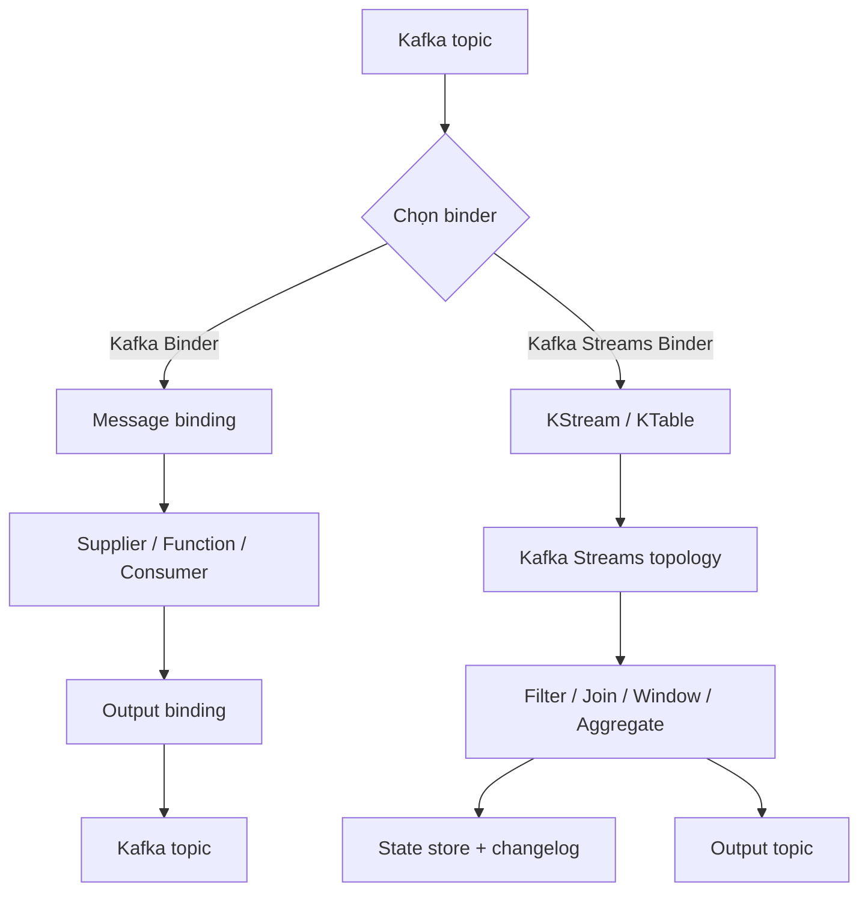

# Khi nào cần Kafka Streams Binder thay cho Kafka Binder

Spring Cloud Stream cung cấp hai binder dành cho Kafka với mục tiêu khác nhau. **Kafka Binder** kết nối các function `Supplier`, `Function`, `Consumer` với topic Kafka như một hệ thống messaging: ứng dụng nhận message, thực hiện nghiệp vụ rồi phát message tiếp theo. **Kafka Streams Binder** tích hợp thư viện Kafka Streams để xây dựng topology xử lý luồng: lọc, biến đổi, join, window, aggregate và duy trì state theo partition.

Nếu ứng dụng chủ yếu nhận một event rồi gọi service hoặc phát event khác, Kafka Binder thường đơn giản và phù hợp hơn. Nếu nghiệp vụ cần tính toán liên tục trên nhiều event, kết hợp stream với table, tổng hợp theo cửa sổ thời gian hoặc lưu state có thể phục hồi, Kafka Streams Binder là lựa chọn tự nhiên. Khác biệt cốt lõi nằm ở mô hình xử lý và quản lý state, không chỉ ở tên dependency.

## 1. Hai binder giải quyết hai bài toán khác nhau

Kafka Binder dùng mô hình binding message thông thường của Spring Cloud Stream. Input binding chuyển message từ topic thành payload; function xử lý; output binding publish kết quả. Ứng dụng có thể dùng Kafka consumer group, partition, retry, DLQ và producer properties theo cấu hình binder.

Kafka Streams Binder dùng Kafka Streams API làm runtime xử lý. Function nhận các kiểu như `KStream`, `KTable` hoặc `GlobalKTable` và trả về topology tương ứng. Kafka Streams quản lý task theo partition, state store, changelog topic, repartition topic, windowing và các thao tác join/aggregate.



| Tiêu chí | Kafka Binder | Kafka Streams Binder |
|---|---|---|
| Abstraction chính | Message và binding | Kafka Streams topology |
| Kiểu hàm thường dùng | `Supplier<T>`, `Function<T,R>`, `Consumer<T>`, reactive types | `Function<KStream<K,V>, KStream<K2,V2>>`, `KTable`, `GlobalKTable` và các hàm nhiều input |
| Xử lý stateless | Có | Có |
| Join stream/table và windowed aggregation | Ứng dụng tự triển khai hoặc dùng thư viện khác | Có DSL và runtime hỗ trợ trực tiếp |
| State store có changelog để phục hồi | Không phải năng lực cốt lõi của binder | Là năng lực của Kafka Streams |
| Phụ thuộc Kafka | Binder Kafka, nhưng mô hình function/message tổng quát hơn | Gắn chặt với Kafka Streams và Kafka topic |
| Phù hợp nhất | Event-driven messaging và xử lý từng message | Stream processing liên tục, stateful và phân tích theo thời gian |

## 2. Khi Kafka Binder là đủ

Kafka Binder phù hợp khi luồng xử lý chủ yếu là các bước message độc lập hoặc mỗi event được chuyển qua một service nghiệp vụ:

- Nhận `OrderCreated`, kiểm tra dữ liệu rồi phát `OrderValidated`.
- Nhận `PaymentRequested`, gọi payment service và phát kết quả.
- Đọc event, ghi database trong transaction rồi xác nhận offset.
- Chuyển đổi payload, đổi header, định tuyến hoặc publish sang topic khác.
- Dùng consumer group và partition để chia tải giữa các instance.
- Dùng retry/DLQ để cô lập message không xử lý được.

Ví dụ function thông thường:

```java
@Bean
Function<OrderCreated, OrderValidated> validateOrder(OrderValidator validator) {
    return validator::validate;
}
```

Binding tương ứng:

```yaml
spring:
  cloud:
    function:
      definition: validateOrder
    stream:
      bindings:
        validateOrder-in-0:
          destination: orders.created
          group: order-validation
          content-type: application/json
        validateOrder-out-0:
          destination: orders.validated
          content-type: application/json
```

Mỗi message được chuyển đổi thành `OrderCreated`, xử lý bởi function và kết quả được gửi tới `orders.validated`. Nếu logic không cần nhìn nhiều record cùng lúc hoặc duy trì state theo key/window, dùng Kafka Binder giúp code và vận hành gọn hơn.

Không cần Kafka Streams chỉ vì ứng dụng có nhiều topic, cần concurrency hoặc dùng Kafka partition. Kafka Binder cũng hỗ trợ consumer group, partitioning, concurrency và producer/consumer configuration. Kafka Streams có giá trị khi ứng dụng cần các phép toán stream-processing cùng state được quản lý theo topology.

## 3. Khi Kafka Streams Binder mang lại lợi ích rõ ràng

Chọn Kafka Streams Binder khi yêu cầu nghiệp vụ thuộc một hoặc nhiều nhóm sau:

1. **Join các luồng sự kiện:** kết hợp `OrderCreated` với `PaymentCompleted` hoặc `ShipmentDispatched` theo key và thời gian.
2. **Stream-table join:** làm giàu event bằng dữ liệu tham chiếu đang được biểu diễn dưới dạng `KTable` hoặc `GlobalKTable`.
3. **Windowed aggregation:** đếm đơn hàng trong 5 phút, tính tổng giao dịch theo giờ hoặc phát hiện ngưỡng bất thường theo cửa sổ.
4. **Stateful processing:** duy trì tổng tích lũy, số dư, trạng thái phiên hoặc kết quả tổng hợp theo key.
5. **Event-time processing:** xử lý timestamp sự kiện, grace period và late-arriving records.
6. **State phục hồi được:** dùng state store có changelog để tái tạo state sau khi task chuyển instance hoặc ứng dụng restart.
7. **Topology nhiều bước:** biểu diễn pipeline Kafka-native gồm filter, map, group, join, aggregate và sink trong một graph.

Ví dụ, hệ thống bán hàng cần đếm số đơn theo khách hàng và phát cập nhật tổng số đơn liên tục. Đây là bài toán stateful aggregation: mỗi event làm thay đổi kết quả tích lũy theo key. Tự lưu `Map<CustomerId, Count>` trong một bean Kafka Binder sẽ phải tự giải quyết đồng bộ giữa instance, partition, phục hồi sau restart và lưu changelog. Kafka Streams đã cung cấp mô hình state store phù hợp cho loại bài toán này.

## 4. Mô hình KStream, KTable và GlobalKTable

Kafka Streams DSL có các abstraction quan trọng:

| Kiểu | Ý nghĩa | Ví dụ dữ liệu |
|---|---|---|
| `KStream<K,V>` | Chuỗi record sự kiện; mỗi record là một lần xuất hiện độc lập | `OrderCreated`, `PaymentCompleted` |
| `KTable<K,V>` | Bảng được cập nhật từ changelog theo key; record mới có thể thay giá trị hiện tại của key | Trạng thái mới nhất của đơn hàng theo `orderId` |
| `GlobalKTable<K,V>` | Bảng được materialize trên mọi instance, thay vì phân vùng theo task như KTable thông thường | Bảng mã quốc gia hoặc danh mục nhỏ cần tra cứu toàn cục |

KStream phù hợp với event stream. KTable phù hợp khi cần biểu diễn trạng thái mới nhất theo key. GlobalKTable giúp tra cứu toàn cục dễ hơn nhưng mỗi instance phải duy trì bản sao dữ liệu, do đó không phù hợp bảng lớn hoặc cập nhật quá dày.

Một số phép join cần co-partitioning: hai input phải có partition count và cách phân vùng tương thích để cùng key được xử lý ở cùng task. Nếu key hoặc partitioning không tương thích, cần repartition trước join. GlobalKTable có cơ chế join khác vì bảng được sao chép trên mọi instance, đổi lại tiêu tốn tài nguyên theo kích thước bảng.

## 5. Cấu hình dependency và function với Kafka Streams Binder

Ứng dụng cần dependency Kafka Streams Binder do Spring Cloud Stream quản lý phiên bản thông qua Spring Cloud BOM:

```xml
<dependency>
    <groupId>org.springframework.cloud</groupId>
    <artifactId>spring-cloud-stream-binder-kafka-streams</artifactId>
</dependency>
```

Trong ứng dụng chỉ dùng Kafka Streams Binder, dependency này thay cho Kafka Binder thông thường. Không thêm cả hai binder vào classpath một cách tùy tiện nếu chưa cấu hình binder selection rõ ràng; khi có nhiều binder, cần xác định binding nào dùng binder nào.

Ví dụ function biến đổi stream:

```java
@Bean
Function<KStream<String, OrderCreated>, KStream<String, OrderAccepted>> acceptOrders() {
    return orders -> orders
            .filter((orderId, order) -> order.total().signum() > 0)
            .mapValues(order -> new OrderAccepted(
                    order.eventId(), order.orderId(), order.total()));
}
```

Khai báo function và binding:

```yaml
spring:
  cloud:
    function:
      definition: acceptOrders
    stream:
      bindings:
        acceptOrders-in-0:
          destination: orders.created
        acceptOrders-out-0:
          destination: orders.accepted
    kafka:
      streams:
        binder:
          configuration:
            application.id: order-acceptance-streams
```

`application.id` là danh tính Kafka Streams application. Nó được dùng làm consumer group identity và prefix cho một số internal topics. Các instance của cùng một ứng dụng cần dùng cùng ID để phối hợp task; một ứng dụng độc lập hoặc một pipeline replay riêng thường cần ID khác. Không đổi ID trong mỗi lần deploy nếu mục tiêu là tiếp tục cùng state và tiến độ.

Tên binding theo function là `acceptOrders-in-0` và `acceptOrders-out-0`. Khi function có nhiều input hoặc output, hậu tố index và quy tắc binding phải khớp chữ ký function. Kiểm tra log khởi tạo topology để xác nhận đúng function được phát hiện và đúng topic được nối.

## 6. Ví dụ stateful aggregation

Giả sử cần đếm số đơn theo khách hàng. Với Kafka Streams, có thể group event theo customer ID rồi duy trì count trong state store:

```java
@Bean
Function<KStream<String, OrderCreated>, KStream<String, Long>> countOrdersByCustomer() {
    return orders -> orders
            .selectKey((orderId, order) -> order.customerId())
            .groupByKey()
            .count(Materialized.as("orders-by-customer"))
            .toStream();
}
```

Đây là ví dụ minh họa DSL; cấu hình Serde cho key/value phải phù hợp với kiểu dữ liệu thực tế. `selectKey` thay key sang customer ID. `groupByKey` nhóm theo key mới; nếu thay key làm thay đổi partition assignment, Kafka Streams có thể cần repartition topic nội bộ. `count` cập nhật số lượng theo key và materialize kết quả trong state store có tên `orders-by-customer`. `toStream()` biến các cập nhật của KTable thành stream đầu ra.

Kết quả là các bản cập nhật count, không phải chỉ một record duy nhất khi ứng dụng kết thúc. Mỗi event mới của customer có thể phát ra giá trị count mới. Nếu consumer downstream cần snapshot hiện tại, nó phải xử lý semantics cập nhật theo key.

### 6.1. State store và changelog

State store có thể được lưu cục bộ trên instance để truy cập nhanh. Kafka Streams đồng thời dùng changelog topic để ghi nhận thay đổi state. Khi task được chuyển sang instance khác hoặc local state bị mất, runtime có thể khôi phục store bằng cách đọc changelog.

Vì vậy, state store không đơn giản là cache trong RAM. Nó là một phần của topology và cần được vận hành cùng internal topics:

- Bảo đảm broker có đủ replication và dung lượng cho changelog/repartition topics.
- Dùng `application.id` ổn định cho cùng một logical application.
- Cấu hình thư mục state local có dung lượng và quyền ghi phù hợp.
- Theo dõi thời gian restore, task migration và rebalance.
- Giữ schema/Serde tương thích khi thay đổi state store hoặc topology.

## 7. Windowing và event time

Kafka Streams hỗ trợ các cửa sổ để gom event theo thời gian. Ví dụ, đếm số đơn trong mỗi cửa sổ 5 phút. Cần phân biệt event time (timestamp của sự kiện) với processing time (thời điểm ứng dụng xử lý). Dữ liệu có thể tới trễ hoặc sai thứ tự, do mạng, retry hoặc producer phát lại.

Các khái niệm quan trọng:

- **Tumbling window:** các cửa sổ cố định, không chồng lấn.
- **Hopping window:** các cửa sổ có kích thước và bước nhảy, có thể chồng lấn.
- **Sliding window:** cửa sổ thay đổi theo khoảng cách timestamp giữa các record.
- **Session window:** nhóm hoạt động theo khoảng không có event, thích hợp mô hình phiên.
- **Grace period:** khoảng thời gian chấp nhận record đến muộn sau khi cửa sổ đã kết thúc theo timestamp.

Windowed aggregation tạo state theo key và cửa sổ. Cần chọn retention và grace phù hợp với đặc điểm trễ của dữ liệu. Nếu grace quá ngắn, event đến muộn có thể bị bỏ qua hoặc không cập nhật kết quả theo chính sách của topology. Nếu retention quá dài, state store và changelog có thể tăng dung lượng đáng kể.

## 8. Serde và schema là một phần của topology

Kafka Streams cần biết cách serialize/deserialize key và value ở input, repartition, state store và output. Sai Serde có thể khiến topology không khởi động, lỗi khi đọc record hoặc lỗi khi ghi internal topic.

Ví dụ cấu hình Serde theo binding có thể dùng `keySerde` và `valueSerde` của Kafka Streams Binder:

```yaml
spring:
  cloud:
    stream:
      kafka:
        streams:
          bindings:
            acceptOrders-in-0:
              consumer:
                keySerde: org.apache.kafka.common.serialization.Serdes$StringSerde
                valueSerde: com.example.OrderCreatedSerde
            acceptOrders-out-0:
              producer:
                keySerde: org.apache.kafka.common.serialization.Serdes$StringSerde
                valueSerde: com.example.OrderAcceptedSerde
```

Tên class Serde phải tồn tại trên classpath và có constructor/đăng ký phù hợp với binder version. Với JSON, Avro hoặc Protobuf, dùng Serde và schema strategy thống nhất giữa producer, topology và consumer. Khi thay schema, kiểm tra cả topic đầu vào, output, repartition topic và changelog/state store.

Không giả định `content-type: application/json` tự động giải quyết mọi Serde trong Kafka Streams DSL. Message conversion của Spring Cloud Stream và Serde của Kafka Streams là hai lớp khác nhau; cấu hình phải nhất quán với kiểu `KStream<K,V>` mà topology khai báo.

## 9. Scaling và vận hành topology

Kafka Streams tạo tasks dựa trên số partition của input topics. `num.stream.threads` điều khiển số stream thread trong một instance, còn số instance quyết định tổng số worker có thể tham gia. Tổng mức song song hữu ích bị giới hạn bởi số task/partition có thể tạo.

Ví dụ cấu hình:

```yaml
spring:
  cloud:
    stream:
      kafka:
        streams:
          binder:
            configuration:
              application.id: order-acceptance-streams
              num.stream.threads: 2
              replication.factor: 3
```

Hai stream thread trong mỗi instance không có nghĩa ứng dụng luôn xử lý đúng hai partition; số task phụ thuộc topology và partition count. Replication factor áp dụng cho internal topics do Kafka Streams tạo, cần phù hợp số broker. Kiểm tra tài liệu phiên bản đang dùng trước khi triển khai cấu hình production.

Khi tăng số instance hoặc thay đổi topology, Kafka Streams có thể rebalance tasks và restore state. Các tác vụ có state lớn có thể mất thời gian phục hồi. Có thể cân nhắc standby replicas khi cần giảm thời gian chuyển task, nhưng đổi lại cần thêm tài nguyên và replication traffic.

Không tăng partition count tùy tiện sau khi hệ thống chạy ổn định. Thay đổi partition có thể làm key được ánh xạ sang partition khác, ảnh hưởng ordering và state partitioning. Hãy lập kế hoạch migration, kiểm tra repartition topics và bảo đảm state được phục hồi theo topology mới.

## 10. Processing guarantee và ranh giới exactly-once

Kafka Streams hỗ trợ các processing guarantee. Với cấu hình at-least-once, record có thể được xử lý lại sau sự cố. Với `exactly_once_v2` trên các phiên bản hỗ trợ, Kafka Streams dùng transaction để phối hợp đọc offset, ghi output topic và cập nhật state/changelog trong phạm vi Kafka Streams application.

Ví dụ:

```yaml
spring:
  cloud:
    stream:
      kafka:
        streams:
          binder:
            configuration:
              processing.guarantee: exactly_once_v2
```

Exactly-once trong Kafka Streams không tự bao phủ side effect ngoài Kafka như ghi database độc lập, gọi REST API, gửi email hoặc thanh toán. Nếu topology gọi external service hoặc function thực hiện side effect ngoài transaction Kafka, vẫn cần idempotency, outbox/inbox hoặc workflow phù hợp. Cần kiểm tra yêu cầu broker version, transaction settings, ACL và throughput khi bật EOS vì transaction có chi phí vận hành.

## 11. Kiểm thử Kafka Streams Binder

Kiểm thử nên chia thành topology logic và tích hợp broker:

- **Topology unit test:** dùng `TopologyTestDriver` để đưa record vào input topic ảo, kiểm tra output, state store, window và join mà không cần broker đang chạy.
- **Serde test:** xác nhận key/value serialize và deserialize đúng, bao gồm schema cũ/mới.
- **Binder integration test:** xác nhận function binding, destination, Serde và cấu hình Kafka Streams Binder được nạp đúng.
- **Broker integration test:** xác nhận application ID, internal topics, partition assignment, rebalance, state restoration và processing guarantee.
- **Failure test:** dừng instance khi đang xử lý, khởi động lại và kiểm tra state được restore cùng output không bị nhân đôi trong phạm vi guarantee đã chọn.
- **Load test:** kiểm tra lag, throughput, state store size, restore time, CPU, disk và network.

Test Binder của Spring Cloud Stream có thể hỗ trợ kiểm thử một số tương tác binding, nhưng không thay thế `TopologyTestDriver` cho logic DSL hoặc Kafka thật cho transaction, changelog và rebalance. Mỗi loại test xác nhận một lớp hành vi khác nhau.

## 12. Những lỗi lựa chọn và triển khai thường gặp

| Triệu chứng hoặc quyết định | Nguyên nhân | Hướng xử lý |
|---|---|---|
| Dùng Kafka Streams cho một phép map độc lập rất đơn giản | Chọn runtime stateful dù không có nhu cầu state/topology | Dùng Kafka Binder nếu chỉ cần nhận, biến đổi và phát message |
| Dùng Kafka Binder nhưng tự quản lý `Map` state trong bean | State không chia sẻ/phục hồi an toàn giữa instance | Dùng Kafka Streams state store hoặc kho dữ liệu phù hợp |
| Function không được phát hiện | `spring.cloud.function.definition` hoặc tên binding không khớp | Kiểm tra function bean, signature và binding names |
| Lỗi deserialize khi topology khởi động hoặc chạy | Serde không khớp key/value thực tế | Cấu hình Serde cho từng binding và internal topics cần thiết |
| Join không ghép được cùng key | Hai input không co-partition hoặc Serde/key khác nhau | Repartition và thống nhất key/partition strategy |
| State restore chậm | Changelog lớn, state store lớn hoặc broker/network chậm | Đo restore, retention và cân nhắc standby replicas |
| Nhiều instance nhưng throughput không tăng | Input partition/task count thấp hoặc downstream là nút thắt | Kiểm tra task count, partition và stream threads |
| Thay `application.id` làm app đọc lại dữ liệu | Kafka Streams coi đây là logical application mới | Giữ ID ổn định khi cần tiếp tục state/offset; dùng ID mới có chủ đích cho replay độc lập |
| Bật EOS nhưng side effect database vẫn trùng | Exactly-once chỉ bao phủ giao dịch Kafka Streams | Dùng idempotency hoặc transaction/outbox cho hệ thống ngoài |

## 13. Quy trình quyết định binder

1. Viết rõ dữ liệu đầu vào, đầu ra và các bước xử lý cần có.
2. Xác định function chỉ xử lý từng message hay cần nhìn nhiều record theo key/thời gian.
3. Nếu cần join, window, aggregation hoặc state store có phục hồi, đánh giá Kafka Streams Binder.
4. Nếu chỉ cần consume, gọi service, ghi database và publish event, bắt đầu với Kafka Binder.
5. Xác định mức phụ thuộc Kafka: nếu cần khả năng đổi sang RabbitMQ/Pulsar bằng abstraction message, tránh đưa Kafka Streams API vào business function.
6. Đánh giá Serde/schema, partitioning, application ID, internal topics, state size và restore time.
7. Xác định processing guarantee và các side effect nằm ngoài Kafka.
8. Kiểm thử topology, binder và broker ở đúng lớp trước khi triển khai.

## 14. Danh sách kiểm tra trước khi triển khai

- [ ] Bài toán thật sự cần join, window, aggregate hoặc state store theo key.
- [ ] Nếu chỉ xử lý từng message độc lập, đã cân nhắc Kafka Binder thông thường.
- [ ] Dependency `spring-cloud-stream-binder-kafka-streams` tương thích với Spring Cloud BOM.
- [ ] Function signature dùng đúng `KStream`, `KTable` hoặc `GlobalKTable`.
- [ ] `spring.cloud.function.definition` và tên binding khớp với function.
- [ ] `application.id` ổn định và duy nhất giữa các logical application độc lập.
- [ ] Key/value Serde và schema tương thích trên input, output và internal topics.
- [ ] Join có key và partitioning tương thích; repartition được dự kiến.
- [ ] Window, grace và retention phù hợp với event time/late events.
- [ ] State store, changelog, replication factor và local state directory có đủ tài nguyên.
- [ ] `processing.guarantee` phù hợp và không bị hiểu nhầm là bao phủ external side effects.
- [ ] Đã kiểm thử bằng `TopologyTestDriver` và Kafka integration test.
- [ ] Theo dõi task assignment, rebalance, consumer lag, restore time, state size và lỗi Serde.

Kafka Binder phù hợp với messaging: nhận và phát message qua các binding, để ứng dụng xử lý từng event. Kafka Streams Binder phù hợp với stream processing: topology liên tục có thể join, window, aggregate và duy trì state store được phục hồi qua changelog. Chỉ chọn Kafka Streams khi các khả năng đó giải quyết một yêu cầu cụ thể; khi chọn, cần vận hành cả application ID, Serde, partition, internal topics, state restoration và processing guarantee như một phần của ứng dụng.

## Tài liệu tham khảo

- [Spring Cloud Stream Kafka Streams Binder Reference](https://docs.spring.io/spring-cloud-stream/reference/kafka/kafka-streams-binder/)
- [Spring Cloud Stream Kafka Binder Reference](https://docs.spring.io/spring-cloud-stream/reference/kafka/kafka-binder/)
- [Apache Kafka Streams Developer Guide](https://kafka.apache.org/documentation/streams/)
