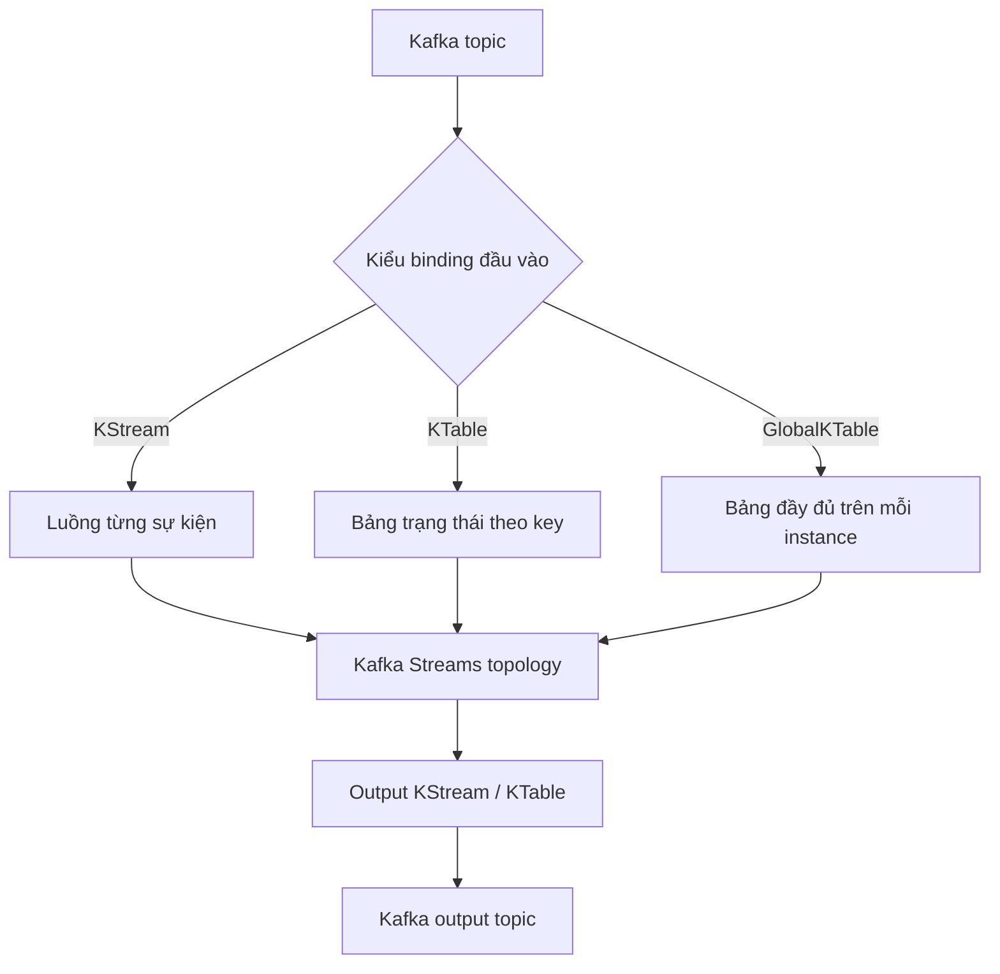
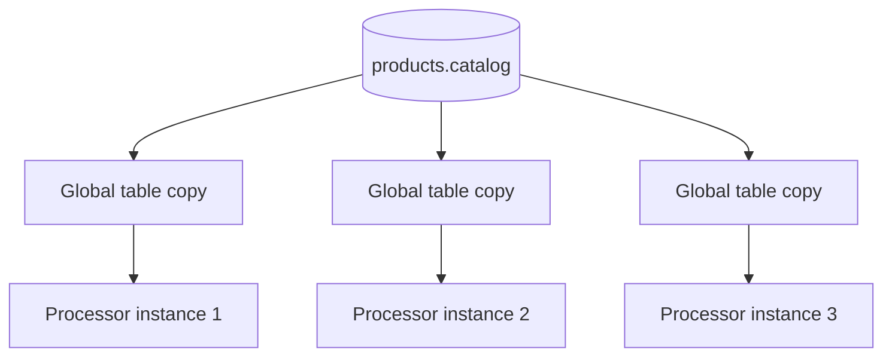

# Binding cho KStream, KTable và GlobalKTable

## 1. Kafka Streams binder nhận dữ liệu dưới dạng nào?

Spring Cloud Stream Kafka Streams binder kết nối các topic Kafka với Kafka Streams DSL. Khác với Kafka message-channel binder thông thường, function của Kafka Streams binder nhận trực tiếp các kiểu dữ liệu của Kafka Streams như `KStream`, `KTable` và `GlobalKTable`.

Ba kiểu này đều biểu diễn dữ liệu đọc từ Kafka, nhưng mang ý nghĩa xử lý khác nhau:

- **`KStream<K, V>`** là luồng sự kiện. Mỗi record là một sự kiện độc lập được xử lý khi nó đến.
- **`KTable<K, V>`** là bảng trạng thái được xây dựng từ các thay đổi có khóa. Với mỗi key, giá trị mới nhất đại diện cho trạng thái hiện tại.
- **`GlobalKTable<K, V>`** là bảng trạng thái được sao chép đầy đủ đến mỗi instance của ứng dụng Kafka Streams, phù hợp cho các phép tra cứu tham chiếu nhỏ hoặc vừa.

Kiểu tham số trong chữ ký function quyết định binder tạo binding theo kiểu nào. Vì vậy, chọn `KStream`, `KTable` hay `GlobalKTable` là quyết định về semantics dữ liệu và cách phân phối trạng thái, không chỉ là thay đổi kiểu Java.



Kafka Streams binder hỗ trợ `KStream`, `KTable` và `GlobalKTable` ở input. Với output, binder hỗ trợ `KStream` và `KTable`; `GlobalKTable` là kiểu đầu vào để tra cứu dữ liệu toàn cục, không phải kiểu output binding thông thường.

## 2. KStream: một record là một sự kiện

`KStream<K, V>` biểu diễn các record được đọc từ topic theo thứ tự của từng partition. Mỗi record có key và value. Một key có thể xuất hiện nhiều lần với các value khác nhau; các lần xuất hiện đó đều là sự kiện trong luồng.

Ví dụ topic `orders.events` chứa:

| Key (`orderId`) | Value | Ý nghĩa |
|---|---|---|
| `ORD-101` | `OrderCreated` | Đơn hàng được tạo |
| `ORD-205` | `OrderCreated` | Đơn hàng khác được tạo |
| `ORD-101` | `PaymentAuthorized` | Thanh toán của ORD-101 được xác nhận |
| `ORD-101` | `OrderShipped` | ORD-101 được giao cho vận chuyển |

Consumer dạng KStream nhìn thấy cả bốn record. Nếu cần đếm sự kiện, lọc, biến đổi, join hoặc tổng hợp theo thời gian, KStream là điểm bắt đầu phù hợp.

### Function chỉ có một input

Ví dụ function nhận luồng click và phát lại các record sau khi chuẩn hóa key/value:

```java
import java.util.function.Function;
import org.apache.kafka.streams.KeyValue;
import org.apache.kafka.streams.kstream.KStream;
import org.springframework.context.annotation.Bean;
import org.springframework.context.annotation.Configuration;

@Configuration
class ClickFunctions {

    @Bean
    Function<KStream<String, String>, KStream<String, String>> normalizeClicks() {
        return clicks -> clicks
            .filter((userId, event) -> userId != null && event != null)
            .map((userId, event) -> new KeyValue<>(
                userId.trim(), event.trim().toLowerCase()
            ));
    }
}
```

Binder tạo hai binding mặc định:

- `normalizeClicks-in-0`: input KStream.
- `normalizeClicks-out-0`: output KStream.

Cấu hình destination:

```yaml
spring:
  cloud:
    function:
      definition: normalizeClicks
    stream:
      bindings:
        normalizeClicks-in-0:
          destination: clicks.raw
        normalizeClicks-out-0:
          destination: clicks.normalized
```

Nếu chỉ cần đọc và thực hiện side effect mà không phát output, có thể dùng `Consumer<KStream<K, V>>`. Với processor có cả input và output, dùng `Function<KStream<K, V>, KStream<K2, V2>>`.

Lưu ý: đổi key bằng `map` không tự chuyển record sang partition mới. Nếu key mới sẽ được dùng cho phép toán stateful như `groupByKey`, hãy dùng `selectKey`/`groupBy` và bảo đảm có repartition khi cần. Key trong record và partition vật lý hiện tại là hai khái niệm khác nhau.

## 3. KTable: biểu diễn trạng thái mới nhất theo key

`KTable<K, V>` diễn giải các record có key như những lần cập nhật một bảng. Khi nhận một record mới cho key đã tồn tại, giá trị mới thay thế trạng thái trước đó của key.

Ví dụ topic `users.regions` có các record:

| Offset | Key (`userId`) | Value (`region`) | Trạng thái sau record |
|---:|---|---|---|
| 0 | `U-1` | `north` | `U-1 → north` |
| 1 | `U-2` | `south` | `U-1 → north`, `U-2 → south` |
| 2 | `U-1` | `central` | `U-1 → central`, `U-2 → south` |

KStream nhìn thấy cả ba sự kiện. KTable biểu diễn trạng thái cuối cùng:

```text
U-1 -> central
U-2 -> south
```

Đây là điểm khác biệt cốt lõi: KStream giữ ý nghĩa của từng lần phát; KTable giữ ý nghĩa trạng thái mới nhất của mỗi key.

### Tombstone xóa key khỏi KTable

Trong Kafka, record có key nhưng value là `null` thường được gọi là tombstone. Khi KTable nhận tombstone, key tương ứng bị xóa khỏi trạng thái bảng. Ví dụ:

```text
U-1 -> null
```

Sau tombstone, KTable không còn giá trị hiện tại cho `U-1`. Đây là cơ chế xóa trạng thái trong changelog, khác với một value JSON có trường `deleted=true` mà ứng dụng phải tự diễn giải.

### Topic đầu vào của KTable

Topic dùng làm changelog cho KTable cần có key ổn định và được serialize nhất quán. Topic compacted thường phù hợp với dữ liệu biểu diễn trạng thái vì Kafka có thể giữ lại giá trị mới nhất cho mỗi key theo chính sách compaction. Tuy nhiên, compaction không diễn ra tức thời và không nên giả định mọi phiên bản cũ đã biến mất ngay lập tức.

Nếu cần dựng lại bảng đầy đủ, phải bảo đảm topic còn đủ dữ liệu để khôi phục trạng thái. Topic dùng retention xóa theo thời gian có thể làm mất những cập nhật cần thiết nếu thiết kế không phù hợp.

## 4. GlobalKTable: bản sao đầy đủ trên từng instance

`GlobalKTable<K, V>` cũng biểu diễn trạng thái mới nhất theo key, nhưng khác KTable ở cách phân phối dữ liệu. Mỗi instance Kafka Streams đọc toàn bộ partition của topic nguồn và duy trì một bản sao đầy đủ của bảng cục bộ.

Ví dụ, `products.catalog` có vài nghìn sản phẩm. Mỗi instance xử lý đơn hàng cần tra cứu thông tin sản phẩm theo `productId`. GlobalKTable giúp mỗi instance có thể tra cứu mọi sản phẩm mà không cần phân phối bảng theo partition của stream.



Các instance có cùng dữ liệu tham chiếu sau khi cập nhật được tiêu thụ và áp dụng. Vì mỗi instance đọc toàn bộ topic, GlobalKTable có thể tốn thêm network, disk và memory khi số instance hoặc kích thước bảng tăng.

### Khi nào dùng GlobalKTable?

Phù hợp khi bảng tra cứu có kích thước vừa phải, cần được truy cập từ mọi partition của stream và thay đổi không quá lớn so với khả năng đồng bộ. Ví dụ:

- Bảng mã quốc gia hoặc tiền tệ.
- Danh mục sản phẩm quy mô vừa.
- Bảng cấu hình tenant cần tra cứu tại mọi processor instance.
- Bảng ánh xạ ID sang metadata dùng khi enrich event.

Không nên dùng GlobalKTable cho bảng hàng trăm triệu bản ghi nếu mỗi instance không đủ tài nguyên để giữ và cập nhật toàn bộ dữ liệu. Khi đó, KTable phân vùng, external lookup có cache hoặc một kiến trúc tra cứu khác có thể phù hợp hơn.

## 5. Binding name được tạo từ chữ ký function

Kafka Streams binder sử dụng tên bean function và vị trí tham số để tạo binding name. Với function bean tên `process`:

| Chữ ký function | Binding mặc định |
|---|---|
| `Consumer<KStream<K,V>>` | `process-in-0` |
| `Function<KStream<K,V>, KStream<K2,V2>>` | `process-in-0`, `process-out-0` |
| `BiFunction<KStream<K,V1>, KTable<K,V2>, KStream<K,V3>>` | `process-in-0`, `process-in-1`, `process-out-0` |
| `BiConsumer<KStream<K,V1>, KTable<K,V2>>` | `process-in-0`, `process-in-1` |

Vị trí tham số quyết định kiểu binding:

- Tham số thứ nhất của `BiFunction` được bind thành input thứ 0.
- Tham số thứ hai được bind thành input thứ 1.
- Kiểu Java của từng tham số cho binder biết input đó là KStream, KTable hay GlobalKTable.

Ví dụ `BiFunction<KStream<String, Order>, GlobalKTable<String, Product>, KStream<String, EnrichedOrder>>` tạo `enrichOrder-in-0` cho topic đơn hàng và `enrichOrder-in-1` cho topic sản phẩm.

Không đặt tên binding theo kiểu tự đoán như `orders-input` nếu chưa khai báo alias. Hãy dùng đúng tên được tạo mặc định hoặc cấu hình override tường minh.

## 6. Binding nhiều input bằng BiFunction

Một use case phổ biến là join luồng sự kiện click với bảng khu vực người dùng. Topic `clicks.events` chứa các click mới; topic `users.regions` chứa trạng thái vùng mới nhất của từng user.

```java
import java.util.function.BiFunction;
import org.apache.kafka.streams.kstream.KStream;
import org.apache.kafka.streams.kstream.KTable;
import org.springframework.context.annotation.Bean;
import org.springframework.context.annotation.Configuration;

record RegionWithClicks(String region, Long clicks) {}

@Configuration
class RegionFunctions {

    @Bean
    BiFunction<KStream<String, Long>, KTable<String, String>,
            KStream<String, RegionWithClicks>> enrichClicks() {
        return (clicks, userRegions) -> clicks.leftJoin(
            userRegions,
            (count, region) -> new RegionWithClicks(
                region == null ? "UNKNOWN" : region,
                count
            )
        );
    }
}
```

Cấu hình hai input và một output:

```yaml
spring:
  cloud:
    function:
      definition: enrichClicks
    stream:
      bindings:
        enrichClicks-in-0:
          destination: clicks.events
        enrichClicks-in-1:
          destination: users.regions
        enrichClicks-out-0:
          destination: clicks.enriched
      kafka:
        streams:
          bindings:
            enrichClicks-in-1:
              consumer:
                materializedAs: user-regions-store
```

Input thứ nhất là KStream, input thứ hai là KTable. Output là KStream. `materializedAs` đặt tên state store cho KTable đầu vào để có thể nhận diện và truy cập khi cần.

### Ý nghĩa của KStream-KTable join

Với mỗi click event đến, Kafka Streams tra cứu giá trị hiện tại của `userId` trong KTable và tạo kết quả enrich. Khi vùng của một user thay đổi trong KTable, các click event cũ đã phát trước đó không tự động được phát lại chỉ vì bảng thay đổi. Join này được kích hoạt bởi record đến từ phía KStream.

Nếu cần tính toán lại kết quả khi một trong hai bảng thay đổi, hãy cân nhắc KTable-KTable join hoặc một topology khác phù hợp với semantics cập nhật.

## 7. Điều kiện partitioning khi join KTable

KStream-KTable join thông thường yêu cầu hai phía có cùng key và được partition tương thích để record của cùng key có thể được xử lý tại cùng task. Trong thực tế, điều này thường có nghĩa:

- KStream và KTable dùng cùng kiểu key và cùng quy tắc serialize.
- Các topic được partition tương thích, thường cùng partition count.
- Producer định tuyến cùng key về cùng partition theo chiến lược tương ứng.
- Không thay đổi partitioning tùy tiện giữa hai nguồn.

Nếu hai topic không co-partitioned, Kafka Streams có thể từ chối topology hoặc join không đáp ứng yêu cầu. Hãy kiểm tra partition count và key distribution khi triển khai.

KTable là bảng phân vùng, nên mỗi task giữ phần trạng thái thuộc partition mà task đó sở hữu. Đây là lý do join theo key cần hai nguồn có cách phân vùng tương thích.

## 8. KStream-GlobalKTable join để tra cứu không cần co-partitioning

GlobalKTable phù hợp khi stream cần tra cứu một bảng đầy đủ theo khóa được tính từ record. Khác KTable join, API join với GlobalKTable nhận thêm một hàm `KeyValueMapper` để lấy lookup key từ stream record.

Ví dụ, đơn hàng có `productId`; bảng sản phẩm có key là `productId`:

```java
import java.util.function.Function;
import org.apache.kafka.streams.kstream.GlobalKTable;
import org.apache.kafka.streams.kstream.KStream;
import org.springframework.context.annotation.Bean;
import org.springframework.context.annotation.Configuration;

record Order(String orderId, String productId, int quantity) {}
record Product(String productId, String name, long unitPrice) {}
record EnrichedOrder(String orderId, String productName, int quantity,
                     long unitPrice) {}

@Configuration
class ProductEnrichmentFunctions {

    @Bean
    Function<KStream<String, Order>,
            Function<GlobalKTable<String, Product>, KStream<String, EnrichedOrder>>>
    enrichOrders() {
        return orders -> products -> orders.leftJoin(
            products,
            (orderId, order) -> order.productId(),
            (order, product) -> product == null
                ? new EnrichedOrder(order.orderId(), "UNKNOWN", order.quantity(), 0)
                : new EnrichedOrder(order.orderId(), product.name(),
                    order.quantity(), product.unitPrice())
        );
    }
}
```

Function có hai input được viết dưới dạng curried function: input đầu tiên là KStream, input thứ hai là GlobalKTable. Binder tạo:

- `enrichOrders-in-0` cho topic đơn hàng.
- `enrichOrders-in-1` cho topic sản phẩm.
- `enrichOrders-out-0` cho topic kết quả.

GlobalKTable được sao chép đến mỗi instance, nên stream có thể tra cứu `productId` mà không cần KTable và KStream co-partitioned. Đổi lại, mỗi instance phải đọc và duy trì toàn bộ bảng sản phẩm.

## 9. KTable-KTable join

Khi cả hai input đều là bảng trạng thái và kết quả cần phản ánh thay đổi từ một trong hai phía, KTable-KTable join là lựa chọn phù hợp.

Ví dụ, `orders.by-customer` chứa trạng thái đơn hàng theo `customerId`, còn `customers.profile` chứa thông tin khách hàng theo cùng key. Khi đơn hàng hoặc hồ sơ khách hàng thay đổi, kết quả join có thể phát ra bản cập nhật tương ứng.

```java
import java.util.function.BiFunction;
import org.apache.kafka.streams.kstream.KTable;
import org.springframework.context.annotation.Bean;

record Customer(String name, String tier) {}
record OrderSummary(long orderCount, long totalCents) {}
record CustomerSummary(String customerName, String tier,
                       long orderCount, long totalCents) {}

@Bean
BiFunction<KTable<String, OrderSummary>, KTable<String, Customer>,
        KTable<String, CustomerSummary>> customerSummary() {
    return (orders, customers) -> orders.join(
        customers,
        (orderSummary, customer) -> new CustomerSummary(
            customer.name(), customer.tier(),
            orderSummary.orderCount(), orderSummary.totalCents()
        )
    );
}
```

Join này yêu cầu hai KTable có key tương thích và co-partitioned. Nếu cần giữ kết quả khi một phía thiếu key, có thể dùng `leftJoin` hoặc `outerJoin` theo semantics nghiệp vụ và API Kafka Streams tương ứng.

## 10. KTable và GlobalKTable khác nhau thế nào?

| Tiêu chí | KTable | GlobalKTable |
|---|---|---|
| Trạng thái | Bảng theo key, phân vùng theo task | Bản sao đầy đủ trên mỗi instance |
| Phân phối dữ liệu | Mỗi task xử lý partition được gán | Mỗi instance đọc toàn bộ partition của topic |
| Join phổ biến | KStream-KTable, KTable-KTable | KStream-GlobalKTable |
| Co-partitioning | Cần tương thích khi join theo key | Không cần co-partitioning cho lookup join |
| Tài nguyên | Chia theo partition/task | Mỗi instance phải giữ toàn bộ dữ liệu |
| Phù hợp | Bảng lớn, có thể partition theo key | Bảng tra cứu vừa/nhỏ cần có ở mọi instance |

Đừng chọn GlobalKTable chỉ vì nó giúp bỏ qua co-partitioning. Nếu bảng rất lớn, chi phí đọc toàn bộ topic và duy trì bản sao trên từng instance có thể vượt lợi ích. KTable phân vùng thường phù hợp hơn với dữ liệu lớn.

## 11. Materialize KTable thành state store có tên

Kafka Streams thường tạo state store khi DSL sử dụng các phép toán stateful như aggregate, count, reduce hoặc join. Với một KTable input, có thể đặt tên state store bằng thuộc tính `materializedAs` của consumer binding:

```yaml
spring:
  cloud:
    stream:
      kafka:
        streams:
          bindings:
            enrichClicks-in-1:
              consumer:
                materializedAs: user-regions-store
```

Tên store có ích khi cần truy cập trạng thái cục bộ bằng Interactive Queries hoặc tích hợp Processor API. State store thường có thể được khôi phục từ changelog/replay theo cấu hình Kafka Streams.

`materializedAs` trong ví dụ áp dụng cho incoming KTable. Không mặc định rằng cùng thuộc tính này có thể đặt tên GlobalKTable store. Global state store có cách đăng ký và quản lý riêng trong Kafka Streams.

### State store và dữ liệu nguồn

State store là trạng thái cục bộ mà Kafka Streams duy trì để xử lý topology. Nó không thay thế topic nguồn. Nếu local state bị mất, Kafka Streams cần khôi phục từ changelog hoặc đọc lại dữ liệu nguồn theo cơ chế đã cấu hình.

Đặt tên store ổn định, tránh trùng tên trong cùng topology và cân nhắc tương thích khi đổi tên. Đổi tên state store có thể khiến ứng dụng tạo trạng thái mới và phải khôi phục lại dữ liệu.

## 12. Serde cho KStream, KTable và GlobalKTable

Kafka lưu byte; Kafka Streams cần `Serde` để serialize key/value khi đọc và ghi. Với Kafka Streams binder, key được deserialize/serialize bằng native Kafka Serdes. Value có thể được binder suy luận từ kiểu Java, Serde bean hoặc cấu hình.

Các kiểu phổ biến như `String`, `Long`, `Integer`, `UUID`, `byte[]` có Serde tương ứng. Với kiểu domain như `Order`, `Customer` hoặc `Product`, binder có thể suy luận JSON Serde khi phù hợp; nếu dùng Avro, Protobuf hoặc kiểu tùy chỉnh, nên cấu hình Serde rõ ràng.

Ví dụ cấu hình Serde theo từng input:

```yaml
spring:
  cloud:
    stream:
      kafka:
        streams:
          bindings:
            enrichOrders-in-0:
              consumer:
                keySerde: org.apache.kafka.common.serialization.Serdes$StringSerde
                valueSerde: com.example.serde.OrderSerde
            enrichOrders-in-1:
              consumer:
                keySerde: org.apache.kafka.common.serialization.Serdes$StringSerde
                valueSerde: com.example.serde.ProductSerde
            enrichOrders-out-0:
              producer:
                keySerde: org.apache.kafka.common.serialization.Serdes$StringSerde
                valueSerde: com.example.serde.EnrichedOrderSerde
```

Đường dẫn class trong ví dụ cần thay bằng Serde thực tế của ứng dụng. Thuộc tính consumer/producer Serde nằm dưới namespace `spring.cloud.stream.kafka.streams.bindings.<binding-name>`, khác với cấu hình của regular Kafka binder.

### Cấu hình Serde mặc định ở binder

Khi nhiều binding dùng cùng Serde, có thể khai báo default key/value Serde trong Kafka Streams configuration:

```yaml
spring:
  cloud:
    stream:
      kafka:
        streams:
          binder:
            configuration:
              default.key.serde: org.apache.kafka.common.serialization.Serdes$StringSerde
              default.value.serde: org.apache.kafka.common.serialization.Serdes$StringSerde
```

Đây là cấu hình cấp binder, có thể ảnh hưởng nhiều processor trong cùng ứng dụng. Nếu một binding cần kiểu khác, khai báo Serde ở binding đó để làm rõ hợp đồng dữ liệu.

### Native decoding và message conversion

Kafka Streams binder thường dùng native Kafka Serdes cho input/output. Nếu muốn dùng message conversion của Spring Cloud Stream thay cho native decoding/encoding, phải tắt native decoding/encoding tương ứng ở từng binding. Không trộn hai cơ chế mà không xác định rõ nơi deserialize payload, vì có thể gây double conversion hoặc lỗi kiểu dữ liệu.

## 13. application.id và binding type

Kafka Streams dùng `application.id` để nhận diện một ứng dụng Streams, quản lý consumer group, tiến độ và state directory. Các instance của cùng một logical topology thường dùng cùng application ID để chia partition và khôi phục trạng thái. Các topology độc lập cần application ID khác nhau.

Ví dụ cấu hình cấp binder:

```yaml
spring:
  cloud:
    stream:
      kafka:
        streams:
          binder:
            applicationId: order-enrichment-app
```

Nếu một Spring Cloud Stream application khai báo nhiều Kafka Streams function, mỗi processor cần application ID phù hợp. Có thể đặt ID theo function hoặc input binding theo các thuộc tính Kafka Streams binder hỗ trợ. Không dùng chung một ID cho những topology độc lập nếu chúng cần tiến độ và state store riêng.

Đổi application ID thường tạo một consumer group logic mới. Ứng dụng có thể bắt đầu đọc theo `startOffset` khi group mới chưa có offset và xây dựng state store lại từ topic nguồn. Đây không phải thao tác đổi tên vô hại; cần tính đến replay, retention và duplicate side effect.

## 14. Kích hoạt function và cấu hình nhiều binding

Nếu ứng dụng có nhiều function bean, chỉ các function được khai báo trong `spring.cloud.function.definition` mới được kích hoạt theo mô hình functional binding.

```yaml
spring:
  cloud:
    function:
      definition: normalizeClicks;enrichOrders
```

Các binding được tạo theo tên từng function:

- `normalizeClicks-in-0`, `normalizeClicks-out-0`.
- `enrichOrders-in-0`, `enrichOrders-in-1`, `enrichOrders-out-0`.

Nếu cần đổi binding name mặc định thành tên domain cụ thể, có thể dùng cơ chế alias `spring.cloud.stream.function.bindings.<default-binding-name>`. Sau đó, cấu hình destination trên alias đã đặt. Giữ mapping rõ ràng để tránh nhầm tên function bean, binding name và Kafka topic.

## 15. Binding KTable và GlobalKTable không giống regular Consumer

KStream binder không đưa từng record vào một hàm `Consumer<Message<T>>` theo cách message-channel binder thông thường. Nó xây dựng Kafka Streams topology và truyền một đối tượng KStream/KTable/GlobalKTable cho function. Function định nghĩa các phép toán của topology; Kafka Streams thực thi topology khi record đến.

Điều này ảnh hưởng cách viết code:

- Không gọi `subscribe()` hoặc tự tạo consumer trong function.
- Không lặp qua toàn bộ KStream ngay khi function được gọi; function đang khai báo topology, không phải xử lý một batch dữ liệu đã có.
- Dùng DSL như `map`, `filter`, `join`, `groupBy`, `aggregate`, `toStream` để mô tả phép biến đổi.
- Dùng `foreach` cho side effect cuối luồng khi phù hợp, nhưng cân nhắc khả năng retry và giao dịch.
- Để binder quản lý lifecycle và binding của Kafka Streams application.

Ví dụ, `input.filter(...).mapValues(...)` tạo topology. Nó không thực thi ngay toàn bộ record trong topic khi Spring tạo bean.

## 16. Những lỗi thường gặp khi chọn binding type

| Triệu chứng | Nguyên nhân có thể | Hướng xử lý |
|---|---|---|
| Join không có dữ liệu hoặc topology lỗi | Dùng KTable join với key/partition không tương thích | Kiểm tra key, Serde, partition count và partitioner |
| Bảng không phản ánh cập nhật mới | Topic không có key ổn định hoặc Serde sai | Kiểm tra record key, tombstone và deserialization |
| KTable giữ giá trị cũ sau thao tác xóa | Producer phát value `deleted=true` thay vì tombstone theo semantics mong muốn | Xác định hợp đồng xóa; dùng tombstone khi cần xóa key khỏi KTable |
| Mỗi instance tiêu thụ toàn bộ dữ liệu quá lớn | Dùng GlobalKTable cho bảng lớn | Cân nhắc KTable phân vùng hoặc lookup architecture khác |
| Không tìm thấy state store | Store chưa được materialize hoặc tên không khớp | Kiểm tra `materializedAs` và topology |
| Deserialization exception | Serde không khớp schema/kiểu Java | Khai báo Serde đúng ở binding hoặc binder |
| Binding không được tạo | Function bean chưa được kích hoạt hoặc sai tên binding | Kiểm tra `spring.cloud.function.definition` và tên bean |
| Replay toàn bộ dữ liệu ngoài ý muốn | Đổi `application.id` hoặc group state | Xác định ID, offset và retention trước deploy |

## 17. Kiểm thử binding và topology

Kiểm thử nên xác nhận cả kiểu dữ liệu đầu vào và semantics của từng bảng/luồng:

1. Kiểm tra `function.definition` kích hoạt đúng function.
2. Xác nhận binding name và destination của từng input/output.
3. Gửi nhiều record cùng key vào KStream và xác nhận mọi event đều được xử lý.
4. Gửi nhiều update cho cùng key vào KTable và xác nhận giá trị mới nhất được sử dụng.
5. Gửi tombstone và xác nhận key bị xóa khỏi trạng thái KTable.
6. Kiểm tra KStream-KTable join với key trùng và key không tồn tại.
7. Kiểm tra KStream-GlobalKTable join với lookup key được ánh xạ đúng.
8. Khởi chạy nhiều instance để xác nhận GlobalKTable được tải trên từng instance và KTable được phân vùng theo topology.
9. Kiểm tra Serde với dữ liệu thực tế, bao gồm record lỗi schema.
10. Restart ứng dụng và xác nhận state store/offset được khôi phục theo application ID.

Test binder hoặc topology test của Kafka Streams có thể hỗ trợ kiểm thử logic. Với các hành vi liên quan partition assignment, state restoration, Serde broker và application ID, cần integration test với Kafka thật hoặc môi trường test tương thích.

## 18. Quy trình chọn KStream, KTable hoặc GlobalKTable

1. Nếu mọi record đều là sự kiện cần xử lý, chọn KStream.
2. Nếu mỗi key cần biểu diễn trạng thái mới nhất và bảng có thể phân vùng, chọn KTable.
3. Nếu mọi processor instance cần tra cứu toàn bộ bảng nhỏ/vừa, cân nhắc GlobalKTable.
4. Xác định key, Serde và partitioning trước khi viết join.
5. Dùng chữ ký `Function`, `Consumer`, `BiFunction` hoặc curried function để khai báo số input/output.
6. Cấu hình destination cho từng binding name do binder tạo.
7. Đặt `application.id` ổn định cho mỗi logical topology.
8. Cấu hình `materializedAs` khi cần state store có tên cho incoming KTable.
9. Kiểm tra native Serdes hoặc message conversion ở từng binding.
10. Kiểm thử update, tombstone, join, state restoration và nhiều instance.

KStream, KTable và GlobalKTable mô tả ba cách nhìn khác nhau về dữ liệu Kafka: sự kiện, trạng thái phân vùng và trạng thái toàn cục được sao chép. Spring Cloud Stream Kafka Streams binder suy ra kiểu binding từ chữ ký function, tạo binding name theo vị trí input/output và kết nối chúng với topic. Chọn đúng kiểu, key, Serde và application ID giúp topology join đúng dữ liệu, duy trì state store và mở rộng nhiều instance mà không phải tự quản lý Kafka consumer ở tầng ứng dụng.

## Tài liệu tham khảo

- [Spring Cloud Stream Kafka Streams Binder — Programming Model](https://docs.spring.io/spring-cloud-stream/reference/kafka/kafka-streams-binder/programming-model.html)
- [Spring Cloud Stream Kafka Streams Binder — Configuration Options](https://docs.spring.io/spring-cloud-stream/reference/kafka/kafka-streams-binder/configuration-options.html)
- [Spring Cloud Stream Kafka Streams Binder — Record Serialization and Deserialization](https://docs.spring.io/spring-cloud-stream/reference/kafka/kafka-streams-binder/record-serialization-and-deserialization.html)
- [Spring Cloud Stream Kafka Streams Binder — State Store](https://docs.spring.io/spring-cloud-stream/reference/kafka/kafka-streams-binder/state-store.html)

