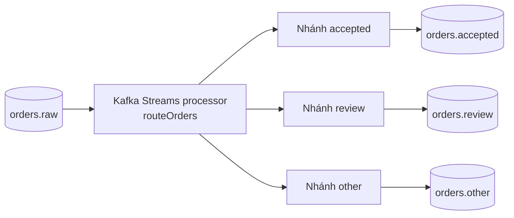

# Nhiều đầu ra bằng KStream[] và phân nhánh dữ liệu

Một Kafka Streams processor có thể đọc một topic, áp dụng logic xử lý rồi ghi kết quả ra nhiều topic. Với Spring Cloud Stream Kafka Streams binder, mô hình functional hỗ trợ việc này bằng cách trả về một mảng `KStream[]` từ function bean. Binder dựa trên số phần tử của mảng để tạo nhiều output binding; từng phần tử được nối với output binding theo vị trí trong mảng.

Tính năng này thường được gọi là **branching**. Ở tầng Kafka Streams, `split().branch(...)` phân luồng record theo các predicate. Mỗi record được đưa vào nhánh đầu tiên có predicate đúng; nếu không nhánh nào khớp, record đi vào default branch hoặc bị loại khỏi các nhánh nếu dùng `noDefaultBranch()`.

Cần phân biệt branching với broadcast. Branching chọn một nhánh theo điều kiện đầu tiên khớp. Broadcast tạo nhiều luồng xử lý từ cùng một stream để một record có thể đi qua nhiều nhánh xử lý. Bài học này trình bày cách trả về `KStream[]`, ánh xạ output binding, định tuyến record, cấu hình topic/Serde và kiểm thử topology.

## 1. Vì sao một processor cần nhiều đầu ra?

Một luồng sự kiện có thể chứa nhiều loại dữ liệu hoặc nhiều kết quả nghiệp vụ. Thay vì tạo một ứng dụng riêng cho mỗi quy tắc định tuyến, processor có thể đọc một input stream, phân loại record rồi ghi từng nhóm vào topic phù hợp.

Ví dụ hệ thống đơn hàng nhận sự kiện từ topic `orders.raw`:

- Đơn hợp lệ được chuyển tới `orders.accepted`.
- Đơn cần nhân viên kiểm tra được chuyển tới `orders.review`.
- Đơn không thuộc hai nhóm trên được chuyển tới `orders.other`.



Mỗi output topic có thể phục vụ một nhóm consumer downstream độc lập. Ví dụ service fulfillment đọc đơn accepted, đội vận hành đọc đơn review, còn pipeline kiểm tra dữ liệu đọc đơn other.

Nhiều output binding giúp topology thể hiện rõ nơi dữ liệu đi tới. Các topic vẫn là tài nguyên Kafka riêng, có partition, retention, ACL và consumer group riêng.

## 2. KStream[] là hợp đồng nhiều output của function

Trong functional programming model, function một input và một output thường có dạng:

```java
@Bean
Function<KStream<String, OrderEvent>, KStream<String, OrderEvent>> process() {
    return input -> input.filter((key, event) -> event.isValid());
}
```

Binder tạo một input binding và một output binding mặc định:

- `process-in-0`: input `KStream`.
- `process-out-0`: output `KStream`.

Khi function cần nhiều output, kiểu trả về chuyển thành mảng:

```java
@Bean
Function<KStream<String, OrderEvent>, KStream<?, ?>[]> routeOrders() {
    return input -> {
        KStream<String, OrderEvent> accepted = input.filter(
                (key, event) -> event.isAccepted());

        KStream<String, OrderEvent> review = input.filter(
                (key, event) -> event.requiresReview());

        return new KStream<?, ?>[] { accepted, review };
    };
}
```

Binder phát hiện mảng có hai phần tử và tạo hai output binding:

- `routeOrders-out-0`
- `routeOrders-out-1`

Nếu function trả về ba phần tử, binder tạo `routeOrders-out-0`, `routeOrders-out-1` và `routeOrders-out-2`.

Đây là hợp đồng của topology, không phải một mảng message được trả về mỗi lần có event. Function khai báo các stream xử lý liên tục; mỗi phần tử mảng là một stream output của topology.

### Số phần tử và thứ tự phải ổn định

Số lượng output được xác định từ cấu trúc mảng mà function trả về khi binder xây dựng topology. Vì vậy:

- Luôn trả về cùng số lượng stream output.
- Giữ thứ tự các phần tử nhất quán giữa các lần khởi động.
- Không trả về mảng có số phần tử thay đổi tùy payload.
- Không đặt nhầm stream vào vị trí của output binding khác.

Vị trí trong mảng là một phần của hợp đồng cấu hình. Nếu đổi thứ tự hai stream nhưng không đổi destination, dữ liệu có thể đi sang topic không đúng nghiệp vụ.

## 3. Tên output binding được sinh tự động

Với function bean tên `routeOrders`, binder dùng quy ước:

| Vị trí trong mảng | Output binding mặc định |
|---:|---|
| 0 | `routeOrders-out-0` |
| 1 | `routeOrders-out-1` |
| 2 | `routeOrders-out-2` |
| 3 | `routeOrders-out-3` |

Tên function bean là phần đầu của binding name. Hậu tố `out` chỉ output, còn chỉ số là vị trí phần tử trong mảng.

Tên binding là tên logic để cấu hình Spring Cloud Stream. Tên topic được chỉ định riêng qua thuộc tính `destination`. Vì vậy, không bắt buộc topic phải có tên giống binding.

## 4. Phân nhánh bằng split() và branch()

Kafka Streams DSL cung cấp `KStream.split()` để bắt đầu xây dựng các nhánh. Mỗi lần gọi `branch(predicate, Branched.as(name))` thêm một điều kiện định tuyến.

Ví dụ:

```java
Map<String, KStream<String, OrderEvent>> branches = input
        .split(Named.as("orders-"))
        .branch(
                (key, event) -> event.isAccepted(),
                Branched.as("accepted"))
        .branch(
                (key, event) -> event.requiresReview(),
                Branched.as("review"))
        .defaultBranch(Branched.as("other"));
```

Trong ví dụ:

- `Named.as("orders-")` đặt prefix cho tên nhánh.
- `Branched.as("accepted")` đặt suffix cho nhánh accepted.
- `Branched.as("review")` đặt suffix cho nhánh review.
- `defaultBranch(...)` nhận record không khớp các predicate trước đó.

Các key trong map tương ứng là `orders-accepted`, `orders-review` và `orders-other`.

Có thể dùng `split()` không có prefix nếu không cần đặt tên processor. Khi cần lấy từng nhánh bằng tên, prefix và suffix rõ ràng giúp code dễ đọc và tránh nhầm.

### Predicate được đánh giá theo thứ tự

Kafka Streams đánh giá các predicate theo thứ tự khai báo. Một record được chuyển vào **nhánh đầu tiên** có predicate trả về `true`; các predicate sau không được dùng để đưa record đó vào thêm nhánh khác.

Ví dụ:

1. Record thỏa `isAccepted` đi vào nhánh accepted.
2. Nếu không accepted nhưng thỏa `requiresReview`, record đi vào nhánh review.
3. Nếu không khớp hai điều kiện trên, record đi vào default branch.

Do đó, nếu hai điều kiện có thể cùng đúng, thứ tự khai báo quyết định nhánh nhận record. Hãy thiết kế predicate sao cho không mơ hồ hoặc sắp xếp theo mức ưu tiên nghiệp vụ.

## 5. Ví dụ hoàn chỉnh: định tuyến đơn hàng vào ba topic

Giả sử domain có kiểu dữ liệu:

```java
public enum OrderStatus {
    ACCEPTED,
    REVIEW,
    OTHER
}

public record OrderEvent(
        String orderId,
        OrderStatus status,
        long occurredAt
) {
    public boolean isAccepted() {
        return status == OrderStatus.ACCEPTED;
    }

    public boolean requiresReview() {
        return status == OrderStatus.REVIEW;
    }
}
```

Function xây dựng ba nhánh:

```java
import java.util.Map;
import java.util.function.Function;

import org.apache.kafka.streams.kstream.Branched;
import org.apache.kafka.streams.kstream.KStream;
import org.apache.kafka.streams.kstream.Named;
import org.springframework.context.annotation.Bean;

@Bean
Function<KStream<String, OrderEvent>, KStream<?, ?>[]> routeOrders() {
    return input -> {
        Map<String, KStream<String, OrderEvent>> branches = input
                .split(Named.as("orders-"))
                .branch(
                        (key, event) -> event != null && event.isAccepted(),
                        Branched.as("accepted"))
                .branch(
                        (key, event) -> event != null && event.requiresReview(),
                        Branched.as("review"))
                .defaultBranch(Branched.as("other"));

        return new KStream<?, ?>[] {
                branches.get("orders-accepted"),
                branches.get("orders-review"),
                branches.get("orders-other")
        };
    };
}
```

Mảng trả về có thứ tự cố định:

| Index | Stream | Output binding |
|---:|---|---|
| 0 | `orders-accepted` | `routeOrders-out-0` |
| 1 | `orders-review` | `routeOrders-out-1` |
| 2 | `orders-other` | `routeOrders-out-2` |

Ở đây dùng `defaultBranch` để giữ lại record không khớp hai điều kiện chính. Ví dụ kiểm tra `event != null` cũng giúp tránh gọi method trên tombstone/null value. Nếu hệ thống cần xử lý tombstone theo quy tắc riêng, hãy thêm predicate hoặc nhánh rõ ràng cho trường hợp đó.

### Vì sao lấy stream bằng tên thay vì dựa vào values()?

Tài liệu binder cũng minh họa việc lấy các stream bằng:

```java
return branches.values().toArray(new KStream[0]);
```

Cách này ngắn gọn khi chấp nhận thứ tự map do quá trình tạo nhánh. Trong ứng dụng cần hợp đồng output rõ ràng, lấy từng nhánh bằng key rồi đặt vào mảng theo thứ tự đã định giúp người đọc nhìn thấy trực tiếp mapping giữa nhánh và output binding.

Không được đảo thứ tự các phần tử mảng mà vẫn giữ nguyên destination cấu hình; khi đó accepted có thể bị gửi sang topic review và ngược lại.

## 6. Cấu hình destination cho từng output

Sau khi xác định tên binding, cấu hình destination cho mỗi output trong `application.yml`:

```yaml
spring:
  cloud:
    function:
      definition: routeOrders
    stream:
      bindings:
        routeOrders-in-0:
          destination: orders.raw
        routeOrders-out-0:
          destination: orders.accepted
        routeOrders-out-1:
          destination: orders.review
        routeOrders-out-2:
          destination: orders.other
      kafka:
        streams:
          binder:
            application-id: order-router-v1
            brokers: localhost:9092
```

Cách đọc:

- `routeOrders-in-0` đọc topic `orders.raw`.
- `routeOrders-out-0` ghi stream accepted vào `orders.accepted`.
- `routeOrders-out-1` ghi stream review vào `orders.review`.
- `routeOrders-out-2` ghi stream other vào `orders.other`.
- `application-id` là danh tính Kafka Streams application; nó được dùng cho consumer group, offset và state recovery của processor.

Nếu chỉ có một Kafka Streams processor, có thể cấu hình application ID ở binder level hoặc dùng `spring.application.name` theo hướng dẫn binder. Nếu có nhiều processor trong cùng ứng dụng, cần đặt application ID riêng cho từng processor/function để chúng có state và tiến độ tiêu thụ độc lập.

Topic phải tồn tại hoặc được tạo theo quyền và cơ chế provisioning của môi trường. Hãy xác minh partition count, replication factor, retention và ACL cho cả input lẫn từng output topic.

## 7. Output Serde: cấu hình theo từng nhánh

Kafka Streams binder cần biết cách serialize key và value của từng output stream. Binder cố gắng suy luận Serde dựa trên kiểu dữ liệu:

- Các kiểu Kafka phổ biến như String, Integer, Long, Double, Float, byte[] và UUID có thể dùng Serde tương ứng.
- Binder có thể dùng JsonSerde của Spring Kafka cho kiểu object phù hợp.
- Nếu không suy luận được hoặc cần định dạng cụ thể như Avro/Protobuf, hãy khai báo Serde rõ ràng.

Khi branching tạo nhiều output, mỗi output có thể mang kiểu dữ liệu khác nhau. Nếu cần cấu hình tường minh, đặt Serde theo đúng output binding:

```yaml
spring:
  cloud:
    stream:
      kafka:
        streams:
          bindings:
            routeOrders-out-0:
              producer:
                key-serde: com.example.kafka.StringKeySerde
                value-serde: com.example.kafka.AcceptedOrderSerde
            routeOrders-out-1:
              producer:
                key-serde: com.example.kafka.StringKeySerde
                value-serde: com.example.kafka.ReviewOrderSerde
            routeOrders-out-2:
              producer:
                key-serde: com.example.kafka.StringKeySerde
                value-serde: com.example.kafka.OtherOrderSerde
```

Các class trong ví dụ là Serde do ứng dụng cung cấp và phải implement `org.apache.kafka.common.serialization.Serde`. Tên property trong Java API thường là `keySerde` và `valueSerde`; YAML có thể dùng dạng kebab-case.

Có thể dùng cấu hình chung `spring.cloud.stream.kafka.streams.default.producer.*` nếu mọi output có cùng yêu cầu. Khi các nhánh có kiểu value khác nhau, cấu hình theo từng binding giúp tránh áp dụng nhầm serializer.

### Native encoding và message conversion

Kafka Streams binder mặc định sử dụng native encoding cho output. Trong trường hợp này, Kafka Serde chịu trách nhiệm serialize record. Nếu muốn dùng message conversion của Spring Cloud Stream, cần tắt native encoding trên từng output binding liên quan và khai báo content type/converter phù hợp.

Không trộn nhiều cách serialize mà không có hợp đồng rõ ràng. Producer downstream phải dùng deserializer tương thích với từng topic.

## 8. Branching là first-match, không phải broadcast

Đây là khác biệt quan trọng nhất khi thiết kế nhiều đầu ra.

Với `split().branch(...)`:

- Predicate được đánh giá theo thứ tự.
- Một record đi vào nhánh đầu tiên khớp.
- Record không khớp đi vào default branch nếu có.
- Nếu không có default branch, record không khớp bị loại khỏi các output branch.

Nói cách khác, một record không được sao chép tự động sang mọi nhánh. Đây là routing độc quyền theo điều kiện.

### Khi nào cần broadcast?

Nếu mọi record cần được gửi tới nhiều output, hãy tạo nhiều luồng xử lý từ cùng KStream thay vì dùng split first-match.

Ví dụ, mọi đơn hàng đều cần được gửi sang audit topic, đồng thời đơn accepted được gửi thêm sang fulfillment topic:

```java
@Bean
Function<KStream<String, OrderEvent>, KStream<?, ?>[]> publishOrders(
        AuditMapper auditMapper) {

    return input -> {
        KStream<String, OrderEvent> accepted =
                input.filter((key, event) ->
                        event != null && event.isAccepted());

        KStream<String, OrderAudit> audit =
                input.mapValues(auditMapper::toAudit);

        return new KStream<?, ?>[] { accepted, audit };
    };
}
```

Trong ví dụ này, stream audit được tạo từ toàn bộ input; stream accepted chỉ giữ các đơn accepted. Một record accepted có thể đi tới cả hai output. Đây là fan-out/broadcast thông qua nhiều downstream operator, không phải first-match branching.

Kafka Streams không cung cấp một operator split để đưa cùng record vào nhiều nhánh predicate. Nếu cần multicast có điều kiện, có thể tạo các stream bằng các phép filter độc lập từ cùng input hoặc dùng các operator phù hợp với logic nghiệp vụ.

| Nhu cầu | Cách triển khai |
|---|---|
| Mỗi record chỉ vào một topic theo thứ tự ưu tiên | `split().branch(...)` |
| Record không khớp cần đi vào topic dự phòng | `defaultBranch(...)` |
| Record không khớp được bỏ qua | `noDefaultBranch()` |
| Mọi record đi vào audit, một số record đi thêm vào topic nghiệp vụ | Tạo nhiều downstream stream từ cùng input |
| Một record có thể vào nhiều topic theo nhiều predicate độc lập | Tạo nhiều stream/filter độc lập, không dùng first-match split |

## 9. defaultBranch và noDefaultBranch

Khi dùng branching, phải quyết định rõ xử lý record không khớp predicate.

### Có default branch

```java
Map<String, KStream<String, OrderEvent>> branches = input
        .split(Named.as("orders-"))
        .branch(isAccepted, Branched.as("accepted"))
        .branch(isReview, Branched.as("review"))
        .defaultBranch(Branched.as("other"));
```

Kết quả có ba stream: accepted, review và other. Mảng trả về phải có ba phần tử và binder tạo ba output binding.

### Không có default branch

```java
Map<String, KStream<String, OrderEvent>> branches = input
        .split(Named.as("orders-"))
        .branch(isAccepted, Branched.as("accepted"))
        .branch(isReview, Branched.as("review"))
        .noDefaultBranch();
```

Kết quả chỉ có hai stream. Record không khớp hai predicate không đi vào output nào trong topology này.

Với `noDefaultBranch()`, mảng chỉ có hai phần tử và binder tạo hai output binding. Không có output binding thứ ba cho unmatched record.

### Unmatched không tự động là DLQ

Default branch là quyết định routing nghiệp vụ. Nó không phải dead-letter queue tự động và không có metadata exception mặc định.

Nếu record không khớp do dữ liệu không hợp lệ, hãy định nghĩa nhánh quarantine/rejected rõ ràng, hoặc dùng cơ chế error handling riêng khi thực sự có exception. Đừng dùng `noDefaultBranch()` rồi cho rằng record bị loại đã được lưu vào DLQ.

## 10. Phân nhánh trước hay sau khi biến đổi?

Vị trí gọi `split()` quyết định dữ liệu mà predicate nhìn thấy.

### Phân nhánh trực tiếp từ input

```java
Map<String, KStream<String, OrderEvent>> branches = input
        .split(Named.as("orders-"))
        .branch((key, event) -> event.total() >= 1_000_000,
                Branched.as("high-value"))
        .defaultBranch(Branched.as("standard"));
```

Predicate làm việc với OrderEvent ban đầu.

### Biến đổi rồi mới phân nhánh

```java
KStream<String, OrderSummary> summaries = input
        .filter((key, event) -> event != null)
        .mapValues(event -> new OrderSummary(
                event.orderId(),
                event.total(),
                event.status()));

Map<String, KStream<String, OrderSummary>> branches = summaries
        .split(Named.as("summary-"))
        .branch((key, summary) -> summary.total() >= 1_000_000,
                Branched.as("high-value"))
        .defaultBranch(Branched.as("standard"));
```

Ở đây predicate làm việc với OrderSummary, không còn trực tiếp nhìn toàn bộ OrderEvent. Cách này hữu ích khi cần chuẩn hóa dữ liệu hoặc tính thuộc tính trước khi định tuyến.

### Phân nhánh sau aggregation

Có thể thực hiện aggregation, windowing hoặc join trước khi phân nhánh. Khi đó output branch chứa kết quả đã tổng hợp, không phải từng input record ban đầu.

Ví dụ word count theo cửa sổ thời gian tạo ra stream WordCount; sau đó có thể phân nhánh theo ngôn ngữ hoặc ngưỡng số lần xuất hiện. Hãy nhớ rằng state store, repartition topic và Serde của aggregation vẫn là trách nhiệm topology; KStream[] chỉ định nghĩa nhiều output của kết quả cuối.

## 11. Dùng KStream[] cùng KTable và các function khác

Kafka Streams binder hỗ trợ KStream và KTable làm output đơn. Khi function trả về KTable, binder chuyển nó thành KStream để ghi output topic. Với nhiều output, hợp đồng được biểu diễn bằng mảng KStream.

Ví dụ function có hai input:

```java
BiFunction<KStream<String, OrderEvent>,
           KTable<String, CustomerProfile>,
           KStream<?, ?>[]> enrichAndRoute()
```

Function có thể join stream đơn hàng với KTable hồ sơ khách hàng, sau đó phân nhánh kết quả thành nhiều KStream output. Khi dùng hai input, binding mặc định là `enrichAndRoute-in-0` và `enrichAndRoute-in-1`; output được đánh số `enrichAndRoute-out-0`, `out-1` theo mảng.

Với nhiều hơn hai input, Kafka Streams binder hỗ trợ curried functions. Tuy nhiên, không nên làm chữ ký function quá phức tạp nếu có thể tách processor thành các phần nhỏ dễ vận hành.

## 12. Giới hạn khi composition với KStream[]

Kafka Streams binder hỗ trợ composition cho topology tuyến tính, ví dụ `foo|bar`. Nhưng function trả về mảng `KStream[]` để branching chỉ có thể là thành phần cuối trong chuỗi composition.

Ví dụ hợp lệ về ý tưởng:

- `normalize|routeOrders`: normalize trả về một KStream, routeOrders tạo nhiều output và đứng cuối.
- `enrich|routeOrders`: enrich trả về KStream, routeOrders phân nhánh cuối cùng.

Không đặt một function trả về `KStream[]` ở giữa chuỗi để một function sau nhận mảng đó như một KStream đơn. Nếu cần xử lý sau khi đã branch, hãy thực hiện các phép biến đổi trong từng branch trước khi trả về mảng hoặc tách thành processor/topic riêng.

## 13. Key, partition và thứ tự ở từng output

Mỗi output binding ghi vào một topic riêng. Key của record quyết định partition ở topic đích theo Serde/partitioner mà Kafka Streams sử dụng.

Khi branch giữ nguyên key, các record cùng key có thể tiếp tục được định tuyến theo key tới partition tương ứng trong từng output topic. Nếu dùng `map` để thay key, hãy kiểm tra key mới và Serde trước khi ghi.

Một số nguyên tắc:

- Giữ key aggregate nếu downstream cần thứ tự theo đơn hàng/customer.
- Đặt key rõ ràng trước output nếu branch thay đổi mô hình dữ liệu.
- Cấu hình Serde của key tương thích giữa producer và consumer.
- Không giả định partition số 2 của topic accepted có quan hệ cố định với partition số 2 của topic review.
- Nếu cần partitioner riêng, Kafka Streams binder hỗ trợ cấu hình outbound partitioner theo output binding.

Mỗi output topic có partition count và consumer group độc lập. Không nên mặc định các topic đầu ra có cùng số partition hoặc cùng semantics ordering.

## 14. Lỗi, unmatched record và độ tin cậy

Branching chỉ quyết định record đi vào stream nào. Nó không thay thế cơ chế xử lý exception, deserialization failure hay retry.

| Tình huống | Hành vi cần thiết |
|---|---|
| Predicate khớp một nhánh | Record đi vào stream tương ứng |
| Không predicate nào khớp, có default branch | Record đi vào default stream |
| Không predicate nào khớp, dùng noDefaultBranch | Record không đi vào các output branch |
| Predicate ném exception | Topology xử lý lỗi theo cơ chế Kafka Streams/application |
| Deserialization thất bại trước khi có KStream record | Dùng deserialization exception handler của Kafka Streams binder |
| Output topic/Serde cấu hình sai | Processor có thể không khởi động hoặc fail khi serialize/publish |

Nếu unmatched record cần được điều tra, tạo nhánh quarantine cụ thể và ghi thêm reason code. Nếu cần retry một lỗi downstream, thiết kế retry topic hoặc cơ chế xử lý riêng; không dùng default branch để thay cho retry.

Khi dùng nhiều output trong một topology, cần kiểm tra processing guarantee, transaction và behavior khi một output bị lỗi. Đừng giả định nhiều topic output đồng nghĩa một transaction nghiệp vụ độc lập được bảo đảm theo cách ứng dụng mong muốn; hãy cấu hình Kafka Streams processing guarantee và kiểm thử trên broker.

## 15. Kiểm thử branching bằng TopologyTestDriver

`TopologyTestDriver` cho phép kiểm thử topology Kafka Streams mà không cần chạy broker. Có thể tạo input topic, gửi record và đọc output topic để xác minh predicate và nội dung từng branch.

Các trường hợp nên kiểm thử:

1. Record accepted chỉ xuất hiện ở output accepted.
2. Record review chỉ xuất hiện ở output review.
3. Record không khớp predicate đi vào default output.
4. Với noDefaultBranch, record unmatched không xuất hiện ở các branch output.
5. Record thỏa nhiều predicate đi vào predicate đầu tiên.
6. Null/tombstone được xử lý theo quy tắc đã thiết kế.
7. Key và value sau transformation được giữ hoặc đổi đúng.
8. Output stream có đúng kiểu dữ liệu và Serde.

Pseudo-test:

```java
inputTopic.pipeInput("order-1", acceptedOrder);
inputTopic.pipeInput("order-2", reviewOrder);
inputTopic.pipeInput("order-3", unknownOrder);

assertThat(acceptedOutput.readValue()).isEqualTo(acceptedOrder);
assertThat(reviewOutput.readValue()).isEqualTo(reviewOrder);
assertThat(otherOutput.readValue()).isEqualTo(unknownOrder);
```

Đây là pseudo-test để thể hiện ý tưởng; tên topic và helper phụ thuộc topology test cụ thể. Test nên kiểm tra cả key, timestamp và headers nếu chúng quan trọng với downstream.

## 16. Integration test với Spring Cloud Stream Kafka Streams binder

TopologyTestDriver kiểm tra logic DSL nhưng không xác minh toàn bộ binding của Spring Cloud Stream. Cần thêm integration test với Kafka thật hoặc Testcontainers để kiểm tra:

- Function bean được kích hoạt bằng `spring.cloud.function.definition`.
- Input binding trỏ đúng topic.
- Số output binding tương ứng với độ dài mảng.
- `routeOrders-out-0`, `out-1`, `out-2` trỏ đúng destination.
- Serde của từng output hoạt động với kiểu dữ liệu thực tế.
- Topic output có thể được tạo hoặc đã tồn tại.
- Consumer downstream đọc được record và key đúng.
- Restart processor khôi phục application state/offset theo application ID.
- Lỗi khi một output không thể serialize được được phát hiện và quan sát.

Dùng topic riêng cho từng test, event ID duy nhất, timeout hữu hạn và dọn tài nguyên sau khi chạy. Không chỉ xác minh function được khởi tạo; cần đọc record từ từng output topic để xác nhận mapping.

## 17. Quan sát vận hành nhiều output

Một processor nhiều output cần metric theo từng nhánh/topic:

- Số record vào input.
- Số record được route vào từng branch.
- Số record unmatched/default.
- Output publish rate theo topic.
- Serialization error theo output binding.
- Consumer lag của các downstream group.
- Processing latency và commit/transaction error.
- Tỷ lệ record bị drop theo chính sách noDefaultBranch.

Có thể thêm metric counter trong predicate hoặc trước/sau branch, nhưng tránh side effect ngoài topology khi predicate được đánh giá. Dùng `peek` cho logging/metrics quan sát có kiểm soát; không thay đổi dữ liệu trong callback.

Log nên có event ID, key, branch name, output topic và correlation ID nếu có. Tránh ghi payload nhạy cảm.

## 18. Lỗi cấu hình thường gặp

| Triệu chứng | Nguyên nhân có thể |
|---|---|
| Binder chỉ tạo một output binding | Function vẫn khai báo trả về một KStream đơn |
| Topic nhận sai loại event | Mảng KStream trả về sai thứ tự so với output binding |
| Record unmatched biến mất | Dùng noDefaultBranch và không có nhánh quarantine |
| Một record chỉ vào một branch dù nhiều predicate đúng | split/branch dùng first-match |
| Muốn broadcast nhưng chỉ một output nhận record | Dùng branching thay vì tạo nhiều downstream stream độc lập |
| Function composition không hoạt động | KStream[] output không nằm ở vị trí cuối trong composition |
| Serialization lỗi ở một topic | Serde không phù hợp với key/value của output binding đó |
| Output topic không xuất hiện | Sai destination, thiếu quyền hoặc topic chưa được provision |
| Downstream không đọc được value | Producer Serde và consumer deserializer không tương thích |
| Chỉ có một branch chạy | Predicate thứ nhất quá rộng và nhận record trước các predicate sau |

Khi gặp lỗi, kiểm tra theo thứ tự: kiểu trả về function, độ dài và thứ tự mảng, tên binding mặc định, destination, Serde và kết quả test của từng predicate.

## 19. Quy trình thiết kế nhiều output

1. Xác định các nhóm record cần định tuyến.
2. Quyết định mỗi record chỉ thuộc một nhóm hay có thể cần nhiều output.
3. Nếu first-match, sắp xếp predicate theo ưu tiên nghiệp vụ.
4. Quyết định default branch hoặc noDefaultBranch.
5. Đặt tên branch rõ ràng.
6. Tạo mảng KStream theo thứ tự output đã thống nhất.
7. Ánh xạ từng output binding sang destination cụ thể.
8. Kiểm tra Serde riêng cho từng output nếu kiểu dữ liệu khác nhau.
9. Xác định key và partition semantics của mỗi topic.
10. Kiểm thử predicate bằng TopologyTestDriver.
11. Kiểm thử binder/topic/Serde bằng broker thật.
12. Theo dõi số record theo branch và output lag sau deploy.

## 20. Checklist trước khi deploy

- Function bean được khai báo là Function nhận KStream và trả về KStream[].
- Số phần tử mảng cố định và khớp số output binding.
- Thứ tự mảng được ghi rõ và không thay đổi ngoài kế hoạch.
- Binding name dùng đúng quy ước <function>-out-<index>.
- Mỗi output binding có destination đúng.
- Predicate được sắp theo thứ tự ưu tiên.
- Đã quyết định defaultBranch hoặc noDefaultBranch.
- Unmatched record không bị bỏ ngoài ý muốn.
- Đã phân biệt first-match branching với broadcast/multicast.
- Nếu cần broadcast, đã tạo nhiều downstream stream từ cùng KStream.
- Branch name và output index có thể truy vết.
- Serde của từng output tương thích với key/value thực tế.
- Key giữ đúng aggregate semantics nếu cần thứ tự.
- Function trả về KStream[] chỉ là bước cuối nếu có composition.
- Đã kiểm thử predicate, default branch, unmatched và first-match.
- Đã integration test mapping binding tới topic và đọc record từ từng output.
- Metrics theo dõi record count, output rate, lag và serialization error.

Spring Cloud Stream Kafka Streams binder dùng `KStream[]` để biểu diễn nhiều output binding trong functional model. Binder tạo output binding theo số phần tử và vị trí của mảng. Kafka Streams `split().branch()` thực hiện routing theo first-match; default branch giữ record không khớp, còn noDefaultBranch bỏ record khỏi các branch output. Khi thiết kế, hãy xác định rõ branching hay broadcast, giữ mapping output ổn định, cấu hình Serde phù hợp và kiểm thử từng topic đích.

## Tài liệu tham khảo

- [Spring Cloud Stream 5.0.4 — Kafka Streams Binder: Programming Model](https://docs.spring.io/spring-cloud-stream/reference/kafka/kafka-streams-binder/programming-model.html)
- [Spring Cloud Stream 5.0.4 — Kafka Streams Binder: Configuration Options](https://docs.spring.io/spring-cloud-stream/reference/kafka/kafka-streams-binder/configuration-options.html)
- [Apache Kafka — Streams DSL: Branching and Routing](https://kafka.apache.org/documentation/streams/developer-guide/dsl-api/)
- [Apache Kafka — KStream API](https://kafka.apache.org/43/javadoc/org/apache/kafka/streams/kstream/KStream.html)

