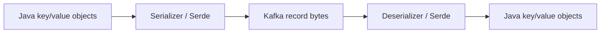

# Phân biệt native Serde với chuyển đổi của framework

## Mục tiêu

Kafka lưu key và value của record dưới dạng byte. Khi ứng dụng đọc hoặc ghi dữ liệu, byte phải được chuyển đổi thành kiểu Java mà code có thể xử lý và ngược lại. Trong Spring Cloud Stream có hai cơ chế dễ bị nhầm lẫn:

- **Chuyển đổi của framework (MessageConverter):** Spring Cloud Stream dùng message payload, header và content type để chuyển đổi dữ liệu giữa các kiểu ứng dụng.
- **Native Serde của Kafka Streams:** Kafka Streams dùng `Serde` (Serializer + Deserializer) để mã hóa và giải mã key/value tại ranh giới Kafka và trong các thao tác DSL cần materialize hoặc repartition dữ liệu.

Kafka Streams binder dựa trên cơ chế Serde của Kafka Streams. Đây là điểm khác biệt quan trọng so với cách chuyển đổi message thường gặp ở các binding imperative hoặc functional của Kafka message binder. Nếu chỉ đặt `content-type: application/json` mà không có Serde phù hợp, ứng dụng Kafka Streams vẫn có thể không giải mã được record hoặc ghi ra wire format mà consumer mong đợi.

Bài học này giải thích ranh giới của hai cơ chế, cách cấu hình Serde mặc định và theo binding, cách dùng Serde có kiểu cho POJO, cách khai báo Serde trong Kafka Streams DSL và cách kiểm thử wire format.

Sau bài học, bạn có thể:

- Phân biệt MessageConverter với Kafka Streams Serde.
- Giải thích vì sao Kafka Streams cần Serde cho cả key và value.
- Cấu hình default key/value Serde ở cấp binder.
- Cấu hình keySerde/valueSerde riêng cho input và output binding.
- Tạo Serde có kiểu cho POJO bằng Spring Kafka JsonSerde hoặc Serde tùy chỉnh.
- Chọn Serde cho các thao tác group, join, repartition và state store.
- Đồng bộ wire format giữa producer và consumer.
- Kiểm thử serialization/deserialization và xử lý lỗi dữ liệu.

## 1. Vì sao phải chuyển đổi dữ liệu?

Kafka record gồm key, value và metadata/header. Broker lưu key/value dưới dạng byte; broker không biết một byte array đại diện cho `OrderCreated`, JSON, Avro hay một chuỗi.

Ví dụ record có thể chứa:

- Key: chuỗi `order-42`, được mã hóa thành UTF-8 bytes.
- Value: một đối tượng `OrderCreated`, được mã hóa thành JSON bytes.
- Headers: event type, trace ID hoặc schema metadata.

Khi producer ghi record, dữ liệu ứng dụng phải được serialize. Khi consumer đọc record, bytes phải được deserialize về kiểu dữ liệu mà ứng dụng sử dụng.



Nếu producer và consumer dùng định dạng không tương thích, consumer có thể gặp lỗi deserialize, đọc sai dữ liệu hoặc không thể diễn giải record. Vì vậy, serializer và deserializer là một phần của hợp đồng tích hợp giữa các ứng dụng.

## 2. MessageConverter của Spring Cloud Stream

Trong mô hình Spring Cloud Stream thông thường, framework làm việc với Spring Message. Message có payload và headers; content type giúp framework chọn cách chuyển đổi payload.

Ví dụ một output binding gửi POJO dưới dạng JSON:

```java
public record OrderCreated(
        String eventId,
        String orderId,
        long totalAmount
) {}

@Bean
Supplier<OrderCreated> orderEvents(OrderEventSource source) {
    return source::next;
}
```

Cấu hình:

```yaml
spring:
  cloud:
    function:
      definition: orderEvents
    stream:
      bindings:
        orderEvents-out-0:
          destination: orders.created
          content-type: application/json
```

Với đường binding dùng MessageConverter, framework có thể chuyển payload `OrderCreated` thành JSON theo content type. Consumer dùng conversion tương ứng để nhận kiểu payload.

MessageConverter hoạt động ở tầng Spring Messaging:

- Nhận payload và headers.
- Dùng content type để chọn converter.
- Chuyển đổi giữa object và representation phù hợp.
- Có thể tham gia vào quá trình chuyển đổi trước/sau binder tùy loại binder và cấu hình.

Content type mô tả định dạng nội dung ở tầng framework. Nó không tự định nghĩa toàn bộ wire protocol của một hệ thống và không thay thế serializer/deserializer mà Kafka Streams DSL yêu cầu.

## 3. Kafka Streams Serde là gì?

`Serde<T>` là abstraction của Kafka Streams kết hợp hai thành phần:

- `Serializer<T>`: chuyển đối tượng Java thành byte array để ghi vào Kafka.
- `Deserializer<T>`: chuyển byte array đọc từ Kafka thành đối tượng Java.

Kafka Streams cần biết Serde của key và value vì topology xử lý dữ liệu có kiểu:

```java
KStream<String, OrderCreated>
```

Ở đây key là `String`, value là `OrderCreated`. Kafka Streams cần một Serde cho String key và một Serde cho OrderCreated value khi đọc dữ liệu; khi ghi output cũng cần Serde phù hợp.

Một số Serde có sẵn trong Kafka:

| Kiểu dữ liệu | Serde thường dùng |
|---|---|
| `String` | `Serdes.String()` |
| `Long` | `Serdes.Long()` |
| `Integer` | `Serdes.Integer()` |
| `byte[]` | `Serdes.ByteArray()` |
| `UUID` | Serde tùy chỉnh hoặc thư viện phù hợp |
| POJO/record | JSON, Avro, Protobuf hoặc Serde tùy chỉnh |

Kafka Streams dùng Serde trong nhiều vị trí:

- Đọc key/value từ source topic.
- Ghi key/value vào sink topic.
- Grouping và repartition.
- Join giữa stream và table.
- Aggregate và materialize state store.
- Ghi changelog topic cho state store.

Vì vậy, Serde không chỉ là cấu hình của producer/consumer bên ngoài. Nó còn ảnh hưởng đến dữ liệu nội bộ mà Kafka Streams tạo ra trong topology.

## 4. Khác biệt giữa MessageConverter và Serde

| Tiêu chí | MessageConverter | Kafka Streams Serde |
|---|---|---|
| Abstraction | Spring Message, payload và headers | Kafka key/value |
| Mục tiêu | Chuyển đổi payload theo content type | Serialize/deserialize object thành bytes |
| Cấu hình chính | Content type và converter | Key/value Serde |
| Phạm vi | Tầng Spring Messaging và binder conversion | Kafka Streams source, sink và DSL |
| Kiểu dữ liệu | Payload của Spring Message | Key/value có kiểu trong KStream/KTable |
| Metadata | Có thể sử dụng Spring headers | Xử lý record key/value; headers Kafka là metadata riêng |
| Ví dụ | POJO sang JSON qua converter | `Serde<OrderCreated>` tạo JSON bytes |
| Tình huống điển hình | Function/Consumer binding thông thường | Kafka Streams topology |

Hai cơ chế đều có thể tạo hoặc đọc JSON bytes, nhưng chúng không phải cùng một API và không tự động thay thế nhau.

Một MessageConverter có thể biết `content-type: application/json`, trong khi Serde phải được chỉ định cho kiểu key/value mà Kafka Streams xử lý. Nếu topology cần `KStream<String, OrderCreated>`, hãy cấu hình Serde có thể deserialize value thành `OrderCreated`; chỉ đặt content type không cung cấp đầy đủ Serde cho Kafka Streams.

## 5. Kafka Streams binder sử dụng Serde

Kafka Streams binder kết nối các function bean dùng `KStream`, `KTable` hoặc `GlobalKTable` với input/output binding. Việc đọc và ghi record của topology dựa trên Kafka Streams Serde.

Ví dụ function:

```java
@Bean
Function<KStream<String, OrderCreated>,
         KStream<String, OrderCreated>> normalizeOrders() {
    return orders -> orders.mapValues(order ->
            new OrderCreated(
                    order.eventId(),
                    order.orderId().trim(),
                    order.totalAmount()
            )
    );
}
```

Input và output binding:

```yaml
spring:
  cloud:
    function:
      definition: normalizeOrders
    stream:
      bindings:
        normalizeOrders-in-0:
          destination: orders.created
        normalizeOrders-out-0:
          destination: orders.normalized
```

Function signature cho biết kiểu key/value ở mức Java, nhưng Kafka vẫn lưu bytes. Binder cần Serde phù hợp để giải mã dữ liệu đầu vào và mã hóa dữ liệu đầu ra.

Với Kafka Streams binder, không nên giả định content type conversion thông thường sẽ tự xử lý toàn bộ key/value của topology. Hãy cấu hình Serde cho dữ liệu thực tế và kiểm thử với topic chứa đúng wire format production.

## 6. Cấu hình Serde mặc định ở cấp binder

Có thể khai báo default key/value Serde trong cấu hình Kafka Streams binder. Các mặc định này được dùng khi binding hoặc thao tác topology không chỉ định Serde cụ thể và phiên bản binder cho phép kế thừa cấu hình mặc định.

Ví dụ cho dữ liệu String:

```yaml
spring:
  cloud:
    stream:
      kafka:
        streams:
          binder:
            configuration:
              default.key.serde: org.apache.kafka.common.serialization.Serdes$StringSerde
              default.value.serde: org.apache.kafka.common.serialization.Serdes$StringSerde
```

Hai cấu hình trên là Kafka Streams properties:

- `default.key.serde` là Serde mặc định cho key.
- `default.value.serde` là Serde mặc định cho value.

Mặc định String chỉ phù hợp khi record bytes thực sự là chuỗi UTF-8. Nếu value là JSON object, Avro hoặc Protobuf, dùng StringSerde có thể khiến code nhận một chuỗi thay vì POJO hoặc làm hỏng cách giải mã mong muốn.

Không chọn default POJO Serde chung cho mọi binding nếu các topic có schema khác nhau. Có thể cấu hình Serde riêng theo binding để mỗi topic có hợp đồng dữ liệu rõ ràng.

## 7. Cấu hình Serde riêng cho input binding

Kafka Streams binder cho phép chỉ định keySerde và valueSerde trên consumer binding. Ví dụ input có key String và value JSON `OrderCreated`:

```yaml
spring:
  cloud:
    function:
      definition: normalizeOrders
    stream:
      bindings:
        normalizeOrders-in-0:
          destination: orders.created
      kafka:
        streams:
          bindings:
            normalizeOrders-in-0:
              consumer:
                keySerde: org.apache.kafka.common.serialization.Serdes$StringSerde
                valueSerde: orderCreatedSerde
```

Trong ví dụ, `orderCreatedSerde` là tên bean Serde có kiểu `OrderCreated` được đăng ký trong Spring context. Việc tham chiếu Serde bean theo tên hoặc class cần tuân theo khả năng của phiên bản Kafka Streams binder đang dùng; nếu phiên bản yêu cầu cách khai báo khác, hãy dùng đúng cơ chế được tài liệu binder hỗ trợ.

Ví dụ bean:

```java
@Bean
Serde<OrderCreated> orderCreatedSerde() {
    return new JsonSerde<>(OrderCreated.class).noTypeInfo();
}
```

Spring Kafka `JsonSerde` kết hợp JSON serializer và deserializer. Khai báo target type giúp deserialize JSON thành `OrderCreated`. `noTypeInfo()` tắt việc thêm type information headers riêng của Spring Kafka khi serialize; chỉ dùng khi consumer xác định kiểu đích bằng contract/configuration thay vì dựa vào type header.

Khi nhận message từ nguồn không đáng tin cậy, cấu hình deserializer theo nguyên tắc an toàn và giới hạn kiểu được phép. Không mở rộng trusted packages tùy tiện chỉ để tránh lỗi deserialize.

## 8. Cấu hình Serde riêng cho output binding

Output binding cũng cần Serde để serialize key và value trước khi ghi ra topic.

```yaml
spring:
  cloud:
    stream:
      bindings:
        normalizeOrders-out-0:
          destination: orders.normalized
      kafka:
        streams:
          bindings:
            normalizeOrders-out-0:
              producer:
                keySerde: org.apache.kafka.common.serialization.Serdes$StringSerde
                valueSerde: orderCreatedSerde
```

Ví dụ này sử dụng String key và JSON value. Output Serde phải tương thích với consumer của topic `orders.normalized`.

Nếu output value có kiểu khác input, hãy dùng Serde đúng kiểu output. Không tái sử dụng `orderCreatedSerde` cho một kiểu `OrderSummary` chỉ vì cả hai đều được mã hóa JSON; target type và schema của chúng có thể khác nhau.

### Input và output Serde phải tương thích theo wire format

| Binding | Key | Value | Serde |
|---|---|---|---|
| `normalizeOrders-in-0` | String | OrderCreated JSON | StringSerde + OrderCreated JsonSerde |
| `normalizeOrders-out-0` | String | OrderCreated JSON | StringSerde + OrderCreated JsonSerde |
| `summarizeOrders-out-0` | String | OrderSummary JSON | StringSerde + OrderSummary JsonSerde |

Tên class Java không nhất thiết phải giống nhau giữa producer và consumer, nhưng bytes phải tuân theo cùng wire contract. Nếu producer ghi Avro, consumer không thể đọc bằng JsonSerde chỉ vì cả hai object đều có các trường tương tự.

## 9. Tạo Serde tùy chỉnh cho POJO

Với kiểu dữ liệu riêng, có thể tạo Serde bằng serializer và deserializer tương thích. Ví dụ dùng Spring Kafka JsonSerializer/JsonDeserializer:

```java
@Bean
Serde<OrderCreated> orderCreatedSerde() {
    JsonSerializer<OrderCreated> serializer =
            new JsonSerializer<>();

    JsonDeserializer<OrderCreated> deserializer =
            new JsonDeserializer<>(OrderCreated.class);

    deserializer.addTrustedPackages("com.example.orders");

    return Serdes.serdeFrom(serializer, deserializer);
}
```

Trong ứng dụng thật, cấu hình ObjectMapper, type headers và trusted packages theo contract và chính sách bảo mật. Không tin tưởng package rộng chỉ để deserialize được payload đến từ broker.

Một Serde tùy chỉnh có thể cần implement `Serde<T>` hoặc được tạo bằng `Serdes.serdeFrom(serializer, deserializer)`. Hãy bảo đảm:

- Serializer và deserializer dùng cùng wire format.
- Kiểu đích rõ ràng.
- Null key/value được xử lý theo semantics mong muốn.
- Cấu hình serializer/deserializer được truyền đầy đủ.
- Tài nguyên được đóng theo lifecycle của Kafka Streams.
- Version/schema tương thích giữa các producer và consumer.

Nếu dùng Avro hoặc Protobuf, chọn Serde tích hợp schema registry tương ứng. Serde phải biết cách đăng ký/tìm schema, mã hóa payload và giải mã bytes theo schema ID/version. Chỉ thêm URL schema registry vào YAML mà không chọn đúng Serde không đủ để bật Avro hoặc Protobuf.

## 10. Serde trong các thao tác Kafka Streams DSL

Serde cần thiết ở nhiều toán tử DSL. Một số toán tử nhận Serde trực tiếp hoặc thông qua cấu hình materialization.

### Grouping

Khi group stream theo key mới, Kafka Streams có thể tạo repartition topic. Cần Serde cho key mới và value:

```java
KGroupedStream<String, OrderCreated> grouped =
        orders.groupByKey(
                Grouped.with(
                        Serdes.String(),
                        orderCreatedSerde
                )
        );
```

Trong ví dụ, key và value Serde xác định bytes được ghi/đọc trong repartition topic nếu topology cần repartition. Nếu Serde không tương thích, lỗi có thể chỉ xuất hiện khi topology thực sự kích hoạt repartition.

### Materialized state store

Khi aggregate và lưu state store, Kafka Streams cần Serde cho key và giá trị aggregate:

```java
KTable<String, Long> orderCounts = orders
        .groupByKey(Grouped.with(Serdes.String(), orderCreatedSerde))
        .count(
                Materialized
                        .<String, Long, KeyValueStore<Bytes, byte[]>>as("order-counts")
                        .withKeySerde(Serdes.String())
                        .withValueSerde(Serdes.Long())
        );
```

State store có changelog topic để khôi phục trạng thái. Serde của state store ảnh hưởng dữ liệu changelog và khả năng restore sau restart. Không thay đổi Serde hoặc schema của state store tùy tiện khi ứng dụng đang có dữ liệu đã materialize.

### Join

Join giữa stream/table cần Serde tương thích cho key/value và các kết quả nội bộ. Ví dụ:

```java
KStream<String, OrderWithCustomer> enriched =
        orders.join(
                customers,
                (order, customer) ->
                        new OrderWithCustomer(order, customer),
                Joined.with(
                        Serdes.String(),
                        orderCreatedSerde,
                        customerSerde
                )
        );
```

Đây là ví dụ minh họa việc cung cấp Serde cho key, left value và right value. Chữ ký join cụ thể thay đổi theo loại stream/table và phiên bản Kafka Streams; kiểm tra overload tương ứng với topology thực tế.

Không chỉ cấu hình Serde cho binding đầu vào/đầu ra rồi bỏ qua repartition, join hoặc state store. Lỗi Serde nội bộ có thể xuất hiện sau khi topology chạy một thời gian hoặc khi có dữ liệu mới kích hoạt nhánh xử lý.

## 11. Key Serde và Value Serde có vai trò khác nhau

Kafka key thường quyết định partition routing khi producer dùng partitioner mặc định. Value chứa payload nghiệp vụ. Hai phần có thể dùng định dạng khác nhau.

Ví dụ:

- Key là String `order-42` để các event cùng order đi vào cùng partition.
- Value là JSON `OrderCreated`.
- Header chứa trace ID hoặc metadata kỹ thuật.

Cấu hình keySerde và valueSerde riêng:

```yaml
spring:
  cloud:
    stream:
      kafka:
        streams:
          bindings:
            normalizeOrders-in-0:
              consumer:
                keySerde: org.apache.kafka.common.serialization.Serdes$StringSerde
                valueSerde: orderCreatedSerde
```

Nếu key producer là String nhưng consumer dùng LongSerde, deserialization key sẽ thất bại hoặc không tạo được key như mong đợi. Nếu key bytes không nhất quán, partitioning có thể không còn đúng theo business key.

Không đưa thông tin bí mật vào key chỉ vì key được dùng để partition. Key có thể được quan sát bởi công cụ quản trị, log hoặc consumer khác.

## 12. Content type và headers không thay thế Serde

Trong Spring Cloud Stream, content type và message headers có thể hữu ích cho các binding dùng conversion của framework. Tuy nhiên, Kafka Streams DSL cần Serde để biết cách chuyển key/value bytes.

Ví dụ cấu hình sau không đủ để định nghĩa Serde POJO cho Kafka Streams:

```yaml
spring:
  cloud:
    stream:
      bindings:
        normalizeOrders-in-0:
          destination: orders.created
          content-type: application/json
```

Cấu hình content type không chỉ rõ keySerde/valueSerde cho topology. Hãy khai báo Serde ở binding hoặc default configuration và xác minh nó được sử dụng cho source/sink cần thiết.

Cũng cần phân biệt:

- Kafka record headers là metadata ở tầng Kafka.
- Spring Message headers là metadata ở tầng Spring Messaging.
- Content type là thông tin về định dạng nội dung.
- Serde là cơ chế thực tế mã hóa/giải mã key/value bytes.

Một serializer có thể thêm type header, nhưng header đó không phải schema registry và không thay thế hợp đồng dữ liệu. Consumer đa ngôn ngữ thường nên dựa trên schema/wire format được công bố, thay vì tên class Java của producer.

## 13. Phân biệt với use-native-encoding của Kafka message binder

Ở Kafka message binder thông thường, producer có thể bật `use-native-encoding` để dùng Kafka client serializer thay cho MessageConverter; consumer có thể bật `use-native-decoding` để dùng deserializer native.

Kafka Streams binder là một programming model khác. Kafka Streams topology dùng Serde làm cơ chế cốt lõi cho key/value và các thao tác DSL. Không sao chép máy móc cấu hình `use-native-encoding`/`use-native-decoding` của regular Kafka binder rồi cho rằng nó thay thế được `keySerde`/`valueSerde` của Kafka Streams binder.

| Mô hình | Cơ chế cần hiểu |
|---|---|
| Spring Cloud Stream Kafka message binder | MessageConverter hoặc Kafka client serializer/deserializer qua native encoding/decoding |
| Spring Cloud Stream Kafka Streams binder | Kafka Streams Serde cho key/value của topology |
| Kafka Streams DSL thuần | Serde truyền vào source, sink, grouping, join và state store |

Nếu một ứng dụng có cả binding thường và Kafka Streams binder, hãy kiểm tra namespace cấu hình của từng binder. Property có tên gần giống nhau nhưng không nhất thiết có cùng semantics.

## 14. Chọn Serde theo wire format

| Wire format | Serde/serializer phù hợp | Lưu ý |
|---|---|---|
| String/UTF-8 | StringSerde | Đảm bảo producer gửi text theo encoding thống nhất |
| Byte array | ByteArraySerde | Ứng dụng tự quản lý bytes và schema |
| JSON | JsonSerde hoặc Serde Jackson tùy chỉnh | Chốt tên trường, kiểu dữ liệu và version |
| Avro | Avro Serde tích hợp schema registry | Quản lý schema ID và compatibility |
| Protobuf | Protobuf Serde | Quản lý message descriptor và schema evolution |
| Long/Integer | Serdes.Long/Integer | Kiểu số và byte format phải thống nhất |

JSON dễ quan sát nhưng cần quy định rõ schema, optional fields, timestamp, decimal và compatibility. Avro/Protobuf có schema contract rõ hơn nhưng đòi hỏi registry hoặc descriptor management.

Không đổi wire format của topic đang được nhiều consumer sử dụng mà chưa có migration plan. Các lựa chọn thường gồm topic version mới, schema compatibility, dual-read/dual-write trong giai đoạn chuyển đổi hoặc consumer hỗ trợ nhiều version.

## 15. Kiểm thử Serde

Cần kiểm tra cả chiều serialize và deserialize.

### Round-trip test

```java
@Test
void orderSerdeShouldRoundTrip() {
    Serde<OrderCreated> serde =
            new JsonSerde<>(OrderCreated.class).noTypeInfo();

    OrderCreated original =
            new OrderCreated("evt-1", "order-42", 12500L);

    byte[] bytes = serde.serializer()
            .serialize("orders.created", original);

    OrderCreated restored = serde.deserializer()
            .deserialize("orders.created", bytes);

    assertEquals(original, restored);
}
```

Test round-trip xác minh một object được mã hóa và giải mã về giá trị tương đương. Cần bổ sung test cho null, field optional, dữ liệu cũ, schema version và payload lỗi.

### Kiểm thử binding và topology

- Input key/value được deserialize thành đúng kiểu.
- Output key/value được serialize theo wire contract.
- Binding-specific Serde được chọn thay vì default ngoài ý muốn.
- Grouping/repartition dùng Serde đúng cho key/value mới.
- Join dùng Serde tương thích cho hai phía.
- State store và changelog topic có thể restore sau restart.
- Deserialization exception được xử lý theo policy đã cấu hình.

### Integration test với Kafka

Dùng Kafka broker test hoặc Testcontainers để kiểm tra:

1. Gửi record có key/value bytes đúng wire format.
2. Khởi chạy Kafka Streams binder topology.
3. Xác minh function nhận đúng kiểu dữ liệu.
4. Kiểm tra output topic chứa bytes có thể đọc bởi consumer tương ứng.
5. Restart ứng dụng và xác minh state store restore.
6. Gửi payload không hợp lệ và xác minh deserialization error handler.
7. Kiểm tra schema compatibility khi producer và consumer dùng version khác nhau.

Test Binder hữu ích cho wiring của Spring Cloud Stream nhưng không thay thế Kafka broker integration test để xác minh Serde, repartition topic, changelog và state restoration.

## 16. Lỗi thường gặp

| Triệu chứng | Nguyên nhân có thể | Cách xử lý |
|---|---|---|
| Kafka Streams không deserialize được POJO | Chỉ đặt content type mà không cấu hình Serde | Khai báo valueSerde đúng kiểu |
| String key đọc thành bytes hoặc lỗi kiểu | Producer và consumer dùng key Serde khác nhau | Đồng bộ key wire format và Serde |
| Input đọc được nhưng output consumer lỗi | Output binding dùng Serde khác contract | Cấu hình producer valueSerde phù hợp |
| Grouping/repartition lỗi dù source đọc được | DSL operation thiếu hoặc dùng Serde không đúng | Cung cấp Serde trong Grouped/Consumed/Produced |
| State store restore thất bại | Serde/schema của state store hoặc changelog thay đổi không tương thích | Quản lý schema và migration state có kế hoạch |
| JsonSerde không tạo đúng kiểu đích | Thiếu target type hoặc type mapping không phù hợp | Dùng Serde có kiểu và cấu hình deserializer rõ ràng |
| Consumer đa ngôn ngữ không hiểu type header | Wire contract phụ thuộc class metadata Java | Định nghĩa JSON/Avro/Protobuf schema độc lập |
| Runtime lỗi chỉ xuất hiện khi join | Serde của một phía join không tương thích | Test cả hai input và Serde của join |
| Dữ liệu bị sai sau đổi serializer | Producer đã thay wire format nhưng consumer cũ chưa nâng cấp | Version hóa topic/schema và triển khai migration |

## 17. Quy trình chọn và cấu hình Serde

Trước khi triển khai topology Kafka Streams:

1. Liệt kê kiểu key/value của từng input và output binding.
2. Xác định wire format của từng topic và schema version.
3. Chọn keySerde và valueSerde tương ứng.
4. Đặt default Serde ở binder chỉ khi các binding thực sự dùng chung định dạng.
5. Đặt Serde riêng cho binding có schema hoặc kiểu dữ liệu khác.
6. Cung cấp Serde cho grouping, repartition, join và state store khi DSL yêu cầu.
7. Kiểm tra serializer/deserializer và type headers.
8. Xác minh producer/consumer đa ngôn ngữ dùng cùng wire contract.
9. Viết round-trip test và Kafka integration test.
10. Theo dõi deserialization errors, schema registry failures và state restoration.

Khi đổi Serde của một topic hoặc state store, hãy đánh giá dữ liệu cũ còn trong retention/changelog. Một ứng dụng mới có thể deserialize record mới nhưng thất bại khi đọc record cũ nếu wire format đã thay đổi không tương thích.

## Kết luận

MessageConverter của Spring Cloud Stream chuyển đổi Spring Message payload dựa trên content type và converter. Kafka Streams binder sử dụng Kafka Streams Serde để serialize/deserialize key và value của topology. Hai cơ chế giải quyết các ranh giới khác nhau; content type không thay thế keySerde/valueSerde.

Hãy cấu hình Serde mặc định hoặc theo binding, chọn Serde riêng cho key và value, đồng thời khai báo Serde cho grouping, join, repartition và state store khi cần. Producer và consumer phải thống nhất wire format/schema. Kiểm thử round-trip, output bytes, deserialization error và state restoration trên Kafka để bảo đảm topology xử lý đúng cả dữ liệu mới lẫn dữ liệu đã lưu.

