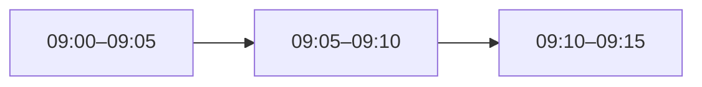
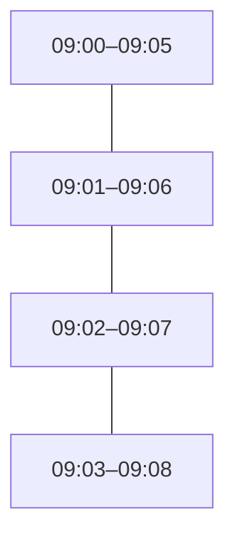
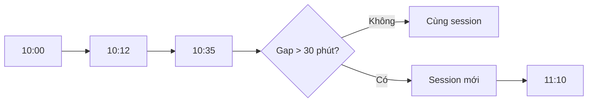

# Cửa sổ tumbling, hopping, sliding và session

Trong xử lý luồng có trạng thái, một phép tổng hợp thường không áp dụng cho toàn bộ lịch sử mà chỉ áp dụng cho một phạm vi dữ liệu. Window (cửa sổ) xác định những record nào được xem là cùng một nhóm theo thời gian hoặc theo khoảng không hoạt động. Kafka Streams cung cấp bốn kiểu cửa sổ thường gặp: tumbling, hopping, sliding và session.

Việc chọn đúng cửa sổ ảnh hưởng tới ý nghĩa kết quả, độ trễ, lượng state phải lưu và cách xử lý event đến muộn. Ví dụ, báo cáo số đơn theo từng khoảng 5 phút thường dùng tumbling window; tính tổng giao dịch trong 5 phút gần nhất, cập nhật mỗi phút dùng hopping window; phát hiện hai sự kiện của cùng tài khoản cách nhau không quá 5 phút dùng sliding window; gom các thao tác thành một phiên cho tới khi người dùng ngừng hoạt động 30 phút dùng session window.

## 1. Window giải quyết vấn đề gì?

Một Kafka topic là luồng record liên tục. Nếu chỉ gọi `groupByKey().count()` thì kết quả là tổng tích lũy theo key, không tự chia theo giờ, ngày hoặc phiên. Window bổ sung phạm vi thời gian cho key, để cùng một key có nhiều kết quả độc lập ở các khoảng khác nhau.

Ví dụ, với các sự kiện mua hàng của khách hàng `cust-42`:

| Thời điểm sự kiện | Số tiền |
|---|---:|
| 09:01 | 100.000 |
| 09:03 | 250.000 |
| 09:07 | 80.000 |
| 09:11 | 120.000 |

Nếu cần tổng tiền theo từng khoảng 5 phút, ta cần xác định rõ ranh giới cửa sổ và cách xử lý record ở đúng biên. Nếu cần tổng trong 5 phút gần nhất cập nhật mỗi phút, các cửa sổ phải chồng lấn. Nếu cần nhóm hoạt động theo từng đợt, ranh giới phải phụ thuộc khoảng không có event chứ không phải lịch cố định.

Kafka Streams thực hiện windowed aggregation theo key. Kết quả thường được lưu trong state store và có thể được phát ra dưới dạng `KTable<Windowed<K>, V>` hoặc chuyển thành stream bằng `toStream()`. Mỗi kết quả được định danh bởi key cùng thông tin cửa sổ, không chỉ bởi key ban đầu.

## 2. Phân biệt event time, processing time và stream time

Trước khi chọn loại window, cần xác định timestamp nào điều khiển cửa sổ:

- **Event time:** thời điểm sự kiện thực sự xảy ra theo timestamp trong record hoặc metadata do producer cung cấp.
- **Processing time:** thời điểm ứng dụng xử lý record. Nó chịu ảnh hưởng của tải, mạng, retry và backlog.
- **Stream time:** khái niệm thời gian của Kafka Streams được tiến lên dựa trên timestamp của record đã xử lý trong task. Window đóng theo tiến trình stream time, không đơn giản theo đồng hồ treo tường.

Kafka Streams sử dụng timestamp gắn với record, thông qua timestamp extractor, để tính window. Nếu producer phát event lúc 09:01 nhưng record chỉ tới consumer lúc 09:12, event time vẫn có thể là 09:01. Nếu timestamp không được đặt đúng, kết quả tổng hợp có thể lệch cửa sổ dù consumer xử lý message thành công.

Ví dụ, event có timestamp:

```java
ProducerRecord<String, OrderCreated> record = new ProducerRecord<>(
        "orders.created", order.customerId(), order);
record.headers().add("event-time", Long.toString(order.occurredAt().toEpochMilli())
        .getBytes(StandardCharsets.UTF_8));
```

Trong thực tế, nên dùng timestamp của Kafka record hoặc một `TimestampExtractor` được cấu hình thống nhất, thay vì chỉ thêm header rồi giả định Kafka Streams tự đọc header đó. Nếu thời điểm nghiệp vụ nằm trong payload, extractor có thể đọc payload sau khi deserialize theo thiết kế Serde; nếu timestamp đã được producer đặt trực tiếp vào record, extractor mặc định có thể sử dụng giá trị đó.

Ví dụ một extractor tùy chỉnh:

```java
public final class OrderTimestampExtractor implements TimestampExtractor {
    @Override
    public long extract(ConsumerRecord<Object, Object> record, long partitionTime) {
        if (record.value() instanceof OrderCreated order) {
            return order.occurredAt().toEpochMilli();
        }
        return record.timestamp();
    }
}
```

Khi dùng extractor, kiểm tra timestamp null, sai đơn vị (giây so với mili giây), nằm trong tương lai quá xa hoặc cũ bất thường. Một timestamp sai có thể làm stream time nhảy vọt và khiến nhiều window đóng sớm; timestamp quá cũ có thể khiến record bị coi là late.

## 3. Tumbling window: cửa sổ cố định, không chồng lấn

Tumbling window chia thời gian thành các khoảng có độ dài cố định và liền nhau. Mỗi timestamp thuộc đúng một cửa sổ. Ví dụ, cửa sổ 5 phút có thể là 09:00–09:05, 09:05–09:10, 09:10–09:15.



Các cửa sổ liên tiếp, không có vùng chồng lấn.

Ví dụ, đếm số đơn theo khách hàng trong từng 5 phút:

```java
@Bean
Function<KStream<String, OrderCreated>, KStream<String, Long>> countOrdersEveryFiveMinutes() {
    return orders -> orders
            .groupByKey()
            .windowedBy(TimeWindows.ofSizeAndGrace(
                    Duration.ofMinutes(5), Duration.ofMinutes(1)))
            .count(Materialized.as("orders-per-customer-5m"))
            .toStream()
            .map((windowedKey, count) ->
                    KeyValue.pair(windowedKey.key(), count));
}
```

`ofSizeAndGrace` tạo cửa sổ có kích thước 5 phút và grace period 1 phút. Với tumbling window, không gọi `advanceBy` hoặc đặt bước nhảy bằng kích thước cửa sổ. Trong ví dụ, kết quả KTable được chuyển thành KStream; code rút gọn key để minh họa, còn hệ thống thực tế thường nên giữ cả `windowedKey.window().start()` và `end()` trong payload output để phân biệt các kết quả cùng customer.

Tumbling window phù hợp với báo cáo theo bucket cố định: doanh thu mỗi 5 phút, số đơn mỗi giờ, số lỗi mỗi ngày. Nó dễ đối soát và không đếm một record vào nhiều bucket.

## 4. Hopping window: cửa sổ cố định có bước trượt

Hopping window có kích thước cố định nhưng được mở theo một bước thời gian (advance). Nếu bước nhỏ hơn kích thước, các cửa sổ chồng lấn. Nếu bước bằng kích thước, hành vi tương đương tumbling. Ví dụ cửa sổ 5 phút, bước 1 phút sẽ tạo các khoảng 09:00–09:05, 09:01–09:06, 09:02–09:07...



Mỗi cửa sổ dài 5 phút; cửa sổ mới bắt đầu sau mỗi phút nên các khoảng thời gian chồng lấn.

Ví dụ đếm số đơn trong 5 phút gần nhất, cập nhật mỗi phút:

```java
@Bean
Function<KStream<String, OrderCreated>, KStream<Windowed<String>, Long>>
countOrdersInHoppingWindows() {
    return orders -> orders
            .groupByKey()
            .windowedBy(TimeWindows.ofSizeAndGrace(
                            Duration.ofMinutes(5), Duration.ofMinutes(1))
                    .advanceBy(Duration.ofMinutes(1)))
            .count(Materialized.as("orders-hopping-5m-1m"))
            .toStream();
}
```

Một event có thể thuộc nhiều hopping window. Với size 5 phút và advance 1 phút, một record gần như có thể làm thay đổi tối đa 5 kết quả cửa sổ đang mở. Điều này tăng số lần cập nhật state và output so với tumbling window.

Hopping window phù hợp với dashboard hoặc cảnh báo cần cập nhật thường xuyên trên một khoảng nhìn lại cố định, chẳng hạn số giao dịch trong 5 phút gần nhất được cập nhật mỗi phút. Cần xác định consumer downstream nhận các bản cập nhật của cùng một cửa sổ như thế nào và tránh hiểu mỗi output là một tổng mới hoàn toàn độc lập.

## 5. Sliding window: quan hệ theo khoảng cách giữa các event

Sliding window tạo cửa sổ dựa trên khoảng cách timestamp giữa các record, thay vì các ranh giới lịch cố định như tumbling/hopping. Với một key, hai event có thể cùng thuộc một cửa sổ nếu timestamp của chúng nằm trong time difference đã định nghĩa. Cửa sổ có thể bắt đầu/kết thúc tại timestamp của record và có thể chồng lấn theo từng event.

Ví dụ, phát hiện các giao dịch của cùng tài khoản xảy ra trong khoảng cách không quá 2 phút để tính tổng hoặc phát hiện hành vi bất thường. Không cần chia thời gian thành các mốc 09:00, 09:02, 09:04; quan hệ cửa sổ được hình thành theo timestamp của các record.

```java
@Bean
Function<KStream<String, PaymentEvent>, KStream<Windowed<String>, Long>>
countPaymentsInSlidingWindows() {
    return payments -> payments
            .groupByKey()
            .windowedBy(SlidingWindows.ofTimeDifferenceAndGrace(
                    Duration.ofMinutes(2), Duration.ofSeconds(30)))
            .count(Materialized.as("payments-sliding-2m"))
            .toStream();
}
```

`ofTimeDifferenceAndGrace` đặt khoảng cách thời gian tối đa giữa các record trong cửa sổ và grace period cho event đến muộn. API sliding window và chi tiết semantics phụ thuộc phiên bản Kafka Streams; hãy dùng đúng overload theo release đang được Spring Cloud BOM quản lý.

Sliding window hữu ích khi ý nghĩa nghiệp vụ phụ thuộc vào khoảng cách giữa các sự kiện: hai lần đăng nhập gần nhau, chuỗi thao tác liên tiếp, hoặc phát hiện nhiều giao dịch trong khoảng thời gian ngắn tính từ từng event. Nó có thể tạo nhiều cửa sổ hơn và chi phí tính toán cao hơn tumbling/hopping; hãy benchmark với số key và mật độ event thực tế.

## 6. Session window: gom sự kiện theo khoảng không hoạt động

Session window không có độ dài cố định. Các event cùng key thuộc một session nếu khoảng thời gian không có event giữa chúng không vượt quá inactivity gap. Khi có event mới đến trong gap, session có thể được kéo dài hoặc hai session trước đó có thể được hợp nhất.

Ví dụ, một phiên mua sắm của khách hàng kết thúc khi họ không phát sinh hoạt động trong 30 phút. Nếu khách hàng thao tác lúc 10:00, 10:12 và 10:35, với inactivity gap 30 phút, các event có thể thuộc cùng một session vì khoảng cách giữa các lần liên tiếp nhỏ hơn 30 phút. Nếu event tiếp theo tới 11:10, nó bắt đầu session mới vì gap từ 10:35 lớn hơn 30 phút.



Ví dụ tổng số tiền theo session khách hàng:

```java
@Bean
Function<KStream<String, PurchaseEvent>, KStream<Windowed<String>, BigDecimal>>
sumPurchasesBySession() {
    return purchases -> purchases
            .groupByKey()
            .windowedBy(SessionWindows.ofInactivityGapAndGrace(
                    Duration.ofMinutes(30), Duration.ofMinutes(2)))
            .aggregate(
                    () -> BigDecimal.ZERO,
                    (customerId, event, total) -> total.add(event.amount()),
                    (customerId, left, right) -> left.add(right),
                    Materialized.as("purchase-session-total"))
            .toStream();
}
```

Hàm aggregate nhận hai loại phép hợp nhất: cập nhật aggregate khi có event mới trong session và merge hai aggregate khi hai session được nối lại bởi một event đến giữa chúng. Vì vậy, session window cần merge function có ý nghĩa đúng với phép tổng hợp. Với tổng tiền, cộng hai tổng là hợp lý; với một trạng thái phức tạp, cần định nghĩa cách hợp nhất cẩn thận.

Session window phù hợp với phiên người dùng, phiên thiết bị, nhóm thao tác liên tiếp hoặc hoạt động có thời gian nghỉ tự nhiên. Nó khó dự đoán số lượng và độ dài state hơn window cố định; cần giới hạn retention và theo dõi session kéo dài bất thường.

## 7. Bảng so sánh bốn loại cửa sổ

| Loại window | Cách xác định ranh giới | Chồng lấn? | Ví dụ nghiệp vụ |
|---|---|---|---|
| Tumbling | Kích thước cố định, bước nhảy bằng kích thước | Không | Doanh thu mỗi 5 phút |
| Hopping | Kích thước cố định và bước nhảy riêng | Có nếu advance nhỏ hơn size | Tổng giao dịch 5 phút cập nhật mỗi phút |
| Sliding | Khoảng cách timestamp giữa các record | Có thể có nhiều cửa sổ theo từng event | Phát hiện nhiều giao dịch gần nhau |
| Session | Khoảng không hoạt động giữa các event cùng key | Session có thể kéo dài hoặc merge | Phiên sử dụng ứng dụng kết thúc sau 30 phút im lặng |

Chọn window theo câu hỏi nghiệp vụ:

- “Trong mỗi bucket cố định có bao nhiêu event?” → Tumbling.
- “Trong N phút gần nhất, cập nhật kết quả mỗi M phút?” → Hopping.
- “Các event nào nằm gần nhau trong một khoảng thời gian tính theo event?” → Sliding.
- “Một chuỗi hoạt động kết thúc khi nào người dùng ngừng phát event?” → Session.

## 8. Grace period và late-arriving events

Trong hệ thống phân tán, event có thể đến Kafka muộn hơn thời điểm xảy ra. Producer có thể retry, mạng có thể gián đoạn, consumer có thể bị backlog hoặc một partition có thể xử lý record không đồng đều. Nếu window đóng ngay khi timestamp vượt qua end time, event đến muộn sẽ không thể cập nhật kết quả.

Grace period xác định khoảng thời gian bổ sung mà Kafka Streams chấp nhận record đến muộn cho window. Ví dụ, tumbling window 5 phút với grace 1 phút cho phép event có timestamp thuộc cửa sổ được chấp nhận trong khoảng grace sau khi cửa sổ kết thúc theo stream time.

Điểm cần nhớ:

- Grace không kéo dài thời lượng window; nó kéo dài thời gian chấp nhận event đến muộn.
- Window chỉ được coi là đóng khi stream time vượt qua end time cộng grace theo semantics của loại window.
- Grace quá ngắn làm mất cơ hội cập nhật khi event tới trễ.
- Grace quá dài làm state phải được giữ lâu hơn và kết quả cuối cùng phát muộn hơn.
- Grace không phải timeout theo đồng hồ wall-clock; nếu không có record mới, stream time có thể không tiến lên.

Ví dụ, một cửa sổ 09:00–09:05 có grace 1 phút có thể chấp nhận event timestamp 09:04:30 khi event đó tới sau một số record timestamp lớn hơn, miễn là stream time chưa vượt quá mốc đóng cửa sổ theo quy tắc Kafka Streams. Nếu stream time đã đi qua mốc đóng, event có thể bị bỏ khỏi phép tổng hợp và được tính là late record.

## 9. Retention và state store

Windowed aggregation cần lưu state cho từng key và từng window. Retention quyết định state cũ được giữ bao lâu. Với windowed store, retention phải đủ lớn để bao phủ window size và grace period; cấu hình lớn hơn sẽ tăng dung lượng local state và changelog topic.

Các yếu tố ảnh hưởng dung lượng:

- Số lượng key duy nhất trong mỗi partition.
- Kích thước value được lưu trong state store.
- Số lượng window đang mở cho mỗi key.
- Mức overlap của hopping/sliding window.
- Độ dài grace và retention.
- Số partition và replication factor của changelog topic.

Hopping window có overlap lớn có thể lưu nhiều kết quả cho cùng key. Sliding window có thể tạo nhiều window boundaries theo event. Session window giữ state cho các session chưa đóng và có thể merge state. Vì vậy, không chỉ ước lượng theo số record đầu vào; cần ước lượng số key và số window đồng thời.

Ví dụ materialize một tumbling window với retention rõ ràng:

```java
Materialized<String, Long, WindowStore<Bytes, byte[]>> store =
        Materialized.<String, Long, WindowStore<Bytes, byte[]>>as("orders-count-5m")
                .withRetention(Duration.ofHours(2));

KTable<Windowed<String>, Long> counts = orders
        .groupByKey()
        .windowedBy(TimeWindows.ofSizeAndGrace(
                Duration.ofMinutes(5), Duration.ofMinutes(1)))
        .count(store);
```

Đây là ví dụ API Kafka Streams DSL; import và generic cụ thể có thể cần điều chỉnh theo phiên bản Kafka Streams mà binder sử dụng. Retention 2 giờ chỉ là giá trị minh họa, cần lớn hơn tổng window/grace và phù hợp thời gian truy vấn/recovery của ứng dụng.

## 10. Phát kết quả liên tục hay chỉ phát kết quả cuối?

Windowed aggregation thường phát các bản cập nhật khi có event mới. Nếu dashboard cần thấy tổng đang thay đổi, đây là hành vi phù hợp. Nếu downstream chỉ muốn một kết quả cuối cùng khi window đã đóng, Kafka Streams có `Suppressed.untilWindowCloses(...)` để giữ các cập nhật trung gian và chỉ phát kết quả cuối theo window.

Ví dụ về ý tưởng suppression:

```java
KTable<Windowed<String>, Long> counts = orders
        .groupByKey()
        .windowedBy(TimeWindows.ofSizeAndGrace(
                Duration.ofMinutes(5), Duration.ofMinutes(1)))
        .count(Materialized.as("orders-final-count"));

KTable<Windowed<String>, Long> finalCounts = counts.suppress(
        Suppressed.untilWindowCloses(
                Suppressed.BufferConfig.maxBytes(10_000_000L).shutDownWhenFull()));
```

Buffer suppression phải được giới hạn. Nếu dùng buffer không giới hạn, ứng dụng có thể hết bộ nhớ khi window đóng chậm hoặc số key tăng. Với buffer có giới hạn, cần chọn hành vi khi đầy: dừng ứng dụng để giữ đúng semantics hay phát sớm theo chính sách cho phép. Không dùng suppression nếu downstream cần nhận mọi bản cập nhật trung gian.

## 11. Kết nối window với Spring Cloud Stream Kafka Streams Binder

Kafka Streams Binder cho phép khai báo function nhận `KStream` và trả về `KStream`. Binder quản lý việc tạo topology, kết nối input/output binding và vòng đời Kafka Streams runtime.

Ví dụ function tumbling window đếm đơn theo khách hàng:

```java
@Bean
Function<KStream<String, OrderCreated>, KStream<Windowed<String>, Long>>
countOrdersByCustomerWindow() {
    return orders -> orders
            .groupByKey()
            .windowedBy(TimeWindows.ofSizeAndGrace(
                    Duration.ofMinutes(5), Duration.ofMinutes(1)))
            .count(Materialized.as("orders-customer-5m"))
            .toStream();
}
```

Khai báo function:

```yaml
spring:
  cloud:
    function:
      definition: countOrdersByCustomerWindow
    stream:
      bindings:
        countOrdersByCustomerWindow-in-0:
          destination: orders.created
        countOrdersByCustomerWindow-out-0:
          destination: orders.counted.5m
    kafka:
      streams:
        binder:
          configuration:
            application.id: order-window-aggregator
```

Khi output key là `Windowed<String>`, cần Serde phù hợp cho windowed key và value ở output. Không nên mặc định dùng String Serde cho `Windowed<K>`; Kafka Streams Binder có thể hỗ trợ windowed Serde theo cấu hình hoặc cần khai báo Serde cụ thể tùy phiên bản. Payload output nên chứa window start/end và aggregate value để consumer downstream diễn giải được.

`application.id` phải ổn định giữa các instance của cùng logical application. Nếu đổi ID, Kafka Streams có thể tạo consumer group/internal topics mới và xử lý lại dữ liệu theo trạng thái mới; đây không phải cách thay đổi window size an toàn mà không có migration.

## 12. Kiểm thử window semantics

Không chỉ kiểm tra tổng cuối cùng. Test phải chứng minh record thuộc window nào, event đến muộn được chấp nhận hay bị bỏ và session được merge đúng.

`TopologyTestDriver` hỗ trợ đưa record với timestamp cụ thể vào input topic để kiểm tra window. Một bộ test nên có:

- Record nằm đúng trước, đúng tại và đúng sau ranh giới tumbling window.
- Record trong hopping window xuất hiện ở nhiều cửa sổ theo size/advance.
- Hai record cách nhau trong/ngoài sliding time difference.
- Session được kéo dài khi event đến trong inactivity gap.
- Hai session được merge khi event đến nối khoảng cách giữa chúng.
- Event đến muộn trong grace được chấp nhận.
- Event đến sau grace bị loại theo semantics của Kafka Streams.
- Timestamp extractor xử lý đúng timestamp, timezone và đơn vị mili giây.
- Retention và suppression không làm mất kết quả cuối ngoài chính sách.
- Restart/restore state cho kết quả giống trước khi dừng trong phạm vi processing guarantee đã chọn.

Ví dụ kiểm thử đơn giản cần đặt timestamp rõ ràng thay vì dựa vào thời gian chạy test:

```java
inputTopic.pipeInput(
        "cust-42", orderAt0901, Instant.parse("2026-11-24T09:01:00Z"));
inputTopic.pipeInput(
        "cust-42", orderAt0903, Instant.parse("2026-11-24T09:03:00Z"));
```

API helper của `TopologyTestDriver` thay đổi theo phiên bản Kafka Streams; đoạn mã minh họa cách chủ động đặt timestamp. Trong test thực, dùng `TestInputTopic`/`TestRecord` của phiên bản dependency và đọc `TestOutputTopic` để kiểm tra `Windowed` key, window boundaries và value.

## 13. Lỗi thường gặp

| Triệu chứng | Nguyên nhân có thể | Hướng xử lý |
|---|---|---|
| Tổng hợp sai bucket | Dùng processing timestamp thay vì event timestamp hoặc timestamp extractor sai | Kiểm tra timestamp record, extractor và đơn vị epoch |
| Event đến muộn không cập nhật kết quả | Grace period quá ngắn hoặc stream time đã vượt mốc đóng | Đo lateness thực tế và chọn grace phù hợp |
| Kết quả hopping bị đếm nhiều lần ngoài dự kiến | Một record thuộc nhiều window chồng lấn | Kiểm tra size/advance và semantics output |
| Session tách thành nhiều phiên | Inactivity gap quá ngắn hoặc timestamp bị lệch | Điều chỉnh gap và kiểm tra event time |
| Session merge tạo kết quả bất thường | Merge aggregator không kết hợp state đúng | Viết merge function có tính kết hợp và kiểm thử trường hợp nối hai session |
| State store tăng nhanh | Quá nhiều key/window, overlap lớn hoặc retention dài | Giảm cardinality/overlap, đặt retention và giám sát state |
| Không thấy kết quả cuối | Window chưa đóng theo stream time hoặc suppression buffer chưa flush | Kiểm tra stream time, grace và suppression semantics |
| Ứng dụng hết bộ nhớ khi suppression | Buffer không giới hạn hoặc số window/key lớn | Dùng buffer giới hạn và chọn hành vi overflow rõ ràng |
| Window key khó deserialize ở output | Serde không hỗ trợ `Windowed<K>` hoặc không thống nhất schema | Cấu hình windowed Serde và test output topic |

## 14. Chọn window theo yêu cầu nghiệp vụ

Trước khi triển khai, trả lời các câu hỏi:

1. Kết quả cần theo bucket lịch cố định hay theo chuỗi hoạt động?
2. Một event có thể thuộc nhiều cửa sổ hay chỉ một?
3. Timestamp lấy từ producer, payload hay thời điểm consumer xử lý?
4. Event thường đến muộn bao lâu ở p95/p99?
5. Kết quả cần cập nhật liên tục hay chỉ cần final result?
6. Số key duy nhất và số window đồng thời dự kiến là bao nhiêu?
7. Consumer downstream có hiểu `Windowed<K>` và các bản cập nhật lặp theo cùng window không?
8. State cần được giữ bao lâu và phục hồi sau restart như thế nào?

| Mục tiêu | Lựa chọn thường phù hợp |
|---|---|
| Báo cáo theo phút/giờ/ngày không chồng lấn | Tumbling |
| Rolling metric cập nhật theo chu kỳ | Hopping |
| Phát hiện các event gần nhau theo timestamp | Sliding |
| Nhóm hoạt động đến khi im lặng đủ lâu | Session |

Không chọn session chỉ vì tên gọi giống “phiên người dùng”; nếu nghiệp vụ cần báo cáo theo khung giờ cố định, tumbling/hopping thường dễ hiểu và dễ đối soát hơn. Tương tự, không dùng hopping khi downstream chỉ cần mỗi event được tính vào đúng một bucket.

## 15. Danh sách kiểm tra trước khi triển khai

- [ ] Chọn window theo ý nghĩa nghiệp vụ: tumbling, hopping, sliding hoặc session.
- [ ] Xác định event timestamp và cấu hình timestamp extractor chính xác.
- [ ] Hiểu khác biệt event time, processing time và stream time.
- [ ] Chọn size, advance hoặc inactivity gap phù hợp.
- [ ] Chọn grace theo độ trễ event thực tế và chấp nhận tradeoff state/latency.
- [ ] Đặt retention đủ cho window, grace và nhu cầu phục hồi/truy vấn.
- [ ] Ước lượng cardinality, overlap và state store/changelog size.
- [ ] Với session window, merge aggregator có logic kết hợp đúng.
- [ ] Chọn continuous updates hay final-only output; giới hạn suppression buffer.
- [ ] Cấu hình Serde đúng cho key, value và `Windowed<K>` output.
- [ ] Kiểm thử ranh giới thời gian, late event, session merge và restart bằng TopologyTestDriver/Kafka.
- [ ] Theo dõi late-record drop, state size, restore time, lag và suppression buffer.

Tumbling phù hợp với bucket cố định không chồng lấn; hopping tạo các bucket cố định có thể chồng lấn và cập nhật theo bước; sliding nhóm record theo khoảng cách timestamp giữa chúng; session gom hoạt động cho tới khi có khoảng im lặng đủ dài. Trong Kafka Streams, window chạy theo timestamp của record và stream time, còn grace quyết định mức trễ được chấp nhận. Chọn đúng loại window, retention và cách phát kết quả giúp phép tổng hợp có ý nghĩa nghiệp vụ rõ ràng, kiểm soát được state và phục hồi an toàn khi triển khai.

## Tài liệu tham khảo

- [Apache Kafka Streams — Windowing](https://kafka.apache.org/documentation/streams/developer-guide/dsl-api.html#windowing)
- [Apache Kafka Streams — Time Concepts and Timestamp Extractors](https://kafka.apache.org/documentation/streams/developer-guide/config-streams.html)
- [Spring Cloud Stream Kafka Streams Binder Reference](https://docs.spring.io/spring-cloud-stream/reference/kafka/kafka-streams-binder/)
