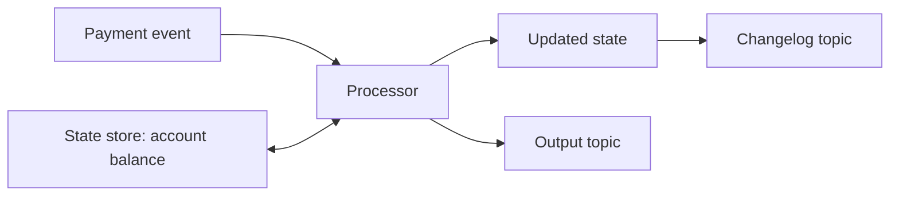
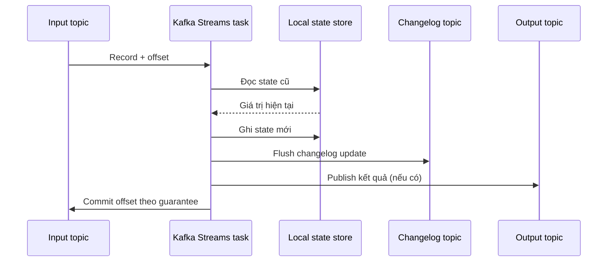
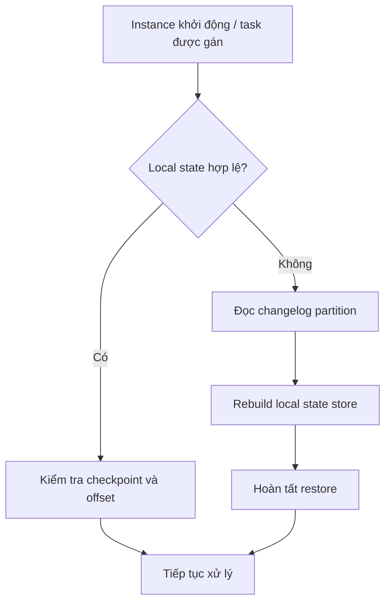

# Changelog, bộ nhớ đệm và khôi phục trạng thái

Kafka Streams có thể duy trì trạng thái giữa các record, chẳng hạn tổng tiền theo tài khoản, số đơn theo khách hàng hoặc kết quả tổng hợp theo cửa sổ. Trạng thái thường được lưu trong state store cục bộ để truy cập nhanh. Để không mất trạng thái khi process hoặc máy chủ gặp sự cố, Kafka Streams ghi các thay đổi của store vào changelog topic trên Kafka. Khi task chuyển sang instance khác hoặc local state không còn dùng được, runtime có thể dựng lại store bằng cách đọc changelog.

Bộ nhớ đệm (cache) giúp gom nhiều lần cập nhật state trước khi ghi xuống store và phát changelog/output. Nó giảm I/O và số record trung gian, nhưng cũng làm thay đổi thời điểm các cập nhật được nhìn thấy ở downstream. Cần hiểu rõ ba lớp: state store cục bộ, changelog bền vững trên Kafka và cache phục vụ batching. Chúng phối hợp để cân bằng tốc độ xử lý, khả năng phục hồi và độ trễ.

## 1. Vì sao stream processing cần state?

Một phép biến đổi stateless chỉ cần xử lý record hiện tại. Ví dụ, `mapValues` đổi `OrderCreated` thành `OrderAccepted` mà không cần biết các record trước đó. Một phép xử lý stateful cần nhớ dữ liệu đã thấy để tính kết quả tiếp theo.

Ví dụ, với các sự kiện thanh toán:

| Event | Tài khoản | Số tiền | Số dư sau xử lý |
|---|---|---:|---:|
| `p-01` | `acc-7` | +500.000 | 500.000 |
| `p-02` | `acc-7` | -120.000 | 380.000 |
| `p-03` | `acc-7` | +80.000 | 460.000 |

Để tính số dư mới, topology cần biết số dư trước đó của `acc-7`. Kafka Streams lưu giá trị này trong state store, được phân vùng theo task/partition. Khi một record mới tới, processor đọc state cũ, tính state mới rồi cập nhật store.



State store có thể là key-value store, window store hoặc session store. Các phép `count`, `aggregate`, `reduce`, join và windowed aggregation thường cần state. Store có thể được truy vấn cục bộ, nhưng phạm vi dữ liệu mà một instance nhìn thấy phụ thuộc partition/task được gán cho instance đó.

## 2. State store cục bộ và changelog topic

Với persistent state store, Kafka Streams thường dùng RocksDB làm storage engine cục bộ. Dữ liệu trên đĩa local giúp đọc/ghi nhanh mà không phải truy vấn Kafka cho mỗi phép toán. Tuy nhiên, local disk có thể mất khi pod bị thay thế, volume bị xóa hoặc task được chuyển sang instance khác.

Kafka Streams tạo changelog topic để lưu các thay đổi state store. Mỗi cập nhật có thể được ghi thành một record mang key/value tương ứng. Với store dạng key-value, changelog thường dùng compaction để giữ trạng thái mới nhất của mỗi key và hỗ trợ khôi phục. Với window store, cấu hình cleanup có thể kết hợp compaction và retention/delete để dữ liệu cũ được loại bỏ theo vòng đời window.

Tên changelog thường được tạo từ `application.id`, tên store và hậu tố `-changelog`, ví dụ:

```text
customer-balance-stream-account-balances-changelog
```

Tên thực tế phụ thuộc topology, tên store và phiên bản Kafka Streams. Changelog là internal topic do Kafka Streams quản lý; không nên để ứng dụng nghiệp vụ khác ghi trực tiếp vào topic này.

| Thành phần | Nơi lưu | Vai trò |
|---|---|---|
| Local state store | Disk của instance, thường là RocksDB | Phục vụ truy cập state nhanh trong task đang chạy |
| Changelog topic | Kafka broker | Lưu thay đổi state để khôi phục sau sự cố hoặc task migration |
| Record cache | Bộ nhớ của Kafka Streams process | Gom/coalesce cập nhật trước khi flush xuống store và forward |
| Output topic | Kafka broker | Phát kết quả nghiệp vụ cho consumer downstream |

Local store là bản làm việc của task. Changelog mới là nguồn dữ liệu Kafka dùng để tái dựng state khi local store không thể tái sử dụng. Không coi thư mục state cục bộ là bản sao lưu duy nhất của dữ liệu nghiệp vụ.

## 3. Changelog được ghi và dùng để khôi phục ra sao?

Với một persistent store có logging được bật, luồng tổng quát như sau:

1. Task nhận record từ input partition.
2. Processor đọc state hiện tại từ local store.
3. Processor tính giá trị mới và cập nhật store.
4. Thay đổi được đưa qua cache/flush path của Kafka Streams.
5. Khi flush, Kafka Streams ghi changelog record để lưu thay đổi state.
6. Nếu topology phát output, record đầu ra được gửi tới output topic.
7. Khi task cần khôi phục, runtime đọc changelog partition tương ứng và dựng lại local store.

Với `processing.guarantee=exactly_once_v2`, Kafka Streams có thể phối hợp việc ghi output, changelog và commit input offsets trong transaction Kafka theo semantics của Kafka Streams. Với at-least-once, record có thể được xử lý lại sau sự cố; state update và output cần được thiết kế để đáp ứng guarantee đang dùng.



Sơ đồ mô tả thứ tự khái niệm; cache, batching và transaction có thể khiến các thao tác vật lý được gom lại. Không nên suy luận rằng mỗi input record luôn tạo đúng một record changelog hoặc một output record ngay lập tức.

### 3.1. Vì sao changelog thường được compact?

Với store key-value, mục tiêu khôi phục là dựng lại giá trị mới nhất của mỗi key. Nếu key `acc-7` thay đổi 100 lần, changelog có thể chứa nhiều phiên bản của key đó. Log compaction cho phép broker giữ phiên bản mới nhất theo key sau khi compaction chạy, giảm lượng dữ liệu cần lưu và đọc khi restore.

Compaction diễn ra bất đồng bộ. Không giả định record cũ biến mất ngay sau khi ghi record mới. Với window/session store, vòng đời state có thêm yếu tố thời gian; retention và cleanup policy phải phù hợp loại store và phiên bản Kafka Streams.

### 3.2. Tắt changelog có thể làm mất khả năng phục hồi

Kafka Streams cho phép một số store tắt logging bằng cấu hình topology, chẳng hạn `Materialized.withLoggingDisabled()`. Chỉ dùng khi state có thể tái tạo đầy đủ từ nguồn khác hoặc mất state không ảnh hưởng tính đúng đắn nghiệp vụ.

Nếu tắt logging rồi local state bị mất, Kafka Streams không có changelog để khôi phục store. Task có thể phải bắt đầu lại từ input theo chiến lược reset hoặc ứng dụng có thể cho ra kết quả sai nếu không replay đầy đủ. Không tắt changelog chỉ để giảm dung lượng broker mà chưa đánh giá khả năng recovery.

## 4. Ví dụ stateful topology trong Kafka Streams Binder

Giả sử cần lưu số dư tích lũy theo tài khoản. Key của input record là `accountId`; value là một giao dịch có số tiền thay đổi.

```java
@Bean
Function<KStream<String, PaymentEvent>, KStream<String, BigDecimal>> accountBalances() {
    return payments -> payments
            .groupByKey()
            .aggregate(
                    () -> BigDecimal.ZERO,
                    (accountId, payment, balance) -> balance.add(payment.amount()),
                    Materialized.as("account-balances"))
            .toStream();
}
```

`Materialized.as("account-balances")` đặt tên ổn định cho state store. Kafka Streams dùng tên store trong topology và thường dùng nó để tạo changelog topic. Đổi tên store có thể khiến runtime xem đó là store mới, tạo changelog mới và cần dựng lại state từ input; do đó không đổi tên tùy tiện trong một lần refactor nhỏ.

Cấu hình function và Kafka Streams Binder:

```yaml
spring:
  cloud:
    function:
      definition: accountBalances
    stream:
      bindings:
        accountBalances-in-0:
          destination: payments.posted
        accountBalances-out-0:
          destination: accounts.balance-updates
    kafka:
      streams:
        binder:
          configuration:
            application.id: customer-balance-stream
            state.dir: /var/lib/customer-balance-stream
            replication.factor: 3
```

`application.id` xác định logical Kafka Streams application, consumer group và namespace của internal topics. Các instance thuộc cùng ứng dụng phải dùng cùng ID để chia task và tiếp tục cùng state. `state.dir` chỉ định nơi lưu state cục bộ; mỗi instance cần thư mục riêng, có quyền ghi và đủ dung lượng. `replication.factor` điều khiển replication factor của internal topics do Kafka Streams tạo, cần tương thích số broker và chính sách cluster.

Không đổi `application.id` để “làm mới” ứng dụng trong production nếu không có kế hoạch migration. ID mới tạo logical application mới, thường có offset và internal topics riêng; state cũ không tự được tiếp tục.

## 5. Record cache hoạt động thế nào?

Kafka Streams có cache ở tầng record/state store. Khi nhiều record cập nhật cùng key trong một khoảng ngắn, cache có thể giữ giá trị mới nhất và gộp các lần cập nhật trước khi flush. Ví dụ một tài khoản nhận 100 giao dịch liên tiếp, state store vẫn cần phản ánh số dư mới nhất, nhưng downstream không nhất thiết phải nhận 100 bản cập nhật trung gian nếu topology đang dùng semantics KTable và cache cho phép coalesce.

Cache có thể giúp:

- Giảm số lần ghi xuống RocksDB.
- Giảm số record changelog được phát khi nhiều cập nhật cùng key được gom.
- Giảm số bản cập nhật trung gian đi xuống downstream trong các topology phù hợp.
- Tăng hiệu quả batch và giảm I/O khi traffic dày.

Cache cũng có đánh đổi:

- Cập nhật có thể chưa xuất hiện ngay ở changelog hoặc downstream trước khi flush.
- Dùng nhiều cache hơn làm tăng bộ nhớ của process.
- Khi cache đầy, dữ liệu phải được flush; lưu lượng key phân tán cao có thể làm hiệu quả coalesce thấp.
- Cache không thay thế changelog, không phải kho dữ liệu bền vững và không phải cơ chế idempotency.

Cache của Kafka Streams không đồng nghĩa với cache nghiệp vụ như Redis hay Caffeine. Không lưu quyết định nghiệp vụ chỉ trong record cache; cache có thể bị xóa khi process dừng và dữ liệu phải được phục hồi từ store/changelog.

## 6. Cấu hình cache và thời điểm flush

Kafka Streams cung cấp cấu hình để giới hạn dung lượng cache và điều khiển chu kỳ commit/flush. Tên và phạm vi cấu hình cache đã thay đổi giữa các thế hệ Kafka Streams; nhiều phiên bản sử dụng `cache.max.bytes.buffering`, trong khi các phiên bản mới có thể cung cấp cấu hình cache state store chi tiết hơn. Hãy dùng đúng property được tài liệu Kafka client mà Spring Cloud BOM mang vào hỗ trợ.

Ví dụ minh họa với cấu hình Kafka Streams truyền qua binder:

```yaml
spring:
  cloud:
    stream:
      kafka:
        streams:
          binder:
            configuration:
              cache.max.bytes.buffering: 10485760
              commit.interval.ms: 1000
```

Trong phiên bản hỗ trợ các thuộc tính này:

- `cache.max.bytes.buffering` đặt ngân sách bộ nhớ cache record cho Kafka Streams application; `10485760` tương đương 10 MiB.
- `commit.interval.ms` đặt khoảng thời gian tối đa giữa các lần commit/flush theo processing guarantee và semantics runtime.

Không coi `commit.interval.ms` là timer đảm bảo mỗi output được phát chính xác sau từng ấy mili giây. Cache có thể flush khi đạt ngưỡng dung lượng; commit có thể bị ảnh hưởng bởi transaction, poll, processing và trạng thái task. Khi bật exactly-once, mặc định và chi phí commit khác at-least-once; hãy đo trên đúng phiên bản.

### 6.1. Cache lớn hay nhỏ?

| Cache | Tác động thường gặp | Phù hợp khi |
|---|---|---|
| Nhỏ | Flush thường xuyên hơn, cập nhật downstream mới hơn, nhiều I/O hơn | Cần giảm độ trễ cập nhật và số key hoạt động ít |
| Lớn | Có thêm cơ hội gộp cập nhật cùng key, giảm I/O và changelog traffic | Throughput cao, key được cập nhật lặp và có ngân sách RAM |
| Tắt/0 theo hỗ trợ phiên bản | Hạn chế coalesce, cập nhật được flush thường xuyên hơn | Cần quan sát từng thay đổi hoặc đang chẩn đoán, sau khi hiểu chi phí |

Đặt cache theo workload chứ không theo cảm giác. Nếu mỗi record có key khác nhau, cache lớn có thể tiêu thụ RAM nhưng ít coalesce. Nếu một số key nóng được cập nhật liên tục, cache có thể giảm đáng kể số lần flush.

## 7. Khôi phục state sau restart

Khi một instance khởi động lại, Kafka Streams kiểm tra local state và metadata để xác định store có thể tái sử dụng hay cần restore. Nếu local state hợp lệ và task vẫn phù hợp, runtime có thể tiếp tục từ state hiện có. Nếu state bị thiếu, không hợp lệ hoặc task được gán cho instance khác, runtime đọc changelog partition để dựng lại state.



Thời gian restore phụ thuộc:

- Kích thước changelog cần đọc sau compaction.
- Số lượng store và partition được gán.
- Tốc độ mạng, broker, disk và CPU.
- Serde và chi phí ghi lại vào RocksDB.
- Cache, batching và cấu hình restore consumer.
- Số instance cùng restore và tải hiện tại của Kafka cluster.

Một store lớn có thể khiến task chưa sẵn sàng phục vụ traffic trong thời gian restore. Khi thiết kế production, cần đo restore time và xác định SLA cho việc khởi động lại hoặc thay node.

## 8. Standby replicas để giảm thời gian phục hồi

Kafka Streams hỗ trợ standby task: một instance khác duy trì bản sao state gần nhất bằng cách đọc changelog, nhưng không xử lý input như active task của bản sao đó. Khi active task bị mất, standby replica có thể được nâng lên active với ít dữ liệu phải restore hơn.

Có thể cấu hình `num.standby.replicas` trong Kafka Streams:

```yaml
spring:
  cloud:
    stream:
      kafka:
        streams:
          binder:
            configuration:
              num.standby.replicas: 1
```

Giá trị `1` yêu cầu một standby replica cho task khi có đủ instance phù hợp. Điều này không có nghĩa mỗi task luôn có bản sao sẵn sàng ở mọi tình huống: số instance, task assignment và topology quyết định khả năng bố trí standby. Nếu chỉ chạy một instance, không có instance thứ hai để giữ standby độc lập.

Standby replica giúp giảm thời gian restore khi failover nhưng có chi phí:

- Tốn thêm disk cho local state trên instance standby.
- Tăng network traffic do standby đọc changelog.
- Tăng CPU và bộ nhớ để duy trì state.
- Cần đủ instance và partition để active/standby được phân bố hợp lý.

Không nhầm standby replica với replication factor của changelog topic. Replication factor bảo vệ log trên broker; standby replica duy trì bản state cục bộ trên một Kafka Streams instance khác. Hai cơ chế bổ sung cho nhau.

## 9. State restoration và thay đổi topology

Changelog chỉ có thể khôi phục state nếu topology mới hiểu được dữ liệu đã ghi trước đó. Thay đổi tên store, key/value Serde, schema hoặc cách partition có thể khiến việc restore thất bại hoặc tạo ra state không tương thích.

Trước khi thay đổi:

- Giữ tên store ổn định nếu muốn tiếp tục dùng state hiện tại.
- Kiểm tra Serde đọc được dữ liệu changelog cũ.
- Đánh giá thay đổi key hoặc partition count vì nó có thể thay đổi phân vùng state.
- Xác định có cần migration state hoặc chạy ứng dụng mới với `application.id` mới.
- Giữ changelog và internal topics đủ lâu cho quá trình rollback/restore theo chính sách.
- Kiểm thử nâng cấp từ dữ liệu state của phiên bản trước, không chỉ khởi động trên topic rỗng.

Nếu cần rebuild toàn bộ state từ input, hãy thực hiện reset/replay theo quy trình Kafka Streams được hỗ trợ và có kế hoạch cho output topic. Không xóa changelog hoặc local state thủ công trong khi ứng dụng đang chạy; hành động đó có thể làm task không khôi phục được hoặc tạo kết quả sai.

## 10. Window store, retention và changelog

Với windowed aggregation, state được lưu theo key và cửa sổ. Một key có thể có nhiều window cùng tồn tại. Retention của window store quyết định thời gian dữ liệu cửa sổ còn có thể được truy vấn và duy trì; grace period ảnh hưởng thời gian chấp nhận late events. Changelog cho window store cần được cấu hình cleanup phù hợp để khôi phục đúng dữ liệu còn hiệu lực mà không lưu vô hạn.

Ví dụ materialize window store:

```java
KTable<Windowed<String>, Long> orderCounts = orders
        .groupByKey()
        .windowedBy(TimeWindows.ofSizeAndGrace(
                Duration.ofMinutes(5), Duration.ofMinutes(1)))
        .count(Materialized.as("orders-per-customer-5m"));
```

Khi triển khai, xem xét:

- Window size, grace và retention.
- Cardinality của key và số window đang mở.
- Kích thước value và tốc độ cập nhật.
- Changelog partition count và replication factor.
- Compaction/retention policy của internal topic do Kafka Streams tạo.
- Dung lượng local state directory và thời gian restore.

Không tự đặt cleanup policy cho changelog topic như một topic nghiệp vụ thông thường. Kafka Streams tạo và quản lý cấu hình internal topic dựa trên loại store; thay đổi thủ công có thể phá vỡ semantics phục hồi.

## 11. Truy vấn state store và giới hạn locality

Kafka Streams có thể cho phép truy vấn state store qua Interactive Queries. Tuy nhiên, một instance chỉ có state của các task/partition đang được gán cho nó, cộng với một số state toàn cục nếu topology có GlobalKTable/store tương ứng. Truy vấn một key có thể cần định vị instance đang giữ partition của key đó.

Khi cung cấp API đọc state:

- Dùng metadata về key/partition để định tuyến tới instance đang giữ active task.
- Xác định API trả dữ liệu active hay standby và độ mới dữ liệu.
- Xử lý trường hợp task đang restore hoặc rebalance.
- Không giả định mọi instance đều có toàn bộ state partitioned.
- Không dùng Interactive Queries thay database giao dịch nếu cần truy vấn ad hoc, join tùy ý hoặc cập nhật từ nhiều ứng dụng.

Changelog hỗ trợ phục hồi state, không tự tạo một API query phân tán cho toàn bộ ứng dụng. Lớp service/API phải định tuyến và xử lý lỗi khi instance giữ key không sẵn sàng.

## 12. Xử lý sự cố thường gặp

| Triệu chứng | Nguyên nhân có thể | Hướng xử lý |
|---|---|---|
| Restart mất state | Store tắt changelog, changelog bị xóa hoặc `application.id` thay đổi | Kiểm tra internal topics, logging và ID; phục hồi/replay theo kế hoạch |
| Startup mất nhiều thời gian | Changelog lớn hoặc task cần restore nhiều partition | Đo restore metrics, kiểm tra broker/disk/network và cân nhắc standby replicas |
| Restore lỗi deserialize | Serde hoặc schema hiện tại không đọc được changelog cũ | Giữ tương thích schema/Serde hoặc migration state có kiểm soát |
| Internal topic không tạo được | Thiếu quyền create/describe/write hoặc replication factor vượt khả năng cluster | Kiểm tra ACL, số broker và replication factor |
| Disk local tăng liên tục | State cardinality/retention cao hoặc store không được dọn | Kiểm tra store, window retention, `state.dir` và dung lượng volume |
| Downstream nhận ít update hơn dự kiến | Cache coalesce nhiều cập nhật cùng key trước khi forward | Kiểm tra cache và commit interval; xác định downstream cần snapshot hay mọi event |
| Downstream thấy cập nhật trễ | Cache chưa flush hoặc commit/transaction interval dài | Đo latency và điều chỉnh cache/commit theo SLA |
| Tăng cache gây OOM | Ngân sách cache quá lớn so với heap và số stream thread | Giảm cache, kiểm tra heap và state store memory |
| Failover vẫn restore lâu | Không có standby phù hợp hoặc standby lag changelog | Kiểm tra instance count, standby assignment và restore lag |
| Đổi tên store làm state trống | Runtime tạo store/changelog mới | Giữ tên ổn định hoặc thực hiện migration/replay có chủ đích |

## 13. Monitoring changelog, cache và restore

Theo dõi cả Kafka Streams runtime và broker:

- Restore rate, tổng record restore, restore latency và thời gian task ở trạng thái restoring.
- Changelog topic throughput, partition count, replication health và consumer lag của restore/standby tasks.
- State store size, disk usage trong `state.dir` và tốc độ tăng dung lượng.
- Cache size, số lần flush, tỷ lệ coalesce/update và commit latency theo metric phiên bản client.
- Task assignment, active/standby task count, rebalance và task migration.
- Input lag, processing latency, output rate và lỗi Serde.

Metric cụ thể và tên JMX phụ thuộc Kafka Streams version. Bật exporter/metrics phù hợp và gắn nhãn theo `application.id`, client ID, thread, task và store. Cảnh báo khi restore kéo dài, standby lag tăng, disk gần đầy hoặc changelog partition mất ISR.

## 14. Kiểm thử khôi phục state

Topology unit test không đủ để chứng minh changelog được tạo và restore đúng trên broker. Nên chia test:

1. **TopologyTestDriver:** kiểm tra phép aggregate, state store và kết quả khi nhận chuỗi record.
2. **Kafka integration test:** khởi động application với `application.id` cố định, gửi record và xác nhận state/output.
3. **Restart test:** dừng ứng dụng có kiểm soát, khởi động lại với cùng ID và cùng state directory, xác nhận tiếp tục đúng.
4. **Local state loss test:** dùng state directory mới hoặc xóa state trong môi trường test đã dừng, khởi động lại và xác nhận restore từ changelog.
5. **Task migration test:** chạy nhiều instance, dừng một instance và xác nhận task được chuyển cùng state được restore.
6. **Standby test:** bật `num.standby.replicas`, quan sát standby catch-up rồi failover và đo thời gian sẵn sàng.
7. **Schema upgrade test:** ghi state bằng phiên bản cũ, triển khai phiên bản mới và xác nhận Serde đọc được changelog cũ.
8. **Cache test:** gửi nhiều update cùng key, xác nhận kết quả cuối và thời điểm downstream nhận update theo cấu hình cache/commit.

Chỉ xóa local state trong thư mục test cô lập và khi process đã dừng. Không thực hiện thao tác xóa state/changelog trên môi trường production để “thử restore”.

## 15. Danh sách kiểm tra trước khi triển khai

- [ ] State store có tên ổn định và logging/changelog được bật khi cần phục hồi.
- [ ] `application.id` ổn định giữa các instance của cùng logical application.
- [ ] Internal changelog/repartition topics có ACL, replication factor và dung lượng phù hợp.
- [ ] `state.dir` là thư mục local có quyền ghi, đủ disk và không bị nhiều instance dùng chung sai cách.
- [ ] Cache được đặt theo workload, RAM và yêu cầu latency.
- [ ] Hiểu cache coalesce cập nhật và thời điểm flush/commit.
- [ ] Không nhầm record cache với cache nghiệp vụ hoặc changelog bền vững.
- [ ] Chỉ tắt changelog khi state có thể tái tạo và việc mất local state đã được chấp nhận.
- [ ] `num.standby.replicas` được cân nhắc cùng số instance và chi phí tài nguyên.
- [ ] Window store có retention/grace phù hợp và cleanup policy không bị sửa tùy tiện.
- [ ] Serde/schema tương thích với dữ liệu changelog cũ qua các lần nâng cấp.
- [ ] Có test restart, local state loss, task migration, standby failover và cache flush.
- [ ] Theo dõi restore time, changelog health, state size, disk, cache và task assignment.

State store cục bộ giúp Kafka Streams xử lý nhanh; changelog topic giữ các thay đổi để dựng lại state khi local data mất hoặc task chuyển instance. Record cache gom các cập nhật để giảm I/O và có thể coalesce các bản cập nhật trung gian, đổi lại độ trễ flush và số output quan sát được có thể thay đổi. Giữ `application.id`, tên store, Serde và internal topics tương thích; đo restore time và cân nhắc standby replicas để đáp ứng yêu cầu phục hồi. Đây là các quyết định vận hành cốt lõi của một topology stateful trong Spring Cloud Stream Kafka Streams Binder.

## Tài liệu tham khảo

- [Apache Kafka Streams — State Stores](https://kafka.apache.org/documentation/streams/developer-guide/processor-api.html#state-stores)
- [Apache Kafka Streams — Configuration](https://kafka.apache.org/documentation/streams/developer-guide/config-streams.html)
- [Apache Kafka Streams — Fault Tolerance and Standby Replicas](https://kafka.apache.org/documentation/streams/architecture.html)
- [Spring Cloud Stream Kafka Streams Binder Reference](https://docs.spring.io/spring-cloud-stream/reference/kafka/kafka-streams-binder/)
