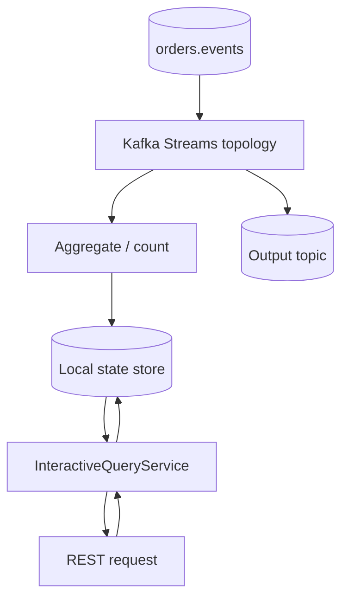
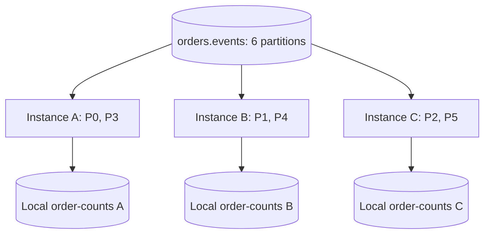
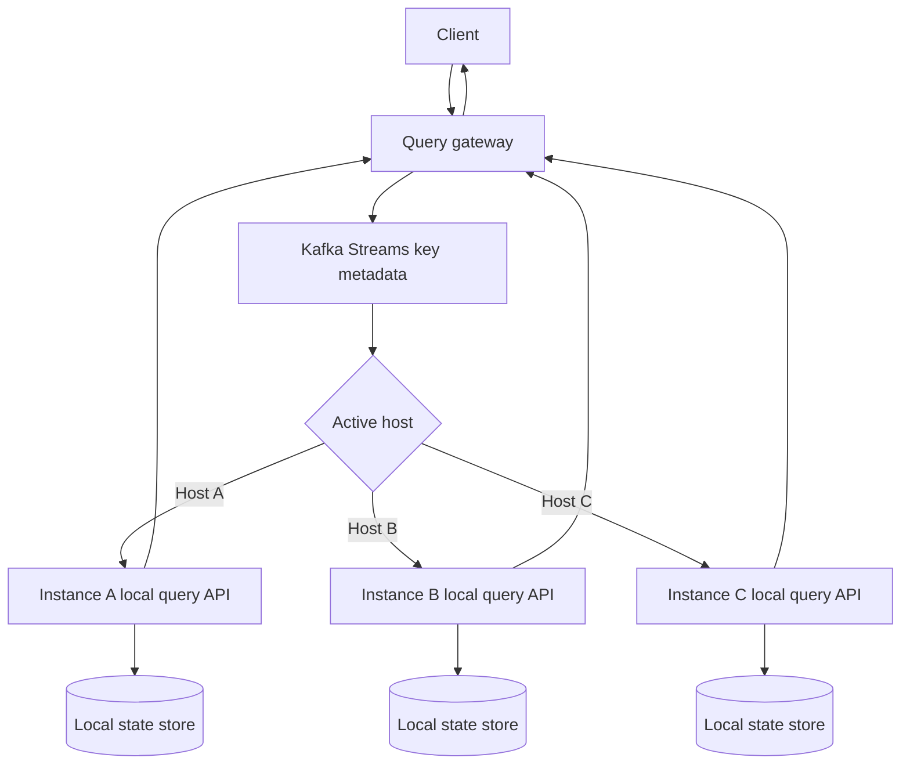

# InteractiveQueryService và giới hạn truy vấn trạng thái cục bộ

## 1. Interactive Queries dùng để làm gì?

Kafka Streams không chỉ biến đổi record rồi ghi kết quả ra topic. Các phép toán như `count`, `aggregate`, `reduce`, join hoặc windowed aggregation còn duy trì trạng thái trong state store. Ứng dụng có thể đọc trạng thái đó để trả lời truy vấn gần thời gian thực mà không cần chờ một consumer khác sao chép kết quả sang database riêng.

Spring Cloud Stream Kafka Streams binder cung cấp `InteractiveQueryService` để lấy state store mà Kafka Streams đang quản lý. Từ store, ứng dụng có thể tra cứu giá trị theo key, đọc một khoảng key hoặc truy vấn theo cửa sổ thời gian tùy loại store.

Ví dụ, topology đếm số đơn hàng theo khách hàng. Mỗi event `OrderCreated` cập nhật state store `order-counts`. Một REST endpoint có thể tra cứu số đơn hàng hiện tại của một `customerId` bằng `InteractiveQueryService`.



Interactive Queries đọc trạng thái đang được Kafka Streams duy trì. Chúng hữu ích cho dashboard, API tra cứu nhanh, kiểm tra trạng thái theo key hoặc phục vụ một projection cục bộ. Cần hiểu giới hạn phân vùng và tính nhất quán trước khi dùng kết quả này như nguồn dữ liệu toàn cục.

## 2. Tạo state store có tên trong topology

Để truy vấn một store, topology phải tạo ra store có tên ổn định. Với phép đếm theo key, có thể dùng `groupByKey().count(Materialized.as(...))`:

```java
import java.util.function.Function;
import org.apache.kafka.streams.kstream.KStream;
import org.apache.kafka.streams.kstream.Materialized;
import org.springframework.context.annotation.Bean;
import org.springframework.context.annotation.Configuration;

record OrderCreated(String customerId, String orderId) {}

@Configuration
class OrderCountFunctions {

    @Bean
    Function<KStream<String, OrderCreated>, KStream<String, Long>> countOrders() {
        return orders -> orders
            .groupByKey()
            .count(Materialized.as("order-counts"))
            .toStream();
    }
}
```

Trong ví dụ, key của KStream là `customerId`; mỗi record làm tăng số đếm của key đó. `Materialized.as("order-counts")` đặt tên state store để ứng dụng có thể truy vấn. Kết quả `KTable` được chuyển thành `KStream` để phát các bản cập nhật ra output topic.

Đảm bảo producer ghi `customerId` vào Kafka record key. Trường `customerId` nằm trong payload không tự động trở thành key. Nếu key chưa đúng, cần chọn key trước khi `groupByKey`, ví dụ `selectKey((oldKey, order) -> order.customerId())`; phép đổi key có thể yêu cầu repartition trước aggregation.

Binding của function:

```yaml
spring:
  cloud:
    function:
      definition: countOrders
    stream:
      bindings:
        countOrders-in-0:
          destination: orders.events
        countOrders-out-0:
          destination: orders.counts
      kafka:
        streams:
          binder:
            applicationId: order-counts-app
```

`applicationId` nhận diện logical Kafka Streams application. Các instance của cùng một topology dùng chung application ID để chia partition và khôi phục trạng thái. Nếu đổi application ID, ứng dụng có thể tạo tiến độ consumer và state riêng, rồi đọc lại dữ liệu theo offset policy.

## 3. Lấy state store bằng InteractiveQueryService

Kafka Streams binder cung cấp bean `InteractiveQueryService`. Có thể inject service này vào một component và yêu cầu store theo tên cùng loại store:

```java
import org.apache.kafka.streams.state.QueryableStoreTypes;
import org.apache.kafka.streams.state.ReadOnlyKeyValueStore;
import org.springframework.cloud.stream.binder.kafka.streams.InteractiveQueryService;
import org.springframework.stereotype.Service;

@Service
class OrderCountQueries {

    private final InteractiveQueryService interactiveQueryService;

    OrderCountQueries(InteractiveQueryService interactiveQueryService) {
        this.interactiveQueryService = interactiveQueryService;
    }

    Long countForCustomer(String customerId) {
        ReadOnlyKeyValueStore<String, Long> store =
            interactiveQueryService.getQueryableStore(
                "order-counts",
                QueryableStoreTypes.keyValueStore()
            );

        return store.get(customerId);
    }
}
```

`getQueryableStore` trả về view đọc của store có tên `order-counts`. `QueryableStoreTypes.keyValueStore()` khai báo loại store cần truy vấn. Nếu tên store không tồn tại trong topology hoặc store chưa sẵn sàng, lời gọi có thể thất bại; cần xử lý trạng thái khởi động và phục hồi thay vì giả định store luôn khả dụng.

`ReadOnlyKeyValueStore` là API chỉ đọc. Không dùng Interactive Queries để sửa state store. Trạng thái phải được cập nhật thông qua Kafka Streams topology để changelog, offset và phục hồi vẫn nhất quán.

## 4. Tạo REST API truy vấn trạng thái

Một controller có thể cung cấp endpoint đọc số đơn hàng theo khách hàng:

```java
import org.springframework.http.ResponseEntity;
import org.springframework.web.bind.annotation.GetMapping;
import org.springframework.web.bind.annotation.PathVariable;
import org.springframework.web.bind.annotation.RestController;

record CustomerOrderCount(String customerId, Long count) {}

@RestController
class OrderCountController {

    private final OrderCountQueries queries;

    OrderCountController(OrderCountQueries queries) {
        this.queries = queries;
    }

    @GetMapping("/local/customers/{customerId}/order-count")
    ResponseEntity<CustomerOrderCount> count(@PathVariable String customerId) {
        Long count = queries.countForCustomer(customerId);
        if (count == null) {
            return ResponseEntity.notFound().build();
        }
        return ResponseEntity.ok(new CustomerOrderCount(customerId, count));
    }
}
```

Endpoint này trả lời từ state store cục bộ của instance đang nhận HTTP request. Nếu key thuộc partition do một instance khác sở hữu, truy vấn tại instance hiện tại có thể không tìm thấy key. Không được diễn giải `null` ở một store cục bộ thành kết luận rằng key không tồn tại trên toàn bộ ứng dụng.

Trong môi trường nhiều instance, cần xác định instance đang sở hữu partition của key rồi định tuyến request đến instance đó, hoặc dùng một kho dữ liệu phục vụ truy vấn toàn cục.

## 5. State store cục bộ chỉ chứa một phần dữ liệu

Với KTable hoặc state store phân vùng, Kafka Streams chia partition thành các task. Mỗi instance chỉ giữ những task/partition được giao cho nó. Do đó, state store cục bộ thường chứa một phần key space của toàn topology.

Ví dụ topic có 6 partition và ứng dụng có 3 instance:



Sơ đồ chỉ minh họa một cách assignment có thể xảy ra. Kafka có thể phân phối partition khác khi instance thay đổi, rebalance hoặc topology được cập nhật. Không hardcode quan hệ partition-instance vào code.

Khi REST request đến Instance A, `InteractiveQueryService` truy cập store của A. Nếu `customerId` được hash đến partition đang nằm ở B, A không có trạng thái đó trong local store. Muốn truy vấn đúng key trên toàn ứng dụng, cần định tuyến đến B hoặc sử dụng một read model được tổng hợp ở nơi khác.

Ngoại lệ cần nhớ là GlobalKTable: Kafka Streams duy trì bản sao toàn bộ GlobalKTable trên mỗi instance, nên local global store có thể tra cứu mọi key của bảng sau khi restore hoàn tất. Điều này không biến các local store thành một snapshot phân tán nhất quán; từng instance vẫn có thể cập nhật ở thời điểm khác nhau và vẫn cần kiểm tra readiness.

## 6. Phân biệt “không có key” và “key không nằm trên instance này”

Đây là một giới hạn quan trọng của truy vấn cục bộ:

- `store.get(key)` trả về `null` có thể nghĩa là key chưa từng xuất hiện hoặc đã bị xóa trong store cục bộ.
- Nhưng nếu ứng dụng nhiều instance, key cũng có thể thuộc partition đang được instance khác sở hữu.
- Trong thời gian rebalance, store có thể tạm thời không sẵn sàng hoặc ownership đang chuyển.

Vì vậy, endpoint local nên thể hiện rõ phạm vi, chẳng hạn `/local/...`, hoặc chỉ được gọi sau khi request router đã định tuyến đến đúng host. API toàn cục cần phân biệt rõ `NOT_FOUND` với `NOT_LOCAL`/`NOT_READY` nếu hệ thống tự quản lý routing.

Không nên trả `404 Not Found` từ bất kỳ instance ngẫu nhiên nào rồi coi đó là kết quả toàn cục. Nếu muốn API đơn giản, tạo một gateway/service định tuyến để client không phải hiểu partition ownership.

## 7. Định vị host sở hữu key

Kafka Streams có metadata để xác định host đang giữ active task cho một key của state store. Interactive Queries phân tán thường thực hiện các bước:

1. Xác định key và serializer dùng để phân vùng key.
2. Lấy metadata của state store cho key đó.
3. Xác định active host đang sở hữu partition.
4. Nếu active host là instance hiện tại, truy vấn local store.
5. Nếu active host là instance khác, gửi request đến endpoint của host đó.
6. Nếu không có host hợp lệ hoặc topology đang rebalance, trả trạng thái tạm thời và thử lại sau.

Kafka Streams cung cấp API metadata theo key, ví dụ `queryMetadataForKey(storeName, key, keySerializer)` trên `KafkaStreams`, để xác định active host và partition. Serializer phải giống cách key được serialize/partition trong topology. Spring Cloud Stream Kafka Streams binder có `InteractiveQueryService` để truy vấn store; cách lấy metadata/host và tích hợp với service discovery phụ thuộc phiên bản binder và kiến trúc triển khai.

### Cấu hình application.server

Để các instance quảng bá địa chỉ phục vụ Interactive Queries, cấu hình Kafka Streams `application.server` bằng host và port có thể truy cập từ các instance khác:

```yaml
server:
  port: 8080
spring:
  cloud:
    stream:
      kafka:
        streams:
          binder:
            configuration:
              application.server: ${QUERY_HOST}:${server.port}
```

`QUERY_HOST` phải là địa chỉ mạng của đúng instance, không phải một service load balancer chung trỏ ngẫu nhiên đến replica. Mỗi instance cần quảng bá endpoint riêng. Với Kubernetes, có thể dùng Pod IP hoặc DNS riêng cho từng Pod qua headless Service, tùy cách routing đã thiết kế.

`application.server` chỉ công bố metadata endpoint; nó không tự tạo gateway, không tự bảo vệ HTTP endpoint và không bảo đảm service discovery đã phân giải host. Ứng dụng cần một cơ chế gọi đến active host và kiểm soát quyền truy cập.

## 8. Ví dụ định tuyến truy vấn phân tán

Kiến trúc phổ biến gồm một query gateway và các instance Kafka Streams:



Gateway chịu trách nhiệm tìm host sở hữu key và gửi request đến host đó. Nếu metadata cho biết key nằm ở host hiện tại, gateway có thể gọi local service hoặc query trực tiếp khi nằm cùng process. Nếu host thay đổi do rebalance, gateway cần làm mới metadata và thử định tuyến lại có giới hạn.

Không định tuyến bằng cách gửi request đến một Kubernetes Service cân bằng tải chung rồi hy vọng request đến đúng Pod. Load balancer thông thường không biết key nào thuộc partition nào. Cần service discovery theo host metadata hoặc một router có hiểu partition ownership.

## 9. Các loại state store có thể truy vấn

Kafka Streams cung cấp nhiều loại store và mỗi loại có API truy vấn phù hợp:

| Store type | API đọc | Trường hợp dùng |
|---|---|---|
| Key-value | `ReadOnlyKeyValueStore<K,V>` | Tra cứu trạng thái hiện tại theo key, range hoặc toàn bộ key |
| Window | `ReadOnlyWindowStore<K,V>` | Tra cứu giá trị theo key và khoảng thời gian |
| Session | `ReadOnlySessionStore<K,V>` | Tra cứu session theo key hoặc khoảng session |

Ví dụ lấy key-value store:

```java
ReadOnlyKeyValueStore<String, Long> store =
    interactiveQueryService.getQueryableStore(
        "order-counts",
        QueryableStoreTypes.keyValueStore()
    );
```

Với window store, dùng `QueryableStoreTypes.windowStore()` và kiểu `ReadOnlyWindowStore`. Với session store, dùng `QueryableStoreTypes.sessionStore()` và `ReadOnlySessionStore`. Kiểu generic phải phù hợp với key/value và Serde đã cấu hình trong topology.

## 10. Truy vấn key-value store

`ReadOnlyKeyValueStore` hỗ trợ các thao tác phổ biến:

- `get(key)`: đọc giá trị hiện tại của một key.
- `range(from, to)`: đọc một khoảng key.
- `all()`: duyệt các key trong store cục bộ.
- `approximateNumEntries()`: lấy số entry ước lượng.

Ví dụ đọc một khoảng key:

```java
import org.apache.kafka.streams.KeyValue;
import org.apache.kafka.streams.state.KeyValueIterator;
import org.apache.kafka.streams.state.ReadOnlyKeyValueStore;

void logCustomerCounts(ReadOnlyKeyValueStore<String, Long> store,
                       String fromCustomerId,
                       String toCustomerId) {
    try (KeyValueIterator<String, Long> entries =
             store.range(fromCustomerId, toCustomerId)) {
        while (entries.hasNext()) {
            KeyValue<String, Long> entry = entries.next();
            System.out.printf("%s -> %d%n", entry.key, entry.value);
        }
    }
}
```

Đóng iterator sau khi sử dụng để giải phóng tài nguyên. `range` và `all` chỉ duyệt dữ liệu có trên instance hiện tại; chúng không tự gọi sang các instance khác. Duyệt toàn bộ store có thể tốn CPU và I/O, không nên dùng làm endpoint đồng bộ cho bảng lớn.

## 11. Truy vấn window store

Windowed aggregation lưu nhiều giá trị theo key và cửa sổ thời gian. Ví dụ đếm số đơn hàng của từng khách hàng theo cửa sổ 5 phút. API truy vấn cần key và khoảng thời gian:

```java
import java.time.Instant;
import org.apache.kafka.streams.state.ReadOnlyWindowStore;
import org.apache.kafka.streams.state.WindowStoreIterator;

void readCounts(ReadOnlyWindowStore<String, Long> store,
                String customerId,
                Instant from,
                Instant to) {
    try (WindowStoreIterator<Long> values =
             store.fetch(customerId, from.toEpochMilli(), to.toEpochMilli())) {
        while (values.hasNext()) {
            var entry = values.next();
            System.out.printf("windowEnd=%d count=%d%n",
                entry.key, entry.value);
        }
    }
}
```

Ví dụ này minh họa cách đọc một key trong khoảng thời gian. Cần dùng đúng window retention và window semantics của topology. Dữ liệu cũ hơn retention có thể không còn trong store; query không thể khôi phục dữ liệu đã bị xóa.

## 12. Truy vấn session store

Session window nhóm các sự kiện theo key dựa trên khoảng thời gian không hoạt động. `ReadOnlySessionStore` cho phép tìm các session theo key hoặc range key tùy API. Kết quả có thể có nhiều session cho cùng một key.

Khi thiết kế endpoint, cần quyết định:

- Trả tất cả session hay chỉ session gần nhất.
- Giới hạn khoảng thời gian truy vấn.
- Phân trang hoặc giới hạn số kết quả.
- Xử lý session bị merge khi một event mới nối hai khoảng hoạt động.
- Giải thích rằng kết quả có thể thay đổi khi event đến muộn trong grace period.

Không coi session store là một bảng có duy nhất một giá trị cho mỗi key. Cấu trúc dữ liệu và semantics truy vấn khác key-value store.

## 13. Store chưa sẵn sàng và InvalidStateStoreException

Trong quá trình khởi động, Kafka Streams cần tạo topology, tham gia consumer group, nhận partition và khôi phục state store. Trước khi các bước đó hoàn tất, truy vấn có thể gặp `InvalidStateStoreException` hoặc lỗi cho biết store chưa khả dụng.

Tình huống tương tự có thể xuất hiện khi:

- Instance vừa khởi động và đang restore state.
- Partition đang được chuyển trong quá trình rebalance.
- Store bị đóng hoặc topology đang thay đổi.
- Tên store không tồn tại hoặc không được materialize.
- Truy vấn dùng sai loại store.

Không bắt exception rồi trả `null` như thể key không tồn tại. Cần phân biệt store chưa sẵn sàng với kết quả không tìm thấy key.

Một endpoint có thể trả `503 Service Unavailable` hoặc trạng thái retryable khi store đang phục hồi. Nếu dùng retry, đặt số lần và backoff có giới hạn; không lặp vô hạn trong request thread.

## 14. Rebalance làm thay đổi host sở hữu partition

Kafka Streams chia task dựa trên partition assignment. Khi instance rời hoặc tham gia application, partition có thể được gán lại. State store tương ứng có thể được đóng ở host cũ, khôi phục ở host mới và chỉ sẵn sàng sau khi restore hoàn tất.

Điều này tạo ra các cửa sổ:

- Metadata cũ vẫn trỏ đến host trước rebalance.
- Host cũ không còn active owner của key.
- Host mới chưa hoàn tất restore state.
- Request đến trong thời gian chuyển giao có thể thất bại tạm thời.

Router cần xử lý host không còn hợp lệ, làm mới metadata và thử lại. Endpoint local cần báo trạng thái store chưa sẵn sàng thay vì trả dữ liệu thiếu như một kết quả chính xác.

## 15. Interactive Queries không phải một snapshot toàn cục

Mỗi instance cập nhật local state theo tốc độ xử lý record và assignment của nó. Khi query nhiều key nằm ở nhiều instance, các lần đọc có thể diễn ra ở những thời điểm khác nhau.

Vì vậy, một API phân tán tổng hợp kết quả từ nhiều host không mặc nhiên có snapshot nhất quán tại cùng một offset hoặc thời điểm. Trong lúc query, một host có thể đã xử lý event mới trong khi host khác chưa xử lý event tương ứng.

Nếu nghiệp vụ cần một snapshot toàn cục, cần thiết kế giao thức snapshot/version rõ ràng hoặc materialize dữ liệu vào một kho truy vấn hỗ trợ semantics đó. Interactive Queries phù hợp với trạng thái cục bộ gần thời gian thực, không tự cung cấp transaction đọc xuyên nhiều partition.

## 16. Độ trễ, event-time và dữ liệu đến muộn

State store phản ánh những record mà topology đã xử lý, không nhất thiết phản ánh mọi record đã được producer gửi. Consumer lag, restore, rebalance hoặc lỗi xử lý có thể làm trạng thái chậm hơn log end offset.

Với windowed aggregation, event-time và grace period còn ảnh hưởng kết quả:

- Event đến muộn nhưng vẫn trong grace period có thể cập nhật kết quả cửa sổ.
- Event đến sau khi cửa sổ đóng theo policy có thể bị loại bỏ hoặc xử lý theo cấu hình.
- Retention quyết định trạng thái cửa sổ được giữ trong bao lâu.
- Một query trong lúc dữ liệu đến có thể trả kết quả trung gian.

API nên công bố timestamp/version hoặc thời điểm cập nhật nếu client cần hiểu độ mới của dữ liệu. Không hứa kết quả “mới nhất tuyệt đối” nếu topology vẫn có lag.

## 17. Bảo vệ Interactive Query endpoint

State store có thể chứa thông tin khách hàng, giao dịch hoặc dữ liệu vận hành. Endpoint truy vấn cần có chính sách bảo vệ giống API nghiệp vụ:

- Xác thực người gọi và kiểm tra quyền theo tenant/key.
- Không cho client tùy ý truy vấn mọi key nếu không có phân quyền.
- Giới hạn khoảng range và số lượng entry trả về.
- Đặt timeout cho truy vấn và lời gọi remote host.
- Không trả raw internal state hoặc metadata nhạy cảm.
- Ghi log query ID, key đã được che phù hợp, host và kết quả lỗi.
- Chỉ quảng bá `application.server` trên mạng nội bộ phù hợp.

Không mở port Interactive Queries trực tiếp ra Internet. Nếu có gateway, gateway cần kiểm tra quyền trước khi định tuyến đến instance sở hữu key.

## 18. Khi nào nên dùng database thay cho Interactive Queries?

Interactive Queries phù hợp khi dữ liệu đã nằm trong Kafka Streams state store và cần đọc gần thời gian thực trong phạm vi topology. Database/read model riêng có thể phù hợp hơn nếu:

- Cần truy vấn toàn cục, join ad-hoc hoặc lọc nhiều chiều.
- Cần API có phân trang, index và transaction đọc rõ ràng.
- Cần giữ lịch sử hoặc báo cáo dài hạn.
- Không muốn mỗi client phải phụ thuộc vào host metadata và rebalance.
- Cần SLA đọc độc lập với trạng thái Kafka Streams instance.

Có thể dùng Kafka Streams để cập nhật một read model bên ngoài qua output topic hoặc connector. Khi đó, database phục vụ query toàn cục; state store vẫn hữu ích cho xử lý streaming cục bộ.

## 19. Kiểm thử InteractiveQueryService

Kiểm thử cần bao gồm cả trường hợp store có dữ liệu và trạng thái không sẵn sàng:

1. Khởi động topology và xác nhận store được materialize với đúng tên.
2. Gửi event có key xác định và chờ topology xử lý.
3. Truy vấn key bằng `InteractiveQueryService` và kiểm tra giá trị.
4. Truy vấn key chưa tồn tại và xác nhận kết quả `null` được xử lý đúng.
5. Truy vấn range và đóng iterator sau khi dùng.
6. Kiểm thử window/session store với khoảng thời gian hợp lệ.
7. Gọi endpoint trước khi store sẵn sàng và xác nhận trả trạng thái retryable.
8. Chạy nhiều instance để xác nhận local store không được hiểu nhầm là toàn bộ key space.
9. Kiểm thử routing đến active host và xử lý metadata cũ trong rebalance.
10. Restart instance và xác nhận state restoration trước khi mở readiness cho query.

Topology test có thể kiểm tra phép toán stateful. Kiểm thử host metadata, partition ownership và remote routing cần integration test với nhiều Kafka Streams instance.

## 20. Quy trình thiết kế API truy vấn trạng thái

1. Xác định state store cần truy vấn và đặt tên ổn định bằng `Materialized.as` hoặc cấu hình binder phù hợp.
2. Chọn loại store: key-value, window hoặc session.
3. Dùng `InteractiveQueryService` lấy store đúng loại và chỉ đọc.
4. Xác định API là local-only hay truy vấn toàn bộ application.
5. Nếu truy vấn toàn cục, lấy metadata theo key và định tuyến đến active host.
6. Cấu hình `application.server` riêng cho từng instance và tích hợp service discovery.
7. Phân biệt key không tồn tại, key không nằm local, store chưa sẵn sàng và host đang rebalance.
8. Giới hạn range, timeout, quyền truy cập và dữ liệu trả về.
9. Theo dõi store restoration, query latency, routing failure và consumer lag.
10. Chọn database/read model riêng nếu cần query toàn cục hoặc snapshot nhất quán.

`InteractiveQueryService` giúp ứng dụng Spring Cloud Stream đọc state store mà Kafka Streams đang duy trì. Tuy nhiên, truy vấn trực tiếp chỉ thấy trạng thái cục bộ của instance; trong ứng dụng nhiều replica, một key có thể thuộc host khác và ownership có thể thay đổi khi rebalance. Hãy materialize store có tên, chọn đúng store type, kiểm tra trạng thái sẵn sàng và dùng metadata cùng routing khi cần truy vấn phân tán. Interactive Queries là cách đọc trạng thái streaming gần thời gian thực, không phải một database toàn cục hay snapshot nhất quán xuyên mọi partition.

## Tài liệu tham khảo

- [Spring Cloud Stream Kafka Streams Binder — Interactive Queries](https://docs.spring.io/spring-cloud-stream/reference/kafka/kafka-streams-binder/interactive-queries.html)
- [Spring Cloud Stream Kafka Streams Binder — State Store](https://docs.spring.io/spring-cloud-stream/reference/kafka/kafka-streams-binder/state-store.html)
- [Apache Kafka Streams — Interactive Queries](https://kafka.apache.org/documentation/streams/developer-guide/interactive-queries/)

