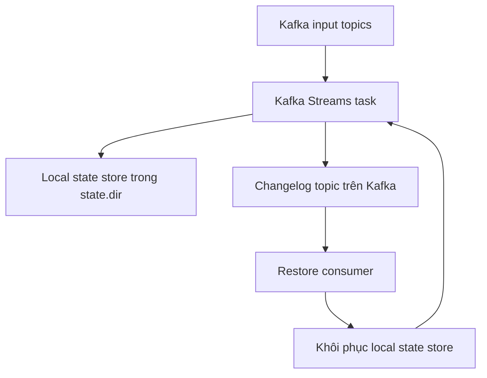

# Thư mục trạng thái, dung lượng đĩa và thời gian phục hồi

Kafka Streams giữ trạng thái cục bộ để thực hiện các phép xử lý có trạng thái như `count`, `aggregate`, join và window. Trạng thái này thường được lưu trong state store trên đĩa của instance, đồng thời được sao lưu bằng changelog topic trên Kafka khi state store bật logging. Vì vậy, khi một pod khởi động lại hoặc một task được chuyển sang instance khác, Kafka Streams có thể khôi phục state bằng cách đọc changelog và dựng lại state store cục bộ.

Trong Spring Cloud Stream, Kafka Streams binder tạo và quản lý `KafkaStreams` instance cho các hàm xử lý. Thuộc tính `state.dir` xác định nơi lưu state store trên máy chạy ứng dụng. Chọn đúng thư mục, cấp đủ dung lượng và đo thời gian restore giúp ứng dụng phục hồi sau restart/rebalance mà không gây gián đoạn dài hoặc làm đầy ổ đĩa.

Bài học này tập trung vào vận hành state store của Kafka Streams: cấu hình `state.dir` qua binder, phân biệt state cục bộ với changelog trên broker, ước lượng dung lượng, hiểu cold/warm restore, dùng standby/warmup replica và quan sát tiến độ phục hồi.

## 1. State store nằm ở đâu và chứa những gì?

Các phép xử lý có trạng thái trong Kafka Streams tạo state store. Ví dụ:

- `count()` lưu số lượng hiện tại theo key.
- `aggregate()` lưu giá trị tích lũy theo key.
- Windowed aggregation lưu trạng thái theo key và cửa sổ thời gian.
- Join giữa stream/table có thể cần lưu dữ liệu để đối chiếu record đến sau.

Với state store persistent, Kafka Streams thường dùng RocksDB để lưu dữ liệu cục bộ. Mỗi Kafka Streams application instance có thư mục con dưới `state.dir`; bên trong là dữ liệu state store theo task, checkpoint và metadata cần thiết cho quá trình khôi phục.

Có hai nơi lưu dữ liệu cần phân biệt:

| Nơi lưu | Vai trò | Khi instance mất dữ liệu |
| --- | --- | --- |
| `state.dir` trên máy ứng dụng | Bản state cục bộ để xử lý nhanh; có thể gồm RocksDB files, checkpoint và metadata | Kafka Streams dựng lại state từ changelog nếu store có logging và changelog còn đủ dữ liệu |
| Changelog topic trên Kafka | Bản ghi thay đổi state được Kafka Streams dùng để khôi phục store | Cần bảo vệ bằng replication, retention/compaction, ACL và capacity của Kafka cluster |

State store cục bộ không phải nguồn dữ liệu duy nhất của hệ thống. Nó là bản làm việc có thể khôi phục từ changelog. Tuy vậy, không được xem changelog là bản backup có thể xóa hoặc thay đổi tùy ý: nếu mất changelog cần thiết, Kafka Streams có thể không khôi phục được state hiện tại.



Changelog topic lưu các thay đổi của state store. Khi task cần phục hồi, Kafka Streams đọc các bản ghi thích hợp từ changelog để tái tạo state trên instance mới hoặc instance vừa khởi động lại.

## 2. state.dir và đường dẫn mặc định

`state.dir` là cấu hình Kafka Streams xác định thư mục chứa state store cục bộ. Nếu không cấu hình, Kafka Streams dùng thư mục tạm của JVM (`java.io.tmpdir`); giá trị thực tế có thể khác nhau theo hệ điều hành, container image và môi trường chạy.

Không nên phụ thuộc vào thư mục tạm mặc định trong production nếu cần kiểm soát dung lượng, hiệu năng đĩa và chính sách lưu trữ. Hãy chỉ định một mount point có dung lượng và hiệu năng đã được đánh giá.

Ví dụ, một ứng dụng chạy trên Linux có thể dùng:

```text
/var/lib/order-streams/state
```

Kafka Streams tự tạo cấu trúc thư mục con cho application ID và các state store/task. Không nên tự tạo file state bên trong hoặc sửa nội dung do Kafka Streams quản lý.

### Đường dẫn phải riêng cho từng instance dùng chung filesystem

Nếu nhiều Kafka Streams instance cùng truy cập một filesystem, mỗi instance phải có `state.dir` riêng. Không cho hai tiến trình Kafka Streams cùng ghi vào một thư mục state. Chia sẻ một đường dẫn có thể gây xung đột file, lock RocksDB, checkpoint và làm hỏng quá trình phục hồi.

Nếu mỗi pod/container có filesystem hoặc volume riêng, cùng một giá trị đường dẫn cấu hình có thể an toàn vì mỗi instance nhìn thấy một thư mục vật lý riêng. Nếu nhiều instance mount chung một filesystem, phải cấp path riêng cho từng instance, chẳng hạn theo pod name hoặc instance ID.

## 3. Cấu hình state.dir trong Spring Cloud Stream Kafka Streams binder

Kafka Streams binder hỗ trợ truyền các thuộc tính `StreamsConfig` qua `configuration`. Với ứng dụng chỉ có một processor, có thể cấu hình ở cấp binder:

```yaml
spring:
  cloud:
    function:
      definition: aggregateOrders
    stream:
      kafka:
        streams:
          binder:
            configuration:
              state.dir: ${KAFKA_STREAMS_STATE_DIR:/var/lib/order-streams/state}
              num.standby.replicas: 1
              acceptable.recovery.lag: 10000
```

`configuration` ở cấp binder áp dụng cho toàn bộ Kafka Streams processor được quản lý bởi binder. Khi ứng dụng có nhiều hàm processor và mỗi hàm cần cấu hình riêng, dùng cấu hình theo tên bean:

```yaml
spring:
  cloud:
    function:
      definition: aggregateOrders;aggregatePayments
    stream:
      kafka:
        streams:
          binder:
            functions:
              aggregateOrders:
                configuration:
                  state.dir: ${ORDERS_STATE_DIR:/var/lib/order-streams/orders}
                  num.standby.replicas: 1
              aggregatePayments:
                configuration:
                  state.dir: ${PAYMENTS_STATE_DIR:/var/lib/order-streams/payments}
                  num.standby.replicas: 0
```

`functions.<function-bean-name>.configuration` chỉ áp dụng cho processor functional có tên tương ứng. Cách này hữu ích khi các processor có state store, application ID hoặc chính sách phục hồi khác nhau. Nếu nhiều instance dùng chung filesystem, giá trị environment variable phải được cấp riêng cho từng instance, không dùng cùng một thư mục vật lý.

### Lưu ý về namespace cấu hình

`state.dir` là thuộc tính Kafka Streams, vì vậy đặt nó trong `spring.cloud.stream.kafka.streams.binder.configuration` hoặc `functions.<function-bean-name>.configuration`. Không nhầm với `spring.cloud.stream.kafka.binder.configuration` của Kafka message binder thông thường. Hai binder có namespace và mục đích cấu hình khác nhau.

## 4. Chọn local disk, ephemeral volume hay persistent volume

Lựa chọn lưu trữ ảnh hưởng trực tiếp tới tốc độ phục hồi:

| Kiểu lưu trữ | Ưu điểm | Đánh đổi |
| --- | --- | --- |
| Local SSD/NVMe | Độ trễ thấp, thông lượng đọc/ghi cao, phù hợp RocksDB | State có thể mất khi node/pod bị thay thế; cần restore từ Kafka |
| Ephemeral volume của container | Dễ triển khai, tách biệt theo pod | Pod mới thường bắt đầu với state rỗng và phải restore nhiều dữ liệu |
| Persistent volume gắn riêng cho instance | Có thể giữ local state qua restart/pod reschedule phù hợp | Cần quản lý attach/detach, zone, quyền truy cập, capacity và path riêng |
| Network filesystem dùng chung | Có thể đơn giản hóa việc mount trên nhiều máy | Latency và I/O không ổn định có thể làm chậm RocksDB; không được để nhiều instance dùng chung cùng state path |

Với Kafka Streams, changelog là cơ chế phục hồi state. Persistent volume giúp tái sử dụng local state và giảm lượng changelog phải đọc khi instance khởi động lại, nhưng không thay thế changelog hoặc replication của Kafka.

Một thiết kế thường gặp trong Kubernetes là mount volume nhanh riêng cho từng pod tại `/var/lib/order-streams/state`. Nếu dùng `emptyDir`, hãy tính thời gian restore khi pod mới được tạo. Nếu dùng PVC, bảo đảm volume được gắn cho đúng pod và không cho nhiều replica ghi cùng một thư mục state.

Không chọn persistent volume chỉ vì muốn “backup state”. Changelog topic mới là nguồn phục hồi do Kafka Streams sử dụng. Hãy bảo vệ cả broker-side changelog lẫn local storage, đồng thời kiểm thử trường hợp local volume bị mất hoàn toàn.

## 5. Ước lượng dung lượng đĩa

Dung lượng cần cấp không chỉ bằng kích thước payload input. Một state store có thể giữ dữ liệu đã tổng hợp, index, metadata, log và các file tạm trong quá trình compaction của RocksDB.

Một cách ước lượng ban đầu:

```text
Dung lượng cần cấp
  >= state store active trên instance
   + state store standby trên instance
   + phần tăng thêm khi RocksDB compaction/restore
   + checkpoint, metadata và file vận hành
   + khoảng trống dự phòng
```

Các thành phần cần đo:

- **Active state:** tổng kích thước state store của các task active được gán cho instance.
- **Standby state:** bản sao state của các standby task đang được giữ trên instance đó.
- **Compaction overhead:** RocksDB có thể cần thêm không gian khi tạo SST file mới trước khi xóa file cũ.
- **Restore overhead:** trong lúc restore, dữ liệu được ghi vào RocksDB và có thể phát sinh compaction hoặc file tạm.
- **Metadata/checkpoint:** các file do Kafka Streams và RocksDB quản lý.
- **Growth/headroom:** tăng trưởng key, thời gian retention của window, số partition và mức tăng lưu lượng.

### Ví dụ tính dung lượng

Giả sử đo trên một instance ở tải đỉnh:

| Thành phần | Dung lượng giả định |
| --- | ---: |
| Active state store | 48 GiB |
| Standby state store | 24 GiB |
| Compaction và restore overhead | 12 GiB |
| Metadata và file vận hành | 2 GiB |
| Dự phòng tăng trưởng và khoảng trống | 14 GiB |
| **Tổng minh họa** | **100 GiB** |

Đây chỉ là ví dụ tính toán, không phải định mức cho mọi ứng dụng. Hãy đo kích thước RocksDB sau khi topology đã xử lý đủ dữ liệu đại diện, sau đó kiểm tra ở tải đỉnh và trong lúc compaction/restore. Kích thước changelog trên broker không nhất thiết bằng kích thước state store cục bộ vì encoding, compaction, tombstone và cách RocksDB lưu index khác nhau.

### Đừng chỉ giám sát phần trăm dung lượng

Nên theo dõi cả:

- Byte còn trống trên filesystem chứa `state.dir`.
- Inode còn trống nếu filesystem có giới hạn inode.
- Tốc độ tăng dung lượng theo ngày/tuần.
- I/O latency, throughput và thời gian chờ đĩa.
- Dung lượng theo từng state store/task nếu có thể thu thập.
- Số lần RocksDB compaction và các lỗi ghi state store.

Ổ đĩa đầy có thể khiến RocksDB không ghi được state, làm task lỗi hoặc khiến ứng dụng không thể hoàn tất restore. Hãy đặt cảnh báo trước ngưỡng cạn dung lượng và có kế hoạch mở rộng volume.

## 6. Dung lượng local state khác dung lượng changelog trên Kafka

Local state store nằm trên ổ đĩa của instance. Changelog topic nằm trên Kafka broker và có thể được replication giữa các broker theo replication factor. Hai phần cần được sizing riêng:

| Thành phần | Cần sizing theo | Điều cần bảo vệ |
| --- | --- | --- |
| Local state store | Số task active/standby, kích thước RocksDB, compaction, restore và growth | Filesystem, latency, throughput, inode và headroom |
| Changelog topic | Lượng thay đổi state, key cardinality, compaction/retention, replication factor và số replica | Broker disk, replication, retention/cleanup policy và ACL |

Không xóa changelog topic để giải phóng dung lượng local. Nếu xóa hoặc rút ngắn retention sai cách, một instance mất local state có thể không còn đủ dữ liệu để khôi phục.

Với state store quan trọng, không tắt changelog logging chỉ để giảm dung lượng broker nếu chưa có một cơ chế tái tạo state khác được thiết kế và kiểm thử. `withLoggingDisabled()` làm thay đổi khả năng phục hồi của store.

## 7. Kafka Streams phục hồi state như thế nào?

Khi task khởi tạo hoặc được chuyển sang instance khác, Kafka Streams kiểm tra local state store và checkpoint:

1. Nếu chưa có local state store, Kafka Streams đọc changelog từ vị trí đầu tiên còn cần thiết để dựng lại state tới offset hiện tại.
2. Nếu local state store còn tồn tại và checkpoint hợp lệ, Kafka Streams đọc tiếp changelog từ offset đã checkpoint thay vì dựng lại toàn bộ.
3. Khi state đạt vị trí cần thiết, task mới có thể tiếp tục xử lý theo assignment và trạng thái của topology.

Đó là lý do restart trên cùng node với local state còn nguyên thường nhanh hơn khởi chạy một instance mới trên volume rỗng. Nếu local state bị xóa hoặc không thể sử dụng, thời gian phục hồi phụ thuộc vào lượng changelog phải đọc và tốc độ dựng lại store.

### Cold restore và warm restore

| Tình huống | Công việc phục hồi | Hệ quả thường gặp |
| --- | --- | --- |
| Warm restore | Local state còn nguyên; chỉ đọc phần changelog sau checkpoint | Thường nhanh hơn và ít tải broker hơn |
| Cold restore | Local state rỗng hoặc không dùng được; đọc nhiều changelog để dựng lại | Có thể kéo dài, tăng broker/network/disk I/O và trì hoãn task |
| Restore từ standby | Một instance khác đã duy trì bản standby gần trạng thái active | Có thể giảm đáng kể phần dữ liệu phải restore khi failover |

Kafka Streams cần state chính xác trước khi task active tiếp tục xử lý. Không bỏ qua restore chỉ để làm health check báo xanh sớm hơn; nếu ứng dụng nhận traffic nghiệp vụ khi state chưa sẵn sàng, kết quả có thể sai.

## 8. Những yếu tố quyết định thời gian phục hồi

Thời gian restore không chỉ phụ thuộc số byte trong changelog. Các yếu tố chính gồm:

- **Lượng dữ liệu cần đọc:** số record và byte còn thiếu so với checkpoint/local state.
- **Broker throughput:** tốc độ đọc changelog topic và khả năng phục vụ các restore consumer đồng thời.
- **Network:** băng thông, latency và vị trí broker so với instance.
- **Disk throughput:** tốc độ ghi RocksDB, flush và compaction trên `state.dir`.
- **CPU:** giải mã key/value, áp dụng changelog record và xử lý RocksDB.
- **Parallelism:** số task/partition được restore đồng thời và mức tranh chấp tài nguyên.
- **Tình trạng cluster:** rebalance, broker load, replication lag và các workload khác.
- **Serde và cấu trúc state:** record lớn, schema conversion hoặc logic restore tùy chỉnh có thể làm chậm tiến trình.

Có thể ước lượng sơ bộ:

```text
Thời gian restore
  ≈ dữ liệu changelog cần đọc / thông lượng restore hiệu dụng
    + thời gian khởi tạo, rebalance và chuyển trạng thái
```

Thông lượng hiệu dụng bị giới hạn bởi nút thắt chậm nhất giữa broker fetch, network, CPU/deserialization và local disk write. Đây là mô hình ước lượng; restore nhiều partition song song có thể làm thông lượng thay đổi theo tải.

### Ví dụ ước lượng

Nếu một instance cần restore 60 GiB changelog và đo được thông lượng hiệu dụng ổn định 100 MiB/s:

```text
60 GiB = 61,440 MiB
61,440 MiB / 100 MiB/s = 614.4 giây
614.4 giây ≈ 10.2 phút
```

Thời gian thực tế còn có startup, task assignment, RocksDB compaction và cạnh tranh I/O. Hãy dùng phép đo từ môi trường gần production thay vì lấy throughput lý thuyết của ổ đĩa hoặc network.

## 9. Standby replicas giúp giảm thời gian failover

`num.standby.replicas` xác định số bản standby của task mà Kafka Streams cố gắng duy trì. Standby là bản sao state store cục bộ trên instance khác, được cập nhật từ changelog trong khi active task xử lý dữ liệu.

Ví dụ cấu hình:

```yaml
spring:
  cloud:
    stream:
      kafka:
        streams:
          binder:
            functions:
              aggregateOrders:
                configuration:
                  num.standby.replicas: 1
```

Khi active instance gặp sự cố, Kafka Streams có thể chuyển task sang instance đang giữ standby. Vì standby đã gần cập nhật với changelog, phần restore còn thiếu thường nhỏ hơn nhiều so với cold restore.

### Chi phí của standby

- Cần thêm local storage để giữ các bản sao state.
- Tăng traffic đọc changelog và tài nguyên CPU/disk trên instance standby.
- Cần đủ số instance để phân bố active và standby.
- Nếu bật `n` standby replica cho task, cần ít nhất `n + 1` Kafka Streams instance có thể tham gia để đặt active và các standby ở các instance khác nhau.

Kafka Streams mặc định có `num.standby.replicas = 0`. Tăng lên `1` thường giảm độ trễ failover cho stateful task, nhưng không miễn phí. Hãy sizing disk và broker traffic theo số bản sao thực tế.

Standby replica là bản sao state ở tầng ứng dụng. Nó khác replication factor của Kafka changelog topic: replication factor bảo vệ dữ liệu trên broker, còn standby replica giữ state đã dựng trên instance xử lý.

## 10. Warmup replicas và acceptable.recovery.lag

Kafka Streams có thể khởi tạo warmup task để phục hồi state ở nền trước khi chuyển task active sang instance đích. Cách này giúp task đang chạy trên instance cũ tiếp tục phục vụ trong khi instance mới bắt kịp changelog.

Hai cấu hình liên quan:

- `max.warmup.replicas`: giới hạn số warmup replica được tạo đồng thời để phục hồi task.
- `acceptable.recovery.lag`: ngưỡng lag theo số offset mà warmup task được xem là đủ gần trạng thái hiện tại để nhận active assignment trong quy trình rebalance.

`acceptable.recovery.lag` không phải thời gian tính bằng giây và cũng không có nghĩa task đã restore xong. Khi task được gán active, Kafka Streams vẫn phải restore phần changelog còn lại trước khi xử lý. Hãy chọn ngưỡng dựa trên tốc độ restore thực tế và yêu cầu thời gian gián đoạn của hệ thống.

Ví dụ:

```yaml
spring:
  cloud:
    stream:
      kafka:
        streams:
          binder:
            functions:
              aggregateOrders:
                configuration:
                  num.standby.replicas: 1
                  acceptable.recovery.lag: 5000
                  max.warmup.replicas: 2
```

Đây là cấu hình minh họa. `max.warmup.replicas` và probing rebalance có thể ảnh hưởng lượng traffic changelog và số task đang restore. Không tăng số warmup quá cao nếu broker hoặc ổ đĩa không đủ năng lực phục vụ nhiều luồng restore đồng thời.

## 11. Quan sát tiến độ restore bằng StateRestoreListener

Kafka Streams cung cấp `StateRestoreListener` để theo dõi tiến độ phục hồi của state store:

- `onRestoreStart`: thông báo task/store bắt đầu restore, kèm starting offset và ending offset.
- `onBatchRestored`: thông báo sau mỗi batch record được phục hồi.
- `onRestoreEnd`: thông báo hoàn tất restore và tổng số record đã phục hồi.
- `onRestoreSuspended`: ở các phiên bản hỗ trợ, thông báo quá trình restore bị tạm dừng do task rời instance.

Với Spring Cloud Stream Kafka Streams binder, có thể tùy chỉnh `StreamsBuilderFactoryBean` trước khi Kafka Streams khởi động và đăng ký listener:

```java
import org.apache.kafka.common.TopicPartition;
import org.apache.kafka.streams.processor.StateRestoreListener;
import org.springframework.context.annotation.Bean;
import org.springframework.kafka.config.StreamsBuilderFactoryBeanConfigurer;
import org.slf4j.Logger;
import org.slf4j.LoggerFactory;

public class StreamsRestoreConfiguration {

    private static final Logger log =
            LoggerFactory.getLogger(StreamsRestoreConfiguration.class);

    @Bean
    public StreamsBuilderFactoryBeanConfigurer restoreListenerConfigurer() {
        return factoryBean -> factoryBean.setKafkaStreamsCustomizer(
                kafkaStreams -> kafkaStreams.setGlobalStateRestoreListener(
                        new StateRestoreListener() {
                            @Override
                            public void onRestoreStart(
                                    TopicPartition partition,
                                    String storeName,
                                    long startingOffset,
                                    long endingOffset) {
                                log.info(
                                        "State restore started: store={}, partition={}, from={}, to={}",
                                        storeName, partition,
                                        startingOffset, endingOffset);
                            }

                            @Override
                            public void onBatchRestored(
                                    TopicPartition partition,
                                    String storeName,
                                    long batchEndOffset,
                                    long numRestored) {
                                log.debug(
                                        "State restore batch: store={}, partition={}, endOffset={}, records={}",
                                        storeName, partition,
                                        batchEndOffset, numRestored);
                            }

                            @Override
                            public void onRestoreEnd(
                                    TopicPartition partition,
                                    String storeName,
                                    long totalRestored) {
                                log.info(
                                        "State restore completed: store={}, partition={}, records={}",
                                        storeName, partition, totalRestored);
                            }
                        }));
    }
}
```

Đây là ví dụ quan sát restore cho một processor. Nếu ứng dụng có nhiều `StreamsBuilderFactoryBean`, hãy lọc theo application ID trong `StreamsBuilderFactoryBeanConfigurer` để gắn listener vào đúng processor. Listener được chia sẻ giữa các stream thread; giữ callback nhẹ, thread-safe và tránh gọi database/API chậm bên trong `onBatchRestored`, vì callback nặng sẽ làm chậm restore.

`StateRestoreListener` theo dõi active state restoration. Standby task được cập nhật liên tục từ changelog và có listener riêng là `StandbyUpdateListener` trong các phiên bản Kafka hỗ trợ. Không dùng `StateRestoreListener` để suy ra toàn bộ tiến độ cập nhật standby.

## 12. Đo restore lag và thời gian phục hồi

Để biết instance đã sẵn sàng hay chưa, cần quan sát cả offset và trạng thái:

1. Ghi nhận `startingOffset` và `endingOffset` khi restore bắt đầu.
2. Theo dõi `batchEndOffset` và số record mỗi batch.
3. Tính thời gian từ `onRestoreStart` đến `onRestoreEnd` theo store/partition.
4. Đối chiếu với lag của changelog partition và trạng thái task.
5. Ghi nhận thời điểm processor chuyển sang trạng thái `RUNNING` hoặc trạng thái sẵn sàng tương ứng.

Không lấy `endingOffset - startingOffset` làm số record chính xác trong mọi trường hợp: offset có thể có khoảng trống do compaction, tombstone hoặc record nội bộ. Nó hữu ích để ước lượng phạm vi offset cần bắt kịp, còn `totalRestored` phản ánh số record được callback báo đã phục hồi.

Các metric và tên metric cụ thể có thể thay đổi theo phiên bản Kafka Streams. Hãy kết hợp callback với Kafka Streams metrics, broker metrics và chỉ số hệ điều hành thay vì chỉ dựa vào một con số consumer lag.

## 13. Startup, readiness và ứng dụng có state store lớn

Nếu state store rất lớn, việc khởi động processor có thể mất nhiều thời gian hơn thời gian khởi động Spring Boot context. Nếu health probe chỉ kiểm tra HTTP server, Kubernetes có thể thấy ứng dụng đã chạy dù Kafka Streams chưa phục hồi xong.

Spring Cloud Stream Kafka Streams binder cho phép kiểm soát thời điểm start processor qua `StreamsBuilderFactoryManager`. Có thể tắt auto startup của Kafka Streams factory bean bằng:

```yaml
spring:
  kafka:
    streams:
      auto-startup: false
```

Sau đó ứng dụng có thể chủ động start processor qua `StreamsBuilderFactoryManager` khi đã chuẩn bị xong các thành phần cần thiết. Ví dụ khái niệm:

```java
import org.springframework.boot.ApplicationRunner;
import org.springframework.context.annotation.Bean;
import org.springframework.cloud.stream.binder.kafka.streams.StreamsBuilderFactoryManager;

@Bean
ApplicationRunner startKafkaStreams(StreamsBuilderFactoryManager manager) {
    return args -> manager.start();
}
```

Ví dụ cần đối chiếu package API theo phiên bản binder đang dùng. Việc gọi `start()` khởi động processor; readiness của ứng dụng vẫn nên dựa trên trạng thái Kafka Streams và việc state store cần thiết đã restore xong, không chỉ dựa vào việc lệnh start đã được gọi.

Tách startup của web server và processor có thể giúp liveness probe không restart liên tục một ứng dụng đang restore state lớn. Tuy nhiên, không đánh dấu processor ready trước khi task cần thiết đã sẵn sàng nhận dữ liệu.

## 14. Quản lý cleanup và thay đổi topology

Kafka Streams quản lý state directory của các task và có thể xóa state cũ sau khi task đã di chuyển. `state.cleanup.delay.ms` xác định thời gian chờ trước khi xóa các state directory không còn được cập nhật sau migration; mặc định trong Kafka 4.2 là 10 phút.

Không tự xóa thư mục state đang được một KafkaStreams instance sử dụng. Nếu cần xóa state để buộc cold restore, hãy dừng đúng processor/instance trước, xác minh application ID và state path, rồi mới thao tác theo runbook đã kiểm thử.

Các thay đổi có thể khiến Kafka Streams phải dựng lại state:

- Xóa local state directory.
- Thay đổi application ID, làm ứng dụng sử dụng group/changelog namespace khác.
- Đổi tên state store hoặc thay đổi topology theo cách tạo store/changelog mới.
- Chuyển instance sang node/volume không còn local checkpoint.
- Mất changelog hoặc thay đổi retention/compaction khiến dữ liệu phục hồi không còn đủ.

Giữ application ID và tên state store ổn định giữa các lần triển khai tương thích. Nếu phải đổi, hãy xem đó là một migration: ước lượng lượng dữ liệu cần replay, thời gian restore, capacity của broker và khoảng gián đoạn chấp nhận được.

## 15. Runbook khi state directory bị đầy hoặc hỏng

Khi instance báo lỗi ghi RocksDB, `No space left on device` hoặc state restore thất bại, xử lý theo trình tự:

1. Xác định đúng pod/instance, application ID, `state.dir` và state store bị ảnh hưởng.
2. Kiểm tra filesystem capacity, inode, I/O latency và log RocksDB/Kafka Streams.
3. Kiểm tra changelog topic còn tồn tại, có đủ retention/compaction và broker ACL phù hợp không.
4. Nếu cần mở rộng volume, thực hiện theo quy trình storage của nền tảng và xác minh filesystem đã nhận dung lượng mới.
5. Nếu nghi local state hỏng, dừng processor/instance theo cách graceful trước khi cô lập hoặc xóa local state directory của đúng instance.
6. Khởi động lại và quan sát tiến độ restore từ changelog.
7. Xác minh state store hoàn tất restore, processor chuyển sang trạng thái sẵn sàng và consumer lag giảm theo dự kiến.
8. Ghi lại lượng dữ liệu restore, thời gian phục hồi và nguyên nhân để cập nhật capacity plan.

Không xóa changelog topic để xử lý lỗi ổ đĩa local. Không xóa thư mục state đang được tiến trình sử dụng. Nếu changelog không còn đủ dữ liệu, dừng thao tác destructive và xây dựng phương án phục hồi từ nguồn dữ liệu nghiệp vụ hoặc bản snapshot được thiết kế riêng.

## 16. Kiểm thử thời gian phục hồi

Nên kiểm thử cả warm restore và cold restore trong môi trường gần production:

| Kịch bản | Cách thử | Điều cần xác minh |
| --- | --- | --- |
| Warm restart | Dừng ứng dụng có kiểm soát rồi khởi động lại trên cùng volume | Restore chỉ đọc phần changelog sau checkpoint và hoàn tất trong SLA |
| Cold start | Dùng volume state rỗng trong môi trường test cô lập | State được dựng lại từ changelog và kết quả đầu ra đúng |
| Pod/node replacement | Khởi chạy instance mới trên node khác | Task được assign, restore và trở lại RUNNING đúng cách |
| Standby failover | Dừng instance đang giữ active task khi có standby | Instance standby được promote và thời gian gián đoạn nằm trong mục tiêu |
| Disk gần đầy | Giới hạn dung lượng ở môi trường test | Cảnh báo xuất hiện trước khi store không thể ghi; runbook xử lý đúng |
| Restore nhiều task đồng thời | Tăng số partition/task trong môi trường test | Broker, network và local disk không bị quá tải kéo dài |
| Changelog không khả dụng | Dùng môi trường test với ACL hoặc topic lỗi có kiểm soát | Ứng dụng báo lỗi rõ ràng, không đánh dấu processor ready sai |

Không thử xóa state hoặc changelog của ứng dụng production để đo cold restore. Dùng application ID và topic thử nghiệm riêng để không ảnh hưởng state nghiệp vụ thật.

## 17. Các chỉ số nên giám sát

| Nhóm | Chỉ số | Ý nghĩa |
| --- | --- | --- |
| Disk | Free bytes, inode, disk usage theo state path | Phát hiện nguy cơ đầy ổ đĩa |
| Disk I/O | Read/write throughput, latency, I/O wait | Phát hiện local storage làm chậm RocksDB/restore |
| State | Kích thước store, số task active/standby, RocksDB compaction | Theo dõi tăng trưởng và chi phí local state |
| Restore | Restore start/end, records restored, offset range, restore duration | Đo thời gian cold/warm restore |
| Kafka | Changelog lag, broker fetch throughput, replication health | Xác định nguồn dữ liệu phục hồi có sẵn và đủ nhanh không |
| Runtime | KafkaStreams state, rebalance, task migration, processor readiness | Biết ứng dụng đã phục hồi và sẵn sàng xử lý chưa |
| SLA | Thời gian từ restart/failover đến khi processor ready | So sánh với mục tiêu phục hồi của dịch vụ |

Đặt cảnh báo theo xu hướng tăng trưởng và SLA. Ví dụ, cảnh báo khi dung lượng trống xuống dưới ngưỡng vận hành đã xác định, restore duration vượt mức cho phép hoặc task liên tục restore lại do rebalance. Không chỉ nhìn CPU: một ứng dụng có CPU thấp vẫn có thể bị chặn bởi broker fetch hoặc disk I/O.

## 18. Lỗi thường gặp và cách xử lý

| Hiện tượng | Nguyên nhân có thể | Cách xử lý |
| --- | --- | --- |
| Mỗi lần restart đều restore toàn bộ state | `state.dir` nằm trên volume tạm hoặc local state không được giữ | Cấp local state path phù hợp; đánh giá persistent volume nếu cần giảm cold restore |
| Hai instance báo lỗi lock/state store | Dùng chung một `state.dir` trên filesystem | Cấp path riêng cho từng instance |
| Disk đầy dù input topic không quá lớn | State store, index, standby, compaction và file tạm làm tăng dung lượng | Đo kích thước store thực tế, tính standby và compaction overhead, mở rộng volume |
| Restore kéo dài dù broker khỏe | Local disk chậm, CPU/Serde nặng hoặc restore đồng thời quá nhiều task | Đo throughput theo từng tầng, tối ưu storage và giới hạn warmup concurrency |
| Task bị gián đoạn khi scale instance | Instance mới chưa kịp restore state | Dùng standby/warmup replica, chọn `acceptable.recovery.lag` theo workload |
| State cũ bị xóa sau migration | Cleanup hoặc thao tác thủ công tác động nhầm thư mục | Kiểm tra `state.cleanup.delay.ms`, không xóa active state directory |
| Processor ready trước khi state restore xong | Readiness chỉ kiểm tra web server hoặc ApplicationContext | Gắn readiness với trạng thái Kafka Streams và restore hoàn tất |
| Restore thất bại sau khi đổi application ID | Ứng dụng dùng changelog namespace mới hoặc cần rebuild | Xem thay đổi application ID là migration và ước lượng full restore |
| State không thể phục hồi sau khi xóa local | Changelog topic thiếu, bị xóa hoặc retention không đủ | Kiểm tra changelog durability/retention và nguồn snapshot nghiệp vụ |

## 19. Checklist triển khai production

Trước khi phát hành Kafka Streams processor có state store:

- Cấu hình `state.dir` rõ ràng, không phụ thuộc mặc định `java.io.tmpdir` ngoài ý muốn.
- Bảo đảm mỗi instance dùng chung filesystem có path state riêng.
- Chọn local SSD hoặc volume có latency/throughput phù hợp với RocksDB.
- Đo state store ở tải đại diện và tính active, standby, compaction, restore, growth cùng headroom.
- Bảo vệ changelog topic bằng replication, retention/compaction và ACL phù hợp.
- Giữ application ID và tên store ổn định giữa các lần triển khai tương thích.
- Chọn `num.standby.replicas` theo SLA failover và capacity.
- Đặt `acceptable.recovery.lag` theo offset catch-up và tốc độ restore thực tế.
- Theo dõi restore listener, Kafka Streams state và local disk metrics.
- Tách readiness của processor khỏi liveness của web server khi state lớn cần thời gian restore.
- Kiểm thử warm restore, cold restore, failover, disk pressure và rebalance.
- Có runbook xử lý disk full/state corruption mà không xóa nhầm changelog hoặc active state.

## Tài liệu tham khảo

- [Apache Kafka 4.2 — Kafka Streams Configs (`state.dir`, `num.standby.replicas`, `acceptable.recovery.lag`)](https://kafka.apache.org/42/configuration/kafka-streams-configs/)
- [Apache Kafka 4.2 — Running Streams Applications and State Restoration](https://kafka.apache.org/42/streams/developer-guide/running-app/)
- [Apache Kafka — Configuring a Streams Application](https://kafka.apache.org/42/streams/developer-guide/config-streams/)
- [Apache Kafka — StateRestoreListener API](https://kafka.apache.org/44/javadoc/org/apache/kafka/streams/processor/StateRestoreListener.html)
- [Spring Cloud Stream 5.0.4 — Kafka Streams Binder Configuration Options](https://docs.spring.io/spring-cloud-stream/reference/kafka/kafka-streams-binder/configuration-options.html)
- [Spring Cloud Stream 5.0.4 — State Store](https://docs.spring.io/spring-cloud-stream/reference/kafka/kafka-streams-binder/state-store.html)
- [Spring Cloud Stream 5.0.4 — StreamsBuilderFactoryBean Configurer](https://docs.spring.io/spring-cloud-stream/reference/kafka/kafka-streams-binder/streamsbuilderfactorybean-customizer.html)
- [Spring Cloud Stream — Manually Starting Kafka Streams Processors](https://docs.spring.io/spring-cloud-stream/reference/kafka/kafka-streams-binder/manually-starting-processors.html)

Các giá trị mặc định và API có thể thay đổi theo phiên bản Kafka Streams, Spring Kafka và Spring Cloud Stream release train. Hãy xác minh cấu hình thực tế của dự án trước khi áp dụng ví dụ.

## Kết luận

`state.dir` lưu bản state cục bộ của Kafka Streams; changelog topic trên Kafka là dữ liệu để tái tạo state khi local store bị mất hoặc task chuyển instance. Cần cấp đường dẫn riêng cho mỗi instance dùng chung filesystem, sizing disk theo active/standby store cùng compaction và restore overhead, và đo restore time bằng dữ liệu thực tế. Standby/warmup replica có thể giảm thời gian failover nhưng cần thêm storage, broker traffic và instance capacity. Khi vận hành, hãy giám sát dung lượng đĩa, changelog lag, restore listener và readiness của processor; không xóa active state directory hoặc changelog topic tùy tiện.
