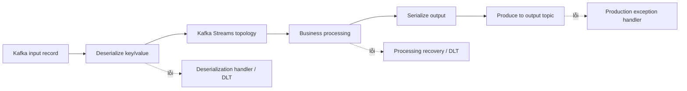

# Xử lý lỗi deserialization, processing và production

Một Kafka Streams topology nhận record từ Kafka, giải mã key/value, chạy các phép biến đổi và ghi kết quả ra topic hoặc state store. Lỗi có thể xuất hiện ở từng chặng: dữ liệu đầu vào không giải mã được, logic nghiệp vụ ném exception hoặc producer không thể ghi output. Ba loại lỗi này xảy ra ở các ranh giới khác nhau nên cần cơ chế xử lý tương ứng.

Spring Cloud Stream Kafka Streams Binder tích hợp các handler deserialization và DLQ cho record đầu vào. Với lỗi trong logic ứng dụng, binder cung cấp `RecordRecoverableProcessor` và `DltAwareProcessor`, đồng thời tạo `RetryTemplate` theo input binding để thử lại những lời gọi nghiệp vụ quan trọng. Với lỗi khi ghi output, có thể cấu hình Kafka Streams `ProductionExceptionHandler` thông qua `StreamsBuilderFactoryBeanCustomizer`. Phân loại đúng lỗi trước khi chọn hành động giúp topology tiếp tục an toàn mà không âm thầm làm mất dữ liệu.

## 1. Xác định lỗi xảy ra ở chặng nào

Một record đi qua các bước chính:



| Loại lỗi | Ví dụ | Thành phần xử lý |
|---|---|---|
| Deserialization | JSON/Avro sai schema, byte không hợp lệ, Serde không tương thích | `DeserializationExceptionHandler` của Kafka Streams Binder |
| Processing | Null không được dự kiến, validation thất bại, gọi database/REST ném exception | Logic ứng dụng, `RecordRecoverableProcessor`, `DltAwareProcessor`, `RetryTemplate` hoặc `ProcessingExceptionHandler` |
| Production | Output record quá lớn, serialization lỗi, broker từ chối ghi | `ProductionExceptionHandler` |
| Lỗi thread/runtime | Uncaught exception, lỗi nghiêm trọng trong stream thread hoặc khôi phục state | Kafka Streams uncaught exception handler, lifecycle listener và vận hành |

Không dùng `sendToDlq` cho mọi lỗi. Handler deserialization chỉ xử lý record không giải mã được ở đầu vào. Nó không tự bắt exception ném ra trong `mapValues`, `process` hoặc service nghiệp vụ. Tương tự, `ProductionExceptionHandler` xử lý lỗi khi ghi record ra broker, không xử lý lỗi deserialize input.

## 2. Deserialization xảy ra trước logic nghiệp vụ

Kafka Streams cần một `Serde` để chuyển key/value từ byte thành kiểu Java. Kafka Streams Binder thường dùng native Serde ở biên input/output. Binder có thể suy luận Serde từ kiểu generic của `KStream`, bean `Serde` được khai báo hoặc các kiểu phổ biến như `String`, `Long`, `UUID`, `byte[]`. Nếu không suy luận được, cần khai báo Serde rõ ràng.

Ví dụ function nhận sự kiện đơn hàng:

```java
@Bean
Function<KStream<String, OrderCreated>,
         KStream<String, OrderCreated>> validateOrders() {

    return input -> input
        .filter((key, event) -> event != null)
        .mapValues(this::normalize);
}
```

Nếu value trong Kafka không thể giải mã thành `OrderCreated`, Kafka Streams không thể đưa một đối tượng `OrderCreated` hợp lệ vào topology. Vì vậy, `normalize()` hoặc `filter()` chưa chắc được gọi. Lỗi phải được xử lý ở lớp deserialization.

Các nguyên nhân thường gặp:

- Producer và consumer dùng schema không tương thích.
- Producer đổi tên hoặc kiểu field mà consumer chưa hỗ trợ.
- Consumer chọn sai `Serde` hoặc serializer/deserializer class.
- Payload bị cắt, hỏng hoặc không đúng encoding.
- Topic chứa nhiều event type nhưng consumer chỉ hỗ trợ một kiểu.
- Native decoding và message conversion của Spring Cloud Stream được cấu hình không nhất quán.

Trước khi chọn bỏ qua hoặc đưa record vào DLQ, hãy kiểm tra hợp đồng schema, versioning, Serde và cách producer phát record. Nếu dữ liệu hợp lệ theo một schema cũ, giải pháp tốt có thể là bổ sung reader compatibility thay vì loại bỏ message.

## 3. Cấu hình Serde đúng cho input binding

Có thể khai báo Serde theo từng input binding:

```yaml
spring:
  cloud:
    function:
      definition: validateOrders
    stream:
      bindings:
        validateOrders-in-0:
          destination: orders.created
      kafka:
        streams:
          bindings:
            validateOrders-in-0:
              consumer:
                keySerde: org.apache.kafka.common.serialization.Serdes$StringSerde
                valueSerde: com.example.kafka.OrderCreatedSerde
```

Khi cần cấu hình Serde mặc định cho binder, có thể dùng `spring.cloud.stream.kafka.streams.binder.configuration.default.key.serde` và `default.value.serde`. Cấu hình ở cấp binding giúp một input dùng schema hoặc kiểu dữ liệu riêng mà không ảnh hưởng các input khác.

Trong Kafka Streams Binder, native decoding mặc định được bật. Nếu muốn Spring Cloud Stream chuyển đổi payload qua message converter, phải tắt native decoding trên input binding tương ứng:

```yaml
spring:
  cloud:
    stream:
      bindings:
        validateOrders-in-0:
          consumer:
            nativeDecoding: false
          contentType: application/json
```

Chỉ tắt native decoding khi producer và converter có hợp đồng tương thích. Nếu vẫn dùng native Serde, hãy cấu hình đúng key/value Serde và không dựa vào `contentType` để sửa một Serde sai.

Keys luôn được giải mã bằng native Serde trong mô hình Kafka Streams Binder. Khi có nhiều input, cấu hình Serde và decoding cho từng binding riêng; một input dùng Avro không có nghĩa input khác cũng dùng cùng Serde.

## 4. Chọn chính sách deserialization: fail, continue hay DLQ

Kafka Streams có hai handler cơ bản:

- `LogAndFailExceptionHandler`: ghi log và làm stream xử lý thất bại. Đây là mặc định của Kafka Streams.
- `LogAndContinueExceptionHandler`: ghi log rồi bỏ qua record lỗi để xử lý record tiếp theo.

Kafka Streams Binder bổ sung lựa chọn gửi record lỗi sang Dead Letter Topic (DLT) bằng `sendToDlq`.

| Chính sách | Hành vi | Khi phù hợp |
|---|---|---|
| `logAndFail` | Log lỗi và dừng xử lý theo handler | Dữ liệu sai phải được điều tra trước khi tiếp tục |
| `logAndContinue` | Log rồi bỏ qua record không giải mã được | Có thể chấp nhận mất record lỗi khỏi phép tính |
| `sendToDlq` | Gửi record không giải mã được sang DLT | Cần cô lập và xử lý lại dữ liệu lỗi |
| `skipAndContinue` | Bỏ qua record lỗi ở cấu hình per-binding được hỗ trợ | Một input cụ thể được phép tiếp tục khi gặp poison record |

Ví dụ bật DLT ở cấp binder:

```yaml
spring:
  cloud:
    stream:
      kafka:
        streams:
          binder:
            deserializationExceptionHandler: sendToDlq
```

Cấu hình binder-level áp dụng cho toàn bộ các processor/input trong ứng dụng Kafka Streams đó. Nếu ứng dụng có nhiều function hoặc nhiều input binding với yêu cầu khác nhau, dùng cấu hình per-binding để giới hạn phạm vi.

Ví dụ chỉ gửi lỗi của input đơn hàng vào DLT, còn input tra cứu khách hàng được phép bỏ qua record lỗi:

```yaml
spring:
  cloud:
    function:
      definition: enrichOrders
    stream:
      kafka:
        streams:
          bindings:
            enrichOrders-in-0:
              consumer:
                deserializationExceptionHandler: sendToDlq
                dlqName: orders-deserialization-dlt
            enrichOrders-in-1:
              consumer:
                deserializationExceptionHandler: skipAndContinue
```

Cấu hình `spring.cloud.stream.kafka.streams.bindings.<binding>.consumer.deserializationExceptionHandler` có độ ưu tiên cao hơn lựa chọn binder-level. Hãy dùng tên binding do function tạo ra, ví dụ `enrichOrders-in-0` và `enrichOrders-in-1`.

**Bỏ qua record là quyết định nghiệp vụ.** Khi dùng `logAndContinue` hoặc `skipAndContinue`, record lỗi không được xử lý trong topology. Nếu record đó đại diện giao dịch tài chính, thay đổi trạng thái đơn hàng hoặc sự kiện kiểm toán, bỏ qua có thể tạo ra state không đầy đủ. Trong trường hợp đó, nên fail để dừng và điều tra hoặc gửi record vào DLT/quarantine.

## 5. Cấu hình DLT và định tuyến record lỗi

Khi chọn `sendToDlq`, có thể đặt tên DLT theo từng input binding bằng `dlqName`. Nếu không chỉ định, binder tạo tên mặc định theo dạng:

```text
error.<input-topic-name>.<application-id>
```

Ví dụ:

```yaml
spring:
  cloud:
    stream:
      kafka:
        streams:
          bindings:
            enrichOrders-in-0:
              consumer:
                deserializationExceptionHandler: sendToDlq
                dlqName: orders.created.deserialization-dlt
```

Binder mặc định gửi record lỗi tới cùng partition index với record gốc. Do đó, DLT cần có ít nhất số partition bằng topic nguồn nếu muốn giữ partition mapping mặc định. Việc dùng cùng partition có thể giúp đối chiếu dữ liệu và duy trì cách phân chia theo key, nhưng không tự bảo đảm thứ tự nghiệp vụ giữa topic chính và DLT.

Nếu cấu hình `dlqPartitions` bằng `1` và `minPartitionCount` của binder cũng bằng `1`, binder có thể dùng partition 0 mà không cần bean tùy chỉnh. Nếu một trong hai giá trị lớn hơn `1`, cần cung cấp `DlqPartitionFunction`, kể cả khi số partition DLT bằng số partition nguồn.

Có thể thay đổi partition bằng bean `DlqPartitionFunction`:

```java
import org.springframework.cloud.stream.binder.kafka.streams.DlqPartitionFunction;
import org.springframework.context.annotation.Bean;
import org.springframework.context.annotation.Configuration;

@Configuration
public class StreamsDlqConfiguration {

    @Bean
    DlqPartitionFunction dlqPartitionFunction() {
        return (group, record, exception) -> 0;
    }
}
```

Ví dụ đưa mọi record lỗi vào partition 0. Chỉ có thể có một bean `DlqPartitionFunction` trong application context. Khi dùng chiến lược partition tùy chỉnh, hãy bảo đảm topic đích có partition tương ứng.

Nếu cần chọn DLT theo topic nguồn, tenant hoặc loại lỗi, có thể khai báo `DlqDestinationResolver`:

```java
import org.springframework.cloud.stream.binder.kafka.streams.DlqDestinationResolver;
import org.springframework.context.annotation.Bean;

@Bean
DlqDestinationResolver dlqDestinationResolver() {
    return (record, exception) -> {
        if ("orders.created".equals(record.topic())) {
            return "orders-deserialization-dlt";
        }
        return "other-deserialization-dlt";
    };
}
```

Khi dùng resolver động, binder không thể tự suy ra tất cả tên DLT để provision. Ứng dụng/hạ tầng phải tạo trước các topic đích, cấu hình partition, replication, retention và ACL. Nếu resolver tồn tại, nó được ưu tiên hơn tên DLT tĩnh.

## 6. Đưa record lỗi vào DLT có an toàn không?

Một record không giải mã được có thể không có object Java đã chuyển đổi. Cần giữ dữ liệu gốc và metadata đủ để điều tra:

- Topic, partition và offset nguồn.
- Timestamp và key gốc.
- Byte payload chưa giải mã nếu cơ chế handler cung cấp.
- Tên Serde hoặc schema version đang dùng.
- Exception class và thông tin lỗi.
- Application ID, binding và thời điểm xử lý.
- Correlation/event ID nếu metadata vẫn đọc được.

DLT phải có quyền truy cập và retention phù hợp. Payload có thể chứa dữ liệu nhạy cảm; không cấp quyền đọc DLT rộng hơn topic nguồn nếu không có lý do. Tránh ghi toàn bộ payload hoặc credential vào log.

Không nên phát lại record lỗi vào topic chính ngay khi chưa sửa nguyên nhân. Nếu schema producer vẫn không tương thích, record sẽ tiếp tục thất bại và quay lại DLT. Quy trình replay cần xác minh schema, Serde và phiên bản consumer đã được sửa.

## 7. Lỗi trong processing: exception từ logic ứng dụng

Deserialization handler không can thiệp vào exception ném ra trong code nghiệp vụ. Ví dụ:

```java
@Bean
Function<KStream<String, OrderCreated>,
         KStream<String, OrderSummary>> summarizeOrders() {

    return orders -> orders.mapValues(event -> {
        if (event.total() == null) {
            throw new IllegalArgumentException("total is required");
        }

        return OrderSummary.from(event);
    });
}
```

Nếu `event.total()` là null, exception xuất hiện trong quá trình xử lý record. Cấu hình `deserializationExceptionHandler: sendToDlq` không tự bắt exception này vì record đã được deserialize thành công.

Kafka Streams có `ProcessingExceptionHandler` ở các phiên bản hỗ trợ. Handler này quyết định FAIL hoặc CONTINUE cho exception trong quá trình xử lý record. Handler mặc định là `LogAndFailProcessingExceptionHandler`; handler `LogAndContinueProcessingExceptionHandler` ghi log và bỏ qua record lỗi. Đây là một cơ chế khác với deserialization handler và không tự gửi record vào DLT.

Trong Kafka Streams Binder, cách tường minh để xử lý lỗi ứng dụng theo từng record là dùng `RecordRecoverableProcessor` hoặc `DltAwareProcessor`.

## 8. Dùng DltAwareProcessor để đưa lỗi nghiệp vụ vào DLT

`DltAwareProcessor` là một implementation của `RecordRecoverableProcessor` do Kafka Streams Binder cung cấp. Nó bao bọc logic xử lý một record; nếu logic ném exception, processor gửi record thất bại tới DLT đã chỉ định thông qua `DltPublishingContext`.

Ví dụ function chỉ xử lý, không tạo output stream:

```java
import org.apache.kafka.streams.kstream.KStream;
import org.springframework.cloud.stream.binder.kafka.streams.DltAwareProcessor;
import org.springframework.cloud.stream.binder.kafka.streams.DltPublishingContext;
import org.springframework.context.annotation.Bean;

import java.util.function.Consumer;

@Bean
Consumer<KStream<String, OrderCreated>> processOrders(
        DltPublishingContext dltPublishingContext,
        OrderService orderService) {

    return input -> input.process(() ->
        new DltAwareProcessor<>(
            record -> {
                OrderCreated event = record.value();

                if (event.total() == null || event.total().signum() < 0) {
                    throw new InvalidOrderException(
                        "Invalid total for order " + event.orderId()
                    );
                }

                orderService.apply(event);
                return null;
            },
            "orders-processing-dlt",
            dltPublishingContext
        )
    );
}
```

Ví dụ tập trung vào ranh giới xử lý và recovery. `DltPublishingContext` được binder tự cấu hình và cung cấp hạ tầng publish. Hàm xử lý nhận record và thực hiện nghiệp vụ; nếu ném exception, `DltAwareProcessor` đưa record đó vào DLT.

Đặt tên topic DLT tường minh, tạo topic trước khi triển khai và cấp quyền publish cho ứng dụng. Nếu DLT key là kiểu `String`, cần cấu hình key serializer cho output binding DLT:

```yaml
spring:
  cloud:
    stream:
      kafka:
        bindings:
          orders-processing-dlt:
            producer:
              configuration:
                key.serializer: org.apache.kafka.common.serialization.StringSerializer
```

`DltAwareProcessor` dùng `StreamBridge` và regular Kafka binder để publish DLT. Value được chuyển thành byte theo cơ chế của Spring Cloud Stream, nhưng key không tự động chuyển đổi theo cùng cách. Nếu key không phải `byte[]`, hãy cấu hình serializer tương ứng. Không giả định DLT publish dùng cùng Serde như output Kafka Streams binder.

## 9. RecordRecoverableProcessor với recovery tùy chỉnh

Nếu không muốn gửi record lỗi vào DLT, có thể dùng `RecordRecoverableProcessor` trực tiếp. Constructor nhận function xử lý record và một recoverer dạng `BiConsumer` nhận record cùng exception.

```java
import org.springframework.cloud.stream.binder.kafka.streams.RecordRecoverableProcessor;

@Bean
Consumer<KStream<String, OrderCreated>> processOrders(
        OrderService orderService,
        ErrorAuditService auditService) {

    return input -> input.process(() ->
        new RecordRecoverableProcessor<>(
            record -> {
                orderService.apply(record.value());
                return null;
            },
            (record, exception) -> {
                auditService.recordFailure(
                    record.key(),
                    record.value(),
                    exception
                );
            }
        )
    );
}
```

Ví dụ này ghi nhận lỗi vào audit service và để topology tiếp tục. Nếu recoverer chỉ log rồi bỏ qua, record sẽ không được xử lý lại tự động. Hãy lưu đủ metadata để có thể điều tra hoặc phục hồi sau đó.

Không được nuốt exception nếu nghiệp vụ yêu cầu bảo đảm xử lý. Recoverer phải có hành động rõ ràng: DLT, quarantine, ghi trạng thái lỗi bền vững hoặc dừng pipeline. Nếu audit service cũng lỗi, cần có chính sách cho lỗi của chính recovery path; nếu không, lỗi thứ hai có thể làm stream thread thất bại.

## 10. Retry các lời gọi nghiệp vụ quan trọng

Một processor có thể gọi database hoặc REST service trong lúc xử lý record. Lỗi mạng tạm thời có thể tự hết sau một khoảng chờ. Kafka Streams Binder tạo một `RetryTemplate` theo từng input binding để ứng dụng có thể retry phần logic quan trọng.

Với function tên `process`, input binding mặc định là `process-in-0` và RetryTemplate có tên `process-in-0-RetryTemplate`. Với nhiều input binding, mỗi input có RetryTemplate riêng.

Ví dụ lấy template bằng qualifier:

```java
import org.springframework.beans.factory.annotation.Qualifier;
import org.springframework.context.annotation.Lazy;
import org.springframework.retry.support.RetryTemplate;

@Bean
Consumer<KStream<String, OrderCreated>> process(
        @Lazy @Qualifier("process-in-0-RetryTemplate")
        RetryTemplate retryTemplate,
        PaymentClient paymentClient) {

    return input -> input.foreach((key, event) ->
        retryTemplate.execute(context -> {
            paymentClient.authorize(event);
            return null;
        })
    );
}
```

Đây là ví dụ retry một lời gọi bên ngoài. Cần cấu hình retry policy có giới hạn, backoff và timeout cho HTTP client. RetryTemplate không tự làm cho thao tác bên ngoài trở thành idempotent; nếu request đã tới dịch vụ nhưng response bị mất, lần thử tiếp theo có thể tạo tác dụng phụ trùng. Dùng idempotency key như `eventId` khi gọi dịch vụ.

Có thể cung cấp custom `RetryTemplate` bean bằng `@StreamRetryTemplate` hoặc đặt tên template qua thuộc tính `retryTemplateName` của consumer binding. Khi retry hết, exception cuối cùng mặc định được ném ra và có thể làm processor dừng. Nếu muốn xử lý tiếp, dùng `RecoveryCallback` có hành động cụ thể:

```java
retryTemplate.execute(
    context -> {
        paymentClient.authorize(event);
        return null;
    },
    context -> {
        auditService.markAuthorizationFailed(event.eventId());
        return null;
    }
);
```

Recovery callback không nên chỉ trả về null nếu trạng thái nghiệp vụ vẫn chưa được ghi nhận. Nếu chọn tiếp tục, phải có trạng thái lỗi hoặc luồng quarantine để không làm mất dấu sự kiện.

## 11. Giới hạn retry và tránh chặn stream thread quá lâu

Retry đồng bộ giữ thread xử lý trong suốt thời gian chờ. Nếu retry nhiều lần hoặc backoff dài, stream thread có thể chậm xử lý các record khác, tăng lag và có nguy cơ vượt các giới hạn tiến triển của task.

Khi thiết kế retry:

- Chỉ retry lỗi có khả năng tự phục hồi như timeout hoặc lỗi mạng tạm thời.
- Không retry lỗi schema, dữ liệu không hợp lệ hoặc lỗi quyền truy cập kéo dài.
- Đặt timeout cho từng lần gọi bên ngoài.
- Giới hạn tổng số lần thử và tổng thời gian retry.
- Dùng exponential backoff hoặc fixed backoff phù hợp.
- Giữ event ID ổn định qua mọi lần retry.
- Dùng idempotency key cho các API tạo side effect.
- Đưa message vào DLT/quarantine khi hết retry.
- Theo dõi thời gian xử lý, số lần retry và consumer lag.

Không lồng retry không giới hạn ở HTTP client, service nghiệp vụ và RetryTemplate. Tổng số lần gọi thực tế có thể nhân lên nhanh chóng. Hãy xác định một ngân sách retry tổng thể.

Nếu cần chờ lâu, không nên giữ stream thread ngủ trong nhiều phút. Có thể cần tách công việc sang workflow hoặc retry topic có delay, nhưng phải bảo đảm input offset và trạng thái xử lý không bị commit trước khi công việc được lưu bền vững.

## 12. ProcessingExceptionHandler của Kafka Streams

Kafka Streams ở các phiên bản hỗ trợ `ProcessingExceptionHandler` cho phép quyết định cách xử lý exception phát sinh trong quá trình xử lý record:

- `FAIL`: dừng xử lý stream theo handler.
- `CONTINUE`: bỏ qua record gây lỗi và tiếp tục.

Các implementation có sẵn gồm `LogAndFailProcessingExceptionHandler` và `LogAndContinueProcessingExceptionHandler`. Mặc định là fail. Đây là quyết định tiến triển của topology, không phải một cơ chế retry có backoff hay một DLT tự động.

Ví dụ khai báo handler tùy chỉnh trong Kafka Streams configuration:

```java
import org.apache.kafka.streams.errors.ErrorHandlerContext;
import org.apache.kafka.streams.errors.ProcessingExceptionHandler;
import org.apache.kafka.streams.errors.ProcessingExceptionHandler.Response;
import org.apache.kafka.streams.processor.api.Record;
import java.util.Map;

public final class SelectiveProcessingExceptionHandler
        implements ProcessingExceptionHandler {

    @Override
    public Response handleError(
            ErrorHandlerContext context,
            Record<?, ?> record,
            Exception exception) {

        if (exception instanceof InvalidOrderException) {
            return Response.resume();
        }

        return Response.fail();
    }

    @Override
    public void configure(Map<String, ?> configs) {
    }
}
```

Cấu hình qua Kafka Streams Binder:

```yaml
spring:
  cloud:
    stream:
      kafka:
        streams:
          binder:
            configuration:
              processing.exception.handler: com.example.SelectiveProcessingExceptionHandler
```

Handler này bỏ qua lỗi nghiệp vụ đã phân loại là không thể phục hồi và dừng topology với lỗi ngoài dự kiến. Khi chọn CONTINUE, record không được xử lý lại và không tự động đi vào DLT. Nếu cần lưu record lỗi, hãy dùng `DltAwareProcessor` hoặc một recovery path có thể publish/quarantine trước khi quyết định tiếp tục.

Ở Kafka Streams 4.4, `ProcessingExceptionHandler.Response` còn cho phép trả về `Response.resume(List<ProducerRecord<byte[], byte[]>>)` hoặc `Response.fail(List<ProducerRecord<byte[], byte[]>>)` kèm các record muốn gửi tới DLT. Đây là API của Kafka Streams; ứng dụng vẫn phải tạo record DLT, chọn serializer và provision topic phù hợp. Với phiên bản cũ, API có thể dùng enum response `ProcessingHandlerResponse` đã bị deprecated; kiểm tra Javadoc theo Kafka client thực tế.

`ProcessingExceptionHandler` và `RecordRecoverableProcessor` không thay thế nhau hoàn toàn. Handler Kafka Streams ở mức runtime quyết định FAIL/CONTINUE; processor recovery cho phép ứng dụng kiểm soát từng record và hành động khi logic cụ thể thất bại.

Một số phiên bản Kafka có cấu hình riêng để áp dụng processing handler cho global store/KTable. Hành vi mặc định và tên property thay đổi theo phiên bản; kiểm tra tài liệu Kafka Streams tương ứng với dependency đang dùng trước khi dựa vào handler cho global state.

## 13. Production exception: lỗi khi ghi output

Sau khi topology xử lý xong, Kafka Streams cần serialize và gửi output record tới Kafka. Lỗi có thể xuất hiện khi:

- Record vượt giới hạn kích thước broker/topic.
- Serializer không xử lý được kiểu dữ liệu hoặc dữ liệu đầu ra.
- Broker tạm thời không sẵn sàng hoặc từ chối ghi.
- Replication/ISR policy không đáp ứng acknowledgement.
- ACL không cho phép ghi topic.
- Output topic không tồn tại hoặc metadata chưa sẵn sàng.

Kafka Streams dùng `ProductionExceptionHandler` để xử lý lỗi khi producer gửi record. Handler mặc định là `DefaultProductionExceptionHandler`, có hành vi fail khi gặp lỗi production.

Trong các phiên bản Kafka hỗ trợ response mới, production handler có thể trả về:

| Response | Hành vi |
|---|---|
| `FAIL` | Báo Kafka Streams dừng xử lý |
| `CONTINUE` | Bỏ qua output record lỗi và tiếp tục |
| `RETRY` | Thử gửi lại khi exception là `RetriableException` |

Nếu trả về `RETRY` cho exception không retryable, Kafka Streams xem như `FAIL`. Không dùng CONTINUE cho lỗi output quan trọng nếu bỏ record có thể làm mất dữ liệu nghiệp vụ.

Trong Kafka Streams 4.4, `ProductionExceptionHandler` còn có phương thức riêng `handleSerializationError(...)`. Nếu cần tùy biến lỗi serialize output, hãy override phương thức này; nếu không, hành vi mặc định vẫn là fail. Lỗi serializer thường phản ánh cấu hình hoặc dữ liệu không tương thích, nên retry thường không giải quyết được nguyên nhân.

Ví dụ handler chỉ retry lỗi broker có thể phục hồi:

```java
import org.apache.kafka.common.errors.RetriableException;
import org.apache.kafka.clients.producer.ProducerRecord;
import org.apache.kafka.streams.errors.ErrorHandlerContext;
import org.apache.kafka.streams.errors.ProductionExceptionHandler;
import org.apache.kafka.streams.errors.ProductionExceptionHandler.Response;
import java.util.Map;

public final class SelectiveProductionExceptionHandler
        implements ProductionExceptionHandler {

    @Override
    public Response handleError(
            ErrorHandlerContext context,
            ProducerRecord<byte[], byte[]> record,
            Exception exception) {

        if (exception instanceof RetriableException) {
            return Response.retry();
        }

        return Response.fail();
    }

    @Override
    public void configure(Map<String, ?> configs) {
    }
}
```

Tên enum/API có thể khác giữa các dòng Kafka client cũ và mới. Đối chiếu phiên bản Kafka Streams thực tế trong BOM trước khi biên dịch. Với các phiên bản cũ chỉ có FAIL/CONTINUE, không giả định response RETRY tồn tại.

## 14. Đăng ký ProductionExceptionHandler qua binder customizer

Kafka Streams Binder không cung cấp một thuộc tính DLT chuyên biệt ở cấp binder cho production exception giống như deserialization. Có thể đăng ký handler bằng `StreamsBuilderFactoryBeanCustomizer` của Spring for Apache Kafka.

```java
import org.apache.kafka.streams.StreamsConfig;
import org.springframework.kafka.config.StreamsBuilderFactoryBeanCustomizer;

@Bean
StreamsBuilderFactoryBeanCustomizer productionHandlerCustomizer() {
    return factoryBean -> factoryBean.getStreamsConfiguration().put(
        StreamsConfig.PRODUCTION_EXCEPTION_HANDLER_CLASS_CONFIG,
        SelectiveProductionExceptionHandler.class
    );
}
```

Customizer được binder gọi trước khi factory bean khởi động Kafka Streams. Với nhiều processor trong cùng application, mỗi processor có `StreamsBuilderFactoryBean` riêng. Có thể kiểm tra `application.id` trong streams configuration để chỉ áp dụng handler cho processor mong muốn.

Nếu muốn giới hạn handler cho một processor cụ thể, thay customizer tổng quát ở trên bằng biến thể lọc theo application ID sau:

```java
@Bean
StreamsBuilderFactoryBeanCustomizer productionHandlerCustomizer() {
    return factoryBean -> {
        String applicationId = factoryBean.getStreamsConfiguration()
            .getProperty(StreamsConfig.APPLICATION_ID_CONFIG);

        if ("orders-enricher".equals(applicationId)) {
            factoryBean.getStreamsConfiguration().put(
                StreamsConfig.PRODUCTION_EXCEPTION_HANDLER_CLASS_CONFIG,
                SelectiveProductionExceptionHandler.class
            );
        }
    };
}
```

Chỉ khai báo một `StreamsBuilderFactoryBeanCustomizer` bean cho toàn application theo hợp đồng của binder. Nếu cần nhiều tùy biến, gom chúng vào cùng customizer và phân nhánh theo application ID. Ở một số phiên bản cũ, tên config key/constant có tiền tố `default.`; dùng tên property được Kafka client version hiện tại tài liệu hóa.

Không nên viết handler trả về CONTINUE cho mọi lỗi. Record output bị bỏ qua có thể khiến downstream thiếu sự kiện trong khi input đã được xem là xử lý xong. Với dữ liệu quan trọng, fail fast và phục hồi hạ tầng thường an toàn hơn bỏ output âm thầm.

## 15. Theo dõi trạng thái KafkaStreams và uncaught exception

Ngoài ba handler record-level, cần theo dõi trạng thái runtime. `StreamsBuilderFactoryBeanCustomizer` có thể gắn state listener để ghi nhận chuyển trạng thái của Kafka Streams:

```java
import org.springframework.kafka.config.StreamsBuilderFactoryBeanCustomizer;

@Bean
StreamsBuilderFactoryBeanCustomizer streamsStateListener() {
    return factoryBean -> factoryBean.setStateListener(
        (newState, oldState) ->
            log.info(
                "Kafka Streams state changed: {} -> {}",
                oldState,
                newState
            )
    );
}
```

State listener giúp phát hiện processor chuyển sang RUNNING, REBALANCING, ERROR hoặc trạng thái khác theo phiên bản API. Nó không thay thế exception handler; chỉ quan sát vòng đời.

Nếu application đã khai báo `StreamsBuilderFactoryBeanCustomizer` cho production handler, hãy gộp `setStateListener` vào cùng bean đó. Binder chỉ hỗ trợ một customizer bean loại này trong application context; không khai báo một bean thứ hai chỉ để thêm state listener.

Có thể dùng `KafkaStreamsCustomizer` để cấu hình uncaught exception handler trên đối tượng KafkaStreams. Handler này dành cho exception không được xử lý ở các lớp record-level và có thể quyết định thay thread hoặc dừng client/application tùy API version. Không dùng uncaught handler như cách thay thế deserialization/processing/production handler.

Nên phát cảnh báo khi:

- Kafka Streams chuyển sang ERROR hoặc dừng ngoài kế hoạch.
- Stream thread liên tục bị thay thế.
- Consumer lag tăng liên tục.
- State store restore kéo dài hoặc không hoàn tất.
- DLT có record mới hoặc DLT publish thất bại.
- Production exception tăng.
- Retry của service phụ thuộc vượt ngưỡng.

## 16. Exactly-once không bao phủ mọi side effect

Kafka Streams có thể cấu hình `processing.guarantee=exactly_once_v2` để phối hợp input offsets, Kafka output và state store changelog trong transaction Kafka. Điều này giúp tránh một số trường hợp duplicate hoặc mất nhất quán trong ranh giới Kafka.

Tuy nhiên, exactly-once không tự bao gồm:

- Ghi vào database ngoài Kafka.
- Gọi REST API hoặc gửi email.
- Side effect trong một service không tham gia Kafka transaction.
- Publish DLT qua một đường gửi độc lập nếu đường đó không nằm trong transaction tương ứng.
- Một record đã bị handler CONTINUE bỏ qua.

Nếu xử lý record rồi cập nhật database, sau đó process lỗi trước khi offset được commit, record có thể được đọc lại. Hãy dùng idempotency key hoặc transactional outbox ở ranh giới database. Nếu DLT là một phần của quy trình phục hồi quan trọng, cần kiểm tra rõ transaction và producer được dùng để publish DLT.

## 17. Quy trình replay và phục hồi record lỗi

DLT là nơi cách ly dữ liệu lỗi, không phải hàng đợi để tự động phát lại vô hạn. Trước khi replay:

1. Xác định record lỗi từ topic, partition, offset và event ID.
2. Đọc exception, schema version, Serde và metadata.
3. Phân loại lỗi là schema, dữ liệu, nghiệp vụ, hạ tầng hay lỗi output.
4. Sửa producer/consumer hoặc dữ liệu theo quy trình có audit.
5. Xác minh processor mới có thể giải mã và xử lý record.
6. Kiểm tra side effect trước đó và idempotency.
7. Replay một nhóm nhỏ trước, sau đó mới tăng tốc độ.
8. Theo dõi DLT depth, lỗi mới, consumer lag và kết quả nghiệp vụ.

Nếu DLT chứa record chưa giải mã, công cụ replay cần giữ nguyên byte payload hoặc chuyển đổi theo schema mới có chủ đích. Không deserialize bằng một schema phỏng đoán rồi phát lại dữ liệu đã thay đổi mà không lưu dấu vết.

## 18. Kiểm thử ba nhóm lỗi

Unit test và TopologyTestDriver phù hợp để kiểm tra logic topology, business validation và các nhánh recovery trong code. Tuy nhiên, cần integration test với Kafka thật để xác minh Serde, DLQ, producer exception và offset/transaction semantics.

| Kịch bản | Điều cần xác minh |
|---|---|
| Input có byte không hợp lệ | Deserialization handler fail/continue/sendToDlq đúng cấu hình |
| Schema version cũ | Serde có hỗ trợ tương thích hoặc record được đưa DLT |
| DLT topic không tồn tại/thiếu ACL | Ứng dụng phát hiện lỗi publish DLT, không âm thầm bỏ record |
| Function xử lý ném exception | Recovery path đúng; phân biệt exception trong business code với deserialize |
| External service timeout | Retry hữu hạn, backoff và idempotency hoạt động |
| Record nghiệp vụ không hợp lệ | DLT hoặc quarantine nhận record và metadata |
| Output vượt giới hạn kích thước | ProductionExceptionHandler áp dụng đúng FAIL/CONTINUE/RETRY |
| Broker mất kết nối khi produce | Kafka client retry và production handler hoạt động theo policy |
| Nhiều input binding | Handler per-binding có hiệu lực đúng input |
| Replay DLT | Record được xử lý lại không tạo side effect trùng |

Với deserialization, nên phát raw byte sai schema vào topic qua Kafka producer cấp thấp để chắc chắn lỗi xảy ra trước logic topology. Với production failure, có thể dùng topic/ACL/giới hạn kích thước trong môi trường integration riêng để tạo lỗi có kiểm soát. Không mô phỏng các tình huống này chỉ bằng mock function.

## 19. Quan sát và cảnh báo production

Tách metric theo từng lớp giúp tìm đúng nguyên nhân:

| Metric/log | Ý nghĩa |
|---|---|
| Deserialization exception count | Producer/consumer schema hoặc Serde không tương thích |
| DLT publish count và failure | Số record được cô lập và tình trạng đường gửi DLT |
| Processing exception count theo class | Lỗi validation, code hoặc service phụ thuộc |
| Retry attempt và retry exhaustion | Downstream chập chờn hoặc chính sách retry không phù hợp |
| Production exception theo loại | Serializer, kích thước record, ACL hoặc broker |
| Stream thread state và uncaught exception | Runtime không ổn định hoặc task bị dừng |
| Consumer lag theo partition | Topology xử lý chậm hoặc đang phục hồi |
| State restore duration | Thời gian phục hồi state store sau restart/rebalance |
| Output throughput và error rate | Tình trạng ghi kết quả ra topic |

Log nên chứa application ID, input binding, topic, partition, offset, event ID và exception class. Không ghi credential, token hoặc toàn bộ payload nhạy cảm. Đối với DLT, theo dõi số lượng record và tuổi của record cũ nhất để tránh backlog tồn đọng mà không ai xử lý.

## 20. Những lỗi cấu hình thường gặp

| Hiện tượng | Nguyên nhân | Hướng xử lý |
|---|---|---|
| `sendToDlq` không bắt exception trong `mapValues` | Đây là lỗi processing, không phải deserialization | Dùng `DltAwareProcessor` hoặc recovery phù hợp |
| Record lỗi bị bỏ qua không có DLT | Đang dùng `logAndContinue` hoặc `skipAndContinue` | Chuyển sang `sendToDlq` nếu cần giữ record |
| DLT publish thất bại | Topic chưa provision, ACL hoặc partition không hợp lệ | Tạo DLT trước, kiểm tra quyền và partition |
| Per-binding handler không có tác dụng | Sai binding name hoặc đặt sai prefix | Kiểm tra function definition và input binding |
| Processing exception làm stream dừng | Không có recovery cho logic ứng dụng hoặc handler mặc định fail | Phân loại lỗi và dùng processor recovery |
| Retry làm consumer lag tăng | Backoff dài hoặc gọi external service đồng bộ quá lâu | Giới hạn retry, timeout và tách workflow dài |
| DLT key lỗi serializer | DltAwareProcessor publish key qua regular Kafka binder | Cấu hình key serializer trên DLT binding |
| Production handler CONTINUE gây thiếu output | Record output lỗi bị bỏ qua | Dùng FAIL hoặc RETRY cho lỗi phù hợp |
| Handler custom không được áp dụng đúng processor | Customizer áp dụng cho toàn app hoặc nhầm application ID | Lọc StreamsBuilderFactoryBean theo application ID |
| Exactly-once vẫn tạo duplicate ở database | Database không nằm trong Kafka transaction | Idempotency hoặc transactional outbox |

## 21. Checklist trước khi triển khai

- Xác định lỗi xảy ra ở deserialize, processing, production hay runtime.
- Chọn Serde/native decoding tương thích với schema producer.
- Quyết định rõ fail, continue hay sendToDlq cho mỗi input binding.
- Dùng per-binding deserialization handler khi các input có yêu cầu khác nhau.
- Provision DLT, partition, replication, retention và ACL trước khi chạy.
- Dùng `DlqDestinationResolver` chỉ khi topic đích được quản lý trước.
- Dùng `DltAwareProcessor` hoặc `RecordRecoverableProcessor` cho lỗi logic nghiệp vụ.
- Retry external calls có giới hạn, backoff, timeout và idempotency.
- Cấu hình `ProcessingExceptionHandler` theo version Kafka nếu cần FAIL/CONTINUE ở mức runtime.
- Cấu hình `ProductionExceptionHandler` riêng cho lỗi ghi output.
- Không bỏ output quan trọng bằng CONTINUE nếu không có recovery.
- Theo dõi stream state, thread, lag, DLT và production exceptions.
- Kiểm thử raw deserialization error, business failure, DLT failure và producer failure với Kafka thật.
- Thiết kế replay có audit và chống side effect trùng.
- Xác minh exactly-once chỉ trong phạm vi Kafka; xử lý riêng database và dịch vụ ngoài.

## 22. Tài liệu tham khảo

- [Spring Cloud Stream Kafka Streams Binder — Error Handling](https://docs.spring.io/spring-cloud-stream/reference/kafka/kafka-streams-binder/error-handling.html), deserialization handler, DLQ, processing recovery và DltAwareProcessor.
- [Spring Cloud Stream Kafka Streams Binder — Retrying Critical Business Logic](https://docs.spring.io/spring-cloud-stream-binder-kafka/docs/current/reference/html/kafka-streams.html), RetryTemplate theo input binding và recovery callback.
- [Spring Cloud Stream Kafka Streams Binder — StreamsBuilderFactoryBean Customizer](https://docs.spring.io/spring-cloud-stream-binder-kafka/docs/current/reference/html/kafka-streams.html), tùy biến lifecycle và production exception handler.
- [Apache Kafka Streams — Configuring a Streams Application](https://kafka.apache.org/44/streams/developer-guide/config-streams/), deserialization, processing và production exception handlers.
- [Apache Kafka Streams — Configuration Reference](https://kafka.apache.org/44/configuration/kafka-streams-configs/), `processing.exception.handler`, `production.exception.handler` và processing guarantee.
- [Spring for Apache Kafka — Kafka Streams Support](https://docs.spring.io/spring-kafka/reference/streams.html), StreamsBuilderFactoryBean, lifecycle và recovery integration.

Xử lý lỗi Kafka Streams cần tách rõ lỗi giải mã đầu vào, lỗi logic nghiệp vụ và lỗi ghi output. Kafka Streams Binder cung cấp handler deserialization cùng DLT; `DltAwareProcessor` và `RecordRecoverableProcessor` xử lý lỗi trong code; `RetryTemplate` phù hợp với đoạn gọi dịch vụ có thể phục hồi; còn `ProductionExceptionHandler` quyết định cách phản ứng khi output không ghi được. Khi chính sách fail/continue/retry được chọn theo loại lỗi, DLT có thể ghi, retry có giới hạn và replay có idempotency, topology sẽ phục hồi có kiểm soát mà không âm thầm bỏ qua sự kiện quan trọng.

