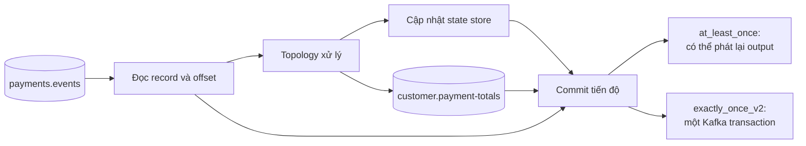
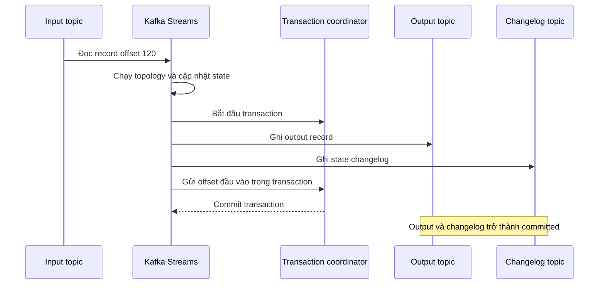

# processing.guarantee và bảo đảm trong topology Kafka Streams

Một topology Kafka Streams thường đọc record từ topic đầu vào, cập nhật state store và ghi kết quả sang topic đầu ra. Nếu ứng dụng dừng giữa chừng, ba thao tác này phải được phối hợp để tránh mất kết quả hoặc tạo bản ghi trùng. Thuộc tính `processing.guarantee` xác định mức bảo đảm xử lý mà Kafka Streams áp dụng cho chu trình đó.

Hai lựa chọn chính trong Kafka hiện đại:

- `at_least_once`: mặc định. Nếu ứng dụng lỗi sau khi ghi output nhưng trước khi lưu offset, record có thể được xử lý lại và output có thể xuất hiện trùng.
- `exactly_once_v2`: dùng Kafka transaction để commit nguyên tử offset đầu vào, output records và changelog của state store. Consumer `read_committed` chỉ thấy kết quả đã commit.

Với Spring Cloud Stream Kafka Streams binder, có thể đặt `processing.guarantee` qua cấu hình Kafka Streams ở cấp function hoặc binder. Bảo đảm exactly-once chỉ bao phủ dữ liệu nằm trong transaction Kafka; nó không tự bao gồm cập nhật database, gọi REST API, gửi email hay side effect ở hệ thống bên ngoài.

## 1. Vì sao topology cần processing guarantee?

Giả sử processor đọc sự kiện thanh toán từ `payments.events`, cập nhật tổng tiền theo khách hàng trong state store và phát kết quả sang `customer.payment-totals`.

Một lần xử lý có ba kết quả cần giữ nhất quán:

1. Offset đầu vào: vị trí record mà processor đã xử lý.
2. State: giá trị mới của tổng tiền trong state store và changelog topic.
3. Output: record tổng tiền mới được ghi vào topic kết quả.

Nếu chỉ một phần được lưu, sau khi khởi động lại topology có thể rơi vào một trong hai tình huống:

- Offset đã tiến lên nhưng output/state chưa được lưu: record bị bỏ qua và kết quả bị mất.
- Output/state đã được ghi nhưng offset chưa tiến lên: record được đọc lại và kết quả có thể bị ghi lần nữa.

`processing.guarantee` xác định cách Kafka Streams phối hợp các thao tác này khi commit và phục hồi.



State store có thể được lưu cục bộ trên máy chạy ứng dụng. Kafka Streams dùng changelog topic để tái tạo state khi task được chuyển sang instance khác hoặc local state cần phục hồi. Transaction exactly-once bao gồm các bản ghi changelog được ghi vào Kafka cùng output và offset.

## 2. at_least_once là gì?

`at_least_once` có nghĩa record đầu vào được xử lý cho tới khi tiến độ được xác nhận, nhưng trong một số tình huống lỗi, cùng record có thể được xử lý nhiều lần. Đây là chế độ mặc định của Kafka Streams và không cần transaction cho mỗi chu kỳ commit.

Ví dụ function tính tổng số thanh toán theo key:

```java
@Bean
Function<KStream<String, PaymentEvent>, KStream<String, Long>> paymentTotals() {
    return payments -> payments
            .groupByKey()
            .count(Materialized.as("payment-totals"))
            .toStream();
}
```

Giả sử record của khách hàng C42 làm tổng tiền tăng từ 100 lên 150. Topology ghi changelog state mới và output 150. Nếu output được ghi thành công nhưng ứng dụng dừng trước khi offset đầu vào được commit, khi khởi động lại record đó có thể được đọc lại. Output 150 có thể được phát lần nữa.

### Kịch bản lỗi với at-least-once

1. Consumer đọc record ở offset 120.
2. Function xử lý record và tạo output.
3. Output được ghi vào topic kết quả.
4. Ứng dụng dừng trước khi offset 120 được commit.
5. Instance mới nhận lại task và đọc lại offset 120.
6. Logic xử lý chạy lần nữa; output có thể bị lặp.

At-least-once ưu tiên không bỏ qua record chưa commit, đổi lại downstream phải chấp nhận khả năng nhận trùng.

Chế độ này thường đủ khi downstream có idempotency theo event ID, duplicate không gây sai lệch nghiệp vụ, hoặc kết quả có thể tính lại và đối soát. Không giả định mỗi lần function được gọi chỉ xảy ra một lần.

## 3. exactly_once_v2 là gì?

`exactly_once_v2` là cơ chế exactly-once processing hiện đại của Kafka Streams. Kafka dùng producer transaction, idempotent producer và consumer offset commit trong transaction để bảo đảm một chu kỳ xử lý được công bố nguyên tử.

Khi transaction commit thành công, các thành phần sau cùng có hiệu lực:

- Offset đầu vào đã xử lý.
- Các record được ghi ra topic đầu ra.
- Các record changelog phản ánh cập nhật state store.
- Tiến độ nội bộ liên quan tới task.

Nếu transaction bị abort, output/changelog thuộc transaction đó không được consumer `read_committed` nhìn thấy và offset đầu vào chưa được commit như một phần của transaction. Khi task phục hồi, record có thể được xử lý lại, nhưng chỉ kết quả đã commit được công bố.

Kafka Streams không bảo đảm code chỉ chạy đúng một lần về mặt CPU. Khi transaction abort, function hoặc processor có thể chạy lại. Điều được bảo đảm là kết quả đã commit trong Kafka không bị nhân đôi bởi lần thử đã abort.

### Minh họa transaction



Nếu ứng dụng lỗi trước commit, transaction chưa hoàn tất sẽ bị abort hoặc được coordinator phục hồi theo trạng thái transaction. Consumer `read_committed` bỏ qua record thuộc transaction đã abort.

## 4. Exactly-once bao phủ những gì?

Phạm vi exactly-once của Kafka Streams nằm trong Kafka:

| Thành phần | at_least_once | exactly_once_v2 |
|---|---|---|
| Đọc record từ input topic | Có thể đọc lại sau lỗi | Có thể đọc lại nội bộ sau abort |
| Commit input offset | Theo chu kỳ commit | Nằm trong Kafka transaction |
| Ghi output topic | Có thể xuất hiện duplicate | Chỉ hiển thị nếu transaction commit |
| Cập nhật state store | Có thể được phát lại khi phục hồi | Changelog update được commit cùng output và offset |
| Repartition/changelog topic | Có thể có lần ghi lặp theo retry | Các ghi trong transaction được commit/abort cùng chu kỳ |
| Database bên ngoài | Không được bao phủ | Không được bao phủ |
| REST API, email, thanh toán ngoài Kafka | Không được bao phủ | Không được bao phủ |

Transaction Kafka không thể tự commit một transaction JDBC hoặc một HTTP request. Nếu topology gọi hệ thống bên ngoài trong callback, side effect đó có thể xảy ra trước khi Kafka transaction abort. Khi record được xử lý lại, side effect bên ngoài có thể bị lặp.

### State store cục bộ và changelog

Kafka Streams có thể dùng RocksDB hoặc store trong memory cho state cục bộ. State store phục vụ xử lý nhanh, còn changelog topic cung cấp nguồn dữ liệu để phục hồi.

Trong exactly-once, các bản ghi changelog được ghi trong cùng transaction với output và offset. Sau lỗi, Kafka Streams phục hồi state từ changelog đã commit. Local state không phải database transaction độc lập nằm ngoài Kafka guarantee.

Nếu tắt logging của một state store hoặc dùng store không được Kafka Streams quản lý theo cách thông thường, cần đánh giá riêng khả năng phục hồi và phạm vi guarantee. Không giả định mọi dữ liệu trên disk cục bộ đều tự động nằm trong transaction.

## 5. Phân biệt exactly-once, idempotent producer và read_committed

Ba cơ chế này có liên quan nhưng giải quyết các vấn đề khác nhau.

| Cơ chế | Bảo vệ điều gì? | Không tự bảo vệ điều gì? |
|---|---|---|
| Idempotent producer | Duplicate do producer retry trong phạm vi producer session/sequence | Không ghép input offset với output transaction |
| Kafka transaction | Ghi nhiều partition/topic và offset theo một transaction | Không bao phủ database/API bên ngoài |
| Consumer read_committed | Chỉ đọc record thuộc transaction đã commit | Không làm consumer thường thành exactly-once processor |

Idempotent producer ngăn một số duplicate do retry gửi produce request. Tuy nhiên, nếu ứng dụng đọc input, ghi output rồi crash trước khi commit offset, producer idempotence riêng lẻ không biết output đó tương ứng với offset nào. Kafka Streams exactly-once kết hợp producer transaction với offset commit để giải quyết bài toán đó.

Consumer downstream cần đặt `isolation.level=read_committed` nếu chỉ muốn quan sát record đã commit. Consumer ở chế độ `read_uncommitted` có thể nhìn thấy record của transaction chưa commit hoặc đã abort.

## 6. Cấu hình processing.guarantee trong Kafka Streams binder

Kafka Streams binder nhận các thuộc tính của `StreamsConfig` qua cấu hình binder. Với functional processor, có thể cấu hình riêng từng function bằng:

`spring.cloud.stream.kafka.streams.binder.functions.<function-name>.configuration`

Đây là cách phù hợp khi ứng dụng có nhiều processor với yêu cầu khác nhau. Thuộc tính `configuration` ở cấp binder áp dụng cho tất cả processor do binder quản lý.

Ví dụ function tên `paymentTotals`:

```yaml
spring:
  cloud:
    function:
      definition: paymentTotals
    stream:
      bindings:
        paymentTotals-in-0:
          destination: payments.events
        paymentTotals-out-0:
          destination: customer.payment-totals
      kafka:
        streams:
          binder:
            brokers: kafka-1:9092,kafka-2:9092,kafka-3:9092
            functions:
              paymentTotals:
                applicationId: payment-totals-v1
                configuration:
                  processing.guarantee: exactly_once_v2
                  commit.interval.ms: 100
                  replication.factor: 3
```

Trong ví dụ:

- `paymentTotals` là tên function bean.
- `applicationId` là danh tính ổn định của Kafka Streams application.
- `processing.guarantee: exactly_once_v2` bật exactly-once-v2 cho processor này.
- `commit.interval.ms` đặt khoảng commit theo mili giây; khi EOS bật, Kafka Streams mặc định dùng 100 ms nếu không được override.
- `brokers` là danh sách broker của Kafka Streams binder.

### Cấu hình toàn binder

Nếu ứng dụng chỉ có một processor hoặc tất cả processor cần cùng guarantee, có thể đặt ở cấp binder:

```yaml
spring:
  cloud:
    stream:
      kafka:
        streams:
          binder:
            configuration:
              processing.guarantee: exactly_once_v2
```

Cấu hình cấp binder áp dụng cho tất cả processor. Khi có nhiều function, nên dùng function-specific configuration để tránh vô tình thay đổi guarantee của processor khác.

### Không nhầm Kafka binder thường với Kafka Streams binder

Hai prefix sau thuộc hai binder khác nhau:

| Binder | Prefix |
|---|---|
| Kafka message-channel binder | `spring.cloud.stream.kafka.binder.*` |
| Kafka Streams binder | `spring.cloud.stream.kafka.streams.binder.*` |

`processing.guarantee` là thuộc tính của Kafka Streams `StreamsConfig`. Đặt nó dưới prefix của Kafka message-channel binder không cấu hình exactly-once cho Kafka Streams topology.

## 7. Giá trị hợp lệ và tương thích phiên bản

Với Kafka hiện đại, hai giá trị chính là:

- `at_least_once`: mặc định.
- `exactly_once_v2`: exactly-once version 2.

Các giá trị cũ `exactly_once` và `exactly_once_beta` đã bị deprecated trong các phiên bản Kafka mới. Không dùng chúng cho hệ thống mới.

`exactly_once_v2` yêu cầu Kafka brokers phiên bản **2.5 trở lên**. Kafka Streams 2.6 giới thiệu triển khai EOS v2 và từ Kafka 3.0, EOS phiên bản đầu tiên đã bị deprecated. Cần kiểm tra compatibility giữa phiên bản Spring Cloud Stream binder, Kafka Streams client và broker trước khi triển khai.

Không chỉ kiểm tra broker version. Dependency Kafka Streams trong ứng dụng cũng phải hỗ trợ EOS v2 và tương thích với Spring Cloud Stream release train đang dùng.

## 8. Broker và replication requirements

Exactly-once dựa trên Kafka transactions. Transaction coordinator lưu trạng thái transaction trong topic nội bộ `__transaction_state`. Nếu topic transaction state không đủ replication hoặc không có đủ replica đồng bộ, khả năng phục hồi transaction sẽ giảm.

Khuyến nghị production của Kafka:

- Transaction state topic có replication factor 3.
- `transaction.state.log.min.isr=2`.
- Topic `__consumer_offsets` có replication phù hợp.
- Changelog/repartition topics của Kafka Streams có replication factor phù hợp.
- User input/output topics có replication và min ISR theo yêu cầu độ bền.
- Các broker replica nên phân bố trên node/rack hoặc failure domain độc lập.

Kafka Streams khuyến nghị replication factor 3 và `min.insync.replicas=2` cho các topic liên quan, bao gồm transaction state, consumer offsets, internal topics và user topics. Nếu dùng replication factor thấp hơn 3, hệ thống vẫn có thể chạy EOS về mặt kỹ thuật nhưng khả năng chịu lỗi giảm đáng kể.

### Ví dụ broker configuration

Đây là cấu hình phía broker trong `server.properties`, không phải application.yml:

```properties
transaction.state.log.replication.factor=3
transaction.state.log.min.isr=2
offsets.topic.replication.factor=3
min.insync.replicas=2
```

Các giá trị trên là ví dụ cho cluster production có ít nhất ba broker. Topic nội bộ Kafka Streams còn phụ thuộc `replication.factor` của StreamsConfig và cấu hình topic hiện có.

### Môi trường development một broker

Để thử nghiệm trên một broker đơn, có thể hạ các broker transaction settings xuống 1:

```properties
transaction.state.log.replication.factor=1
transaction.state.log.min.isr=1
offsets.topic.replication.factor=1
default.replication.factor=1
min.insync.replicas=1
```

Đây chỉ là cấu hình local/dev. Một broker đơn không có khả năng chịu lỗi broker và không đại diện cho độ bền của cluster production. Nếu internal topics đã được tạo trước đó với replication factor khác, thay đổi default không tự động sửa replication của các topic đã tồn tại.

## 9. Internal topics và state recovery

Kafka Streams có thể tạo các topic nội bộ cho:

- Changelog của state store.
- Repartition khi thay đổi key hoặc cần phân phối lại dữ liệu.
- Metadata và tiến độ cần cho processor.

Các topic này có tên dựa trên `application.id` và tên processor/store. Chúng là một phần của cơ chế phục hồi topology.

Khi instance bị lỗi:

1. Kafka group coordinator phân công task cho instance còn hoạt động.
2. Instance mới xác định changelog và offset đã commit.
3. State store cục bộ được khôi phục từ changelog committed nếu cần.
4. Task tiếp tục từ tiến độ đã commit.
5. Transaction chưa commit trước đó không được công bố cho consumer read_committed.

Nếu state store phải khôi phục từ changelog lớn, thời gian phục hồi có thể tăng. Có thể dùng standby replicas để duy trì bản sao state gần cập nhật trên instance khác, nhưng cần thêm tài nguyên và network traffic.

`num.standby.replicas` không thay thế processing guarantee. Nó giúp giảm thời gian khôi phục state khi task chuyển instance.

## 10. commit.interval.ms và transaction timeout

`commit.interval.ms` xác định khoảng thời gian Kafka Streams commit tiến độ xử lý. Với `at_least_once`, mặc định hiện đại thường là 30 giây. Khi bật exactly-once, mặc định thay đổi thành 100 ms.

| Guarantee | commit.interval.ms mặc định |
|---|---:|
| at_least_once | 30000 ms |
| exactly_once_v2 | 100 ms |

Commit thường xuyên hơn có thể giảm lượng công việc phải phát lại sau lỗi và giảm độ trễ công bố kết quả. Đổi lại, số transaction tăng và broker chịu thêm overhead.

Kafka Streams cũng đặt `transaction.timeout.ms` mặc định là 10 giây khi exactly-once bật. Transaction cần được hoàn tất trước timeout; nếu vượt quá, broker có thể abort transaction và fence producer.

Nếu một chu kỳ xử lý cần lâu hơn, có thể tăng transaction timeout qua producer-prefixed StreamsConfig, nhưng phải thỏa các điều kiện:

- Không thấp hơn `commit.interval.ms`.
- Không vượt `transaction.max.timeout.ms` do broker cho phép.
- Phù hợp với thời gian xử lý thực tế và failure detection.
- Không tăng quá cao chỉ để che giấu processor bị treo.

Transaction timeout lớn làm chậm việc fence zombie producer và có thể khiến consumer `read_committed` phải chờ lâu hơn đối với dữ liệu chưa được commit. Hãy đo p99 processing cycle trước khi điều chỉnh.

## 11. Failure scenarios: điều gì xảy ra khi ứng dụng lỗi?

### Lỗi trước khi transaction bắt đầu

Record đã được đọc nhưng chưa có transaction ghi kết quả. Khi task phục hồi, record được đọc lại từ offset đã commit gần nhất. Không có output transaction nào cần rollback.

### Lỗi sau khi ghi output nhưng trước commit

Với `at_least_once`, output có thể đã được ghi nhưng offset chưa commit; record được đọc lại và output có thể trùng.

Với `exactly_once_v2`, output đang nằm trong transaction chưa commit. Khi transaction abort, consumer `read_committed` không nhìn thấy output đó. Offset và changelog cũng không được commit như một phần của transaction đó. Record được xử lý lại.

### Lỗi sau khi transaction commit

Offset, output và changelog đã commit nguyên tử. Khi instance khác phục hồi, nó tiếp tục từ offset đã commit. Consumer `read_committed` thấy output đã commit; nó không cần tạo lại output của transaction trước.

### Zombie producer hoặc instance cũ quay lại

Kafka transaction sử dụng producer ID và epoch để fence producer cũ. Nếu instance mới sở hữu cùng task và producer epoch mới được cấp, producer cũ không thể tiếp tục commit transaction bằng epoch lỗi thời.

Đây là một phần quan trọng giúp EOS chịu được restart, rebalance và instance cũ vẫn còn hoạt động sau sự cố mạng.

## 12. Consumer downstream phải dùng read_committed

Khi Kafka Streams ghi output trong transaction, consumer ở chế độ `read_uncommitted` có thể nhìn thấy record chưa commit hoặc thuộc transaction đã abort. Để chỉ xử lý output đã commit, downstream consumer cần:

```properties
isolation.level=read_committed
```

Với Kafka Streams application đang chạy exactly-once, Kafka Streams tự cấu hình consumer nội bộ dùng `read_committed`. Tuy nhiên, consumer độc lập bên ngoài topology cần được cấu hình riêng.

Ví dụ một service Spring Kafka đọc topic kết quả:

```java
@Bean
ConsumerFactory<String, PaymentTotal> paymentTotalConsumerFactory() {
    Map<String, Object> props = new HashMap<>();
    props.put(ConsumerConfig.BOOTSTRAP_SERVERS_CONFIG, "kafka:9092");
    props.put(ConsumerConfig.GROUP_ID_CONFIG, "payment-reporting");
    props.put(ConsumerConfig.ISOLATION_LEVEL_CONFIG, "read_committed");

    return new DefaultKafkaConsumerFactory<>(props);
}
```

`read_committed` chỉ hiển thị dữ liệu thuộc transaction đã commit. Nó không tự làm cho service downstream có exactly-once side effect khi service đó cập nhật database; service vẫn cần transaction/idempotency của riêng mình.

## 13. Exactly-once không bao phủ database hoặc REST API

Đây là giới hạn quan trọng nhất khi thiết kế topology.

Giả sử processor gọi một API có side effect:

```java
input.foreach((key, event) -> paymentGateway.charge(event));
```

Nếu API charge thành công nhưng Kafka transaction sau đó abort, record được xử lý lại và API có thể bị gọi lần nữa. Kafka không thể rollback một khoản thanh toán đã được hệ thống bên ngoài chấp nhận.

Các side effect sau không nằm trong Kafka transaction:

- Ghi database qua JDBC/JPA.
- Gọi REST/gRPC.
- Gửi email hoặc SMS.
- Ghi file hoặc object storage.
- Gọi dịch vụ thanh toán.
- Cập nhật cache hoặc hệ thống khác không tham gia Kafka transaction.

### Giải pháp cho side effect ngoài Kafka

**Idempotency key:** gửi event ID ổn định tới dịch vụ bên ngoài. Dịch vụ nhận diện request trùng và trả kết quả trước đó thay vì thực hiện lại.

**Inbox pattern:** consumer lưu event ID đã xử lý cùng thay đổi nghiệp vụ trong một database transaction. Event ID có unique constraint để ngăn xử lý trùng.

**Transactional outbox:** ứng dụng ghi thay đổi nghiệp vụ và outbox record trong cùng transaction database; publisher riêng phát outbox record sang Kafka.

**Saga/compensation:** với workflow gồm nhiều hệ thống, dùng trạng thái workflow và hành động bù trừ khi một bước sau thất bại.

Không gọi API có side effect trực tiếp trong callback topology rồi dựa vào `exactly_once_v2` để tuyên bố nghiệp vụ được thực hiện đúng một lần.

## 14. Idempotency vẫn cần thiết

Ngay cả khi Kafka Streams dùng exactly-once, idempotency vẫn hữu ích ở ranh giới ngoài Kafka, ở consumer downstream và khi replay dữ liệu thủ công.

Ví dụ bảng đã xử lý event:

```sql
CREATE TABLE processed_events (
    event_id VARCHAR(100) PRIMARY KEY,
    processed_at TIMESTAMP NOT NULL
);
```

Trong database transaction:

```java
@Transactional
public void apply(PaymentEvent event) {
    if (processedEventRepository.existsById(event.eventId())) {
        return;
    }

    accountRepository.applyPayment(event);
    processedEventRepository.save(
            new ProcessedEvent(event.eventId(), Instant.now()));
}
```

Trong triển khai thực tế, tránh chỉ kiểm tra rồi mới insert nếu nhiều thread có thể xử lý cùng event đồng thời. Unique constraint hoặc thao tác insert-if-absent trong cùng transaction là hàng rào cuối cùng chống duplicate.

Idempotency key nên ổn định qua retry và replay. Không dùng timestamp hiện tại hoặc random UUID mới mỗi lần xử lý làm key chống trùng.

## 15. Exactly-once và nhiều output topic

Một topology có thể ghi nhiều output topic trong cùng processing cycle. Khi bật exactly-once, các output record và offset đầu vào thuộc transaction có thể được commit cùng nhau.

Ví dụ một processor ghi:

- `payments.accepted`
- `payments.audit`
- `customer.balances`

Nếu transaction commit, các record thuộc transaction trở thành committed. Nếu transaction abort, consumer read_committed không nhìn thấy các record đó.

Điều này hữu ích khi nhiều output phải nhất quán với nhau. Tuy nhiên, một consumer đọc từng topic riêng có thể quan sát các thời điểm khác nhau do lịch polling và độ trễ mạng; transaction bảo đảm tính commit của dữ liệu, không bảo đảm nhiều consumer độc lập cập nhật dashboard cùng một thời điểm.

## 16. processing.guarantee không xử lý mọi loại lỗi

`processing.guarantee` điều khiển tính nguyên tử của commit Kafka. Nó không quyết định mọi lỗi trong topology sẽ được bỏ qua, retry hay đưa vào DLQ.

| Cấu hình/cơ chế | Trách nhiệm |
|---|---|
| `processing.guarantee` | At-least-once hoặc exactly-once cho chu kỳ xử lý Kafka |
| `processing.exception.handler` | Cách xử lý exception trong quá trình xử lý record |
| `deserializationExceptionHandler` | Cách xử lý lỗi deserialize input |
| Producer exception handler | Cách phản ứng khi ghi output thất bại |
| Retry trong business logic | Thử lại thao tác nghiệp vụ có khả năng hồi phục |
| DLQ/retry topic | Cách ly hoặc định tuyến record lỗi |

Nếu exception handler chọn tiếp tục và bỏ qua record lỗi, exactly-once không có nghĩa record đó được xử lý thành công. Guarantee chỉ áp dụng cho transaction và tiến độ mà topology commit.

Với một record gây exception, cần quyết định rõ: fail topology để sửa dữ liệu, bỏ qua có log/metric, hay chuyển sang DLQ. Không dùng processing guarantee thay cho error-handling policy.

## 17. Output durability và application.id

Khi EOS bật, Kafka Streams tự cấu hình producer dùng idempotence và consumer nội bộ dùng read_committed. Không nên tùy tiện override các thuộc tính này nếu không hiểu tác động.

Độ bền của output vẫn phụ thuộc broker:

- Replication factor của topic.
- `min.insync.replicas`.
- `acks`.
- Broker availability và transaction coordinator.
- Topic retention và disk capacity.

Với Kafka Streams EOS, producer sử dụng `acks=all` và cơ chế xác nhận theo transaction. Cấu hình `replication.factor=3` cho changelog/repartition topics, kết hợp `min.insync.replicas=2`, giúp một lần ghi chỉ được xác nhận khi đủ replica đồng bộ. Nếu user topic chỉ có một replica, mất broker đó có thể làm mất dữ liệu đã commit. Exactly-once không thay thế replication.

`application.id` là danh tính logic của Kafka Streams application. Nó được dùng làm consumer group ID, prefix cho internal topics và vùng state store của application.

Quy tắc:

- Các instance replica của cùng processor phải dùng cùng application ID.
- Các processor độc lập cần application ID riêng.
- Application ID phải ổn định qua restart và deployment thông thường.
- Đổi application ID có thể tạo consumer group và internal topics mới; ứng dụng có thể đọc lại input theo offset reset policy thay vì tiếp tục tiến độ cũ.
- Không đổi application ID chỉ để restart một processor.

Ví dụ function-specific:

```yaml
spring:
  cloud:
    stream:
      kafka:
        streams:
          binder:
            functions:
              paymentTotals:
                applicationId: payment-totals-v1
                configuration:
                  processing.guarantee: exactly_once_v2
```

Nếu deploy nhiều instance, tất cả instance phải nhận cùng application ID và cùng cấu hình guarantee. Không tạo application ID ngẫu nhiên theo hostname hoặc pod name.

## 18. Kiểm thử processing guarantee

Unit test topology kiểm tra logic biến đổi nhưng không chứng minh transaction commit/abort trên broker. Cần kết hợp nhiều lớp kiểm thử.

### TopologyTestDriver

Dùng `TopologyTestDriver` để xác minh input record tạo output đúng, state store cập nhật đúng, window/join/aggregation giữ logic đúng và key/timestamp của output đúng kỳ vọng.

TopologyTestDriver hữu ích cho logic DSL nhưng không mô phỏng đầy đủ transaction coordinator, broker failover hoặc isolation level của consumer.

### Integration test với Kafka

Dùng Kafka broker thật hoặc Testcontainers để kiểm tra:

1. Cấu hình `processing.guarantee=exactly_once_v2` được binder áp dụng.
2. Processor ghi output và changelog trong transaction.
3. Consumer `read_committed` chỉ thấy record committed.
4. Restart processor sau khi transaction commit.
5. Dừng processor giữa chu kỳ xử lý trước commit.
6. Kiểm tra record chưa commit được xử lý lại mà không tạo duplicate committed output.
7. Xác minh state store phục hồi từ changelog.
8. Kiểm tra output nhiều topic được commit/abort nhất quán.
9. Kiểm tra transaction timeout và producer fencing.

Một test hữu ích là tạo processor có điểm dừng có kiểm soát: đọc input và tạo output, chặn trước commit, dừng process, khởi động lại cùng application ID, rồi dùng consumer read_committed đọc output. Xác minh chỉ có một kết quả committed cho input event.

Không chỉ đếm số lần function được gọi. Exactly-once cho phép lần chạy trước bị abort và record được xử lý lại; điều cần xác minh là số kết quả committed mà consumer read_committed nhìn thấy.

## 19. Monitoring và troubleshooting

Theo dõi các tín hiệu sau:

- Transaction commit rate và abort rate.
- Transaction coordinator errors.
- Producer fencing hoặc transaction timeout.
- Commit latency và processing latency.
- Consumer lag theo input partition.
- State restoration duration và changelog lag.
- Rebalance/task migration.
- Output topic replication health và under-replicated partitions.
- Số lượng record đầu vào, output và state update.
- Duplicate event ID được phát hiện ở downstream.

| Triệu chứng | Nguyên nhân cần kiểm tra |
|---|---|
| Processor không khởi động với exactly_once_v2 | Broker cũ hơn 2.5, transaction topic không đủ replication hoặc ACL thiếu |
| Transaction abort thường xuyên | Processing cycle vượt timeout, broker lỗi hoặc producer bị fence |
| Consumer downstream thấy record chưa commit | Consumer dùng read_uncommitted |
| Duplicate output trong at_least_once | Output commit trước offset, sau đó record được replay |
| Database side effect bị lặp dù EOS bật | Side effect ngoài Kafka transaction |
| State restore lâu | Changelog lớn, standby replica không đủ hoặc broker/network chậm |
| Transaction timeout khi tải cao | commit interval/transaction timeout không phù hợp processing cycle |
| EOS hoạt động ở dev nhưng yếu khi broker mất | Replication factor hoặc min ISR thấp hơn production recommendation |

Đừng chỉ theo dõi số record đã xử lý. Hãy đối chiếu input offset, committed output, state restoration và transaction metrics để phát hiện lỗi bảo đảm.

## 20. Quy trình chọn guarantee

| Yêu cầu | Lựa chọn |
|---|---|
| Chấp nhận duplicate và downstream có idempotency | at_least_once |
| Muốn commit nguyên tử offset + Kafka output + state store | exactly_once_v2 |
| Có side effect database/API | Kết hợp EOS với outbox/inbox hoặc idempotency |
| Một broker local cho developer | at_least_once hoặc thử EOS với broker transaction config giảm; không xem đó là production HA |
| Nhiều processor trong cùng ứng dụng | Cấu hình guarantee theo function nếu mỗi processor có yêu cầu khác nhau |

Quy trình triển khai:

1. Xác định nguồn input, output topics và state stores.
2. Liệt kê side effect ngoài Kafka.
3. Chọn at_least_once hoặc exactly_once_v2 theo yêu cầu duplicate.
4. Kiểm tra broker version và Kafka Streams client version.
5. Đặt processing.guarantee ở đúng Kafka Streams binder.
6. Đặt application ID ổn định cho từng processor.
7. Kiểm tra replication factor và min ISR của transaction/internal/user topics.
8. Kiểm tra transaction timeout và commit interval.
9. Đặt downstream consumers dùng read_committed nếu cần đọc committed output.
10. Thiết kế idempotency/outbox cho hệ thống ngoài Kafka.
11. Integration test crash, abort, restart và state restoration.
12. Theo dõi transaction, lag và duplicate sau rollout.

## 21. Checklist trước khi deploy

- Đã hiểu mặc định `at_least_once` và cách duplicate xuất hiện khi crash.
- Đã hiểu `exactly_once_v2` dùng transaction Kafka để commit offset, output và changelog cùng nhau.
- Không nhầm exactly-once committed result với việc function chỉ chạy một lần.
- Đã kiểm tra broker hỗ trợ EOS v2 (2.5+).
- Đã dùng đúng prefix Kafka Streams binder.
- Đã chọn binder-level hay function-specific configuration có chủ đích.
- Đã đặt application ID ổn định và giống nhau trên các replica.
- Transaction state topic có replication factor 3 và min ISR 2 theo production recommendation.
- Consumer offsets, changelog/repartition và user topics có replication factor phù hợp (thường là 3) và min ISR 2.
- StreamsConfig `replication.factor` được đặt theo chính sách topic nội bộ.
- Đã kiểm tra ACL cho transactional producer và internal topics.
- Downstream consumers dùng read_committed nếu chỉ chấp nhận committed output.
- Đã hiểu commit.interval.ms và transaction.timeout.ms.
- Không tăng transaction timeout quá mức hoặc vượt broker max.
- Đã tách side effect ngoài Kafka và có idempotency/outbox/inbox.
- Đã kiểm thử crash trước commit, restart sau commit và state restoration.
- Đã theo dõi transaction abort, fencing, lag và changelog recovery.
- Đã kiểm tra error handler riêng; không coi processing.guarantee là retry/DLQ policy.

`processing.guarantee` là nền tảng bảo đảm của Kafka Streams topology. `at_least_once` cho phép xử lý lại record và có thể tạo duplicate khi ứng dụng lỗi giữa output và offset commit. `exactly_once_v2` dùng transaction Kafka để commit input offsets, output records và state changelog nguyên tử. Muốn bảo đảm này có ý nghĩa trong production, cần broker replication phù hợp, application ID ổn định, downstream consumer dùng read_committed và side effect ngoài Kafka có idempotency hoặc outbox/inbox riêng.

## Tài liệu tham khảo

- [Apache Kafka 4.4 — Processing Guarantees](https://kafka.apache.org/44/streams/core-concepts/#processing-guarantees)
- [Apache Kafka 4.4 — Configuring a Streams Application](https://kafka.apache.org/44/streams/developer-guide/config-streams/)
- [Apache Kafka 4.4 — Kafka Streams Configs](https://kafka.apache.org/44/configuration/kafka-streams-configs/)
- [Spring Cloud Stream — Kafka Streams Binder Configuration Options](https://docs.spring.io/spring-cloud-stream/reference/kafka/kafka-streams-binder/configuration-options.html)
- [Spring Cloud Stream — Kafka Streams Binder Reference Guide](https://docs.spring.io/spring-cloud-stream-binder-kafka/docs/current/reference/html/kafka-streams.html)

