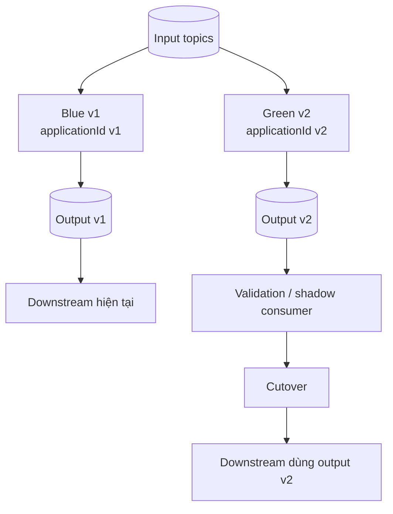

# Đổi applicationId, reset ứng dụng và nâng cấp topology an toàn

## Mục tiêu

Kafka Streams duy trì tiến độ đọc, task assignment, state store và các topic nội bộ theo danh tính của ứng dụng. Trong Spring Cloud Stream Kafka Streams binder, thuộc tính `applicationId` xác định logical application chạy topology. Nó đồng thời tham gia vào consumer group và quy tắc đặt tên các internal topic như changelog hoặc repartition topic.

Khi đổi code topology, đổi schema state store, đổi key hoặc muốn chạy lại dữ liệu từ đầu, cần chọn đúng chiến lược. **Đổi applicationId**, **reset một ứng dụng hiện tại** và **nâng cấp topology giữ nguyên trạng thái** là ba thao tác khác nhau. Nhầm lẫn giữa chúng có thể tạo một consumer group mới ngoài ý muốn, xử lý lại toàn bộ dữ liệu, ghi trùng output hoặc làm mất khả năng khôi phục state.

Bài học này hướng dẫn cách quản lý vòng đời Kafka Streams trong production: giữ applicationId ổn định khi cần tiếp tục state, tạo applicationId mới khi cần một logical application độc lập, reset có kiểm soát bằng công cụ Kafka Streams và nâng cấp topology theo cách có thể rollback.

Sau bài học, bạn có thể:

- Giải thích vai trò của applicationId đối với consumer group và internal topics.
- Phân biệt đổi applicationId với reset ứng dụng hiện tại.
- Hiểu tác động của auto.offset.reset khi một applicationId mới chưa có committed offsets.
- Sử dụng Kafka Streams application reset tool theo quy trình an toàn.
- Nhận diện topology changes có thể giữ state và thay đổi cần rebuild.
- Chọn giữa nâng cấp tại chỗ và blue-green bằng applicationId mới.
- Quản lý state directory, changelog, repartition topics và output topics.
- Kiểm thử replay, duplicate, state restoration và cutover trước khi triển khai.

## 1. applicationId là danh tính của một Kafka Streams application

Kafka Streams dùng application ID để nhận diện một logical stream processing application. Trong Spring Cloud Stream Kafka Streams binder, có thể cấu hình application ID ở cấp binder:

    spring:
      cloud:
        function:
          definition: enrichOrders
        stream:
          bindings:
            enrichOrders-in-0:
              destination: orders.created
            enrichOrders-out-0:
              destination: orders.enriched
          kafka:
            streams:
              binder:
                applicationId: orders-enricher-prod-v1
                configuration:
                  auto.offset.reset: earliest
                  state.dir: /var/lib/kafka-streams

Ở ví dụ này:

- `enrichOrders` là function tạo Kafka Streams topology.
- `orders.created` là input topic.
- `orders.enriched` là output topic.
- `orders-enricher-prod-v1` là applicationId của logical application.
- `auto.offset.reset` quy định cách bắt đầu đọc khi group chưa có offset phù hợp.
- `state.dir` là thư mục local lưu state của Kafka Streams trên instance.

Application ID có một số vai trò:

1. Được dùng làm consumer group ID cho Kafka Streams application.
2. Là tiền tố trong tên các internal topics do Kafka Streams tạo, ví dụ changelog và repartition topics.
3. Gắn với task assignment, tiến độ đọc và quá trình phục hồi state.
4. Giúp Kafka Streams phân biệt các ứng dụng độc lập dù chúng đọc cùng input topics.

Application ID không phải tên function, tên output binding hay tên Kubernetes pod. Hãy chọn một giá trị ổn định, có ý nghĩa và duy nhất trong phạm vi các logical application cần chạy độc lập.

### Các replica của cùng ứng dụng dùng chung applicationId

Nếu một topology chạy ba replica để chia task, cả ba replica phải dùng cùng applicationId:

    orders-enricher instance 1 -> orders-enricher-prod-v1
    orders-enricher instance 2 -> orders-enricher-prod-v1
    orders-enricher instance 3 -> orders-enricher-prod-v1

Kafka Streams xem chúng là thành viên của cùng logical application và phân phối task giữa các instance. Không gắn pod ID hoặc UUID ngẫu nhiên vào applicationId của từng replica; làm vậy sẽ tạo nhiều ứng dụng/consumer group độc lập, mỗi ứng dụng có thể đọc lại toàn bộ input.

Nếu cần hai topology độc lập cùng đọc một topic, chúng phải có applicationId khác nhau. Mỗi application có offset, state store và internal topics riêng.

## 2. applicationId liên kết với consumer group và internal topics

ApplicationId tác động đến nhiều thành phần runtime:

| Thành phần | Quan hệ với applicationId |
|---|---|
| Consumer group | ApplicationId xác định group quản lý input offsets và task membership |
| Changelog topic | Tên internal topic thường chứa applicationId và tên store |
| Repartition topic | Tên internal topic thường chứa applicationId và node/repartition identity |
| Task assignment | Các instance cùng applicationId chia sẻ task của topology |
| State restoration | Task phục hồi local state từ changelog thuộc application |
| Local state | Kafka Streams dùng state directory trên từng instance; application/task metadata gắn với app runtime |

Ví dụ một topology có state store tên `orders-by-customer`. Kafka Streams có thể tạo changelog topic có tiền tố applicationId và thông tin store. Tên thực tế phụ thuộc topology và phiên bản Kafka Streams; không nên hardcode tên internal topic trong ứng dụng.

Repartition topic có thể được tạo khi topology cần phân phối lại record theo key mới. Changelog topic ghi thay đổi state để phục hồi. Đây là dữ liệu vận hành nội bộ của topology, không phải output contract dành cho consumer nghiệp vụ.

Không tự ý publish message nghiệp vụ vào internal topic hoặc để một ứng dụng khác phụ thuộc trực tiếp vào tên changelog/repartition topic. Nếu cần chia sẻ kết quả, hãy tạo output binding/topic có contract rõ ràng.

## 3. Giữ applicationId khi muốn tiếp tục trạng thái

Khi triển khai một bản build mới của cùng logical application, thông thường cần giữ nguyên applicationId. Nhờ đó Kafka Streams có thể tiếp tục dùng:

- Consumer group và committed offsets hiện có.
- Internal topics và changelog hiện có.
- State store có thể phục hồi từ local state/changelog.
- Task assignment của cùng logical application.

Ví dụ bản cũ và bản mới cùng dùng:

    spring.cloud.stream.kafka.streams.binder.applicationId=orders-enricher-prod-v1

Nếu topology tương thích với state và internal topics hiện tại, ứng dụng có thể tiếp tục từ tiến độ đã commit. Nhưng giữ nguyên applicationId không làm mọi thay đổi code trở nên an toàn. Nếu thay key, Serde, state store schema, repartition strategy hoặc semantics aggregate, state cũ có thể không còn phù hợp.

Một quy tắc hữu ích:

- Thay đổi xử lý stateless, không làm thay đổi wire contract hoặc cấu trúc state, thường có thể nâng cấp tại chỗ sau khi kiểm thử.
- Thay đổi stateful topology cần đánh giá changelog, store schema, internal topics và khả năng restore.
- Thay đổi không tương thích nên dùng migration/rebuild có kế hoạch, thường thông qua applicationId mới hoặc reset có kiểm soát.

Không đổi applicationId chỉ để ép một lần deploy tạo consumer group mới. Việc đó tạo một logical application mới, không tự động di chuyển state từ application cũ.

## 4. Đổi applicationId tạo ứng dụng mới

Giả sử application hiện tại dùng:

    applicationId: orders-enricher-prod-v1

Nếu đổi thành:

    applicationId: orders-enricher-prod-v2

Kafka Streams xem đây là logical application khác. Ứng dụng mới có:

- Consumer group mới, chưa có committed offsets của group cũ.
- Internal topic namespace mới.
- State store mới, không tự dùng changelog của v1.
- Task assignment độc lập với v1.
- Tiến độ đọc input riêng.

Đổi applicationId không xóa application cũ, không reset offset của group cũ và không xóa internal topics cũ. Nó chỉ tạo danh tính mới. Application v1 và v2 có thể cùng tồn tại nếu hạ tầng và topology cho phép; khi đó cả hai có thể đọc cùng input topics và tiêu thụ tài nguyên riêng.

### auto.offset.reset quyết định điểm bắt đầu cho group mới

Vì group mới chưa có committed offset, Kafka cần một chính sách để xác định điểm bắt đầu:

| Giá trị | Hành vi khi chưa có offset phù hợp |
|---|---|
| `earliest` | Đọc từ record sớm nhất còn được giữ trong mỗi partition |
| `latest` | Bắt đầu từ cuối log tại thời điểm xác lập vị trí đọc |
| `none` | Phát lỗi nếu không tìm được offset phù hợp |

Ví dụ:

    spring:
      cloud:
        stream:
          kafka:
            streams:
              binder:
                applicationId: orders-enricher-prod-v2
                configuration:
                  auto.offset.reset: earliest

Với `earliest`, v2 có thể xử lý lại toàn bộ input còn trong retention. Nếu output binding vẫn ghi vào `orders.enriched`, output có thể trùng với dữ liệu đã được v1 phát. Cần tách output topic, dùng event ID để deduplicate hoặc thiết kế cutover để downstream không nhận đồng thời kết quả của hai phiên bản.

Với `latest`, v2 bỏ qua phần lịch sử trước điểm bắt đầu và chỉ xử lý dữ liệu mới theo offset được xác lập. Cách này không phù hợp nếu state store mới cần dựng lại từ lịch sử để có trạng thái đầy đủ.

`auto.offset.reset` không ghi đè committed offsets đã tồn tại. Nó chỉ được áp dụng khi group không có offset phù hợp, ví dụ một applicationId mới hoặc offset đã bị xóa/hết hiệu lực.

## 5. Khi nào nên đổi applicationId?

Đổi applicationId có ý nghĩa khi cần tạo một logical application độc lập, chẳng hạn:

- Chạy song song v1 và v2 để so sánh kết quả.
- Tạo topology mới với state store/schema không tương thích.
- Rebuild state từ input mà vẫn giữ ứng dụng cũ hoạt động trong giai đoạn chuẩn bị.
- Tách một workload thành hai ứng dụng có vòng đời và tiến độ riêng.
- Thực hiện blue-green deployment có kiểm soát.

Không nên đổi applicationId chỉ vì:

- Pod được thay thế hoặc autoscaling.
- Bản build thay đổi nhưng topology/state vẫn tương thích.
- Muốn restart process sau một lỗi thông thường.
- Muốn xóa backlog hoặc sửa một consumer lag mà chưa điều tra nguyên nhân.
- Muốn tránh xử lý duplicate mà chưa thiết kế idempotency.

Một applicationId mới có thể làm tăng tải đọc, tạo internal topics mới và phát lại nhiều output. Hãy tính capacity của broker, database và downstream trước khi chạy song song hai phiên bản.

## 6. Reset ứng dụng hiện tại khác với đổi applicationId

**Reset** là thao tác đưa một Kafka Streams application hiện tại về một điểm đọc được chọn và loại bỏ trạng thái nội bộ cần được tạo lại. Reset thường giữ nguyên applicationId, nhưng xóa/reset tiến độ và internal state theo phạm vi công cụ reset.

**Đổi applicationId** tạo một logical application mới và để application cũ cùng dữ liệu của nó tồn tại.

| Tiêu chí | Đổi applicationId | Reset application hiện tại |
|---|---|---|
| Logical application | Tạo application mới | Giữ danh tính application hiện tại |
| Consumer group | Group mới | Reset offsets của group được chọn |
| Internal topics | Tạo namespace mới; topic cũ còn lại | Công cụ reset xử lý internal topics của app theo phạm vi hỗ trợ |
| State store | State mới, không tự dùng state cũ | State được dựng lại sau reset |
| Input offsets | Group mới dùng auto.offset.reset nếu chưa có offset | Offset của group hiện tại được đưa về vị trí được chọn |
| Application cũ | Có thể vẫn chạy độc lập | Phải dừng app đang reset |
| Tác động output | Có thể phát lại lịch sử hoặc bắt đầu từ latest | Có thể phát lại input và tạo output trùng |

Reset không phải thao tác restart. Restart bình thường giữ applicationId, committed offsets và state; Kafka Streams khôi phục state nếu cần. Reset chỉ nên dùng khi chủ động muốn xây lại tiến độ/state hoặc sửa trạng thái vận hành sau khi đã xác định nguyên nhân.

## 7. Công cụ kafka-streams-application-reset

Kafka cung cấp công cụ `kafka-streams-application-reset.sh` để reset một Kafka Streams application. Công cụ này có thể reset input consumer group offsets và xóa các internal topics thuộc application theo các tùy chọn hỗ trợ của phiên bản Kafka.

Ví dụ chạy kiểm tra trước (dry run):

    bin/kafka-streams-application-reset.sh --application-id orders-enricher-prod-v1 --bootstrap-servers kafka-1:9092,kafka-2:9092 --input-topics orders.created,orders.updated --dry-run

Ví dụ chỉ minh họa cú pháp phổ biến. Tùy phiên bản Kafka, có thể có thêm tùy chọn chọn offset đích, intermediate topics hoặc chế độ thực thi. Trước khi chạy trong production, đọc `--help` của đúng Kafka distribution và xác nhận option có sẵn; không sao chép lệnh từ một phiên bản khác mà chưa kiểm tra.

### Công cụ reset tác động gì?

Tùy phiên bản và option được chọn, reset tool có thể:

- Reset committed offsets của application consumer group trên các input topics đã chỉ định.
- Xóa các internal topics của application như changelog và repartition topics theo phạm vi công cụ hỗ trợ.
- Đưa ứng dụng về trạng thái có thể đọc lại input và dựng lại state.
- Cho phép chọn điểm bắt đầu như earliest hoặc offset/time cụ thể nếu tool version hỗ trợ.

Công cụ reset **không phải công cụ xóa output topic nghiệp vụ**. Các output records đã được phát trước đó vẫn có thể tồn tại. Nếu reset rồi chạy lại từ đầu, ứng dụng có thể phát các output tương tự lần nữa.

Reset tool cũng không thay thế việc quản lý local state directory trên từng instance. Sau khi dừng ứng dụng, hãy kiểm tra hướng dẫn của Kafka Streams version đang dùng và quy trình vận hành để xử lý local state cũ nếu cần. Chỉ xóa đúng thư mục state của application/instance đã xác định; không xóa thư mục dùng chung hoặc state của ứng dụng khác.

### Điều kiện bắt buộc trước reset

1. Dừng toàn bộ instance của application có applicationId cần reset.
2. Xác nhận không còn instance cũ tự khởi động lại bởi autoscaler hoặc orchestrator.
3. Xác định chính xác applicationId và cluster bootstrap servers.
4. Liệt kê đầy đủ input topics của topology.
5. Xác định internal/repartition topics liên quan và các option reset của Kafka version.
6. Chạy dry run, lưu lại danh sách hành động.
7. Đánh giá tác động đến output topics, downstream consumer và duplicate.
8. Có backup hoặc kế hoạch rebuild/reconciliation cho dữ liệu quan trọng.
9. Chỉ thực thi sau khi owner xác nhận đúng cluster, đúng application và đúng điểm reset.
10. Khởi động lại application và theo dõi state restoration, lag và output.

Không chạy reset tool trong khi application vẫn hoạt động. Consumer có thể tiếp tục commit offsets, tạo internal topics mới hoặc ghi state trong lúc tool đang xóa/reset tài nguyên, dẫn đến trạng thái không nhất quán.

## 8. Reset về earliest và replay dữ liệu

Reset về earliest có thể hữu ích khi cần dựng lại state từ lịch sử input. Nhưng kết quả chỉ đầy đủ trong phạm vi dữ liệu còn được lưu trên Kafka.

Ví dụ:

- Topic input có retention 14 ngày.
- Application bị reset về earliest.
- Kafka chỉ còn dữ liệu trong 14 ngày gần nhất.
- State được dựng lại từ phần dữ liệu còn lại, không tự khôi phục được các event đã hết retention.

Nếu state cần toàn bộ lịch sử, cần nguồn dữ liệu có thể replay đầy đủ như event archive, event store hoặc snapshot. Đừng giả định earliest đồng nghĩa với "từ lúc hệ thống bắt đầu".

Trước khi replay, kiểm tra:

- Input topics và partition count.
- Retention/compaction policy.
- Schema và Serde của record cũ.
- Timestamp extractor và window/grace behavior.
- External side effect của topology.
- Output topic có được downstream tiêu thụ ngay không.
- Idempotency và deduplication theo event ID.

Với topology phát email, gọi API thanh toán hoặc cập nhật hệ thống ngoài Kafka, replay có thể lặp lại side effect. Các side effect đó phải được idempotent hoặc tách khỏi quá trình rebuild state.

## 9. Reset state store và changelog

State store được Kafka Streams phục hồi chủ yếu từ changelog topics khi logging được bật. Reset application có thể xóa internal topics, khiến store cần được dựng lại từ input. Đây là một thao tác tốn thời gian với topic lớn hoặc topology nhiều state store.

Một số lưu ý:

- Changelog topic không phải backup độc lập nếu reset tool xóa nó.
- Nếu state store tắt logging, có thể không có changelog để phục hồi; cần xác định cách rebuild.
- Local state directory có thể còn dữ liệu cũ sau khi reset broker-side.
- Store name, Serde và schema phải tương thích với topology đang chạy.
- Repartition topics có thể cần được tạo lại khi topology xử lý lại input.
- State restoration có thể làm ứng dụng chưa sẵn sàng phục vụ query trong một khoảng thời gian.

Không xóa riêng changelog topic để ép Kafka Streams tạo state mới khi chưa hiểu quan hệ với applicationId và topology. Dùng reset procedure được tài liệu hóa và kiểm tra trạng thái sau đó.

## 10. Nâng cấp topology: phân loại thay đổi trước khi triển khai

Không phải mọi thay đổi topology đều cần reset. Trước khi deploy, phân loại thay đổi:

| Thay đổi | Rủi ro chính | Hướng xử lý |
|---|---|---|
| Sửa log/metric hoặc code không đổi kết quả topology | Thấp | Có thể nâng cấp tại chỗ sau kiểm thử |
| Thay đổi logic stateless map/filter | Output mới khác với bản cũ; dữ liệu lịch sử không tự chạy lại | Giữ appId nếu topology tương thích; replay riêng nếu cần tính lại lịch sử |
| Thêm state store/aggregate mới | Store mới chỉ nhận record từ tiến độ hiện tại, thiếu lịch sử trước đó | Backfill/replay hoặc appId mới để dựng state đầy đủ |
| Đổi key hoặc partitioning | Repartition và ordering có thể thay đổi | Migration có kế hoạch, thường rebuild topology/state |
| Đổi Serde/schema của state store | Changelog/local state cũ có thể không đọc được | Schema migration hoặc state rebuild |
| Đổi tên store | State identity/changelog có thể thay đổi | Xem như migration state; xác định giữ hay rebuild |
| Đổi window, grace hoặc aggregate semantics | Kết quả state cũ không còn cùng ý nghĩa | Rebuild hoặc chạy topology version mới |
| Đổi input/output topics | Offset, routing và downstream contract thay đổi | Migration binding/topic có kế hoạch |
| Đổi topology repartition/join | Internal topics và task graph có thể thay đổi | Integration test và rollout phối hợp |

Một topology mới có thể chạy từ offset hiện tại và tạo state mới chỉ từ các event tương lai. Điều đó có thể hợp lệ nếu nghiệp vụ chỉ quan tâm dữ liệu mới; nhưng nếu state phải phản ánh lịch sử, cần backfill hoặc rebuild.

## 11. Nâng cấp tại chỗ với applicationId giữ nguyên

Nâng cấp tại chỗ phù hợp khi topology và state compatibility đã được xác nhận. Quy trình tổng quát:

1. Ghi nhận applicationId, topology hiện tại, input/output topics và internal topics.
2. Xác định state store, key/value Serde, schema và retention.
3. Kiểm thử bản mới với dữ liệu đại diện và state cũ đã tồn tại.
4. Xác định có cho phép old/new instances chạy đồng thời trong cùng group hay không.
5. Nếu topology thay đổi không tương thích, dừng toàn bộ phiên bản cũ trước khi start phiên bản mới.
6. Triển khai bản mới với cùng applicationId và cấu hình tương thích.
7. Chờ task assignment và state restoration hoàn tất.
8. Xác minh committed offsets, consumer lag, store query và output.
9. Giữ phương án rollback tương thích với state đã được ghi bởi bản mới.

### Không rolling deploy mù quáng khi topology khác nhau

Các instance cùng applicationId là thành viên của một logical application. Trong rolling deployment, instance cũ và mới có thể cùng tham gia group trong một khoảng thời gian. Nếu topology/state-store definitions không tương thích, việc trộn phiên bản có thể gây lỗi assignment, internal topic hoặc state restoration.

Nếu thay đổi topology ảnh hưởng state hoặc internal topic, dùng coordinated stop-and-start hoặc chiến lược blue-green với applicationId mới. Không để hai phiên bản topology không tương thích cùng chia task chỉ vì orchestrator đang rolling update theo mặc định.

### Rollback cũng cần tương thích state

Nếu bản mới đã ghi state/changelog theo schema hoặc semantics mới, quay lại binary cũ có thể không đọc được state. Trước khi deploy, xác định rollback có thể giữ state hay phải reset/rebuild. Đối với thay đổi không tương thích, blue-green với applicationId mới giúp giữ app cũ và state cũ trong thời gian cutover, nhưng cần tách output để tránh duplicate.

## 12. Blue-green bằng applicationId mới

Blue-green tạo một logical application mới song song với bản cũ:

- Blue: applicationId hiện tại, ví dụ `orders-enricher-prod-v1`.
- Green: applicationId mới, ví dụ `orders-enricher-prod-v2`.

Hai ứng dụng có group, state store và internal topics riêng. Cả hai có thể đọc cùng input topics. Cách này cho phép so sánh output và kiểm tra state mới trước khi chuyển downstream sang phiên bản mới.

Sơ đồ:

### Quy trình blue-green

1. Giữ blue đang phục vụ và ghi nhận baseline output/lag.
2. Deploy green với applicationId mới và internal topic namespace riêng.
3. Chọn offset reset policy có chủ đích: earliest để rebuild từ retained history, latest để chỉ xử lý dữ liệu mới.
4. Nếu green cần state đầy đủ, cho chạy replay/backfill và chờ restoration/catch-up.
5. Ghi output green vào topic riêng hoặc môi trường shadow.
6. So sánh count, aggregate, key distribution, latency và kết quả nghiệp vụ giữa blue/green.
7. Xác nhận green đạt tiêu chí và downstream đã sẵn sàng.
8. Chuyển consumer/downstream sang output green theo kế hoạch.
9. Dừng blue sau khi hoàn tất cutover và thời gian quan sát.
10. Giữ state/output blue theo retention để rollback trong thời hạn đã định.

Không để blue và green cùng ghi vào một output topic mà downstream không có cơ chế phân biệt version. Nếu cả hai cùng phát cùng event, downstream có thể xử lý hai lần. Dùng output topic riêng, header/version rõ ràng hoặc deduplication theo event ID.

### Cutover và rollback

Cutover cần có một điểm chuyển quyền rõ ràng. Ví dụ, đổi downstream binding từ `orders.enriched.v1` sang `orders.enriched.v2` sau khi green đã catch up. Nếu dùng một topic chung, cần cơ chế kiểm soát producer ownership hoặc event version để tránh hai application cùng phát bản sao.

Nếu green lỗi, chuyển downstream về blue và dừng green theo kế hoạch. Không xóa internal topics của green ngay nếu cần điều tra. Nếu đã phát output green vào hệ thống ngoài, rollback ứng dụng không tự đảo ngược side effect; cần reconciliation hoặc compensation theo nghiệp vụ.

## 13. Thay đổi applicationId và reset trong cấu hình Spring Cloud Stream

Một cấu hình production có thể tách applicationId theo môi trường bằng externalized configuration:

    spring:
      cloud:
        stream:
          kafka:
            streams:
              binder:
                applicationId: orders-enricher-prod-v1
                configuration:
                  auto.offset.reset: earliest
                  state.dir: /var/lib/kafka-streams

Trong deployment, giá trị applicationId nên đến từ cấu hình môi trường/secret/config management, nhưng phải giữ ổn định cho mọi replica của cùng logical application. Ví dụ dev, staging và production cần applicationId khác nhau để không chia sẻ group hoặc internal topics ngoài ý muốn.

Khi tạo v2, thay applicationId một cách có chủ đích:

    spring:
      cloud:
        stream:
          kafka:
            streams:
              binder:
                applicationId: orders-enricher-prod-v2
                configuration:
                  auto.offset.reset: earliest
                  state.dir: /var/lib/kafka-streams

Đường dẫn state.dir cần được quản lý theo instance và quyền truy cập. Không cho nhiều replica độc lập ghi chung một local state directory. Nếu dùng persistent volume, mỗi instance cần mount phù hợp và tránh gắn nhầm state cũ của application khác.

Đối với Kafka Streams binder, hãy kiểm tra đúng namespace property của phiên bản Spring Cloud Stream đang sử dụng. `applicationId` là binder property; `auto.offset.reset` và `state.dir` là Kafka Streams configuration. Đừng đặt chúng nhầm vào regular Kafka message binder namespace.

## 14. Internal topics, partition count và schema compatibility

Topology có thể tạo internal topics cho changelog và repartition. Khi nâng cấp, kiểm tra:

- Internal topic names có tiếp tục tương thích với topology hiện tại không.
- Partition count của changelog/repartition có phù hợp với input partitions và task layout không.
- Replication factor và broker defaults có đáp ứng production không.
- Cleanup policy của changelog phù hợp với state restoration.
- Retention/compaction không làm mất dữ liệu cần phục hồi.
- ACL cho applicationId mới cho phép tạo/đọc/ghi internal topics.
- Serde của key/value và schema changelog còn tương thích.

Thay đổi số partition input có thể thay đổi số task và cách phân vùng state. Thay đổi key hoặc partitioner có thể khiến cùng một aggregate chuyển sang partition khác. State cũ có thể cần repartition/rebuild; không giả định Kafka Streams tự di chuyển mọi dữ liệu nghiệp vụ theo ý muốn.

Nếu schema state thay đổi, hãy xác định có thể đọc state cũ bằng deserializer mới hay không. Nếu không, chọn migration strategy: tạo store mới, backfill, chạy appId mới hoặc reset/rebuild sau khi đã có nguồn dữ liệu đầy đủ.

## 15. State directory và vòng đời local state

Kafka Streams dùng local state directory để lưu state store trên từng instance. Thư mục này là cache/state cục bộ của task, không phải nguồn sự thật duy nhất. Changelog topics hỗ trợ phục hồi khi instance mất local disk hoặc task chuyển sang instance khác.

Các nguyên tắc vận hành:

- Mỗi instance cần state directory riêng, có quyền ghi và dung lượng phù hợp.
- Tránh chia sẻ cùng thư mục cho nhiều instance độc lập.
- Dùng persistent volume khi cần giảm thời gian restore sau restart, nhưng phải quản lý ownership và lifecycle.
- Không xóa state directory khi application còn chạy.
- Khi reset hoặc đổi appId, xác định state directory nào thuộc application/instance cần xử lý.
- Theo dõi dung lượng disk, RocksDB files, restore time và lỗi local state.

Đổi applicationId tạo logical state namespace mới, nhưng local directory có thể vẫn chứa dữ liệu cũ. Dùng state directory được quản lý rõ ràng và kiểm tra cách Kafka Streams tạo subdirectory theo application/task. Không xóa thủ công cả thư mục cha nếu nó chứa state của nhiều ứng dụng.

## 16. Kiểm thử topology upgrade trước production

Một topology upgrade cần kiểm tra cả logic và state compatibility.

### Kiểm thử giữ applicationId

- Tạo dữ liệu input và để topology cũ materialize state.
- Dừng ứng dụng theo graceful shutdown.
- Khởi động phiên bản mới với cùng applicationId.
- Xác minh state restore từ changelog/local state.
- Xác minh offset tiếp tục từ tiến độ đã commit.
- Gửi record mới và kiểm tra kết quả.
- Nếu thay Serde/schema, kiểm tra đọc được state cũ.
- Kiểm tra rebalance và output trong thời gian chuyển phiên bản.

### Kiểm thử applicationId mới

- Chạy bản mới với applicationId mới.
- Xác minh consumer group và internal topics riêng.
- Thử `earliest` và `latest` trên môi trường test để thấy khác biệt.
- Xác minh replay không tạo side effect không kiểm soát.
- Kiểm tra state store được dựng lại và query đúng.
- Xác minh output v2 được tách khỏi output v1.

### Kiểm thử reset

- Chạy reset tool ở chế độ dry-run và kiểm tra danh sách tác động.
- Dừng tất cả instance trước reset.
- Reset trên một Kafka cluster thử nghiệm với đúng applicationId/input topics.
- Xác minh offsets đã được đưa về điểm mong muốn.
- Xác minh internal topics được xử lý theo option của tool.
- Khởi động lại và quan sát state restoration/replay.
- Xác minh output topics cũ không bị xóa và duplicate được xử lý.

### Kiểm thử rollback

- Triển khai topology mới có state schema thay đổi.
- Tạo state mới và output.
- Thử rollback về binary cũ trong môi trường test.
- Xác minh binary cũ đọc được state mới hay cần giữ appId/state cũ riêng.
- Kiểm tra cutover downstream và reconciliation.

Test Binder giúp xác minh wiring/function ở mức Spring Cloud Stream, nhưng không thay thế Kafka integration test cho consumer group, internal topics, state restoration, reset tool và offset behavior. Dùng Kafka broker test hoặc môi trường staging tương đương production.

## 17. Giám sát sau deploy, reset hoặc cutover

Theo dõi các tín hiệu sau:

| Chỉ số | Điều cần quan sát |
|---|---|
| Consumer group lag | Ứng dụng có bắt kịp input sau replay/upgrade không |
| Rebalance count/duration | Group có ổn định sau khi thêm/bớt instance không |
| State restoration duration | Task mất bao lâu để phục hồi store |
| Changelog/repartition traffic | Internal topics có hoạt động và đủ capacity không |
| State store query availability | Interactive Query chỉ phục vụ khi store sẵn sàng |
| Processing throughput | Bản mới có đạt throughput yêu cầu không |
| Output duplicate rate | Replay hoặc chạy song song có tạo event trùng không |
| Deserialization/restore errors | Schema/Serde cũ có tương thích không |
| Disk usage/state directory | Local state có tăng bất thường hoặc hết dung lượng không |
| Out-of-sync result | Blue/green có chênh lệch aggregate hoặc event count không |

Đặt readiness condition để ứng dụng chỉ nhận traffic/query khi topology đã ở trạng thái phù hợp. Liveness không nên restart liên tục chỉ vì state restoration đang diễn ra bình thường; readiness và liveness cần phản ánh hai mục đích khác nhau.

Khi lag tăng sau reset về earliest, có thể đó là replay backlog dự kiến. So sánh tốc độ xử lý với tốc độ producer để xác định thời gian catch-up. Nếu processing rate không vượt input rate, ứng dụng sẽ không bao giờ bắt kịp.

## 18. Các lỗi thường gặp

| Triệu chứng | Nguyên nhân có thể | Cách xử lý |
|---|---|---|
| Mỗi pod xử lý toàn bộ input | Mỗi replica dùng applicationId khác nhau | Dùng chung applicationId cho replica cùng topology |
| Đổi applicationId nhưng state rỗng | App mới có internal topics/store riêng | Replay/backfill hoặc migration state có chủ đích |
| App mới đọc lại toàn bộ dữ liệu | Group mới dùng auto.offset.reset=earliest | Đánh giá retention, output duplicate và chọn offset policy |
| App mới bỏ qua lịch sử | Group mới dùng latest | Chỉ dùng khi state không cần lịch sử hoặc đã có snapshot |
| Reset xong vẫn thấy state cũ | Local state directory còn dữ liệu hoặc reset chưa đúng app | Dừng app, xác minh appId/state dir và reset procedure |
| Output bị phát trùng sau reset | Replay input tạo lại output cũ | Dùng output version riêng và consumer idempotency |
| Topology mới không restore state | Store name/Serde/schema/changelog không tương thích | Migration/rebuild với appId hoặc store version mới |
| Rolling deploy gây lỗi task | Old/new topology không tương thích cùng group | Coordinated stop/start hoặc blue-green |
| Reset tool xóa nhầm dữ liệu | Sai cluster, appId hoặc input/intermediate topic list | Dry-run, review và xác nhận môi trường trước execute |
| Ứng dụng không tạo internal topic | ACL/provisioning policy không cho phép | Cấp quyền hoặc provision theo IaC |
| State restoration kéo dài | Changelog lớn, disk chậm hoặc nhiều task | Đo restore, tối ưu state và capacity |
| Rollback binary cũ không đọc state mới | Schema/state semantics đã thay đổi | Giữ appId/state version riêng hoặc rebuild tương thích |

## 19. Quy trình ra quyết định

Trước khi thay đổi applicationId hoặc topology, hãy trả lời theo thứ tự:

1. Đây có phải cùng một logical application hay cần một application độc lập?
2. Có cần giữ committed offsets và state store hiện tại không?
3. Thay đổi topology có làm đổi key, Serde, store schema, window hoặc repartition không?
4. State mới có thể được tính từ dữ liệu tương lai hay phải dựng lại lịch sử?
5. Nếu tạo applicationId mới, chọn earliest hay latest và output sẽ được tách thế nào?
6. Nếu reset, toàn bộ instance đã dừng chưa và dry-run đã được review chưa?
7. Internal topics, changelog, local state directory và ACL đã được kiểm tra chưa?
8. Downstream có chịu được duplicate hoặc chạy song song v1/v2 không?
9. Có kế hoạch cutover, rollback và reconciliation không?
10. Integration test đã chứng minh state restore, replay và output đúng chưa?

Một quyết định rõ ràng nên được ghi thành runbook: applicationId cũ/mới, cluster, input/output topics, reset options, state directory, expected replay volume, owner phê duyệt và điều kiện rollback.

## Kết luận

ApplicationId là danh tính của Kafka Streams application, gắn với consumer group, task assignment và namespace của internal topics. Giữ applicationId khi muốn tiếp tục tiến độ/state của cùng logical application. Đổi applicationId khi cần một ứng dụng độc lập hoặc blue-green topology; group mới sẽ áp dụng auto.offset.reset nếu chưa có committed offsets và không tự dùng state của application cũ.

Reset application hiện tại là thao tác khác: dừng toàn bộ instance, chạy reset tool với đúng applicationId/input topics, review dry-run và hiểu tác động đến offsets/internal topics/local state trước khi thực thi. Output topics nghiệp vụ không tự bị xóa và replay có thể tạo duplicate.

Khi nâng cấp topology, phân loại thay đổi theo tác động đến state, key, Serde, schema và internal topics. Dùng nâng cấp tại chỗ khi tương thích đã được chứng minh; dùng coordinated migration hoặc blue-green với applicationId mới cho thay đổi không tương thích. Luôn kiểm thử state restoration, replay, output, rollback và downstream cutover trên Kafka trước khi triển khai production.

