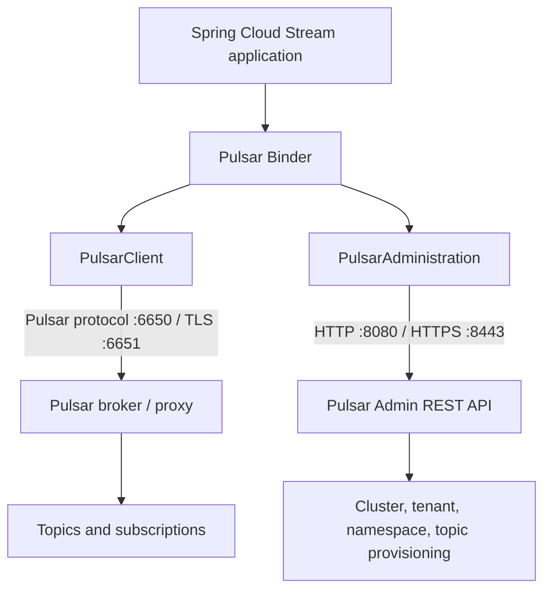

# Kết nối Pulsar service URL và administration URL

Spring Cloud Stream Pulsar Binder sử dụng Apache Pulsar thông qua hai client có nhiệm vụ khác nhau. `PulsarClient` kết nối tới broker để publish và consume message bằng giao thức Pulsar. `PulsarAdministration` gọi HTTP API để xem hoặc thay đổi metadata cluster, tenant, namespace và topic; binder dùng client này trong quá trình provision destination.

Vì vậy, ứng dụng thường cần cấu hình hai địa chỉ riêng:

- **Service URL**: địa chỉ giao thức Pulsar, thường có dạng `pulsar://host:6650` hoặc `pulsar+ssl://host:6651`.
- **Administration URL**: địa chỉ HTTP API, thường có dạng `http://host:8080` hoặc `https://host:8443`.

Hai địa chỉ có thể trỏ tới cùng cụm Pulsar nhưng dùng listener, cổng, giao thức, quyền truy cập và đường mạng khác nhau. Cấu hình đúng service URL chưa chứng minh admin API có thể truy cập; ngược lại, admin URL hoạt động không có nghĩa producer/consumer kết nối được broker.

## 1. Phân biệt hai endpoint

| Endpoint | Client sử dụng | Giao thức | Công việc chính |
|---|---|---|---|
| Pulsar service URL | `PulsarClient` | Pulsar binary protocol qua TCP | Lookup broker, tạo producer/consumer, gửi và nhận message |
| Pulsar administration URL | `PulsarAdministration` / `PulsarAdmin` | HTTP hoặc HTTPS REST API | Đọc metadata và quản lý cluster, tenant, namespace, topic, partition, permission |



Service URL không phải URL của Pulsar Manager UI. Administration URL cũng không phải địa chỉ broker binary. Không đổi hai giá trị cho nhau chỉ vì chúng cùng trỏ tới một hostname.

## 2. Cấu hình service URL

Spring for Apache Pulsar tự cấu hình `PulsarClient` khi ứng dụng có starter/binder tương ứng. Thuộc tính Spring Boot thông dụng là `spring.pulsar.client.service-url`.

Ví dụ chạy Pulsar local không bật TLS:

```yaml
spring:
  pulsar:
    client:
      service-url: pulsar://localhost:6650
```

Giá trị mặc định thường dùng trong môi trường local là `pulsar://localhost:6650`. Trong môi trường container hoặc Kubernetes, `localhost` chỉ trỏ tới chính container/pod của ứng dụng. Hãy dùng DNS/service name mà workload có thể phân giải, ví dụ `pulsar-broker.messaging.svc.cluster.local:6650`, hoặc địa chỉ proxy/load balancer do nền tảng cung cấp.

### 2.1. Chọn scheme và port

| Scheme | Mục đích | Port thường gặp |
|---|---|---:|
| `pulsar://` | Kết nối broker không mã hóa TLS | `6650` |
| `pulsar+ssl://` | Kết nối broker có TLS | `6651` |

Port là giá trị thường gặp, không phải quy tắc bắt buộc. Cluster có thể đổi port hoặc chỉ expose TLS. Scheme phải khớp listener của broker/proxy. Nếu dùng `pulsar+ssl://`, broker phải bật TLS và client phải tin cậy chứng chỉ theo chính sách môi trường.

Ví dụ:

```yaml
spring:
  pulsar:
    client:
      service-url: pulsar+ssl://pulsar.example.internal:6651
```

Pulsar client có thể nhận địa chỉ ban đầu từ service URL rồi thực hiện lookup để kết nối tới broker sở hữu topic. Vì vậy, trong cluster có nhiều broker, không chỉ kiểm tra được cổng của URL ban đầu; các địa chỉ broker được quảng bá (advertised listeners) cũng phải phân giải được và truy cập được từ mạng của ứng dụng. Một proxy Pulsar có thể giúp cung cấp một điểm vào ổn định, nhưng cần cấu hình đúng theo kiến trúc của cluster.

## 3. Cấu hình administration URL

Administration client gọi REST API của Pulsar. Trong các phiên bản Spring Boot/Spring for Apache Pulsar hiện hành, thuộc tính phổ biến là `spring.pulsar.admin.service-url`:

```yaml
spring:
  pulsar:
    admin:
      service-url: http://localhost:8080
```

Administration URL thường dùng `http://localhost:8080` trong môi trường local. Khi triển khai có TLS, dùng `https://` và cổng web TLS mà cluster expose, thường là `8443`:

```yaml
spring:
  pulsar:
    admin:
      service-url: https://pulsar.example.internal:8443
```

**Lưu ý tương thích phiên bản:** một số tài liệu Spring Cloud Stream Pulsar Binder và Spring for Apache Pulsar phiên bản cũ dùng prefix `spring.pulsar.administration.service-url`. Các phiên bản Spring Boot/Spring Pulsar mới hơn công bố prefix rút gọn `spring.pulsar.admin.service-url`. Hãy dùng đúng tên property được hỗ trợ bởi dependency version mà Spring Cloud BOM của dự án quản lý; không đặt cả hai prefix để đoán property nào có hiệu lực. Xem configuration metadata và tài liệu của đúng release train trước khi triển khai.

Administration URL là địa chỉ REST API, không phải địa chỉ trang quản trị web. Ví dụ `http://pulsar.example:8080` là base URL API; giao diện Pulsar Manager, nếu có, là một dịch vụ riêng.

## 4. Cấu hình hai URL trong một ứng dụng

Ví dụ local với một topic orders:

```yaml
spring:
  pulsar:
    client:
      service-url: pulsar://localhost:6650
    admin:
      service-url: http://localhost:8080
  cloud:
    function:
      definition: processOrder
    stream:
      bindings:
        processOrder-in-0:
          destination: persistent://public/default/orders.created
          group: inventory-service
          content-type: application/json
```

`processOrder-in-0` là input binding của function `processOrder`. Destination ở ví dụ dùng tên topic đầy đủ theo dạng `persistent://tenant/namespace/topic`. Service URL được dùng cho việc nhận message; administration URL được dùng khi binder cần thao tác provisioning topic. `group` là cấu hình consumer của Spring Cloud Stream/Pulsar Binder; subscription name và subscription type thực tế cần được kiểm tra theo cấu hình binder tương ứng.

Trong Spring Cloud Stream, các thuộc tính kết nối Pulsar nằm ở Spring Boot/Spring Pulsar autoconfiguration. Các thuộc tính binder như producer, consumer hoặc partition count có thể được đặt ở cấp binder hay binding. Không nhầm `spring.cloud.stream.pulsar.binder.*` với `spring.pulsar.client.service-url`: chúng có phạm vi khác nhau.

## 5. Administration URL được dùng khi nào?

Pulsar Binder có topic provisioner. Khi ứng dụng khởi tạo binding, provisioner kiểm tra destination và có thể tạo topic nếu topic chưa tồn tại. Binder sử dụng `PulsarAdministration` để thực hiện các thao tác quản trị này. Vì thế, administration URL cần chính xác nếu ứng dụng phải provision topic và không chạy trên endpoint mặc định.

Provisioner có thể tạo topic không phân vùng cơ bản khi topic chưa tồn tại. Khi cần partitioned topic, có thể đặt số partition ở cấp binder:

```yaml
spring:
  cloud:
    stream:
      pulsar:
        binder:
          partition-count: 6
```

Hoặc cấu hình riêng theo binding:

```yaml
spring:
  cloud:
    stream:
      pulsar:
        bindings:
          publishOrder-out-0:
            producer:
              partition-count: 6
```

Property prefix và vị trí binding phải khớp phiên bản Pulsar Binder đang dùng. Cấu hình cấp binder áp dụng cho các topic mà ứng dụng provision theo mặc định; cấu hình extended binding cho phép mỗi binding có số partition riêng. Nếu topic đã được nền tảng tạo trước, hãy xác nhận partition count thực tế và quyền admin cần thiết; đừng dựa vào service URL để suy ra topic đã tồn tại.

Administration client có thể cần quyền để đọc metadata và tạo topic/partition. Nếu service URL kết nối được nhưng admin URL sai hoặc admin principal thiếu quyền, ứng dụng có thể thất bại lúc khởi tạo binding dù broker vẫn hoạt động. Ngược lại, nếu chỉ dùng topic đã có và cấu hình triển khai không cần thao tác provision, nhu cầu gọi admin API có thể khác; kiểm tra log và hành vi provisioner của phiên bản đang dùng.

## 6. Đặt URL theo từng môi trường

Không hard-code địa chỉ production vào source. Dùng biến môi trường, profile hoặc config store để cung cấp endpoint theo môi trường.

Ví dụ `application-prod.yml`:

```yaml
spring:
  pulsar:
    client:
      service-url: ${PULSAR_SERVICE_URL}
    admin:
      service-url: ${PULSAR_ADMIN_URL}
```

Giá trị môi trường có thể là:

```text
PULSAR_SERVICE_URL=pulsar+ssl://pulsar-broker.prod.internal:6651
PULSAR_ADMIN_URL=https://pulsar-admin.prod.internal:8443
```

Tên host và port chỉ minh họa. Lấy endpoint thực tế từ nhóm nền tảng, đồng thời xác nhận DNS, route, firewall, network policy và TLS trust chain từ đúng nơi ứng dụng chạy.

| Môi trường | Service URL ví dụ | Administration URL ví dụ |
|---|---|---|
| Local standalone | `pulsar://localhost:6650` | `http://localhost:8080` |
| Docker Compose | `pulsar://pulsar:6650` | `http://pulsar:8080` |
| Kubernetes | `pulsar://pulsar-broker.messaging.svc:6650` | `http://pulsar-broker.messaging.svc:8080` |
| Production TLS | `pulsar+ssl://broker.example:6651` | `https://admin.example:8443` |

Trong Docker Compose/Kubernetes, dùng hostname của service trong cùng network/namespace phù hợp. Không dùng `localhost` từ application container để kết nối sang container Pulsar khác.

## 7. Bảo mật và xác thực

Service client và admin client đều có thể cần xác thực. Cần phân biệt quyền publish/consume với quyền quản trị:

- Client runtime cần quyền produce trên topic output và consume trên topic/subscription input.
- Admin client cần quyền đọc metadata và các quyền quản lý topic/namespace nếu binder provision tài nguyên.
- Không cấp superuser cho ứng dụng chỉ để tránh lỗi provisioning; dùng role/service account với quyền tối thiểu.
- Nếu nền tảng cấp credential riêng cho admin và client, cấu hình đúng từng client theo phiên bản Spring Pulsar.

Ví dụ token authentication cho client:

```yaml
spring:
  pulsar:
    client:
      service-url: pulsar+ssl://pulsar.example.internal:6651
      authentication:
        plugin-class-name: org.apache.pulsar.client.impl.auth.AuthenticationToken
        param:
          token: ${PULSAR_CLIENT_TOKEN}
```

Nếu admin client cần token hoặc OAuth credential riêng, cấu hình authentication dưới namespace admin/administration tương ứng với version đang dùng. Trong các bản Spring Boot hiện hành, nhóm thuộc tính thường là `spring.pulsar.admin.authentication`; các bản cũ có thể dùng `spring.pulsar.administration.authentication`. Không ghi token trực tiếp vào Git, log hoặc file cấu hình chia sẻ.

### 7.1. TLS cho cả hai đường kết nối

Khi bật TLS, cần kiểm tra cả hai client:

| Client | Scheme | Điều cần xác minh |
|---|---|---|
| Pulsar client | `pulsar+ssl://` | TLS broker listener, chứng chỉ server, trust chain và cấu hình client builder |
| Pulsar admin | `https://` | HTTPS web listener, chứng chỉ REST endpoint, trust chain và cấu hình admin builder |

Chỉ đổi scheme không đủ nếu JVM không tin cậy CA hoặc hostname không khớp chứng chỉ. Một số phiên bản Spring Boot/Spring Pulsar yêu cầu `PulsarClientBuilderCustomizer` hoặc `PulsarAdminBuilderCustomizer` để cấu hình TLS chi tiết. Không tắt kiểm tra chứng chỉ trong production để xử lý nhanh lỗi kết nối.

## 8. Tách cấu hình theo phạm vi

Spring Cloud Stream Pulsar Binder sử dụng Spring Boot autoconfiguration của Spring for Apache Pulsar. Do đó, có thể đặt một số thuộc tính Pulsar ở nhiều cấp:

| Cấp cấu hình | Ví dụ prefix | Phạm vi |
|---|---|---|
| Spring Boot client/admin | `spring.pulsar.client.*`, `spring.pulsar.admin.*` | Cấu hình client dùng chung của ứng dụng |
| Binder | `spring.cloud.stream.pulsar.binder.producer.*`, `...consumer.*` | Áp dụng chung cho các binding của binder |
| Extended binding | `spring.cloud.stream.pulsar.bindings.<binding-name>.producer.*` hoặc `.consumer.*` | Cấu hình riêng cho một output/input binding |

Khi cùng một thuộc tính được đặt ở nhiều cấp, extended binding có độ ưu tiên cao hơn binder-level, binder-level cao hơn Spring Boot property theo quy tắc của Pulsar Binder. Service URL và administration URL thường là cấu hình kết nối dùng chung; không đặt khác nhau theo binding nếu ứng dụng chỉ có một Pulsar client/admin context. Nếu cần kết nối nhiều cluster, phải thiết kế nhiều binder/client context riêng và xác định rõ binding nào sử dụng cluster nào.

## 9. Nhiều cluster hoặc nhiều binder

Một ứng dụng có thể cần kết nối nhiều middleware/cluster. Trong trường hợp đó, chỉ đặt một `spring.pulsar.client.service-url` toàn cục sẽ không đủ để mô tả nhiều Pulsar cluster độc lập. Cần khai báo binder configuration riêng theo cơ chế multi-binder của Spring Cloud Stream, mỗi binder có environment/context và cấu hình Spring Pulsar tương ứng.

Trước khi triển khai nhiều cluster, xác định:

- Binding nào publish/consume ở cluster nào.
- Service URL và administration URL của từng cluster.
- Credential và TLS trust riêng cho mỗi cluster.
- Topic, tenant, namespace và subscription tương ứng.
- Quyền provision và ownership của từng cluster.
- Chính sách retry, failover và đối soát khi một cluster mất kết nối.

Không dùng cùng một admin credential có quyền rộng cho mọi cluster nếu có thể cấp quyền riêng. Cấu hình multi-binder cần được kiểm thử để tránh binding vô tình dùng default binder.

## 10. Kiểm tra kết nối từ môi trường chạy ứng dụng

Kiểm tra endpoint từ laptop không đủ nếu ứng dụng chạy trong container hoặc Kubernetes. Hãy chạy kiểm tra trong cùng network namespace hoặc từ một pod chẩn đoán có network policy tương đương.

Các bước gợi ý:

1. Xác nhận service URL có scheme Pulsar hợp lệ và hostname phân giải được.
2. Kiểm tra TCP tới port service (thường 6650 hoặc 6651).
3. Gọi HTTP(S) tới administration base URL; phản hồi `401` hoặc `403` vẫn cho biết đã tới được HTTP server nhưng credential/permission chưa phù hợp.
4. Xác nhận admin API có thể đọc cluster/tenant/namespace theo quyền của ứng dụng.
5. Khởi tạo một binding test tới topic đã tồn tại để xác minh client lookup và consume/produce.
6. Nếu binder phải tạo topic, kiểm tra admin permission và provisioning log.
7. Xác nhận broker advertised addresses trả về từ lookup cũng truy cập được từ ứng dụng.

Ví dụ kiểm tra TCP và HTTP trong môi trường có công cụ tương ứng:

```bash
nc -vz pulsar-broker.example.internal 6650
curl -i https://pulsar-admin.example.internal:8443/admin/v2/clusters
```

Lệnh `curl` có thể trả `401`/`403` nếu chưa gửi credential; điều đó khác với timeout hoặc lỗi DNS. Không đưa token vào command history hoặc chia sẻ output chứa thông tin xác thực.

## 11. Lỗi thường gặp

| Triệu chứng | Nguyên nhân có thể | Hướng xử lý |
|---|---|---|
| `PulsarClient` timeout khi startup hoặc gửi message | Service URL sai, broker port bị chặn, TLS scheme không khớp hoặc DNS không phân giải | Kiểm tra `spring.pulsar.client.service-url`, port, route và broker listener |
| Admin provisioner không tạo được topic | Administration URL sai, REST port không truy cập được hoặc admin credential thiếu quyền | Kiểm tra `spring.pulsar.admin.service-url`/prefix theo version, HTTP(S), ACL và log provisioner |
| Client kết nối được nhưng binding startup lỗi | Admin API không truy cập được trong lúc binder provision destination | Kiểm tra admin endpoint và quyền tạo/đọc topic, tenant, namespace |
| Admin API hoạt động nhưng publish/consume lỗi | Pulsar binary service port hoặc advertised broker address không truy cập được | Kiểm tra service URL, lookup response và network giữa ứng dụng với broker |
| Lỗi `UnknownHostException` | Hostname chỉ tồn tại trong network khác hoặc sai DNS suffix | Dùng DNS/service name đúng môi trường và kiểm tra network policy |
| TLS handshake failure | CA không được tin cậy, hostname mismatch, sai port hoặc thiếu client TLS config | Kiểm tra certificate chain, scheme, listener và builder customizer |
| Authentication failed | Token/plugin/parameter không đúng hoặc credential được đặt sai prefix | Kiểm tra auth config của client và admin riêng biệt; xác minh secret injection |
| Topic không được tạo | Admin principal thiếu quyền hoặc namespace/tenant chưa tồn tại | Cấp quyền tối thiểu và provision tenant/namespace theo quy trình nền tảng |
| Topic partition count không như mong muốn | Chỉ dùng auto-create cơ bản hoặc thiếu `partition-count` | Đặt partition count ở binder/binding và xác nhận topic thực tế qua admin API |
| Local chạy được, Kubernetes lỗi | Cấu hình dùng `localhost` hoặc port chỉ expose trong host | Dùng service DNS và kiểm tra từ pod ứng dụng |

Khi chẩn đoán, tách lỗi theo lớp: DNS/network, TLS, authentication, Pulsar binary protocol, admin REST API, quyền tenant/namespace và binder provisioning. Không đổi đồng thời cả hai URL vì sẽ khó xác định lớp lỗi.

## 12. Danh sách kiểm tra trước khi triển khai

- [ ] Service URL dùng `pulsar://` hoặc `pulsar+ssl://` và đúng broker/proxy port.
- [ ] Administration URL dùng `http://` hoặc `https://` và đúng REST/web port.
- [ ] Đã phân biệt service endpoint với admin API và Pulsar Manager UI.
- [ ] Property prefix admin khớp phiên bản Spring Boot/Spring Pulsar được BOM quản lý.
- [ ] DNS, firewall, network policy và advertised broker addresses truy cập được từ ứng dụng.
- [ ] TLS certificate, hostname validation và trust chain đúng cho cả hai client.
- [ ] Authentication/authorization của client và admin được cấu hình theo nguyên tắc quyền tối thiểu.
- [ ] Tenant, namespace, topic và partition count phù hợp với destination của binding.
- [ ] Hiểu khi nào binder topic provisioner gọi administration API.
- [ ] URL và secret được cấp qua profile/environment/config store, không hard-code.
- [ ] Có kiểm tra TCP service port, HTTP admin API và integration test qua binder.
- [ ] Monitoring phân biệt lỗi client connection với lỗi admin provisioning.

Service URL là đường kết nối dữ liệu của `PulsarClient`; administration URL là đường REST quản trị mà `PulsarAdministration` dùng khi binder cần provision topic và đọc metadata. Cấu hình đúng cả hai, dùng đúng scheme/port, property prefix theo phiên bản và quyền riêng cho từng client sẽ giúp ứng dụng khởi tạo binding ổn định. Khi có lỗi, kiểm tra riêng đường broker và đường admin từ chính môi trường chạy ứng dụng để xác định chính xác lớp kết nối đang gặp vấn đề.

## Tài liệu tham khảo

- [Spring Cloud Stream — Pulsar Binder](https://docs.spring.io/spring-cloud-stream/reference/pulsar/pulsar_binder.html)
- [Spring Boot — Apache Pulsar Support](https://docs.spring.io/spring-boot/reference/messaging/pulsar.html)
- [Spring for Apache Pulsar — Pulsar Client](https://docs.spring.io/spring-pulsar/reference/reference/pulsar/pulsar-client.html)
- [Spring for Apache Pulsar — Pulsar Administration](https://docs.spring.io/spring-pulsar/reference/reference/pulsar-admin.html)
- [Apache Pulsar — Concepts and Architecture](https://pulsar.apache.org/docs/next/concepts-architecture-overview/)
