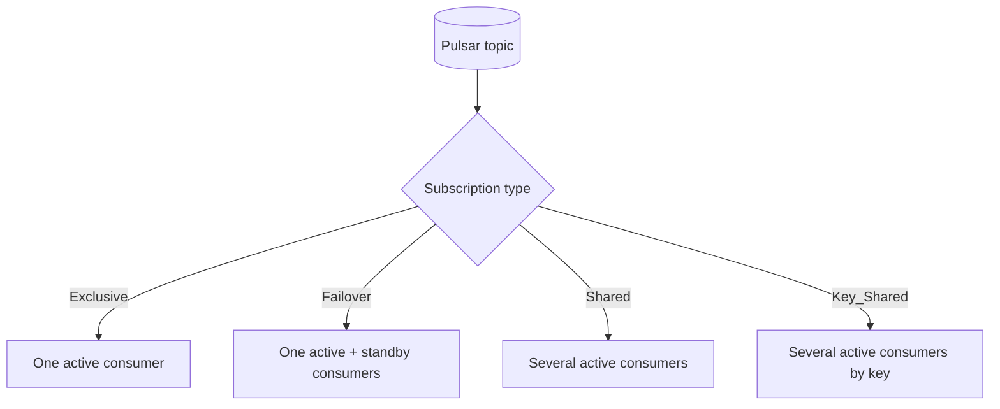
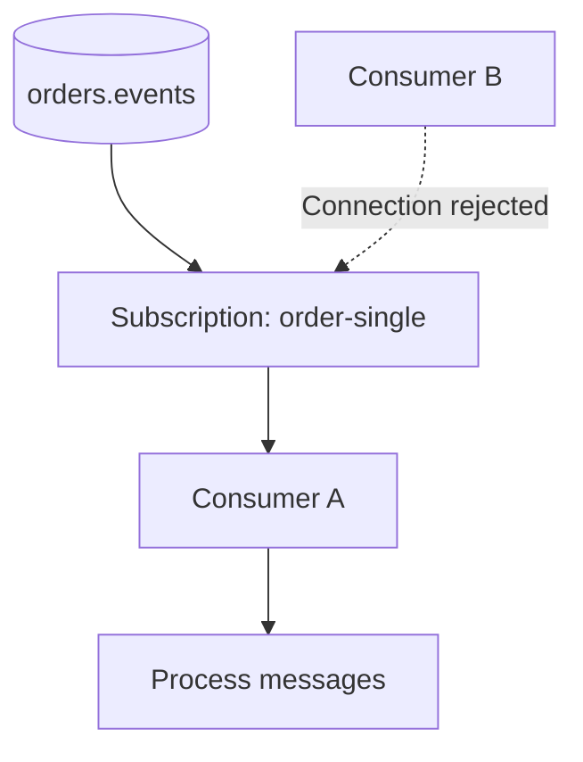
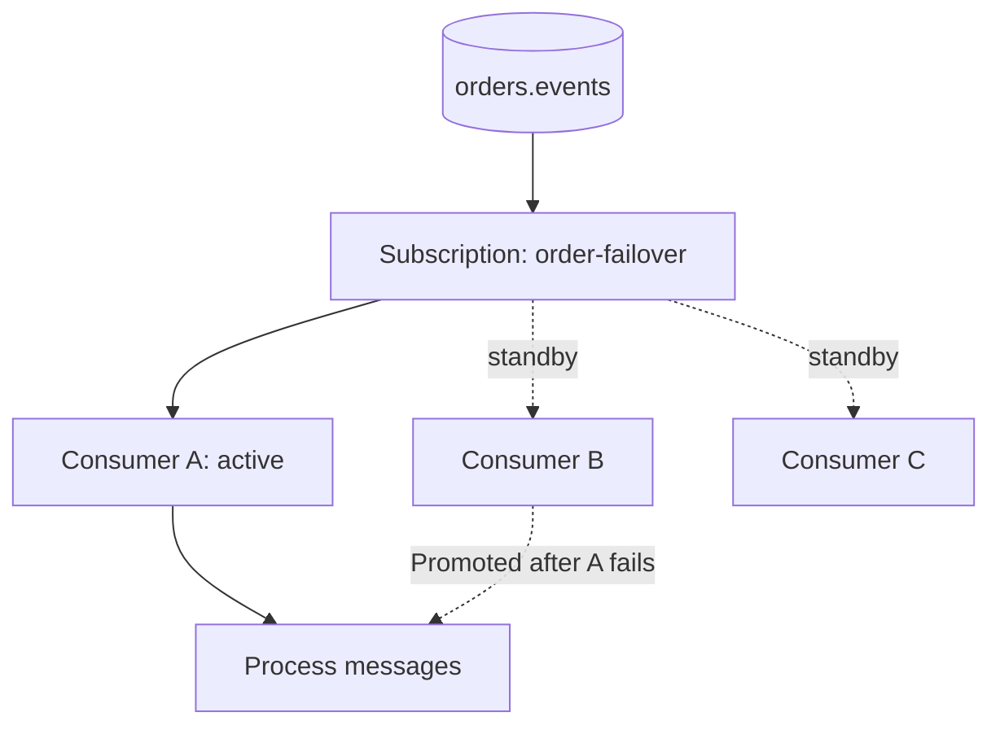
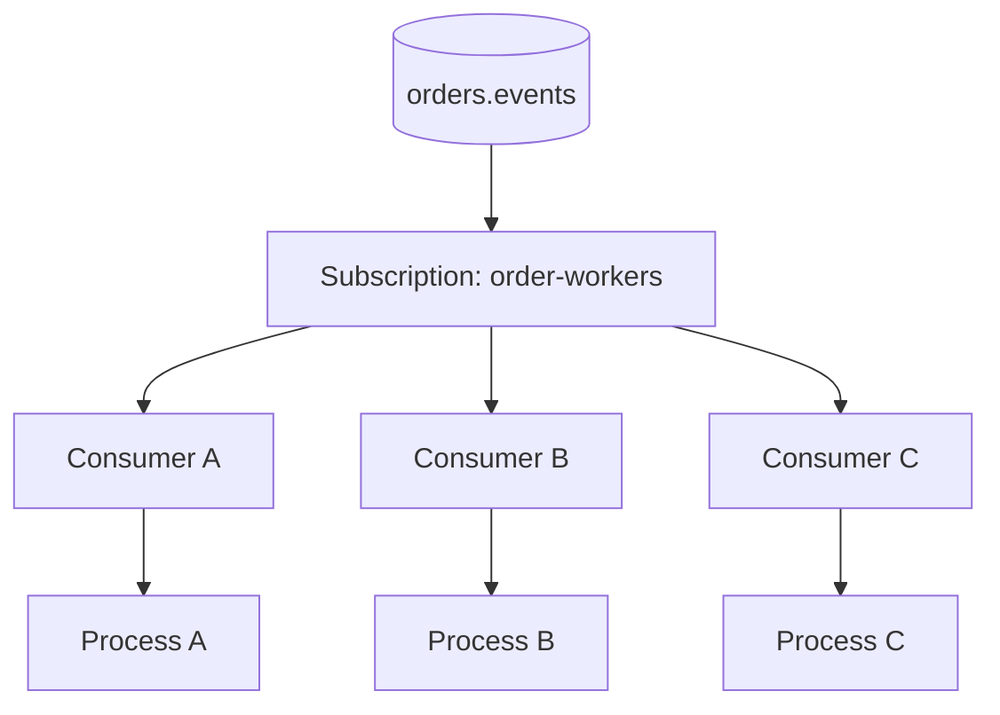
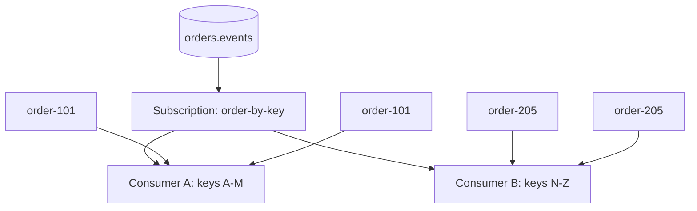

# Kiểu subscription và ảnh hưởng đến chia tải, thứ tự

## 1. Subscription quyết định consumer chia sẻ message như thế nào

Trong Apache Pulsar, producer ghi message vào topic và consumer nhận message thông qua một subscription. Subscription lưu trạng thái tiêu thụ, acknowledgement và vị trí đọc. Nhiều consumer có thể cùng tham gia một subscription để chia tải hoặc dự phòng cho nhau, tùy kiểu subscription được chọn.

Pulsar có bốn kiểu subscription chính:

- **Exclusive:** chỉ một consumer được phép kết nối vào subscription.
- **Failover:** nhiều consumer có thể kết nối, nhưng chỉ consumer active nhận message; consumer khác chờ làm dự phòng.
- **Shared:** nhiều consumer cùng active và chia message, thường theo cơ chế phân phối luân phiên.
- **Key_Shared:** nhiều consumer cùng active, nhưng message có cùng key hoặc ordering key được định tuyến về cùng consumer trong điều kiện assignment ổn định.

Kiểu subscription ảnh hưởng trực tiếp đến số consumer có thể nhận message đồng thời, khả năng failover, thứ tự quan sát và cách message được redeliver khi xử lý lỗi.



Không có kiểu subscription tốt nhất cho mọi workload. Cần bắt đầu từ yêu cầu nghiệp vụ: có cần thứ tự toàn topic hay theo key, có cần nhiều consumer xử lý song song, có cần standby tự tiếp quản khi instance lỗi và có thể chấp nhận redelivery hay không.

## 2. Subscription name và consumer group trong Spring Cloud Stream

Spring Cloud Stream sử dụng thuộc tính `group` của input binding để xác định nhóm consumer. Với Pulsar binder, group được ánh xạ thành subscription name hoặc tham gia tạo subscription name theo quy tắc binder. Các instance của cùng một ứng dụng cần dùng cùng group để chia sẻ tiến độ tiêu thụ; các ứng dụng cần nhận bản sao độc lập nên dùng group khác nhau.

Ví dụ một function xử lý đơn hàng:

```java
import java.util.function.Consumer;
import org.springframework.context.annotation.Bean;
import org.springframework.context.annotation.Configuration;

record OrderCreated(String orderId, long totalCents) {}

@Configuration
class OrderFunctions {

    @Bean
    Consumer<OrderCreated> processOrder(OrderService orderService) {
        return event -> orderService.process(event);
    }
}
```

Cấu hình binding dùng group ổn định:

```yaml
spring:
  cloud:
    function:
      definition: processOrder
    stream:
      bindings:
        processOrder-in-0:
          destination: persistent://commerce/orders/events
          group: order-processor
      pulsar:
        bindings:
          processOrder-in-0:
            consumer:
              subscriptionType: Shared
```

Trong ví dụ, các replica của `order-processor` cùng tham gia subscription cho binding đó và chia sẻ message theo kiểu `Shared`. Một ứng dụng khác dùng group `order-audit` sẽ có subscription riêng và nhận luồng message độc lập.

Tên property cụ thể của Pulsar binder cần được xác nhận theo phiên bản Spring Cloud Stream đang dùng. Ví dụ dùng namespace `spring.cloud.stream.pulsar.bindings.<bindingName>.consumer` để cấu hình thuộc tính consumer riêng của Pulsar. Không nhầm `group` của Spring Cloud Stream với `subscriptionType`: group xác định subscription logic, còn subscription type xác định cách các consumer trong subscription phối hợp.

## 3. Exclusive: một consumer duy nhất

Với `Exclusive`, một subscription chỉ cho phép một consumer active. Nếu consumer khác cố kết nối vào cùng subscription, broker từ chối kết nối thứ hai cho đến khi consumer hiện tại rời đi.



### Đặc điểm

- Chỉ một consumer nhận message trên subscription.
- Cách vận hành đơn giản, dễ hình dung thứ tự trong một topic không phân vùng.
- Không chia tải song song giữa nhiều consumer trong cùng subscription.
- Nếu consumer dừng, subscription chờ consumer khác kết nối lại; trong thời gian đó backlog có thể tăng.
- Khi consumer thay thế kết nối, message chưa được xác nhận có thể được giao lại.

Exclusive phù hợp với workload cần một consumer duy nhất, lưu lượng thấp hoặc xử lý tuần tự ở cấp subscription. Với topic phân vùng, cần phân biệt thứ tự theo partition; một consumer nhận từ nhiều partition vẫn không tạo ra một thứ tự toàn cục tuyệt đối giữa các partition.

### Khi nào không nên dùng?

Không chọn Exclusive nếu cần nhiều replica cùng xử lý song song một queue logic hoặc cần tăng năng lực tiêu thụ bằng cách thêm consumer vào cùng subscription. Khi đó, Shared hoặc Key_Shared phù hợp hơn tùy yêu cầu thứ tự.

## 4. Failover: một consumer active, các consumer còn lại standby

Với `Failover`, nhiều consumer có thể đăng ký cùng subscription, nhưng broker chọn một consumer active để nhận message. Các consumer còn lại ở trạng thái standby. Khi consumer active mất kết nối hoặc bị loại khỏi subscription, broker chuyển quyền nhận message sang một consumer dự phòng.



### Đặc điểm

- Chỉ consumer active nhận message tại một thời điểm trên phạm vi phân phối tương ứng.
- Consumer standby không chia tải bình thường, mà chờ tiếp quản.
- Khi active consumer lỗi, consumer standby được chọn làm active.
- Message chưa ack có thể được redeliver sau failover.
- Phù hợp khi ưu tiên thứ tự và tính sẵn sàng hơn throughput song song.

Với topic không phân vùng, một consumer active xử lý subscription. Với partitioned topic, việc chọn active consumer được thực hiện theo partition; một consumer có thể active cho một số partition và standby cho partition khác. Do đó, nhiều consumer có thể cùng nhận dữ liệu ở các partition khác nhau, nhưng mỗi partition vẫn có một consumer active tại một thời điểm.

Failover không có nghĩa message chưa ack chắc chắn được xử lý đúng một lần. Khi active consumer đã thực hiện side effect nhưng chưa ack trước khi lỗi, message có thể được giao lại cho consumer tiếp quản. Consumer vẫn cần idempotency.

## 5. Shared: nhiều consumer cùng chia message

Với `Shared`, nhiều consumer cùng active trên một subscription. Broker phân phối message cho các consumer, thường theo cơ chế round-robin hoặc theo khả năng nhận của consumer.



### Đặc điểm

- Nhiều consumer có thể xử lý message đồng thời.
- Thêm consumer có thể tăng throughput nếu broker, network và downstream còn đủ năng lực.
- Message không được bảo đảm giữ thứ tự ban đầu khi phân phối cho nhiều consumer.
- Redelivery sau lỗi có thể làm thứ tự quan sát thay đổi.
- Không hỗ trợ cumulative acknowledgement; consumer cần acknowledge message riêng lẻ.

Ví dụ topic nhận lần lượt `A`, `B`, `C`. Broker có thể gửi `A` cho Consumer 1, `B` cho Consumer 2 và `C` cho Consumer 3. Nếu Consumer 2 xử lý nhanh hơn, `B` có thể hoàn tất trước `A`. Vì vậy, Shared phù hợp với các event độc lập, không yêu cầu thứ tự toàn subscription.

### Khi nào dùng Shared?

Shared thường phù hợp với tác vụ nền có thể chạy song song như gửi email, tạo thumbnail, xử lý webhook hoặc xử lý đơn hàng độc lập theo ID. Nếu nhiều message của cùng một aggregate phải xử lý đúng thứ tự, Shared không phải lựa chọn mặc định.

## 6. Key_Shared: chia tải theo key

`Key_Shared` cho phép nhiều consumer cùng active nhưng broker định tuyến message dựa trên key hoặc ordering key. Các message có cùng key được gán cho cùng consumer trong một assignment ổn định, giúp bảo toàn thứ tự theo key trong luồng phân phối bình thường.



Ví dụ, các event của `order-101` được gửi tới Consumer A; các event của `order-205` được gửi tới Consumer B. Hai consumer có thể xử lý song song hai đơn hàng khác nhau, còn các event của cùng một đơn hàng được gom về một consumer.

### Đặc điểm

- Nhiều consumer cùng active.
- Message cùng key hoặc ordering key được định tuyến về cùng consumer theo hash/range assignment.
- Có thể tăng throughput giữa các key mà vẫn giữ thứ tự xử lý theo key trong điều kiện bình thường.
- Khi consumer tham gia/rời subscription, key range có thể được phân phối lại.
- Redelivery, negative acknowledgement và failover vẫn có thể tạo xử lý lặp; không thay thế idempotency.
- Không hỗ trợ cumulative acknowledgement.

Key_Shared phù hợp với nghiệp vụ cần thứ tự theo thực thể như đơn hàng, tài khoản hoặc thiết bị nhưng vẫn cần xử lý song song giữa các thực thể.

## 7. Producer batching với Key_Shared

Key_Shared phụ thuộc vào key của message để phân phối đúng consumer. Nếu producer gom message thuộc nhiều key vào một batch thông thường, broker có thể không phân phối từng message trong batch theo key như mong muốn.

Khi dùng Key_Shared, producer cần tắt batching hoặc dùng chế độ key-based batching mà Pulsar hỗ trợ. Key-based batching bảo đảm các message cùng key được gom theo cách tương thích với phân phối Key_Shared.

Ví dụ với Pulsar Java client:

```java
import org.apache.pulsar.client.api.BatcherBuilder;
import org.apache.pulsar.client.api.PulsarClient;
import org.apache.pulsar.client.api.Producer;
import org.apache.pulsar.client.api.Schema;

Producer<OrderEvent> producer = pulsarClient.newProducer(Schema.JSON(OrderEvent.class))
    .topic("persistent://commerce/orders/events")
    .batcherBuilder(BatcherBuilder.KEY_BASED)
    .create();

producer.newMessage()
    .key("order-101")
    .value(new OrderEvent("order-101", "CREATED"))
    .send();
```

Đoạn code minh họa cấu hình producer native. Nếu producer được Spring Cloud Stream Pulsar binder quản lý, hãy cấu hình batcher tương ứng bằng producer properties mà phiên bản binder hỗ trợ. Không giả định thuộc tính của Pulsar Java client có cùng tên ở mọi phiên bản binder.

Nếu dùng ordering key thay cho key thông thường, producer và consumer phải thống nhất semantics định tuyến. Không đổi key giữa các event của cùng aggregate nếu muốn chúng đi cùng một luồng xử lý.

## 8. So sánh bốn kiểu subscription

| Tiêu chí | Exclusive | Failover | Shared | Key_Shared |
|---|---|---|---|---|
| Consumer active | Một | Một theo phạm vi partition/assignment | Nhiều | Nhiều |
| Consumer standby | Không | Có | Không | Không |
| Chia tải song song | Không trong cùng subscription | Theo partition, không chia cùng partition | Có | Có, giữa các key |
| Thứ tự | Theo thứ tự của luồng/partition | Theo partition khi không có redelivery làm thay đổi quan sát | Không bảo đảm | Theo key trong điều kiện phân phối bình thường |
| Failover | Consumer khác kết nối sau khi active rời | Standby được promote | Consumer còn lại tiếp tục nhận | Consumer còn lại tiếp tục, key range có thể đổi |
| Cumulative ack | Có thể dùng theo giới hạn của Pulsar | Có thể dùng theo giới hạn của Pulsar | Không hỗ trợ | Không hỗ trợ |
| Trường hợp phù hợp | Một consumer tuần tự | Ưu tiên standby và failover | Event độc lập, throughput cao | Thứ tự theo key và song song giữa key |

Thứ tự trong bảng cần được hiểu trong phạm vi partition/key và điều kiện xử lý bình thường. Redelivery, retry, consumer failure và nhiều partition có thể làm thứ tự hoàn tất khác thứ tự publish. Không có subscription type nào tạo thứ tự toàn cục giữa mọi partition của một topic phân vùng.

## 9. Subscription type và partitioned topic

Một Pulsar partitioned topic được tạo từ nhiều partition topic nội bộ. Producer chọn partition dựa trên routing mode và key. Consumer subscribe vào tên topic logic và client/broker quản lý việc đọc từ các partition.

Subscription type vẫn áp dụng, nhưng hành vi cần nhìn theo từng partition:

- Với Exclusive, một consumer sở hữu subscription; nó có thể đọc từ nhiều partition.
- Với Failover, một consumer active cho mỗi partition, các consumer khác là standby cho những partition đó.
- Với Shared, nhiều consumer cùng nhận message từ subscription và có thể nhận message thuộc các partition khác nhau.
- Với Key_Shared, key range được phân phối giữa consumer; key routing và partition routing của producer phải tương thích để giữ affinity theo key.

Không suy ra rằng một partitioned topic có 8 partition thì Shared chỉ có tối đa 8 consumer hoặc Key_Shared luôn tạo một consumer cho mỗi partition. Số consumer hữu ích còn phụ thuộc subscription mode, số partition, phân phối key, receiver capacity và tải thực tế.

### Partitioning và thứ tự

Kafka và Pulsar đều chỉ bảo đảm thứ tự trong phạm vi partition/luồng được xác định, không có thứ tự toàn cục tự nhiên giữa nhiều partition. Nếu nghiệp vụ yêu cầu mọi event của cùng aggregate có thứ tự, hãy dùng key ổn định và routing nhất quán để các event đó đi cùng partition/consumer lane phù hợp.

## 10. Spring Cloud Stream cấu hình subscription type

Với Pulsar binder, subscription type được cấu hình riêng cho input binding. Ví dụ dùng `Key_Shared` cho event đơn hàng:

```yaml
spring:
  cloud:
    function:
      definition: processOrder
    stream:
      bindings:
        processOrder-in-0:
          destination: persistent://commerce/orders/events
          group: order-processor
      pulsar:
        bindings:
          processOrder-in-0:
            consumer:
              subscriptionType: Key_Shared
```

Nếu muốn chia tải không cần giữ thứ tự theo key, có thể đổi `subscriptionType` thành `Shared`. Nếu muốn một consumer active và các instance còn lại standby, chọn `Failover`. Nếu chỉ cho phép một consumer kết nối, chọn `Exclusive`.

Các giá trị enum thường được viết `Exclusive`, `Failover`, `Shared`, `Key_Shared`; binding metadata của phiên bản binder có thể hỗ trợ cách viết khác theo relaxed binding. Kiểm tra cấu hình đã được bind thành công khi ứng dụng khởi động và xác minh subscription type thực tế trên Pulsar admin/monitoring.

## 11. Group khác nhau tạo luồng nhận độc lập

Subscription type quyết định các consumer trong một subscription phối hợp. `group` quyết định consumer thuộc subscription nào.

Ví dụ cùng topic `orders.events` có hai ứng dụng:

```yaml
spring:
  cloud:
    stream:
      bindings:
        processOrder-in-0:
          destination: persistent://commerce/orders/events
          group: order-processor
        auditOrder-in-0:
          destination: persistent://commerce/orders/events
          group: order-audit
```

`order-processor` và `order-audit` là hai subscription độc lập. Mỗi subscription có tiến độ acknowledgement riêng. Một ứng dụng có thể dùng Shared để chia tải, ứng dụng còn lại dùng Failover để dự phòng. Kiểu subscription không cần giống nhau giữa các group.

Nếu không khai báo group, Spring Cloud Stream thường tạo anonymous/unique subscription theo binder. Subscription ẩn danh phù hợp với một consumer tạm thời hoặc một lần chạy thử; không phù hợp khi cần lưu tiến độ bền vững qua restart và chia sẻ giữa nhiều replica. Hãy khai báo group ổn định cho workload production.

## 12. Acknowledgement ảnh hưởng đến redelivery và thứ tự

Pulsar chỉ xem message đã hoàn tất khi consumer acknowledge. Nếu consumer lỗi trước khi ack, message có thể được redeliver theo negative acknowledgement, acknowledgement timeout hoặc cơ chế phục hồi subscription.

Hành vi phụ thuộc subscription type:

- Với Exclusive/Failover, redelivery có thể làm consumer nhận lại message chưa ack; failover cũng có thể khiến message được xử lý lại.
- Với Shared, nhiều consumer xử lý song song nên một message redeliver có thể đến consumer khác và hoàn tất sau các message mới hơn.
- Với Key_Shared, key affinity giúp cùng key đi cùng consumer khi assignment ổn định; khi redelivery hoặc consumer membership thay đổi, ứng dụng vẫn phải kiểm tra thứ tự và idempotency.

Không dựa vào việc “broker giao cùng key cho cùng consumer” để kết luận side effect chỉ xảy ra một lần. Ack bị mất hoặc process dừng sau side effect nhưng trước ack vẫn có thể tạo duplicate.

### Cumulative acknowledgement

Pulsar hỗ trợ individual acknowledgement và cumulative acknowledgement trong các subscription type có semantics phù hợp. Shared và Key_Shared không hỗ trợ cumulative acknowledgement vì nhiều consumer có thể xử lý message song song; xác nhận một vị trí cao hơn có thể vô tình xác nhận message khác chưa được xử lý.

Với Shared/Key_Shared, dùng acknowledgement từng message. Không thiết kế consumer phụ thuộc vào việc cumulative ack để xác nhận một dải offset/sequence.

## 13. Redelivery, retry và dead-letter policy

Khi xử lý thất bại, consumer có thể negative-acknowledge message để yêu cầu redelivery. Pulsar có thể trì hoãn redelivery theo cấu hình và hỗ trợ dead-letter policy để chuyển message lỗi sau số lần giao lại nhất định.

Ví dụ cấu hình khái niệm trong binder:

```yaml
spring:
  cloud:
    stream:
      bindings:
        processOrder-in-0:
          destination: persistent://commerce/orders/events
          group: order-processor
      pulsar:
        bindings:
          processOrder-in-0:
            consumer:
              subscriptionType: Shared
              deadLetterPolicy:
                maxRedeliverCount: 5
                deadLetterTopic: persistent://commerce/orders/events-DLQ
```

Tên property và cách biểu diễn nested dead-letter policy phụ thuộc phiên bản Spring Cloud Stream Pulsar binder. Hãy xác minh metadata cấu hình binder đang dùng; nếu binder nhận một đối tượng Pulsar `DeadLetterPolicy`, cấu hình cần ánh xạ đúng các trường mà phiên bản đó hỗ trợ.

Với Shared, redelivery có thể được phân phối cho consumer khác; không giả định retry chạy lại trên đúng instance đã gặp lỗi. Với Key_Shared, cần kiểm thử redelivery và ordering behavior cùng phiên bản broker/client cụ thể. Dù dùng kiểu nào, handler phải an toàn khi nhận cùng event nhiều lần.

## 14. Receiver queue size và subscription type là hai cấu hình khác nhau

Pulsar consumer có receiver queue để client buffer message đã nhận từ broker trước khi ứng dụng xử lý. `receiverQueueSize` ảnh hưởng lượng message có thể nằm sẵn trong bộ nhớ client và độ trễ nhận message tiếp theo.

Receiver queue size không quyết định consumer nào nhận message; đó là vai trò của subscription type. Tuy nhiên, nó ảnh hưởng tải và phân phối thực tế:

- Queue quá lớn có thể làm một consumer giữ nhiều message trong bộ nhớ.
- Queue nhỏ có thể làm consumer thường xuyên chờ broker cấp message mới.
- Với partitioned topic, giới hạn queue tổng và queue mỗi partition cần được xem xét cùng nhau.
- Khi xử lý chậm, message đã buffer vẫn chiếm tài nguyên và có thể ảnh hưởng thời gian xử lý/ack.

Ví dụ cấu hình consumer property (tên property cần xác nhận theo binder version):

```yaml
spring:
  cloud:
    stream:
      pulsar:
        bindings:
          processOrder-in-0:
            consumer:
              receiverQueueSize: 100
```

Đừng tăng receiver queue size để thay thế việc tăng số consumer. Chọn queue size theo payload size, memory budget và tốc độ xử lý.

## 15. Cách chọn subscription type theo yêu cầu nghiệp vụ

| Yêu cầu | Kiểu phù hợp để cân nhắc | Lý do |
|---|---|---|
| Một consumer duy nhất, không cần chia tải | Exclusive | Đơn giản, chỉ một consumer được kết nối |
| Cần một consumer active và standby tự tiếp quản | Failover | Nhiều consumer đăng ký nhưng chỉ active consumer nhận message theo partition |
| Event độc lập, ưu tiên throughput | Shared | Nhiều consumer cùng xử lý song song |
| Nhiều aggregate, cần thứ tự riêng cho từng key | Key_Shared | Chia tải giữa key, giữ affinity theo key |
| Cần thứ tự toàn cục giữa nhiều partition | Không subscription type nào tự cung cấp | Phải thiết kế một luồng/partition tuần tự hoặc thay đổi mô hình dữ liệu |

Ví dụ thực tế:

- Gửi email thông báo: Shared, vì mỗi email độc lập và không cần thứ tự toàn topic.
- Xử lý trạng thái đơn hàng: Key_Shared theo `orderId`, vì các event cùng đơn hàng cần cùng luồng xử lý.
- Một job duy nhất cập nhật file snapshot: Exclusive, nếu chỉ cho phép một consumer chạy.
- Consumer quan trọng cần standby nóng: Failover, nếu throughput một active consumer cho mỗi partition là đủ.

## 16. Thử nghiệm phân phối message

Có thể tạo một topic thử nghiệm và chạy nhiều consumer cùng subscription để quan sát semantics:

1. Tạo topic `subscription-lab`.
2. Gửi một chuỗi message có key `A`, `B`, `A`, `B`, `C`.
3. Chạy hai consumer cùng subscription với `Exclusive`; xác nhận consumer thứ hai không thể cùng active.
4. Đổi sang `Failover`; quan sát một consumer active và một consumer standby, sau đó dừng active để quan sát promotion.
5. Đổi sang `Shared`; quan sát message được chia cho hai consumer và thứ tự hoàn tất có thể khác thứ tự gửi.
6. Đổi sang `Key_Shared`; gửi nhiều message cùng key và quan sát chúng được định tuyến cùng consumer khi assignment ổn định.
7. Bật batching thông thường rồi so sánh với key-based batching để thấy ảnh hưởng đến Key_Shared.
8. Negative-ack một message và quan sát redelivery.
9. Dừng consumer khi còn message chưa ack và quan sát việc giao lại.
10. Ghi lại message ID, key, consumer name, thời điểm nhận và thời điểm ack.

Chạy thử với cùng broker/client version như production. Không dùng một lần quan sát ngắn để kết luận về thứ tự khi có retry, redelivery hoặc consumer membership thay đổi.

## 17. Theo dõi subscription trong production

Các chỉ số cần theo dõi gồm:

- Số consumer đang kết nối theo subscription.
- Consumer active/standby với Failover.
- Backlog và message age.
- Số message unacknowledged hoặc pending acknowledgement.
- Tỷ lệ redelivery và negative acknowledgement.
- DLQ message count và tuổi message cũ nhất.
- Throughput theo consumer và partition.
- Receiver queue utilization, memory và processing latency.
- Thời gian failover khi active consumer dừng.
- Consumer churn và thời gian phân phối lại key range với Key_Shared.

Khi backlog tăng:

1. Xác định subscription đang dùng kiểu nào.
2. Kiểm tra số consumer active thực tế.
3. Kiểm tra consumer có bị chậm do database/API hay không.
4. Kiểm tra redelivery hoặc retry có làm tăng tải không.
5. Với Shared/Key_Shared, tăng consumer nếu partition/key distribution và downstream cho phép.
6. Với Failover, thêm standby không làm tăng số consumer xử lý đồng thời; cần đánh giá partitioning hoặc đổi mô hình nếu cần throughput.

## 18. Các lỗi cấu hình thường gặp

| Triệu chứng | Nguyên nhân có thể | Cách xử lý |
|---|---|---|
| Consumer thứ hai không kết nối được | Subscription đang là Exclusive và đã có active consumer | Chọn Failover, Shared hoặc Key_Shared nếu cần nhiều consumer |
| Nhiều consumer kết nối nhưng chỉ một consumer nhận | Đang dùng Failover; các consumer còn lại là standby | Dùng Shared/Key_Shared nếu mục tiêu là chia tải |
| Thứ tự xử lý bị đảo | Shared phân phối song song hoặc side effect hoàn tất không theo thứ tự | Dùng Key_Shared theo key hoặc tuần tự hóa xử lý |
| Cùng key xuất hiện ở nhiều consumer | Producer key/batching không tương thích hoặc assignment thay đổi | Kiểm tra key, ordering key và key-based batching |
| Consumer nhận lại message | Ack chưa được broker ghi nhận, negative ack hoặc timeout | Kiểm tra ack flow và làm consumer idempotent |
| Key_Shared throughput kém | Phân phối key lệch, một key nóng hoặc ít key hoạt động | Kiểm tra key skew và số consumer hữu ích |
| Thêm standby không giảm backlog | Failover chỉ có một active consumer theo partition | Đánh giá Shared/Key_Shared hoặc tăng partition nếu phù hợp |
| Bộ nhớ tăng sau khi tăng consumer queue | Receiver queue quá lớn hoặc payload lớn | Giảm queue size, đo memory và giới hạn payload |

## 19. Quy trình chọn subscription cho Spring Cloud Stream

1. Xác định topic là partitioned hay non-partitioned và key được tạo như thế nào.
2. Chọn group ổn định cho workload cần chia sẻ tiến độ; dùng group khác cho consumer độc lập.
3. Xác định cần một consumer, active/standby, chia tải tự do hay chia tải theo key.
4. Chọn `Exclusive`, `Failover`, `Shared` hoặc `Key_Shared` tương ứng.
5. Nếu dùng Key_Shared, bảo đảm producer gửi key/ordering key ổn định và dùng key-based batching hoặc tắt batching.
6. Kiểm tra semantics acknowledgement; Shared và Key_Shared cần individual ack.
7. Cấu hình redelivery, retry và DLQ theo loại lỗi.
8. Điều chỉnh receiver queue size theo payload và memory budget.
9. Thử nghiệm nhiều consumer, failover, redelivery và thứ tự với broker thực tế.
10. Theo dõi backlog, consumer active, redelivery, key skew và DLQ sau triển khai.

Subscription type của Pulsar là quyết định quan trọng về cách consumer chia sẻ workload. Exclusive giới hạn một consumer, Failover cung cấp active/standby, Shared tối ưu chia tải cho event độc lập và Key_Shared chia tải theo key để giữ affinity cho từng thực thể. Spring Cloud Stream Pulsar binder cho phép chọn kiểu subscription trên input binding; cần kết hợp group, partitioning, producer key/batching, acknowledgement và retry để đạt throughput phù hợp mà vẫn giữ đúng thứ tự nghiệp vụ cần thiết.

## Tài liệu tham khảo

- [Apache Pulsar — Messaging concepts: subscriptions](https://pulsar.apache.org/docs/concepts-messaging/#subscriptions)
- [Apache Pulsar — Consumer](https://pulsar.apache.org/docs/client-libraries-java/#consumer)
- [Spring Cloud Stream Pulsar Binder](https://docs.spring.io/spring-cloud-stream/reference/pulsar/pulsar-binder.html)

