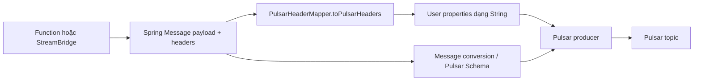

# Ánh xạ header và tùy biến PulsarHeaderMapper

Một message đi qua Spring Cloud Stream thường mang cả payload và metadata như `correlationId`, `eventType`, `tenantId`, message ID hoặc thời điểm publish. Spring biểu diễn metadata bằng `MessageHeaders`; Apache Pulsar cung cấp message metadata và một map user properties cho các thuộc tính do ứng dụng tự đặt. Pulsar binder phải chuyển đổi hai mô hình này khi gửi message ra topic và khi nhận message từ topic.

`PulsarHeaderMapper` là strategy thực hiện việc chuyển đổi đó. Binder cung cấp mapper mặc định và cho phép thay thế bằng một bean `PulsarHeaderMapper` do ứng dụng khai báo. Khi tùy biến mapper, cần quyết định header nào được phép đi ra Pulsar, header nào được đưa vào Spring, kiểu Java nào có thể được phục hồi từ JSON và cách xử lý các giá trị không thể serialize trực tiếp.

## 1. Header trong Spring và metadata trong Pulsar

Spring Messaging cung cấp `Message<T>` gồm payload và `MessageHeaders`. Ví dụ một message đơn hàng có thể mang:

```java
public record OrderCreated(String orderId, String tenantId, long totalCents) {}

Message<OrderCreated> message = MessageBuilder
        .withPayload(new OrderCreated("ORD-1001", "tenant-a", 125000))
        .setHeader("x-correlation-id", "corr-2026-001")
        .setHeader("x-event-type", "OrderCreated")
        .setHeader("x-tenant-id", "tenant-a")
        .build();
```

Pulsar không có một cấu trúc header riêng giống hệt Spring. Thay vào đó, message Pulsar có metadata do broker/client quản lý và map user properties dạng key/value để ứng dụng truyền thuộc tính tùy chỉnh. Vì vậy, tài liệu Spring for Apache Pulsar thường dùng hai thuật ngữ *message header* và *message metadata* gần như thay thế cho nhau.

| Nhóm thông tin | Ví dụ | Nơi lưu trong Pulsar | Có thể do ứng dụng tùy ý đặt? |
| --- | --- | --- | --- |
| User properties | `x-correlation-id`, `x-event-type`, `x-tenant-id` | Map custom properties của message | Có |
| Metadata do Pulsar quản lý | Message ID, topic name, publish time, sequence ID, producer name, redelivery count | Các trường metadata của message | Không; phần lớn là read-only |
| Spring framework headers | `id`, `timestamp`, header nội bộ của Spring | `MessageHeaders` | Được Spring tạo hoặc quản lý; không phải tất cả đều nên gửi qua broker |

`PulsarHeaderMapper` chuyển đổi giữa Spring headers và các thông tin tương ứng của Pulsar. Khi gửi, mapper tạo map `Map<String, String>` cho user properties. Khi nhận, mapper tạo `MessageHeaders` từ message Pulsar, bao gồm các metadata mà framework đưa ra dưới dạng Spring header.

## 2. Hai chiều ánh xạ

Hợp đồng của `PulsarHeaderMapper` có hai phương thức chính:

```java
public interface PulsarHeaderMapper {

    Map<String, String> toPulsarHeaders(MessageHeaders springHeaders);

    MessageHeaders toSpringHeaders(
            org.apache.pulsar.client.api.Message<?> pulsarMessage);
}
```

| Phương thức | Hướng | Công việc |
| --- | --- | --- |
| `toPulsarHeaders(...)` | Spring → Pulsar | Chọn các Spring headers được phép gửi và chuyển giá trị thành chuỗi để ghi vào user properties |
| `toSpringHeaders(...)` | Pulsar → Spring | Đọc user properties và metadata của Pulsar, chuyển chúng thành `MessageHeaders` để hàm nghiệp vụ sử dụng |

Luồng gửi trong Spring Cloud Stream:



Luồng nhận diễn ra theo chiều ngược lại: Pulsar consumer lấy message, binder dùng mapper để tạo Spring headers, chuyển payload theo cơ chế message conversion hoặc native decoding, rồi chuyển `Message<T>` tới `Function`/`Consumer`.

Mapper xử lý metadata. Nó không thay thế serializer hoặc Pulsar Schema dùng cho payload. Việc chọn `application/json`, Avro, Protobuf hay native Pulsar schema là một quyết định riêng với việc ánh xạ `correlationId` hoặc `tenantId`.

## 3. Binder sử dụng mapper mặc định như thế nào?

Pulsar binder có một header mapper mặc định. Spring for Apache Pulsar cung cấp hai implementation phổ biến:

- `JsonPulsarHeaderMapper`: chuyển các header value sang JSON để hỗ trợ nhiều kiểu dữ liệu. Đây là lựa chọn mặc định khi thư viện Jackson JSON có trên classpath.
- `ToStringPulsarHeaderMapper`: chuyển giá trị bằng `Object.toString()` và dùng làm fallback khi không có JSON mapper phù hợp.

`JsonPulsarHeaderMapper` phù hợp khi ứng dụng Spring cần phục hồi các kiểu header đã biết. `ToStringPulsarHeaderMapper` phù hợp với hợp đồng metadata đơn giản, nơi consumer chấp nhận nhận mọi giá trị dưới dạng chuỗi.

| Tiêu chí | JSON mapper | ToString mapper |
| --- | --- | --- |
| Giá trị outbound | JSON representation của giá trị header | `toString()` |
| Giá trị inbound | Có thể phục hồi kiểu Java nếu type metadata hợp lệ và package được tin cậy | Chuỗi |
| Kiểu phức tạp | Hỗ trợ tốt hơn khi Jackson có thể serialize/deserialize kiểu đó | Không giữ cấu trúc hoặc kiểu gốc |
| Khả năng tương tác với consumer ngoài Java | Consumer cần hiểu cách đọc JSON và metadata type nếu muốn khôi phục kiểu | Dễ đọc như chuỗi, nhưng consumer tự parse nếu cần kiểu khác |
| Rủi ro cấu hình | Cần kiểm soát trusted packages và schema của header | Có thể mất thông tin kiểu hoặc tạo chuỗi không có định dạng ổn định |

Đừng dựa vào việc classpath tình cờ có Jackson để quyết định hợp đồng header production. Nếu header chứa kiểu quan trọng, hãy cấu hình mapper tường minh và kiểm thử cả hai chiều.

## 4. JSON mapper lưu kiểu dữ liệu như thế nào?

Khi `JsonPulsarHeaderMapper` serialize header value, nó ghi giá trị JSON vào Pulsar user property. Mapper đồng thời ghi một property đặc biệt tên `spring_json_header_types`, chứa map giữa tên header và tên lớp Java của giá trị đã được serialize bằng JSON.

Ví dụ về mặt khái niệm:

```text
Pulsar user properties:
  x-correlation-id       -> "corr-2026-001"
  x-attempt              -> 3
  x-money                -> {"currency":"VND","amount":125000}
  spring_json_header_types -> {
      "x-attempt": "java.lang.Integer",
      "x-money": "com.acme.money.Money"
  }
```

Khi message đi vào Spring, JSON mapper đọc `spring_json_header_types` để biết kiểu ban đầu của từng header, sau đó quyết định có được phép phục hồi kiểu đó hay không. Property đặc biệt này là chi tiết triển khai của Spring mapper; consumer không dùng Spring không nên phụ thuộc vào nó như một schema nghiệp vụ.

Với hệ thống nhiều ngôn ngữ, hãy thiết kế header contract theo kiểu đơn giản và ổn định như chuỗi, số, boolean hoặc JSON có schema rõ ràng. Không buộc consumer Python, Go hoặc Node.js phải tải các lớp Java chỉ để đọc một header.

## 5. Tùy biến mapper bằng bean PulsarHeaderMapper

Đây là cách tùy biến thường dùng nhất. Pulsar binder cho phép thay mapper mặc định bằng cách cung cấp một bean có kiểu `PulsarHeaderMapper`.

Ví dụ dưới đây:

- Loại bỏ `top` và `secret` khi nhận từ Pulsar.
- Loại bỏ `id`, `timestamp` và `userId` khi gửi ra Pulsar.
- Chỉ tin cậy các lớp header thuộc package `com.acme` và các package mặc định an toàn.
- Serialize `com.acme.Money` bằng `toString()`; khi nhận lại giá trị đó là chuỗi.

```java
import org.springframework.context.annotation.Bean;
import org.springframework.context.annotation.Configuration;
import org.springframework.pulsar.support.header.JsonPulsarHeaderMapper;
import org.springframework.pulsar.support.header.PulsarHeaderMapper;

@Configuration(proxyBeanMethods = false)
public class PulsarHeaderConfiguration {

    @Bean
    public PulsarHeaderMapper customPulsarHeaderMapper() {
        return JsonPulsarHeaderMapper.builder()
                .inboundPatterns("!top", "!secret", "*")
                .outboundPatterns("!id", "!timestamp", "!userId", "*")
                .trustedPackages("com.acme")
                .toStringClasses("com.acme.Money")
                .build();
    }
}
```

Khi bean này có trong application context, Pulsar binder sử dụng nó cho quá trình ánh xạ header. Đây là cấu hình ở cấp mapper bean; các pattern và chính sách serialize/deserialze áp dụng cho luồng Pulsar được mapper đó phục vụ. Nếu ứng dụng có nhiều binding Pulsar với yêu cầu header khác nhau, hãy thiết kế một chính sách chung rõ ràng hoặc tách ranh giới ứng dụng/context thay vì giả định có một thuộc tính YAML `headerMapper` độc lập cho từng binding.

## 6. Inbound patterns và outbound patterns

Mapper cho phép lọc riêng header đi vào Spring và header đi ra Pulsar:

- `inboundPatterns`: lọc tên header khi chuyển từ Pulsar sang Spring.
- `outboundPatterns`: lọc tên header khi chuyển từ Spring sang Pulsar.

Pattern là bộ khớp đơn giản. Có thể dùng wildcard ở đầu, cuối hoặc cả hai, ví dụ `x-trace-*`, `*-id` hoặc `*.cat.*`. Đặt dấu `!` ở đầu để loại trừ một pattern. Pattern được kiểm tra theo thứ tự; pattern đầu tiên khớp sẽ quyết định header được nhận hay loại bỏ.

Ví dụ:

```java
return JsonPulsarHeaderMapper.builder()
        .inboundPatterns("!secret", "!authorization", "*")
        .outboundPatterns(
                "!id",
                "!timestamp",
                "!secret",
                "!authorization",
                "x-correlation-id",
                "x-event-*",
                "*")
        .build();
```

Trong ví dụ, `secret` và `authorization` bị loại trước khi pattern tổng quát `*` được xét. Các header bắt đầu bằng `x-` được cho phép; những header khác vẫn được cho phép bởi `*` cuối cùng. Nếu muốn chỉ cho phép một allowlist, bỏ `*` cuối cùng và liệt kê từng header hoặc nhóm header cần dùng.

### Khi đã khai báo pattern, không có wildcard mặc định tự thêm

Nếu không khai báo pattern, mapper dùng mặc định tương ứng: inbound nhận tất cả, outbound nhận tất cả trừ các header bị loại mặc định. Nhưng khi đã cung cấp một danh sách pattern tùy chỉnh, mapper không tự thêm `*` vào cuối danh sách. Vì vậy, nếu muốn “loại trừ vài header, còn lại giữ tất cả”, phải thêm `*` rõ ràng sau các pattern phủ định.

Ví dụ đúng để loại `secret` nhưng giữ các header còn lại:

```java
.inboundPatterns("!secret", "*")
```

Nếu chỉ viết `.inboundPatterns("!secret")`, các header khác không tự động được đưa vào do không có pattern cho phép khớp.

## 7. Metadata Pulsar và các header read-only

Pulsar cung cấp metadata như message ID, topic name, publish time, event time, sequence ID, producer name, key, ordering key, redelivery count và schema version. Spring for Apache Pulsar đưa các thông tin này ra dưới dạng các hằng số trong `PulsarHeaders`, ví dụ:

```java
import org.springframework.pulsar.support.PulsarHeaders;

String messageIdHeader = PulsarHeaders.MESSAGE_ID;
String topicHeader = PulsarHeaders.TOPIC_NAME;
String eventTimeHeader = PulsarHeaders.EVENT_TIME;
```

Khi nhận message, ứng dụng có thể đọc metadata bằng `MessageHeaders` hoặc `@Header`:

```java
import java.util.function.Consumer;

import org.springframework.context.annotation.Bean;
import org.springframework.messaging.Message;
import org.springframework.pulsar.support.PulsarHeaders;

@Bean
public Consumer<Message<OrderCreated>> processOrder() {
    return message -> {
        OrderCreated event = message.getPayload();
        Object messageId = message.getHeaders().get(PulsarHeaders.MESSAGE_ID);
        Object topic = message.getHeaders().get(PulsarHeaders.TOPIC_NAME);

        process(event, messageId, topic);
    };
}
```

Các header phản ánh metadata do Pulsar tạo ra chỉ có ý nghĩa khi đọc inbound. Không cố gửi lại `id` hoặc `timestamp` của Spring Message; đây là các header read-only trong luồng nhận. Mặc định outbound mapper cũng loại `id`, `timestamp` và các header biểu diễn metadata Pulsar có prefix `pulsar_message_`.

Nếu thật sự cần đưa một metadata Pulsar cụ thể vào luồng outbound, phải thêm đúng tên header metadata vào `outboundPatterns`. Các metadata header này không hỗ trợ wildcard pattern; cần chỉ định chính xác tên. Thông thường, nên gửi một header nghiệp vụ riêng như `x-original-message-id` nếu cần lưu dấu message ID nguồn, thay vì cố ghi đè metadata message ID mới do broker tạo.

## 8. Header mapper và payload schema là hai cơ chế riêng

Pulsar binder có thể dùng message conversion của Spring Cloud Stream hoặc native encoding/decoding dựa trên Pulsar Schema. Header mapper vẫn có nhiệm vụ riêng trong cả hai trường hợp.

| Thành phần | Xử lý | Ví dụ |
| --- | --- | --- |
| Payload conversion | Chuyển body giữa Java object và bytes/schema | JSON, Avro, Protobuf, `Schema.JSON` |
| Header mapping | Chuyển Spring `MessageHeaders` thành Pulsar user properties và ngược lại | `x-correlation-id`, `x-tenant-id`, `x-event-type` |
| Pulsar message metadata | Thông tin do Pulsar broker/client cung cấp | Message ID, publish time, topic name |

Ví dụ binding native encoding/decoding:

```yaml
spring:
  cloud:
    stream:
      bindings:
        orders-out-0:
          producer:
            use-native-encoding: true
        orders-in-0:
          consumer:
            use-native-decoding: true
      pulsar:
        bindings:
          orders-out-0:
            producer:
              schema-type: JSON
              message-type: com.acme.events.OrderCreated
          orders-in-0:
            consumer:
              schema-type: JSON
              message-type: com.acme.events.OrderCreated
```

Ở đây `schema-type` và `message-type` mô tả payload. `PulsarHeaderMapper` tiếp tục xử lý các header như `x-correlation-id`; không dùng `schema-type` để quyết định kiểu Java của custom header.

## 9. JSON mapper và trusted packages

Khi JSON mapper nhận một header có type metadata, nó chỉ phục hồi kiểu Java nếu package của lớp được tin cậy. Trong Spring for Apache Pulsar hiện hành, các package mặc định gồm:

- `java.lang`
- `java.net`
- `java.util`
- `org.springframework.util`

Việc kiểm tra package là khớp chính xác. Tin cậy `com.acme.events` không tự động tin cậy `com.acme.events.internal`; mỗi package cần được thêm riêng nếu thực sự cần.

Thêm package cho các kiểu header của ứng dụng:

```java
@Bean
public PulsarHeaderMapper customPulsarHeaderMapper() {
    return JsonPulsarHeaderMapper.builder()
            .trustedPackages("com.acme.events", "com.acme.headers")
            .build();
}
```

Các package được thêm vào danh sách trusted mặc định. Nếu mapper gặp một kiểu không được tin cậy, nó không deserialize thành object tùy ý; ứng dụng nhận một giá trị `JsonPulsarHeaderMapper.NonTrustedHeaderType` để biểu thị header có type không được phép phục hồi.

### Vì sao không nên dùng trustedPackages("*")?

Có thể truyền `"*"` như phần tử duy nhất để tin cậy mọi package. Điều này cho phép mapper nạp và khởi tạo một phần kiểu Java từ thông tin header khi deserialize. Nếu message đến từ producer ngoài phạm vi kiểm soát hoặc nguồn không đáng tin cậy, việc tin cậy mọi package mở rộng bề mặt tấn công deserialization.

Chỉ dùng wildcard trust trong môi trường nội bộ có kiểm soát đầy đủ producer và classpath. Với hệ thống event-driven có nhiều producer, ưu tiên allowlist package nhỏ và header contract đơn giản.

## 10. toStringClasses cho các kiểu không nên serialize JSON

Một số kiểu header phù hợp với biểu diễn chuỗi hơn JSON. `toStringClasses(...)` cho phép liệt kê tên đầy đủ của các lớp sẽ được serialize bằng `Object.toString()` khi gửi ra Pulsar.

Ví dụ:

```java
@Bean
public PulsarHeaderMapper customPulsarHeaderMapper() {
    return JsonPulsarHeaderMapper.builder()
            .toStringClasses(
                    "com.acme.money.Money",
                    "com.acme.ids.TenantId")
            .build();
}
```

Khi nhận lại, các giá trị này được ánh xạ thành `String`. Mapper không tái tạo object `Money` hoặc `TenantId` từ chuỗi đó. Nếu consumer cần object gốc, hãy cung cấp một bộ chuyển đổi riêng ở tầng nghiệp vụ hoặc dùng JSON serialization với trusted package phù hợp.

`toString()` chỉ là một hợp đồng ổn định nếu lớp đảm bảo định dạng chuỗi của nó ổn định và có thể parse. Không dùng biểu diễn `toString()` mặc định của object có dạng phụ thuộc triển khai như `ClassName@hashcode`.

## 11. Tùy biến Jackson ObjectMapper

`JsonPulsarHeaderMapper` dùng Jackson để đọc/ghi giá trị header JSON. Có hai cách cung cấp mapper tùy chỉnh:

1. Gọi `.objectMapper(...)` trên builder khi tự tạo `JsonPulsarHeaderMapper`.
2. Đăng ký bean `ObjectMapper` với tên chính xác `pulsarHeaderObjectMapper` để Spring for Apache Pulsar sử dụng.

Ví dụ dùng bean có tên được framework nhận diện:

```java
import com.fasterxml.jackson.databind.ObjectMapper;
import org.springframework.context.annotation.Bean;
import org.springframework.context.annotation.Configuration;

@Configuration(proxyBeanMethods = false)
public class PulsarHeaderJsonConfiguration {

    @Bean(name = "pulsarHeaderObjectMapper")
    ObjectMapper pulsarHeaderObjectMapper() {
        return new ObjectMapper().findAndRegisterModules();
    }
}
```

Bean phải là `com.fasterxml.jackson.databind.ObjectMapper` của Jackson mà phiên bản Spring for Apache Pulsar đang sử dụng; không dùng `ObjectMapper` đã được Pulsar client shade/relocate vào package khác. Kiểm tra tương thích Jackson 2/Jackson 3 theo release train của Spring Boot, Spring Pulsar và Pulsar binder trước khi thêm module hoặc custom serializer.

Không đăng ký nhiều bean cùng tên `pulsarHeaderObjectMapper`. Nếu cần cấu hình serializer cho một kiểu header, hãy kiểm thử round-trip outbound/inbound để bảo đảm consumer có thể đọc đúng giá trị.

## 12. Khi nào cần tự triển khai PulsarHeaderMapper?

Builder của `JsonPulsarHeaderMapper` đáp ứng phần lớn yêu cầu: lọc header, giới hạn package được deserialize, chọn kiểu dùng `toString()` và cung cấp `ObjectMapper`. Chỉ tự triển khai mapper khi có quy tắc chuyển đổi đặc thù, ví dụ:

- Một header nghiệp vụ phải mã hóa theo định dạng wire riêng.
- Cần chuyển đổi giá trị từ một kiểu Java sang chuỗi theo quy tắc chuẩn hóa cụ thể.
- Cần xác thực hoặc từ chối một số giá trị trước khi gửi.
- Cần bổ sung logic theo ngữ cảnh của cả lần ánh xạ.

Có thể triển khai trực tiếp `PulsarHeaderMapper`, nhưng khi đó ứng dụng phải tự xử lý cả hai chiều, lọc header, metadata và lỗi chuyển đổi. Cách thường tiện hơn là mở rộng `AbstractPulsarHeaderMapper`, vì lớp này đã quản lý matcher inbound/outbound và vòng đời mapping.

Ví dụ mapper chỉ cho phép một số header dạng scalar:

```java
import java.util.List;

import org.springframework.pulsar.support.header.AbstractPulsarHeaderMapper;

public final class ScalarPulsarHeaderMapper
        extends AbstractPulsarHeaderMapper<Object, Object> {

    public ScalarPulsarHeaderMapper() {
        super(
                List.of("x-correlation-id", "x-tenant-id", "x-event-type"),
                List.of("!id", "!timestamp",
                        "x-correlation-id", "x-tenant-id", "x-event-type"));
    }

    @Override
    protected String toPulsarHeaderValue(
            String name, Object value, Object context) {
        if (value == null) {
            return null;
        }
        if (value instanceof String
                || value instanceof Number
                || value instanceof Boolean) {
            return value.toString();
        }
        throw new IllegalArgumentException(
                "Unsupported header type for " + name + ": "
                        + value.getClass().getName());
    }

    @Override
    protected Object toSpringHeaderValue(
            String name, String value, Object context) {
        return value;
    }
}
```

Đăng ký mapper:

```java
@Bean
public PulsarHeaderMapper customPulsarHeaderMapper() {
    return new ScalarPulsarHeaderMapper();
}
```

Ví dụ này cố ý chỉ hỗ trợ ba header scalar và trả chúng về dưới dạng chuỗi khi nhận. Nó không phù hợp nếu ứng dụng cần phục hồi header `Integer`, `UUID` hoặc DTO về đúng kiểu Java; hãy bổ sung conversion có kiểm soát hoặc dùng `JsonPulsarHeaderMapper`.

`AbstractPulsarHeaderMapper` còn có các hook `toPulsarHeadersOnStarted`, `toPulsarHeadersOnCompleted`, `toSpringHeadersOnStarted` và `toSpringHeadersOnCompleted`. Các hook này cho phép tạo context cho một lượt mapping, dùng context đó khi chuyển từng header rồi thực hiện xử lý cuối lượt. Nếu override, giữ logic thread-safe, không lưu trạng thái message vào field dùng chung và không thực hiện I/O chậm trong quá trình map.

## 13. Gửi và nhận custom headers trong Spring Cloud Stream

Ứng dụng nghiệp vụ không cần gọi trực tiếp `PulsarHeaderMapper`. Binder tự gọi mapper khi chuyển Spring Message thành Pulsar message và ngược lại.

Ví dụ producer dùng `StreamBridge`:

```java
import org.springframework.cloud.stream.function.StreamBridge;
import org.springframework.messaging.Message;
import org.springframework.messaging.support.MessageBuilder;
import org.springframework.stereotype.Service;

@Service
public class OrderPublisher {

    private final StreamBridge streamBridge;

    public OrderPublisher(StreamBridge streamBridge) {
        this.streamBridge = streamBridge;
    }

    public boolean publish(OrderCreated event, String correlationId) {
        Message<OrderCreated> message = MessageBuilder
                .withPayload(event)
                .setHeader("x-correlation-id", correlationId)
                .setHeader("x-event-type", "OrderCreated")
                .setHeader("x-tenant-id", event.tenantId())
                .build();

        return streamBridge.send("orders-out-0", message);
    }
}
```

Ví dụ consumer đọc header:

```java
import java.util.function.Consumer;

import org.springframework.context.annotation.Bean;
import org.springframework.messaging.Message;

@Bean
public Consumer<Message<OrderCreated>> consumeOrder() {
    return message -> {
        OrderCreated event = message.getPayload();
        String correlationId = message.getHeaders()
                .get("x-correlation-id", String.class);
        String tenantId = message.getHeaders()
                .get("x-tenant-id", String.class);

        handle(event, correlationId, tenantId);
    };
}
```

`OrderCreated` và binding `orders-out-0` là model/tên binding của ví dụ. Nếu header bị loại bởi `outboundPatterns`, consumer sẽ không nhận được nó. Nếu JSON mapper không phục hồi được kiểu do package chưa trusted, ứng dụng có thể nhận `NonTrustedHeaderType` thay vì DTO mong đợi. Vì vậy, kiểm tra mapper và pattern là một phần của hợp đồng giữa producer và consumer.

## 14. Tên header, quy ước và khả năng tương tác

Nên thống nhất tên header có prefix riêng cho ứng dụng, ví dụ `x-correlation-id`, `x-event-type`, `x-tenant-id` hoặc `x-schema-version`. Tránh dùng tên dễ xung đột với metadata Pulsar hoặc header nội bộ của Spring.

Một hợp đồng header tốt cần:

- Tên ổn định, viết thường và có quy ước rõ.
- Kiểu dữ liệu đơn giản, được tài liệu hóa.
- Quy định header bắt buộc và header tùy chọn.
- Giới hạn kích thước giá trị.
- Quy tắc versioning khi đổi kiểu hoặc định dạng.
- Danh sách header được phép gửi qua từng ranh giới dịch vụ.

Nếu consumer ngoài Java cần đọc header, ưu tiên chuỗi hoặc JSON theo schema công khai. Không yêu cầu consumer khác ngôn ngữ hiểu `spring_json_header_types` hoặc tên lớp Java. Nếu dùng `toStringClasses`, hãy công bố định dạng chuỗi và cách parse.

## 15. Bảo mật và dữ liệu nhạy cảm trong header

Header không phải nơi lưu secret, token, mật khẩu hoặc payload nghiệp vụ lớn. User properties được truyền cùng message và có thể xuất hiện trong log, tracing, công cụ quản trị hoặc bản sao message. Cần áp dụng nguyên tắc tối thiểu:

- Loại bỏ `authorization`, `secret`, access token và thông tin xác thực bằng inbound/outbound patterns.
- Chỉ tin cậy package cần thiết khi JSON mapper phục hồi kiểu Java.
- Không dùng `trustedPackages("*")` cho message từ producer ngoài phạm vi tin cậy.
- Không serialize object lớn hoặc chứa dữ liệu nhạy cảm vào header.
- Không ghi toàn bộ `MessageHeaders` vào log nếu có thể chứa thông tin cá nhân hoặc token.
- Kiểm soát ACL topic và quyền đọc metadata như đối với payload.
- Xác thực header ở tầng nghiệp vụ; không xem header do producer gửi là danh tính đã được xác minh.

Header `x-tenant-id` có thể giúp định tuyến hoặc quan sát, nhưng không tự chứng minh producer có quyền đại diện tenant đó. Dùng xác thực, phân quyền và kiểm tra tenant ở service trước khi thực hiện nghiệp vụ.

## 16. Giới hạn kích thước và kiểu giá trị

Pulsar user properties là các cặp chuỗi. Một header value lớn làm tăng metadata của message và có thể ảnh hưởng network, broker, storage và chi phí serialization. Chỉ đưa vào header những thông tin ngắn cần để định tuyến, truy vết hoặc diễn giải message.

Tránh đặt nguyên object order, danh sách sản phẩm hoặc stack trace lớn vào header. Hãy để dữ liệu nghiệp vụ trong payload theo schema; header chỉ chứa event ID, correlation ID, event type hoặc một số cờ nhỏ.

Khi mapper không serialize được một kiểu, đừng âm thầm thay giá trị bằng chuỗi rỗng. Nên fail rõ ràng hoặc bỏ header theo chính sách đã được xác định và ghi metric/log đủ để điều tra. Một header bắt buộc bị mất có thể làm consumer định tuyến sai hoặc không thể liên kết trace.

## 17. Kiểm thử mapper độc lập

Với `JsonPulsarHeaderMapper`, có thể kiểm tra phần outbound mà không cần broker bằng cách tạo `MessageHeaders` rồi gọi `toPulsarHeaders`:

```java
import java.util.Map;

import org.springframework.messaging.MessageHeaders;
import org.springframework.pulsar.support.header.JsonPulsarHeaderMapper;

JsonPulsarHeaderMapper mapper = JsonPulsarHeaderMapper.builder()
        .outboundPatterns("!secret", "*")
        .build();

MessageHeaders headers = new MessageHeaders(Map.of(
        "x-correlation-id", "corr-1",
        "secret", "must-not-leak"));

Map<String, String> pulsarHeaders = mapper.toPulsarHeaders(headers);
```

Kiểm tra rằng `x-correlation-id` có mặt và `secret` không có mặt. Với inbound, tạo một Pulsar message trong test hoặc dùng helper test của Spring for Apache Pulsar, sau đó gọi `toSpringHeaders` và xác minh giá trị, kiểu và trusted-package behavior.

Các trường hợp unit test quan trọng:

1. Header được allowlist đi ra Pulsar.
2. Header bị denylist không đi ra.
3. Pattern được xét theo thứ tự và `*` cuối cùng giữ các header còn lại.
4. `id` và `timestamp` không bị gửi outbound.
5. JSON header có kiểu thuộc trusted package được phục hồi đúng.
6. Kiểu thuộc package không trusted trở thành `NonTrustedHeaderType`.
7. `toStringClasses` trở về `String` khi inbound.
8. Header null hoặc kiểu không hỗ trợ được xử lý theo chính sách.
9. Custom ObjectMapper serialize và deserialize các kiểu cần thiết.

## 18. Integration test với Pulsar binder

Unit test mapper không chứng minh binder đã thực sự sử dụng bean tùy chỉnh. Cần integration test với Pulsar broker, ví dụ dùng Testcontainers hoặc môi trường Pulsar test:

- Gửi một Spring `Message` qua output binding có custom headers.
- Đọc trực tiếp Pulsar message và kiểm tra user properties.
- Gửi message từ producer Pulsar bên ngoài có user properties rồi nhận qua input binding.
- Kiểm tra `MessageHeaders` có đúng tên, giá trị và kiểu mong muốn.
- Xác nhận `PulsarHeaders.MESSAGE_ID`, `TOPIC_NAME`, `PUBLISH_TIME` có thể đọc inbound.
- Xác nhận metadata read-only không bị cố gửi ngược lại.
- Kiểm tra header nhạy cảm bị loại ở cả inbound và outbound theo policy.
- Kiểm tra message dùng native schema vẫn nhận được custom header.
- Kiểm tra producer/consumer ở ngôn ngữ khác đọc được header theo wire contract đã công bố.

Nên test cả mapper mặc định và mapper tùy chỉnh để tránh thay đổi ngoài ý muốn khi nâng phiên bản Spring Cloud Stream hoặc Spring for Apache Pulsar.

## 19. Lỗi thường gặp

| Hiện tượng | Nguyên nhân có thể | Cách xử lý |
| --- | --- | --- |
| Consumer không thấy custom header | `outboundPatterns` không cho phép header hoặc `inboundPatterns` đã loại nó | Kiểm tra cả hai chiều pattern và thứ tự match. |
| Chỉ một số header được gửi sau khi cấu hình pattern | Đã khai báo pattern nhưng quên thêm `*` cuối danh sách | Thêm wildcard nếu muốn giữ các header không bị loại. |
| Header DTO trở thành `NonTrustedHeaderType` | Package của lớp không nằm trong trusted packages | Thêm chính xác package cần thiết; không mở wildcard cho nguồn không tin cậy. |
| Header Money nhận lại thành String | Lớp nằm trong `toStringClasses` | Đây là hành vi dự kiến; parse ở nghiệp vụ hoặc dùng JSON với trusted package. |
| Consumer ngoài Java không hiểu header | Phụ thuộc `spring_json_header_types` hoặc class name Java | Dùng header contract chuỗi/JSON công khai và tài liệu hóa schema. |
| `id` hoặc `timestamp` bị từ chối outbound | Đây là header read-only của Spring/Pulsar | Dùng header nghiệp vụ riêng như `x-original-message-id`. |
| Metadata Pulsar không được map outbound | Metadata headers cần tên chính xác trong `outboundPatterns` và phần lớn là read-only | Không ghi đè metadata broker; gửi giá trị audit bằng custom header riêng. |
| Mapper tùy chỉnh làm mất header mặc định | Custom mapper bean thay mapper mặc định và có allowlist quá hẹp | Bổ sung rõ các header cần thiết, viết integration test cho metadata. |
| Header object serialize lỗi | Jackson không hỗ trợ kiểu hoặc custom serializer chưa được đăng ký | Dùng ObjectMapper phù hợp, DTO đơn giản hoặc `toStringClasses` có định dạng ổn định. |
| Header nhạy cảm xuất hiện ở consumer | Pattern inbound/outbound quá rộng hoặc thiếu denylist | Loại trừ rõ secret/token và kiểm thử cả hai chiều. |

## 20. Quy trình chọn và triển khai header mapper

Khi thiết kế một ứng dụng Spring Cloud Stream dùng Pulsar binder:

1. Liệt kê header nghiệp vụ cần truyền, metadata Pulsar cần đọc và header nội bộ không được gửi.
2. Xác định consumer có cần khôi phục kiểu Java hay chỉ cần chuỗi.
3. Dùng `JsonPulsarHeaderMapper` nếu cần JSON/type metadata; dùng `ToStringPulsarHeaderMapper` nếu hợp đồng chỉ là chuỗi.
4. Đăng ký bean `PulsarHeaderMapper` nếu cần policy riêng.
5. Cấu hình `inboundPatterns` và `outboundPatterns` theo allowlist/denylist; thêm `*` khi muốn giữ phần còn lại.
6. Giữ `id`, `timestamp` và metadata read-only ngoài luồng outbound.
7. Chỉ thêm package cần thiết vào trusted packages.
8. Dùng `toStringClasses` cho kiểu thật sự phù hợp với định dạng chuỗi có thể parse.
9. Cấu hình `pulsarHeaderObjectMapper` nếu cần Jackson behavior riêng.
10. Giữ payload schema độc lập với header mapper.
11. Kiểm thử unit mapping và integration qua Pulsar binder.
12. Tài liệu hóa header contract để producer/consumer nhiều ngôn ngữ cùng hiểu.

## Tài liệu tham khảo

- [Spring Cloud Stream 5.0.4 — Binder for Apache Pulsar, Message Header Conversion](https://docs.spring.io/spring-cloud-stream/reference/pulsar/pulsar_binder.html)
- [Spring for Apache Pulsar 2.0 — Pulsar Headers](https://docs.spring.io/spring-pulsar/reference/reference/pulsar-header.html)
- [Spring for Apache Pulsar — Message Consumption and Header Access](https://docs.spring.io/spring-pulsar/reference/reference/pulsar/message-consumption.html)
- [Spring for Apache Pulsar API — PulsarHeaderMapper](https://docs.spring.io/spring-pulsar/docs/current/api/org/springframework/pulsar/support/header/PulsarHeaderMapper.html)
- [Spring for Apache Pulsar API — JsonPulsarHeaderMapper Builder](https://docs.spring.io/spring-pulsar/docs/current/api/org/springframework/pulsar/support/header/JsonPulsarHeaderMapper.JsonPulsarHeaderMapperBuilder.html)
- [Spring for Apache Pulsar API — PulsarHeaders](https://docs.spring.io/spring-pulsar/docs/current/api/org/springframework/pulsar/support/PulsarHeaders.html)

API và default có thể thay đổi theo phiên bản Spring Cloud Stream, Spring for Apache Pulsar và Jackson. Khi nâng release train, hãy kiểm tra lại package class, trusted packages, ObjectMapper compatibility và hành vi pattern của mapper.

## Kết luận

`PulsarHeaderMapper` chuyển đổi Spring `MessageHeaders` sang Pulsar user properties và đưa user properties cùng metadata Pulsar trở lại Spring headers. Pulsar binder cho phép thay mapper mặc định bằng bean `PulsarHeaderMapper`; `JsonPulsarHeaderMapper` hỗ trợ JSON và phục hồi kiểu trong trusted packages, còn `ToStringPulsarHeaderMapper` ưu tiên chuỗi. Tùy biến đúng cần kiểm soát riêng inbound/outbound patterns, giữ metadata read-only khỏi outbound, giới hạn trusted packages, chọn kiểu `toString()` có định dạng ổn định và giữ payload schema độc lập. Hãy kiểm thử cả hai chiều qua binder để bảo đảm header contract không bị mất, đổi kiểu hoặc làm lộ dữ liệu nhạy cảm.
