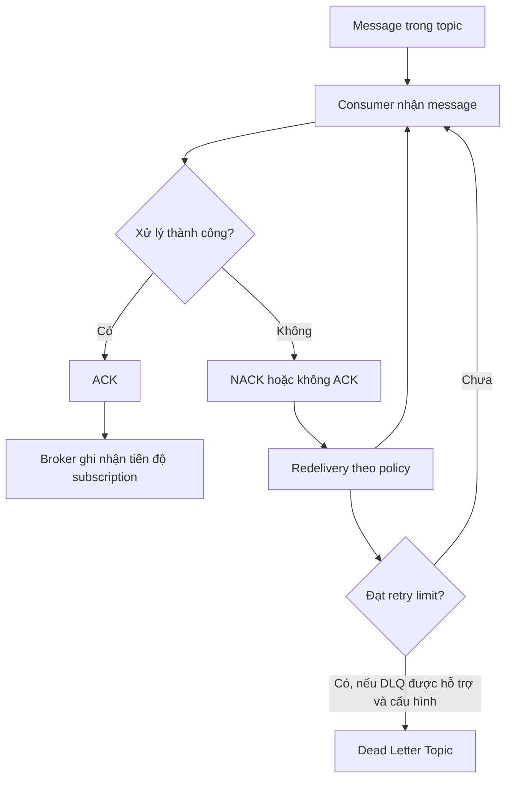

# Kiểm tra cơ chế ack, redelivery và DLQ theo phiên bản binder

## Mục tiêu

Trong Apache Pulsar, consumer phải xác nhận (acknowledge) một message sau khi xử lý thành công. Nếu message chưa được xác nhận, consumer có thể bị dừng hoặc gửi negative acknowledgment (nack), broker có thể giao lại message. Khi một message thất bại nhiều lần, **Dead Letter Topic (DLT/DLQ)** có thể cách ly nó để điều tra hoặc xử lý lại.

Spring Cloud Stream Pulsar binder nối mô hình function và binding với consumer của Pulsar. Tuy nhiên, cơ chế ack, redelivery và dead-letter chịu ảnh hưởng của nhiều lớp: Spring Cloud Stream, Pulsar binder, Spring for Apache Pulsar, Pulsar client và Pulsar broker. Tên thuộc tính, mặc định và phạm vi hỗ trợ có thể thay đổi giữa các phiên bản.

Bài học này tập trung vào cách kiểm tra hành vi thực tế theo phiên bản binder đang dùng. Bạn sẽ phân biệt ack thành công, nack và ack timeout; hiểu retry của framework khác redelivery của broker; cấu hình consumer properties theo binding; xác minh điều kiện dùng DLQ; và viết integration test để chứng minh message được giao lại hoặc cách ly đúng như mong muốn.

Sau bài học, bạn có thể:

- Mô tả vòng đời delivery, ack, nack và redelivery của Pulsar.
- Phân biệt ack timeout với negative acknowledgment.
- Phân biệt ack modes của Spring for Apache Pulsar với cấu hình consumer của Spring Cloud Stream binder.
- Đặt ack, retry và dead-letter properties ở đúng namespace và đúng binding.
- Hiểu vì sao maxRedeliverCount có thể không đạt ngưỡng nếu chỉ dùng negative acknowledgment.
- Chọn subscription type tương thích với native dead-letter policy của phiên bản Pulsar.
- Kiểm tra tên DLT, retry topic, partitioned topic và quyền truy cập.
- Kiểm thử hành vi trên đúng binder/client/broker version trước khi triển khai.

## 1. Vòng đời delivery và acknowledgment

Pulsar lưu message trong topic và theo dõi tiến độ theo subscription. Khi consumer nhận message, broker giữ message trong backlog cho đến khi subscription xác nhận xử lý thành công. Ack cho broker biết message đã được xử lý; nack cho biết consumer chưa xử lý thành công và yêu cầu giao lại.

Luồng đơn giản:



Các khái niệm:

- **ACK:** xác nhận message đã được xử lý thành công.
- **NACK:** báo xử lý thất bại và yêu cầu broker giao lại theo redelivery policy.
- **Unacknowledged message:** message đã giao nhưng subscription chưa xác nhận.
- **Redelivery:** broker giao lại message chưa được ack hoặc đã bị nack.
- **DLQ/DLT:** topic nhận message sau khi đạt điều kiện dead-letter.
- **Retry Letter Topic (retry topic):** topic lưu message cần thử lại sau một khoảng trễ, trước khi chuyển sang DLT nếu vượt giới hạn.

Pulsar chỉ loại message khỏi backlog của subscription khi subscription đó đã ack. Một message có thể được giao nhiều lần; vì vậy, consumer cần idempotency theo event ID hoặc message ID nếu side effect có thể bị lặp.

### Individual và cumulative acknowledgment

Pulsar hỗ trợ hai cách ack:

- **Individual ack:** xác nhận riêng từng message.
- **Cumulative ack:** xác nhận message cuối cùng và mọi message trước nó trong thứ tự của subscription.

Shared và Key_Shared dùng nhiều consumer cùng một subscription, vì vậy cần individual ack. Cumulative ack không phù hợp với các subscription type này. Với Exclusive hoặc Failover, cumulative ack có thể được sử dụng theo semantics của subscription.

Khi xử lý song song, không được cumulative-ack một message mới hơn nếu còn message cũ hơn chưa xử lý xong. Làm vậy có thể xác nhận tiến độ vượt qua công việc chưa hoàn tất.

## 2. NACK và ack timeout là hai cơ chế khác nhau

Pulsar có hai cách phổ biến để yêu cầu redelivery:

| Cơ chế | Khi nào kích hoạt | Cấu hình chính | Điểm cần chú ý |
|---|---|---|---|
| Negative acknowledgment | Ứng dụng biết message xử lý thất bại | `negativeAckRedeliveryDelay` hoặc binder `ack.redelivery-delay` | Phù hợp khi handler phát hiện lỗi ngay |
| Acknowledgment timeout | Message đã giao nhưng không được ack trong thời gian quy định | `ackTimeoutMillis` hoặc binder `ack.timeout` | Là cơ chế dự phòng; timeout quá ngắn gây redelivery không cần thiết |

### Negative acknowledgment

Khi handler phát hiện lỗi có thể thử lại, consumer có thể nack message. Pulsar sẽ giao lại sau khoảng chờ cấu hình. Nếu không cấu hình delay riêng, Pulsar client thường dùng thời gian mặc định một phút.

NACK phù hợp khi ứng dụng biết ngay rằng xử lý thất bại, ví dụ database tạm thời không truy cập được. Không nên nack liên tục với delay rất ngắn khi dependency đang quá tải; điều đó tạo vòng lặp nóng và tăng tải.

### Acknowledgment timeout

Mặc định, ack timeout của Pulsar bị tắt. Khi timeout lớn hơn 0, client theo dõi các message chưa được ack. Nếu quá thời gian mà message vẫn chưa được xác nhận, client yêu cầu broker giao lại.

Timeout là một safety net cho trường hợp consumer treo hoặc mất kết nối. Hãy đặt timeout lớn hơn thời gian xử lý bình thường ở percentile cao, cộng thời gian chờ dependency và độ trễ mạng. Nếu timeout thấp hơn thời gian xử lý hợp lệ, cùng một message có thể được giao cho consumer khác trong khi lần xử lý đầu vẫn còn chạy.

Nếu xử lý thất bại đã được phát hiện trong code, ưu tiên nack có chủ đích. Ack timeout nên bảo vệ trường hợp không thể hoàn tất hoặc không thể gửi ack, không nên thay thế toàn bộ error handling.

### Backoff

Có thể tăng dần khoảng chờ redelivery bằng backoff. Ví dụ min 1 giây, max 60 giây và multiplier 2:

| Lần redelivery | Khoảng chờ minh họa |
|---:|---:|
| 1 | 1 giây |
| 2 | 2 giây |
| 3 | 4 giây |
| 4 | 8 giây |
| 5 | 16 giây |
| 6 trở đi | Tối đa 60 giây |

Backoff giúp giảm áp lực lên hệ thống đang lỗi. Cần đặt retry budget và thời gian tổng thể rõ ràng; backoff không làm một lỗi dữ liệu vĩnh viễn tự biến mất.

## 3. Phân biệt Spring Cloud Stream binder với @PulsarListener

Đây là điểm quan trọng khi đọc tài liệu theo phiên bản.

Spring for Apache Pulsar cung cấp listener container cho endpoint `@PulsarListener`. Tài liệu Spring Pulsar mô tả các ack mode:

- `BATCH`: mặc định trong listener container; xác nhận batch theo semantics của container.
- `RECORD`: xác nhận hoặc nack từng record khi xử lý từng record.
- `MANUAL`: ứng dụng gọi `Acknowledgment.acknowledge()` hoặc `nack()`.

Ví dụ của Spring Pulsar listener:

```java
@PulsarListener(
        subscriptionName = "orders-subscription",
        topics = "persistent://acme/orders/orders",
        ackMode = AckMode.MANUAL
)
void listen(Message<String> message, Acknowledgment acknowledgment) {
    try {
        orderService.process(message.getValue());
        acknowledgment.acknowledge();
    }
    catch (TransientDataAccessException ex) {
        acknowledgment.nack();
    }
}
```

Đây là API của `@PulsarListener`. Không mặc định rằng thuộc tính `ackMode` hoặc tham số `Acknowledgment` sẽ được cung cấp cho một function `Consumer<OrderEvent>` chạy qua Spring Cloud Stream Pulsar binder.

Functional binding được binder triển khai bằng consumer adapter và error infrastructure của binder. Binder có extended consumer properties riêng, đồng thời kế thừa nhiều consumer properties của Spring for Apache Pulsar/Spring Boot. Hãy kiểm tra tài liệu và cấu hình của đúng binder version để biết thuộc tính nào thực sự được expose cho binding.

### Đừng trộn hai namespace

| Nhu cầu | API/namespace cần kiểm tra |
|---|---|
| Function/Consumer input binding | `spring.cloud.stream.bindings.<binding>` |
| Pulsar consumer properties riêng binding | `spring.cloud.stream.pulsar.bindings.<binding>.consumer` |
| Pulsar properties áp dụng toàn binder | `spring.cloud.stream.pulsar.binder.consumer` |
| Spring Boot Pulsar consumer properties toàn ứng dụng | `spring.pulsar.consumer` |
| Ack mode của `@PulsarListener` | `ackMode` trên annotation/listener container, nếu phiên bản hỗ trợ |

Trong binder hiện hành, extended binding properties có độ ưu tiên cao hơn binder properties, và binder properties có độ ưu tiên cao hơn Spring Boot properties. Điều này cho phép một binding có ack/redelivery policy riêng mà không làm thay đổi các binding khác.

Không đặt `spring.pulsar.listener.ack-mode: MANUAL` rồi giả định function binding tự chuyển sang manual ack. Nếu cần manual ack ở cấp ứng dụng, trước hết xác nhận binder version có extension point/API tương ứng; nếu không, hãy dùng mô hình listener phù hợp thay vì dựa vào một thuộc tính không được binder expose.

## 4. Kiểm tra phiên bản trước khi cấu hình

Pulsar binder đã có các dòng triển khai và dependency khác nhau. Khi đọc ví dụ, cần xác định ví dụ thuộc đúng họ thư viện:

- Binder hiện hành được tài liệu Spring Cloud Stream mô tả với dependency `org.springframework.pulsar:spring-pulsar-spring-cloud-stream-binder`.
- Các bản binder cũ/đời thử nghiệm có thể dùng package, property class và cách tích hợp khác.
- Spring Cloud Stream, Spring Boot, Spring for Apache Pulsar, Pulsar Java client và Pulsar broker cần có bộ phiên bản tương thích.
- Một thuộc tính có trong Pulsar Java client chưa chắc được binder version cũ expose thành YAML property.
- Một tính năng có trong Pulsar broker mới chưa chắc có trong Pulsar client hoặc Spring Pulsar version đang chạy.

Tài liệu Spring Cloud Stream hiện công bố nhiều nhánh ổn định song song, chẳng hạn 4.1.x, 4.2.x, 4.3.x và 5.0.x. Hãy mở trang reference đúng nhánh mà dự án dùng; không lấy property từ trang snapshot hoặc bản mới nhất rồi áp dụng trực tiếp vào một ứng dụng cũ.

### Checklist xác định phiên bản

1. Xác định artifact binder thực tế trong dependency graph.
2. Ghi lại version Spring Cloud Stream và Spring Boot.
3. Xác định version Spring for Apache Pulsar và Pulsar client được resolve.
4. Xác định broker version và subscription type đang dùng.
5. Mở reference guide/API của đúng release.
6. Kiểm tra property metadata hoặc class cấu hình của đúng release để xác nhận YAML path.
7. Chạy application context test để phát hiện property không được bind.
8. Chạy broker integration test để xác minh hành vi ack/redelivery/DLQ.

Ví dụ kiểm tra dependency với Maven:

```bash
mvn dependency:tree -Dincludes=org.springframework.pulsar,org.springframework.cloud:spring-cloud-stream
```

Khi version được quản lý bằng Spring Cloud BOM, hãy để BOM quyết định các dependency tương thích. Tránh nâng riêng Pulsar client hoặc Spring Pulsar mà không kiểm tra ma trận tương thích.

## 5. Các consumer properties của binder hiện hành

Trong binder hiện hành, consumer extended properties hỗ trợ cấu hình Pulsar consumer ở cấp binding. Một số trường ack được ánh xạ sang native Pulsar consumer properties:

| Binder property | Native Pulsar property | Ý nghĩa |
|---|---|---|
| `consumer.ack.timeout` | `ackTimeoutMillis` | Thời gian chờ ack trước khi yêu cầu redelivery |
| `consumer.ack.redelivery-delay` | `negativeAckRedeliveryDelayMicros` | Khoảng chờ sau nack |
| `consumer.ack.group-time` | `acknowledgementsGroupTimeMicros` | Gom các ack trước khi gửi đến broker |
| `consumer.ack.timeout-tick-duration` | `tickDurationMillis` | Độ chính xác của bộ theo dõi ack timeout |
| `consumer.ack.batch-index-enabled` | `batchIndexAckEnabled` | Theo dõi ack theo index trong batch |
| `consumer.retry-enable` | `retryEnable` | Bật cơ chế retry topic của Pulsar |
| `consumer.dead-letter-policy` | `deadLetterPolicy` | Chính sách retry/DLQ native |

Trong source hiện hành, các giá trị mặc định của nhóm ack bao gồm: timeout bằng 0 (tắt), redelivery delay một phút, group time 100 ms và timeout tick một giây. Đây là thông tin theo implementation hiện hành; luôn kiểm tra default của release đang dùng trước khi dựa vào chúng trong production.

### Ví dụ cấu hình theo binding

Giả sử function `processOrders` nhận message từ topic đơn hàng:

```yaml
spring:
  cloud:
    function:
      definition: processOrders
    stream:
      bindings:
        processOrders-in-0:
          destination: persistent://acme/orders/orders
          group: inventory-service
      pulsar:
        bindings:
          processOrders-in-0:
            consumer:
              subscription:
                type: Shared
              ack:
                timeout: 90s
                redelivery-delay: 10s
                timeout-tick-duration: 1s
                group-time: 100ms
              retry-enable: true
              dead-letter-policy:
                max-redeliver-count: 5
                retry-letter-topic: persistent://acme/orders/orders-retry
                dead-letter-topic: persistent://acme/orders/orders-dlq
                initial-subscription-name: orders-dlq-reader
```

Ý nghĩa:

- `processOrders-in-0` là tên input binding.
- `destination` là topic nguồn.
- `group` xác định logical consumer/subscription theo cơ chế provision của binder.
- `subscription.type` chọn loại subscription của Pulsar.
- `ack.timeout` là ngưỡng dự phòng cho message chưa được ack.
- `ack.redelivery-delay` đặt thời gian chờ khi message bị nack.
- `retry-enable` bật cơ chế retry topic của Pulsar.
- `dead-letter-policy` đặt retry limit, retry topic và DLT.
- `initial-subscription-name` yêu cầu tạo subscription ban đầu cho DLT nếu broker cho phép auto subscription creation.

Ví dụ dùng `Shared` làm baseline tương thích rộng cho native DLQ. Hãy xác nhận property và kiểu subscription có trong đúng binder/client version. Không copy nguyên YAML sang một binder cũ mà chưa kiểm tra cấu hình metadata.

### Cấu hình toàn binder và theo binding

Nếu đặt consumer properties ở `spring.cloud.stream.pulsar.binder.consumer`, chúng có thể áp dụng cho nhiều binding. Nếu mỗi function cần policy khác nhau, đặt ở `spring.cloud.stream.pulsar.bindings.<binding-name>.consumer`.

Ví dụ:

```yaml
spring:
  cloud:
    stream:
      pulsar:
        bindings:
          processOrders-in-0:
            consumer:
              ack:
                timeout: 90s
          processPayments-in-0:
            consumer:
              ack:
                timeout: 30s
```

Không cấu hình cùng một binding ở nhiều cấp mà không kiểm tra precedence. Giá trị ở extended binding có thể ghi đè giá trị chung của binder hoặc Spring Boot.

## 6. ACK trong functional consumer và xử lý exception

Một function consumer thường xử lý payload:

```java
@Bean
Consumer<OrderCreated> processOrders(OrderService service) {
    return event -> service.process(event);
}
```

Ở mức ứng dụng, quy ước cần giữ:

- Khi nghiệp vụ hoàn tất thành công, handler kết thúc bình thường để binder/container có thể xác nhận message theo cơ chế của phiên bản đó.
- Khi nghiệp vụ chưa hoàn tất, không nuốt exception rồi trả về như thể thành công.
- Nếu lỗi có thể phục hồi, cho error handling của binder/broker thực hiện retry/redelivery theo policy đã cấu hình.
- Nếu lỗi không thể phục hồi, dùng error handling và dead-letter policy đã được kiểm chứng để cách ly message.
- Nếu database commit xong nhưng ack chưa tới broker, message có thể được giao lại; consumer cần idempotency.

Không bắt mọi exception rồi chỉ ghi log. Nếu function trả về bình thường sau khi side effect thất bại, framework có thể xem handler đã thành công và message có thể được ack. Ngược lại, ném exception không tự đảm bảo message sẽ vào DLT; nó chỉ khởi động error path, còn kết quả cuối phụ thuộc retry, binder và broker configuration.

### Retry của Spring Cloud Stream và redelivery của Pulsar

Đây là hai tầng khác nhau:

| Tầng | Cơ chế | Phạm vi |
|---|---|---|
| Spring Cloud Stream | Consumer retry/error handling như `max-attempts` | Thử lại lời gọi handler trong error infrastructure của framework |
| Pulsar client/broker | NACK và ack timeout | Giao lại message theo subscription |
| Pulsar retry topic | `retryEnable` và retry letter topic | Lưu message thất bại để thử lại sau |
| Pulsar dead-letter policy | `maxRedeliverCount` và DLT | Cách ly message sau retry limit được broker/client ghi nhận |

Không cộng các con số retry một cách máy móc. Một lần function được gọi lại bởi framework không nhất thiết tương đương một lần message được broker redeliver. Hãy đo số lần handler chạy và số lần delivery/redelivery thực tế trên broker.

Nếu ứng dụng dùng retry ở cả framework và broker, tổng thời gian và số lần thử có thể vượt dự kiến. Đặt một retry budget có chủ đích, xác định tầng nào chịu trách nhiệm retry và kiểm thử exception path của đúng binder version.

## 7. Retry Letter Topic và Dead Letter Topic

Retry topic và DLT có mục đích khác nhau:

- Retry topic lưu message thất bại để consumer thử lại sau một khoảng trễ.
- DLT giữ message đã vượt retry limit để điều tra, sửa dữ liệu hoặc replay có kiểm soát.

Pulsar native `DeadLetterPolicy` có các thuộc tính quan trọng:

| Thuộc tính | Vai trò |
|---|---|
| `max-redeliver-count` | Số lần redelivery tối đa theo cơ chế được Pulsar ghi nhận |
| `retry-letter-topic` | Topic lưu message cần thử lại sau |
| `dead-letter-topic` | Topic nhận message đã vượt retry policy |
| `initial-subscription-name` | Tên subscription ban đầu được tạo cho DLT, nếu broker cho phép |

`max-redeliver-count` phải là số dương. Nếu không chỉ định tên DLT, Pulsar có thể sinh tên mặc định dựa trên topic và subscription. Với partitioned topic, tên mặc định có thể bao gồm hậu tố partition; nên đặt DLT rõ ràng để dễ vận hành và giám sát.

### Cảnh báo quan trọng: NACK counter không nhất thiết bền vững

Trong Pulsar 5.0, tài liệu broker nêu rõ bộ đếm redelivery của negative acknowledgment chỉ được giữ trong bộ nhớ. Khi broker đóng dispatcher do restart, bundle unload/rebalance, topic unload hoặc consumer disconnect, bộ đếm có thể reset. Khi đó `DeadLetterPolicy.maxRedeliverCount` có thể không bao giờ đạt ngưỡng và message tiếp tục redelivery vô hạn.

Nếu cần retry limit đáng tin cậy qua các sự kiện vận hành đó, dùng retry letter topic với `retryEnable: true`. Retry count được lưu trong message property và có thể tồn tại qua broker/consumer lifecycle. Hãy xác minh hành vi này với Pulsar broker/client version đang triển khai; không giả định mọi bản cũ có cùng semantics.

### Điều kiện subscription type

Tài liệu giữa các phiên bản có khác biệt:

- Tài liệu Spring for Apache Pulsar 1.2.x mô tả native DeadLetterPolicy cho Shared subscription.
- Tài liệu Apache Pulsar 5.0.x mô tả DLT được hỗ trợ với Shared và Key_Shared.
- Exclusive và Failover có semantics ordering riêng; native DLQ có thể không được hỗ trợ theo phiên bản.

Vì vậy, Shared là lựa chọn baseline khi cần native DLQ. Chỉ chọn Key_Shared sau khi xác minh đúng Pulsar broker, client và Spring Pulsar version. Nếu cần DLT với Exclusive/Failover, kiểm tra khả năng error handler ở đúng integration API; không giả định native DeadLetterPolicy tự hỗ trợ.

### Tạo subscription ban đầu cho DLT

Tạo DLT topic không đồng nghĩa đã có consumer subscription đọc nó. Nếu không có subscription và retention phù hợp, message trên DLT có thể không được giữ theo kỳ vọng của quy trình xử lý. Có thể dùng `initial-subscription-name` nếu phiên bản hỗ trợ và broker bật `allowAutoSubscriptionCreation`. Kiểm tra cấu hình namespace/broker trước khi bật.

## 8. Vì sao chỉ dùng NACK có thể không đưa message vào DLQ?

Một tình huống nguy hiểm:

1. Consumer nhận message.
2. Handler thất bại và gửi NACK.
3. Pulsar redeliver message.
4. Redelivery counter chỉ nằm trong bộ nhớ.
5. Broker restart hoặc dispatcher bị đóng, counter reset.
6. Message tiếp tục redelivery và không đạt `maxRedeliverCount`.

Nếu ứng dụng cần giới hạn retry bền vững, cấu hình retry topic và bật retry support:

```yaml
spring:
  cloud:
    stream:
      pulsar:
        bindings:
          processOrders-in-0:
            consumer:
              retry-enable: true
              dead-letter-policy:
                max-redeliver-count: 5
                retry-letter-topic: persistent://acme/orders/orders-retry
                dead-letter-topic: persistent://acme/orders/orders-dlq
```

Kiểm thử bằng cách làm handler thất bại nhiều lần, restart consumer hoặc broker trong lúc retry, rồi xác minh message cuối cùng có đến DLT. Nếu chỉ test liên tục trong một process mà không restart, bạn có thể bỏ sót lỗi counter không bền vững.

## 9. Batch, batch index acknowledgment và redelivery

Batching có thể thay đổi phạm vi redelivery. Nếu nhiều message được nhận trong cùng batch và batch index acknowledgment không bật hoặc không được hỗ trợ, một message lỗi có thể khiến các message khác trong batch bị giao lại cùng nó. Điều này làm tăng số lần xử lý lặp dù một số record đã hoàn thành.

Cần xác minh:

- Function/binder đang nhận từng record hay batch.
- Ack được gửi theo từng message hay theo batch.
- Broker/client version có hỗ trợ batch index acknowledgment không.
- Binder version expose property `ack.batch-index-enabled` hay không.
- Khi một record lỗi, các record đã thành công có bị redelivery không.

Trong Spring for Apache Pulsar listener container, `RECORD` ack mode không được phép với batch listener; manual ack có thể dùng MessageId để xác nhận từng record. Đây là behavior của listener container. Với Spring Cloud Stream binder, chỉ áp dụng nếu phiên bản binder thực sự dùng cùng API/container và expose cấu hình tương ứng.

Đừng suy ra batch semantics từ tên function `Consumer<List<T>>` mà chưa kiểm tra binder model và consumer adapter. Dùng integration test với nhiều record trong cùng batch và cố tình làm một record thất bại.

## 10. Ví dụ function và error classification

Ví dụ function phân loại lỗi:

```java
@Bean
Consumer<OrderCreated> processOrders(OrderService service) {
    return event -> {
        try {
            service.process(event);
        }
        catch (TransientDependencyException ex) {
            throw ex;
        }
        catch (InvalidOrderEventException ex) {
            throw ex;
        }
    };
}
```

Ví dụ chỉ minh họa việc để lỗi đi vào error handling. Policy retry hay dead-letter cần được cấu hình ở đúng tầng. Trong production, có thể dùng error handler để phân loại lỗi:

| Loại lỗi | Ví dụ | Chính sách gợi ý |
|---|---|---|
| Tạm thời | Database timeout, service 503 | Retry có backoff, sau giới hạn chuyển DLT |
| Dữ liệu vĩnh viễn | Payload sai schema, thiếu field bắt buộc | Hạn chế retry; cách ly sớm nếu error handler hỗ trợ |
| Nghiệp vụ | Đơn đã hủy, trạng thái không hợp lệ | Phát kết quả nghiệp vụ hoặc cách ly theo contract |
| Hạ tầng | Credential hết hạn, topic không truy cập được | Cảnh báo và khôi phục hạ tầng; retry vô hạn có thể che giấu sự cố |
| Bug code | Null pointer, mapper lỗi | Giới hạn retry, giữ message để điều tra và replay sau khi sửa |

Nếu binder chỉ cung cấp retry chung cho mọi exception, hãy kiểm tra extension point để phân loại lỗi. Không tự giả định `max-attempts` biết lỗi nào là vĩnh viễn.

## 11. DLT consumer, điều tra và replay

DLT là vùng cách ly, không phải queue xử lý nghiệp vụ thứ hai. Mỗi message cần metadata đủ để điều tra:

- Event ID và event type.
- Topic nguồn và subscription.
- Message ID và key.
- Thời điểm publish, thời điểm dead-letter.
- Redelivery/retry count nếu broker/client cung cấp.
- Exception class và lỗi đã được làm sạch.
- Schema/version và correlation ID.
- Binder/client/broker version dùng khi message bị lỗi.

Không log toàn bộ payload nếu có dữ liệu nhạy cảm. Giới hạn kích thước exception metadata và che token, credential hoặc thông tin cá nhân.

Quy trình replay:

1. Xác định nguyên nhân message vào DLT.
2. Sửa lỗi code, schema hoặc dependency.
3. Xác minh consumer mới có thể đọc payload cũ.
4. Chọn message theo event ID, thời gian hoặc loại lỗi.
5. Replay sang topic/luồng được kiểm soát.
6. Giữ event ID gốc để consumer deduplicate.
7. Giới hạn tốc độ và batch replay.
8. Ghi audit trail và đối soát kết quả.

Không tự động publish mọi message từ DLT về topic gốc ngay khi DLT consumer nhận được. Nếu lỗi chưa được sửa, message sẽ tạo vòng lặp retry/DLT và tăng tải.

## 12. Kiểm tra DLT với partitioned topic

Pulsar partitioned topic được triển khai thành nhiều partition topic. Tên DLT mặc định có thể được tạo dựa trên tên topic partition và subscription. Điều đó có thể tạo nhiều DLT khác nhau thay vì một topic dễ quan sát.

Vì vậy:

- Đặt tên DLT tường minh trong `dead-letter-topic`.
- Xác minh topic có đúng partition count/namespace.
- Kiểm tra quyền publish của consumer vào retry/DLT topics.
- Kiểm tra quyền consume của DLT processor.
- Xác minh subscription ban đầu và retention của DLT.
- Test một message lỗi từ mỗi partition.

Không chỉ kiểm tra một partition rồi suy ra mọi partition hoạt động giống nhau. Kiểm tra tên topic thực tế trong Pulsar Admin hoặc công cụ quản trị sau khi binder provision.

## 13. Kiểm thử ack, redelivery và DLQ theo phiên bản

Test Binder kiểm tra wiring và function behavior ở mức Spring Cloud Stream, nhưng không chứng minh broker thực sự nack, redeliver hoặc chuyển message vào DLT. Cần integration test với Pulsar broker tương thích phiên bản production.

### Ma trận kiểm thử cơ bản

| Tình huống | Thao tác test | Kết quả cần xác minh |
|---|---|---|
| Xử lý thành công | Handler hoàn tất bình thường | Message được ack, không redeliver |
| Handler ném exception | Gây lỗi xử lý | Error path đúng; xác định framework retry hay broker nack |
| NACK | Kích hoạt lỗi có chủ đích | Message được giao lại sau delay đã cấu hình |
| Ack timeout | Giữ message chưa ack lâu hơn timeout | Message redeliver; không tạo duplicate ngoài dự kiến |
| Retry topic | Bật retryEnable và gây lỗi | Message được lưu vào retry topic, thử lại sau delay |
| Retry limit | Tiếp tục gây lỗi đến maxRedeliverCount | Message được chuyển sang DLT |
| Broker restart | Restart khi message đang retry | Retry count và DLT behavior vẫn đúng |
| Consumer crash | Dừng process trước ack | Message được giao lại khi consumer khởi động lại |
| Partitioned topic | Gây lỗi trên nhiều partition | DLT name/routing đúng cho từng partition |
| Subscription type | Chạy Shared/Key_Shared/Failover/Exclusive | Native DLQ chỉ hoạt động ở loại được version hỗ trợ |
| Batch | Cho một record trong batch thất bại | Phạm vi redelivery đúng với batch ack policy |
| DLQ subscription | Tạo DLT và kiểm tra subscription | Message được giữ và DLT consumer đọc được |

### Kiểm thử từng tầng

**Unit test:**

- Logic phân loại lỗi.
- Event ID ổn định.
- Idempotency khi message được giao lại.
- Retry budget ở tầng service nếu có.
- Dữ liệu metadata cần giữ khi cách ly.

**Application context test:**

- Binding name, destination và group đúng.
- Extended binding properties được bind đúng.
- YAML property có trong version đang dùng.
- Không có cảnh báo property không nhận diện.
- Effective consumer configuration chứa ack, retry và DLQ policy mong muốn.

**Broker integration test:**

- Xác minh ack/nack và redelivery thực tế.
- Xác minh retry count qua broker/consumer restart.
- Xác minh DLT nhận đúng payload và metadata.
- Xác minh partitioned topic và subscription type.
- Xác minh quyền truy cập và initial subscription.
- Xác minh message không bị mất khi DLT publish hoặc retry topic tạm thời không khả dụng.

### Ghi nhận version trong test report

Mỗi test run nên ghi:

- Spring Cloud Stream version.
- Pulsar binder artifact/version.
- Spring for Apache Pulsar version.
- Pulsar Java client version.
- Pulsar broker version.
- Subscription type.
- Retry/DLQ properties hiệu lực.

Nếu test chỉ ghi "Pulsar DLQ passed" mà không ghi version, kết quả khó tái hiện sau khi nâng cấp dependency.

## 14. Quan sát trong production

Theo dõi các chỉ số:

| Metric | Ý nghĩa | Cảnh báo khi |
|---|---|---|
| Subscription backlog | Số message chưa được ack | Tăng liên tục hoặc vượt SLA |
| Unacked message count | Message đã giao nhưng chưa ack | Tăng bất thường |
| Redelivery rate | Tần suất message được giao lại | Tăng đột biến |
| Retry topic backlog | Message đang chờ retry | Tuổi message vượt retry SLA |
| DLT depth | Số message đã dead-letter | Có message mới hoặc tăng nhanh |
| Oldest DLT message age | Tuổi message lỗi lâu nhất | Vượt thời gian xử lý sự cố |
| Ack latency | Thời gian từ receive đến ack | Vượt timeout hoặc SLA |
| Consumer processing latency | Thời gian xử lý handler | Gần hoặc vượt ack timeout |
| Consumer count | Số consumer đang hoạt động | Bằng 0 khi service phải hoạt động |
| Error rate | Lỗi handler/deserialization/dependency | Tăng theo event type hoặc partition |

Khi backlog tăng, phân biệt consumer chậm với message bị poison. Redelivery rate cao cùng một event ID lặp lại có thể cho thấy lỗi không thể phục hồi hoặc retry delay quá thấp. DLT depth tăng cho biết cần quy trình điều tra, không chỉ tăng số consumer.

## 15. Lỗi thường gặp

| Triệu chứng | Nguyên nhân có thể | Cách xử lý |
|---|---|---|
| Handler thành công nhưng message vẫn redeliver | Ack không được gửi/ghi nhận hoặc timeout quá ngắn | Kiểm tra ack path, timeout và processing duration |
| Handler thất bại nhưng message biến mất | Exception bị nuốt hoặc đường xử lý xem là thành công | Để lỗi đi vào error handling và kiểm tra ack |
| NACK liên tục nhưng không vào DLT | Redelivery counter không bền vững hoặc subscription không hỗ trợ | Dùng retry topic + enableRetry, xác minh subscription type |
| DLT không được tạo/không publish | Thiếu quyền, topic name sai hoặc broker không cho auto subscription | Kiểm tra policy, ACL, topic và initial subscription |
| DLT bị chia thành nhiều topic | Dùng tên mặc định với partitioned topic | Đặt dead-letter-topic tường minh |
| Consumer dùng Key_Shared nhưng DLT không hoạt động | Binder/client/broker version chưa hỗ trợ | Dùng Shared hoặc xác minh compatibility matrix |
| Đặt AckMode nhưng binder không đổi hành vi | Nhầm API @PulsarListener với functional binding | Kiểm tra binder extended consumer properties |
| Message bị giao lại nhiều lần khi xử lý lâu | Ack timeout thấp hơn thời gian xử lý | Tăng timeout có đo lường hoặc dùng nack có chủ đích |
| Batch có nhiều record bị lặp | Batch index ack không bật/hỗ trợ hoặc semantics batch khác dự kiến | Kiểm thử batch và cấu hình ack index theo version |
| Upgrade binder làm mất property | Property đổi tên hoặc không còn được expose | Đọc config metadata/reference của release mới |
| Retry số lần lớn hơn mong đợi | Retry framework và broker cùng hoạt động | Đặt retry budget một tầng chính và đo delivery count |
| DLT consumer không nhận message | DLT chưa có subscription hoặc ACL không đủ | Tạo initial subscription và cấp quyền consume |

## 16. Quy trình xác minh trước khi phát hành

Trước khi bật ack/redelivery/DLQ trong production:

1. Chốt artifact và version của Pulsar binder.
2. Đối chiếu Spring Boot, Spring Pulsar, Pulsar client và broker version.
3. Kiểm tra property metadata của consumer extended binding.
4. Xác định subscription name và subscription type thực tế.
5. Chọn ack timeout, nack delay và backoff dựa trên thời gian xử lý đo được.
6. Quyết định dùng retry topic hay chỉ redelivery.
7. Nếu cần retry limit bền vững, kiểm tra retryEnable và retryLetterTopic.
8. Đặt DLT tường minh, đặc biệt với partitioned topic.
9. Kiểm tra initial subscription, retention và ACL của retry/DLT.
10. Test handler success, exception, nack, timeout, restart và broker restart.
11. Xác minh message đến DLT và có thể được replay.
12. Ghi lại version và effective properties trong runbook.

## 17. Tài liệu đối chiếu theo phiên bản

Khi nâng cấp binder hoặc Pulsar, hãy đối chiếu lại các tài liệu chính thức tương ứng với version đã resolve:

- [Spring Cloud Stream Pulsar Binder Reference](https://docs.spring.io/spring-cloud-stream/reference/pulsar/pulsar_binder.html) — dependency, binding properties, property precedence và cấu hình topic.
- [Spring for Apache Pulsar 1.2.x Message Consumption](https://docs.spring.io/spring-pulsar/docs/1.2.x/reference/reference/pulsar/message-consumption.html) — ack mode, manual acknowledgment, timeout, nack, DeadLetterPolicy và error handler của listener container.
- [Apache Pulsar 5.0.x Messaging](https://pulsar.apache.org/docs/5.0.x/concepts-messaging/) — broker/client semantics cho ack, redelivery, retry letter topic và dead-letter topic.
- [Pulsar binder ConsumerConfigProperties source](https://github.com/spring-cloud/spring-cloud-stream/blob/main/binders/pulsar-binder/spring-cloud-stream-binder-pulsar/src/main/java/org/springframework/cloud/stream/binder/pulsar/properties/ConsumerConfigProperties.java) — ánh xạ các extended consumer properties trong nhánh source hiện hành.

Trang reference của binder liệt kê nhiều release line ổn định. Chọn phiên bản tài liệu trùng với binder trong dependency graph; source trên nhánh main chỉ dùng để hiểu implementation hiện hành, không thay thế source JAR hoặc reference của release đang chạy.

## Kết luận

Pulsar ACK xác nhận message đã xử lý; NACK yêu cầu redelivery; ack timeout là cơ chế dự phòng cho message chưa được xác nhận; retry topic trì hoãn việc thử lại; DLT cách ly message vượt giới hạn. Các cơ chế này có semantics riêng và phụ thuộc subscription type, Pulsar client/broker version và cách Spring Cloud Stream binder tích hợp Spring for Apache Pulsar.

Trong functional binding, cấu hình consumer properties ở đúng extended binding namespace của Pulsar binder. Không nhầm ack mode của `@PulsarListener` với thuộc tính mà binder expose. Đặc biệt, kiểm tra độ bền của redelivery counter: với Pulsar 5.0, NACK counter có thể reset khi dispatcher đóng; nếu cần giới hạn retry đáng tin cậy, dùng retry topic và bật retry support. Chọn Shared làm baseline cho native DLQ trừ khi compatibility matrix xác nhận subscription type khác được hỗ trợ.

Chỉ xem cấu hình là hoàn tất khi integration test trên đúng binder/client/broker version chứng minh message được ack sau thành công, redeliver đúng khi thất bại, đến DLT sau retry limit và vẫn giữ hành vi mong đợi qua consumer/broker restart.

