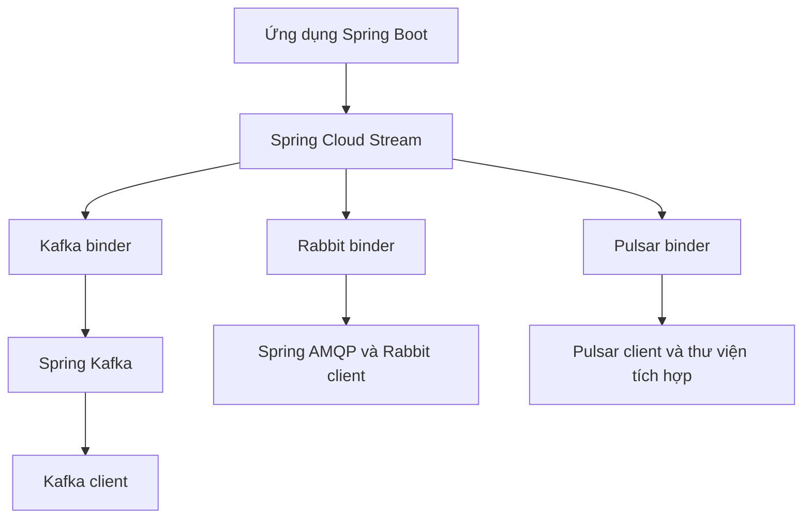

# Kiểm tra dependency tree và xử lý xung đột thư viện

Một ứng dụng Spring Cloud Stream thường không chỉ phụ thuộc vào một thư viện. Spring Boot cung cấp nền tảng ứng dụng; Spring Cloud Stream cung cấp mô hình hàm, binding và abstraction cho binder; binder kết nối với Kafka, RabbitMQ hoặc Pulsar; mỗi binder lại kéo theo client và các thư viện tích hợp. Ngoài ra, ứng dụng có thể dùng cơ sở dữ liệu, serializer, metrics và thư viện dùng chung khác. Một phiên bản không tương thích ở bất kỳ mắt xích nào cũng có thể làm ứng dụng lỗi khi biên dịch hoặc chỉ lỗi lúc khởi động và chạy.

Dependency tree cho biết thư viện nào được đưa vào classpath, thư viện đó đến từ dependency trực tiếp hay gián tiếp, phiên bản nào được chọn và đường phụ thuộc nào đã yêu cầu nó. Biết cách đọc cây phụ thuộc giúp tìm nguyên nhân trước khi thay đổi phiên bản hoặc thêm exclusion. Mục tiêu là giữ cho Spring Boot, Spring Cloud, Spring Cloud Stream, binder và client broker tương thích trong cùng một ứng dụng.

## 1. Hiểu dependency graph

Một dependency thường được nhận diện bằng tọa độ gồm group, artifact và version (GAV), ví dụ `org.springframework.cloud:spring-cloud-stream`. Group cho biết nhóm phát hành, artifact là thư viện cụ thể và version xác định phiên bản được sử dụng.

Dependency trực tiếp là thư viện được khai báo trong dự án. Dependency bắc cầu (transitive dependency) là thư viện được một dependency khác yêu cầu. Ví dụ, ứng dụng khai báo Kafka binder trực tiếp; binder có thể kéo theo Spring Kafka và Kafka client. Ứng dụng không khai báo Kafka client nhưng client vẫn xuất hiện trong runtime classpath.



Mỗi dependency có thể xuất hiện qua nhiều đường. Chẳng hạn, một thư viện tiện ích có thể kéo theo phiên bản Jackson khác với phiên bản do Spring Boot quản lý. Khi đó công cụ build phải chọn một phiên bản cho cấu hình classpath đang xét. Phiên bản được yêu cầu không nhất thiết là phiên bản cuối cùng được chọn.

Dependency cũng được phân theo phạm vi. Với Gradle, cần chú ý các configuration như `compileClasspath`, `runtimeClasspath`, `testCompileClasspath` và `testRuntimeClasspath`. Với Maven, các scope thường gặp là `compile`, `runtime`, `provided`, `test` và `import`. Một thư viện chỉ có trong test classpath có thể khiến test chạy được trong khi ứng dụng đóng gói hoặc khởi động ở production lại thiếu lớp cần thiết. Vì vậy, hãy kiểm tra đúng classpath gây ra lỗi.

## 2. Những nhóm thư viện cần theo dõi trong Spring Cloud Stream

Khi kiểm tra một ứng dụng xử lý sự kiện, hãy chú ý các nhóm sau:

| Nhóm | Vai trò | Ví dụ cần quan sát |
|---|---|---|
| Spring Boot | Nền tảng, auto-configuration và quản lý dependency | Spring Boot, Spring Framework, Jackson, logging |
| Spring Cloud | Các thành phần tích hợp thuộc cùng release train | Spring Cloud BOM, Spring Cloud Context và các module liên quan |
| Spring Cloud Stream | Function model, binding, message conversion và binder abstraction | `spring-cloud-stream` |
| Kafka binder | Kết nối binding với Kafka | Kafka binder, Spring Kafka, Kafka client |
| Rabbit binder | Kết nối binding với RabbitMQ | Rabbit binder, Spring AMQP, Rabbit client |
| Pulsar binder | Kết nối binding với Pulsar | Pulsar binder, Pulsar client và thư viện Spring tích hợp |
| Kiểm thử | Kiểm tra function và binding | Spring Cloud Stream test binder, thư viện test của Spring Boot |

Một ứng dụng có thể sử dụng nhiều binder nếu thật sự cần gửi hoặc nhận qua nhiều broker. Khi đó mỗi binder có thể đưa thêm một bộ client vào runtime classpath. Đây là cấu hình hợp lệ nếu các binder và client tương thích, nhưng cần kiểm tra kỹ dependency graph và cấu hình binder. Nếu ứng dụng chỉ dùng Kafka mà vô tình kéo cả Rabbit binder hoặc Pulsar binder từ một module dùng chung, hãy xác định dependency nào đưa chúng vào trước khi loại bỏ.

Không suy luận rằng hai thư viện có tên gần nhau chắc chắn tương thích. Ví dụ, Spring Kafka và Kafka client có chu kỳ phát hành riêng; Spring AMQP và Rabbit client cũng vậy. Binder được phát hành để làm việc với một tập phiên bản nền tảng cụ thể. Chỉ nhìn thấy tất cả dependency đều tải được không chứng minh chúng tương thích ở runtime.

## 3. Chọn đúng phiên bản nền tảng và BOM

Spring Boot và Spring Cloud có các dòng phát hành tương thích được công bố trong tài liệu chính thức. Trước khi chọn phiên bản, hãy xác định phiên bản Java mà dự án sử dụng, phiên bản Spring Boot và release train Spring Cloud tương ứng. Sau đó dùng BOM của Spring Cloud để quản lý phiên bản các thành phần Spring Cloud, trong đó có Spring Cloud Stream và binder. Spring Boot tiếp tục quản lý các thư viện nền tảng thuộc phạm vi BOM của Boot.

Không ghép tùy ý một phiên bản Spring Cloud Stream mới với một binder cũ, hoặc nâng riêng Spring Framework/Spring Kafka mà không kiểm tra ma trận tương thích. Việc trộn các thế hệ Spring Framework khác nhau có thể dẫn đến lỗi liên kết lớp, API không tồn tại hoặc auto-configuration không hoạt động. Khi nâng cấp nền tảng, nên nâng theo một tổ hợp phiên bản đã được hỗ trợ.

### Gradle: quản lý dependency bằng Spring Cloud BOM

Ví dụ dùng plugin quản lý dependency để import Spring Cloud BOM. Các giá trị placeholder phải được thay bằng phiên bản Spring Boot, plugin và release train Spring Cloud tương thích theo ma trận phát hành của dự án:

```groovy
plugins {
    id 'java'
    id 'org.springframework.boot' version '<spring-boot-version>'
    id 'io.spring.dependency-management' version '<dependency-management-plugin-version>'
}

ext {
    set('springCloudVersion', '<compatible-spring-cloud-release-train>')
}

dependencyManagement {
    imports {
        mavenBom "org.springframework.cloud:spring-cloud-dependencies:${springCloudVersion}"
    }
}

dependencies {
    implementation 'org.springframework.cloud:spring-cloud-starter-stream-kafka'
    // Chỉ thêm binder RabbitMQ hoặc Pulsar nếu ứng dụng thực sự sử dụng.

    testImplementation 'org.springframework.cloud:spring-cloud-stream-test-binder'
}
```

Một cách khác là khai báo BOM dưới dạng Gradle platform:

```groovy
dependencies {
    implementation platform("org.springframework.cloud:spring-cloud-dependencies:${springCloudVersion}")
    implementation 'org.springframework.cloud:spring-cloud-starter-stream-kafka'
}
```

Chọn một cách quản lý nhất quán theo cấu trúc build của dự án. Không cần ghi phiên bản riêng cho từng module Spring Cloud Stream khi BOM đã quản lý chúng. Nếu dự án đã dùng Spring Boot dependency management, hãy giữ vai trò của BOM Boot và BOM Cloud rõ ràng thay vì thêm nhiều cơ chế ép phiên bản chồng chéo.

### Maven: import Spring Cloud BOM

Trong Maven, khai báo BOM của Spring Cloud ở `dependencyManagement` với scope `import` và type `pom`:

```xml
<properties>
    <spring-cloud.version>COMPATIBLE_RELEASE_TRAIN</spring-cloud.version>
</properties>

<dependencyManagement>
    <dependencies>
        <dependency>
            <groupId>org.springframework.cloud</groupId>
            <artifactId>spring-cloud-dependencies</artifactId>
            <version>${spring-cloud.version}</version>
            <type>pom</type>
            <scope>import</scope>
        </dependency>
    </dependencies>
</dependencyManagement>

<dependencies>
    <dependency>
        <groupId>org.springframework.cloud</groupId>
        <artifactId>spring-cloud-starter-stream-kafka</artifactId>
    </dependency>
</dependencies>
```

Nếu dự án dùng Spring Boot parent, parent thường đã quản lý nhiều dependency của Boot. Spring Cloud BOM bổ sung quản lý phiên bản cho các module Spring Cloud. Không đặt version tùy tiện ngay trên dependency Spring Cloud đã được BOM quản lý, vì khai báo version trực tiếp có thể khiến dự án dùng phiên bản khác với tổ hợp đã chọn.

Tên starter và cấu trúc dependency có thể thay đổi theo dòng phát hành. Hãy dùng tọa độ được tài liệu của chính release train đang dùng hướng dẫn, đặc biệt khi chọn binder Pulsar hoặc nâng từ một thế hệ Spring Cloud Stream cũ.

## 4. Đọc dependency tree bằng Gradle

Lệnh `dependencies` in ra cây phụ thuộc của một configuration. Hãy bắt đầu với runtime classpath vì đó là nơi các lỗi thiếu lớp hoặc không tương thích thường xuất hiện:

```bash
./gradlew dependencies --configuration runtimeClasspath
```

Trên Windows PowerShell có thể gọi wrapper bằng:

```powershell
.\gradlew.bat dependencies --configuration runtimeClasspath
```

Để kiểm tra compile classpath hoặc test runtime, thay configuration tương ứng:

```bash
./gradlew dependencies --configuration compileClasspath
./gradlew dependencies --configuration testRuntimeClasspath
```

Khi cây quá lớn, dùng `dependencyInsight` để hỏi riêng một dependency. Ví dụ:

```bash
./gradlew dependencyInsight --dependency spring-cloud-stream --configuration runtimeClasspath
./gradlew dependencyInsight --dependency spring-kafka --configuration runtimeClasspath
./gradlew dependencyInsight --dependency kafka-clients --configuration runtimeClasspath
```

Với RabbitMQ hoặc Pulsar, thay tên dependency bằng artifact tương ứng trong cây của dự án, chẳng hạn thư viện Spring AMQP, Rabbit client hoặc Pulsar client.

`dependencyInsight` hữu ích vì nó cho biết dependency được yêu cầu bởi những đường nào, phiên bản nào được chọn và lý do chọn phiên bản đó. Gradle thường chọn phiên bản cao nhất trong các phiên bản được yêu cầu, nhưng constraint, platform, strict version và resolution rule có thể thay đổi kết quả. Đừng chỉ nhìn số phiên bản lớn nhất; hãy đọc phần lý do lựa chọn và các đường dependency.

Ví dụ, nếu `spring-kafka` được yêu cầu ở hai phiên bản, kết quả có thể cho thấy một đường đi từ Kafka binder và đường khác từ một thư viện tích hợp. Nếu phiên bản được chọn không thuộc tổ hợp tương thích của binder, hãy sửa dependency khai báo hoặc BOM gây ra yêu cầu đó.

## 5. Đọc dependency tree bằng Maven

Lệnh cơ bản để in dependency tree:

```bash
mvn dependency:tree
```

Giới hạn theo runtime scope hoặc nhóm thư viện cần điều tra:

```bash
mvn dependency:tree -Dscope=runtime
mvn dependency:tree -Dverbose
mvn dependency:tree -Dincludes=org.springframework.cloud:*,org.springframework.kafka:*,org.apache.kafka:*
```

Có thể mở rộng bộ lọc cho `org.springframework.amqp`, `com.rabbitmq`, `org.springframework.pulsar` hoặc các group thực tế xuất hiện trong dự án. `-Dverbose` giúp quan sát các dependency bị loại khỏi kết quả cuối cùng do quy tắc mediation.

Maven thường áp dụng quy tắc nearest definition: nếu cùng một artifact được yêu cầu ở nhiều nhánh, dependency gần hơn với dự án thường thắng; nếu cùng độ sâu, thứ tự khai báo có thể ảnh hưởng. `dependencyManagement` có thể quản lý phiên bản của dependency trực tiếp hoặc bắc cầu. Vì vậy, khi một phiên bản xuất hiện trong cây nhưng không được chọn, hãy xem đường đi và phần ghi chú về phiên bản bị omitted.

Để kiểm tra cấu hình POM sau khi kế thừa parent và import BOM, có thể xuất effective POM:

```bash
mvn help:effective-pom -Doutput=effective-pom.xml
```

Effective POM cho biết các giá trị dependency management cuối cùng sau khi Maven hợp nhất cấu hình. Khi điều tra, tập trung vào các mục liên quan đến Spring Cloud, Spring Cloud Stream, binder và client broker; không cần đọc toàn bộ file nếu nó quá dài.

## 6. Nhận diện dấu hiệu xung đột

Một số lỗi thường gặp và hướng điều tra:

| Dấu hiệu | Khả năng nguyên nhân | Nơi nên kiểm tra |
|---|---|---|
| `NoSuchMethodError` hoặc `NoSuchFieldError` | Class được nạp từ phiên bản khác với phiên bản mà mã đã biên dịch mong đợi | Phiên bản runtime của Spring Framework, Spring Kafka, client broker hoặc thư viện liên quan |
| `ClassNotFoundException` hoặc `NoClassDefFoundError` | Thiếu dependency ở runtime, dependency bị loại hoặc lớp đã chuyển package | Runtime dependency tree và cấu hình đóng gói |
| Lỗi `LinkageError` | Hai thành phần không tương thích ở cấp bytecode hoặc class loader | Các phiên bản thư viện và nguồn JAR thực tế |
| Ứng dụng không tạo được binder hoặc bean | Thiếu binder, binder không tương thích hoặc auto-configuration không khớp | Binder artifact, Spring Boot condition report và runtime classpath |
| Lỗi kết nối broker sau khi nâng cấp | Client, giao thức, TLS hoặc cấu hình broker không tương thích | Phiên bản client, cấu hình bảo mật và log kết nối |
| Cảnh báo nhiều provider logging | Nhiều implementation hoặc binding logging cùng xuất hiện | Các dependency logging trực tiếp và bắc cầu |
| `UnsupportedClassVersionError` | Bytecode được biên dịch bằng Java mới hơn runtime đang chạy | Java toolchain, `JAVA_HOME` và JDK chạy ứng dụng |

Không phải lỗi khởi động nào cũng là xung đột phiên bản. Ví dụ, `UnsupportedClassVersionError` thường liên quan đến JDK; lỗi timeout có thể do mạng hoặc broker; lỗi authentication có thể do credential. Hãy dùng loại exception và phần stack trace đầu tiên thuộc mã ứng dụng để khoanh vùng, rồi đối chiếu với dependency tree.

Nếu cần biết JVM đã nạp lớp từ JAR nào, có thể bật log class loading trên Java hiện đại:

```bash
java -Xlog:class+load=info -jar app.jar
```

Thông tin này hữu ích khi dependency tree có vẻ đúng nhưng runtime vẫn nạp một bản thư viện khác do classpath đóng gói, launcher hoặc class loader riêng.

## 7. Quy trình xử lý xung đột có kiểm soát

Hãy đi theo trình tự sau để mỗi thay đổi đều có nguyên nhân rõ ràng:

1. **Ghi nhận lỗi cụ thể.** Lưu exception đầy đủ, class hoặc method bị lỗi, thời điểm phát sinh và classpath đang chạy. Phân biệt lỗi compile, test, startup và lỗi chỉ xuất hiện khi xử lý message.
2. **Chọn đúng configuration.** Kiểm tra `runtimeClasspath` hoặc `testRuntimeClasspath` với Gradle; dùng scope phù hợp với Maven. Dependency ở test không đại diện cho dependency trong ứng dụng đã đóng gói.
3. **Tìm artifact liên quan.** Dùng `dependencyInsight` hoặc lọc `dependency:tree` theo tên thư viện trong stack trace. Tìm tất cả đường dẫn đưa artifact đó vào dự án.
4. **Xác định nơi đặt phiên bản.** Kiểm tra Spring Boot parent/BOM, Spring Cloud BOM, version khai báo trực tiếp, constraint và plugin quản lý dependency. Tìm dependency nào đang kéo phiên bản lệch khỏi tổ hợp dự kiến.
5. **Đồng bộ theo BOM tương thích.** Ưu tiên dùng release train Spring Cloud tương thích với Spring Boot và để BOM quản lý các module cùng hệ sinh thái. Xóa version riêng không cần thiết trên dependency đã được quản lý.
6. **Chỉ dùng exclusion khi hiểu rõ đường phụ thuộc.** Exclude một dependency bắc cầu có thể loại bỏ lớp mà binder cần. Nếu loại bỏ một phiên bản cũ, phải bảo đảm dependency thay thế vẫn đáp ứng API mà thư viện gọi yêu cầu.
7. **Kiểm tra lại cây sau thay đổi.** Xác nhận chỉ còn phiên bản mong muốn trong configuration liên quan và không tạo ra xung đột mới ở thư viện khác.
8. **Kiểm thử theo đường đi thực tế.** Chạy compile, unit test, test binder và integration test với broker phù hợp. Với tính năng phụ thuộc broker như xác nhận publish, offset commit, redelivery và DLQ, test binder không thể thay thế hoàn toàn broker thật.

Không nên bắt đầu bằng cách xóa cache Gradle/Maven hoặc ép toàn bộ dependency lên phiên bản mới nhất. Cache không phải nguyên nhân thông thường của xung đột có thể tái hiện trong dependency graph; ép phiên bản có thể làm mất tính tương thích và khiến lỗi xuất hiện ở một lớp khác.

## 8. Ví dụ xử lý một phiên bản Spring Kafka bị lệch

Giả sử ứng dụng dùng Kafka binder. Một module tiện ích khai báo trực tiếp Spring Kafka với version riêng, trong khi binder được phát hành theo tổ hợp phiên bản do Spring Cloud BOM quản lý. Dependency tree cho thấy runtime chọn một phiên bản Spring Kafka khác với phiên bản dự kiến của release train. Ứng dụng có thể biên dịch nhưng gặp `NoSuchMethodError` khi binder gọi API không có trong JAR đang được nạp.

Hướng xử lý:

- Dùng `dependencyInsight` hoặc `mvn dependency:tree -Dverbose` để tìm module khai báo version Spring Kafka trực tiếp.
- Xác định phiên bản Spring Boot và Spring Cloud BOM mà dự án đang dùng, kiểm tra release train đó có hỗ trợ tổ hợp hiện tại không.
- Nếu module tiện ích không có lý do đặc biệt để khóa version Spring Kafka, bỏ version trực tiếp và để BOM quản lý.
- Nếu module thực sự yêu cầu API chỉ có ở một phiên bản khác, đánh giá nâng cấp module hoặc chọn release train tương thích; không ép riêng Spring Kafka rồi giả định binder sẽ hoạt động.
- Đọc lại dependency tree và chạy kiểm thử tích hợp với Kafka broker để xác nhận binder khởi động, publish, consume và commit offset đúng.

Ví dụ loại bỏ một dependency bắc cầu chỉ nên dùng khi đã xác định nó là thành phần không mong muốn và có phương án thay thế tương thích. Với Gradle:

```groovy
dependencies {
    implementation('com.example:legacy-integration:1.2.0') {
        exclude group: 'com.example.legacy', module: 'legacy-transport'
    }
}
```

Với Maven:

```xml
<dependency>
    <groupId>com.example</groupId>
    <artifactId>legacy-integration</artifactId>
    <version>1.2.0</version>
    <exclusions>
        <exclusion>
            <groupId>com.example.legacy</groupId>
            <artifactId>legacy-transport</artifactId>
        </exclusion>
    </exclusions>
</dependency>
```

Đây là ví dụ minh họa cú pháp exclusion. Không sao chép exclusion cho `spring-kafka`, Spring AMQP hoặc Pulsar client nếu chưa xác định binder không cần dependency đó. Việc loại nhầm một client hoặc thư viện nền tảng có thể khiến ứng dụng không khởi động.

## 9. Phòng ngừa xung đột trong dự án

Một số thực hành giúp dependency graph ổn định giữa máy lập trình viên và CI:

- Quản lý phiên bản Spring Boot và Spring Cloud tại một nơi; import đúng BOM và hạn chế version rải rác trong từng module.
- Không khai báo đồng thời nhiều phiên bản của cùng một binder hoặc nhiều starter không được ứng dụng sử dụng.
- Kiểm tra dependency graph của runtime và test khi thêm một thư viện mới, đặc biệt thư viện có tích hợp Spring hoặc broker client.
- Dùng dependency locking của Gradle hoặc cơ chế quản lý phiên bản tương ứng trong quy trình Maven nếu dự án cần tái lập chính xác kết quả resolve.
- Có thể dùng Maven Enforcer với rule `dependencyConvergence` để phát hiện một số trường hợp cùng artifact xuất hiện với nhiều phiên bản được yêu cầu. Đọc kỹ báo cáo và cấu hình ngoại lệ có chủ đích; không phải mọi khác biệt đều có thể xử lý bằng cách ép một phiên bản chung.
- Trong CI, lưu lại dependency tree khi nâng cấp nền tảng hoặc binder để reviewer thấy thay đổi ở runtime classpath.
- Sau khi nâng Spring Boot hoặc Spring Cloud, kiểm tra lại JDK, plugin build, binder, client broker, serializer và thư viện quan sát hệ thống.

Dependency locking giúp cố định kết quả resolve, nhưng không chứng minh phiên bản đã khóa là tương thích. BOM giúp chọn một tập phiên bản được quản lý cùng nhau, nhưng cũng không thay thế việc kiểm thử ứng dụng. Cần kết hợp cả hai với kiểm tra runtime.

## 10. Checklist trước khi kết luận đã xử lý xong

- [ ] Đã xác định lỗi xảy ra ở compile, test, startup hay runtime.
- [ ] Đã kiểm tra đúng `runtimeClasspath` hoặc Maven runtime scope.
- [ ] Đã tìm được đường dependency đưa phiên bản xung đột vào dự án.
- [ ] Spring Boot và Spring Cloud release train nằm trong tổ hợp tương thích.
- [ ] Spring Cloud Stream và binder được quản lý bằng BOM phù hợp.
- [ ] Không còn version override không cần thiết trên Spring Kafka, Spring AMQP, Kafka client hoặc Pulsar client.
- [ ] Exclusion (nếu có) đã được giải thích và dependency thay thế đáp ứng API cần thiết.
- [ ] Dependency tree sau thay đổi phản ánh phiên bản dự kiến.
- [ ] Kiểm thử ứng dụng và kiểm thử với broker thật đã xác nhận luồng publish/consume cần thiết.

Khi kiểm tra dependency tree theo đúng classpath và để BOM quản lý các thành phần Spring tương thích, việc xử lý xung đột trở nên có thể giải thích và tái lập. Điều này giúp ứng dụng Spring Cloud Stream khởi động ổn định, binder sử dụng đúng client broker và các luồng sự kiện hoạt động nhất quán giữa môi trường phát triển, kiểm thử và production.
