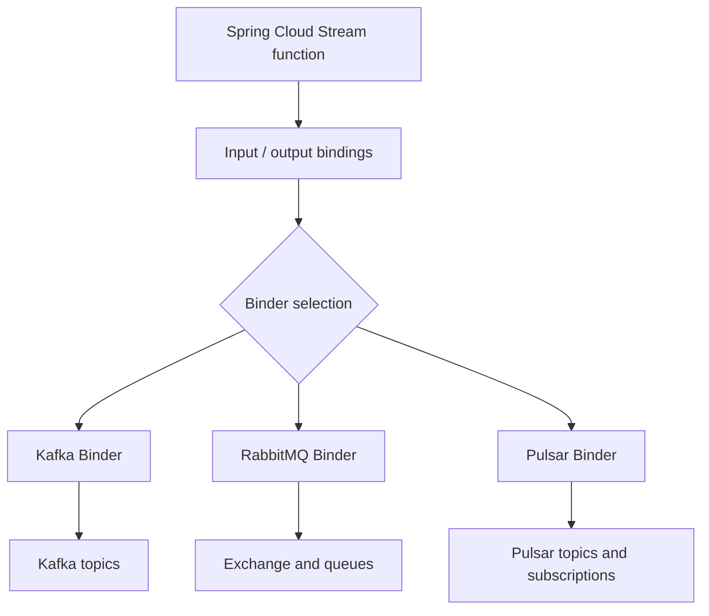

# Nhiều loại binder trên classpath và lựa chọn `defaultBinder`

Spring Cloud Stream dùng binder để kết nối các binding của ứng dụng với middleware như Kafka, RabbitMQ hoặc Pulsar. Một ứng dụng có thể có nhiều binder implementation trên classpath, hoặc có nhiều cấu hình binder cùng loại nhưng trỏ tới các cluster khác nhau. Khi đó, cần xác định binder nào sẽ phục vụ từng binding và binder nào được dùng mặc định.

Hai cơ chế chính là `spring.cloud.stream.default-binder` để chọn binder mặc định và thuộc tính `binder` trên từng binding để chỉ định rõ nơi kết nối. Khi cần nhiều kết nối độc lập, khai báo các named binder dưới `spring.cloud.stream.binders`, mỗi cấu hình có `type` và `environment` riêng.

## 1. Binder là lớp kết nối giữa binding và broker

Function của Spring Cloud Stream làm việc với input/output binding. Binder chịu trách nhiệm ánh xạ binding tới hệ thống messaging cụ thể, quản lý consumer/producer và chuyển đổi các thuộc tính chung thành cấu hình native của broker.

Ví dụ, một function có input `validateOrder-in-0` và output `validateOrder-out-0`. Kafka Binder có thể nối hai binding này với Kafka topic; RabbitMQ Binder có thể nối chúng với exchange/queue. Phần business function vẫn làm việc với payload và message theo hợp đồng của Spring Cloud Stream.



Binder không phải là tên topic, exchange hoặc queue. Binder xác định công nghệ và cấu hình kết nối; `destination` xác định đích messaging của binding trên công nghệ đó.

## 2. Một binder implementation trên classpath

Nếu ứng dụng chỉ có một binder implementation phù hợp trên classpath, Spring Cloud Stream thường tự chọn binder đó cho các binding chưa chỉ định binder riêng. Ví dụ, ứng dụng chỉ thêm dependency Kafka Binder thì binding thông thường sẽ dùng Kafka Binder.

```xml
<dependency>
    <groupId>org.springframework.cloud</groupId>
    <artifactId>spring-cloud-stream-binder-kafka</artifactId>
</dependency>
```

Khi chỉ có Kafka Binder, có thể cấu hình binding như sau:

```yaml
spring:
  cloud:
    function:
      definition: validateOrder
    stream:
      bindings:
        validateOrder-in-0:
          destination: orders.created
          group: order-validation
        validateOrder-out-0:
          destination: orders.validated
```

Không cần khai báo `default-binder` trong trường hợp chỉ có một lựa chọn binder. Tuy vậy, khi thêm dependency RabbitMQ hoặc Pulsar Binder vào classpath, cách chọn binder cần được xem xét lại để tránh lựa chọn mặc định không rõ ràng.

## 3. Nhiều binder implementation trên classpath

Nếu ứng dụng có nhiều binder implementation, Spring Cloud Stream cần biết binder mặc định cho những binding không chỉ định riêng. Có thể đặt `spring.cloud.stream.default-binder` bằng tên binder phù hợp.

Ví dụ ứng dụng có Kafka Binder và RabbitMQ Binder, chọn Kafka làm mặc định:

```yaml
spring:
  cloud:
    stream:
      default-binder: kafka
      bindings:
        validateOrder-in-0:
          destination: orders.created
          group: order-validation
        validateOrder-out-0:
          destination: orders.validated
```

Tên trong `default-binder` phải khớp với binder candidate mà Spring Cloud Stream nhận diện hoặc tên cấu hình binder được khai báo. Không dùng tên topic hoặc tên function ở đây. Nếu có nhiều binder candidates mà không xác định được một default duy nhất, context có thể khởi tạo thất bại vì binder selection mơ hồ.

### 3.1. Chỉ định binder cho từng binding

Thuộc tính `binder` trên binding ghi đè lựa chọn mặc định cho binding đó. Ví dụ, ứng dụng nhận order từ Kafka nhưng phát thông báo sang RabbitMQ:

```yaml
spring:
  cloud:
    stream:
      default-binder: kafka
      bindings:
        validateOrder-in-0:
          destination: orders.created
          group: order-validation
          binder: kafka
        validateOrder-out-0:
          destination: orders.validated
          binder: rabbit
```

Ở đây input dùng Kafka Binder, output dùng RabbitMQ Binder. `default-binder` chỉ là lựa chọn dự phòng cho binding chưa có `binder`; nó không ép tất cả binding phải dùng Kafka.

Nếu function có nhiều input hoặc output, có thể chỉ định binder riêng cho từng binding. Tên binding phải đúng với quy tắc function-based binding, ví dụ `process-in-0`, `process-in-1` và `process-out-0`.

## 4. Phân biệt binder type và tên cấu hình binder

Khi cần nhiều cấu hình kết nối, khai báo các named binder trong `spring.cloud.stream.binders`. Mỗi cấu hình có:

- `type`: loại binder implementation, ví dụ `kafka`, `rabbit` hoặc `pulsar`.
- `environment`: các thuộc tính môi trường được dùng để tạo context/cấu hình riêng cho binder đó.
- `inheritEnvironment`: quyết định binder environment có kế thừa environment ứng dụng hay không.
- `defaultCandidate`: quyết định cấu hình binder có tham gia lựa chọn binder mặc định hay không.

Tên cấu hình binder là alias do ứng dụng đặt, ví dụ `kafka-primary` hoặc `rabbit-events`. `type` mới cho biết alias đó sử dụng implementation nào. Khi binding tham chiếu `binder: kafka-primary`, nó chọn đúng named configuration `kafka-primary`, không phải mọi binder có type Kafka.

Khi khai báo rõ `spring.cloud.stream.binders`, ứng dụng chuyển sang cơ chế binder configuration tường minh; quá trình cấu hình binder mặc định tự động bị thay thế. Vì vậy, phải khai báo đầy đủ mọi named binder mà các binding sẽ sử dụng. Không khai báo một binder phụ rồi giả định các binder khác trên classpath vẫn tự động được cấu hình như trước.

## 5. Ví dụ nhiều binder type với named configurations

Ví dụ dưới đây dùng Kafka làm default binder và định tuyến một output binding sang RabbitMQ:

```yaml
spring:
  cloud:
    stream:
      default-binder: kafka-primary
      binders:
        kafka-primary:
          type: kafka
          environment:
            spring:
              cloud:
                stream:
                  kafka:
                    binder:
                      brokers: kafka-primary.internal:9092
        rabbit-events:
          type: rabbit
          environment:
            spring:
              rabbitmq:
                host: rabbit.internal
                port: 5672
      bindings:
        validateOrder-in-0:
          destination: orders.created
          group: order-validation
          binder: kafka-primary
        validateOrder-out-0:
          destination: orders.validated
          binder: rabbit-events
```

Trong ví dụ, `kafka-primary` và `rabbit-events` là tên cấu hình. `type` lần lượt là `kafka` và `rabbit`. Các thuộc tính bên trong `environment` được nạp cho binder tương ứng. Cấu hình Kafka broker và Rabbit host ở hai environment khác nhau nên mỗi binder có thể kết nối tới endpoint riêng.

Khi đã định nghĩa named binder, nên dùng tên cấu hình nhất quán ở `default-binder` và `bindings.<binding>.binder`. Không dùng `type` thay cho alias nếu alias đã được đặt khác, vì binder lookup cần tìm đúng cấu hình.

## 6. Nhiều cấu hình cùng một binder type

Một trường hợp phổ biến là cùng một ứng dụng cần kết nối hai Kafka cluster, ví dụ cluster nội bộ và cluster đối tác. Khi đó, chỉ thêm một Kafka Binder dependency là đủ; khai báo hai named binder cùng `type: kafka` nhưng có broker configuration khác nhau.

```yaml
spring:
  cloud:
    stream:
      default-binder: kafka-internal
      binders:
        kafka-internal:
          type: kafka
          environment:
            spring:
              cloud:
                stream:
                  kafka:
                    binder:
                      brokers: kafka-internal:9092
        kafka-partner:
          type: kafka
          default-candidate: false
          environment:
            spring:
              cloud:
                stream:
                  kafka:
                    binder:
                      brokers: kafka-partner:9092
      bindings:
        internalOrders-in-0:
          destination: orders.created
          group: order-service
          binder: kafka-internal
        partnerEvents-out-0:
          destination: partner.orders
          binder: kafka-partner
```

`kafka-internal` và `kafka-partner` cùng type nhưng có broker endpoint khác nhau. `default-candidate: false` loại `kafka-partner` khỏi tập lựa chọn mặc định; binding vẫn có thể tham chiếu trực tiếp `binder: kafka-partner`. Điều này hữu ích khi một binder chỉ được dùng tường minh, tránh nó trở thành lựa chọn mặc định ngoài ý muốn.

## 7. `defaultBinder` và `defaultCandidate`

Hai thuộc tính này giải quyết hai câu hỏi khác nhau:

| Thuộc tính | Câu hỏi | Cách dùng |
|---|---|---|
| `default-binder` | Binding không ghi `binder` sẽ dùng binder nào? | Chọn alias mặc định, ví dụ `kafka-internal` |
| `default-candidate` | Named binder có được tham gia tập lựa chọn mặc định không? | Đặt `false` nếu binder chỉ được gọi tên tường minh |

Ví dụ có ba cấu hình: một Kafka nội bộ, một Kafka đối tác và một RabbitMQ. Có thể đặt Kafka nội bộ làm default, còn hai binder kia `default-candidate: false` để buộc binding ghi rõ khi dùng. Nhờ vậy, thêm một binder mới không vô tình làm thay đổi binder của các binding hiện có.

Nếu mọi binding đều có `binder` tường minh, `default-binder` có thể không cần thiết. Dù vậy, chọn default rõ ràng vẫn hữu ích cho binding được thêm sau này và giúp người đọc cấu hình nhận ra đường kết nối mặc định.

## 8. `inheritEnvironment` và cô lập cấu hình

Named binder có thể chạy trong environment riêng. Theo mặc định, binder environment thường kế thừa các property của ứng dụng; `inherit-environment: false` cho phép cô lập context của binder để tránh vô tình dùng cấu hình toàn cục.

Ví dụ:

```yaml
spring:
  cloud:
    stream:
      binders:
        kafka-secure:
          type: kafka
          inherit-environment: false
          environment:
            spring:
              cloud:
                stream:
                  kafka:
                    binder:
                      brokers: kafka-secure.internal:9093
                      configuration:
                        security.protocol: SASL_SSL
```

Khi tắt kế thừa, các thuộc tính mà binder cần phải được cung cấp trong environment riêng hoặc theo cơ chế cấu hình được hỗ trợ. Không giả định các property toàn cục như credentials, truststore, schema registry, proxy hoặc customizer tự động xuất hiện trong binder context cô lập. Hãy liệt kê đầy đủ cấu hình bắt buộc và kiểm thử bằng đúng profile triển khai.

Ngược lại, nếu muốn dùng chung cấu hình global như observability hoặc một số client properties, giữ kế thừa mặc định có thể đơn giản hơn. Chỉ bật cô lập khi cần tách credentials, endpoint hoặc chính sách bảo mật giữa các cluster.

## 9. Binder-level properties và binding-level properties

Các thuộc tính có thể đặt ở nhiều phạm vi:

| Phạm vi | Ví dụ | Tác dụng |
|---|---|---|
| Binding chung | `spring.cloud.stream.bindings.<name>.*` | Destination, group, content type và consumer/producer settings chung |
| Extended binding | `spring.cloud.stream.kafka.bindings.<name>.*`, `spring.cloud.stream.rabbit.bindings.<name>.*` | Thuộc tính riêng của broker cho một binding |
| Binder configuration | `spring.cloud.stream.binders.<alias>.environment.*` | Endpoint và cấu hình riêng của named binder |
| Default binder | `spring.cloud.stream.default-binder` | Binder dùng cho binding không chọn riêng |

Ví dụ `destination` và `group` thuộc binding chung; Kafka `brokers` thuộc cấu hình Kafka Binder; Rabbit `host` thuộc environment của Rabbit binder. Đặt sai phạm vi có thể khiến property không được binder đọc hoặc bị áp dụng cho tất cả kết nối ngoài dự kiến.

Khi cùng một thuộc tính được đặt ở global environment và binder environment, kết quả phụ thuộc context và quy tắc kế thừa. Không giả định mọi property đều được merge theo cùng cách. Kiểm tra effective configuration bằng log startup/Actuator environment theo chính sách bảo mật, tránh để lộ secret.

## 10. Kết nối các broker bằng một function

Một use case phổ biến là nhận event từ Kafka, biến đổi payload rồi phát sang RabbitMQ hoặc Pulsar:

```java
@Bean
Function<OrderCreated, PartnerOrderEvent> forwardOrder() {
    return event -> new PartnerOrderEvent(
            event.eventId(), event.orderId(), event.customerId());
}
```

```yaml
spring:
  cloud:
    function:
      definition: forwardOrder
    stream:
      bindings:
        forwardOrder-in-0:
          destination: orders.created
          group: partner-forwarder
          binder: kafka-primary
          content-type: application/json
        forwardOrder-out-0:
          destination: partner.orders
          binder: rabbit-events
          content-type: application/json
```

Input và output có thể dùng hai binder khác nhau. Tuy nhiên, việc function trả về bình thường không tạo transaction phân tán giữa Kafka và RabbitMQ. Có thể xảy ra trường hợp output publish thành công nhưng offset input chưa commit, khiến event được đọc lại và phát output lần nữa; hoặc input được commit theo cấu hình không phù hợp trước khi output được xác nhận.

Với luồng liên broker quan trọng, cần thiết kế idempotency ở đích, lưu event ID, retry có giới hạn và cơ chế outbox/inbox hoặc workflow phù hợp. Không tuyên bố exactly-once xuyên qua hai broker chỉ vì cả hai binder đều hỗ trợ acknowledgement/transaction riêng.

## 11. Dependency và classpath hygiene

Binder implementation thường được thêm qua dependency tương ứng:

```xml
<dependency>
    <groupId>org.springframework.cloud</groupId>
    <artifactId>spring-cloud-stream-binder-kafka</artifactId>
</dependency>
<dependency>
    <groupId>org.springframework.cloud</groupId>
    <artifactId>spring-cloud-stream-binder-rabbit</artifactId>
</dependency>
```

Nếu dùng Pulsar Binder, thêm artifact Pulsar Binder tương ứng với release train. Quản lý version bằng Spring Cloud BOM để các binder và Spring Cloud Stream tương thích. Tránh khai báo version rời rạc cho từng binder nếu BOM đã quản lý chúng.

Chỉ thêm binder mà ứng dụng thực sự sử dụng. Dependency thừa có thể làm xuất hiện thêm candidate, khiến lựa chọn default thay đổi hoặc context khởi tạo phức tạp hơn. Khi nâng version, kiểm tra compatibility giữa Spring Boot, Spring Cloud release train, Spring Cloud Stream và binder artifacts.

## 12. Kiểm thử binder selection

Kiểm thử cần xác nhận binding được nối tới đúng broker, không chỉ xác nhận function được gọi:

1. Khởi động context với một binder implementation và xác nhận auto-selection.
2. Thêm binder thứ hai, đặt `default-binder` và xác nhận binding không khai báo binder dùng đúng default.
3. Đặt binder tường minh cho một input/output và xác nhận từng binding kết nối đúng cluster.
4. Khai báo hai named binder cùng type với broker endpoint khác nhau; gửi record vào từng destination và xác nhận không đi nhầm cluster.
5. Đặt `default-candidate: false` và xác nhận binder vẫn hoạt động khi được binding tham chiếu tường minh.
6. Thử `inherit-environment: false` và xác nhận endpoint, authentication, TLS cùng các property bắt buộc đã được cung cấp trong context riêng.
7. Cố ý đặt sai alias hoặc type để xác nhận startup báo lỗi rõ ràng.
8. Kiểm tra content type, Serde/converter và header khi event đi qua hai broker khác nhau.
9. Mô phỏng output publish thành công nhưng input offset chưa commit để kiểm tra idempotency và duplicate handling.

Test Binder hữu ích để kiểm tra logic function và một số binding trong JVM, nhưng không chứng minh cấu hình broker thật, credentials, ACL, TLS hoặc routing đúng. Dùng Kafka/RabbitMQ/Pulsar integration test cho các kết nối thực tế.

## 13. Lỗi thường gặp

| Triệu chứng | Nguyên nhân có thể | Hướng xử lý |
|---|---|---|
| Ứng dụng không khởi động vì binder selection mơ hồ | Có nhiều candidate nhưng chưa chọn default rõ ràng | Đặt `default-binder` hoặc chỉ định `binder` cho từng binding |
| Binding báo không tìm thấy binder | Giá trị `binder` không khớp tên candidate/named configuration | So sánh alias trong `binders` và tên tham chiếu ở binding |
| Binding đi tới cluster mặc định thay vì cluster dự kiến | Binding thiếu `binder` hoặc `default-binder` trỏ sai alias | Khai báo binder tường minh và kiểm tra log startup |
| Hai Kafka binding cùng kết nối một cluster | Cả hai dùng cùng named binder hoặc environment bị kế thừa ngoài ý muốn | Tạo hai alias, cấu hình brokers riêng và kiểm tra `inherit-environment` |
| Binder phụ không được chọn làm default | `default-candidate: false` | Giữ false nếu chỉ muốn chọn tường minh; nếu muốn làm default thì bật candidate và cấu hình default phù hợp |
| Broker property không có hiệu lực | Đặt property sai cấp hoặc sai prefix trong `environment` | Kiểm tra binder type, context và property path của phiên bản |
| Authentication chỉ lỗi ở một binder | Credential không được kế thừa hoặc chưa khai báo trong environment cô lập | Cấu hình credentials/truststore riêng và kiểm thử từ binder context |
| Event qua broker khác bị lỗi deserialize | Content type, schema hoặc converter không tương thích | Chuẩn hóa event contract và cấu hình converter/Serde cho cả hai phía |
| Event bị phát trùng khi bridge broker | Không có transaction xuyên broker; input redelivery sau output publish | Dùng idempotency key, inbox/outbox và đối soát |

## 14. Quy trình lựa chọn và cấu hình

1. Liệt kê các middleware/cluster mà từng input/output binding cần dùng.
2. Kiểm tra binder dependency tương ứng có trên classpath và tương thích BOM.
3. Nếu chỉ có một binder candidate, dùng auto-selection hoặc đặt default rõ ràng nếu cần tài liệu hóa.
4. Nếu có nhiều loại binder, chọn `default-binder` cho binding chưa chỉ định.
5. Nếu có nhiều cluster cùng loại, khai báo named binder với `type` và `environment` riêng.
6. Gắn `binder` tường minh vào binding cần cluster đặc biệt.
7. Dùng `default-candidate: false` cho binder không được tự chọn mặc định.
8. Chỉ tắt `inherit-environment` khi đã cung cấp đầy đủ property cần thiết trong context riêng.
9. Kiểm tra schema, content type, key, header và semantics giao nhận khi đi qua nhiều broker.
10. Kiểm thử startup, routing, security và failure windows trên broker thật.

## 15. Danh sách kiểm tra trước khi triển khai

- [ ] Biết chính xác binder implementation nào có trên classpath.
- [ ] Nếu có nhiều candidate, `default-binder` được chọn rõ ràng.
- [ ] Binding đặc biệt có `binder` trỏ đúng named configuration.
- [ ] Phân biệt tên alias binder với `type` của implementation.
- [ ] Nhiều cluster cùng type được cấu hình bằng nhiều named binder riêng.
- [ ] `default-candidate` được đặt theo chủ đích.
- [ ] `inherit-environment` phù hợp và không làm thiếu credential/TLS properties.
- [ ] Endpoint, authentication, TLS và ACL riêng của từng broker đã được xác nhận.
- [ ] Binding-level và binder-level properties đặt đúng phạm vi.
- [ ] Event contract, Serde/converter, key và headers tương thích giữa các broker.
- [ ] Luồng liên broker có idempotency và xử lý duplicate/failure window.
- [ ] Có integration test xác nhận binding tới đúng broker/cluster.

Khi chỉ có một binder implementation, Spring Cloud Stream có thể tự chọn binder cho binding. Khi có nhiều loại binder, dùng `default-binder` để xác định lựa chọn chung và `binder` để ghi đè theo từng binding. Khi cần nhiều cluster cùng loại, khai báo named binder với `type` và `environment` riêng; `default-candidate` kiểm soát binder nào tham gia lựa chọn mặc định, còn `inherit-environment` kiểm soát việc kế thừa cấu hình ứng dụng. Cấu hình tường minh và kiểm thử trên broker thật giúp tránh kết nối nhầm cluster và làm rõ ranh giới giao nhận khi một function nối nhiều hệ thống messaging.

## Tài liệu tham khảo

- [Spring Cloud Stream — Multiple Binders on the Classpath](https://docs.spring.io/spring-cloud-stream/reference/spring-cloud-stream/multiple-binders.html)
- [Spring Cloud Stream — Binding and Binder Configuration](https://docs.spring.io/spring-cloud-stream/reference/spring-cloud-stream/binding-properties.html)
- [Spring Cloud Stream — Function-based Binding Names](https://docs.spring.io/spring-cloud-stream/reference/spring-cloud-stream/functional-binding-names.html)
