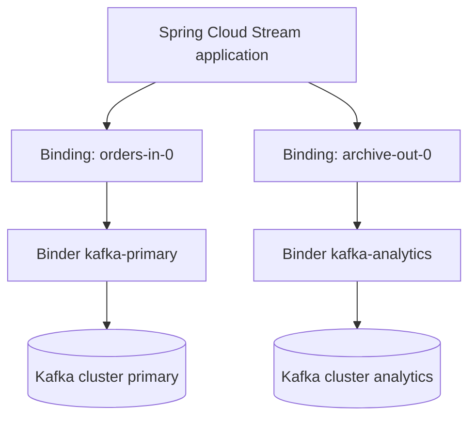
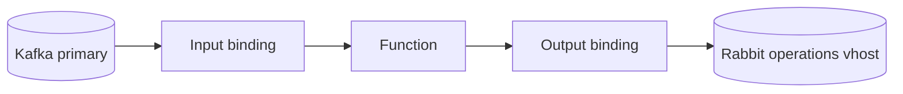

# Nhiều Kafka cluster hoặc nhiều RabbitMQ virtual host

## 1. Khi nào một ứng dụng cần nhiều binder?

Spring Cloud Stream thường kết nối một ứng dụng với một broker thông qua binder. Trong một số hệ thống, cùng một ứng dụng phải đọc hoặc ghi dữ liệu ở nhiều hạ tầng messaging độc lập:

- Đọc đơn hàng từ Kafka cluster nội bộ và ghi bản sao phân tích sang Kafka cluster của data platform.
- Đọc event từ một RabbitMQ virtual host dành cho đơn hàng và phát thông báo sang virtual host dành cho vận hành.
- Kết nối nhiều Kafka cluster theo vùng địa lý, môi trường hoặc ranh giới bảo mật.
- Kết nối nhiều RabbitMQ virtual host với tài khoản và quyền truy cập khác nhau.

Spring Cloud Stream cho phép khai báo nhiều binder instance có tên. Mỗi binder instance có thể dùng cùng loại công nghệ nhưng trỏ đến một cluster hoặc virtual host khác nhau. Sau đó, từng input/output binding được gán cho binder phù hợp.

Ví dụ, một ứng dụng có thể dùng hai Kafka binder:



Binder là adapter kết nối binding với hệ thống messaging. Nhiều binder trong cùng ứng dụng không có nghĩa các broker trở thành một hệ thống lưu trữ chung; mỗi broker vẫn có topic/queue, tiến độ tiêu thụ, bảo mật và khả năng sẵn sàng riêng.

## 2. Phân biệt binder, binding và broker destination

Ba khái niệm cần tách biệt:

| Khái niệm | Ý nghĩa | Ví dụ |
|---|---|---|
| Binder instance | Một cấu hình kết nối tới một hệ thống messaging | `kafka-primary`, `rabbit-orders` |
| Binding | Kết nối input/output của function với binder | `processOrder-in-0` |
| Destination | Topic, exchange/queue hoặc tên logical mà binding sử dụng | `orders.events`, `orders.audit` |

Một binder instance có thể phục vụ nhiều binding. Một ứng dụng có thể khai báo nhiều binder instance cùng loại, chẳng hạn hai Kafka binder hoặc hai Rabbit binder. Mỗi binding chọn binder bằng thuộc tính `binder`.

Tên binder là tên do ứng dụng đặt trong cấu hình, không phải tên topic, queue, exchange, cluster hoặc virtual host. Đặt tên theo mục đích và vị trí để dễ nhận diện, ví dụ `kafka-primary`, `kafka-analytics`, `rabbit-orders`, `rabbit-operations`.

## 3. Khai báo nhiều Kafka binder cho nhiều cluster

Giả sử ứng dụng cần đọc event từ Kafka cluster nghiệp vụ và ghi kết quả sang Kafka cluster phân tích. Khai báo hai binder instance dưới `spring.cloud.stream.binders`:

```yaml
spring:
  cloud:
    stream:
      binders:
        kafka-primary:
          type: kafka
          environment:
            spring:
              cloud:
                stream:
                  kafka:
                    binder:
                      brokers: kafka-primary.internal:9092
        kafka-analytics:
          type: kafka
          defaultCandidate: false
          environment:
            spring:
              cloud:
                stream:
                  kafka:
                    binder:
                      brokers: kafka-analytics.internal:9092
```

Trong cấu hình:

- `type: kafka` chọn Kafka binder.
- `environment` chứa các thuộc tính Spring được dùng trong context của binder instance.
- `brokers` chỉ định bootstrap broker của cluster tương ứng.
- `defaultCandidate: false` loại `kafka-analytics` khỏi lựa chọn binder mặc định tự động.

Nếu có nhiều binder cùng loại, nên gán binder tường minh cho từng binding để tránh chọn nhầm cluster. `defaultCandidate: false` hữu ích với binder phụ không nên được tự chọn làm mặc định. Có thể khai báo `defaultBinder` ở cấp stream nếu muốn chỉ định một binder mặc định, nhưng các binding quan trọng vẫn nên ghi rõ `binder` để cấu hình dễ kiểm tra.

## 4. Gán input và output binding vào từng Kafka cluster

Ví dụ function nhận đơn hàng từ cluster chính và chuyển thành event đã chuẩn hóa:

```java
import java.util.function.Function;
import org.springframework.context.annotation.Bean;
import org.springframework.context.annotation.Configuration;

record OrderCreated(String orderId, long totalCents) {}
record OrderAccepted(String orderId, long totalCents, String status) {}

@Configuration
class OrderFunctions {

    @Bean
    Function<OrderCreated, OrderAccepted> acceptOrder() {
        return order -> new OrderAccepted(
            order.orderId(), order.totalCents(), "ACCEPTED"
        );
    }
}
```

Gán hai binding tới hai binder khác nhau:

```yaml
spring:
  cloud:
    function:
      definition: acceptOrder
    stream:
      bindings:
        acceptOrder-in-0:
          destination: orders.events
          group: order-processor
          binder: kafka-primary
        acceptOrder-out-0:
          destination: orders.accepted
          binder: kafka-analytics
```

Input `acceptOrder-in-0` đọc từ topic `orders.events` của cluster `kafka-primary`. Output `acceptOrder-out-0` ghi topic `orders.accepted` của cluster `kafka-analytics`.

Tên destination có thể giống nhau giữa hai cluster nhưng dữ liệu vẫn độc lập. Topic `orders.events` trên cluster A không tự đồng bộ với topic cùng tên trên cluster B. Nếu cần sao chép, ứng dụng hoặc công cụ replication phải thực hiện việc đó.

## 5. Nhiều Kafka binder cần cấu hình bảo mật riêng

Hai cluster có thể dùng cơ chế xác thực, TLS hoặc ACL khác nhau. Cấu hình bảo mật cần nằm trong environment của binder tương ứng để credential và trust material không bị áp dụng nhầm sang cluster khác.

Ví dụ minh họa Kafka cluster dùng SASL/SCRAM:

```yaml
spring:
  cloud:
    stream:
      binders:
        kafka-primary:
          type: kafka
          environment:
            spring:
              cloud:
                stream:
                  kafka:
                    binder:
                      brokers: kafka-primary.internal:9093
                      configuration:
                        security.protocol: SASL_SSL
                        sasl.mechanism: SCRAM-SHA-512
                        sasl.jaas.config: ${PRIMARY_KAFKA_JAAS}
        kafka-analytics:
          type: kafka
          defaultCandidate: false
          environment:
            spring:
              cloud:
                stream:
                  kafka:
                    binder:
                      brokers: kafka-analytics.internal:9093
                      configuration:
                        security.protocol: SASL_SSL
                        sasl.mechanism: SCRAM-SHA-512
                        sasl.jaas.config: ${ANALYTICS_KAFKA_JAAS}
```

Các placeholder phải được cấp từ secret manager hoặc biến môi trường của môi trường triển khai. Không commit username/password hoặc JAAS secret thật vào Git. ACL trên từng cluster cần cấp đúng quyền đọc topic, ghi topic và sử dụng consumer group cho binder tương ứng.

Nếu hai cluster dùng truststore hoặc client certificate khác nhau, cấu hình đường dẫn và mật khẩu trong environment riêng của từng binder. Đảm bảo file truststore/keystore có mặt trong container hoặc máy chạy ứng dụng.

## 6. Cấu hình binder environment và kế thừa môi trường

Binder instance chạy trong context riêng. Thuộc tính trong `environment` được đưa vào context của binder đó. Theo mặc định, binder có thể kế thừa một phần môi trường chung của ứng dụng; thuộc tính `inheritEnvironment` điều khiển hành vi kế thừa này theo hỗ trợ của Spring Cloud Stream version.

Ví dụ chủ động tắt kế thừa cho một binder cần môi trường kết nối tách biệt:

```yaml
spring:
  cloud:
    stream:
      binders:
        kafka-isolated:
          type: kafka
          inheritEnvironment: false
          environment:
            spring:
              cloud:
                stream:
                  kafka:
                    binder:
                      brokers: kafka-isolated.internal:9092
```

Chỉ đặt `inheritEnvironment: false` khi đã cung cấp đầy đủ các thuộc tính cần thiết cho binder trong environment riêng. Nếu ứng dụng dựa vào cấu hình chung như SSL, credential, schema registry hoặc property tùy chỉnh mà không khai báo lại, binder có thể không khởi tạo được.

Khi cần chia sẻ cấu hình chung và chỉ override broker/credential, giữ cơ chế kế thừa mặc định thường đơn giản hơn. Khi cần cô lập mạnh giữa hai cluster, dùng environment riêng và kiểm thử cả cấu hình khởi động.

## 7. Khai báo nhiều Rabbit binder cho nhiều virtual host

RabbitMQ virtual host là namespace logic độc lập trong một RabbitMQ broker. Mỗi virtual host có exchange, queue, binding, permission và resource riêng. Cùng một tên exchange hoặc queue trong hai virtual host khác nhau là hai resource độc lập.

Giả sử một ứng dụng cần đọc queue trong virtual host `/orders` và phát message sang virtual host `/operations`. Khai báo hai Rabbit binder instance:

```yaml
spring:
  cloud:
    stream:
      binders:
        rabbit-orders:
          type: rabbit
          environment:
            spring:
              rabbitmq:
                host: rabbit.internal
                port: 5672
                username: orders_app
                password: ${ORDERS_RABBIT_PASSWORD}
                virtual-host: /orders
        rabbit-operations:
          type: rabbit
          defaultCandidate: false
          environment:
            spring:
              rabbitmq:
                host: rabbit.internal
                port: 5672
                username: operations_app
                password: ${OPERATIONS_RABBIT_PASSWORD}
                virtual-host: /operations
```

Hai binder cùng loại `rabbit` nhưng kết nối vào hai virtual host khác nhau. Tài khoản `orders_app` và `operations_app` có thể có quyền khác nhau. Nếu hai virtual host nằm trên hai broker host khác nhau, mỗi binder có thể khai báo host/port riêng.

## 8. Gán binding cho Rabbit virtual host tương ứng

Ví dụ một function nhận đơn hàng từ `/orders` rồi phát thông báo vận hành sang `/operations`:

```java
import java.util.function.Function;
import org.springframework.context.annotation.Bean;
import org.springframework.context.annotation.Configuration;

record OrderCreated(String orderId, long totalCents) {}
record OperationsNotice(String orderId, String message) {}

@Configuration
class OperationsFunctions {

    @Bean
    Function<OrderCreated, OperationsNotice> notifyOperations() {
        return order -> new OperationsNotice(
            order.orderId(),
            "New order received: " + order.orderId()
        );
    }
}
```

Cấu hình binding:

```yaml
spring:
  cloud:
    function:
      definition: notifyOperations
    stream:
      bindings:
        notifyOperations-in-0:
          destination: orders.created
          group: operations-bridge
          binder: rabbit-orders
        notifyOperations-out-0:
          destination: operations.notices
          binder: rabbit-operations
```

Binder `rabbit-orders` đọc destination `orders.created` trong virtual host `/orders`; binder `rabbit-operations` ghi destination `operations.notices` trong `/operations`.

Với Rabbit binder, destination thường được ánh xạ vào exchange; queue của consumer được provision theo destination và group. Tên resource cụ thể còn phụ thuộc cấu hình exchange type, queue name, group và thuộc tính provisioning của binder. Cùng destination `orders.created` ở hai virtual host không xung đột vì namespace tách biệt.

## 9. Virtual host là ranh giới namespace và quyền truy cập

Virtual host không phải một broker độc lập. Nhiều virtual host có thể dùng chung một RabbitMQ node/cluster và chia sẻ tài nguyên hạ tầng, nhưng có namespace và permission riêng.

| Thuộc tính | Virtual host `/orders` | Virtual host `/operations` |
|---|---|---|
| Exchange | `orders.created` | `operations.notices` |
| Queue | `operations-bridge` hoặc queue do binder provision | Queue của consumer operations |
| User | `orders_app` | `operations_app` |
| Permission | Chỉ đọc/ghi resource được cấp | Chỉ đọc/ghi resource được cấp |
| Tiến độ/queue state | Độc lập | Độc lập |

Virtual host giúp tách resource và quyền nhưng không tự cung cấp cách ly tài nguyên vật lý. Một broker quá tải vẫn có thể ảnh hưởng nhiều virtual host. Nếu cần isolation về capacity, fault domain hoặc maintenance, cân nhắc broker/cluster riêng.

## 10. Dùng nhiều binder cùng loại: tránh chọn binder mặc định nhầm

Khi chỉ có một binder, Spring Cloud Stream có thể tự chọn binder đó cho binding. Khi khai báo nhiều binder cùng loại hoặc nhiều binder candidate, lựa chọn mặc định có thể trở nên không rõ ràng.

Quy tắc thực hành:

1. Đặt tên binder theo vai trò, không theo tên class.
2. Gán `binder` trực tiếp cho các binding cần cluster/virtual host cụ thể.
3. Dùng `defaultCandidate: false` cho binder phụ không được chọn tự động.
4. Nếu có một binder mặc định, khai báo rõ `spring.cloud.stream.defaultBinder` hoặc bảo đảm chỉ còn một candidate phù hợp.
5. Kiểm tra log khởi động để xác nhận binding đã được gắn với đúng binder.

Ví dụ binding rõ ràng:

```yaml
spring:
  cloud:
    stream:
      defaultBinder: kafka-primary
      bindings:
        orderInput-in-0:
          destination: orders.events
          group: order-service
          binder: kafka-primary
        auditOutput-out-0:
          destination: audit.events
          binder: kafka-analytics
```

`defaultBinder` là giá trị fallback cho binding không chỉ định binder. Binding đã có `binder` riêng sẽ dùng binder được chỉ định. Không dựa vào thứ tự khai báo YAML để đoán binder nào sẽ được chọn.

## 11. Một function có thể đi qua hai broker khác nhau

Spring Cloud Stream cho phép input và output binding của cùng function dùng binder khác nhau. Điều này tạo ra một luồng bridge:



Function nhận dữ liệu từ một hệ thống, xử lý trong ứng dụng và gửi kết quả sang hệ thống khác. Đây là một lần chuyển tiếp qua ứng dụng, không phải transaction phân tán giữa hai broker.

Nếu function đọc message thành công nhưng publish sang broker đích thất bại, cần xác định input có được acknowledge/commit hay không. Cấu hình retry, error handling, DLQ và idempotency phải tính đến cả hai phía.

Không giả định Kafka transaction có thể commit đồng thời Rabbit publish hoặc Rabbit transaction có thể rollback Kafka offset. Mỗi binder dùng protocol và transaction scope riêng.

## 12. Nhiều input binding từ nhiều cluster

Một function có thể nhận nhiều input, mỗi input từ một binder khác nhau. Ví dụ kết hợp đơn hàng từ Kafka và dữ liệu hồ sơ khách hàng từ RabbitMQ:

```java
import java.util.function.BiFunction;
import org.springframework.context.annotation.Bean;
import org.springframework.context.annotation.Configuration;
import reactor.core.publisher.Flux;

record OrderEvent(String orderId, String customerId) {}
record CustomerProfile(String customerId, String tier) {}
record EnrichedOrder(String orderId, String tier) {}

@Configuration
class EnrichmentFunctions {

    @Bean
    BiFunction<Flux<OrderEvent>, Flux<CustomerProfile>, Flux<EnrichedOrder>>
    enrichOrder() {
        return (orders, customers) -> orders.zipWith(
            customers,
            (order, customer) -> new EnrichedOrder(
                order.orderId(), customer.tier()
            )
        );
    }
}
```

Gán từng input binding:

```yaml
spring:
  cloud:
    function:
      definition: enrichOrder
    stream:
      bindings:
        enrichOrder-in-0:
          destination: orders.events
          group: order-enricher
          binder: kafka-primary
        enrichOrder-in-1:
          destination: customer.profiles
          group: order-enricher
          binder: rabbit-orders
        enrichOrder-out-0:
          destination: orders.enriched
          binder: kafka-analytics
```

Ví dụ dùng reactive `BiFunction` với hai input `Flux`. `zipWith` ghép phần tử theo thứ tự phát ra: phần tử thứ nhất của stream A đi với phần tử thứ nhất của stream B. Đây không phải join theo `customerId`, timestamp hoặc event key; nếu hai stream đến lệch nhịp hoặc có tốc độ khác nhau, cặp dữ liệu có thể không đúng nghiệp vụ. Khi cần join streaming theo key/window, dùng Kafka Streams DSL hoặc một cơ chế correlation/state phù hợp. Nhiều input binding không tự cung cấp semantics join.

## 13. StreamBridge và chọn binder cho output động

`StreamBridge` cho phép gửi message từ code ứng dụng tới output binding. Với nhiều binder, nên khai báo trước output binding và gán binder rõ ràng, sau đó gửi tới tên binding đó.

```yaml
spring:
  cloud:
    stream:
      output-bindings: auditKafka;operationsRabbit
      bindings:
        auditKafka:
          destination: audit.events
          binder: kafka-analytics
        operationsRabbit:
          destination: operations.notices
          binder: rabbit-operations
```

```java
import org.springframework.cloud.stream.function.StreamBridge;
import org.springframework.stereotype.Service;

@Service
class NotificationPublisher {

    private final StreamBridge streamBridge;

    NotificationPublisher(StreamBridge streamBridge) {
        this.streamBridge = streamBridge;
    }

    void publishAudit(Object event) {
        if (!streamBridge.send("auditKafka", event)) {
            throw new IllegalStateException("Audit binding did not accept the message");
        }
    }

    void publishOperationsNotice(Object notice) {
        if (!streamBridge.send("operationsRabbit", notice)) {
            throw new IllegalStateException("Operations binding did not accept the message");
        }
    }
}
```

`send` trả về `true` cho biết binding chấp nhận thao tác gửi theo semantics của API; không mặc nhiên chứng minh consumer đích đã xử lý message. Với gửi bất đồng bộ, cần cấu hình và theo dõi lỗi của binder. Nếu cần bảo đảm publish sau khi database commit, cân nhắc transactional outbox.

## 14. Không có transaction nguyên tử xuyên nhiều binder

Một function có thể đọc từ Kafka primary và ghi sang Rabbit operations. Hai thao tác này thuộc hai broker khác nhau, do đó không có một transaction mặc định bao trùm cả hai.

Các cửa sổ lỗi có thể xảy ra:

| Thời điểm lỗi | Hệ quả có thể xảy ra |
|---|---|
| Input đã đọc, output chưa publish | Input có thể được retry/redeliver nếu chưa commit/ack |
| Output publish thành công, input chưa commit | Input có thể được giao lại và output bị publish trùng |
| Input commit trước khi output được xác nhận | Có thể mất output nếu publish thất bại sau commit |
| Output broker xác nhận nhưng consumer downstream chưa xử lý | Message vẫn đang chờ ở broker đích; producer ack không phải business ack |

Để thiết kế bridge đáng tin cậy:

- Giữ input chưa ack/commit cho đến khi output được xác nhận ở mức cần thiết.
- Dùng event ID ổn định để downstream deduplicate.
- Cấu hình retry có giới hạn và DLQ cho lỗi không thể phục hồi.
- Với side effect database, dùng outbox/inbox.
- Lưu trạng thái chuyển tiếp nếu cần điều tra hoặc tiếp tục sau lỗi.
- Tránh tuyên bố exactly-once xuyên Kafka và RabbitMQ khi không có giao thức phối hợp tương ứng.

## 15. Consumer group và subscription độc lập theo binder

Mỗi binder kết nối tới broker riêng, nên group/subscription cũng có phạm vi ở broker đó. Ví dụ `group: order-service` trên Kafka primary không phải cùng một consumer group với tên tương tự trên Kafka analytics; chúng là metadata độc lập trên hai cluster.

Tương tự, Rabbit queue trong virtual host `/orders` không phải queue trong `/operations`, dù tên queue giống nhau. Các binding cần cấu hình group và destination theo đúng namespace.

Khi đổi binder của một binding từ cluster này sang cluster khác, ứng dụng có thể bắt đầu với topic/queue mới và tiến độ tiêu thụ mới. Không giả định offset hoặc acknowledgement state được chuyển theo binding name.

## 16. Cấu hình Kafka binder theo binding

Ngoài broker endpoint ở binder environment, mỗi binding có thể cần cấu hình riêng như consumer group, partition, producer key, retry hoặc DLQ. Các thuộc tính chung của Spring Cloud Stream đặt dưới `spring.cloud.stream.bindings`; thuộc tính riêng Kafka đặt dưới `spring.cloud.stream.kafka.bindings`.

Ví dụ:

```yaml
spring:
  cloud:
    stream:
      bindings:
        ordersInput-in-0:
          destination: orders.events
          group: order-reader
          binder: kafka-primary
      kafka:
        bindings:
          ordersInput-in-0:
            consumer:
              startOffset: earliest
```

Nếu hai Kafka binder dùng các cluster khác nhau, kiểm tra thuộc tính binder-level và binding-level được áp dụng trong đúng binder context. Với cấu hình bảo mật hoặc schema registry riêng, đặt endpoint/credential trong environment tương ứng và không chia sẻ nhầm giữa các cluster.

## 17. Cấu hình Rabbit binder theo virtual host

Rabbit binder có các thuộc tính riêng cho consumer/producer như exchange type, queue durability, dead-letter, acknowledge mode và provisioning. Các thuộc tính này nên gắn với binding tương ứng:

```yaml
spring:
  cloud:
    stream:
      bindings:
        ordersInput-in-0:
          destination: orders.created
          group: order-processor
          binder: rabbit-orders
      rabbit:
        bindings:
          ordersInput-in-0:
            consumer:
              acknowledgeMode: AUTO
              prefetch: 20
              autoBindDlq: true
```

Binder `rabbit-orders` quyết định broker connection và virtual host. Binding-specific Rabbit properties quyết định hành vi consumer và provisioning của queue/exchange trong virtual host đó. Hãy xác nhận exchange/queue đã được provision trong đúng vhost và user có quyền configure/read/write cần thiết.

## 18. Tránh rò rỉ cấu hình giữa các binder

Một lỗi phổ biến là đặt `spring.rabbitmq.virtual-host` hoặc `spring.cloud.stream.kafka.binder.brokers` ở root rồi nghĩ thuộc tính đó sẽ tự áp dụng khác nhau cho từng binder. Root environment là cấu hình chung; nếu nhiều binder cùng kế thừa, chúng có thể dùng chung giá trị ngoài ý muốn.

Để tránh nhầm lẫn:

1. Đặt endpoint riêng trong `spring.cloud.stream.binders.<name>.environment`.
2. Đặt credentials riêng cho từng binder instance.
3. Dùng `inheritEnvironment: false` khi thật sự cần context cô lập và đã khai báo đủ property.
4. Không để secret ở file cấu hình được commit.
5. Gán binder trực tiếp trên từng binding.
6. Xem log startup và broker connection để xác nhận host, cluster hoặc vhost thực tế.

Nếu cấu hình root vẫn chứa broker mặc định cho các thành phần khác của ứng dụng, hãy kiểm tra binder child context có kế thừa giá trị đó hay bị override bởi environment riêng. Không dựa vào tên binder để suy ra kết nối đã được cô lập.

## 19. Kiểm thử ứng dụng có nhiều binder

Kiểm thử cần xác nhận không chỉ function logic mà cả định tuyến binding:

1. Khởi động hai Kafka cluster thử nghiệm hoặc hai Rabbit virtual host độc lập.
2. Cấu hình binder name khác nhau và gán từng binding tường minh.
3. Gửi message vào topic/queue nguồn của binder thứ nhất.
4. Xác nhận output xuất hiện trong destination của binder thứ hai.
5. Tạo cùng tên destination trên hai cluster/vhost và xác nhận dữ liệu không bị nhầm namespace.
6. Dừng một broker hoặc thu hồi credential của một binder để xác nhận lỗi được cô lập và quan sát rõ.
7. Kiểm tra group/subscription và offset/ack state trên từng broker.
8. Kiểm tra retry, DLQ và duplicate khi output thành công nhưng input chưa ack/commit.
9. Xác nhận secret, TLS và ACL đúng cho từng binder.
10. Kiểm tra log startup cho biết binding đã gắn với đúng binder.

Test binder có thể kiểm tra function logic nhưng không xác nhận kết nối tới nhiều cluster/vhost thật. Integration test nên dùng broker thật hoặc môi trường container phù hợp để kiểm tra provisioning, authentication, routing và failure behavior.

## 20. Vận hành và giám sát nhiều binder

Mỗi binder có vòng đời connection và lỗi riêng. Dashboard/log cần gắn được sự kiện với binder name và binding name.

Theo dõi các chỉ số:

- Connection status, reconnect và authentication failure theo binder.
- Consumer lag hoặc queue backlog theo destination/group.
- Producer send rate, error rate và latency theo binding.
- Retry, redelivery, DLQ và message age.
- Broker-specific metrics như Kafka ISR/partition hoặc Rabbit unacked/consumer count.
- Tỷ lệ bridge input/output thành công và độ trễ chuyển tiếp.
- Outbox backlog nếu có relay giữa database và broker.

Khi một binder mất kết nối, cần biết function nào bị ảnh hưởng và input nào còn đang được giữ chưa ack. Đừng chỉ log “messaging unavailable” chung cho toàn ứng dụng; ghi rõ binder, binding, destination và exception gốc.

## 21. Quy trình thiết kế nhiều Kafka cluster hoặc RabbitMQ virtual host

1. Xác định lý do cần tách cluster hoặc virtual host: bảo mật, quyền sở hữu dữ liệu, vùng địa lý hay tải.
2. Khai báo một binder instance có tên cho mỗi endpoint cần kết nối.
3. Chọn `type` đúng (`kafka` hoặc `rabbit`) và cấu hình environment riêng.
4. Externalize credential, TLS material và ACL; không commit secret.
5. Quyết định `defaultCandidate`, `defaultBinder` và `inheritEnvironment` rõ ràng.
6. Gán `binder` trực tiếp cho từng input/output binding quan trọng.
7. Xác định destination, group, queue/exchange hoặc topic trong đúng namespace.
8. Nếu function bridge hai broker, thiết kế retry, acknowledgement, DLQ và idempotency cho cửa sổ lỗi giữa hai broker.
9. Kiểm thử routing, bảo mật, broker failure và duplicate với môi trường tích hợp.
10. Theo dõi metric theo binder/binding để vận hành từng kết nối độc lập.

Spring Cloud Stream hỗ trợ nhiều binder instance trong cùng ứng dụng. Với Kafka, mỗi binder có thể kết nối một cluster khác; với RabbitMQ, mỗi binder có thể kết nối một virtual host hoặc broker khác. `binder` trên input/output binding quyết định nơi dữ liệu được đọc/ghi, còn `environment` cung cấp cấu hình kết nối riêng. Khi chuyển tiếp message giữa hai binder, hãy coi đó là hai hệ thống độc lập và thiết kế acknowledgement, retry, DLQ cùng idempotency cho các trường hợp lỗi giữa chừng.

## Tài liệu tham khảo

- [Spring Cloud Stream — Multiple Binders on the Classpath](https://docs.spring.io/spring-cloud-stream/reference/spring-cloud-stream/multiple-binders.html)
- [Spring Cloud Stream — Binding Properties](https://docs.spring.io/spring-cloud-stream/reference/spring-cloud-stream/binding-properties.html)
- [Spring Cloud Stream Kafka Binder](https://docs.spring.io/spring-cloud-stream/reference/kafka/kafka-binder/overview.html)
- [Spring Cloud Stream Rabbit Binder](https://docs.spring.io/spring-cloud-stream/reference/rabbit/rabbit_overview.html)

