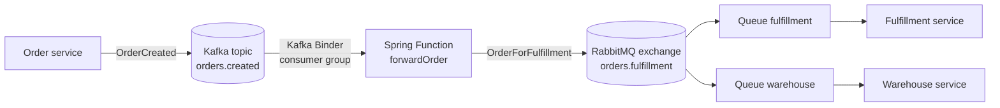
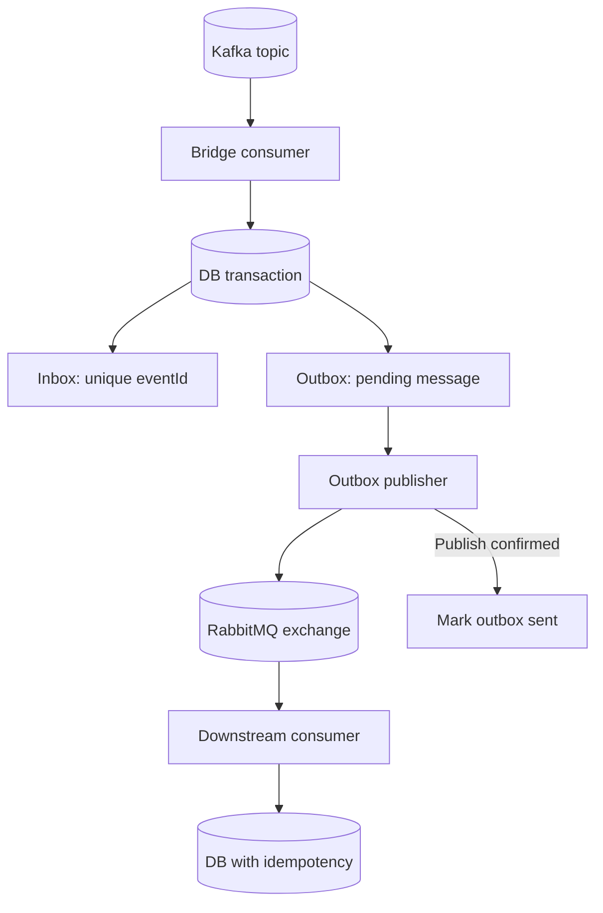

# Luồng nhận từ Kafka và phát sang RabbitMQ

Một ứng dụng Spring Cloud Stream có thể nhận sự kiện từ Apache Kafka, áp dụng logic nghiệp vụ rồi phát kết quả sang RabbitMQ. Mỗi đầu vào và đầu ra được kết nối bằng một binder phù hợp: Kafka Binder quản lý việc đọc topic và consumer group, còn RabbitMQ Binder quản lý việc gửi tới exchange và các queue được bind vào exchange đó.

Đây là một ứng dụng có hai binding thuộc hai hệ thống message broker khác nhau. Function xử lý dữ liệu vẫn là một bean Java thông thường; cấu hình binding quyết định nơi nhận và nơi phát. Thiết kế này hữu ích khi cần chuyển tiếp sự kiện giữa nền tảng dữ liệu Kafka và các dịch vụ downstream đang tiêu thụ RabbitMQ. Tuy nhiên, hai broker không chia sẻ một transaction nguyên tử. Ứng dụng phải xử lý khả năng publish thành công nhưng offset Kafka chưa được commit, dẫn đến sự kiện được nhận lại và phát trùng.

## 1. Kiến trúc luồng Kafka sang RabbitMQ

Ví dụ nghiệp vụ: hệ thống đơn hàng phát sự kiện `OrderCreated` vào topic Kafka `orders.created`. Một ứng dụng bridge đọc sự kiện, chuẩn hóa dữ liệu thành `OrderForFulfillment`, rồi gửi tới RabbitMQ destination `orders.fulfillment`. Các dịch vụ kho vận hoặc đóng gói đăng ký queue thuộc destination đó để nhận lệnh.



Mỗi thành phần có trách nhiệm riêng:

- Kafka topic lưu sự kiện nguồn theo partition và offset.
- Kafka consumer group xác định nhóm instance cùng chia việc đọc topic.
- Function nhận payload, kiểm tra và chuyển đổi dữ liệu.
- RabbitMQ exchange định tuyến message theo exchange type, routing key và binding.
- Queue thuộc consumer group nhận message từ exchange.
- Consumer downstream xử lý message và acknowledge theo cấu hình Rabbit binder.

Spring Cloud Stream không tự biến Kafka topic thành RabbitMQ queue. Binder chỉ kết nối từng binding với destination tương ứng. Logic chuyển đổi và quyết định nội dung message thuộc về function.

## 2. Thêm hai binder vào ứng dụng

Ứng dụng cần cả Kafka Binder và RabbitMQ Binder trên classpath. Với Maven, có thể dùng hai starter:

```xml
<dependencies>
    <dependency>
        <groupId>org.springframework.cloud</groupId>
        <artifactId>spring-cloud-starter-stream-kafka</artifactId>
    </dependency>

    <dependency>
        <groupId>org.springframework.cloud</groupId>
        <artifactId>spring-cloud-starter-stream-rabbit</artifactId>
    </dependency>
</dependencies>
```

Quản lý phiên bản bằng Spring Cloud BOM tương thích với phiên bản Spring Boot của dự án. Không tự ghép hai phiên bản binder khác release train. Nếu dự án đã dùng các starter này qua dependency management nội bộ, tránh khai báo thêm phiên bản trực tiếp ở từng dependency.

Khi chỉ có một binder implementation trên classpath, Spring Cloud Stream có thể tự chọn binder đó. Khi có nhiều binder implementation, ứng dụng cần xác định binder cho từng binding hoặc khai báo một default binder và ghi đè ở binding cần binder khác.

Với luồng này, đầu vào phải dùng Kafka và đầu ra phải dùng RabbitMQ. Nên khai báo `binder` rõ ràng trên cả hai binding để cấu hình dễ đọc và không phụ thuộc lựa chọn mặc định.

## 3. Function và tên binding được tạo tự động

Một function có một input và một output tạo ra hai binding theo quy ước:

- `<functionName>-in-0`: binding đầu vào.
- `<functionName>-out-0`: binding đầu ra.

Ví dụ function có tên `forwardOrder`:

```java
import java.math.BigDecimal;
import java.time.Instant;

public record OrderCreated(
    String eventId,
    String orderId,
    String customerId,
    BigDecimal total,
    Instant occurredAt
) {}

public record OrderForFulfillment(
    String eventId,
    String orderId,
    String customerId,
    BigDecimal total,
    Instant createdAt
) {}
```

Function chuyển đổi event nguồn thành message dành cho dịch vụ fulfillment:

```java
import java.util.function.Function;

import org.springframework.context.annotation.Bean;
import org.springframework.context.annotation.Configuration;

@Configuration
public class OrderBridgeConfiguration {

    @Bean
    Function<OrderCreated, OrderForFulfillment> forwardOrder() {
        return event -> {
            if (event == null
                    || event.eventId() == null
                    || event.orderId() == null
                    || event.customerId() == null
                    || event.total() == null) {
                throw new IllegalArgumentException(
                    "OrderCreated is missing required fields"
                );
            }

            if (event.total().signum() < 0) {
                throw new IllegalArgumentException(
                    "Order total must not be negative"
                );
            }

            return new OrderForFulfillment(
                event.eventId(),
                event.orderId(),
                event.customerId(),
                event.total(),
                event.occurredAt()
            );
        };
    }
}
```

Spring Cloud Function phát hiện bean `Function` và Spring Cloud Stream tạo input/output binding. Không cần tự tạo `KafkaConsumer`, `KafkaProducer`, RabbitMQ `ConnectionFactory` hoặc channel để thực hiện luồng cơ bản.

Function chỉ thực hiện validation và chuyển đổi. Nó không cần biết Kafka topic hay RabbitMQ exchange tên gì. Tên destination và binder được cấu hình ở binding properties.

## 4. Gán Kafka Binder cho input và Rabbit Binder cho output

Cấu hình tối thiểu:

```yaml
spring:
  cloud:
    function:
      definition: forwardOrder
    stream:
      bindings:
        forwardOrder-in-0:
          destination: orders.created
          group: fulfillment-bridge
          binder: kafka
          content-type: application/json
          consumer:
            max-attempts: 3
            back-off-initial-interval: 1000
            back-off-max-interval: 10000
            back-off-multiplier: 2.0

        forwardOrder-out-0:
          destination: orders.fulfillment
          binder: rabbit
          content-type: application/json

      kafka:
        binder:
          brokers:
            - ${KAFKA_BOOTSTRAP_SERVERS:localhost:9092}

  rabbitmq:
    addresses: ${RABBITMQ_ADDRESSES:localhost:5672}
    username: ${RABBITMQ_USERNAME:app}
    password: ${RABBITMQ_PASSWORD}
    virtual-host: ${RABBITMQ_VHOST:/}
```

Ý nghĩa các thuộc tính:

| Thuộc tính | Ý nghĩa |
|---|---|
| `function.definition` | Chọn function bean `forwardOrder` để kích hoạt |
| `forwardOrder-in-0.destination` | Topic Kafka nguồn |
| `forwardOrder-in-0.group` | Consumer group ổn định của bridge |
| `forwardOrder-in-0.binder` | Chọn Kafka Binder cho input |
| `forwardOrder-out-0.destination` | Destination RabbitMQ để phát message |
| `forwardOrder-out-0.binder` | Chọn RabbitMQ Binder cho output |
| `content-type` | Định dạng message ở ranh giới binding |
| `consumer.max-attempts` | Số lần xử lý tối đa ở retry policy của input |
| `kafka.binder.brokers` | Địa chỉ bootstrap Kafka |
| `spring.rabbitmq.*` | Cấu hình kết nối RabbitMQ do Spring Boot cung cấp cho Rabbit binder |

Tên `kafka` và `rabbit` là các binder type mặc định được cung cấp bởi hai binder implementation. Nếu ứng dụng định nghĩa binder instance có tên riêng, binding phải tham chiếu đúng alias đó thay vì dùng tên type.

Các biến môi trường trong ví dụ cần được cấp khi chạy ứng dụng. Giá trị mặc định `localhost` chỉ phù hợp cho môi trường phát triển. Không commit password hoặc thông tin xác thực production vào file cấu hình.

## 5. Kafka topic và consumer group

Kafka Binder ánh xạ destination tới topic Kafka. Consumer group ánh xạ tới khái niệm consumer group của Kafka. Trong ví dụ, topic `orders.created` là nguồn và group `fulfillment-bridge` là danh tính tiêu thụ của ứng dụng bridge.

Group cần ổn định qua các lần restart. Nếu đổi group, Kafka xem đó là một consumer group mới và có thể đọc lại dữ liệu theo offset reset policy. Nếu nhiều instance bridge cùng dùng group `fulfillment-bridge`, Kafka phân phối partition giữa các instance.

Cần lưu ý:

- Số instance xử lý song song bị giới hạn bởi số partition được gán cho group.
- Các instance trong cùng group chia nhau record; chúng không nhận bản sao riêng của mọi record.
- Nếu một dịch vụ khác cũng cần đọc toàn bộ topic, dịch vụ đó nên có group riêng.
- Không dùng group ngẫu nhiên trong production nếu cần tiếp tục từ offset đã commit.
- Offset reset policy quyết định vị trí bắt đầu khi group chưa có offset hợp lệ.

Kafka Binder có thể tự provision topic tùy cấu hình và quyền broker. Trong production, nên quản lý topic, partition, replication factor, retention và ACL bằng quy trình hạ tầng rõ ràng.

## 6. RabbitMQ destination là exchange

RabbitMQ Binder mặc định ánh xạ một destination tới một `TopicExchange`. Với consumer group có tên, binder tạo queue và bind queue đó vào exchange. Output binding của bridge gửi message tới exchange `orders.fulfillment`.

Một dịch vụ downstream khai báo input binding:

```yaml
spring:
  cloud:
    function:
      definition: receiveFulfillment
    stream:
      bindings:
        receiveFulfillment-in-0:
          destination: orders.fulfillment
          group: fulfillment-service
          binder: rabbit
          content-type: application/json
```

Với group `fulfillment-service`, Rabbit binder tạo queue cho group và bind queue đó vào exchange. Nếu có một dịch vụ khác như warehouse, nó dùng group khác để nhận một bản sao message riêng qua queue riêng. Các instance của cùng dịch vụ dùng chung group sẽ cạnh tranh nhận message từ cùng queue.

Nếu output exchange không có queue binding phù hợp, message có thể không được dịch vụ nào nhận. Vì vậy, cần provision consumer queue/binding hoặc xác minh topology được binder khai báo tự động. Destination của producer là exchange; queue downstream thường được hình thành khi consumer binding có group được khai báo.

Không nhầm `group` của Kafka input với `group` của Rabbit consumer. Hai thuộc tính cùng tên ở API chung nhưng ánh xạ tới cơ chế broker khác nhau.

## 7. Vì sao phải gán binder trên từng binding?

Khi Kafka và Rabbit binder cùng có mặt trên classpath, Spring Cloud Stream cần biết binder nào xử lý destination nào. Ví dụ:

```yaml
spring:
  cloud:
    stream:
      default-binder: kafka
      bindings:
        forwardOrder-in-0:
          destination: orders.created
          group: fulfillment-bridge
        forwardOrder-out-0:
          destination: orders.fulfillment
          binder: rabbit
```

Cấu hình này chọn Kafka làm default binder và chỉ định Rabbit cho output. Nó tương đương với việc gán rõ `binder: kafka` cho input và `binder: rabbit` cho output. Với ứng dụng bridge có ít binding, gán rõ cả hai thường giúp người đọc nhận ra luồng dữ liệu nhanh hơn.

Nếu đặt `default-binder` nhưng binding không có `binder`, binding đó dùng default binder. Nếu không có default và nhiều binder implementation cùng khả dụng, cần chỉ định binder rõ ràng để tránh lựa chọn mơ hồ hoặc binding không khởi tạo như mong muốn.

`default-binder` là lựa chọn mặc định cho binding chưa gán cụ thể; nó không chuyển đổi binder của các binding đã chỉ định.

## 8. Kết nối tới nhiều broker cùng loại bằng named binder

Trường hợp có một Kafka cluster và một RabbitMQ broker khác loại, chỉ cần hai binder implementation và gán binder cho binding. Named binder configuration hữu ích khi cần kết nối nhiều broker cùng loại, ví dụ đọc Kafka cluster A và phát tới Kafka cluster B, hoặc hai RabbitMQ cluster khác nhau.

Ví dụ khai báo hai Kafka binder instance:

```yaml
spring:
  cloud:
    stream:
      binders:
        kafkaSource:
          type: kafka
          environment:
            spring:
              cloud:
                stream:
                  kafka:
                    binder:
                      brokers: ${KAFKA_SOURCE_BROKERS}
        kafkaArchive:
          type: kafka
          environment:
            spring:
              cloud:
                stream:
                  kafka:
                    binder:
                      brokers: ${KAFKA_ARCHIVE_BROKERS}
          default-candidate: false

      bindings:
        forwardOrder-in-0:
          destination: orders.created
          group: fulfillment-bridge
          binder: kafkaSource
        forwardOrder-out-0:
          destination: orders.archive
          binder: kafkaArchive
```

`kafkaSource` và `kafkaArchive` là alias do ứng dụng đặt. `type: kafka` chọn implementation Kafka Binder; `environment` cung cấp cấu hình Spring Boot riêng cho binder instance. `default-candidate: false` giữ binder archive ở trạng thái chỉ được chọn khi binding tham chiếu tường minh.

Khi bật explicit binder configuration qua `spring.cloud.stream.binders.*`, Spring Cloud Stream tắt quy trình cấu hình default binder tự động. Tất cả binder cần dùng phải được khai báo trong phần `binders`. Không khai báo một named binder duy nhất rồi giả định binder mặc định khác vẫn tự được tạo. Nếu ứng dụng cần cả Kafka và Rabbit trong explicit mode, hãy khai báo cả hai:

```yaml
spring:
  cloud:
    stream:
      binders:
        kafkaSource:
          type: kafka
          environment:
            spring:
              cloud:
                stream:
                  kafka:
                    binder:
                      brokers: ${KAFKA_BOOTSTRAP_SERVERS}
        rabbitTarget:
          type: rabbit
          environment:
            spring:
              rabbitmq:
                addresses: ${RABBITMQ_ADDRESSES}
                username: ${RABBITMQ_USERNAME}
                password: ${RABBITMQ_PASSWORD}
      bindings:
        forwardOrder-in-0:
          destination: orders.created
          group: fulfillment-bridge
          binder: kafkaSource
        forwardOrder-out-0:
          destination: orders.fulfillment
          binder: rabbitTarget
```

Khi đã khai báo môi trường riêng cho binder, xác minh property có đúng prefix của binder implementation. Kafka Binder dùng `spring.cloud.stream.kafka.binder.*`; Rabbit binder dùng các thuộc tính kết nối Spring AMQP/Spring Boot như `spring.rabbitmq.*`.

Trong một ứng dụng nhiều binder, các binder có thể chạy trong application context riêng. Nếu cần tùy biến đối tượng binder bằng code (ví dụ gắn rebalance listener cho Kafka binder), bean cấu hình thông thường ở application context chính có thể không được binder context nhìn thấy trực tiếp. Spring Cloud Stream cung cấp `BinderCustomizer` để chuyển tùy biến tới từng binder trước khi binding sử dụng chúng. Customizer nhận cả binder instance và binder name; nên kiểm tra loại binder và alias để chỉ áp dụng cấu hình cho đúng broker. Cơ chế này dành cho tùy biến bằng code, không cần thiết khi chỉ cấu hình broker, credential hoặc destination bằng properties.

## 9. Tách môi trường và thông tin xác thực

Local, staging và production thường dùng broker, credential, TLS và virtual host khác nhau. Có thể externalize bằng biến môi trường, profile hoặc secret manager.

Ví dụ cấu hình production:

```yaml
spring:
  cloud:
    stream:
      kafka:
        binder:
          brokers: ${KAFKA_BOOTSTRAP_SERVERS}
          configuration:
            security.protocol: SASL_SSL
            sasl.mechanism: PLAIN
            sasl.jaas.config: ${KAFKA_SASL_JAAS_CONFIG}
  rabbitmq:
    addresses: ${RABBITMQ_ADDRESSES}
    username: ${RABBITMQ_USERNAME}
    password: ${RABBITMQ_PASSWORD}
    virtual-host: ${RABBITMQ_VHOST}
    ssl:
      enabled: true
```

Kafka và RabbitMQ có cơ chế bảo mật riêng. Cấu hình TLS/SASL của Kafka không tự áp dụng cho RabbitMQ. RabbitMQ TLS, credential và virtual host cần được cấu hình qua connection factory của Rabbit binder.

Khi dùng named binder, môi trường của từng binder có thể chứa profile riêng. Cần kiểm tra `inherit-environment` và `environment` để biết binder kế thừa property từ application context hay chạy trong context tách biệt. Không để một binder vô tình nhận credential của broker khác do property dùng chung.

Không log toàn bộ environment hoặc cấu hình kết nối. Password, JAAS string, token, truststore password và private key phải được quản lý như secret.

## 10. Chuyển đổi payload và hợp đồng message

Kafka và RabbitMQ không bắt buộc dùng cùng một wire protocol hay schema. Spring Cloud Stream chuyển đổi payload ở ranh giới binding theo `content-type` và message converter. Function nhận kiểu Java đã được giải mã, sau đó output binding chuyển kiểu trả về thành message phù hợp với binder đích.

Trong ví dụ, cả hai binding dùng `application/json`. Điều này có nghĩa bridge nhận JSON có thể chuyển đổi thành `OrderCreated`, sau đó phát `OrderForFulfillment` dưới dạng JSON. Hai kiểu Java không nhất thiết giống nhau; function là nơi thực hiện mapping.

Cần thống nhất hợp đồng downstream:

- Tên field và kiểu dữ liệu.
- Định dạng timestamp và timezone.
- Đơn vị tiền tệ và quy tắc làm tròn.
- Event ID và correlation ID.
- Schema version và chính sách tương thích.
- Cách xử lý field mới, field thiếu hoặc giá trị null.

Nếu producer Kafka dùng Avro, Protobuf hoặc serializer riêng, binder cần Serde/converter phù hợp. Không đặt `content-type: application/json` để giả định payload Avro tự trở thành JSON. Cần giải mã theo schema nguồn trước khi function xử lý.

RabbitMQ message nên mang event ID ổn định để consumer downstream có thể chống xử lý trùng. Có thể dùng payload field hoặc header theo hợp đồng đã thống nhất. Nếu function nhận `Message<OrderCreated>` và trả về `Message<OrderForFulfillment>`, có thể chủ động giữ correlation headers:

Đây là biến thể thay thế chữ ký `Function<OrderCreated, OrderForFulfillment>` ở phần trước khi ứng dụng cần truyền header nghiệp vụ:

```java
import java.util.function.Function;

import org.springframework.context.annotation.Bean;
import org.springframework.messaging.Message;
import org.springframework.messaging.support.MessageBuilder;

@Bean
Function<Message<OrderCreated>, Message<OrderForFulfillment>> forwardOrder() {
    return message -> {
        OrderCreated event = message.getPayload();

        OrderForFulfillment output = new OrderForFulfillment(
            event.eventId(),
            event.orderId(),
            event.customerId(),
            event.total(),
            event.occurredAt()
        );

        return MessageBuilder
            .withPayload(output)
            .copyHeaders(message.getHeaders())
            .build();
    };
}
```

Ví dụ này yêu cầu import `Message` và `MessageBuilder` từ Spring Messaging. Không nên sao chép tất cả header một cách mù quáng nếu chúng chứa header nội bộ của Kafka hoặc Rabbit không có ý nghĩa ở broker đích. Hãy chọn những header ứng dụng cần giữ như `eventId`, `correlationId`, `traceparent` và schema version.

## 11. Đường đi của message và cửa sổ phát trùng

Khi function xử lý đồng bộ, ứng dụng nhận record Kafka, chạy logic và gửi output tới RabbitMQ. Sau khi xử lý thành công, listener container có thể hoàn tất acknowledgement/offset commit cho input theo cấu hình binder.

Hai broker không cùng tham gia một transaction nguyên tử. Có một cửa sổ lỗi quan trọng:

1. Kafka giao record `OrderCreated`.
2. Function xử lý và Rabbit binder publish `OrderForFulfillment`.
3. RabbitMQ nhận message.
4. Ứng dụng hoặc consumer bị lỗi trước khi Kafka offset được commit.
5. Kafka giao lại record nguồn.
6. Function publish lại message RabbitMQ.

Kết quả là RabbitMQ có thể nhận hai message cùng event ID. Đây là tình huống at-least-once thường gặp khi bridge qua hai hệ thống độc lập. Kafka transaction không thể bao trùm một publish RabbitMQ theo cách tạo distributed atomic commit với RabbitMQ.

Cũng cần xử lý trường hợp Rabbit publish thất bại. Nếu lỗi được truyền về listener trước khi input được xác nhận, Kafka có thể giao lại record theo retry/error policy. Nếu output send được cấu hình bất đồng bộ hoặc lỗi không được truyền về caller, cần một cơ chế xác nhận và lưu trạng thái riêng; không giả định việc function trả về đã bảo đảm message đến exchange/queue.

## 12. Idempotency ở phía RabbitMQ consumer

Cách đơn giản để giảm tác động của publish trùng là giữ `eventId` ổn định qua mọi lần retry và replay. Consumer RabbitMQ lưu event ID đã xử lý cùng transaction với thay đổi nghiệp vụ.

Ví dụ:

```java
@Service
public class FulfillmentService {

    private final ProcessedEventRepository processedEvents;
    private final ShipmentRepository shipments;

    public FulfillmentService(
            ProcessedEventRepository processedEvents,
            ShipmentRepository shipments) {
        this.processedEvents = processedEvents;
        this.shipments = shipments;
    }

    @Transactional
    public void createShipment(OrderForFulfillment event) {
        if (processedEvents.existsById(event.eventId())) {
            return;
        }

        shipments.createFor(event.orderId(), event.customerId());
        processedEvents.save(new ProcessedEvent(event.eventId()));
    }
}
```

Bảng `processed_event` cần unique constraint trên `eventId`. Kiểm tra tồn tại trước khi insert không tự ngăn race condition nếu hai consumer xử lý cùng event đồng thời; cần bắt unique constraint hoặc dùng thao tác insert có điều kiện.

Idempotency ở consumer downstream bảo vệ side effect nghiệp vụ, kể cả khi bridge publish trùng. Nó không làm message chỉ được publish một lần; nó làm cho việc xử lý lặp trở nên an toàn.

## 13. Transactional outbox khi cần độ tin cậy cao

Nếu bridge phải bảo đảm không mất sự kiện khi chuyển từ Kafka sang RabbitMQ, có thể dùng một database làm ranh giới lưu trạng thái và outbox:

1. Nhận record Kafka có event ID.
2. Trong một database transaction, insert inbox record với unique event ID và insert outbox record chứa payload cần phát RabbitMQ.
3. Commit database transaction.
4. Khi function trả về thành công, Kafka input có thể được xác nhận.
5. Một outbox publisher riêng đọc các bản ghi chưa gửi và publish tới RabbitMQ.
6. Chỉ đánh dấu outbox đã gửi sau khi nhận được xác nhận phù hợp từ RabbitMQ.
7. Nếu publisher crash sau publish nhưng trước khi đánh dấu, nó có thể publish lại; consumer RabbitMQ vẫn cần idempotency.



Mẫu này lưu bền vững ý định phát message trước khi acknowledge input. Nếu Kafka giao lại record do bridge crash sau database commit, unique event ID trong inbox giúp bỏ qua lần xử lý trùng và giữ nguyên outbox đã có.

Outbox publisher vẫn có thể phát trùng nếu RabbitMQ đã nhận message nhưng publisher crash trước khi đánh dấu sent. Vì vậy, consumer downstream cần idempotency. Publisher confirms giúp xác định broker đã nhận publish theo semantics của RabbitMQ, nhưng không tạo transaction phân tán giữa database và broker.

## 14. Retry và DLQ ở đầu vào Kafka

Kafka input có thể dùng retry hữu hạn cho lỗi tạm thời trong function:

```yaml
spring:
  cloud:
    stream:
      bindings:
        forwardOrder-in-0:
          destination: orders.created
          group: fulfillment-bridge
          binder: kafka
          consumer:
            max-attempts: 3
            back-off-initial-interval: 1000
            back-off-max-interval: 10000
            back-off-multiplier: 2.0
      kafka:
        bindings:
          forwardOrder-in-0:
            consumer:
              enable-dlq: true
              dlq-name: orders.created.fulfillment-bridge.dlt
```

Kafka binder hỗ trợ dead-letter topic cho consumer có group khi cấu hình phù hợp. Cần provision topic DLT, số partition, replication và ACL để binder/producer ghi được. Khi handler lỗi vĩnh viễn hoặc retry hết, record có thể được đưa sang DLT theo chính sách binder.

Phân biệt lỗi:

- Lỗi validation vĩnh viễn: không retry nhiều lần; đưa DLT để điều tra.
- RabbitMQ tạm thời không sẵn sàng: retry hữu hạn và backoff.
- RabbitMQ credential sai: retry liên tục không sửa được cấu hình; cần cảnh báo và xử lý hạ tầng.
- Payload schema không tương thích: sửa schema/Serde hoặc quarantine thay vì replay mù quáng.

DLT Kafka chỉ lưu record input thất bại. Nó không tự lưu trạng thái output Rabbit đã publish hay chưa. Nếu có khả năng output publish thành công trước khi input thất bại, event ID và idempotency vẫn cần thiết.

## 15. Lỗi publish RabbitMQ và xác nhận producer

Khi Rabbit binder gửi output, lỗi có thể xuất hiện do broker không sẵn sàng, exchange không tồn tại, thiếu quyền publish, routing không tới queue hoặc connection bị đóng. Cần xác định ứng dụng có nhận được lỗi publish đồng bộ hay không và binder đang dùng cơ chế xác nhận nào.

Các điểm cần kiểm tra:

- Exchange destination đã được khai báo hoặc binder có quyền provision.
- RabbitMQ connection factory kết nối đúng cluster và virtual host.
- Producer có quyền write vào exchange.
- Routing key và exchange type dẫn tới queue mong muốn.
- Message converter và content type tương thích consumer.
- Cấu hình publisher confirm/return phù hợp với yêu cầu delivery.
- Timeout và retry không tạo vòng lặp vô hạn.

Publisher confirm và consumer acknowledgement là hai cơ chế khác nhau. Confirm liên quan tới publisher và broker; acknowledgement liên quan tới consumer và message đã nhận. Confirm không chứng minh downstream đã xử lý message.

Nếu bridge cần biết publish đã được broker xác nhận trước khi hoàn tất input, cần thiết kế output send và error propagation phù hợp với binder/version đang dùng. Với yêu cầu bền vững cao, transactional outbox làm rõ ranh giới retry và lưu trạng thái tốt hơn việc chỉ tăng số lần retry trong function.

## 16. Header và correlation giữa hai broker

Kafka và RabbitMQ có tập metadata riêng. Một số header có thể được ánh xạ, một số header là metadata nội bộ của binder hoặc broker và không nên chuyển nguyên vẹn.

Nên định nghĩa một bộ header ứng dụng ổn định:

| Header | Mục đích |
|---|---|
| `eventId` | Khóa idempotency của sự kiện |
| `correlationId` | Liên kết các message trong cùng một luồng nghiệp vụ |
| `causationId` | Xác định event/message tạo ra sự kiện hiện tại |
| `traceparent` | Truyền trace context nếu hệ thống tracing hỗ trợ |
| `schemaVersion` | Xác định phiên bản hợp đồng payload |
| `sourceSystem` | Nhận biết hệ thống phát ban đầu |

Khi chuyển message, hãy giữ hoặc tạo các header theo hợp đồng. Không dùng Kafka offset hoặc Rabbit delivery tag làm event ID vì chúng chỉ có ý nghĩa trong phạm vi broker/queue cụ thể và có thể thay đổi khi replay hoặc chuyển hệ thống.

Nếu dùng `MessageBuilder.copyHeaders`, cần loại bỏ header nội bộ không hợp lệ ở broker đích. Đừng đưa credential, token hoặc header bảo mật vào message downstream nếu không có yêu cầu rõ ràng.

## 17. Quan sát cả hai phía của bridge

Bridge có thể đọc Kafka thành công nhưng không gửi được RabbitMQ, hoặc RabbitMQ hoạt động bình thường trong khi Kafka consumer bị lag. Chỉ giám sát trạng thái Spring Boot là chưa đủ.

| Chỉ số | Ý nghĩa |
|---|---|
| Kafka consumer lag | Bridge có theo kịp topic nguồn không |
| Kafka records consumed | Số record nguồn đã được nhận |
| Function success/failure | Kết quả validation và mapping |
| Rabbit publish success/failure | Tình trạng gửi tới exchange |
| Retry count và DLT depth | Lỗi tạm thời và record không thể xử lý |
| Rabbit exchange/queue depth | Downstream có đang tiêu thụ kịp không |
| Duplicate event ID count | Dấu hiệu redelivery hoặc publish lặp |
| End-to-end latency | Thời gian từ event source đến lúc message sẵn sàng ở Rabbit |
| Outbox pending age | Nếu dùng outbox, thời gian message chờ publish |

Log nên có event ID, input topic, partition, offset, output destination và correlation ID. Không log toàn bộ payload nhạy cảm hoặc thông tin kết nối. Tạo cảnh báo khi lag, DLT hoặc outbox pending tăng liên tục.

## 18. Kiểm thử tích hợp với Kafka và RabbitMQ thật

Test Binder hữu ích để kiểm tra function và binding ở bộ nhớ, nhưng không mô phỏng đầy đủ Kafka offset/partition và Rabbit exchange/queue/confirm. Bridge hai broker cần integration test với cả hai hệ thống.

Có thể dùng Testcontainers để khởi chạy Kafka và RabbitMQ cô lập. Các kịch bản:

1. Publish một `OrderCreated` vào Kafka topic.
2. Xác minh function được gọi và Rabbit exchange nhận `OrderForFulfillment`.
3. Xác minh JSON payload và các header ứng dụng được giữ đúng.
4. Gửi nhiều event và kiểm tra consumer group chia partition.
5. Làm RabbitMQ unavailable tạm thời; xác minh input retry và phục hồi.
6. Làm Rabbit credential sai; xác minh lỗi được quan sát và không retry vô hạn.
7. Làm function validation thất bại; xác minh Kafka DLT nhận record.
8. Publish Rabbit thành công rồi mô phỏng bridge crash trước khi Kafka offset commit; xác minh event có thể xuất hiện lại và consumer idempotent.
9. Với outbox, crash sau publish nhưng trước khi đánh dấu sent; xác minh duplicate được xử lý an toàn.
10. Xác minh exchange, queue, routing key và consumer group được provision đúng.
11. Kiểm tra restart của bridge và giữ nguyên group để tiếp tục từ offset đã commit.
12. Kiểm tra trace/correlation headers qua ranh giới hai broker.

Test nên kiểm tra cả payload, broker metadata, offset và queue depth. Chỉ xác minh function trả về đúng object chưa chứng minh message đã được ghi vào RabbitMQ.

## 19. Lỗi thường gặp

| Hiện tượng | Nguyên nhân có thể | Cách xử lý |
|---|---|---|
| Cả input và output đều kết nối Kafka | Chưa gán binder hoặc default binder áp dụng cho cả hai | Gán `binder: kafka` và `binder: rabbit` theo binding |
| Không tìm thấy binder `rabbit` | Thiếu Rabbit binder dependency hoặc alias không đúng | Thêm Rabbit starter và kiểm tra binder type |
| Output không đến queue | Destination là exchange nhưng chưa có consumer queue/binding | Khởi tạo consumer group và kiểm tra routing |
| Kafka đọc lại toàn bộ dữ liệu sau restart | Group bị đổi hoặc offset reset policy khác | Dùng group ổn định và kiểm tra offset |
| Message Rabbit bị trùng | Rabbit publish thành công nhưng Kafka offset chưa commit | Idempotency bằng event ID hoặc transactional outbox |
| Kafka DLT không có message | Chưa bật DLT, group/ACL/topic sai | Kiểm tra Kafka binder DLT config và provision |
| Rabbit publish lỗi nhưng input vẫn được xác nhận | Error propagation hoặc send mode không như dự kiến | Kiểm thử binder/version và dùng outbox nếu cần bảo đảm |
| JSON không giải mã được | Content type, converter hoặc schema không tương thích | Chuẩn hóa contract và Serde/converter |
| Named binder không khởi tạo | Explicit binder config chưa khai báo đủ binder | Khai báo mọi binder được sử dụng |
| Binder dùng nhầm credential | Property môi trường bị chia sẻ hoặc kế thừa ngoài ý muốn | Kiểm tra binder environment và secret scope |

## 20. Checklist production

- Thêm Kafka Binder và RabbitMQ Binder từ cùng Spring Cloud release train.
- Kích hoạt đúng function bằng `spring.cloud.function.definition`.
- Gán Kafka cho input và Rabbit cho output.
- Dùng consumer group Kafka ổn định.
- Provision Kafka topic, partition, retention, replication và ACL.
- Xác minh Rabbit destination là exchange và queue downstream đã được bind.
- Chuẩn hóa content type, schema version, event ID và correlation headers.
- Externalize broker address, credential, TLS và virtual host.
- Dùng retry hữu hạn và DLT cho lỗi input không thể xử lý.
- Xác minh lỗi publish Rabbit được truyền về hoặc lưu trạng thái bền vững.
- Không giả định Kafka transaction bao gồm RabbitMQ.
- Dùng idempotency ở downstream; dùng inbox/outbox khi cần bảo đảm cao.
- Theo dõi Kafka lag, Rabbit queue depth, retry, DLT, duplicate và latency.
- Kiểm thử cả hai broker bằng integration test trước khi triển khai.

## 21. Tài liệu tham khảo

- [Spring Cloud Stream — Multiple Binders on the Classpath](https://docs.spring.io/spring-cloud-stream/reference/spring-cloud-stream/multiple-binders.html), chọn binder theo từng binding và default binder.
- [Spring Cloud Stream — Connecting to Multiple Systems](https://docs.spring.io/spring-cloud-stream/reference/spring-cloud-stream/multiple-systems.html), named binder configuration, môi trường riêng và default candidate.
- [Spring Cloud Stream — Functional Binding Names](https://docs.spring.io/spring-cloud-stream/reference/spring-cloud-stream/functional-binding-names.html), quy ước tên input/output binding của function.
- [Spring Cloud Stream — Customizing Binders in Multi-Binder Applications](https://docs.spring.io/spring-cloud-stream/reference/spring-cloud-stream/binder-customizer.html), tùy biến binder trong các context riêng.
- [Spring Cloud Stream — Apache Kafka Binder](https://docs.spring.io/spring-cloud-stream-binder-kafka/docs/current/reference/html/spring-cloud-stream-binder-kafka.html), cấu hình Kafka topic, consumer group, producer và DLT.
- [Spring Cloud Stream — RabbitMQ Binder](https://docs.spring.io/spring-cloud-stream-binder-rabbit/docs/current/reference/html/spring-cloud-stream-binder-rabbit-aggregate.html), ánh xạ destination tới exchange, queue, consumer group và producer.
- [Spring Cloud Stream — Binder Usage](https://docs.spring.io/spring-cloud-stream/docs/current/reference/html/README.html), dependency starter cho Kafka và RabbitMQ.

Luồng Kafka sang RabbitMQ dùng một function làm ranh giới chuyển đổi, một Kafka binder cho input và một Rabbit binder cho output. Cấu hình binding xác định broker, destination và consumer group; named binder giúp tách môi trường khi kết nối nhiều cluster. Vì hai broker không có transaction nguyên tử chung, cần event ID ổn định, idempotency, retry/DLT và transactional outbox khi yêu cầu độ tin cậy cao. Khi kiểm thử cả hai broker và quan sát được lag, publish failure cùng duplicate, bridge có thể vận hành rõ ràng và phục hồi an toàn hơn.

