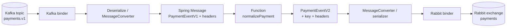

# Chuyển đổi định dạng, khóa và header giữa các hệ thống

Khi một ứng dụng Spring Cloud Stream đọc message từ Kafka rồi ghi sang RabbitMQ hoặc Pulsar, message phải đi qua nhiều lớp biểu diễn. Payload có thể là JSON bytes ở broker nguồn, được chuyển thành Java object trong function, rồi serialize lại theo định dạng mà broker đích hiểu. Trong quá trình đó, khóa định tuyến và metadata cũng cần được ánh xạ theo semantics của hệ thống đích.

Ba thành phần cần xử lý riêng:

- **Payload/format:** bytes trên wire, kiểu Java trong function, content type, serializer/deserializer và schema.
- **Key:** Kafka record key, RabbitMQ routing key và Pulsar message key/ordering key có mục đích khác nhau.
- **Headers/metadata:** Spring MessageHeaders, Kafka record headers, AMQP properties/headers và Pulsar message properties/metadata không có cùng tập kiểu dữ liệu hoặc quy tắc ánh xạ.

Một bridge đáng tin cậy nên chuyển message về mô hình dữ liệu nghiệp vụ ổn định, sau đó tạo payload, key và headers phù hợp với từng output binding. Không nên sao chép mù quáng mọi metadata của broker nguồn sang broker đích.

## 1. Đường đi của message qua nhiều binder

Spring Cloud Stream biểu diễn message trong ứng dụng bằng Spring Messaging `Message<?>`. Binder chịu trách nhiệm kết nối binding với middleware cụ thể. Khi ứng dụng có nhiều binder trên classpath, mỗi binding có thể chọn binder riêng.

Ví dụ một function nhận payment event từ Kafka, chuẩn hóa dữ liệu rồi publish sang RabbitMQ:



Input và output có thể dùng binder, destination, serializer và cấu hình riêng. Function tập trung vào logic nghiệp vụ; cấu hình binding xác định cách đọc và ghi dữ liệu trên từng hệ thống.

Một ứng dụng có nhiều binder cần khai báo binder cho từng binding. Ví dụ binding input dùng Kafka, output dùng Rabbit:

```yaml
spring:
  cloud:
    stream:
      bindings:
        normalizePayment-in-0:
          binder: kafka
          destination: payments.v1
        normalizePayment-out-0:
          binder: rabbit
          destination: payments
```

Nếu chỉ có một binder của mỗi loại, tên binder thường là tên định danh của binder implementation. Khi cần nhiều instance của cùng loại binder hoặc cấu hình kết nối độc lập, khai báo alias trong `spring.cloud.stream.binders` và trỏ binding tới alias đó.

## 2. Payload trên wire và payload trong function

Kafka và Rabbit binder thường trao đổi payload trên wire dưới dạng `byte[]`. Pulsar binder mặc định cũng có thể dùng `Schema.BYTES` khi Spring Cloud Stream thực hiện message conversion. Trong function, payload có thể là Java record, POJO, String hoặc byte array tùy chữ ký function và cấu hình binding.

Ví dụ cùng một payment event có thể được biểu diễn theo ba dạng:

| Lớp | Ví dụ | Vai trò |
|---|---|---|
| Wire payload | JSON bytes | Dữ liệu truyền qua broker |
| Spring Message | `Message<byte[]>` | Payload cùng metadata |
| Business object | `PaymentEvent` | Kiểu dữ liệu function xử lý |

Chuyển đổi thường diễn ra ở hai điểm:

1. **Inbound conversion:** chuyển wire payload thành kiểu tham số mà function khai báo.
2. **Outbound conversion:** chuyển giá trị function trả về thành wire format mà binder gửi đi.

Spring Cloud Stream dùng `MessageConverter` cho quá trình này. Converter chọn cách chuyển đổi dựa trên content type và kiểu tham số đích.

Không nhầm payload Java với bytes trên broker. Một object có thể được serialize thành JSON, Avro hoặc Protobuf; kích thước và cấu trúc bytes phụ thuộc serializer và schema.

## 3. Content type và thứ tự ưu tiên

`contentType` cho biết payload được biểu diễn theo định dạng nào để framework tìm converter phù hợp. Spring Cloud Stream xác định content type theo thứ tự ưu tiên:

1. Header `contentType` có trong Spring Message.
2. `spring.cloud.stream.bindings.<binding-name>.content-type`.
3. Giá trị mặc định `application/json`.

Ví dụ:

```yaml
spring:
  cloud:
    stream:
      bindings:
        normalizePayment-in-0:
          content-type: application/json
        normalizePayment-out-0:
          content-type: application/json
```

Input và output có thể dùng content type khác nhau. Ví dụ nguồn phát Avro nhưng function chuyển thành object và output phát JSON:

```yaml
spring:
  cloud:
    stream:
      bindings:
        normalizePayment-in-0:
          content-type: application/*+avro
        normalizePayment-out-0:
          content-type: application/json
```

Trong trường hợp có header content type, header đó có thể ghi đè giá trị binding. Vì vậy, khi chuyển đổi format, hãy chủ động xác định content type đầu ra. Không sao chép content type của nguồn nếu payload đã được biến đổi sang định dạng khác.

Content type là một gợi ý cho converter, không phải schema đầy đủ. Framework còn cần kiểu tham số function để biết kiểu object đích. Nếu converter không hỗ trợ cặp content type và target type, quá trình chuyển đổi sẽ thất bại.

## 4. Các converter thường dùng

Spring Cloud Stream cung cấp một số converter thông dụng:

| Converter | Content type | Hành vi |
|---|---|---|
| JSON converter | `application/json` | Chuyển JSON bytes/String thành POJO và ngược lại |
| Byte array converter | `application/octet-stream` | Giữ payload dưới dạng `byte[]` |
| Object/String converter | `text/plain` | Chuyển String và một số object sang dạng text |
| Custom converter | MIME type do ứng dụng chọn | Xử lý định dạng hoặc schema riêng |

Ví dụ function nhận JSON thành Java record:

```java
public record PaymentEvent(
        String eventId,
        String accountId,
        long amountMinor,
        String currency
) {
}

@Bean
Function<PaymentEvent, PaymentEvent> validatePayment() {
    return event -> {
        if (event.amountMinor() <= 0) {
            throw new IllegalArgumentException("amountMinor must be positive");
        }
        return event;
    };
}
```

Khi input binding có `content-type: application/json`, converter có thể deserialize payload thành `PaymentEvent` trước khi gọi function. Nếu output binding cũng có content type JSON, object trả về được serialize thành JSON bytes.

Nếu cần định dạng đặc biệt, có thể đăng ký custom `MessageConverter` hoặc dùng schema-aware converter. Hãy kiểm tra converter có hỗ trợ cả chiều inbound và outbound cần thiết hay không.

## 5. Chọn kiểu tham số function để conversion hoạt động

Kiểu tham số function là một phần của hợp đồng conversion.

- `Function<PaymentEvent, ...>` cho framework biết target type là PaymentEvent.
- `Function<Message<PaymentEvent>, ...>` cho phép đọc payload cùng headers trong khi target payload vẫn là PaymentEvent.
- `Function<byte[], ...>` nhận raw bytes; ứng dụng tự decode.
- `Function<Object, ...>` hoặc `Function<Message<?>, ...>` không cung cấp target payload type cụ thể và có thể khiến framework không thực hiện conversion như mong muốn.

Ví dụ cần đọc correlation ID nhưng vẫn muốn converter deserialize JSON:

```java
@Bean
Function<Message<PaymentEvent>, PaymentEvent> inspectPayment() {
    return message -> {
        String correlationId =
                message.getHeaders().get("correlationId", String.class);

        log.info("Processing payment correlationId={}", correlationId);
        return message.getPayload();
    };
}
```

Tránh dùng `Object` chỉ để truy cập headers. Dùng `Message<YourDomainType>` để giữ target type cụ thể. Chỉ chọn raw `byte[]` khi ứng dụng thật sự muốn tự chịu trách nhiệm decode, validate và xử lý schema.

## 6. Native encoding và native decoding

Spring Cloud Stream có hai chế độ conversion:

- **Framework conversion:** `MessageConverter` chuyển payload theo content type và target type.
- **Native encoding/decoding:** client library của middleware tự serialize/deserialize payload bằng serializer, deserializer hoặc schema riêng.

Hai thuộc tính điều khiển chế độ native:

- `spring.cloud.stream.bindings.<binding>.producer.use-native-encoding`.
- `spring.cloud.stream.bindings.<binding>.consumer.use-native-decoding`.

Khi native encoding/decoding được bật:

- Framework không dùng content type để quyết định việc serialize/deserialize payload.
- Ứng dụng phải cấu hình serializer/deserializer hoặc schema tương ứng ở binder/client.
- `headerMode=embeddedHeaders` bị bỏ qua; header không được nhúng vào payload theo cơ chế embedded headers.

Ví dụ cấu hình native encoding/decoding:

```yaml
spring:
  cloud:
    stream:
      bindings:
        pulsarInput-in-0:
          consumer:
            use-native-decoding: true
        pulsarOutput-out-0:
          producer:
            use-native-encoding: true
```

Native mode hữu ích khi hệ thống đã có schema hoặc serializer đặc thù của broker. Tuy nhiên, khi bridge Kafka sang RabbitMQ, việc dùng native encoding ở một đầu và native decoding ở đầu kia không tự làm cho hai format tương thích. Cần chuyển payload qua kiểu dữ liệu chung hoặc tự chuyển đổi bytes bằng serializer/deserializer tương ứng.

## 7. Chuẩn hóa về canonical domain model

Khi bridge nhiều hệ thống, nên dùng một mô hình nghiệp vụ trung gian ổn định. Mỗi binder có thể có DTO riêng phản ánh schema của nguồn hoặc đích, còn function chịu trách nhiệm ánh xạ sang canonical model.

Ví dụ nguồn v1 và đích v2:

```java
public record PaymentEventV1(
        String id,
        String account,
        long amountCents,
        String currency,
        Instant occurredAt
) {
}

public record PaymentEventV2(
        String eventId,
        String accountRef,
        long amountMinor,
        String currency,
        Instant occurredAt
) {
}
```

Hàm chuyển đổi:

```java
PaymentEventV2 toV2(PaymentEventV1 source) {
    return new PaymentEventV2(
            source.id(),
            source.account(),
            source.amountCents(),
            source.currency(),
            source.occurredAt()
    );
}
```

Trong hệ thống thực tế, `occurredAt` nên lấy từ event nguồn hoặc một quy tắc nghiệp vụ rõ ràng. Không tự thay event time bằng thời điểm bridge xử lý nếu điều đó làm thay đổi ý nghĩa thời gian của sự kiện.

Canonical model giúp giảm phụ thuộc giữa các hệ thống. Khi schema nguồn thay đổi, chỉ adapter đầu vào cần cập nhật; khi format đích thay đổi, adapter đầu ra có thể được thay mà không sửa logic nghiệp vụ cốt lõi.

## 8. Ví dụ Kafka → RabbitMQ với JSON

Giả sử Kafka phát payment event dưới dạng JSON. Ứng dụng đọc thành `PaymentEventV1`, đổi tên field và phát sang RabbitMQ dưới dạng `PaymentEventV2`.

Function:

```java
@Bean
Function<Message<PaymentEventV1>, Message<PaymentEventV2>> kafkaToRabbit() {
    return input -> {
        PaymentEventV1 source = input.getPayload();

        PaymentEventV2 target = new PaymentEventV2(
                source.id(),
                source.account(),
                source.amountCents(),
                source.currency(),
                source.occurredAt()
        );

        Map<String, Object> headers = new HashMap<>();
        headers.put("eventId", target.eventId());
        copyIfPresent(input, headers, "correlationId");
        copyIfPresent(input, headers, "tenantId");

        Object kafkaKey = input.getHeaders().get("kafka_receivedMessageKey");
        String routeKey = kafkaKey == null
                ? "payments.unkeyed"
                : kafkaKey.toString();

        headers.put("routeKey", routeKey);
        headers.put(MessageHeaders.CONTENT_TYPE, MimeTypeUtils.APPLICATION_JSON);

        return MessageBuilder.withPayload(target)
                .copyHeaders(headers)
                .build();
    };
}

private static void copyIfPresent(
        Message<?> source,
        Map<String, Object> target,
        String headerName) {

    Object value = source.getHeaders().get(headerName);
    if (value != null) {
        target.put(headerName, value);
    }
}
```

Cấu hình binding:

```yaml
spring:
  cloud:
    function:
      definition: kafkaToRabbit
    stream:
      bindings:
        kafkaToRabbit-in-0:
          binder: kafka
          destination: payments.v1
          content-type: application/json
          consumer:
            use-native-decoding: false
        kafkaToRabbit-out-0:
          binder: rabbit
          destination: payments.exchange
          content-type: application/json
          producer:
            use-native-encoding: false
      rabbit:
        bindings:
          kafkaToRabbit-out-0:
            producer:
              routing-key-expression: headers['routeKey']
```

Trong ví dụ:

- Kafka binder deserialize JSON thành `PaymentEventV1`.
- Function chuyển sang `PaymentEventV2`.
- Chỉ các header nghiệp vụ được whitelist mới được giữ.
- Kafka key được đọc từ header `kafka_receivedMessageKey` và chuyển thành header `routeKey`.
- Rabbit binder serialize `PaymentEventV2` thành JSON và dùng `routeKey` làm routing key.

Đây là một ánh xạ nghiệp vụ có chủ đích. Kafka key dùng để chọn partition và giữ thứ tự theo key trong topic; Rabbit routing key dùng để định tuyến message qua exchange tới queue. Hai giá trị có thể giống nhau về nội dung nhưng không có cùng semantics.

## 9. Chọn binder riêng cho từng binding

Khi có nhiều binder trên classpath, khai báo binder cho từng binding. Nếu chỉ có một Kafka binder và một Rabbit binder, có thể dùng tên định danh `kafka` và `rabbit`.

Khi cần cấu hình nhiều kết nối hoặc nhiều instance cùng loại binder, tạo alias:

```yaml
spring:
  cloud:
    stream:
      binders:
        kafkaSource:
          type: kafka
          environment:
            spring:
              cloud:
                stream:
                  kafka:
                    binder:
                      brokers: ${KAFKA_BROKERS:localhost:9092}
        rabbitTarget:
          type: rabbit
          environment:
            spring:
              rabbitmq:
                host: ${RABBIT_HOST:localhost}
                port: 5672
      bindings:
        kafkaToRabbit-in-0:
          binder: kafkaSource
          destination: payments.v1
        kafkaToRabbit-out-0:
          binder: rabbitTarget
          destination: payments.exchange
```

Alias cho phép hai binding dùng cấu hình kết nối riêng. Không đặt bootstrap server của một Kafka cluster vào producer property chung nếu ứng dụng cần nhiều Kafka binder kết nối tới các cluster khác nhau; hãy dùng multi-binder support và chọn binder ở binding.

## 10. Key trong Kafka, RabbitMQ và Pulsar

Từ “key” xuất hiện ở cả ba hệ thống nhưng mục đích không giống nhau:

| Hệ thống | Khái niệm | Mục đích chính |
|---|---|---|
| Kafka | Record key | Chọn partition, hỗ trợ ordering theo key trong partition và compaction |
| RabbitMQ | Routing key | Định tuyến qua exchange và queue binding |
| Pulsar | Message key | Chọn partition/định tuyến theo key; có thể hỗ trợ ordering theo key |
| Pulsar | Ordering key | Xác định thứ tự xử lý theo key trong các subscription/mode hỗ trợ |

Kafka record key thường được serialize riêng khỏi value. Rabbit routing key là chuỗi được exchange dùng để so khớp binding key hoặc pattern. Pulsar message key và ordering key là metadata của message, có thể được expose qua Spring headers.

Không chuyển key giữa các hệ thống mà không xác định mục đích. Ví dụ, dùng Kafka record key làm Rabbit routing key chỉ hợp lý nếu quy tắc routing của exchange thực sự dựa trên giá trị đó.

### Quy tắc chuẩn hóa key

- Chọn một định danh nghiệp vụ ổn định, ví dụ accountId hoặc orderId.
- Chuẩn hóa kiểu dữ liệu và encoding, thường dùng UTF-8 cho chuỗi.
- Không dùng `toString()` trên object tùy ý làm key.
- Không tạo key ngẫu nhiên mỗi lần retry.
- Giữ cùng key qua các bước bridge nếu downstream cần cùng nhóm ordering hoặc partitioning.
- Nếu đổi key, ghi rõ lý do và kiểm thử lại partition/routing.

Key null hoặc rỗng cần có chính sách rõ ràng. Không tự gán một giá trị chung cho mọi message nếu điều đó khiến toàn bộ traffic dồn vào một partition hoặc queue.

## 11. Giữ Kafka record key khi publish sang Kafka output

Kafka binder cung cấp `messageKeyExpression` để lấy key từ outgoing Spring Message. Với processor thông thường, header `kafka_receivedMessageKey` có thể được dùng để giữ key từ input:

```yaml
spring:
  cloud:
    stream:
      kafka:
        bindings:
          transform-out-0:
            producer:
              message-key-expression: headers['kafka_receivedMessageKey']
```

Nếu function tạo Message mới, cần bảo đảm header key được sao chép sang output. Có thể chuẩn hóa key vào header riêng:

```java
Message<PaymentEvent> output = MessageBuilder
        .withPayload(event)
        .setHeader("paymentKey", event.accountId())
        .build();
```

Sau đó cấu hình:

```yaml
spring:
  cloud:
    stream:
      kafka:
        bindings:
          transform-out-0:
            producer:
              message-key-expression: headers['paymentKey']
```

`messageKeyExpression` chỉ quyết định Kafka record key. Header này không tự động trở thành payload field hoặc Rabbit routing key. Nếu cần gửi sang RabbitMQ, phải ánh xạ riêng sang header mà Rabbit producer dùng.

## 12. Giữ Rabbit routing key và chuyển sang Kafka key

Rabbit binder cho phép cấu hình `routingKeyExpression` để quyết định routing key khi publish. Giá trị có thể được lấy từ Spring Message header:

```yaml
spring:
  cloud:
    stream:
      rabbit:
        bindings:
          rabbitOutput-out-0:
            producer:
              routing-key-expression: headers['routeKey']
```

Khi nhận message từ RabbitMQ, routing key nhận được được expose qua header `amqp_receivedRoutingKey`. Có thể chuyển giá trị đó sang một header ứng dụng, sau đó dùng làm Kafka key:

```java
@Bean
Function<Message<PaymentEvent>, Message<PaymentEvent>> rabbitToKafka() {
    return input -> {
        Object receivedRoutingKey =
                input.getHeaders().get("amqp_receivedRoutingKey");

        Map<String, Object> headers = new HashMap<>();
        if (receivedRoutingKey != null) {
            headers.put("paymentKey", receivedRoutingKey.toString());
        }
        headers.put(MessageHeaders.CONTENT_TYPE, MimeTypeUtils.APPLICATION_JSON);

        return MessageBuilder.withPayload(input.getPayload())
                .copyHeaders(headers)
                .build();
    };
}
```

Kafka output:

```yaml
spring:
  cloud:
    stream:
      kafka:
        bindings:
          rabbitToKafka-out-0:
            producer:
              message-key-expression: headers['paymentKey']
```

Chỉ dùng cách này nếu routing key của Rabbit có ý nghĩa phù hợp với partition key Kafka. Nếu routing key chỉ là tên queue hoặc route kỹ thuật, hãy dùng accountId/orderId trong payload để tạo Kafka key thay vì sao chép route kỹ thuật.

## 13. Pulsar message key và ordering key

Pulsar có message key và ordering key riêng. Khi binder hoặc Spring for Apache Pulsar expose metadata, ứng dụng có thể đọc các header tương ứng, ví dụ `PulsarHeaders.KEY` và `PulsarHeaders.ORDERING_KEY`.

Các khái niệm cần phân biệt:

- Message key thường được dùng cho partition routing và các cơ chế xử lý theo key.
- Ordering key cho phép xác định thứ tự message theo key trong những subscription/consumer mode hỗ trợ.
- User properties là metadata tùy chỉnh; chúng không tự động trở thành message key hoặc ordering key.

Khi bridge Pulsar sang Kafka, nếu cần giữ partition key, hãy đọc message key rồi đặt thành header ứng dụng như `paymentKey` để Kafka producer dùng `messageKeyExpression`. Khi bridge Kafka sang Pulsar, hãy cấu hình Pulsar producer theo cơ chế message key/ordering key mà binder version hỗ trợ; không giả định một Spring custom header bất kỳ tự động trở thành Pulsar key.

Với Pulsar native schema, binder có thể cần `schema-type`, `message-type` và trong trường hợp key/value riêng có thể cần `message-key-type`, `message-value-type`. Hãy cấu hình producer và consumer tương thích với schema thực tế.

## 14. Header là gì và tại sao không thể sao chép tất cả?

Header là metadata đi kèm message, ví dụ:

- `eventId`: định danh sự kiện.
- `correlationId`: liên kết các message trong cùng workflow.
- `tenantId`: tenant sở hữu dữ liệu.
- `traceparent`: trace context theo chuẩn tracing.
- `contentType`: định dạng payload.
- `schemaVersion`: phiên bản hợp đồng dữ liệu.

Ngoài header nghiệp vụ, mỗi binder còn có header kỹ thuật:

| Nguồn | Ví dụ header kỹ thuật |
|---|---|
| Kafka | `kafka_receivedMessageKey`, `kafka_receivedTopic`, `kafka_offset` |
| RabbitMQ | `amqp_receivedRoutingKey`, `amqp_deliveryTag`, `amqp_consumerQueue` |
| Pulsar | `pulsar_messageId`, `pulsar_message_key`, `pulsar_topicName` |

Các header kỹ thuật mô tả delivery hoặc broker nguồn. Khi chuyển message sang broker khác, một số header không còn ý nghĩa hoặc không thể tái sử dụng. Ví dụ delivery tag của RabbitMQ gắn với channel hiện tại; không gửi nó sang Kafka như một metadata nghiệp vụ.

Nên duy trì allowlist header nghiệp vụ và tạo lại metadata transport ở binder đích. Không copy toàn bộ header từ message nguồn bằng `copyHeaders()` mà không lọc.

## 15. Mapping headers của từng binder

Các binder ánh xạ Spring MessageHeaders sang metadata broker theo cách riêng:

| Binder | Cách biểu diễn | Điều cần chú ý |
|---|---|---|
| Kafka | Record headers dạng key/value bytes | Có `headerPatterns` để lọc header; header mapper có thể serialize kiểu phức tạp |
| RabbitMQ | AMQP properties và headers | Kiểu giá trị phải tương thích AMQP; tránh phụ thuộc header riêng của broker |
| Pulsar | Message properties và metadata | `PulsarHeaderMapper` chuyển đổi Spring headers; JSON mapper có thể cần trusted packages |

### Kafka headerPatterns

Kafka binder có thuộc tính `headerPatterns` để chọn header Spring nào được gửi thành Kafka record headers. Mặc định pattern là `*`, trừ các header chuẩn `id` và `timestamp`.

Ví dụ whitelist:

```yaml
spring:
  cloud:
    stream:
      kafka:
        bindings:
          kafkaOutput-out-0:
            producer:
              header-patterns: eventId,correlationId,tenantId,traceparent,paymentKey
```

Kafka binder cũng cho phép cấu hình bean `KafkaHeaderMapper` riêng qua `headerMapperBeanName` nếu cần điều chỉnh trusted packages hoặc cách serialize header phức tạp.

### Rabbit headerPatterns

Rabbit producer có `headerPatterns` để chọn header gửi đi. Tài liệu binder đặt mặc định là tất cả header. Với bridge nhiều hệ thống, nên giới hạn danh sách header nghiệp vụ cần thiết để tránh gửi nhầm metadata transport hoặc header nội bộ.

### PulsarHeaderMapper

Pulsar binder dùng `PulsarHeaderMapper` để chuyển Spring MessageHeaders sang Pulsar user properties và metadata. JSON mapper hỗ trợ header kiểu phức tạp và có cơ chế trusted packages; mapper dạng toString chỉ chuyển giá trị thành chuỗi.

Ví dụ mapper có whitelist:

```java
@Bean
PulsarHeaderMapper customPulsarHeaderMapper() {
    return JsonPulsarHeaderMapper.builder()
            .inboundPatterns("!secret", "*")
            .outboundPatterns(
                    "!id",
                    "!timestamp",
                    "eventId",
                    "correlationId",
                    "tenantId",
                    "traceparent"
            )
            .trustedPackages("com.acme.events")
            .build();
}
```

Khi cung cấp pattern tùy chỉnh, hãy khai báo cả những header muốn giữ. Chỉ định một số pattern có thể thay thế hành vi mặc định map tất cả. Không đưa package không tin cậy vào trusted packages vì mapper có thể deserialize kiểu Java từ header.

## 16. Header chuẩn và header riêng

Nên phân loại metadata trước khi bridge:

| Nhóm | Ví dụ | Cách xử lý |
|---|---|---|
| Business metadata | eventId, tenantId, correlationId | Giữ nếu có ý nghĩa ở hệ thống đích |
| Content metadata | contentType, schemaVersion | Cập nhật theo format/schema đầu ra |
| Trace metadata | traceparent, tracestate | Giữ theo tracing policy và header mapper |
| Transport metadata | deliveryTag, partition, offset | Không copy mù quáng; tạo metadata mới ở broker đích |
| Security metadata | authorization, token, credentials | Không phát tán sang broker khác nếu chưa có chính sách rõ ràng |
| Framework metadata | id, timestamp, internal headers | Thường loại bỏ hoặc tạo mới |

Một header có cùng tên ở hai broker không có nghĩa là có cùng semantics. Ví dụ `timestamp` có thể là thời điểm tạo message, thời điểm publish hoặc thời điểm broker nhận message. Hãy dùng tên nghiệp vụ rõ ràng như `occurredAt`, `publishedAt` và `receivedAt` nếu cần phân biệt.

Không dùng header để truyền payload lớn. Header nên ngắn, có kiểu dữ liệu đơn giản và không chứa secret.

## 17. Schema Registry và schema evolution

Khi nhiều hệ thống trao đổi dữ liệu, chỉ đặt content type là JSON hoặc Avro chưa đủ để bảo đảm hai bên hiểu cùng schema. Schema registry lưu schema theo subject, format và version để producer/consumer tra cứu.

Spring Cloud Stream có hỗ trợ schema registry và Avro converter. Khi output binding dùng content type dạng `application/*+avro`, converter có thể đăng ký schema và gắn thông tin subject/version vào content type.

Ví dụ dạng content type:

`application/vnd.payment-event.v2+avro`

Khi deserialize, converter lấy writer schema của message và đối chiếu với reader schema của ứng dụng nhận. Reader schema có thể được cấu hình qua `spring.cloud.stream.schema.avro.readerSchema`.

### Khi bridge giữa hai broker

Nếu nguồn Kafka dùng Avro nhưng đích RabbitMQ dùng JSON:

1. Input Kafka binder deserialize Avro thành domain object.
2. Function chuyển domain object sang DTO đích.
3. Output Rabbit binder serialize DTO thành JSON.
4. Output content type được đặt thành `application/json`.
5. Nếu đích cần schema version, đưa schema reference/version vào một header nghiệp vụ hoặc contract metadata đã thống nhất.

Không gửi nguyên bytes Avro sang RabbitMQ rồi gắn content type JSON. Nếu muốn giữ binary Avro, output phải giữ schema ID/version tương thích và consumer đích phải truy cập được schema registry phù hợp.

### Quy tắc tương thích schema

- Thêm field optional có default thường dễ tương thích hơn đổi kiểu field hiện có.
- Không đổi ý nghĩa field mà giữ nguyên tên và kiểu.
- Tránh xóa field đang được consumer cũ sử dụng.
- Kiểm thử producer schema mới với reader schema cũ và ngược lại.
- Version hóa contract khi thay đổi không tương thích.
- Dùng event schema độc lập với class Java nội bộ để hỗ trợ consumer khác ngôn ngữ.

## 18. Native Pulsar schema và framework conversion

Pulsar binder hỗ trợ hai cách chính:

**Framework conversion:** Spring Cloud Stream mặc định dùng `application/json`, serialize payload thành bytes và gửi qua Pulsar bằng `Schema.BYTES`.

**Native Pulsar schema:** bật native encoding/decoding và khai báo schema type/message type để Pulsar client xử lý serialization.

Ví dụ native JSON schema:

```yaml
spring:
  cloud:
    stream:
      bindings:
        publishPayment-out-0:
          producer:
            use-native-encoding: true
        consumePayment-in-0:
          consumer:
            use-native-decoding: true
      pulsar:
        bindings:
          publishPayment-out-0:
            producer:
              schema-type: JSON
              message-type: com.acme.PaymentEvent
          consumePayment-in-0:
            consumer:
              schema-type: JSON
              message-type: com.acme.PaymentEvent
```

Trong native mode, schema type và message type phải tương thích giữa producer và consumer. Nếu có key/value riêng, cấu hình message key/value type theo API của binder. Không đặt `content-type: application/json` rồi kỳ vọng nó thay thế Pulsar schema khi native decoding đang bật.

## 19. Serialization và key/header encoding

Serializer của payload và mapper của headers là hai thành phần khác nhau. Một message có thể serialize payload đúng nhưng mất header hoặc key do cấu hình mapping.

Một số nguyên tắc:

- Dùng UTF-8 cho chuỗi key/header.
- Dùng JSON/Avro/Protobuf cho payload theo contract đã chọn.
- Không dùng Java native serialization cho dữ liệu cần trao đổi giữa nhiều ngôn ngữ.
- Tránh đặt object tùy ý vào header; dùng String, number, boolean hoặc byte[] có contract rõ.
- Nếu header chứa bytes, quy định encoding và version.
- Nếu header mapper dùng JSON, cấu hình trusted packages tối thiểu.
- Đặt key serializer/deserializer tương thích ở Kafka khi bật native encoding/decoding.
- Đặt Pulsar schema/message type tương ứng khi bật native mode.

Khi dùng Kafka native encoding, binder không thực hiện conversion theo content type. Ví dụ producer dùng JSON serializer nhưng consumer cấu hình String deserializer có thể đọc được bytes dưới dạng chuỗi, nhưng function nhận POJO vẫn cần một bước decode phù hợp. Hãy kiểm thử cả hai đầu.

## 20. Lỗi chuyển đổi và xử lý message không hợp lệ

Lỗi có thể xuất hiện ở nhiều thời điểm:

| Giai đoạn | Ví dụ lỗi | Cách xử lý |
|---|---|---|
| Deserialize inbound | JSON malformed, Avro schema không tìm thấy | Kiểm tra schema/serializer, quarantine hoặc DLQ theo binder |
| Message conversion | Không có converter phù hợp với content type và target type | Sửa content type, kiểu tham số hoặc bổ sung converter |
| Function mapping | Field bắt buộc thiếu, currency không hỗ trợ | Validate nghiệp vụ và chuyển lỗi theo policy |
| Serialize outbound | Output DTO không tương thích serializer/schema | Kiểm tra output binding, Serde, schema và converter |
| Header mapping | Header object không serialize được hoặc bị filter | Chuyển header sang kiểu đơn giản, chỉnh header mapper |
| Key mapping | Key null hoặc sai kiểu | Validate key và cấu hình key serializer/routing expression |

Lỗi deserialize thường xảy ra trước khi function được gọi. Không đặt validation nghiệp vụ trong function rồi kỳ vọng nó bắt được mọi lỗi bytes hoặc schema.

Với lỗi tạm thời như schema registry timeout, có thể retry có backoff. Với schema không tương thích hoặc payload hỏng, retry cùng bytes thường không giải quyết được nguyên nhân; cần DLQ/quarantine và quy trình sửa dữ liệu.

## 21. Kiểm thử bridge giữa nhiều binder

Nên kiểm thử theo nhiều lớp.

### Unit test cho mapping

Kiểm tra function nhận DTO nguồn và tạo DTO đích chính xác:

- Field được đổi tên hoặc chuyển kiểu đúng.
- Event ID và correlation ID được giữ.
- Content type đầu ra phản ánh format mới.
- Key được chuẩn hóa theo quy tắc nghiệp vụ.
- Header transport không bị copy sang output.

### Test conversion

Kiểm tra:

- JSON bytes deserialize thành đúng DTO.
- Avro writer schema tương thích reader schema.
- Output JSON/Avro có bytes hợp lệ.
- Native encoding/decoding dùng đúng serializer/schema.
- Payload null/tombstone được xử lý theo quy tắc.

### Integration test với broker thật hoặc Testcontainers

Tạo topology Kafka → RabbitMQ hoặc RabbitMQ → Kafka và xác minh:

1. Input binding kết nối đúng broker/topic/queue.
2. Function được gọi với target type mong muốn.
3. Output binding dùng đúng binder và destination.
4. Payload có thể deserialize ở consumer downstream.
5. Kafka key được giữ hoặc đổi đúng.
6. Rabbit routing key đưa message tới queue mong muốn.
7. Pulsar key/ordering key được ánh xạ đúng nếu có dùng.
8. Headers allowlist được truyền; headers bị cấm không xuất hiện.
9. Correlation ID và event ID giữ nguyên qua bridge.
10. Lỗi schema/conversion được đưa tới error channel hoặc DLQ theo policy.

Không chỉ assert function được gọi. Hãy đọc message từ broker đích và xác minh raw payload bytes, content type, key, routing và headers thực tế.

## 22. Troubleshooting thường gặp

| Triệu chứng | Nguyên nhân cần kiểm tra |
|---|---|
| Function nhận byte[] thay vì POJO | Native decoding đang bật hoặc content type/target type chưa đúng |
| Function nhận Object và không conversion | Chữ ký function không cung cấp target type cụ thể |
| JSON output bị gửi thành String | Content type hoặc converter không phù hợp |
| Output broker không hiểu schema | Serializer/schema type không tương thích |
| Header nghiệp vụ biến mất | Header mapper hoặc headerPatterns không cho phép |
| Header kỹ thuật nguồn xuất hiện ở đích | Copy toàn bộ MessageHeaders mà không whitelist |
| Kafka output có key null | messageKeyExpression trỏ sai header hoặc function không copy key |
| Kafka key bị đổi thành Rabbit route sai | Nhầm record key với exchange routing key |
| Rabbit message vào queue khác | routingKeyExpression hoặc exchange binding không đúng |
| Pulsar header object bị chuyển thành String | ToString header mapper đang được dùng |
| Avro consumer không đọc được | Writer schema/version hoặc readerSchema không khớp |
| Message bị deserialize lỗi trước function | Serializer/deserializer hoặc native decoding sai |

Khi debug, log các thông tin có ích: binding name, content type, payload class, key, output destination và danh sách header được phép. Không log token, authorization header hoặc toàn bộ payload nhạy cảm.

## 23. Quy trình thiết kế bridge

1. Xác định binder, destination và wire format ở input.
2. Xác định kiểu domain object mà function cần nhận.
3. Chọn framework conversion hoặc native decoding.
4. Xác định canonical model và quy tắc schema evolution.
5. Xác định key nguồn, key đích và mục đích của từng key.
6. Chọn danh sách business headers cần giữ.
7. Loại bỏ transport headers, secrets và framework metadata không cần thiết.
8. Đặt content type riêng cho input và output.
9. Cấu hình serializer/Serde/schema của output binder.
10. Cấu hình key expression hoặc routing expression phù hợp.
11. Kiểm thử conversion và header mapper.
12. Integration test trên broker thật.
13. Theo dõi conversion errors, serialization errors, DLQ và message throughput sau triển khai.

## 24. Checklist trước khi triển khai

- Mỗi binding đã chọn đúng binder và destination.
- Input content type phản ánh format thật của payload nguồn.
- Output content type phản ánh format thực tế được serialize.
- Function có target type cụ thể để framework conversion hoạt động.
- Native encoding/decoding chỉ bật khi serializer, deserializer hoặc schema đã được cấu hình.
- Đã phân biệt Kafka record key, Rabbit routing key và Pulsar message key/ordering key.
- Key có định dạng ổn định và phù hợp partition/routing semantics.
- Event ID, correlation ID, tenant ID và trace metadata được giữ theo allowlist.
- Delivery tag, offset, partition, broker ID và header kỹ thuật không bị copy mù quáng.
- Kafka headerPatterns, Rabbit headerPatterns hoặc PulsarHeaderMapper được cấu hình phù hợp.
- Header complex type có serialization và trusted packages an toàn.
- Schema registry có writer schema và reader schema tương thích.
- Lỗi deserialize, conversion, function và serialize có policy riêng.
- DLQ/quarantine được kiểm thử cho dữ liệu không hợp lệ.
- Unit test xác minh DTO/key/header mapping.
- Integration test đọc message từ broker đích và xác minh wire payload thực tế.
- Dashboard theo dõi conversion failures, serialization errors, key null, DLQ và lag.

Chuyển đổi giữa các binder không chỉ là serialize payload sang một định dạng khác. Ứng dụng phải giữ đúng hợp đồng dữ liệu, chọn lại key theo semantics của broker đích và chỉ chuyển tiếp những header có ý nghĩa. Hãy ưu tiên canonical domain model, content type rõ ràng, serializer/schema tương thích và allowlist metadata; sau đó kiểm thử message thực tế trên từng broker để bảo đảm bridge hoạt động đúng.

## Tài liệu tham khảo

- [Spring Cloud Stream 5.0.4 — Multiple Binders on the Classpath](https://docs.spring.io/spring-cloud-stream/reference/spring-cloud-stream/multiple-binders.html)
- [Spring Cloud Stream 5.0.4 — Content Type Negotiation](https://docs.spring.io/spring-cloud-stream/reference/spring-cloud-stream/content-type.html)
- [Spring Cloud Stream — Mechanics and Message Conversion](https://docs.spring.io/spring-cloud-stream/reference/spring-cloud-stream/mechanics.html)
- [Spring Cloud Stream — Binding Properties](https://docs.spring.io/spring-cloud-stream/reference/spring-cloud-stream/binding-properties.html)
- [Spring Cloud Stream — Kafka Binder Configuration Options](https://docs.spring.io/spring-cloud-stream/reference/kafka/kafka-binder/config-options.html)
- [Spring Cloud Stream — RabbitMQ Producer Properties](https://docs.spring.io/spring-cloud-stream/reference/rabbit/rabbit_overview/prod-props.html)
- [Spring Cloud Stream 5.0.4 — Pulsar Binder](https://docs.spring.io/spring-cloud-stream/reference/pulsar/pulsar_binder.html)
- [Spring Cloud Stream 5.0.5 — Schema Registry](https://docs.spring.io/spring-cloud-stream/reference/5.0/schema-registry/spring-cloud-stream-schema-registry.html)
- [Spring for Apache Pulsar — Message Headers](https://docs.spring.io/spring-pulsar/reference/reference/pulsar-header.html)

