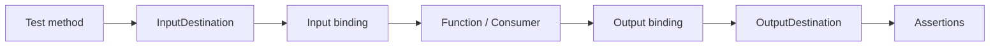

# Đưa dữ liệu vào bằng `InputDestination`

Khi kiểm thử ứng dụng Spring Cloud Stream, ta thường cần đưa một message vào input binding để kiểm tra function hoặc consumer xử lý đúng. `InputDestination` là API của Test Binder giúp gửi message vào binding trong bộ nhớ, không cần khởi chạy Kafka, RabbitMQ hay Pulsar cho bài kiểm thử đó.

`InputDestination` phù hợp để kiểm tra đường đi từ input binding qua message conversion và function tới kết quả hoặc side effect. Với function có output, kết hợp nó với `OutputDestination` để nhận message đầu ra. Với consumer không có output, gửi dữ liệu bằng `InputDestination` rồi kiểm tra collaborator hoặc trạng thái mà consumer cập nhật.

## 1. Test Binder và InputDestination

Spring Cloud Stream Test Binder cung cấp một binder chạy trong tiến trình kiểm thử. Binder tạo các input/output channel trong bộ nhớ và kết nối chúng với function được Spring Cloud Function phát hiện. Test có thể gửi message vào input channel, sau đó đọc message được phát ra output channel.



Các thành phần chính:

| Thành phần | Vai trò |
|---|---|
| `spring-cloud-stream-test-binder` | Dependency cung cấp Test Binder và các test utility |
| `TestChannelBinderConfiguration` | Cấu hình Test Binder cho Spring test context |
| `InputDestination` | Gửi `Message<?>` vào input binding |
| `OutputDestination` | Nhận message từ output binding |
| `Message<?>` | Mang payload và headers qua binding |

Test Binder giúp kiểm tra logic tích hợp với abstraction của Spring Cloud Stream. Nó không giả lập đầy đủ broker thật: không có Kafka partition assignment/offset, RabbitMQ exchange/queue semantics hay Pulsar subscription/acknowledgement thực tế.

## 2. Thêm dependency kiểm thử

Thêm artifact `spring-cloud-stream-test-binder` với scope test. Nếu dự án dùng Spring Cloud BOM, để BOM quản lý version thay vì đặt version riêng:

```xml
<dependency>
    <groupId>org.springframework.cloud</groupId>
    <artifactId>spring-cloud-stream-test-binder</artifactId>
    <scope>test</scope>
</dependency>
```

Với Gradle:

```groovy
dependencies {
    testImplementation 'org.springframework.cloud:spring-cloud-stream-test-binder'
}
```

Dependency này chỉ cần trong test classpath. Ứng dụng production tiếp tục dùng binder thật tương ứng với middleware được triển khai. Kiểm tra Spring Boot, Spring Cloud release train và Spring Cloud Stream version tương thích với nhau theo BOM của dự án.

## 3. Cấu hình Test Binder trong Spring test context

Một cách phổ biến là dùng `@SpringBootTest` và import `TestChannelBinderConfiguration`:

```java
import org.springframework.boot.test.context.SpringBootTest;
import org.springframework.cloud.stream.binder.test.TestChannelBinderConfiguration;
import org.springframework.context.annotation.Import;

@SpringBootTest
@Import(TestChannelBinderConfiguration.class)
class UppercaseFunctionTest {
}
```

Import này đưa Test Binder vào context để Spring Cloud Stream tạo binding trong bộ nhớ. Nếu ứng dụng có nhiều binder implementation trên classpath, cần kiểm tra binder selection của test context để chắc chắn binding đang dùng Test Binder thay vì cố kết nối tới broker thật. Có thể tách cấu hình test hoặc chỉ định binder test theo cách được hỗ trợ bởi phiên bản đang dùng.

Trong test, inject hai destination:

```java
import org.springframework.beans.factory.annotation.Autowired;
import org.springframework.cloud.stream.binder.test.InputDestination;
import org.springframework.cloud.stream.binder.test.OutputDestination;

@Autowired
InputDestination input;

@Autowired
OutputDestination output;
```

`InputDestination` và `OutputDestination` là test utility. Không inject chúng vào business service hoặc component production.

## 4. Xác định đúng tên input binding

Với functional model, tên binding mặc định được tạo từ tên function và hướng dữ liệu:

| Function | Binding | Vai trò |
|---|---|---|
| `uppercase` | `uppercase-in-0` | Input đầu tiên của function |
| `uppercase` | `uppercase-out-0` | Output đầu tiên của function |
| `enrichOrder` | `enrichOrder-in-0` | Input đầu tiên |
| `enrichOrder` | `enrichOrder-out-0` | Output đầu tiên |
| `auditOrder` | `auditOrder-in-0` | Input của consumer |

Ví dụ cấu hình:

```yaml
spring:
  cloud:
    function:
      definition: uppercase
    stream:
      bindings:
        uppercase-in-0:
          destination: raw-orders
          content-type: text/plain
        uppercase-out-0:
          destination: normalized-orders
          content-type: text/plain
```

Trong lời gọi `input.send(message, "uppercase-in-0")`, chuỗi thứ hai là tên input binding mà Test Binder đang quản lý. `raw-orders` là destination broker được cấu hình cho binding; hai tên này có thể khác nhau. Không truyền tên Kafka topic, RabbitMQ exchange hay Pulsar topic thay cho binding name trừ khi ứng dụng đã cấu hình alias khiến chúng trùng nhau.

Nếu ứng dụng dùng `spring.cloud.stream.function.bindings` để đổi tên binding mặc định thành alias tùy chỉnh, test phải gửi vào alias thực tế mà binder sử dụng. Khi không chắc, kiểm tra cấu hình binding của chính function trong test context.

## 5. Ví dụ đầy đủ: gửi message vào Function

Giả sử ứng dụng có function chuyển chuỗi thành chữ hoa:

```java
import java.util.Locale;
import java.util.function.Function;
import org.springframework.context.annotation.Bean;
import org.springframework.context.annotation.Configuration;

@Configuration
class TextFunctions {

    @Bean
    Function<String, String> uppercase() {
        return value -> value.toUpperCase(Locale.ROOT);
    }
}
```

Test gửi một message vào `uppercase-in-0`, sau đó nhận kết quả từ `uppercase-out-0`:

```java
import static org.junit.jupiter.api.Assertions.assertEquals;
import static org.junit.jupiter.api.Assertions.assertNotNull;

import java.nio.charset.StandardCharsets;

import org.junit.jupiter.api.Test;
import org.springframework.beans.factory.annotation.Autowired;
import org.springframework.boot.test.context.SpringBootTest;
import org.springframework.cloud.stream.binder.test.InputDestination;
import org.springframework.cloud.stream.binder.test.OutputDestination;
import org.springframework.cloud.stream.binder.test.TestChannelBinderConfiguration;
import org.springframework.context.annotation.Import;
import org.springframework.messaging.Message;
import org.springframework.messaging.support.GenericMessage;

@SpringBootTest(properties = {
        "spring.cloud.function.definition=uppercase",
        "spring.cloud.stream.bindings.uppercase-in-0.destination=raw-text",
        "spring.cloud.stream.bindings.uppercase-out-0.destination=upper-text",
        "spring.cloud.stream.bindings.uppercase-in-0.content-type=text/plain",
        "spring.cloud.stream.bindings.uppercase-out-0.content-type=text/plain"
})
@Import(TestChannelBinderConfiguration.class)
class UppercaseFunctionTest {

    @Autowired
    InputDestination input;

    @Autowired
    OutputDestination output;

    @Test
    void convertsInputToUppercase() {
        input.send(new GenericMessage<>("hello stream"), "uppercase-in-0");

        Message<byte[]> result = output.receive(2_000, "uppercase-out-0");

        assertNotNull(result, "Function should publish an output message");
        assertEquals("HELLO STREAM",
                new String(result.getPayload(), StandardCharsets.UTF_8));
    }
}
```

Trong ví dụ:

1. `spring.cloud.function.definition` chọn function cần chạy.
2. `uppercase-in-0` và `uppercase-out-0` là tên binding.
3. `InputDestination.send(...)` đưa payload vào input binding.
4. Function xử lý message qua Test Binder.
5. `OutputDestination.receive(...)` đợi tối đa 2 giây để nhận message output.
6. Test kiểm tra message có tồn tại và payload đúng.

Output được đọc dưới dạng `Message<byte[]>` trong ví dụ vì nội dung đi qua message conversion. Nếu test dùng một content type hoặc converter khác, kiểu payload có thể khác; hãy kiểm tra header và cách deserialize phù hợp thay vì ép kiểu tùy tiện.

## 6. Gửi một Message có header

Trong hệ thống event-driven, header thường mang correlation ID, event type, tenant, trace context hoặc metadata định tuyến. `InputDestination` nhận `Message<?>`, do đó có thể kiểm thử cả payload lẫn header.

```java
import org.springframework.messaging.Message;
import org.springframework.messaging.support.MessageBuilder;

Message<OrderCreated> message = MessageBuilder
        .withPayload(new OrderCreated("order-104", "customer-9", 250_000))
        .setHeader("correlationId", "corr-test-104")
        .setHeader("eventType", "OrderCreated")
        .build();

input.send(message, "validateOrder-in-0");
```

Nếu function nhận `Message<OrderCreated>`, có thể kiểm tra header trong logic:

```java
@Bean
Function<Message<OrderCreated>, Message<OrderValidated>> validateOrder() {
    return message -> MessageBuilder
            .withPayload(validate(message.getPayload()))
            .setHeader("correlationId", message.getHeaders().get("correlationId"))
            .build();
}
```

Header có thể được giữ, lọc hoặc chuyển đổi theo message converter và binder. Test nên xác nhận những header thuộc hợp đồng ứng dụng thực sự được bảo toàn. Không giả định mọi header nội bộ của binder sẽ xuất hiện giống nhau giữa Test Binder và Kafka/RabbitMQ/Pulsar Binder.

## 7. Gửi payload có kiểu dữ liệu

Với DTO hoặc record, có thể gửi trực tiếp object làm payload:

```java
OrderCreated event = new OrderCreated(
        "order-104",
        "customer-9",
        250_000);

input.send(new GenericMessage<>(event), "validateOrder-in-0");
```

Nếu binding khai báo `content-type: application/json`, Spring Cloud Stream có thể áp dụng message conversion phù hợp. Khi test, bảo đảm class DTO có cấu trúc tương thích với converter và function signature. Với test tập trung vào function logic, gửi object đã deserialize có thể đủ; với test conversion, hãy gửi payload ở dạng wire format (ví dụ JSON bytes/String) và kiểm tra kết quả sau conversion.

Ví dụ test conversion JSON cần phân biệt hai mục tiêu:

- **Kiểm tra function:** gửi object `OrderCreated`, tập trung vào business logic.
- **Kiểm tra conversion:** gửi JSON payload theo content type, xác nhận framework chuyển thành đúng kiểu đầu vào.

Không dùng test object trực tiếp để kết luận rằng schema registry, Avro/Protobuf Serde hoặc serializer của broker thật hoạt động đúng. Các lớp đó cần integration test riêng.

## 8. Đưa dữ liệu vào Consumer không có output

Consumer nhận message nhưng không trả output binding. Vẫn dùng `InputDestination` để kích hoạt consumer; sau đó kiểm tra side effect như gọi service, ghi trạng thái hoặc lưu bản ghi.

```java
@Bean
Consumer<OrderCreated> auditOrder(OrderAuditService auditService) {
    return auditService::record;
}
```

Test có thể gửi event vào `auditOrder-in-0` rồi xác minh `OrderAuditService` đã ghi nhận đúng event. Ví dụ dùng Mockito:

Giả sử `auditService` là Mockito mock đã được đưa vào Spring test context, còn `input` là `InputDestination` được inject như phần trước.

```java
@Test
void sendsOrderToAuditService() {
    OrderCreated event = new OrderCreated("order-104", "customer-9", 250_000);

    input.send(new GenericMessage<>(event), "auditOrder-in-0");

    verify(auditService, timeout(2_000)).record(event);
}
```

`timeout` hữu ích khi message được xử lý bất đồng bộ qua channel. Nếu ứng dụng dùng transaction hoặc xử lý nền, test nên đợi điều kiện nghiệp vụ cụ thể thay vì dùng `Thread.sleep` cố định. Dùng test double cho service bên ngoài để test không gọi API thật hoặc ghi dữ liệu ngoài phạm vi kiểm thử.

## 9. Nhiều input binding

Function có thể có nhiều input, ví dụ một luồng đơn hàng và một luồng hồ sơ khách hàng. Mỗi input có binding riêng với hậu tố index:

```yaml
spring:
  cloud:
    function:
      definition: enrichOrder
    stream:
      bindings:
        enrichOrder-in-0:
          destination: orders.created
        enrichOrder-in-1:
          destination: customers.profile
        enrichOrder-out-0:
          destination: orders.enriched
```

Test gửi dữ liệu vào từng binding bằng tên tương ứng:

```java
input.send(new GenericMessage<>(order), "enrichOrder-in-0");
input.send(new GenericMessage<>(customer), "enrichOrder-in-1");
```

Việc gửi vào hai input là hai thao tác riêng. Nếu function kết hợp các stream bất đồng bộ, test cần tính tới thời điểm mỗi input tới, key dùng để join, buffering và timeout. Không giả định gửi input thứ nhất sẽ đồng bộ chờ input thứ hai hoặc kết quả luôn xuất hiện ngay sau lời gọi thứ hai.

Với function nhiều input, cần kiểm tra đúng chữ ký function và binding index. Nếu đổi thứ tự tham số hoặc đổi function definition, binding name cũng có thể thay đổi và test phải cập nhật theo cấu hình mới.

## 10. Đưa nhiều message vào cùng một input

Có thể gọi `send` nhiều lần để mô phỏng một chuỗi event:

```java
input.send(new GenericMessage<>("first"), "uppercase-in-0");
input.send(new GenericMessage<>("second"), "uppercase-in-0");
input.send(new GenericMessage<>("third"), "uppercase-in-0");

Message<byte[]> first = output.receive(2_000, "uppercase-out-0");
Message<byte[]> second = output.receive(2_000, "uppercase-out-0");
Message<byte[]> third = output.receive(2_000, "uppercase-out-0");
```

Mỗi lần `receive` lấy một message từ output destination. Nếu thứ tự là một phần của hợp đồng, hãy kiểm tra thứ tự trong điều kiện mà Test Binder bảo đảm và bổ sung integration test cho ordering theo partition/key trên broker thật. Test Binder không mô phỏng Kafka partition assignment hoặc RabbitMQ competing consumers.

Khi test có nhiều output binding, truyền đúng tên output binding vào `receive(timeout, bindingName)` để tránh đọc nhầm kết quả từ một function khác.

## 11. Kiểm tra output và timeout

`OutputDestination.receive(timeout, bindingName)` chờ tối đa thời gian chỉ định để nhận message. Nếu hết thời gian mà không có message, kết quả là `null`. Vì vậy, test nên assert message tồn tại trước khi đọc payload.

```java
Message<byte[]> result = output.receive(2_000, "uppercase-out-0");

assertNotNull(result);
assertEquals("HELLO", new String(result.getPayload(), StandardCharsets.UTF_8));
```

Một số lưu ý:

- Chọn timeout đủ cho test context và xử lý bất đồng bộ; không đặt quá ngắn khiến test chập chờn.
- Không dùng timeout quá dài để che việc function bị lỗi hoặc không được bind.
- Nếu nhận `null`, kiểm tra function definition, binding name, exception log và content type.
- Nếu output là bytes, deserialize theo converter/schema mà binding đang sử dụng.
- Nếu function phát nhiều message, nhận đủ số message mong đợi và kiểm tra từng message.

## 12. Kiểm thử Supplier khác với InputDestination

`Supplier<T>` là nguồn phát dữ liệu, không có input binding để test gửi vào. Vì vậy, `InputDestination` không phải công cụ kích hoạt supplier. Với supplier, kiểm thử output bằng `OutputDestination`, đồng thời cấu hình poller hoặc cơ chế trigger phù hợp với ứng dụng.

Ví dụ:

```java
@Bean
Supplier<String> heartbeat() {
    return () -> "alive";
}
```

Test cần bảo đảm supplier được poll theo cấu hình và đọc message từ output binding tương ứng. Nếu chỉ muốn kiểm tra logic supplier, có thể gọi bean trực tiếp trong unit test; nếu muốn kiểm tra binding/poller, dùng Test Binder và Spring context. Không gửi dữ liệu vào `InputDestination` cho supplier vì supplier không có input binding.

## 13. Phân biệt Test Binder với kiểm thử broker thật

Test Binder kiểm tra message flow qua Spring Cloud Stream abstraction. Nó không thay thế integration test cho đặc tính riêng của broker.

| Nội dung cần xác minh | Test Binder | Broker thật/integration test |
|---|---|---|
| Function nhận đúng payload | Phù hợp | Có thể kiểm tra thêm |
| Mapping function và binding name | Phù hợp | Phù hợp |
| Message conversion cơ bản | Phù hợp theo converter được cấu hình | Xác nhận thêm serializer/deserializer thực tế |
| Business headers trong message | Phù hợp | Xác nhận mapping header theo broker |
| Kafka partition, offset và consumer group rebalance | Không mô phỏng đầy đủ | Cần Kafka |
| Kafka transaction và exactly-once | Không xác nhận semantics broker | Cần Kafka |
| Rabbit exchange, queue, routing và acknowledgement | Không mô phỏng đầy đủ | Cần RabbitMQ |
| Pulsar subscription, ack timeout và redelivery | Không mô phỏng đầy đủ | Cần Pulsar |
| ACL, TLS, authentication và network | Không xác nhận | Cần môi trường broker tương ứng |
| Broker retry/DLQ và provisioning | Chỉ kiểm tra logic ứng dụng ở mức phù hợp | Cần broker và binder thật |

Một chiến lược kiểm thử cân bằng là dùng Test Binder cho nhiều test nhanh của function/binding, rồi dùng một số integration test tập trung để xác nhận partition, ack, retry, DLQ, transaction, authentication và topology trên broker thật.

## 14. Lỗi thường gặp khi dùng InputDestination

| Triệu chứng | Nguyên nhân có thể | Cách xử lý |
|---|---|---|
| `InputDestination` không được inject | Chưa thêm test-binder dependency hoặc chưa import cấu hình Test Binder | Kiểm tra test classpath và `TestChannelBinderConfiguration` |
| Gửi message nhưng function không chạy | Function chưa được chọn hoặc binding name sai | Kiểm tra `spring.cloud.function.definition` và tên `<function>-in-0` |
| Test cố kết nối Kafka/RabbitMQ/Pulsar | Test context đang chọn binder production | Cấu hình Test Binder rõ ràng và kiểm tra binder selection |
| `OutputDestination.receive` trả `null` | Function lỗi, không có output, sai output binding hoặc timeout quá ngắn | Xem log, kiểm tra signature/function definition và tăng timeout hợp lý |
| Payload nhận về là `byte[]` | Message converter/binding content type serialize payload | Deserialize theo content type hoặc dùng assertion phù hợp |
| DTO không chuyển đổi được | Content type, converter hoặc cấu trúc payload không khớp | Kiểm tra JSON/schema và test conversion riêng |
| Header bị thiếu | Header không được truyền, converter/binder lọc header hoặc đọc sai tên | Dùng `MessageBuilder`, kiểm tra header ở function input/output |
| Test consumer kết thúc trước side effect | Xử lý bất đồng bộ chưa hoàn tất | Đợi điều kiện bằng Awaitility/Mockito timeout thay vì sleep cố định |
| Nhiều test đọc nhầm output | Dùng default output destination hoặc chia sẻ context/binding không rõ | Truyền tên output binding vào `receive` |
| Test pass nhưng production broker lỗi | Test Binder không mô phỏng topology, security và delivery semantics | Bổ sung integration test với broker thật |

## 15. Quy trình viết một test dùng InputDestination

1. Xác định function/consumer cần kiểm thử và tên function bean.
2. Xác định input binding name, thường có dạng `<function>-in-0`.
3. Thêm Test Binder dependency trong test scope.
4. Import `TestChannelBinderConfiguration` vào test context.
5. Chọn function bằng `spring.cloud.function.definition` và cấu hình binding cần thiết.
6. Inject `InputDestination`.
7. Tạo payload hoặc `Message<?>` có headers phù hợp.
8. Gọi `input.send(message, inputBindingName)`.
9. Với function có output, nhận bằng `OutputDestination`; với consumer, xác minh side effect.
10. Assert payload, header, số lượng message và timeout.
11. Dùng integration test riêng cho broker-specific behavior.

## 16. Danh sách kiểm tra trước khi commit test

- [ ] Có dependency `spring-cloud-stream-test-binder` trong test scope.
- [ ] Test context import `TestChannelBinderConfiguration`.
- [ ] Đã chọn đúng function bằng `spring.cloud.function.definition`.
- [ ] Tên truyền vào `InputDestination.send` là input binding name thực tế.
- [ ] Phân biệt binding name với broker destination.
- [ ] Payload có kiểu dữ liệu và content type phù hợp.
- [ ] Headers quan trọng được tạo và kiểm tra rõ ràng.
- [ ] Function output được đọc qua đúng output binding và có timeout hữu hạn.
- [ ] Consumer side effect được chờ và xác minh theo điều kiện cụ thể.
- [ ] Supplier không bị kiểm thử bằng cách gửi vào InputDestination.
- [ ] Test nhiều input gửi vào đúng từng binding index.
- [ ] Có integration test cho semantics broker mà Test Binder không mô phỏng.

`InputDestination` là điểm vào tiện lợi để đưa message vào input binding khi kiểm thử Spring Cloud Stream bằng Test Binder. Hãy gửi message theo đúng binding name, kiểm tra payload/header ở function và dùng `OutputDestination` hoặc assertion side effect để xác nhận kết quả. Công cụ này giúp kiểm thử nhanh luồng function/consumer trong Spring context; các đặc tính như partition, offset, acknowledgement, retry, DLQ, transaction, routing và bảo mật vẫn cần integration test với Kafka, RabbitMQ hoặc Pulsar thật.

## Tài liệu tham khảo

- [Spring Cloud Stream — Testing](https://docs.spring.io/spring-cloud-stream/reference/spring-cloud-stream/testing.html)
- [Spring Cloud Stream — Test Binder](https://docs.spring.io/spring-cloud-stream/reference/spring-cloud-stream/spring_integration_test_binder.html)
- [Spring Cloud Stream — Functional Binding Names](https://docs.spring.io/spring-cloud-stream/reference/spring-cloud-stream/functional-binding-names.html)
