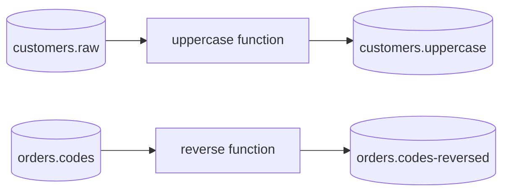

# Chỉ định destination khi kiểm thử nhiều hàm hoặc nhiều binding

## 1. Vì sao phải chỉ định destination trong test?

Spring Cloud Stream test binder cho phép kiểm thử function mà không cần khởi chạy Kafka, RabbitMQ hoặc Pulsar thật. Test binder tạo các kênh message trong bộ nhớ và cung cấp hai đối tượng để test gửi/nhận dữ liệu:

- `InputDestination`: gửi message vào input binding của ứng dụng.
- `OutputDestination`: nhận message từ output binding của ứng dụng.

Với ứng dụng chỉ có một input và một output, các overload mặc định thường đủ dùng:

```java
input.send(new GenericMessage<>("hello"));
Message<byte[]> result = output.receive(1_000);
```

Khi ứng dụng có nhiều function, nhiều input hoặc nhiều output, test cần xác định message thuộc destination nào. Nếu không chỉ định, test binder có thể dùng destination đầu tiên hoặc destination mặc định theo thứ tự đăng ký; test dễ gửi nhầm vào function khác hoặc đọc nhầm output.

Các overload có tham số destination giúp test chọn đúng kênh:

```java
input.send(message, "orders.raw");
Message<byte[]> result = output.receive(1_000, "orders.accepted");
```

Tên truyền vào là destination name mà test binder quản lý. Nếu binding khai báo `destination` tường minh, dùng giá trị destination đó. Nếu không khai báo, destination mặc định thường được suy ra từ binding name, ví dụ `processOrder-in-0` hoặc `processOrder-out-0`.

## 2. Phân biệt function name, binding name và destination

Ba tên này liên quan với nhau nhưng không đồng nghĩa:

| Tên | Vai trò | Ví dụ |
|---|---|---|
| Function bean name | Tên bean hàm được kích hoạt | `acceptOrder` |
| Binding name | Tên input/output được tạo từ function | `acceptOrder-in-0`, `acceptOrder-out-0` |
| Destination | Tên logical mà binding kết nối tới | `orders.raw`, `orders.accepted` |

Với function `acceptOrder` có một input và một output, tên binding mặc định là:

- `acceptOrder-in-0`
- `acceptOrder-out-0`

Nếu cấu hình:

```yaml
spring:
  cloud:
    function:
      definition: acceptOrder
    stream:
      bindings:
        acceptOrder-in-0:
          destination: orders.raw
        acceptOrder-out-0:
          destination: orders.accepted
```

thì test binder nhận message ở destination `orders.raw` và xuất message ở `orders.accepted`. Trong test, truyền destination đã cấu hình vào `InputDestination.send` và `OutputDestination.receive`.

Nếu bỏ `destination`, Spring Cloud Stream dùng binding name làm destination mặc định. Khi đó, test có thể dùng `acceptOrder-in-0` và `acceptOrder-out-0`.

## 3. Khai báo nhiều function độc lập

Giả sử một ứng dụng có hai function độc lập: một function chuẩn hóa tên khách hàng, function còn lại chuyển đổi mã đơn hàng. Khai báo cả hai bean:

```java
import java.util.function.Function;
import org.springframework.context.annotation.Bean;
import org.springframework.context.annotation.Configuration;

@Configuration
class TextFunctions {

    @Bean
    Function<String, String> uppercase() {
        return value -> value.toUpperCase();
    }

    @Bean
    Function<String, String> reverse() {
        return value -> new StringBuilder(value).reverse().toString();
    }
}
```

Kích hoạt cả hai function bằng dấu chấm phẩy trong `spring.cloud.function.definition`:

```yaml
spring:
  cloud:
    function:
      definition: uppercase;reverse
    stream:
      bindings:
        uppercase-in-0:
          destination: customers.raw
          content-type: text/plain
        uppercase-out-0:
          destination: customers.uppercase
          content-type: text/plain
        reverse-in-0:
          destination: orders.codes
          content-type: text/plain
        reverse-out-0:
          destination: orders.codes-reversed
          content-type: text/plain
```

Mỗi function có input/output riêng. `uppercase` không nhận message của `reverse` chỉ vì cả hai được kích hoạt trong cùng application context.



Dấu chấm phẩy có nghĩa là kích hoạt nhiều function độc lập. Dấu `|` dùng cho composition, tức output của function trước trở thành input của function sau. Không nhầm `uppercase;reverse` với `uppercase|reverse`.

## 4. Kiểm thử đúng output của từng function

Test dưới đây gửi message tới từng destination và đọc đúng output tương ứng:

```java
import static org.assertj.core.api.Assertions.assertThat;

import java.nio.charset.StandardCharsets;

import org.junit.jupiter.api.Test;
import org.springframework.beans.factory.annotation.Autowired;
import org.springframework.boot.test.context.SpringBootTest;
import org.springframework.cloud.stream.binder.test.InputDestination;
import org.springframework.cloud.stream.binder.test.OutputDestination;
import org.springframework.cloud.stream.binder.test.TestChannelBinderConfiguration;
import org.springframework.context.annotation.Import;
import org.springframework.messaging.Message;
import org.springframework.messaging.support.GenericMessage;

@SpringBootTest(properties = {
    "spring.cloud.function.definition=uppercase;reverse",
    "spring.cloud.stream.bindings.uppercase-in-0.destination=customers.raw",
    "spring.cloud.stream.bindings.uppercase-out-0.destination=customers.uppercase",
    "spring.cloud.stream.bindings.reverse-in-0.destination=orders.codes",
    "spring.cloud.stream.bindings.reverse-out-0.destination=orders.codes-reversed"
})
@Import(TestChannelBinderConfiguration.class)
class MultipleFunctionsTests {

    @Autowired
    InputDestination input;

    @Autowired
    OutputDestination output;

    @Test
    void routesMessagesToTheSelectedFunction() {
        input.send(new GenericMessage<>("alice"), "customers.raw");
        input.send(new GenericMessage<>("ORD-123"), "orders.codes");

        Message<byte[]> uppercaseResult =
            output.receive(1_000, "customers.uppercase");
        Message<byte[]> reverseResult =
            output.receive(1_000, "orders.codes-reversed");

        assertThat(uppercaseResult).isNotNull();
        assertThat(new String(uppercaseResult.getPayload(), StandardCharsets.UTF_8))
            .isEqualTo("ALICE");

        assertThat(reverseResult).isNotNull();
        assertThat(new String(reverseResult.getPayload(), StandardCharsets.UTF_8))
            .isEqualTo("321-DRO");
    }
}
```

Điểm quan trọng là cả hai lần gửi đều nêu destination đầu vào và cả hai lần nhận đều nêu destination đầu ra. Test không phụ thuộc vào thứ tự các binding được đăng ký trong application context.

## 5. Khi không cấu hình destination tường minh

Nếu không khai báo `destination`, binding name trở thành destination mặc định. Ví dụ:

```yaml
spring:
  cloud:
    function:
      definition: uppercase;reverse
```

Tên mặc định có thể được dùng trong test:

```java
input.send(new GenericMessage<>("alice"), "uppercase-in-0");
Message<byte[]> result = output.receive(1_000, "uppercase-out-0");
```

Đối với function `reverse`, dùng `reverse-in-0` và `reverse-out-0`. Cách này hữu ích cho test nhỏ, nhưng khi cấu hình nhiều binding, đặt destination domain-specific thường giúp test dễ đọc hơn và ít phụ thuộc quy ước đặt tên function.

## 6. Nhiều input binding của cùng một function

Một function có thể có nhiều input binding, ví dụ xử lý đơn hàng cùng hồ sơ khách hàng. Với functional model, một function reactive có thể nhận hai `Flux`:

```java
import java.util.function.BiFunction;
import reactor.core.publisher.Flux;
import org.springframework.context.annotation.Bean;
import org.springframework.context.annotation.Configuration;

record OrderEvent(String orderId, String customerId) {}
record CustomerProfile(String customerId, String tier) {}
record OrderLabel(String orderId, String customerTier) {}

@Configuration
class OrderEnrichmentFunctions {

    @Bean
    BiFunction<Flux<OrderEvent>, Flux<CustomerProfile>, Flux<OrderLabel>>
    enrichOrder() {
        return (orders, customers) -> orders.zipWith(
            customers,
            (order, customer) -> new OrderLabel(
                order.orderId(), customer.tier()
            )
        );
    }
}
```

Khai báo destination cho từng input:

```yaml
spring:
  cloud:
    function:
      definition: enrichOrder
    stream:
      bindings:
        enrichOrder-in-0:
          destination: orders.events
        enrichOrder-in-1:
          destination: customers.profiles
        enrichOrder-out-0:
          destination: orders.enriched
```

Trong test, gửi dữ liệu vào đúng từng destination:

```java
input.send(orderMessage, "orders.events");
input.send(customerMessage, "customers.profiles");
Message<byte[]> result = output.receive(1_000, "orders.enriched");
```

Không gọi `input.send(message)` hai lần trong test nhiều input rồi giả định binder tự biết message thuộc input nào. Chỉ định destination giúp test chọn đúng binding.

Lưu ý: `zipWith` ghép phần tử theo thứ tự phát ra, không phải join theo `customerId` hay timestamp. Ví dụ trên chỉ minh họa định tuyến nhiều input. Nếu nghiệp vụ cần join theo key hoặc thời gian, hãy dùng Kafka Streams DSL hoặc cơ chế correlation/state phù hợp.

## 7. Nhiều output binding của cùng một function

Một function reactive có thể phát nhiều output, chẳng hạn tách event hợp lệ và event cần kiểm tra. Với `Tuple2`, Spring Cloud Function tạo hai output binding theo thứ tự tuple:

```java
import java.util.function.Function;
import reactor.core.publisher.Flux;
import reactor.util.function.Tuple2;
import reactor.util.function.Tuples;
import org.springframework.context.annotation.Bean;

record IncomingEvent(String id, boolean valid) {}

@Bean
Function<Flux<IncomingEvent>, Tuple2<Flux<IncomingEvent>, Flux<IncomingEvent>>>
splitEvents() {
    return events -> Tuples.of(
        events.filter(IncomingEvent::valid),
        events.filter(event -> !event.valid())
    );
}
```

Binding mặc định:

- `splitEvents-in-0`
- `splitEvents-out-0`
- `splitEvents-out-1`

Cấu hình destination riêng:

```yaml
spring:
  cloud:
    function:
      definition: splitEvents
    stream:
      bindings:
        splitEvents-in-0:
          destination: events.raw
        splitEvents-out-0:
          destination: events.accepted
        splitEvents-out-1:
          destination: events.review
```

Kiểm thử cần gửi vào `events.raw` và đọc riêng hai output:

```java
input.send(validEvent, "events.raw");
input.send(invalidEvent, "events.raw");

Message<byte[]> accepted = output.receive(1_000, "events.accepted");
Message<byte[]> review = output.receive(1_000, "events.review");
```

Nếu chỉ gọi `output.receive(1_000)` nhiều lần, test có thể đọc output từ binding không mong muốn hoặc phụ thuộc thứ tự. Nêu destination giúp kiểm tra cả routing lẫn nội dung.

## 8. Đổi binding name bằng alias

Spring Cloud Stream cho phép đổi tên binding mặc định bằng `spring.cloud.stream.function.bindings`. Ví dụ:

```yaml
spring:
  cloud:
    function:
      definition: uppercase
    stream:
      function:
        bindings:
          uppercase-in-0: customerInput
          uppercase-out-0: customerOutput
      bindings:
        customerInput:
          destination: customers.raw
        customerOutput:
          destination: customers.uppercase
```

Alias `customerInput` và `customerOutput` là tên binding thay thế dùng trong cấu hình. Destination thực tế vẫn là `customers.raw` và `customers.uppercase`.

Trong test binder, chọn đúng destination hiệu lực đã cấu hình:

```java
input.send(new GenericMessage<>("alice"), "customers.raw");
Message<byte[]> result = output.receive(1_000, "customers.uppercase");
```

Khi debug, kiểm tra đủ ba lớp: function bean name, binding name sau alias và destination. Nhầm alias với destination là nguyên nhân phổ biến khiến test không tìm thấy channel mong muốn.

## 9. Phân biệt nhiều function độc lập và function composition

Spring Cloud Function hỗ trợ hai cách khai báo nhiều hàm:

| Cú pháp | Ý nghĩa | Binding |
|---|---|---|
| `uppercase;reverse` | Kích hoạt hai function độc lập | Mỗi function có input/output riêng |
| `uppercase|reverse` | Ghép output của `uppercase` vào input của `reverse` | Một pipeline function đã composition |

Ví dụ với `uppercase;reverse`, test gửi đến hai input destination khác nhau và đọc hai output destination khác nhau.

Với `uppercase|reverse`, test gửi một message vào input của pipeline và đọc output cuối. Không gửi vào input của `reverse` như thể nó vẫn là một function độc lập đã được bind riêng.

Khi test composition, dùng tên binding được Spring Cloud Function tạo cho composed function hoặc cấu hình alias rõ ràng rồi xác định destination tương ứng. Không suy ra tên binding composition từ hai tên function thành phần nếu chưa kiểm tra cấu hình runtime.

## 10. Tách test theo destination để tránh message tồn dư

Test binder chạy trong application context của test. Các message được gửi vào destination có thể còn trong output channel cho đến khi test nhận chúng. Nếu nhiều test dùng chung context và cùng destination, message từ test trước có thể khiến test sau đọc nhầm.

Các cách giữ test độc lập:

1. Mỗi test gửi message có payload/event ID riêng.
2. Nhận hết output mà test đã tạo từ đúng destination.
3. Không dùng một destination chung cho các luồng không liên quan nếu không cần.
4. Dùng context riêng khi test cần cấu hình function/binding khác nhau.
5. Đặt timeout nhận message hữu hạn để test thất bại rõ ràng khi output không xuất hiện.
6. Kiểm tra message `null` trước khi đọc payload.

Không dựa vào thứ tự thực thi test hoặc thứ tự khởi tạo binding. JUnit có thể chạy test theo thứ tự khác, và Spring có thể tái sử dụng context giữa các test class.

## 11. Kiểm thử header và content type theo destination

Khi nhiều binding dùng schema hoặc content type khác nhau, test cần gửi message với header phù hợp và đọc đúng output destination. Ví dụ một function nhận JSON ở input đơn hàng nhưng output là text/plain cho hệ thống giám sát.

```java
import org.springframework.messaging.support.MessageBuilder;
import org.springframework.messaging.MessageHeaders;
import org.springframework.util.MimeTypeUtils;

input.send(
    MessageBuilder.withPayload("{\"orderId\":\"ORD-1\"}")
        .setHeader(MessageHeaders.CONTENT_TYPE, MimeTypeUtils.APPLICATION_JSON)
        .build(),
    "orders.raw"
);
```

Khi nhận output, test có thể kiểm tra header:

```java
Message<byte[]> result = output.receive(1_000, "orders.accepted");
assertThat(result).isNotNull();
assertThat(result.getHeaders().get("contentType")).isNotNull();
```

Test binder giúp kiểm tra routing và conversion trong application context. Nó không xác nhận schema registry, serializer hoặc broker-side ACL của Kafka/Rabbit/Pulsar thật. Những phần đó cần integration test riêng.

## 12. Sử dụng timeout khi nhận output

`OutputDestination.receive(timeout, destinationName)` chờ tối đa khoảng thời gian được chỉ định để nhận message từ destination. Dùng timeout đủ để function được gọi và output được phát trong môi trường test, nhưng không kéo dài quá mức cần thiết.

Ví dụ:

```java
Message<byte[]> result = output.receive(2_000, "orders.accepted");
assertThat(result).isNotNull();
```

Nếu timeout trả về `null`, cần kiểm tra:

- Input đã được gửi vào đúng destination chưa.
- Function đã được kích hoạt trong `spring.cloud.function.definition` chưa.
- Binding name và destination mapping có khớp không.
- Function có ném exception hoặc lọc bỏ message không.
- Output có được cấu hình đúng destination không.

Tránh dùng timeout rất lớn để che giấu việc test gửi sai binding. Một lỗi routing nên được phát hiện nhanh và có thông báo cụ thể.

## 13. Kiểm thử nhiều destination với helper method

Khi một test class có nhiều function, helper method có thể gom logic gửi/nhận nhưng vẫn yêu cầu destination tường minh:

```java
private void sendTo(String destination, Object payload) {
    input.send(new GenericMessage<>(payload), destination);
}

private Message<byte[]> receiveFrom(String destination) {
    Message<byte[]> message = output.receive(1_000, destination);
    assertThat(message)
        .as("Expected output from destination %s", destination)
        .isNotNull();
    return message;
}
```

Sử dụng:

```java
sendTo("customers.raw", "alice");
Message<byte[]> result = receiveFrom("customers.uppercase");
assertThat(new String(result.getPayload(), StandardCharsets.UTF_8))
    .isEqualTo("ALICE");
```

Helper không nên tự suy destination từ payload hoặc từ thứ tự binding. Truyền tên đích rõ ràng làm test thể hiện được hợp đồng routing.

## 14. Kiểm tra cấu hình nhiều function trước khi chạy test

Khi test không nhận được message, rà soát cấu hình theo thứ tự:

1. Function bean có được Spring phát hiện không?
2. `spring.cloud.function.definition` có chứa đúng function không?
3. Dùng `;` cho function độc lập hay `|` cho composition đúng mục đích chưa?
4. Binding name có đúng mẫu `<function>-in-<index>` và `<function>-out-<index>` không?
5. Binding alias có được khai báo không?
6. `destination` thực tế là gì? Nếu bỏ trống, tên mặc định là gì?
7. `InputDestination.send` đang gửi tới đúng destination chưa?
8. `OutputDestination.receive` đang đọc từ đúng destination chưa?
9. Content type và payload có phù hợp với function signature không?
10. Function có phát output hay kết thúc bằng filter không tạo record?

Với nhiều binder thật, test binder chỉ kiểm tra logic binding trong môi trường test. Nếu production binding gán sang Kafka cluster hoặc Rabbit virtual host cụ thể, cần kiểm tra binder routing và credential bằng integration test.

## 15. Phân biệt test binder và integration test với broker thật

Test binder phù hợp cho kiểm thử nhanh function, chuyển đổi message, routing giữa binding và nội dung output. Nó không chạy broker thật và không mô phỏng đầy đủ:

- Kafka partition assignment, consumer group rebalance, ISR hoặc broker acknowledgement.
- Rabbit exchange/queue provisioning, virtual host permission, prefetch và redelivery.
- Pulsar subscription type, partition routing, broker acknowledgement và redelivery.
- Network timeout, TLS/SASL, ACL và lỗi broker.
- Tính bền vững của message sau khi process restart.

Một chiến lược kiểm thử thực tế thường có ba lớp:

| Lớp | Mục tiêu | Công cụ |
|---|---|---|
| Unit test | Kiểm tra logic function thuần | JUnit, Mockito hoặc test framework tương ứng |
| Test binder | Kiểm tra binding, destination, message conversion và routing trong app | `spring-cloud-stream-test-binder` |
| Integration test | Kiểm tra hành vi broker, binder, security và delivery semantics | Kafka/RabbitMQ/Pulsar thật hoặc môi trường container |

Không dùng kết quả test binder để kết luận rằng broker production đã provision đúng topic/queue hoặc consumer group.

## 16. Dependency và cấu hình test binder

Thêm Spring Cloud Stream test binder vào test scope theo dependency management của Spring Cloud release train đang dùng. Ví dụ Maven:

```xml
<dependency>
    <groupId>org.springframework.cloud</groupId>
    <artifactId>spring-cloud-stream-test-binder</artifactId>
    <scope>test</scope>
</dependency>
```

Test có thể import `TestChannelBinderConfiguration`:

```java
@SpringBootTest
@Import(TestChannelBinderConfiguration.class)
class BindingTests {
    // InputDestination and OutputDestination are injected here
}
```

Không khai báo version riêng nếu dự án đã dùng Spring Cloud BOM tương thích. Nếu dependency binder thật cũng nằm trong test classpath, xác nhận test binder được chọn cho test context; không để test vô tình kết nối broker development.

## 17. Lỗi thường gặp khi test nhiều binding

| Triệu chứng | Nguyên nhân có thể | Cách xử lý |
|---|---|---|
| Output nhận được thuộc function khác | Gọi `receive(timeout)` không chỉ định destination | Dùng `receive(timeout, destinationName)` |
| Function không nhận input | Gửi vào destination mặc định khác với destination đã cấu hình | Dùng đúng destination của input binding |
| Không tìm thấy output | Dùng binding name trong khi binding đã map destination riêng | Kiểm tra `destination` hiệu lực và đọc đúng tên đó |
| Test phụ thuộc thứ tự chạy | Dùng destination chung và còn message tồn dư | Nhận hết output, tách context hoặc destination |
| Chỉ function đầu tiên hoạt động | Chưa kích hoạt function còn lại trong definition | Khai báo các function độc lập bằng dấu `;` |
| Function composition không chạy như mong đợi | Dùng `;` thay vì `|` hoặc ngược lại | Chọn đúng semantics kích hoạt/composition |
| Input thứ hai không được xử lý | Gửi message không nêu destination hoặc sai input index | Chỉ định destination của từng input |
| Payload không đúng kiểu | Content type/Serde/conversion không phù hợp | Gửi header và payload đúng schema |
| Output là `null` | Timeout, function filter message hoặc lỗi xử lý | Kiểm tra log, destination và logic function |

## 18. Quy trình viết test cho nhiều function hoặc binding

1. Liệt kê function bean được kích hoạt trong test context.
2. Liệt kê tất cả input/output binding của từng function.
3. Xác định binding name mặc định hoặc alias sau cấu hình.
4. Ghi lại destination thực tế của từng binding.
5. Cấu hình `spring.cloud.function.definition` đúng semantics.
6. Dùng `InputDestination.send(message, destinationName)` cho từng input.
7. Dùng `OutputDestination.receive(timeout, destinationName)` cho từng output.
8. Kiểm tra payload, header và content type sau khi nhận.
9. Dọn message tồn dư hoặc tách destination/context để test độc lập.
10. Bổ sung integration test với broker thật cho các hành vi không được test binder mô phỏng.

Khi một ứng dụng Spring Cloud Stream có nhiều function hoặc nhiều binding, chỉ định destination giúp test gửi đúng input và đọc đúng output. Hãy phân biệt function bean name, binding name và destination; kiểm tra destination mapping sau alias; dùng overload có tên đích của `InputDestination` và `OutputDestination`. Cách này làm test độc lập với thứ tự đăng ký binding, dễ chẩn đoán lỗi routing và phản ánh đúng cấu trúc message flow của ứng dụng.

## Tài liệu tham khảo

- [Spring Cloud Stream — Testing](https://docs.spring.io/spring-cloud-stream/reference/spring-cloud-stream/spring_integration_test_binder.html)
- [Spring Cloud Stream — Functional Binding Names](https://docs.spring.io/spring-cloud-stream/reference/spring-cloud-stream/functional-binding-names.html)
- [Spring Cloud Function — Function Composition](https://docs.spring.io/spring-cloud-function/reference/spring-cloud-function/programming-model.html)

