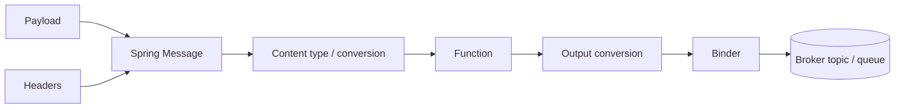

# Kiểm thử JSON, contentType, header và lỗi chuyển đổi

## Mục tiêu

Spring Cloud Stream nhận và gửi message thông qua binding. Trước khi function xử lý payload, framework và binder phải xác định nội dung được biểu diễn như thế nào, chuyển đổi bytes thành kiểu Java, xử lý headers và cuối cùng mã hóa kết quả để gửi đi. Một luồng có thể chạy đúng với object trong unit test nhưng thất bại khi nhận JSON bytes từ broker do content type sai, header bị thiếu hoặc serializer/converter không tương thích.

Bài học này xây dựng cách kiểm thử hợp đồng message ở cả tầng function và binding. Trọng tâm là JSON payload, thuộc tính `content-type`, header `contentType`, custom headers, chuyển đổi inbound/outbound và lỗi dữ liệu. Các ví dụ sử dụng function model của Spring Cloud Stream và test binder; khi cần xác minh mapping header hoặc wire format của Kafka, RabbitMQ hay Pulsar, phải bổ sung broker integration test.

Sau bài học, bạn có thể:

- Phân biệt payload JSON, Java object và byte array trên đường message.
- Hiểu cách content type được chọn từ message header và binding configuration.
- Viết test kiểm tra JSON được deserialize vào đúng kiểu Java.
- Kiểm tra JSON output và custom headers.
- Phân biệt Spring Message headers với broker-native headers.
- Kiểm thử content type không khớp, JSON sai cú pháp và field không tương thích.
- Phân biệt lỗi chuyển đổi inbound, lỗi trong function và lỗi chuyển đổi outbound.
- Dùng test binder cho kiểm thử binding/function và broker thật cho kiểm thử wire behavior.
- Tránh test chỉ dựa vào object-to-object mà bỏ qua bytes và metadata thực tế.

## 1. Message gồm payload và headers

Trong Spring Messaging, một message có hai phần chính:

- **Payload:** dữ liệu chính, ví dụ `OrderCreated`, chuỗi JSON hoặc byte array.
- **Headers:** metadata đi kèm, ví dụ content type, correlation ID, tenant ID hoặc thông tin tracing.

Ví dụ tạo message:

```java
Message<String> message = MessageBuilder
        .withPayload("{\"orderId\":\"O-100\",\"amount\":12500}")
        .setHeader("x-correlation-id", "corr-100")
        .setHeader(MessageHeaders.CONTENT_TYPE, MimeTypeUtils.APPLICATION_JSON)
        .build();
```

Payload ở ví dụ trên vẫn là một Java String chứa JSON text. Header `contentType` thông báo cách diễn giải payload. Nếu payload là một `OrderCreated` object thì nó chưa phải JSON bytes cho đến khi được converter/serializer mã hóa.

Một message có thể được mô tả như sau:



Khi test, hãy kiểm tra cả payload lẫn headers. Chỉ so sánh payload object có thể bỏ qua lỗi content type hoặc header mapping xảy ra khi message đi qua binder.

## 2. Phân biệt content-type của binding và header contentType

Spring Cloud Stream cho phép khai báo content type ở cấp binding:

```yaml
spring:
  cloud:
    function:
      definition: summarizeOrder
    stream:
      bindings:
        summarizeOrder-in-0:
          destination: orders.created
          content-type: application/json
        summarizeOrder-out-0:
          destination: orders.summary
          content-type: application/json
```

`content-type` là thuộc tính cấu hình binding. Khi framework xử lý một message, header `contentType` trong Spring Message cũng có thể mang thông tin định dạng nội dung. Cần phân biệt:

| Thành phần | Ví dụ | Vai trò |
|---|---|---|
| Binding property | `content-type: application/json` | Định dạng mặc định được cấu hình cho binding |
| Spring Message header | `contentType = application/json` | Định dạng gắn trực tiếp với message |
| HTTP Content-Type | `Content-Type: application/json` | Header của HTTP request/response; chỉ liên quan nếu có HTTP adapter |
| Kafka/Rabbit/Pulsar metadata | Broker headers/properties | Metadata được binder ánh xạ theo khả năng của transport |

Trong cơ chế content type của Spring Cloud Stream, message header `contentType` có thể cung cấp định dạng cho message cụ thể; nếu không có, framework dùng content type của binding và sau đó là giá trị mặc định của framework. Khi test, nên có trường hợp binding chỉ định JSON và trường hợp message mang content type rõ ràng để xác minh hành vi đang dùng.

Không nhầm header HTTP `Content-Type` với một Spring Message được gửi trực tiếp vào binding. Trong test binder, hãy đặt `MessageHeaders.CONTENT_TYPE` hoặc cấu hình `content-type` trên binding.

## 3. JSON payload được chuyển đổi như thế nào?

Giả sử input binding nhận một sự kiện:

```java
public record OrderCreated(
        String eventId,
        String orderId,
        String customerId,
        long amountMinor
) {}
```

Function nhận kiểu Java:

```java
@Bean
Function<OrderCreated, OrderSummary> summarizeOrder() {
    return order -> new OrderSummary(
            order.eventId(),
            order.orderId(),
            order.amountMinor(),
            "RECEIVED"
    );
}

public record OrderSummary(
        String eventId,
        String orderId,
        long amountMinor,
        String status
) {}
```

Input trên broker là bytes:

```json
{
  "eventId": "evt-100",
  "orderId": "O-100",
  "customerId": "C-20",
  "amountMinor": 12500
}
```

Với content type JSON và converter phù hợp, Spring Cloud Stream chuyển JSON payload thành `OrderCreated` trước khi gọi function. Function không nên tự parse JSON nếu framework đã nhận diện kiểu đích và thực hiện conversion.

Ở chiều output, object `OrderSummary` được chuyển đổi theo content type output binding trước khi binder gửi message. Test cần xác minh bytes JSON thực tế và nội dung sau khi parse lại, không chỉ kiểm tra rằng function trả về một object.

### Content type phải khớp với wire format

| Wire payload | Content type gợi ý | Kiểu nhận phù hợp |
|---|---|---|
| JSON object bytes | `application/json` | POJO/record tương ứng |
| Text UTF-8 | `text/plain` | String |
| Binary bytes | `application/octet-stream` | byte[] |
| JSON nhưng khai báo text/plain | Không khớp | Có thể nhận String thay vì POJO |
| Avro/Protobuf bytes | Content type/schema theo integration | Schema-aware deserializer/Serde |

Khai báo `application/json` không tự sửa một payload sai định dạng. Nếu producer gửi bytes không phải JSON, converter có thể ném lỗi. Nếu producer gửi JSON nhưng consumer yêu cầu kiểu không tương thích, conversion cũng có thể thất bại.

## 4. Test binder kiểm tra được gì?

Spring Cloud Stream cung cấp test binder để kiểm thử ứng dụng mà không cần broker thật. Test binder cung cấp các điểm gửi/nhận message:

- `InputDestination`: gửi message vào input binding.
- `OutputDestination`: nhận message từ output binding.
- `@EnableTestBinder`: bật test binder cho test context theo cách cấu hình được phiên bản hỗ trợ.

Dependency Maven:

```xml
<dependency>
    <groupId>org.springframework.cloud</groupId>
    <artifactId>spring-cloud-stream-test-binder</artifactId>
    <scope>test</scope>
</dependency>
```

Nên để Spring Cloud BOM quản lý version tương thích với Spring Cloud Stream đang dùng.

Test binder phù hợp để xác minh:

- Function được bind với đúng input/output binding.
- JSON payload được chuyển đổi theo cấu hình test context.
- Function tạo output đúng.
- Header trong in-memory message có được truyền qua function như mong đợi.
- Lỗi logic/conversion xuất hiện trong đường xử lý của ứng dụng.

Test binder không mô phỏng đầy đủ Kafka broker, RabbitMQ exchange/queue, Pulsar subscription, serializer native, header mapper, acknowledgment, partitioning hoặc network failure. Những behavior đó cần broker integration test.

## 5. Kiểm thử JSON bằng InputDestination và OutputDestination

Ví dụ test function nhận JSON bytes và phát JSON summary:

```java
@SpringBootTest
@EnableTestBinder
class OrderFlowTest {

    @Autowired
    InputDestination input;

    @Autowired
    OutputDestination output;

    @Autowired
    ObjectMapper objectMapper;

    @Test
    void convertsJsonInputAndOutput() throws Exception {
        byte[] json = """
                {
                  "eventId": "evt-100",
                  "orderId": "O-100",
                  "customerId": "C-20",
                  "amountMinor": 12500
                }
                """.getBytes(StandardCharsets.UTF_8);

        Message<byte[]> message = MessageBuilder
                .withPayload(json)
                .setHeader(
                        MessageHeaders.CONTENT_TYPE,
                        MimeTypeUtils.APPLICATION_JSON
                )
                .build();

        input.send(message, "summarizeOrder-in-0");

        Message<byte[]> result =
                output.receive(1_000, "summarizeOrder-out-0");

        assertThat(result).isNotNull();

        OrderSummary summary = objectMapper.readValue(
                result.getPayload(),
                OrderSummary.class
        );

        assertThat(summary.orderId()).isEqualTo("O-100");
        assertThat(summary.amountMinor()).isEqualTo(12500L);
        assertThat(summary.status()).isEqualTo("RECEIVED");
    }
}
```

Test gửi bytes JSON vào đúng binding. Header content type xác định payload là JSON. Test sau đó nhận output bytes và dùng ObjectMapper parse lại để kiểm tra wire representation.

Một số lưu ý:

- Binding name phải khớp tên function input/output thực tế.
- Nếu test dựa trên content type cấu hình ở binding, có thể bỏ header content type để kiểm tra fallback.
- Nếu output binder trả payload kiểu khác trong test setup, hãy kiểm tra payload type trước khi parse; mục tiêu là xác minh representation thực tế của binding.
- Timeout nhận output nên hữu hạn để test thất bại rõ ràng thay vì treo.
- Không dùng cùng một OutputDestination cho nhiều test song song nếu các test cạnh tranh đọc cùng binding.

## 6. Kiểm thử binding content-type fallback

Có thể tạo một test khác không gắn header content type, chỉ cấu hình binding:

```yaml
spring:
  cloud:
    stream:
      bindings:
        summarizeOrder-in-0:
          destination: orders.created
          content-type: application/json
        summarizeOrder-out-0:
          destination: orders.summary
          content-type: application/json
```

Trong test, gửi payload JSON bytes mà không đặt `MessageHeaders.CONTENT_TYPE`:

```java
Message<byte[]> message = MessageBuilder
        .withPayload(jsonBytes)
        .setHeader("x-correlation-id", "corr-100")
        .build();

input.send(message, "summarizeOrder-in-0");
```

Kết quả mong đợi: framework dùng content type đã cấu hình trên binding để chuyển đổi payload thành kiểu đầu vào function. Đây là test hữu ích để xác minh cấu hình deployment không phụ thuộc vào producer phải gắn Spring contentType header.

Cũng nên test trường hợp binding không có content type và message không có header. Khi đó hành vi mặc định của framework được áp dụng; không nên để test phụ thuộc vào default mà không ghi rõ version và cấu hình. Với hợp đồng JSON quan trọng, khai báo content type tường minh sẽ dễ hiểu và ổn định hơn.

## 7. Kiểm thử custom headers

Headers thường mang metadata phục vụ tracing, correlation, tenant, schema version hoặc routing. Ví dụ:

```java
Message<OrderCreated> message = MessageBuilder
        .withPayload(event)
        .setHeader("x-correlation-id", "corr-100")
        .setHeader("x-tenant-id", "tenant-a")
        .setHeader("x-schema-version", "2")
        .build();
```

Function có thể nhận Spring Message để đọc và chuyển tiếp metadata một cách có chủ đích:

```java
@Bean
Function<Message<OrderCreated>, Message<OrderSummary>> summarizeOrder() {
    return input -> {
        OrderCreated order = input.getPayload();

        OrderSummary summary = new OrderSummary(
                order.eventId(),
                order.orderId(),
                order.amountMinor(),
                "RECEIVED"
        );

        return MessageBuilder
                .withPayload(summary)
                .setHeader(
                        "x-correlation-id",
                        input.getHeaders().get("x-correlation-id")
                )
                .setHeader(
                        "x-tenant-id",
                        input.getHeaders().get("x-tenant-id")
                )
                .build();
    };
}
```

Function chủ động chọn header nào cần chuyển tiếp. Không nên copy mọi header đầu vào sang output một cách mù quáng vì có thể mang theo metadata nội bộ, thông tin không còn đúng hoặc header không được phép phát ra ngoài.

Test:

```java
@Test
void preservesSelectedHeaders() throws Exception {
    Message<byte[]> inputMessage = MessageBuilder
            .withPayload(orderJson)
            .setHeader(
                    MessageHeaders.CONTENT_TYPE,
                    MimeTypeUtils.APPLICATION_JSON
            )
            .setHeader("x-correlation-id", "corr-100")
            .setHeader("x-tenant-id", "tenant-a")
            .build();

    input.send(inputMessage, "summarizeOrder-in-0");

    Message<byte[]> result =
            output.receive(1_000, "summarizeOrder-out-0");

    assertThat(result).isNotNull();
    assertThat(result.getHeaders().get("x-correlation-id"))
            .isEqualTo("corr-100");
    assertThat(result.getHeaders().get("x-tenant-id"))
            .isEqualTo("tenant-a");
}
```

Test binder thường giữ header trong message nội bộ. Khi chạy qua binder thật, custom headers có thể được ánh xạ, lọc hoặc đổi kiểu theo header mapper và cấu hình transport. Vì vậy, test này xác minh logic message của ứng dụng; broker integration test mới xác minh header có thực sự xuất hiện ở consumer phía bên kia.

### Header contentType và custom header không cùng vai trò

`contentType` điều khiển cách diễn giải payload. Các header như `x-correlation-id` hoặc `x-schema-version` là metadata nghiệp vụ/kỹ thuật do ứng dụng định nghĩa. Không dùng custom header thay thế content type, và không giả định custom header tự được broker truyền qua nếu binder chưa cho phép.

## 8. Kiểm thử header bị thiếu hoặc sai kiểu

Header có thể vắng mặt, null hoặc mang kiểu không đúng. Ví dụ function yêu cầu correlation ID:

```java
String correlationId =
        (String) input.getHeaders().get("x-correlation-id");
if (correlationId == null || correlationId.isBlank()) {
    throw new IllegalArgumentException("Missing correlation ID");
}
```

Các trường hợp nên test:

| Trường hợp | Kỳ vọng |
|---|---|
| Header có giá trị String hợp lệ | Function xử lý |
| Header không có | Validation/error path được kích hoạt |
| Header rỗng | Bị từ chối nếu contract yêu cầu non-empty |
| Header là kiểu không mong đợi | Không cast mù quáng; trả lỗi có kiểm soát |
| Header không được binder map | Integration test phát hiện mất metadata |
| Header schema version không hỗ trợ | Reject hoặc route vào error handling theo policy |

Nếu header bắt buộc để xác thực tenant hoặc quyền truy cập, hãy validate ở ranh giới ứng dụng. Không tin cậy header do producer tùy ý cung cấp nếu nó quyết định quyền truy cập; cần xác thực nguồn và ràng buộc với security context.

## 9. Kiểm thử JSON schema và tương thích dữ liệu

JSON có thể parse thành object nhưng vẫn không đúng contract. Ví dụ field bắt buộc bị thiếu, amount là chuỗi thay vì số, hoặc event type không hợp lệ.

Nên test:

- Field bắt buộc bị thiếu.
- Field có kiểu dữ liệu sai.
- Giá trị null ở field không cho phép null.
- Field bổ sung không được schema hiện tại biết.
- Enum value mới.
- Timestamp sai format hoặc timezone.
- Decimal/amount vượt giới hạn.
- Event ID rỗng hoặc không hợp lệ.
- JSON rỗng, payload rỗng hoặc chỉ có whitespace.

Ví dụ kiểm tra payload với Jackson:

```java
@Test
void rejectsInvalidJsonShape() {
    String invalid = """
            {
              "eventId": "evt-100",
              "orderId": "O-100",
              "customerId": "C-20",
              "amountMinor": "twelve-thousand"
            }
            """;

    assertThatThrownBy(() ->
            objectMapper.readValue(invalid, OrderCreated.class)
    ).isInstanceOf(JsonProcessingException.class);
}
```

Đây là unit test cho JSON mapping với ObjectMapper. Nó không thay thế test converter của Spring Cloud Stream, nhưng giúp phân biệt lỗi contract/JSON với lỗi binding hoặc broker.

### Unknown fields và compatibility

Jackson có thể được cấu hình để bỏ qua hoặc từ chối field không biết. Hành vi này ảnh hưởng khả năng forward compatibility:

- Consumer bỏ qua unknown fields có thể đọc event từ producer mới thêm field.
- Consumer từ chối unknown fields có thể phát hiện contract drift sớm nhưng cần phối hợp rollout.
- Field bắt buộc mới có thể làm consumer cũ không xử lý được event mới.
- Thay đổi kiểu field hiện hữu thường là thay đổi breaking.

Không dùng cấu hình ignore unknown fields để che giấu mọi thay đổi schema. Hãy xác định compatibility policy và test cả producer mới với consumer cũ, consumer mới với producer cũ.

## 10. Kiểm thử lỗi chuyển đổi inbound

Inbound conversion xảy ra sau khi binder đưa message vào framework nhưng trước khi function nhận payload có kiểu. Ví dụ input binding mong đợi `OrderCreated`, nhưng bytes đầu vào không phải JSON hợp lệ.

Các nguyên nhân phổ biến:

- JSON sai cú pháp.
- Payload không phải UTF-8 hoặc encoding khác contract.
- Content type khai báo JSON nhưng bytes là binary/text khác.
- JSON hợp lệ nhưng không ánh xạ được vào target type.
- Header content type bị sai hoặc bị mất.
- Serializer producer và converter consumer không cùng wire format.

Khi inbound conversion lỗi, function có thể chưa được gọi. Đây là khác biệt quan trọng so với lỗi nghiệp vụ trong function.

Cách kiểm thử:

1. Tạo message bytes cố ý sai.
2. Đặt content type giống cấu hình production.
3. Gửi vào đúng input binding.
4. Xác minh function không tạo output nghiệp vụ.
5. Xác minh error handler/retry/DLQ thực tế theo binder.
6. Kiểm tra log/metric chứa binding, topic, message ID và loại lỗi mà không lộ payload nhạy cảm.

Test binder có thể cho biết lỗi phát sinh trong đường xử lý của ứng dụng, nhưng cách exception được chuyển tới error channel hoặc retry có thể khác binder thật. Với Kafka/RabbitMQ/Pulsar, cần integration test để xác minh message bị nack, retry, reject hoặc dead-letter theo cấu hình cụ thể.

## 11. Kiểm thử lỗi trong function

Đây là lỗi xảy ra sau khi conversion thành công và function đã nhận được object Java.

Ví dụ:

```java
@Bean
Consumer<OrderCreated> processOrder(OrderService service) {
    return event -> {
        if (event.amountMinor() <= 0) {
            throw new InvalidOrderException("Amount must be positive");
        }
        service.process(event);
    };
}
```

Test function logic trực tiếp:

```java
@Test
void rejectsNonPositiveAmount() {
    OrderCreated invalid =
            new OrderCreated("evt-1", "O-1", "C-1", 0);

    assertThatThrownBy(() -> orderValidator.validate(invalid))
            .isInstanceOf(InvalidOrderException.class);
}
```

Unit test này xác minh business validation. Nó không xác minh binder có retry hoặc đưa message vào DLQ. Tách hai loại test giúp biết lỗi nằm ở logic nghiệp vụ hay ở transport/error handling.

Không bắt exception rồi chỉ log nếu message chưa được xử lý thành công. Nếu function kết thúc bình thường, framework có thể xem message đã xử lý thành công và xác nhận nó. Hãy để lỗi đi vào error handling có chủ đích hoặc trả kết quả nghiệp vụ rõ ràng.

## 12. Kiểm thử lỗi chuyển đổi outbound

Outbound conversion xảy ra sau khi function trả kết quả nhưng trước khi binder gửi message. Các lỗi có thể gồm:

- Output object không thể serialize bằng converter đã chọn.
- Content type output không khớp với wire format.
- Jackson gặp vòng tham chiếu hoặc kiểu không hỗ trợ.
- Custom serializer ném exception.
- Header bắt buộc bị thiếu hoặc không thể map.
- Schema registry không truy cập được hoặc schema không tương thích khi dùng serializer schema-aware.

Ví dụ output binding khai báo JSON nhưng function trả một kiểu không được serializer hỗ trợ. Test cần xác minh lỗi xuất hiện trước khi message được publish thành công và error path không làm mất trạng thái nghiệp vụ.

Với test binder, có thể kiểm tra output conversion cho các object hợp lệ. Với serializer custom hoặc binder native, cần broker integration test và kiểm tra record bytes. Đừng coi function trả về object là bằng chứng message đã được gửi thành công.

## 13. Phân biệt ba nhóm lỗi

| Nhóm lỗi | Thời điểm | Function đã chạy? | Ví dụ | Nơi kiểm thử chính |
|---|---|---|---|---|
| Inbound conversion | Trước function | Thường chưa | JSON sai, content type không phù hợp | Converter/binding + binder integration |
| Function/business | Trong function | Có | Validation, database exception | Unit test và function test |
| Outbound conversion/publish | Sau function | Có | Serializer lỗi, header mapping, broker send failure | Output conversion và broker integration |

Sự phân biệt này giúp định tuyến lỗi đúng. Một JSON sai không nên được xử lý như lỗi database. Một database timeout không nên bị cách ly như lỗi schema. Một lỗi publish sau khi database commit cần có khả năng phát lại, ví dụ transactional outbox.

## 14. Kiểm thử contentType mismatch

Tạo test matrix:

| Binding content type | Message contentType header | Payload | Điều cần xác minh |
|---|---|---|---|
| JSON | Không có | JSON bytes | Binding content type được dùng |
| JSON | JSON | JSON bytes | Chuyển đổi đúng kiểu |
| JSON | Text/plain | Text | Header message có thể làm thay đổi conversion; xác minh target type |
| Text/plain | JSON | JSON bytes | Xác minh content type hiệu lực và kết quả conversion |
| Octet-stream | Không có | Binary bytes | Payload được xử lý dưới dạng bytes |
| JSON | JSON | Binary bytes | Conversion lỗi được route đúng |

Đừng chỉ test cấu hình happy path. Mismatch là nguyên nhân phổ biến khi producer và consumer được deploy độc lập hoặc một producer gửi message từ ngôn ngữ khác.

Khi test mismatch, ghi rõ content type hiệu lực. Nếu header có precedence cao hơn binding property trong version đang dùng, test cần chứng minh điều đó; nếu framework/binder đã chuẩn hóa header trước khi function nhận, hãy kiểm tra message thực tế tại boundary.

## 15. Kiểm thử headers qua binder thật

Test binder giữ message trong bộ nhớ và không tái hiện mọi quy tắc header của broker. Kafka, RabbitMQ và Pulsar có metadata model khác nhau:

- Kafka record headers là các cặp tên/byte value.
- RabbitMQ có AMQP properties và headers table với kiểu dữ liệu riêng.
- Pulsar có message properties và metadata riêng.
- Binder có thể lọc hoặc chuyển đổi một số header nội bộ.
- Một số header framework được tạo hoặc loại bỏ ở ranh giới binder.

Một broker integration test nên:

1. Publish message qua output binding.
2. Consume message bằng client/binder ở phía nhận.
3. Kiểm tra payload bytes và headers thực tế.
4. Xác minh correlation ID, tenant/schema version và content type được giữ hoặc map theo contract.
5. Kiểm tra header không được phép không xuất hiện.
6. Kiểm tra header binary/string có kiểu tương thích giữa producer và consumer.

Không giả định một header được test binder giữ lại thì chắc chắn đi qua mọi broker. Nếu header là một phần bắt buộc của contract, hãy đưa nó vào integration test cho từng binder được hỗ trợ.

## 16. Kiểm thử lỗi conversion và error handling với broker

Một kịch bản integration test với broker:

- Tạo input topic/queue/subscription.
- Khởi động ứng dụng với đúng binder version và content type.
- Publish một JSON hợp lệ; xác minh output đúng.
- Publish JSON sai cú pháp; xác minh function không tạo output nghiệp vụ và error path hoạt động.
- Publish JSON hợp lệ nhưng field type sai; xác minh lỗi mapping.
- Publish event hợp lệ nhưng function ném lỗi tạm thời; xác minh retry theo policy.
- Publish event gây lỗi vĩnh viễn; xác minh DLQ nếu binder/broker được cấu hình.
- Kiểm tra header và message ID trong output/error route.
- Restart consumer và xác minh redelivery không tạo side effect trùng.

Kết quả retry/DLQ phụ thuộc binder và broker. Không viết assertion chung rằng mọi conversion error đều tự động vào DLQ. Có binder chuyển lỗi vào error channel, binder khác cần cấu hình retry/dead-letter riêng, và một số lỗi serialization xảy ra ở producer không đi qua consumer DLQ.

## 17. Kiểm thử headers bắt buộc và schema version

Nếu message contract yêu cầu `x-schema-version`, test nên xác minh:

- Producer gắn version đúng.
- Consumer nhận version.
- Consumer hỗ trợ version hiện tại.
- Version không hỗ trợ bị từ chối có kiểm soát.
- Error message giữ lại event ID và version để điều tra.

Ví dụ validator:

```java
static void validateSchemaVersion(Message<?> message) {
    Object value = message.getHeaders().get("x-schema-version");
    if (!(value instanceof String version)
            || !Set.of("1", "2").contains(version)) {
        throw new UnsupportedSchemaVersionException(
                "Unsupported x-schema-version"
        );
    }
}
```

Header version chỉ hữu ích khi producer thực sự gắn đúng và consumer kiểm tra nó. Nếu schema version là một phần dữ liệu nghiệp vụ cần lưu trữ lâu dài, cân nhắc đưa version vào event envelope/payload contract thay vì chỉ dựa vào transport header có thể bị mất qua bridge.

## 18. Test với MessageBuilder và MessageHeaders

Spring cung cấp MessageBuilder để tạo message trong test:

```java
Message<OrderCreated> message = MessageBuilder
        .withPayload(new OrderCreated(
                "evt-100", "O-100", "C-20", 12500L
        ))
        .setHeader("x-correlation-id", "corr-100")
        .setHeader("x-schema-version", "2")
        .setHeader(
                MessageHeaders.CONTENT_TYPE,
                MimeTypeUtils.APPLICATION_JSON
        )
        .build();
```

Một số lưu ý:

- Message headers là metadata bất biến theo abstraction; tạo message mới để thay đổi header.
- Dùng `MessageHeaders.CONTENT_TYPE` để tránh gõ sai tên header.
- Dùng kiểu dữ liệu ổn định cho header; đừng lúc gửi String, lúc gửi object tùy ý.
- Không dùng `id` hoặc `timestamp` như custom business field; Spring quản lý các header hệ thống này.
- Không đưa payload lớn vào header.
- Không đặt credential hoặc dữ liệu bí mật trong header vì metadata có thể xuất hiện trong log hoặc công cụ broker.

## 19. Test converter riêng và test function riêng

Một chiến lược test rõ ràng chia thành nhiều tầng:

| Tầng | Test gì | Công cụ |
|---|---|---|
| Contract/JSON | JSON parse, required fields, type, schema version | ObjectMapper hoặc JSON schema validator |
| Function | Business transformation, validation | Unit test |
| Message | Payload, contentType, custom headers | MessageBuilder và MessageHeaders |
| Binding | Input/output binding, conversion trong app context | Spring Cloud Stream test binder |
| Broker | Wire bytes, header mapping, retry/DLQ | Kafka/RabbitMQ/Pulsar integration test |
| End-to-end | Producer độc lập và consumer độc lập tương thích | Test environment có broker thật |

Không cần test lại cùng một điều ở mọi tầng. Unit test JSON contract nhanh; test binder xác minh function/binding; broker integration xác minh transport-specific behavior. Chọn tầng thấp nhất có thể chứng minh điều cần kiểm tra và bổ sung tầng cao hơn cho behavior phụ thuộc binder.

## 20. Lỗi thường gặp

| Triệu chứng | Nguyên nhân có thể | Cách xử lý |
|---|---|---|
| Function nhận String thay vì POJO | Content type là text/plain hoặc không được resolve thành JSON | Kiểm tra binding content-type và message contentType header |
| JSON bytes bị chuyển đổi lỗi | Payload sai cú pháp/encoding hoặc target type không tương thích | Kiểm tra bytes và schema |
| Function không được gọi | Inbound conversion thất bại trước khi dispatch | Kiểm tra error path và converter |
| Function chạy nhưng output không xuất hiện | Outbound conversion hoặc publish thất bại | Kiểm tra output content type, serializer và broker send result |
| Custom header mất qua broker | Binder header mapper không map header đó | Kiểm tra binder-specific header mapping và integration test |
| Test binder pass nhưng production fail | Test binder không mô phỏng broker/native serialization | Bổ sung broker integration test |
| Header contentType không như mong đợi | Binding config và message header khác nhau | Xác định content type hiệu lực ở boundary |
| Unknown JSON field gây lỗi | ObjectMapper policy không tương thích producer mới | Chốt compatibility policy và test version |
| Retry không xảy ra | Exception bị nuốt hoặc binder policy khác dự kiến | Để lỗi đi vào error handling và kiểm tra retry config |
| Conversion error không vào DLQ | DLQ chỉ áp dụng cho một số error path hoặc binder config | Test từng loại lỗi với broker thật |
| Header có kiểu không ổn định | Producer gửi kiểu object/binary không được mapper hỗ trợ | Chuẩn hóa header contract thành String/bytes phù hợp |
| Test flaky do output cũ | OutputDestination dùng chung hoặc không drain message | Cô lập binding/test context và kiểm tra message ID |

## 21. Quy trình kiểm thử trước khi phát hành

Trước khi triển khai một function binding nhận JSON:

1. Chốt schema JSON, field bắt buộc và version.
2. Chốt content type của input/output binding.
3. Xác định message header contentType có được producer gửi hay binding config chịu trách nhiệm.
4. Liệt kê custom headers và kiểu dữ liệu của chúng.
5. Test JSON hợp lệ bằng InputDestination/OutputDestination.
6. Parse output bytes để xác minh wire representation.
7. Test header được giữ/chọn lọc đúng ở function boundary.
8. Test header thiếu, sai kiểu và schema version không hỗ trợ.
9. Test JSON sai cú pháp và JSON có field type không tương thích.
10. Phân biệt inbound conversion, function exception và outbound conversion.
11. Dùng broker integration test để xác minh header mapping, serializer, retry và DLQ.
12. Ghi binder version và broker version của test report.

Một test report tốt ghi rõ binding name, content type hiệu lực, payload fixture, header fixture, binder version và broker version. Nhờ đó lỗi conversion có thể tái hiện khi nâng cấp Spring Cloud Stream hoặc thay đổi producer.

## Kết luận

Kiểm thử message trong Spring Cloud Stream phải xác minh payload, content type và headers như một hợp đồng thống nhất. Binding property `content-type` cung cấp định dạng cấu hình; header `contentType` có thể mang định dạng của message cụ thể; custom headers giữ metadata như correlation ID và schema version. Converter dùng các thông tin này để chuyển đổi JSON bytes thành kiểu Java và mã hóa output.

Hãy dùng test binder với `InputDestination` và `OutputDestination` để kiểm tra function/binding, dùng `MessageBuilder` để tạo payload và headers, đồng thời parse output bytes để xác minh JSON. Phân biệt lỗi inbound conversion, lỗi trong function và lỗi outbound conversion vì chúng xảy ra ở các thời điểm khác nhau. Cuối cùng, dùng broker integration test cho header mapping, wire format và retry/DLQ thực tế; test binder không thay thế được các bảo đảm phụ thuộc Kafka, RabbitMQ hoặc Pulsar.

