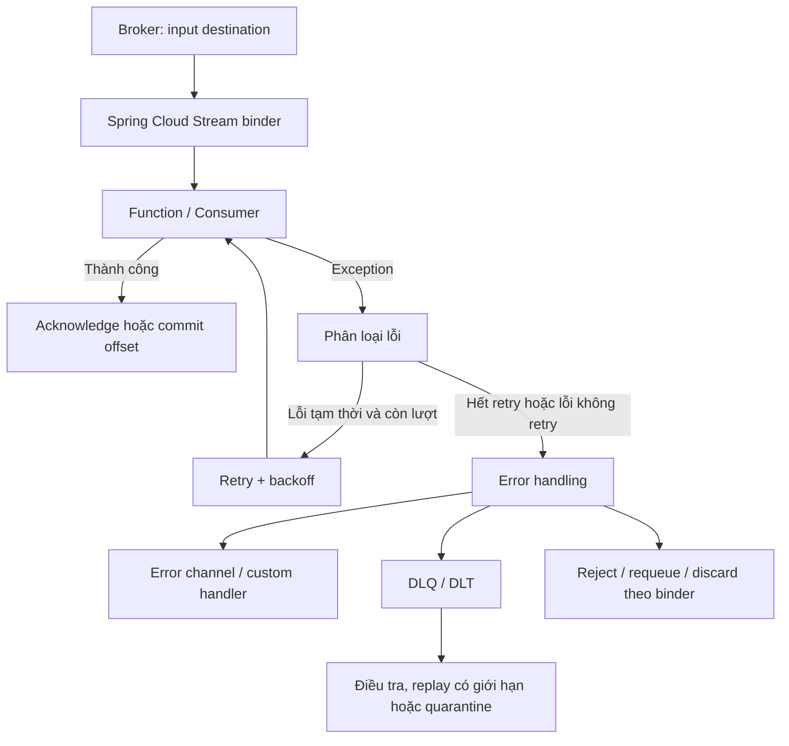
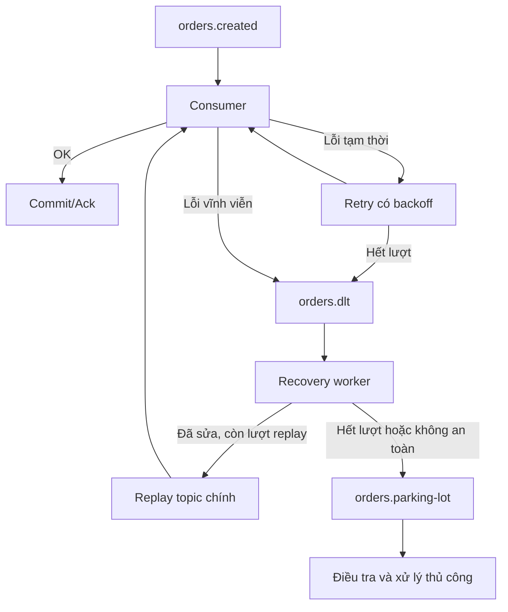

# Kiểm thử thử lại, error handler và đường đưa thông điệp lỗi

Trong một ứng dụng Spring Cloud Stream, hàm xử lý có thể thất bại vì dịch vụ bên ngoài tạm thời không sẵn sàng, dữ liệu đầu vào không hợp lệ, lỗi chuyển đổi schema hoặc lỗi lập trình. Cách ứng dụng phản ứng với từng loại lỗi quyết định message được thử lại, chuyển tới error channel, đưa vào Dead Letter Queue/Dead Letter Topic (DLQ/DLT), hay bị loại bỏ.

Kiểm thử các luồng lỗi cần xác minh cả logic nghiệp vụ lẫn hành vi của binder và broker. Một unit test có thể chứng minh hàm ném đúng exception; một test dùng test binder có thể chứng minh binding hoạt động và output được phát; nhưng chỉ integration test với Kafka, RabbitMQ hoặc Pulsar mới xác minh được việc retry, acknowledgment, redelivery và dead-letter routing theo đúng broker.

## 1. Nhìn toàn bộ đường đi của một message lỗi

Với một consumer xử lý theo kiểu imperative, luồng cơ bản là:

1. Binder nhận message từ broker và chuyển thành Spring `Message` hoặc payload Java.
2. Spring Cloud Function gọi `Consumer` hoặc phần input của `Function`.
3. Nếu hàm hoàn tất bình thường, binder/container xác nhận message theo semantics của broker.
4. Nếu hàm ném exception, cơ chế retry được áp dụng nếu đã cấu hình và được binder hỗ trợ.
5. Nếu retry hết, error handler của binder/container hoặc ứng dụng quyết định message đi đâu.
6. Message có thể được đưa tới DLQ/DLT, một error channel, retry topic, parking-lot/quarantine topic hoặc bị loại bỏ.



Các bước trên là mô hình khái quát. Thứ tự và cơ chế acknowledgment cụ thể phụ thuộc binder, loại consumer, chế độ giao dịch và cấu hình listener container.

## 2. Phân biệt các loại lỗi

Không phải exception nào cũng nên được retry. Trước khi cấu hình, hãy phân loại lỗi theo khả năng tự hết:

| Nhóm lỗi | Ví dụ | Hành động thường phù hợp |
| --- | --- | --- |
| Lỗi tạm thời | HTTP 503, timeout tới payment gateway, database connection reset | Retry có backoff và giới hạn số lần |
| Lỗi dữ liệu vĩnh viễn | Thiếu `orderId`, amount âm, JSON sai cấu trúc | Không retry nhiều lần; chuyển DLQ để điều tra hoặc sửa dữ liệu |
| Lỗi tương thích | Consumer chưa hiểu schema version mới, enum chưa hỗ trợ | Chuyển DLQ hoặc quarantine; sửa code/schema rồi replay có kiểm soát |
| Lỗi cấu hình/hạ tầng kéo dài | Sai credentials, ACL từ chối, topic không tồn tại | Dừng hoặc cảnh báo theo runbook; retry liên tục thường chỉ làm tăng tải và log |
| Lỗi lập trình | `NullPointerException`, invariant bị vi phạm | Cần cảnh báo và giữ message để điều tra; không nên che giấu bằng retry vô hạn |

Retry chỉ hữu ích nếu lần thử tiếp theo có cơ hội thành công. Với lỗi dữ liệu vĩnh viễn, retry lặp lại không làm message hợp lệ hơn.

## 3. Retry trong Spring Cloud Stream áp dụng cho hàm nào?

Spring Cloud Stream hỗ trợ retry theo `RetryTemplate` cho message handler kiểu imperative, chẳng hạn:

```java
@Bean
public Consumer<OrderCreated> processOrder(OrderService orderService) {
    return event -> orderService.process(event);
}
```

Nếu `orderService.process` ném exception, exception được truyền về binder/container để áp dụng cơ chế xử lý lỗi.

Các thuộc tính retry chung được đặt dưới consumer binding:

```yaml
spring:
  cloud:
    stream:
      bindings:
        processOrder-in-0:
          destination: orders.created
          group: order-service
          consumer:
            maxAttempts: 4
            backOffInitialInterval: 500
            backOffMaxInterval: 5000
            backOffMultiplier: 2.0
```

Ý nghĩa:

- `maxAttempts`: tổng số lần gọi handler, bao gồm lần đầu. `4` nghĩa là tối đa một lần đầu và ba lần retry.
- `backOffInitialInterval`: thời gian chờ trước lần retry đầu tiên, tính bằng mili giây.
- `backOffMultiplier`: hệ số nhân khoảng chờ sau mỗi lần thất bại.
- `backOffMaxInterval`: giới hạn trên của khoảng chờ.

Với ví dụ trên, các khoảng chờ dự kiến là 500 ms, 1.000 ms và 2.000 ms; tổng thời gian chờ retry là 3,5 giây, chưa tính thời gian chạy handler. Nếu multiplier tiếp tục làm khoảng chờ vượt 5.000 ms, giá trị sẽ bị chặn ở mức tối đa đó.

Giá trị mặc định phổ biến của consumer properties là `maxAttempts=3`, `backOffInitialInterval=1000`, `backOffMaxInterval=10000` và `backOffMultiplier=2.0`. Hãy cấu hình rõ ràng cho luồng quan trọng thay vì phụ thuộc mặc định, đặc biệt khi binder có thể có thêm retry riêng ở listener container.

## 4. Chọn exception được retry

Mặc định, exception từ listener thường được xem là retryable. Có thể đổi chính sách bằng `defaultRetryable` và map `retryableExceptions`:

```yaml
spring:
  cloud:
    stream:
      bindings:
        processOrder-in-0:
          consumer:
            maxAttempts: 4
            defaultRetryable: false
            retryableExceptions:
              com.acme.payment.PaymentGatewayUnavailableException: true
              com.acme.inventory.InventoryTimeoutException: true
              com.acme.orders.InvalidOrderException: false
              org.springframework.dao.DataIntegrityViolationException: false
```

Trong ví dụ, chỉ hai lỗi hạ tầng được chỉ định mới được retry. Lỗi dữ liệu không hợp lệ và vi phạm ràng buộc database được xử lý ngay theo error route sau lần đầu. Các lớp con của exception được khai báo cũng chịu chính sách tương ứng.

Khi cấu hình `defaultRetryable: true`, các exception không có trong map tiếp tục được retry. Khi đặt `false`, chỉ các exception được đánh dấu `true` mới retry. Hãy dùng tên lớp đầy đủ và kiểm tra exception thực tế được bọc qua những lớp nào; binder có thể nhận một exception wrapper thay vì exception gốc.

## 5. Tùy biến RetryTemplate

Khi các thuộc tính binding chưa đủ, ứng dụng có thể cung cấp `RetryTemplate` tùy chỉnh. Bean được đánh dấu `@StreamRetryTemplate` sẽ được Spring Cloud Stream nhận diện làm template cho retry. Có thể gán template theo tên cho một binding bằng `retry-template-name`.

Ví dụ cấu hình theo binding:

```yaml
spring:
  cloud:
    stream:
      bindings:
        processOrder-in-0:
          consumer:
            retry-template-name: orderRetryTemplate
```

Một `RetryTemplate` tùy chỉnh cho phép định nghĩa retry policy, backoff policy, listener và các quy tắc phục hồi phức tạp hơn. Vì nó có thể thay thế retry template do framework tạo, cần kiểm tra rằng `maxAttempts`, exception classification và recovery callback đang được áp dụng theo đúng ý định.

Không tạo hai lớp retry độc lập mà không tính tổng số lần thử. Ví dụ, nếu binder thử 3 lần và service client bên trong cũng tự retry 3 lần, một message có thể gây tới 9 lần gọi downstream. Hãy xác định một nơi chịu trách nhiệm chính cho retry hoặc tính rõ ngân sách retry toàn tuyến.

## 6. Retry cho reactive function khác imperative function

Một hàm reactive nhận `Flux<T>` không xử lý từng message như một message handler imperative. Vì vậy, các thuộc tính `RetryTemplate`, `maxAttempts`, DLQ và error handler được mô tả cho imperative handler không tự động áp dụng theo cùng cách cho reactive function.

Với reactive function, dùng Reactor operators để mô tả retry theo từng phần tử hoặc theo toàn stream. Nếu muốn retry riêng một sự kiện, đặt retry bên trong `flatMap`/`concatMap`:

```java
@Bean
public Function<Flux<OrderCreated>, Flux<OrderResult>> processOrdersReactive(
        ReactiveOrderService service) {

    return orders -> orders.flatMap(order ->
            Mono.defer(() -> service.process(order))
                    .retryWhen(Retry.backoff(3, Duration.ofMillis(500))
                            .filter(this::isTransientFailure)));
}
```

Ví dụ cần các import Reactor tương ứng và phương thức `isTransientFailure`. `Mono.defer` bảo đảm thao tác được thực hiện lại khi có retry. Nếu đặt `retryWhen` trên toàn `Flux`, một lỗi có thể khiến upstream được subscribe lại và những phần tử trước đó có thể được xử lý lại tùy topology. Vì vậy, hãy quyết định rõ retry theo message hay retry toàn stream và bảo đảm side effect idempotent.

## 7. Error channel và ErrorMessage

Spring Cloud Stream có thể chuyển lỗi tới error channel. Error message thường có payload là exception và giữ tham chiếu tới message ban đầu để ứng dụng biết message nào gây lỗi.

Với consumer có destination và group, error channel dành cho binding thường có dạng:

```text
<destination>.<group>.errors
```

Error channel cũng có thể được bridge tới Spring Integration `errorChannel`. Binder có thể cung cấp error handler riêng để thực hiện hành vi đặc thù như gửi message sang DLQ.

Nếu không có cấu hình xử lý lỗi phù hợp, lỗi có thể chỉ được ghi log rồi message bị loại bỏ. Vì vậy, ghi log không đồng nghĩa message đã được lưu để xử lý lại.

### Custom error handler bằng Consumer<ErrorMessage>

Có thể đăng ký một function nhận `ErrorMessage` và chỉ định nó cho input binding bằng `error-handler-definition`:

```java
import java.util.function.Consumer;

import org.springframework.context.annotation.Bean;
import org.springframework.messaging.Message;
import org.springframework.messaging.support.ErrorMessage;

@Bean
public Consumer<ErrorMessage> orderErrorHandler(FailureStore failureStore) {
    return error -> {
        Throwable cause = error.getPayload();
        Message<?> original = error.getOriginalMessage();

        if (original == null) {
            failureStore.recordHandlerFailure(cause);
            return;
        }

        String eventId = original.getHeaders()
                .get("eventId", String.class);

        failureStore.saveFailure(eventId, original, cause);
    };
}
```

Khai báo handler cho binding:

```yaml
spring:
  cloud:
    stream:
      bindings:
        processOrder-in-0:
          error-handler-definition: orderErrorHandler
```

`FailureStore` là service do ứng dụng triển khai để lưu thông tin lỗi một cách bền vững và idempotent. Handler cần ghi nhận event ID, payload cần thiết, exception, thời điểm, binding/destination và số lần giao nếu có. Không nên chỉ ghi stack trace rồi bỏ message nếu nghiệp vụ yêu cầu phục hồi.

### Custom error handler và DLQ là hai lựa chọn loại trừ nhau

Khi chỉ định `error-handler-definition`, custom handler thay thế các error handler mặc định của framework/binder. Theo đó, cơ chế DLQ do binder cung cấp sẽ không tự chạy, kể cả khi cấu hình DLQ vẫn bật. Nếu custom handler cần đưa message lỗi tới một destination, ứng dụng phải tự thực hiện việc publish, kiểm tra kết quả gửi và xử lý lỗi của chính thao tác publish.

Vì vậy, hãy chọn rõ một trong hai cách:

- Dùng binder DLQ/DLT khi muốn binder/container chịu trách nhiệm dead-letter routing.
- Dùng custom `ErrorMessage` handler khi ứng dụng cần tự lưu trữ, cảnh báo hoặc định tuyến theo logic riêng.

Không cấu hình cả hai rồi giả định chúng sẽ nối tiếp nhau tự động.

## 8. Phân biệt error channel với DLQ/DLT

| Cơ chế | Mục đích | Dữ liệu tồn tại ở đâu? | Ai xử lý tiếp? |
| --- | --- | --- | --- |
| Error channel | Thông báo lỗi trong ứng dụng Spring | Message channel trong runtime ứng dụng | Error handler/service activator hoặc Spring Integration flow |
| DLQ/DLT | Cách ly message thất bại trên broker | Queue/topic bền vững theo cấu hình broker | Consumer phục hồi, công cụ vận hành hoặc quy trình replay |
| Retry topic | Trì hoãn và thử lại sau | Topic/queue trung gian | Consumer retry hoặc broker/client |
| Parking lot/quarantine | Giữ message đã vượt giới hạn hoặc cần can thiệp | Destination riêng trên broker hoặc kho lưu trữ | Quy trình điều tra và phê duyệt thủ công |

Error channel không tự tạo bản lưu bền vững. DLQ/DLT cũng không tự giải quyết lỗi; nó chỉ giữ message để hệ thống khác có thể xử lý sau.

## 9. Cấu hình Kafka binder: retry và Dead Letter Topic

Kafka binder yêu cầu consumer group rõ ràng để bật DLQ. Consumer anonymous không thể dùng tính năng DLQ của Kafka binder.

Ví dụ:

```yaml
spring:
  cloud:
    stream:
      bindings:
        processOrder-in-0:
          destination: orders.created
          group: order-service
          consumer:
            maxAttempts: 4
            backOffInitialInterval: 1000
            backOffMaxInterval: 10000
            backOffMultiplier: 2.0
      kafka:
        bindings:
          processOrder-in-0:
            consumer:
              enable-dlq: true
              dlq-name: orders.created.order-service.dlt
```

Khi retry hết, binder gửi record thất bại tới DLT. Nếu không đặt `dlq-name`, tên mặc định thường theo dạng `error.<destination>.<group>`. DLT mặc định dùng cùng số partition với record gốc, vì vậy topic DLT cần đủ partition hoặc phải cấu hình chiến lược chọn partition khác.

Kafka binder thêm các header hữu ích như topic gốc, exception message và stack trace. Tên header và kiểu giá trị cụ thể phụ thuộc phiên bản binder.

### Một khác biệt quan trọng khi DLQ tắt

Trong Kafka binder, retry có thể được quản lý bởi binder hoặc listener container. Khi DLQ tắt, hành vi retry có thể quay về mặc định của Spring for Apache Kafka container thay vì dùng `maxAttempts` theo cách người đọc mong đợi. Nếu cần tắt retry hoặc tùy biến retry khi DLQ không bật, cần cấu hình `CommonErrorHandler`/`DefaultErrorHandler` qua `ListenerContainerCustomizer` phù hợp với phiên bản. Không suy ra số lần retry chỉ từ một thuộc tính khi chưa xác minh error handler thực tế.

### Chuyển retry/DLQ sang listener container

Kafka binder có `ListenerContainerWithDlqAndRetryCustomizer` để chuyển trách nhiệm retry và DLQ từ binding sang listener container. Cách này hữu ích khi:

- Tổng thời gian retry/backoff có thể vượt `max.poll.interval.ms` và gây rebalance.
- Muốn gửi DLT sang Kafka cluster khác.
- Cần thêm retry listener hoặc dùng `DeadLetterPublishingRecoverer` tùy chỉnh.
- Cần kiểm soát `CommonErrorHandler` ở cấp container.

Khi chuyển sang container, phải cấu hình rõ ai sở hữu retry/DLQ. Không để binder và custom container handler cùng xử lý một record theo hai chính sách độc lập.

### Lỗi gửi producer không tự động thành DLT

Kafka binder có thể gửi lỗi publish bất đồng bộ tới error channel khi bật hỗ trợ tương ứng. Payload lỗi có thể là `KafkaSendFailureException`, chứa `failedMessage` và `ProducerRecord`. Tuy nhiên, lỗi producer không tự động được gửi tới dead-letter topic như lỗi consumer; ứng dụng cần xử lý qua error channel hoặc Spring Integration flow riêng.

## 10. Cấu hình RabbitMQ binder: DLQ, republish và requeue

Rabbit binder có thể tự khai báo DLQ và dead-letter exchange bằng `autoBindDlq`. `republishToDlq` cho phép binder publish lại message lỗi kèm exception metadata.

Ví dụ:

```yaml
spring:
  cloud:
    stream:
      bindings:
        processOrder-in-0:
          destination: orders.created
          group: order-service
          consumer:
            maxAttempts: 4
            backOffInitialInterval: 1000
            backOffMaxInterval: 10000
            backOffMultiplier: 2.0
      rabbit:
        bindings:
          processOrder-in-0:
            consumer:
              auto-bind-dlq: true
              republish-to-dlq: true
              requeue-rejected: false
```

Với cấu hình này, binder tạo DLQ/DLX theo quy ước và republish message sau khi retry hết. Khi `republish-to-dlq` bật, message DLQ có thể chứa exception message và stack trace trong header.

### Tránh vòng lặp requeue vô hạn

`requeue-rejected: true` có thể khiến RabbitMQ đưa message trở lại queue và giao lại liên tục, đặc biệt khi `republish-to-dlq` tắt hoặc retry đã tắt. Điều này có thể tạo vòng lặp nóng, làm tăng CPU, network và log mà không khắc phục được lỗi.

Khi retry bị tắt (`maxAttempts: 1`), cần hiểu rõ `requeueRejected` và dead-letter routing. Với DLQ được cấu hình, `requeueRejected: false` thường cho phép broker chuyển message bị reject sang DLQ. `republishToDlq` có thể gửi message kèm header lỗi ngay cả khi không bật retry.

Rabbit binder không cung cấp một quy trình replay DLQ chung tự động cho mọi ứng dụng. Cần xây dựng consumer phục hồi riêng hoặc dùng công cụ vận hành để xử lý message trong DLQ.

## 11. Cấu hình Pulsar: redelivery, retry letter topic và dead letter topic

Pulsar có cơ chế redelivery, negative acknowledgment, acknowledgment timeout, retry letter topic và dead letter topic ở tầng client/broker. Cấu hình cụ thể phụ thuộc Spring for Apache Pulsar, Spring Boot và Pulsar binder đang dùng.

Spring Cloud Stream Pulsar binder dùng các thành phần của Spring for Apache Pulsar và hỗ trợ các cấu hình Pulsar của Spring Boot. Ví dụ cấu hình consumer ở cấp ứng dụng:

```yaml
spring:
  pulsar:
    consumer:
      retry-enable: true
      dead-letter-policy:
        max-redeliver-count: 5
        retry-letter-topic: persistent://public/default/orders-retry
        dead-letter-topic: persistent://public/default/orders-dlt
```

Đây là cấu hình Spring for Apache Pulsar consumer; nếu ứng dụng có nhiều binding với chính sách khác nhau, xem xét extended binding properties dưới `spring.cloud.stream.pulsar.bindings.<binding-name>.consumer` theo phiên bản binder. Cần xác nhận binder thực sự áp dụng cấu hình đó cho consumer được tạo.

Một số điểm quan trọng của Pulsar:

- Retry letter topic lưu message lỗi để thử lại sau; consumer có thể cấu hình khoảng trễ và số lần thử.
- Dead letter topic lưu message đã vượt giới hạn redelivery để xử lý thủ công hoặc reconciliation.
- Retry letter topic hiện hỗ trợ subscription type `Shared` theo tài liệu Pulsar; kiểm tra subscription type trước khi dùng.
- Bộ đếm redelivery của negative acknowledgment có thể chỉ được giữ trong bộ nhớ và bị reset trong một số tình huống. Với retry cần giới hạn đáng tin cậy, Pulsar khuyến nghị dùng retry letter topic với `enableRetry(true)` và `reconsumeLater` để retry count được lưu trong message property.
- Dead letter policy chỉ phát huy tác dụng khi subscription type và consumer configuration hỗ trợ nó. Không giả định mọi kiểu subscription đều có cùng hành vi.

Pulsar binder không dùng chung tên thuộc tính `enable-dlq` của Kafka. Không sao chép cấu hình Kafka sang Pulsar; hãy dùng Spring Pulsar/Pulsar client properties và integration test với đúng phiên bản broker/client.

## 12. Đưa message lỗi vào parking lot hoặc quarantine

DLQ thường là nơi đầu tiên nhận message hết retry. Một quy trình phục hồi có thể cần thêm parking-lot topic để tránh message lỗi quay lại luồng chính vô hạn.

Ví dụ luồng xử lý:

1. Consumer chính thử xử lý theo retry policy.
2. Hết retry, message vào DLQ.
3. Recovery worker đọc DLQ và kiểm tra nguyên nhân lỗi.
4. Nếu lỗi đã được sửa và message còn lượt replay, worker gửi lại topic gốc hoặc retry topic.
5. Nếu message đã vượt `MAX_REPLAY_ATTEMPTS`, worker chuyển nó tới `orders.parking-lot`.
6. Nhóm vận hành điều tra và quyết định sửa dữ liệu, bỏ message hoặc replay sau phê duyệt.



Mỗi lần replay cần giữ event ID ổn định, tăng replay count và ghi replay request ID. Khi vượt giới hạn, không gửi message về topic chính nữa. Nếu không có bộ đếm bền vững, message lỗi có thể tạo vòng lặp DLT → topic chính → DLT vô hạn.

## 13. Idempotency và duplicate trong retry

Retry tạo ra khả năng một message được xử lý nhiều lần. Ví dụ consumer gọi payment API thành công nhưng process chết trước khi broker nhận acknowledgment; broker có thể giao lại message và payment API bị gọi lần nữa.

Để giảm rủi ro:

- Mỗi event có `eventId` ổn định.
- Lưu dấu event đã xử lý trong inbox table hoặc kho idempotency có unique key.
- Gửi `eventId` làm idempotency key tới dịch vụ bên ngoài nếu API hỗ trợ.
- Chỉ đánh dấu hoàn tất sau khi side effect đã được lưu bền vững.
- Thiết kế transaction giữa database và message broker theo mô hình phù hợp; không giả định acknowledgment tự làm hai hệ thống commit nguyên tử.
- Kiểm thử crash sau side effect nhưng trước acknowledgment.

Một retry thành công không chứng minh message chỉ được xử lý một lần. Hãy kiểm thử cả duplicate và redelivery.

## 14. Kiểm thử logic nghiệp vụ với Test Binder

Test Binder giúp kiểm thử hàm và binding mà không cần kết nối broker thật. Trong Spring Cloud Stream hiện đại, có thể dùng `@EnableTestBinder`, `InputDestination` và `OutputDestination`.

Ví dụ ứng dụng:

```java
@SpringBootApplication
public class OrderApplication {

    @Bean
    public Function<OrderCreated, OrderAccepted> processOrder(
            OrderService service) {
        return event -> service.accept(event);
    }
}
```

Test luồng thành công:

```java
@SpringBootTest(classes = OrderApplication.class)
@EnableTestBinder
class OrderFunctionTest {

    @Autowired
    InputDestination input;

    @Autowired
    OutputDestination output;

    @Test
    void publishesAcceptedOrder() {
        OrderCreated event = new OrderCreated("evt-1", "ord-1");
        input.send(new GenericMessage<>(serialize(event)));

        Message<byte[]> result = output.receive();
        assertThat(result).isNotNull();
        assertThat(deserialize(result.getPayload(), OrderAccepted.class)
                .orderId()).isEqualTo("ord-1");
    }
}
```

`serialize` và `deserialize` là helper của ví dụ; trong dự án có thể dùng JSON mapper, `ObjectMapper` hoặc converter đang cấu hình. Test Binder hữu ích để kiểm tra payload, header và output, nhưng không chứng minh retry, broker acknowledgment, DLQ provisioning hoặc redelivery hoạt động giống Kafka/RabbitMQ/Pulsar.

## 15. Kiểm thử exception classification và custom error handler

Có thể kiểm thử logic phân loại exception độc lập với binder:

```java
class OrderRetryPolicyTest {

    @Test
    void partnerTimeoutIsRetryable() {
        assertThat(isRetryable(new PaymentGatewayUnavailableException()))
                .isTrue();
    }

    @Test
    void invalidOrderIsNotRetryable() {
        assertThat(isRetryable(new InvalidOrderException()))
                .isFalse();
    }
}
```

Với custom error handler, gọi handler bằng một `ErrorMessage` được dựng trong test và xác minh:

- Handler đọc đúng exception payload.
- Handler lấy được original message.
- Event ID và destination được giữ lại.
- Failure store hoặc error destination được gọi đúng một lần theo idempotency key.
- Nếu lưu trữ/định tuyến lỗi, handler không báo thành công khi thao tác lưu trữ thất bại.
- Dữ liệu nhạy cảm không bị ghi vào log hoặc error metadata ngoài chính sách.

Không kiểm tra chỉ bằng cách xác minh logger đã được gọi. Mục tiêu là chứng minh message lỗi được lưu hoặc định tuyến theo yêu cầu nghiệp vụ.

## 16. Integration test với broker thật

Để kiểm thử retry và dead-letter routing, cần chạy broker thật hoặc Testcontainers tương ứng. Mỗi binder có cách xác nhận khác nhau:

| Binder | Môi trường test | Hành vi cần xác minh |
| --- | --- | --- |
| Kafka | Embedded Kafka hoặc Testcontainers Kafka | Consumer group, retry count, offset commit, DLT name/partition, DLT headers, rebalance |
| RabbitMQ | Testcontainers RabbitMQ | Queue/DLX/DLQ provisioning, requeue/reject, republish headers, publisher confirm nếu dùng |
| Pulsar | Testcontainers Pulsar hoặc broker test | Subscription type, redelivery, retry letter topic, dead letter policy, acknowledgment |

Test Binder và broker test có mục tiêu khác nhau. Test Binder xác minh logic hàm; broker integration test xác minh giao thức và semantics giao nhận. Với Kafka, nếu dùng Test Binder thì nó thay thế binder thật trong test context; không thể dùng kết quả đó để kết luận DLT hoặc offset commit hoạt động đúng trên Kafka.

## 17. Ma trận kiểm thử cần có

Một bộ test retry/error route nên bao gồm ít nhất:

| Trường hợp | Kỳ vọng |
| --- | --- |
| Handler thành công ngay lần đầu | Một lần xử lý, không có error route |
| Lỗi tạm thời rồi thành công | Retry theo backoff, sau đó acknowledgment/commit |
| Lỗi tạm thời tới hết `maxAttempts` | Message vào DLQ/DLT hoặc route đã cấu hình |
| Exception được đánh dấu không retryable | Không lặp retry không cần thiết; đi tới error route |
| `maxAttempts: 1` | Không có retry của cơ chế đang được kiểm thử; binder-specific behavior được xác minh |
| Error handler được chỉ định | Handler nhận đúng ErrorMessage và original message |
| Custom handler cùng cấu hình DLQ | Xác minh custom handler thay thế binder handler theo semantics của framework; không giả định DLQ vẫn tự chạy |
| Publish tới DLQ thất bại | Không xác nhận message gốc theo cách gây mất dữ liệu; kiểm tra container/broker thực tế |
| Consumer restart sau side effect trước ack | Duplicate được idempotency xử lý an toàn |
| Replay từ DLQ thành công | Message trở lại luồng đúng và giữ event ID |
| Replay vượt giới hạn | Message đi parking-lot/quarantine, không quay vòng vô hạn |
| Lỗi deserialization trước khi gọi function | Được xử lý bằng cơ chế binder/client phù hợp, không giả định retry của function bắt được |

## 18. Kiểm thử lỗi deserialization và lỗi trước khi gọi function

Không phải mọi lỗi đều phát sinh bên trong `Consumer` hoặc `Function`. Message có thể thất bại trước khi gọi code nghiệp vụ, ví dụ:

- Kafka deserializer không đọc được bytes.
- JSON converter không thể tạo DTO.
- Pulsar schema không tương thích với message.
- Header conversion hoặc type conversion thất bại.

Các lỗi này có thể được xử lý bởi error handler ở tầng binder/client/container thay vì `RetryTemplate` của function. Khi kiểm thử, hãy gửi payload bytes sai định dạng hoặc schema version không hỗ trợ và xác minh message có được log, retry, DLT hoặc quarantine theo chính sách thực tế.

Với Kafka Streams binder, lỗi serde có các handler riêng, ví dụ log-and-fail, log-and-continue hoặc gửi record lỗi tới DLQ theo cấu hình binder. Đây là cơ chế riêng của Kafka Streams binder, không đồng nhất với retry của Spring Cloud Stream imperative consumer.

## 19. Kiểm thử retry có thời gian và tránh test chập chờn

Retry/backoff làm test mất thời gian. Để test ổn định:

- Dùng khoảng backoff ngắn trong profile test nếu mục tiêu chỉ là xác minh số lần thử.
- Dùng `CountDownLatch`, Awaitility hoặc polling có timeout thay cho `Thread.sleep` cố định dài.
- Kiểm tra số lần gọi bằng counter/mock có thread safety.
- Chờ message thực sự xuất hiện ở DLQ thay vì chỉ chờ consumer function kết thúc.
- Dùng group và topic riêng cho mỗi test để tránh dữ liệu cũ làm sai kết quả.
- Đặt timeout đủ lớn cho broker startup và retry schedule nhưng có giới hạn để test không treo.
- Xóa topic/queue test hoặc dùng tên ngẫu nhiên theo test run khi môi trường hỗ trợ.
- Không dùng `maxAttempts` quá lớn để mô phỏng retry dài trong unit test; kiểm tra logic policy riêng.

Ví dụ kiểm tra số lần gọi handler:

```java
AtomicInteger attempts = new AtomicInteger();

Consumer<OrderCreated> handler = event -> {
    int current = attempts.incrementAndGet();
    if (current < 3) {
        throw new PaymentGatewayUnavailableException();
    }
    process(event);
};
```

Unit test có thể xác minh handler logic thất bại hai lần rồi thành công ở lần ba. Integration test mới xác minh binder thực sự gọi handler lại đúng số lần và acknowledgment/DLQ đúng.

## 20. Quan sát retry và đường lỗi trong production

Nên theo dõi các chỉ số sau:

- Số lần retry theo binding và exception class.
- Số message chuyển tới DLQ/DLT theo destination/group.
- Tuổi của message cũ nhất trong DLQ và parking lot.
- Số lỗi được phân loại retryable/non-retryable.
- Số lần redelivery của RabbitMQ/Pulsar hoặc số lần xử lý lại theo metadata.
- Consumer lag và thời gian xử lý trung bình/p95/p99.
- Số lần publish DLQ thất bại.
- Số message bị quarantine và lý do.
- Số duplicate bị idempotency filter loại bỏ.

Log cần có event ID, correlation ID, destination, group, exception type và attempt/replay count nếu có. Tránh log toàn bộ payload nhạy cảm hoặc stack trace lặp lại ở mức ERROR cho mỗi lần retry; có thể log retry ở mức phù hợp và chỉ phát cảnh báo khi hết retry hoặc chuyển DLQ.

## 21. Lỗi thường gặp

| Hiện tượng | Nguyên nhân có thể | Cách xử lý |
| --- | --- | --- |
| Message bị xử lý lại nhiều hơn dự kiến | Retry ở cả binder và HTTP/database client | Tính tổng retry toàn tuyến và chỉ định một lớp retry chính |
| Message bị drop sau khi chỉ thấy log | Không cấu hình DLQ hoặc custom error handler bền vững | Cấu hình dead-letter route hoặc lưu ErrorMessage có xác nhận |
| Custom error handler chạy nhưng DLQ không nhận message | Custom handler thay thế error handler mặc định của binder | Tự publish/lưu message trong custom handler hoặc bỏ custom handler để dùng binder DLQ |
| Kafka `maxAttempts` không có tác dụng như mong đợi | DLQ tắt và retry do container quản lý | Kiểm tra `CommonErrorHandler` và cấu hình container thực tế |
| Rabbit message lặp vô hạn | `requeueRejected=true` hoặc lỗi không được dead-letter | Dùng retry giới hạn, `requeueRejected=false` và cấu hình DLQ |
| Pulsar message redelivery không tới DLQ | Subscription type hoặc retry policy không phù hợp; bộ đếm NACK không bền vững | Kiểm tra Shared subscription và retry letter topic/`reconsumeLater` |
| Error handler producer không chạy | Chưa bật async send error channel hoặc binder không hỗ trợ | Kiểm tra `errorChannelEnabled` và tài liệu binder |
| Test Binder pass nhưng production DLQ không hoạt động | Test Binder không mô phỏng broker semantics | Bổ sung integration test với broker thật |
| Duplicate side effect sau retry | Consumer crash sau side effect nhưng trước ack | Dùng event ID và idempotency/inbox pattern |
| Message sai schema không vào retry policy của function | Lỗi xảy ra trước khi function được gọi | Kiểm thử và cấu hình deserialization/serde error handler riêng |

## 22. Checklist thiết kế và kiểm thử

Trước khi đưa consumer vào production:

1. Phân loại lỗi tạm thời, lỗi dữ liệu và lỗi cấu hình.
2. Đặt `maxAttempts` và backoff rõ ràng theo binding.
3. Cấu hình `retryableExceptions` nếu chỉ một số lỗi được retry.
4. Xác định retry do binder hay listener container quản lý.
5. Chọn error channel/custom handler hoặc DLQ/DLT; hiểu rõ tương tác giữa chúng.
6. Cấu hình group, DLQ destination, partition và quyền publish/consume phù hợp.
7. Thiết kế event ID, idempotency và replay count.
8. Có parking-lot/quarantine cho message vượt giới hạn.
9. Kiểm thử lỗi function, lỗi deserialization và lỗi publish riêng biệt.
10. Chạy integration test với broker thật cho retry, acknowledgment, redelivery và DLQ.
11. Kiểm thử crash window và duplicate.
12. Đặt metric, alert và runbook xử lý DLQ.

## Tài liệu tham khảo

- [Spring Cloud Stream 5.0 — Error Handling](https://docs.spring.io/spring-cloud-stream/reference/5.0/spring-cloud-stream/overview-error-handling.html)
- [Spring Cloud Stream 5.0 — Binding Properties (Retry)](https://docs.spring.io/spring-cloud-stream/reference/5.0/spring-cloud-stream/binding-properties.html)
- [Spring Cloud Stream 5.0 — Kafka Dead-Letter Topic Processing](https://docs.spring.io/spring-cloud-stream/reference/5.0/kafka/kafka-binder/dlq.html)
- [Spring Cloud Stream 5.0 — Kafka Retry and Dead Letter Processing](https://docs.spring.io/spring-cloud-stream/reference/5.0/kafka/kafka-binder/retry-dlq.html)
- [Spring Cloud Stream 5.0 — Kafka Error Channels](https://docs.spring.io/spring-cloud-stream/reference/5.0/kafka/kafka-binder/error-channels.html)
- [Spring Cloud Stream RabbitMQ Binder — Dead Letter Queue and Retry](https://docs.spring.io/spring-cloud-stream-binder-rabbit/docs/current/reference/html/)
- [Spring Cloud Stream 5.0 — Apache Pulsar Binder](https://docs.spring.io/spring-cloud-stream/reference/5.0/pulsar/pulsar_binder.html)
- [Apache Pulsar 5.0 — Retry Letter Topic and Dead Letter Topic](https://pulsar.apache.org/docs/5.0.x/concepts-messaging/)
- [Spring Cloud Stream 5.0 — Testing Applications](https://docs.spring.io/spring-cloud-stream/reference/5.0/spring-cloud-stream.html)

Các default và tên property có thể thay đổi giữa các release train và binder. Trước khi triển khai, đối chiếu tài liệu đúng phiên bản Spring Cloud Stream, Spring Kafka, Spring AMQP, Spring for Apache Pulsar và broker đang sử dụng.

## Kết luận

Retry xử lý lỗi tạm thời; error channel chuyển thông tin lỗi tới handler trong ứng dụng; DLQ/DLT giữ message thất bại trên broker để điều tra hoặc phục hồi. Với imperative function, Spring Cloud Stream có thể dùng `RetryTemplate` và các consumer properties như `maxAttempts`, backoff và `retryableExceptions`. Reactive function cần dùng Reactor retry operators. Kafka, RabbitMQ và Pulsar có cấu hình dead-letter/redelivery riêng, vì vậy không thể dùng một cấu hình chung cho mọi binder. Kiểm thử đầy đủ phải kết hợp unit test, Test Binder và integration test với broker thật, đồng thời xác minh acknowledgment, duplicate, idempotency và đường đưa message lỗi tới nơi lưu trữ cuối cùng.
